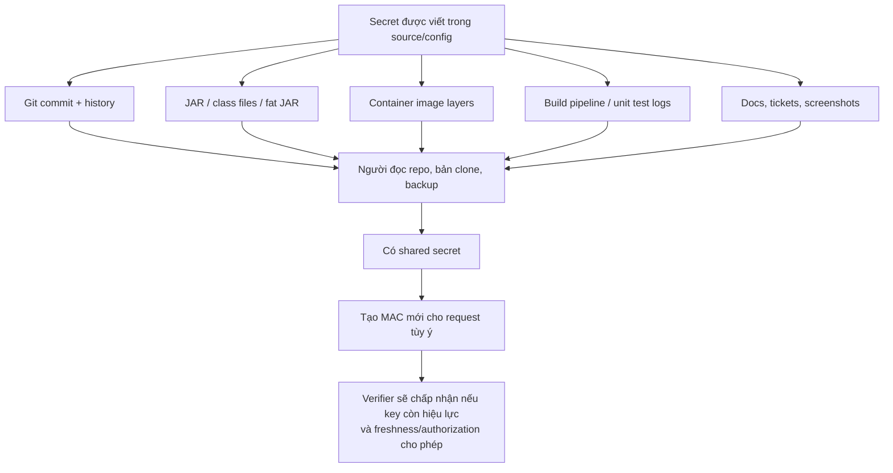
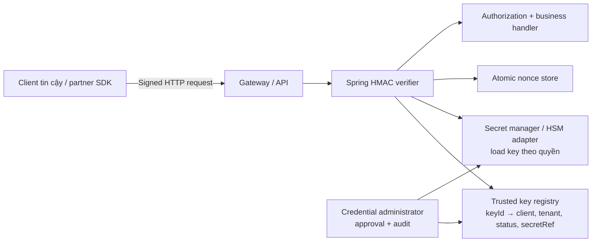
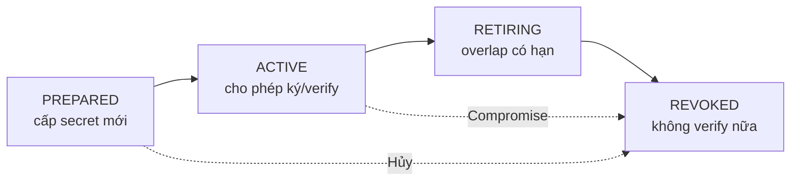

# Hard-code secret: anti-pattern nguy hiểm trong xác thực HTTP request bằng HMAC

## 1. Bối cảnh và mục tiêu

Trong module `SECURITY_AUTHENTICATION_HMAC_REQUEST_AUTHENTICATION`, HTTP client và server dùng một **shared secret** để tạo và kiểm tra HMAC của **canonical request**. Hợp đồng ký có thể bảo vệ HTTP method, URI/query, một số header và body hoặc digest của body. Server còn kiểm tra timestamp/nonce để chống replay, key ID và vòng đời secret để hỗ trợ rotation, xử lý biến đổi qua gateway/proxy, rồi mới dùng danh tính đã xác minh để quyết định **authorization**.

Một lỗi dễ mắc là **hard-code secret**: đặt shared secret trực tiếp trong source Java, file cấu hình commit lên Git, Dockerfile, script build hoặc ứng dụng client phát hành cho người dùng. Hệ thống có thể vượt qua mọi unit test HMAC nhưng vẫn mất khả năng bảo vệ khi người khác đọc được secret. Với shared secret, người có secret có thể tạo một **chữ ký mới** cho request do họ lựa chọn; họ không cần tìm va chạm SHA-256 hoặc sửa một chữ ký có sẵn.

Bài **Hard-code secret** thuộc chương **Anti-pattern HMAC** tập trung vào nguyên nhân, rủi ro, cách phát hiện và cách sửa anti-pattern này trong hệ thống Java/Spring. Người học cần phân biệt việc **không để secret trong mã nguồn** với việc **thực sự quản lý vòng đời secret một cách an toàn**.

Sau bài học, bạn có thể:

- Nhận diện hard-code secret trong Java, Spring configuration, test fixture, build/CI, container image, log và SDK phân phối ra ngoài.
- Giải thích đường tấn công khi attacker đọc JAR, Git history hoặc mobile/web client và lấy được HMAC secret.
- Chọn cách cấp/đọc secret từ nguồn quản lý được bảo vệ, gắn đúng key ID, client/tenant và trạng thái khóa.
- Viết verifier dùng JCA `Mac`, registry và secret provider mà **không đặt secret production trong source**.
- Thực hiện **revoke/rotate** khi secret đã lộ; không nhầm việc xóa dòng code với xử lý xong sự cố.
- Thiết kế unit/integration/CI security tests, observability và runbook để ngăn secret hard-code quay lại.

## 2. Hard-code secret là gì, và có khác hard-code key ID?

Một secret bị **hard-code** khi giá trị có khả năng xác thực thực tế bị nhúng cố định vào artifact hoặc cấu hình không được quản lý như bí mật. Điều này không chỉ giới hạn ở `static final String`.

| Giá trị | Ví dụ | Có nên nằm trong source? | Vì sao |
| --- | --- | --- | --- |
| HMAC shared secret **production** | 32 byte ngẫu nhiên dùng để ký request thật | **Không** | Ai biết secret có thể ký request mới |
| HMAC shared secret **sandbox thật** có quyền với dữ liệu nhạy cảm | Credential của môi trường thử nghiệm kết nối dịch vụ thật | **Không** | Quyền sandbox vẫn có thể bị lạm dụng |
| Key ID | `partner-orders-2026b` | Có thể có trong config/metadata theo policy, **không phải bằng chứng danh tính** | Key ID là khóa tra cứu, không chứa bí mật |
| Algorithm allowlist | `HmacSHA256` | Có | Đây là lựa chọn thuật toán, không phải key material |
| Canonical contract version | `HMAC-REQ-V2` | Có | Quy định cách dựng bytes được ký |
| Secret reference | `vault://integrations/partner-a/key-v2` | Có thể, nếu chỉ là định danh không tiết lộ access token | Không nên nhét credential để truy cập vault vào URL |
| Test-only secret rõ ràng là giả | Vector thuật toán hoặc `new byte[32]` trong test thuần | Có, với phạm vi **chỉ test**, được review | Không được cấp quyền vào hệ thống thật |
| Public API key không dùng để xác thực HMAC | Tên ứng dụng, public client ID | Tùy hợp đồng | Không được gán quyền chỉ bằng giá trị công khai |

Điểm cốt lõi: **key ID không phải shared secret**. Client có thể công khai key ID trong `X-Key-Id`, nhưng server vẫn phải dùng registry đáng tin tìm đúng secret, xác minh MAC, kiểm tra freshness và mới tạo principal.

Một giá trị được “mã hóa Base64”, băm hoặc ghép chuỗi trong code **vẫn là secret hard-code** nếu ứng dụng có thể khôi phục nó để tính HMAC. Obfuscation không biến credential tĩnh thành bí mật.

## 3. Các biểu hiện thường gặp trong Java/Spring

### 3.1. Hằng `static final` trong code

**Không an toàn:**

```java
import java.nio.charset.StandardCharsets;
import javax.crypto.Mac;
import javax.crypto.spec.SecretKeySpec;

public final class BadHmacSigner {
    // Chỉ là chuỗi giả minh họa anti-pattern, không phải secret thật.
    private static final String SHARED_SECRET =
            "DO_NOT_USE_STATIC_DEMO_SECRET_IN_REAL_SYSTEMS";

    public static byte[] sign(byte[] canonicalRequest) throws Exception {
        Mac mac = Mac.getInstance("HmacSHA256");
        mac.init(new SecretKeySpec(
                SHARED_SECRET.getBytes(StandardCharsets.UTF_8),
                "HmacSHA256"));
        return mac.doFinal(canonicalRequest);
    }
}
```

Vấn đề không nằm ở cách gọi `Mac.getInstance`, mà ở `SHARED_SECRET` bị nhúng vào class file/JAR. Biến `private`, `final` hay việc dùng Java module không ngăn người đã có artifact đọc hằng số qua disassembler, decompiler hoặc công cụ xem strings.

### 3.2. Cấu hình Spring có default secret

**Không an toàn:**

```java
// Đừng đưa credential thực vào defaultValue của @Value.
@Value("${integration.hmac.secret:my-production-secret}")
private String sharedSecret;
```

Trong ví dụ trên, `my-production-secret` chỉ là placeholder mô phỏng một cấu hình sai. Nếu secret thật được đưa vào default value thì môi trường quên cấu hình vẫn có thể khởi động bằng cùng một credential cố định.

Một lỗi tương tự:

```yaml
# application-prod.yml bị commit vào repository: KHÔNG ĐƯỢC LÀM.
integration:
  hmac:
    keyId: partner-orders-v2
    secret: "DO_NOT_USE_EXAMPLE_AS_CREDENTIAL"
```

Đặt tên file là `application-prod.yml`, sử dụng một repository riêng hay chỉ ẩn UI không làm nội dung trở thành nơi lưu secret an toàn.

### 3.3. Hard-code trong test và tài liệu rồi bị dùng ở production

Test-only vectors là hợp lệ khi secret hoàn toàn giả và không được registry thật chấp nhận. Rủi ro xuất hiện khi:

- Mã production import lại fixture có `TEST_SECRET` để làm default.
- Một test secret được cấp quyền vào sandbox kết nối dữ liệu thật.
- Ví dụ trong README được copy thẳng vào service mới.
- Test pipeline dùng một secret chung cho tất cả môi trường.
- Snapshot logs hoặc tài liệu chứa giá trị secret thật dù source code không chứa.

**Phân biệt:** một golden vector HMAC với key giả không phải anti-pattern. Anti-pattern là để key có quyền thực tế trở thành tài liệu, fixture hoặc artifact có thể đọc rộng rãi.

## 4. Secret rò rỉ qua nhiều artifact, không chỉ file `.java`



Các nơi phải rà soát:

| Nơi có thể rò | Anti-pattern | Kiểm soát cần có |
| --- | --- | --- |
| Git repository/history | Commit secret rồi xóa ở commit sau | Secret scanning + rotate/revoke + quản lý history/clone |
| JAR/WAR/class file | `static final` hoặc resource properties chứa key | Inject secret ngoài artifact, kiểm tra artifact trước phát hành |
| Dockerfile | `ARG HMAC_SECRET=...` hoặc `ENV HMAC_SECRET=...` | Không đưa secret vào Dockerfile/build arguments/image layers |
| CI/CD | In secret qua `echo`, verbose CLI, exception logs | Secret masking, quyền tối thiểu, không in env/command lines |
| Helm/Terraform | Secret thật trong values, plan, state, user data | Kho secret chuyên dụng; bảo vệ state/plan và RBAC |
| Kubernetes manifest | Commit `Secret.data` Base64 hoặc secret literal | Base64 không mã hóa bảo mật; kiểm soát nguồn và RBAC |
| Logs/APM/traces | Log `X-Signature`, key material, full canonical request | Redaction + audit schema có kiểm soát |
| Client SDK/mobile/web | Nhúng cùng secret trong artifact phát hành cho mọi người | Không thiết kế shared secret cố định trong public client |
| Backup/cache | Secret bản cũ còn trong image, snapshot, cache | Retention, encryption, access review và revocation |

**Docker build argument không phải kho secret.** Các chuỗi truyền qua `ARG`/`ENV` có thể xuất hiện trong metadata, logs, build history hoặc image layers tùy cách build. Khi cần secret lúc build, phải sử dụng cơ chế **build-time secret mount** phù hợp và xác nhận secret không đi vào artifact cuối. Tuy nhiên, hệ thống HMAC ký request thường cần secret **lúc chạy**, không nên nhúng credential thật ở bước build.

## 5. Vì sao secret HMAC bị lộ nguy hiểm hơn lộ key ID?

HMAC dựa trên giả định chỉ những bên được phép biết secret mới có thể tính MAC hợp lệ. Nếu attacker đọc được secret của `partner-a`:

1. Họ có thể tự tạo canonical request mới với method, URI/query và body họ lựa chọn.
2. Họ có thể tự sinh timestamp/nonce mới, tạo HMAC tương ứng.
3. Nếu key chưa bị revoked và request phù hợp contract, verifier có thể xác thực request thành **client A**.
4. Sau đó, authorization chỉ giới hạn attacker ở **quyền client A đã có**; nếu A có `PAYMENT_CREATE`, tác động có thể đáng kể.
5. Rotation/thu hồi và điều tra lịch sử sử dụng key trở nên cần thiết.

Đối với việc **phát lại request đã ký sẵn**, kẻ tấn công không nhất thiết cần secret: họ cần thông điệp, chữ ký và khả năng gửi trong freshness window; timestamp và atomic nonce store là tuyến phòng thủ chống replay. Nhưng khi **secret bị lộ**, attacker có thể tạo request mới với nonce mới. Vì vậy anti-replay **không thay thế** secret management.

HMAC cũng **không tự cấp quyền**. Nếu client đã xác thực không có `ORDER_CREATE` hoặc không có quyền trên tenant khác, `403`/`404` theo policy vẫn phải xảy ra. Hard-code secret không làm biến mất lớp authorization, nhưng có thể làm attacker giả mạo được một client có quyền đã cấp.

## 6. Anti-pattern “đổi tên, encode hoặc chia secret thành nhiều mảnh”

Những kỹ thuật sau **không giải quyết** secret hard-code:

```java
// SAI VỀ MÔ HÌNH QUẢN LÝ SECRET, dù biểu diễn khác:
String keyA = "first-" + "half-" + "second-half";
byte[] keyB = java.util.Base64.getDecoder()
        .decode("RE9fTk9UX1VTRV9BU19TRUFMS0VZ"); // chuỗi demo
String keyC = System.getProperty(
        "hmac.secret", "shared-default-for-all-clients");
```

Với tất cả ví dụ, người đọc code/artifact vẫn có thể tìm hoặc suy ra credential; default chung còn khiến một cấu hình production thiếu secret trở thành một deployment có key yếu và không ai biết.

**“Hash secret rồi lưu hash” không đơn giản áp dụng cho HMAC verification**: server cần vật liệu phù hợp để tính lại HMAC hoặc dùng cryptographic provider giữ key. Không thể thay bằng password-hash theo kiểu xác minh mật khẩu mà không thiết kế lại giao thức.

**Encryption at rest** là kiểm soát bổ sung, không đủ nếu cùng một artifact chứa cả ciphertext lẫn khóa giải mã. Bí mật có thể được lưu dạng ciphertext và giải mã tại runtime bằng KMS/secret manager có quyền riêng; khi đó phải quản lý khóa giải mã, chính sách truy cập và audit độc lập.

## 7. Cách tiếp cận đúng: inject credential theo môi trường và danh tính



**Kiến trúc tách trách nhiệm:**

1. **Key registry** lưu key ID, verified client/tenant mapping, algorithm suite, hiệu lực, trạng thái và **secret reference**, không trả metadata do client tự khai như là sự thật.
2. **Secret manager/KMS/HSM adapter** lấy hoặc sử dụng secret bằng danh tính workload có quyền tối thiểu. Không để application config chứa credential truy cập vault được hard-code.
3. **HMAC verifier** tra **đúng một key ID**, kiểm tra status, dựng canonical request từ request thật, tính MAC và so sánh an toàn.
4. **Freshness guard** xác minh timestamp được ký và claim nonce **atomically** theo verified client scope.
5. **Authorization** lấy principal/authorities từ server policy, không tin `X-Client-Id`/`X-Tenant-Id` tự khai.
6. **Audit/metrics** ghi kết quả, lý do lỗi và request correlation có kiểm soát, không log secret hoặc raw signature.

Một secret có thể nằm trong bộ nhớ tạm thời của process để thực hiện HMAC; điều này **không** giống nhúng secret vào source, nhưng vẫn đòi quyền truy cập, lifecycle và giới hạn retention. Khi provider hỗ trợ key không export, ứng dụng có thể dùng `SecretKey`/crypto provider mà không cần nhận raw bytes; việc có hỗ trợ thực tế tùy dịch vụ và JCA provider.

## 8. Chọn nơi quản lý secret: môi trường, file mount hay secret manager?

| Cách cung cấp | Lợi ích | Hạn chế/rủi ro cần xử lý | Phù hợp khi |
| --- | --- | --- | --- |
| Environment variable tại runtime | Dễ tích hợp, không commit literal trong code | Có thể lộ qua process env, diagnostics, crash reports hoặc quyền host; rotation khó | Môi trường kiểm soát chặt, giải pháp chuyển tiếp có ràng buộc |
| File secret được mount runtime | Phân quyền filesystem, có thể đổi độc lập image | Quyền file, thời điểm refresh, không log/file copy, một số pod cần restart | Orchestrator hỗ trợ secret injection |
| Secret manager qua workload identity | RBAC, audit, rotation version, quản lý tập trung | Dependency availability, network, cache, quyền và chi phí | Dịch vụ production nhiều clients/keys |
| KMS/HSM hoặc crypto provider không export key | Hạn chế key material rời khỏi ranh giới bảo vệ | Tích hợp provider, throughput, latency, thuật toán hỗ trợ, key provisioning | Yêu cầu bảo vệ key cao |
| Secret được commit trong `application.yml` | Đơn giản nhất lúc đầu | **Credential lộ qua repo/artifact** | **Không dùng cho production** |
| Secret hard-code trong `static final String` | Không cần dependency ngoài | **Không có lifecycle/rotation và dễ trích xuất** | **Không dùng cho credential thật** |

**Environment variable không phải phép màu bảo mật.** Nó thường an toàn hơn hard-code vì tách credential khỏi artifact, nhưng vẫn có thể lộ nếu process có quyền bị xâm nhập hoặc logs/diagnostics ghi biến môi trường. Không in `System.getenv()`, không đưa secret vào JVM system properties/command-line flags một cách tùy tiện, và giới hạn ai được xem container/pod/env.

Với orchestrator, tài nguyên có tên “Secret” không tự đảm bảo mã hóa/điều khiển truy cập phù hợp; phải cấu hình encryption at rest khi cần, RBAC, audit, service account scope, namespace isolation và cơ chế refresh thực tế.

## 9. Sinh shared secret bằng entropy đủ mạnh

Đối với `HmacSHA256`, một shared secret gồm **32 byte ngẫu nhiên do CSPRNG tạo** là lựa chọn thông dụng. Secret của mỗi client/key version nên là vật liệu độc lập; không tạo key từ tên tenant, ngày tháng, UUID đoán được hoặc ghép `clientId + "secret"`.

Ví dụ minh họa Java:

```java
import java.security.SecureRandom;
import java.util.Arrays;

byte[] candidate = new byte[32];
new SecureRandom().nextBytes(candidate);

try {
    // Abstraction của hệ thống cấp secret, không phải JDK API.
    provisioningWorkflow.storeNewSecretVersion(
            "partner-orders-2026b", candidate);
} finally {
    // Xóa bản sao tạm; không hứa xóa mọi bản sao trong JVM/provider.
    Arrays.fill(candidate, (byte) 0);
}
```

Trong thực tế ưu tiên tạo secret tại **hệ thống quản lý bí mật** nếu hỗ trợ, cấp quyền và audit đầy đủ. `provisioningWorkflow` trong ví dụ là interface giả định. Đừng chạy đoạn code sinh secret mới mỗi lần service khởi động: client và server phải chia sẻ **một key version ổn định** trong thời gian hiệu lực; mỗi pod tự tạo key ngẫu nhiên riêng sẽ gây lỗi `MAC_MISMATCH` không kiểm soát.

Một secret nên được phân phối cho **đúng các bên tin cậy thực sự cần ký/verify**, qua kênh được xác thực và bảo vệ. Không gửi secret bằng link công khai, email/ticket không có kiểm soát hoặc một URL query.

## 10. Java/Spring: verifier không hard-code secret

Ví dụ dưới đây là khung kiến trúc cho Java 17 + Spring Security. Các interface `KeyRegistry`, `ManagedKeyProvider`, `CanonicalEncoder` và `NonceGuard` là thành phần do ứng dụng triển khai; **đây không phải toàn bộ ứng dụng có thể copy trực tiếp lên production**.

```java
import java.security.GeneralSecurityException;
import java.security.MessageDigest;
import java.time.Clock;
import java.time.Instant;
import java.util.Base64;
import java.util.Optional;
import java.util.regex.Pattern;
import javax.crypto.Mac;
import javax.crypto.SecretKey;
import org.springframework.security.authentication.BadCredentialsException;

public final class ManagedHmacAuthentication {
    public enum KeyState { PREPARED, ACTIVE, RETIRING, REVOKED }

    public record KeyRecord(
            String keyId,
            String verifiedClientId,
            String tenantId,
            String secretRef,
            String algorithm,
            KeyState state,
            Instant notBefore,
            Instant acceptedUntil) {

        public boolean canVerifyAt(Instant now) {
            boolean allowedState =
                    state == KeyState.ACTIVE || state == KeyState.RETIRING;
            return allowedState
                    && !now.isBefore(notBefore)
                    && now.isBefore(acceptedUntil);
        }
    }

    public record SignedRequest(
            String keyId,
            String signatureBase64,
            Instant timestamp,
            String nonce,
            String method,
            String rawTarget,
            String contentType,
            byte[] body) {
        public SignedRequest {
            body = body.clone();
        }
        @Override
        public byte[] body() { return body.clone(); }
    }

    public record VerifiedClient(String clientId, String tenantId) {}

    public interface KeyRegistry {
        Optional<KeyRecord> findByKeyId(String keyId);
    }

    public interface ManagedKeyProvider {
        // Có thể trả key từ vault/secret mount hoặc provider không export.
        SecretKey loadMacKey(String secretRef)
                throws GeneralSecurityException;
    }

    public interface CanonicalEncoder {
        // Hợp đồng phải ký keyId, timestamp, nonce, method,
        // raw URI/query, signed headers và digest của body bytes.
        byte[] encode(SignedRequest request);
    }

    public interface NonceGuard {
        // Chỉ gọi sau MAC hợp lệ. Claim phải atomic và fail closed.
        void validateAndClaim(
                String verifiedClientId,
                Instant signedTimestamp,
                String signedNonce,
                Instant serverNow);
    }

    public static final class HmacDependencyException
            extends RuntimeException {
        public HmacDependencyException(
                String message, Throwable cause) {
            super(message, cause);
        }
    }

    private static final Pattern KEY_ID =
            Pattern.compile("[A-Za-z0-9][A-Za-z0-9._-]{0,63}");

    private final KeyRegistry registry;
    private final ManagedKeyProvider keyProvider;
    private final CanonicalEncoder canonical;
    private final NonceGuard nonces;
    private final Clock clock;

    public ManagedHmacAuthentication(
            KeyRegistry registry,
            ManagedKeyProvider keyProvider,
            CanonicalEncoder canonical,
            NonceGuard nonces,
            Clock clock) {
        this.registry = registry;
        this.keyProvider = keyProvider;
        this.canonical = canonical;
        this.nonces = nonces;
        this.clock = clock;
    }

    public VerifiedClient verify(SignedRequest request) {
        // HTTP parser đã kiểm tra duplicate/malformed headers,
        // body size, request-target, timestamp và nonce syntax.
        if (request.keyId() == null
                || !KEY_ID.matcher(request.keyId()).matches()
                || request.signatureBase64() == null
                || request.signatureBase64().length() > 256) {
            throw new BadCredentialsException("Invalid HMAC credentials");
        }

        Instant now = clock.instant();
        KeyRecord key = registry.findByKeyId(request.keyId())
                .orElseThrow(() -> new BadCredentialsException(
                        "Invalid HMAC credentials"));

        if (!key.canVerifyAt(now)
                || !"HmacSHA256".equals(key.algorithm())) {
            throw new BadCredentialsException("Invalid HMAC credentials");
        }

        final byte[] received;
        try {
            received = Base64.getDecoder()
                    .decode(request.signatureBase64());
        } catch (IllegalArgumentException ex) {
            throw new BadCredentialsException("Invalid HMAC credentials");
        }
        if (received.length != 32) {
            throw new BadCredentialsException("Invalid HMAC credentials");
        }

        // Encoder phải lấy dữ liệu đã parse từ request thực tế,
        // không nhận canonical input do client tự khai.
        byte[] canonicalBytes = canonical.encode(request);
        byte[] expected;
        try {
            SecretKey secretKey =
                    keyProvider.loadMacKey(key.secretRef());
            Mac mac = Mac.getInstance("HmacSHA256");
            mac.init(secretKey);
            expected = mac.doFinal(canonicalBytes);
        } catch (GeneralSecurityException ex) {
            // Lỗi provider/key access khác với MAC không khớp.
            throw new HmacDependencyException(
                    "HMAC key/provider unavailable", ex);
        }
        if (!MessageDigest.isEqual(expected, received)) {
            throw new BadCredentialsException("Invalid HMAC credentials");
        }

        // Freshness phải được thực hiện trước handler/side effect;
        // hạ tầng nonce store lỗi thì không tạo principal.
        nonces.validateAndClaim(
                key.verifiedClientId(),
                request.timestamp(),
                request.nonce(),
                now);

        return new VerifiedClient(
                key.verifiedClientId(), key.tenantId());
    }
}
```

### 10.1. Điều gì làm ví dụ này khác hard-code?

**Không có secret production trong source**. `key.secretRef()` tham chiếu một version bí mật đã đăng ký, còn `ManagedKeyProvider` lấy hoặc sử dụng `SecretKey` tại runtime theo workload identity/policy. Registry chứa mapping tin cậy từ key ID sang client/tenant và lifecycle, **không** lấy client ID từ header rồi tin nó.

**Không có fallback**: nếu request khai key ID B nhưng MAC ký bằng key A, verifier phải `401`; không thử A chỉ để “sửa lỗi”. Nếu key bị `REVOKED`, MAC toán học đúng với secret cũ vẫn bị từ chối.

**Không có mutable `Mac` singleton dùng chung**: mỗi phép verify tạo instance `Mac` cục bộ. `Mac` có trạng thái, không thread-safe khi chia sẻ bừa bãi; cache keyed `Mac` lâu dài còn có nguy cơ giữ secret cũ sau rotation.

**Không bỏ freshness**: các trường timestamp/nonce phải được ký và atomic claim. `NonceGuard` cần sử dụng kho có tính nguyên tử, TTL bao phủ cửa sổ cho phép và xử lý dependency error theo chính sách **fail closed**.

**Không coi `BadCredentialsException` giống lỗi hạ tầng**: MAC sai, key không tồn tại/revoked thường trả `401`; vault/KMS/nonce store unavailable phải trả lỗi server phù hợp, thường `503`, chứ không tự động cho qua hoặc cố dùng fallback secret đã hard-code.

### 10.2. Các ràng buộc production còn phải bổ sung

Ví dụ chưa tự triển khai HTTP parsing, duplicate header detection, nonce storage, request body replay, proxy-aware URI trust, secret cache invalidation, audit redaction hay risk-based rate limiting. Production cần kiểm soát những phần này và test với **bằng chứng thực**; một helper verifier đơn giản không thay thế thiết kế security chain.

`ManagedKeyProvider.loadMacKey` cần phân biệt “key không có hiệu lực” do registry quyết định với “provider không trả lời”; key access lỗi không được biến thành “dùng key test tạm”. Nếu provider trả về `null` hoặc dữ liệu bất thường, implementation phải coi là lỗi hạ tầng/fail closed, không gọi `Mac.init` với một khóa mặc định.

Key cache có thể giảm độ trễ nhưng phải có version, TTL, invalidate và consistency phù hợp để không verify bằng key đã revoke. Khi nghi compromise, cache stale có thể nguy hiểm hơn lỗi availability.

## 11. Spring Boot: inject secret theo runtime, không dùng secret default

Trong Spring Boot, nên cấu hình **reference** hoặc thông tin kết nối tới secret provider, còn workload identity cung cấp quyền truy cập runtime.

```yaml
# application.yml: metadata không nhạy cảm; KHÔNG chứa shared secret.
integration:
  hmac:
    algorithm: HmacSHA256
    required: true
    keyRegistryRef: integrations/hmac/key-registry
    maxClockSkewSeconds: 300
    rejectUnknownKeys: true
    failClosedOnDependencyError: true
```

Đây là ví dụ cấu hình ứng dụng tự định nghĩa, **không phải auto-configuration có sẵn** của Spring Security. Cần validation khi startup: thiếu registry, secret provider hoặc policy không được lặng lẽ chuyển sang secret mặc định, anonymous authentication hay chế độ “test”. Một process có thể không khởi động, hoặc endpoint bảo vệ có thể trả lỗi rõ ràng, thay vì chấp nhận request không xác thực.

Ví dụ **không nên dùng**:

```java
// Không có fallback secret; pattern này nguy hiểm khi dùng key thật.
@Value("${hmac.secret:default-key-shared-with-all-partners}")
String secret;

// Không ghi mọi environment variables để debug:
// log.info("Environment: {}", System.getenv());
```

Với runtime injection:

- Dùng service identity riêng cho từng environment/namespace và cấp quyền `read` tối thiểu cho đúng secret references.
- Đảm bảo secrets không xuất hiện trong `/actuator/env`, `/actuator/configprops`, error pages, diagnostic dumps, log, tracing spans hoặc crash snapshots với quyền truy cập rộng.
- Khi secret mount thay đổi, kiểm tra **cách ứng dụng refresh**; không giả định Spring singleton hoặc client library tự reload file.
- Với HSM/KMS provider, benchmark latency/availability và định nghĩa cache/retry có kiểm soát; lỗi provider phải được phản ánh đúng.
- Tránh biến `@RefreshScope` hoặc restart thành thay đổi policy không được phê duyệt; registry state và key version mới là nguồn sự thật.

**Không hard-code secret cũng chưa đủ nếu mọi service sử dụng cùng một secret.** Mỗi client/key version nên có secret riêng; nếu một client bị lộ, khả năng ảnh hưởng không tự mở rộng tới tất cả đối tác.

## 12. Java web client và SDK: không đóng gói shared secret vào ứng dụng công khai

Một HMAC client **được tin cậy** có thể là service-to-service backend hoặc một agent chạy trên hạ tầng do đối tác kiểm soát. Dù vậy, secret vẫn cần provisioning, lưu trữ và rotation an toàn, không đưa literal vào mã nguồn.

Ngược lại, một ứng dụng **mobile, desktop phân phối công khai hoặc JavaScript trong browser** không thể bảo đảm giữ bí mật chung được nhúng trong package: người dùng có thể đọc file, decompile ứng dụng, debug bộ nhớ hoặc quan sát request. Obfuscation có thể làm khó việc phân tích thông thường nhưng **không tạo ranh giới bảo mật** cho một shared secret được phân phối đến mọi thiết bị.

| Loại client | Cách tiếp cận |
| --- | --- |
| Backend-to-backend do đối tác quản lý | HMAC với key riêng, secret manager và credential provisioning |
| Public web frontend | Không nhúng server HMAC secret; dùng backend tin cậy làm điểm ký hoặc protocol dành cho public clients |
| Mobile app công khai | Không dùng một HMAC secret dùng chung nhúng trong app làm bằng chứng tin cậy; cân nhắc token/user-bound auth, OAuth 2.0/PKCE hoặc mô hình khác phù hợp |
| Agent đặt tại môi trường đối tác | Provision credential riêng, quyền hạn hẹp, rotation/revocation và đánh giá host compromise |
| Máy chủ nội bộ chỉ gọi một dịch vụ | Có thể dùng workload identity/mTLS hoặc HMAC key quản lý ngoài source tùy threat model |

**Nếu một secret đã phát hành tới hàng triệu bản mobile app**, “ẩn chuỗi bằng Base64” không giải quyết vấn đề. Cần xem lại giao thức xác thực và phạm vi tin cậy. Không nên dùng cùng secret global cho mọi installation rồi dựa vào key ID công khai để nhận diện người dùng.

## 13. Secret rotation: phải thay đúng credential, không đổi tên biến

Một key version nên có lifecycle:



Ví dụ:

```text
partner-orders:
  partner-orders-2026a → secret_A → RETIRING đến cutoff T
  partner-orders-2026b → secret_B → ACTIVE

secret_A != secret_B
keyId_A  != keyId_B
verifiedClientId_A == verifiedClientId_B
```

Trong overlap:

1. Server chỉ chấp nhận A khi policy cho phép và trước cutoff; B đã được kích hoạt cho client.
2. Mỗi request nêu **một key ID**, verifier chỉ thử đúng secret/version đó.
3. Client đổi primary signer sang B, tạo timestamp/nonce/MAC mới.
4. Không xóa lịch sử nonce trước khi hết freshness window và không chia scope nonce sai giữa key versions.
5. Tại cutoff, A thành `REVOKED`; request có MAC A **đúng** vẫn phải `401`.
6. Kiểm tra mọi gateway/backend/region đã áp dụng policy; cache stale không được làm A tiếp tục hợp lệ.

**Rotation dự kiến** có thể có thời gian overlap để giảm gián đoạn. **Emergency rotation** do nghi secret bị lộ có thể cần revoke ngay, không cho attacker tiếp tục ký trong grace period. Quyết định phải dựa trên threat model, phê duyệt và yêu cầu incident response.

Không tái sử dụng một secret cho key ID mới rồi tuyên bố đã rotation. Không tái sử dụng key ID cũ với secret mới theo cách khiến audit và caches không phân biệt được version.

## 14. Khi đã commit/lộ secret: phản ứng như sự cố credential

Một git commit chứa secret production là **sự cố cần đánh giá và xử lý**, kể cả khi commit được xóa vài phút sau. Secret có thể đã được clone, cache, mirror, lưu trong CI artifacts, image layers, logs hoặc backup.

### 14.1. Trình tự ứng phó

| Bước | Hành động | Kết quả cần có |
| --- | --- | --- |
| 1. Triage | Xác định secret nào, thuộc client/tenant nào, quyền nào, repository/artifacts nào chứa nó | Phạm vi credential và blast radius |
| 2. Containment | Hạn chế quyền truy cập artifacts, chặn endpoint nhạy cảm khi cần | Giảm khả năng tiếp tục lạm dụng |
| 3. Revoke/rotate | **Vô hiệu hóa key lộ** theo policy và cấp secret **mới thực sự khác** | Key cũ không còn dùng để ký hợp lệ |
| 4. Propagate | Làm mới registry/cache/gateway trên mọi region | Không còn điểm verify dùng key revoked |
| 5. Remediate sources | Xóa literal khỏi source/config/CI/image và xử lý history theo quy trình | Hạn chế tiếp tục lộ trong artifacts |
| 6. Investigate | Rà auth audit, request hợp lệ bất thường, client quyền nhạy cảm, downstream side effects | Đánh giá lạm dụng có xảy ra hay không |
| 7. Verify | Test với MAC **đúng bằng key cũ** phải `401`; key mới hoạt động đúng | Bằng chứng khắc phục, không chỉ báo cáo miệng |
| 8. Prevent | Bổ sung scanning, policy review, owner và runbook | Giảm khả năng tái diễn |

**Điều cần nhấn mạnh:** xóa secret khỏi commit hiện tại, force-push xóa Git history hoặc xóa một image **không làm key đã lộ trở lại bí mật**. Key đã được cung cấp cho người có thể đọc nó cần được coi là có thể bị sao chép. Phải **revoke/rotate** trước khi tuyên bố xử lý xong, theo mức độ rủi ro và kế hoạch phục hồi.

### 14.2. Incident timeline và privacy

Trong điều tra, ghi lại thời điểm secret xuất hiện, phạm vi truy cập, thời điểm revoke có hiệu lực, client/route/region chịu ảnh hưởng, kết quả E2E và tác động nghiệp vụ. Không paste secret thật vào incident ticket để “mọi người cùng kiểm tra”. Có thể dùng **secret reference/key version** và một dấu vết chứng minh bằng metadata, trong khi credential được xử lý qua công cụ chuyên dụng và có audit.

Việc key bị lộ **không tự chứng minh** đã có request giả mạo. Ngược lại, không thấy request bất thường trong logs **không chứng minh** key an toàn. Cần đánh giá window, data retention, độ phủ audit, quyền của client và downstream side effects.

### 14.3. Sau rotate vẫn phải giữ chống replay

Key cũ có thể đã ký các request nằm trong timestamp window; key mới có thể được dùng để retry cùng một nghiệp vụ. Nonce scope theo **verified client** nên không bị “reset” chỉ vì key ID đổi nếu contract yêu cầu uniqueness xuyên versions. Dùng atomic nonce store và idempotency ledger theo hai mục đích khác nhau.

Nếu nonce store lỗi, không bỏ replay defense để giải quyết sự cố lộ secret. Đó có thể làm gia tăng cơ hội phát lại những message đã bị attacker quan sát.

## 15. CI/CD: kiểm tra secret trước khi nó đi vào artifact

Một defense-in-depth pipeline có thể gồm:

1. **Pre-commit scan** các mẫu credential và nội dung entropy cao trong code/config, kèm allowlist cho golden test vectors giả.
2. **Server-side repository scan** mọi commit/pull request và cả Git history khi tiếp nhận repository mới.
3. **Build artifact scan** JAR/WAR, resources, container image/layers và configuration bundles.
4. **IaC/config scan** Helm/Kubernetes/Terraform để tránh literal secret và state artifacts bị lộ.
5. **CI log redaction test** kiểm tra verbose build, crash dumps, failure traces không in credential.
6. **Policy gate** yêu cầu secret reference/provisioning thông qua kênh được phê duyệt và reviewer xác nhận không chứa credential thật.
7. **Incident procedure** khi scanner phát hiện secret có thể thật: không đưa lại literal vào issue, chuyển tới xử lý/rotate.

Regex và entropy scanner có false positives và false negatives. Một chuỗi Base64 bất thường có thể chỉ là test vector; một secret tĩnh có định dạng “từ bình thường” có thể lọt qua scanner. Vì vậy scanning cần kết hợp review, artifact inspection và kiểm soát quyền truy cập.

### 15.1. Ví dụ policy scan cho Java/Spring

Một rule heuristic có thể đánh dấu:

```text
private static final String ...SECRET... = "..."
@Value("${hmac.secret:...}")
integration.hmac.secret: ...
ENV HMAC_SECRET=...
ARG HMAC_SECRET=...
System.out.println(System.getenv(...))
log.info("secret={}", ...)
```

Những rule này **không đủ** để kết luận mọi trường hợp là secret thật; scanner phải hỗ trợ context, allowlist có review và xử lý phát hiện mà không sao chép key ra dashboard. Không dựa duy nhất vào tên biến: một literal key có thể tên là `payloadSalt` hoặc `clientConfig`.

**Không chạy job CI lấy secret thật ra in hex/Base64 chỉ để test khả năng phát hiện.** Dùng dữ liệu giả được cấu hình rõ, kiểm tra policy với fixture không có quyền thực tế.

## 16. Kiểm thử Java/JUnit cho secret lifecycle và verifier

Để tránh test “xanh giả”, phải dùng **test secrets riêng**, fixed `Clock` và một test registry chứa key version còn hiệu lực. Không dùng key production hoặc bỏ security filter vì test khó chạy.

### 16.1. Test state đơn giản, độc lập vault

```java
import static org.junit.jupiter.api.Assertions.assertFalse;
import static org.junit.jupiter.api.Assertions.assertTrue;
import java.time.Instant;
import org.junit.jupiter.api.Test;

class KeyLifecyclePolicyTest {
    private static final Instant START =
            Instant.parse("2026-11-01T00:00:00Z");
    private static final Instant CUTOFF =
            Instant.parse("2026-12-01T00:00:00Z");

    private ManagedHmacAuthentication.KeyRecord key(
            ManagedHmacAuthentication.KeyState state) {
        return new ManagedHmacAuthentication.KeyRecord(
                "partner-orders-2026a",
                "partner-orders",
                "tenant-a",
                "vault://test/partner-orders-2026a",
                "HmacSHA256",
                state, START, CUTOFF);
    }

    @Test
    void activeOrRetiringMustStillRespectCutoff() {
        assertTrue(key(ManagedHmacAuthentication.KeyState.ACTIVE)
                .canVerifyAt(CUTOFF.minusSeconds(1)));
        assertFalse(key(ManagedHmacAuthentication.KeyState.ACTIVE)
                .canVerifyAt(CUTOFF));
        assertTrue(key(ManagedHmacAuthentication.KeyState.RETIRING)
                .canVerifyAt(CUTOFF.minusSeconds(1)));
    }

    @Test
    void revokedMustNeverVerifyEvenBeforeCutoff() {
        assertFalse(key(ManagedHmacAuthentication.KeyState.REVOKED)
                .canVerifyAt(CUTOFF.minusSeconds(10)));
        assertFalse(key(ManagedHmacAuthentication.KeyState.PREPARED)
                .canVerifyAt(CUTOFF.minusSeconds(10)));
    }
}
```

Test này kiểm tra **policy thời gian/trạng thái**, chưa chứng minh secret provider không bị hard-code và MAC được verify đúng. Tên `vault://test/...` chỉ là reference giả, không phải kết nối tới một vault thật.

### 16.2. Test revoked key không được đưa đến provider

Với Mockito:

```java
@Test
void revokedKeyRejectedBeforeSecretProviderCall() {
    Instant now = Instant.parse("2026-11-28T00:00:00Z");
    ManagedHmacAuthentication.KeyRecord revoked =
            new ManagedHmacAuthentication.KeyRecord(
                    "partner-orders-2026a",
                    "partner-orders", "tenant-a",
                    "vault://test/key-a",
                    "HmacSHA256",
                    ManagedHmacAuthentication.KeyState.REVOKED,
                    now.minusSeconds(3600),
                    now.plusSeconds(3600));

    ManagedHmacAuthentication.KeyRegistry registry =
            keyId -> java.util.Optional.of(revoked);
    ManagedHmacAuthentication.ManagedKeyProvider provider =
            org.mockito.Mockito.mock(
                    ManagedHmacAuthentication.ManagedKeyProvider.class);
    ManagedHmacAuthentication.CanonicalEncoder encoder =
            request -> new byte[0];
    ManagedHmacAuthentication.NonceGuard nonceGuard =
            (client, ts, nonce, serverNow) -> {};

    var verifier = new ManagedHmacAuthentication(
            registry, provider, encoder, nonceGuard,
            java.time.Clock.fixed(now, java.time.ZoneOffset.UTC));
    var request = new ManagedHmacAuthentication.SignedRequest(
            "partner-orders-2026a",
            "AAAAAAAAAAAAAAAAAAAAAAAAAAAAAAAAAAAAAAAAAAA=",
            now, "nonce-test-0001", "POST",
            "/integrations/orders", "application/json",
            "{}".getBytes(java.nio.charset.StandardCharsets.UTF_8));

    org.junit.jupiter.api.Assertions.assertThrows(
            org.springframework.security.authentication.BadCredentialsException.class,
            () -> verifier.verify(request));
    org.mockito.Mockito.verifyNoInteractions(provider);
}
```

Test dùng literal signature **giả** vì nhánh `REVOKED` phải chặn **trước khi nạp secret và so MAC**. Khi muốn chứng minh cutoff thực sự reject một MAC hợp lệ, phải tạo chữ ký đúng bằng secret test nhưng đặt key state `REVOKED`, rồi assert `401` và không có side effect trong integration test.

### 16.3. Test provider unavailable phải fail closed

Với mock `ManagedKeyProvider` ném `GeneralSecurityException`, key ACTIVE và signature đúng định dạng, xác nhận verifier không trả `VerifiedClient`; exception hạ tầng được map thành `503` theo HTTP contract. Không dùng `catch (Exception) { return true; }`, không thử `DEFAULT_SECRET` và không đặt `SecurityContext` thành authenticated.

**Giới hạn của ví dụ:** một mock verifier unit test không đảm bảo header parsing thật, canonical bytes, HTTP status mapping, nonce atomicity và gateway behavior. Những phần này cần integration và E2E.

## 17. Spring MVC/WebFlux và kiểm thử end-to-end

### 17.1. Spring MVC

Với `OncePerRequestFilter`/`AuthenticationProvider`, pipeline cần:

1. Parse đúng một `X-Key-Id`, `X-Timestamp`, `X-Nonce`, `X-Signature` và signed headers theo contract; reject duplicate.
2. Tra registry và chỉ nhận key state còn hiệu lực.
3. Nạp/sử dụng secret từ provider qua workload identity, không đọc một hằng production.
4. Dựng canonical bytes từ request thật, tính HMAC-SHA-256, so đầy đủ MAC bằng `MessageDigest.isEqual`.
5. Kiểm tra timestamp/nonce, claim nguyên tử trước khi gọi controller.
6. Tạo `Authentication` từ verified client/tenant và authorities của server policy.

Test với `@SpringBootTest` + `@AutoConfigureMockMvc(addFilters = true)`, không dùng `@WithMockUser` cho endpoint cần HMAC. Assert **positive control** có key test ACTIVE đúng MAC/nonce, rồi negative tests với wrong key ID, revoked key, missing secret provider, replay, body tamper và cross-tenant access.

### 17.2. Spring WebFlux

Với `AuthenticationWebFilter`/`ReactiveAuthenticationManager`, secret provider và nonce store nên có API non-blocking hoặc offload blocking có kiểm soát. Không `block()` hoặc `subscribe()` thủ công trong `WebFilter`; chỉ cho downstream xử lý sau khi verify MAC + nonce claim hoàn tất.

Test với `WebTestClient` và `SecurityWebFilterChain` thật, bao gồm concurrent requests, lỗi vault/nonce store, body `DataBuffer`, release/replay và chính sách authorization. Hệ thống không được bỏ qua HMAC khi provider trả timeout trong reactive pipeline.

### 17.3. Gateway/proxy là điểm cần kiểm chứng riêng

Nếu gateway rewrite `/public-api/orders` thành `/integrations/orders`, client và verifier phải đồng ý canonical request bảo vệ **external hay internal request-target** theo trust boundary. Không bỏ URI khỏi MAC để “khắc phục” mismatch. Không tin `X-Verified-Client` bên ngoài và không để một đường backend trực tiếp dùng secret hard-code legacy.

Khi gateway đã xác minh HMAC, identity assertion tới backend phải được bảo vệ bằng mTLS/signed internal assertion hoặc cơ chế tương đương. Nếu backend verify, các signed header/body bytes phải được bảo toàn theo contract qua HTTP/1.1, HTTP/2/HTTP/3 khi được hỗ trợ.

## 18. Error semantics và quan sát hệ thống

| Trường hợp | HTTP thường dùng | Hành vi đúng |
| --- | --- | --- |
| Key ID không tồn tại, key revoked, MAC sai | `401 Unauthorized` | Không tạo principal, không dùng fallback secret |
| Thiếu/duplicate HMAC credentials | `401` hoặc `400` theo parser/contract | Reject, không chọn tùy ý first/last |
| Timestamp sai, nonce replay | `401` | Không bỏ freshness |
| Vault/KMS/secret provider unavailable | Lỗi server phù hợp, thường `503` | Fail closed, không dùng secret hard-code |
| Nonce store unavailable | `503` hoặc lỗi hạ tầng phù hợp | Không gọi controller |
| MAC đúng nhưng thiếu authority | `403 Forbidden` | Authentication không thay authorization |
| Client có MAC đúng nhưng truy cập tenant khác | `403` hoặc `404` theo policy | Không lộ tài nguyên tenant khác |
| Rate limit khi dò key ID | `429 Too Many Requests` | Không tiết lộ trạng thái key |

Đối với `401`, HTTP authentication challenge `WWW-Authenticate` phải phù hợp với scheme đã công bố; nếu hệ thống có HMAC scheme tự định nghĩa, hãy đặc tả nó thay vì trả `Bearer` cho endpoint không hỗ trợ Bearer.

Các metric gợi ý:

- `hmac_auth_attempts_total` phân theo outcome và route template.
- `hmac_auth_failures_total` với reason `mac_mismatch`, `key_unusable`, `timestamp_invalid`, `nonce_replay`.
- `hmac_auth_dependency_errors_total` phân loại key store và nonce store.
- `hmac_auth_verification_seconds` để phát hiện độ trễ provider khi chuyển khỏi hard-code.
- Audit `hmac.auth.success` gắn **verified client reference**, key version và policy version có kiểm soát.

Không đưa raw secret, signature, nonce, request ID, raw URI/query hoặc client ID cardinality cao vào Prometheus labels. Log lỗi “key not found” không nên trả danh sách các key đang tồn tại cho bên gọi. Một attempt thất bại không tự xác minh danh tính client chỉ vì có header key ID.

### 18.1. Khi chuyển sang secret manager, nhìn thêm availability

Secret provider là một dependency mới (hoặc nay được quản lý chính thức). Cần:

- Alert cho key store unavailable, permission denied, quota/timeout và cache stale.
- Đo p95/p99 verification latency và cân nhắc caching có giới hạn với revocation semantics.
- Không để một API provider lỗi làm verifier lấy key default/bỏ MAC.
- Bảo đảm secret rotation được propagate tới tất cả vùng và các ứng dụng dùng đúng key version.
- Alert nếu có pod vẫn xác thực bằng key đã revoked sau cutoff.

Quản lý bí mật tốt không đòi gọi vault qua mạng cho **mỗi request** khi tải lớn; có thể dùng cache hoặc crypto provider thích hợp, nhưng phải giữ ràng buộc quyền truy cập, thời hạn, refresh và thu hồi.

## 19. Ma trận kiểm thử anti-pattern “Hard-code secret”

| # | Test | Kỳ vọng |
| --- | --- | --- |
| 1 | Scan source Java/config/CI/image | Không có production shared secret trong artifact |
| 2 | Xóa/mất secret configuration bắt buộc | Startup fail hoặc endpoint fail closed; không dùng default |
| 3 | Key ID hợp lệ, provider trả đúng test secret | HMAC positive control thành công |
| 4 | Key ID không có trong registry | `401`, không load secret khác |
| 5 | Key A có thật nhưng MAC ký bằng key B | `401`, không fallback |
| 6 | Key `REVOKED`, MAC toán học đúng | `401`, không gọi nghiệp vụ |
| 7 | Secret provider timeout | `503` hoặc error server phù hợp, fail closed |
| 8 | Secret provider trả null/invalid key | Fail closed, không lấy test/default key |
| 9 | Key mới `ACTIVE`, key cũ `RETIRING` | Chỉ đúng version được khai và còn trong window |
| 10 | Key cũ sau cutoff | `401` ở mọi ingress, kể cả cache nóng |
| 11 | Timestamp ngoài allowed skew | `401` dù MAC đúng |
| 12 | Gửi lại cùng signed request/nonce | `401` lần sau, không duplicate side effect |
| 13 | Nonce store unavailable | Fail closed, không chuyển thành success |
| 14 | Ký v2 rồi sửa method/URI | `401` nếu protected fields thay đổi |
| 15 | Ký body rồi đổi body byte | `401`, digest/MAC mismatch |
| 16 | Hai `X-Key-Id` hoặc signature headers | Reject ambiguity |
| 17 | Signed request qua gateway rewrite | HMAC theo đúng contract hoặc reject, không bỏ signed fields |
| 18 | MAC đúng nhưng client thiếu `ORDER_CREATE` | `403`, không side effect |
| 19 | MAC đúng, client truy cập tài nguyên tenant khác | `403`/`404` theo policy |
| 20 | CI log hoặc failure stack | Không lộ raw shared secret/expected MAC |
| 21 | Public client/mobile được phân phối | Không chứa shared server secret dùng chung |
| 22 | Deploy region mới sau rotate | Không tự khôi phục hard-coded default secret |
| 23 | Redis/key-store failover | Không nhận key revoked hoặc nonce replay ngoài policy |
| 24 | Secret hard-code phát hiện trong Git history | Incident/rotation được kích hoạt; không chỉ xóa commit |

**Test pass không chỉ là “scanner không tìm ra chuỗi SECRET”.** Phải có positive HMAC test qua security chain thật, test revoked key và provider outage, kiểm tra build artifacts cùng runtime config, và chứng minh không còn đường xác thực bằng key lộ.

## 20. Runbook thay thế secret hard-code trong hệ thống đang chạy

Một quy trình migration an toàn:

| Pha | Việc cần làm | Bằng chứng hoàn thành |
| --- | --- | --- |
| 1. Inventory | Xác định secret hard-code, artifact/repository, owners, clients, scopes | Danh sách key/client/route bị ảnh hưởng |
| 2. Risk triage | Xác định secret đã lộ hay chỉ ở kho kiểm soát, quyền và dữ liệu | Quyết định rotation hay emergency revoke |
| 3. Prepare provider | Thiết lập secret manager/workload identity, RBAC/audit | Ứng dụng có thể đọc key đúng mà không hard-code |
| 4. New key version | Tạo secret **mới** khác secret cũ, key ID mới | Provisioning và registry metadata đúng |
| 5. Deploy verifier | Chọn đúng keyRef/key ID, MAC/freshness/authorization | Unit/integration/gateway tests PASS |
| 6. Migrate clients | Chuyển signer theo cohort hoặc khẩn cấp theo risk | Verified new-key traffic được đo |
| 7. Cutoff old key | Revoke key cũ; invalidate caches, gateway, regions | Valid old MAC bị `401` mọi nơi |
| 8. Remove exposure | Gỡ hard-code khỏi source/config/image/CI, xem xét Git history/backup | Scanner và artifact review PASS |
| 9. Verify recovery | Không còn abuse, business side effects đã đối soát | Incident/change record có evidence |
| 10. Prevent regression | Policy gate, owners, alerts, secure onboarding | Không tái phát cùng anti-pattern |

### 20.1. Rollback không đồng nghĩa bật lại secret lộ

Trong planned migration khi chưa nghi compromised, key cũ có thể được dùng đến cutoff được duyệt. Nhưng nếu secret cũ đã lộ, rollback bằng cách tái bật nó làm **mất tác dụng containment**. Có thể rollback code triển khai provider nếu vẫn áp dụng policy cấm key cũ; khi không có signing profile an toàn, endpoint nhạy cảm phải fail closed hoặc tạm ngừng theo incident plan.

Đừng thay một secret hard-code bằng **một secret mới hard-code**. Cách đó chỉ đặt lịch cho sự cố tiếp theo.

## 21. Bài thực hành: tìm và sửa hard-code secret trong Spring HMAC

Giả lập hai API:

- `GET /integrations/orders/{id}` yêu cầu `ORDER_READ`.
- `POST /integrations/orders` yêu cầu `ORDER_CREATE`.

Hai clients:

- `partner-reporting` thuộc `tenant-a`, có `ORDER_READ`.
- `partner-fulfillment` thuộc `tenant-b`, có `ORDER_READ` và `ORDER_CREATE`.

Phạm vi thực hành:

1. **Tạo project test cô lập** với một class `BadHmacSigner` hard-code secret giả, một `application-test.yml` có literal giả và một scanner cấu hình để phát hiện.
2. **Giải thích exploit path**: ai đọc được JAR/Git có thể dùng key giả tạo MAC cho request mới trong môi trường test; không dùng production secret.
3. **Thay literal** bằng key registry trả `secretRef` và `ManagedKeyProvider` sử dụng test secret manager hoặc stub có giới hạn.
4. **Viết HMAC verifier** chọn đúng key ID, lifecycle, thuật toán allowlisted; canonical ký method, URI/query, key ID, timestamp, nonce, signed headers và body hash.
5. **Tạo golden HMAC vector** với key test độc lập; kiểm tra `HmacSHA256` trả MAC đúng với canonical bytes.
6. **Test thiếu cấu hình/provider outage**: không được khởi động bằng secret default; không cấp principal khi provider unavailable.
7. **Thử đổi key ID sau ký** và sai secret: `401`, không fallback sang version khác.
8. **Mô phỏng rotation**: key A RETIRING, key B ACTIVE; sau cutoff A REVOKED; request MAC A đúng vẫn bị `401`.
9. **Dùng `MockMvc` hoặc `WebTestClient`** để kiểm tra security chain thật, MAC đúng, nonce replay, `403` nếu thiếu authority và cross-tenant denial.
10. **Chạy E2E qua gateway**: kiểm tra path rewrite, header forwarding, body bytes và không có route legacy dùng secret hard-code.
11. **Scan build artifacts**: class/JAR, container image, config và CI logs không chứa literal test bí mật ngoài test fixtures có chủ đích.
12. **Lập runbook giả lập secret leak**: inventory, containment, revoke/rotate, propagation, audit và hậu kiểm.

### Câu hỏi tự kiểm tra

**1. Vì sao `private static final String SECRET` vẫn là hard-code?** Vì `private` chỉ giới hạn truy cập ở mức mã Java, không che được literal khỏi người đọc class/JAR hoặc source.

**2. Đưa secret vào Base64 trong code có an toàn hơn không?** Không. Base64 là encoding, không phải quản lý bí mật. Bất kỳ ai đọc artifact đều có thể decode.

**3. Environment variable có tự động an toàn tuyệt đối không?** Không. Nó tách credential khỏi artifact nhưng vẫn có thể lộ qua quyền host/process, logs, crash dumps hoặc sai cấu hình; cần RBAC và redaction.

**4. Lộ key ID có đồng nghĩa lộ secret không?** Không. Key ID là lookup hint. Nhưng đừng để client tự khai key ID rồi tạo principal trước khi xác minh HMAC.

**5. Xóa commit chứa secret có làm secret an toàn trở lại không?** Không. Secret có thể đã được clone/lưu trong artifacts; cần đánh giá rủi ro, revoke/rotate và đối soát.

**6. Nếu key manager lỗi, có thể dùng DEFAULT_SECRET cho tất cả clients không?** Không. Đó là đường bypass và credential chung; phải fail closed và xử lý dependency.

**7. Khi key bị revoke, MAC cũ đúng có được xác thực không?** Không. Lifecycle policy phải từ chối trước business side effect.

**8. Có thể nhúng một shared HMAC secret duy nhất vào mobile app công khai không?** Không nếu kỳ vọng nó luôn bí mật. Cần thiết kế lại ranh giới tin cậy và cơ chế xác thực phù hợp public client.

**9. Nonce store có thay thế quản lý secret không?** Không. Nonce chống replay của thông điệp cũ; người có secret có thể ký message mới với nonce mới.

**10. HMAC đúng có đồng nghĩa được phép truy cập mọi tenant không?** Không. Sau authentication phải kiểm tra authorities/tenant ownership theo server policy.

## 22. Ghi nhớ

**Hard-code secret làm suy yếu chính giả định bảo mật của HMAC: shared secret chỉ được biết bởi các bên được ủy quyền.** Đừng giấu credential thật trong `static final`, Spring default values, Git, Dockerfile, CI logs, mobile/web client hoặc mã hóa Base64. Hãy tạo secret ngẫu nhiên có entropy đủ mạnh, lưu tại nơi quản lý bí mật, inject theo workload identity và tra qua registry gắn key ID/client/tenant/lifecycle.

Khi phát hiện secret bị lộ, **xóa dòng code là chưa đủ**: cần đánh giá tác động, cấp credential mới, revoke key cũ, cập nhật mọi ingress/cache và chủ động chứng minh **MAC của key cũ bị từ chối**. Trong mọi giai đoạn vẫn phải bảo vệ canonical method/URI/signed headers/body, timestamp/nonce chống replay, key rotation và **authorization** độc lập. Một thiết kế đúng sẽ **fail closed** khi không thể kiểm chứng credential, thay vì giữ một secret hard-code dự phòng để request luôn “thành công”.
