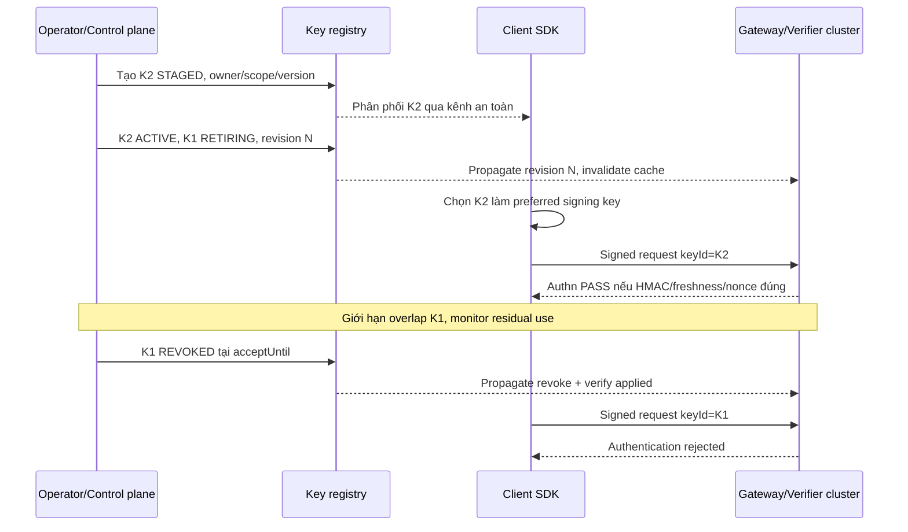
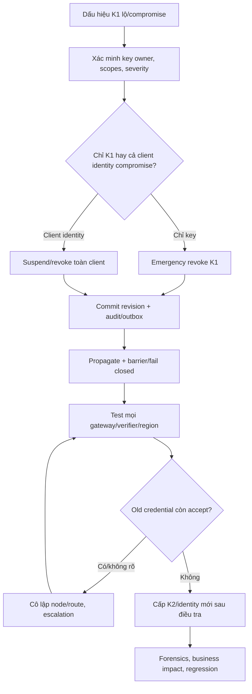
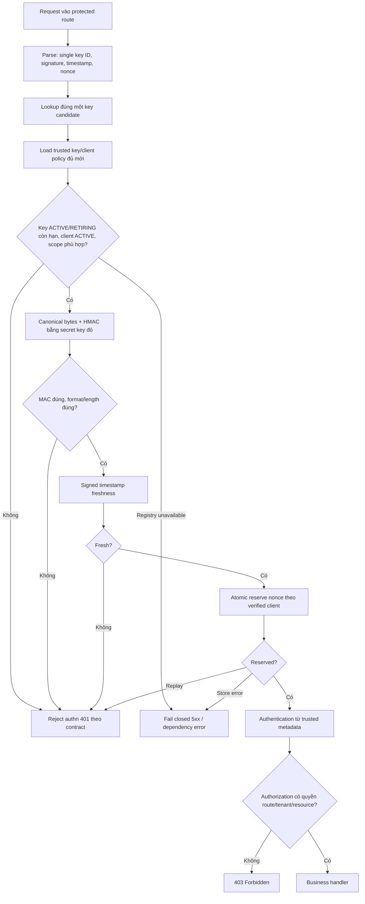
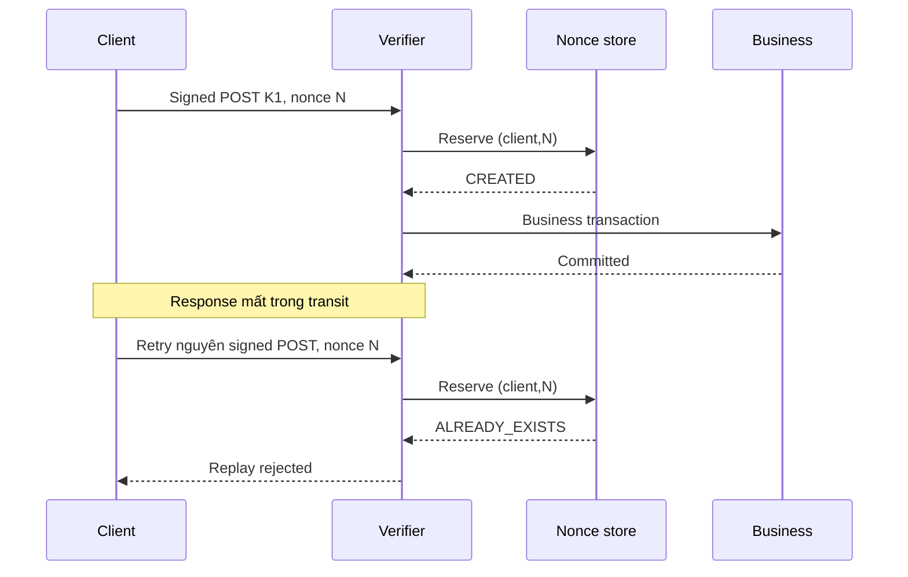

# Không rotate key: anti-pattern giữ shared secret HMAC quá lâu

## 1. Bối cảnh và mục tiêu

Trong module `SECURITY_AUTHENTICATION_HMAC_REQUEST_AUTHENTICATION`, client và server dùng **shared secret** để ký HTTP request bằng HMAC. Hai bên thống nhất một **canonical request** gồm HTTP method, URI/query, những header được ký và/hoặc digest body. Verifier chọn key, tính lại HMAC, kiểm timestamp/nonce chống replay, rồi tạo danh tính đã xác thực để **authorization** quyết định client được làm gì. Gateway/proxy có thể đứng giữa client và backend, nên các thành phần còn phải thống nhất representation được ký.

Một anti-pattern đặc biệt nguy hiểm là **không rotate key**: hệ thống cấp một shared secret cho client khi onboarding rồi tiếp tục sử dụng secret đó trong nhiều tháng hoặc nhiều năm, không có vòng đời, ngày hết hạn, kế hoạch thay thế hay quy trình thu hồi được diễn tập.

Ví dụ:

```text
T0: Onboard partner A, tạo shared secret K0.
T1: Đưa K0 vào cấu hình client và backend.
T2: Deploy nhiều môi trường, copy K0 sang nhiều service.
T3: Nhân sự thay đổi; backups, devices và scripts tích lũy bản sao K0.
T4: Phát hiện nơi có thể lộ K0, nhưng không dám đổi
    vì mọi client/backend instance đang phụ thuộc cùng key.
T5: Tiếp tục dùng K0 để "giữ ổn định".
```

HMAC-SHA256 vẫn có thể **đúng về mặt mật mã** ở T5. Vấn đề là **thời gian hiệu lực của credential quá dài và phạm vi ảnh hưởng rộng**: ai có K0 và biết hợp đồng ký có thể tạo những request **mới, chữ ký hợp lệ**, không chỉ phát lại request cũ. Timestamp/nonce chống replay **không chặn** người đã có shared secret tự sinh nonce mới và ký request mới.

Bài **“Không rotate key”** thuộc chương **Anti-pattern HMAC**. Sau bài học, người học có thể:

1. Nhận diện anti-pattern secret bất biến, dùng chung quá rộng và “không dám rotate vì sợ downtime”.
2. Phân biệt key rotation, key revocation, client-level revocation, algorithm migration và authorization.
3. Xây key lifecycle `STAGED → ACTIVE → RETIRING → REVOKED` có effective time, overlap có giới hạn và rollback an toàn.
4. Đặt key ID, owner, version và chính sách chấp nhận trong verifier mà không fallback thử tất cả secrets.
5. Thực hiện runbook planned rotation và emergency compromise, kiểm propagation qua gateway/backend/cache.
6. Viết test Java, Spring MVC/WebFlux, anti-replay và multi-instance cho cả key cũ/mới.
7. Theo dõi metrics/audit không lộ secret, chọn cutoff và xác nhận key cũ thực sự không còn được chấp nhận.

> **Không có chu kỳ rotate cố định áp dụng cho mọi hệ thống.** Tần suất do threat model, chính sách tổ chức, độ nhạy cảm nghiệp vụ, khả năng tự động hóa và mức phơi lộ credential quyết định. Rotation định kỳ **không thay thế** secret storage an toàn, least privilege, canonicalization đúng, chống replay, TLS và thu hồi khẩn cấp.

## 2. Vì sao không rotate key là một anti-pattern?

### 2.1. HMAC không giải quyết vòng đời credential

HMAC dựa trên bí mật chung `K` và message `M`:

\[
\operatorname{MAC}=\operatorname{HMAC}_{K}(M)
\]

Đối với HTTP request, `M` phải là **canonical request bytes chính xác**; thay method, path, signed header hoặc body khiến signature khác. Nhưng nếu attacker biết `K`, họ có thể tính HMAC cho **bất kỳ message nào trong scope mà key đó được phép ký**.

| Điều đã có | Bảo vệ được | Không bảo vệ được |
| --- | --- | --- |
| HMAC trên canonical request | Phát hiện signed bytes bị sửa khi secret chưa lộ | Kẻ có secret tạo request mới |
| TLS | Bảo vệ nội dung trên đường truyền trong TLS trust model | Secret lộ qua repo, backup, máy client hoặc log |
| Timestamp | Giới hạn tuổi request | Người có secret tạo timestamp mới |
| Nonce store nguyên tử | Chặn nonce dùng lại trong scope đã định | Người có secret tạo nonce mới |
| Key rotation có cutoff | Giới hạn tuổi thọ một key version được accept | Key ACTIVE vẫn có thể bị lộ |
| Key revocation | Chặn key nghi lộ sau khi hiệu lực được áp dụng | Không tự rollback tác vụ đã thực thi |
| Authorization theo client/tenant | Giới hạn client được phép làm gì | Không ngăn người có secret thực hiện quyền client được cấp |

“HMAC đủ mạnh nên key không cần rotate” là kết luận sai: **primitive mạnh không biến secret dài hạn thành credential không thể bị chiếm dụng**.

### 2.2. Tác động tích lũy theo thời gian và số bản sao

Các đường rò rỉ có thể tồn tại độc lập:

- Key có trong cấu hình ứng dụng, biến môi trường, file triển khai, backup hoặc snapshot.
- Key bị copy qua nhiều nhân viên, thiết bị, team, nhà cung cấp và môi trường.
- Một lỗi debug vô tình log đầy đủ cấu hình, request header hoặc secret reference.
- Client SDK cũ không có khả năng nạp key mới; key cũ buộc phải tồn tại.
- Script automation dùng secret không còn owner và không có inventory.
- Người vận hành không biết key version nào đang thực sự có traffic.

Không thể suy ra xác suất lộ key chỉ từ tuổi key. Tuy nhiên, **secret tồn tại lâu, phân phối rộng, không thể thay an toàn** làm giảm khả năng containment khi xảy ra sự cố. Rotation là một **năng lực vận hành**, không đơn thuần là hạng mục compliance.

### 2.3. Một key dùng chung cho nhiều clients

```text
Client A  --+
Client B  --+--> cùng shared secret K_GLOBAL
Client C  --+
```

Nếu clients dùng cùng `K_GLOBAL`, việc lộ secret của một client có thể cho phép giả mạo client khác nếu registry/giao thức không có ranh giới key-owner thực sự. Kể cả khi HMAC ký `clientId`, **bất kỳ ai biết secret chung đều có thể ký giá trị clientId khác**.

Thiết kế tốt hơn:

```text
Client A -> key-A-v1, key-A-v2
Client B -> key-B-v1, key-B-v2
Client C -> key-C-v1, key-C-v2

keyId -> trusted clientRef/tenantRef/scopes từ registry
```

Điều này giúp rotate/revoke độc lập theo client và giới hạn blast radius. **Key ID không phải bí mật** và bản thân nó không chứng minh client đã được xác thực.

## 3. Dấu hiệu hệ thống đang mắc anti-pattern

| Triệu chứng | Vấn đề ẩn | Hậu quả |
| --- | --- | --- |
| Một biến cấu hình `hmac.shared-secret` cho toàn API | Không có key ID/owner/version | Khó revoke từng client và rotate song song |
| Key hardcode hoặc commit vào Git | Bí mật phơi lộ dài hạn | Không thể giả định key chưa bị sao chép |
| Mọi SDK dùng cùng shared secret | Không cô lập tenant/client | Lộ một client ảnh hưởng nhiều identity |
| Không có `keyId` trong signed contract | Khó chọn key version | Bị cám dỗ “thử từng key” |
| Không có `notBefore`/`acceptUntil` | Không có lịch hiệu lực/cutoff | Key cũ được chấp nhận vô hạn |
| Rotate bằng sửa secret rồi restart tất cả nodes | Không có overlap/rollout | 401 hàng loạt khi deploy lệch |
| Khi 401, verifier thử tất cả secrets cũ | Fallback không có policy | Key đã cấm vẫn có thể hoạt động |
| Registry cache ACTIVE mãi mãi | Thiếu revocation freshness | Revoke ở DB không đến data plane |
| Không biết key nào còn traffic | Thiếu metrics/audit | Không dám tắt key cũ |
| Thu hồi key xóa luôn nonce store | Trộn credential lifecycle và replay | Có thể tạo cửa sổ replay |
| Bỏ kiểm HMAC ở gateway khi migrate | “Fix downtime” bằng fail-open | Request mất bảo vệ |

Một câu hỏi kiểm tra năng lực vận hành: **“Nếu phải vô hiệu hóa shared secret của client A ngay hôm nay, làm thế nào để mọi gateway/verifier ngừng accept và chứng minh điều đó?”** Nếu câu trả lời là “sửa biến cấu hình, redeploy rồi hy vọng”, hệ thống cần cải tạo.

### 3.1. Ví dụ thiết kế sai: một secret bất biến

```java
// Anti-pattern: minh họa rủi ro, KHÔNG dùng trong production.
final class BadHmacVerifier {
    // Chỉ nhận một key global từ config khi khởi tạo;
    // không có registry, version, owner hoặc cutoff.
    private final byte[] sharedSecret;

    BadHmacVerifier(byte[] globalKeyFromConfiguration) {
        this.sharedSecret = globalKeyFromConfiguration.clone();
    }

    boolean accepts(byte[] canonical, byte[] signature) {
        byte[] expected = hmacSha256(
            sharedSecret,
            canonical
        );
        return MessageDigest.isEqual(expected, signature);
    }
}
```

Đoạn code chỉ mô tả ý tưởng anti-pattern, không phải lớp Java compile độc lập. Nó không có key ID, client owner, key lifecycle, route scope, freshness, nonce hoặc policy revision. Không thể rotate có kiểm soát hay phân biệt credential các clients. Bổ sung timestamp/nonce **không khắc phục việc thiếu vòng đời secret**.

## 4. Phân biệt rotate, revoke, disable client và đổi thuật toán

| Hành động | Đối tượng | Kết quả |
| --- | --- | --- |
| **Rotate key** | Key versions cùng một client/key family | Key mới dần được dùng; key cũ chỉ còn accept trong overlap có hạn |
| **Revoke key** | Một key version | Key đó bị từ chối, kể cả MAC đúng |
| **Suspend/disable client** | Toàn bộ client identity | Mọi key versions bị chặn theo client-level policy |
| **Change grants** | Authority/tenant/resource permission | Client còn authenticate nhưng có thể nhận 403 |
| **Algorithm migration** | HMAC-SHA256 → HMAC-SHA512 hoặc format khác | Thay primitive/contract có allowlist; không tự rotate secret |
| **Canonicalization migration** | Bytes được ký, header set, query normalization | Cần versioning/golden vectors; không đồng nghĩa thay key |
| **Secret re-issuance** | Cấp key mới khi nghi compromise | Cần thu hồi key cũ và đánh giá nơi lưu secret |

**Rotate key không thay thế client-level revocation** khi cả identity/môi trường giữ secret đã bị chiếm quyền. Ngược lại, disable client không phải cách thông thường để thay secret định kỳ nếu cần giữ dịch vụ liên tục.

### 4.1. Key ký request và key được phép xác minh

- **Preferred signing key:** Key client SDK chọn ký request mới.
- **Accepted verification keys:** Key server còn cho phép trong migration, có state/time rõ ràng.

Tại một thời điểm có thể có **một signing key ưu tiên** và **hai keys được verifier chấp nhận**. Điều đó hợp lệ nếu overlap **có thời hạn**, không phải lý do giữ hai key ACTIVE vĩnh viễn.

## 5. Key lifecycle đúng: trạng thái và bất biến

```mermaid
stateDiagram-v2
    [*] --> STAGED: Generate/register new version
    STAGED --> ACTIVE: Approval + effective time
    ACTIVE --> RETIRING: New key becomes preferred
    RETIRING --> REVOKED: acceptUntil reached
    STAGED --> REVOKED: Abort
    ACTIVE --> REVOKED: Emergency compromise
    RETIRING --> REVOKED: Emergency compromise
    REVOKED --> [*]: Metadata retained; material retired by policy
```



| State | Ký request mới? | Verifier accept? | Ý nghĩa |
| --- | --- | --- | --- |
| `STAGED` | Chưa | **Không** | Tạo/phân phối trước activation |
| `ACTIVE` | **Có**, nếu preferred | **Có** khi key, client, scope, signature, freshness, nonce hợp lệ | Key hoạt động |
| `RETIRING` | **Không nên** sau cutover | **Có điều kiện** trước `acceptUntil` | Overlap có hạn |
| `REVOKED` | **Không** | **Không**, kể cả MAC đúng | Key bị thu hồi |

`RETIRING` không phải `REVOKED`. Nếu verifier còn accept RETIRING, người biết secret cũ vẫn có thể **ký request mới** hợp lệ trong khoảng overlap. Vì vậy đây là **cửa sổ rủi ro có chủ đích**, cần ngắn, được giám sát và kết thúc đúng hạn.

### 5.1. Bất biến

1. Một key ID gắn với **đúng một key version/owner** trong namespace đã định; không âm thầm trỏ tới secret mới.
2. Key ID, algorithm và protocol version được ràng buộc vào **canonical bytes và/hoặc policy**, không fallback thử secrets khác khi MAC sai.
3. Key `STAGED` hoặc `REVOKED` không tạo `Authentication` thành công.
4. Key `RETIRING` không được accept sau `acceptUntil` dù timestamp được ký trước cutoff.
5. Client `SUSPENDED`/`REVOKED` không authenticate bằng bất kỳ key nào.
6. Key khác algorithm/route/tenant/scope được phép phải bị từ chối dù HMAC cryptographically đúng.
7. Metadata revision/staleness có policy; registry/cache lỗi **không default ACTIVE**.
8. Không tạo `Authentication` trước khi key, MAC, freshness, nonce và client state đạt policy.

### 5.2. Giữ metadata, hủy key material theo policy

Key `REVOKED` không nhất thiết cần giữ raw secret vô thời hạn. Tuy nhiên nên giữ metadata/audit về owner, activation, cutoff, revocation và policy revision theo retention để giải thích lịch sử. Hủy key bytes phải phối hợp secret manager, backups, incident forensics và compliance; không xóa audit trail chỉ vì key đã revoke.

## 6. Key ID và canonical request: không để rotation tạo đường fallback

### 6.1. HTTP signing contract minh họa

```http
POST /internal/orders?tenant=t1 HTTP/1.1
Content-Type: application/json
X-Hmac-Key-Id: client-a-key-2026-b
X-Hmac-Timestamp: 2026-11-28T08:00:00Z
X-Hmac-Nonce: nonce-lab-1001
X-Hmac-Signature: <hex-hmac-sha256>

{"orderId":"ORD-1001","amount":100}
```

Canonical representation của **giao thức ví dụ**:

```text
HMAC-V1
POST
/internal/orders?tenant=t1
content-type:application/json
x-hmac-key-id:client-a-key-2026-b
x-hmac-nonce:nonce-lab-1001
x-hmac-timestamp:2026-11-28T08:00:00Z
<sha256-raw-body-hex>
```

`<sha256-raw-body-hex>` là placeholder, **chưa phải known signature vector**. Khi đưa vào test cần cố định raw body bytes, digest, nối LF/CRLF và output MAC bằng oracle độc lập.

Ở contract này, `X-Hmac-Key-Id` nằm trong signed bytes. Thay key ID nhưng giữ signature làm MAC mismatch; registry chọn secret/owner theo ID đã gửi và sau đó xác minh signature.

### 6.2. Sai: fallback thử mọi key

```java
// Anti-pattern: kéo dài hiệu lực key cũ, bỏ key-id policy.
for (SecretKey key : allHistoricKeysForClient) {
    if (signatureMatches(key, canonicalBytes, suppliedSignature)) {
        return authenticatedClient;
    }
}
```

Hậu quả: khó đảm bảo key REVOKED thực sự bị loại, có thể accept thuật toán/scope không được phép, tăng chi phí và timing differences, key ID không còn binding rõ, khó audit request đã dùng key version nào.

Thiết kế đúng:

```text
parse single keyId + strict format
  → resolve exactly one key version from trusted registry
  → validate key lifecycle, client state, time, scope
  → build canonical bytes for declared supported contract
  → calculate MAC with only selected key
  → constant-time byte comparison
  → validate signed timestamp, atomically reserve nonce
  → create Authentication from trusted metadata
  → authorization separately
```

Không dựa **chỉ** vào key ID để nhận diện client: key ID là **untrusted selector** trước MAC verification. Không dùng raw `X-Role`/`X-Tenant` do client tự gửi để cấp authorities dù các header đó được ký; quyền phải lấy từ policy server.

### 6.3. Duplicate key ID và parser differential

`X-Hmac-Key-Id`, `X-Hmac-Timestamp`, `X-Hmac-Nonce` và `X-Hmac-Signature` nên có **single-value contract**. Hai occurrences hoặc giá trị `key-a,key-b` ngoài contract có thể bị gateway/backend diễn giải khác nhau. Reject request mơ hồ; không tin `getHeader(...)` trả một chuỗi là bằng chứng không có duplicate khi proxy có thể gộp header.

## 7. Planned rotation không gián đoạn



### 7.1. Runbook chi tiết

1. **Inventory:** Xác định verified clientRef, key versions, SDK versions, routes/tenants, vùng triển khai, nơi giữ secret và owner.
2. **Định nghĩa policy:** Approved rotation window, `notBefore`/`acceptUntil`, accepted algorithms, key IDs, nonce scope, revocation freshness SLO.
3. **Sinh K2:** CSPRNG và secret manager; không dùng secret entropy thấp, không ghi raw key vào Git/ticket/log.
4. **Đăng ký STAGED:** K2 có key ID và owner/scope bất biến; verifier vẫn từ chối chữ ký K2 trước activation.
5. **Phân phối:** Client nhận K2 qua secret-delivery channel được kiểm soát; SDK chuyển preferred key được.
6. **Chuẩn bị data plane:** Gateway/backend hiểu metadata/contract mới và áp policy revision tương ứng.
7. **Activation:** K2 ACTIVE, K1 RETIRING trong transaction, audit và outbox.
8. **Client cutover:** Client ký request mới bằng K2, nonce mới; kiểm HMAC, replay, principal, quyền và body end-to-end.
9. **Theo dõi K1:** Accepted usage theo aggregate/opaque reference, tìm callers chưa migrate; không kéo dài overlap vô hạn.
10. **Revoke K1:** Đúng cutoff, chặn mọi request K1 kể cả MAC đúng; không xóa nonce state client.
11. **Xác minh:** Synthetic signed requests K1/K2 qua mọi gateway/region/verifier; so applied revision và side effects.
12. **Đóng change:** Evidence, cleanup/retention và kế hoạch rotation tiếp theo.

### 7.2. Overlap có giới hạn, không dùng timestamp để cứu key cũ

Một overlap cần cân bằng thời gian phân phối K2, rollout server/gateway, in-flight requests, timestamp freshness, clock skew và nguy cơ key cũ vẫn có thể ký request mới.

Giả sử:

```text
fresh iff now-maxPast <= signedAt <= now+maxFuture
K1 accepted iff now < K1.acceptUntil
```

thì mọi request K1 bị chặn ngay khi `now >= acceptUntil`, **bất kể** `signedAt` còn fresh hay được ký trước cutoff. Nếu muốn request in-flight K1 có thời gian đến backend, chọn `acceptUntil` đủ dựa trên rollout/transport/freshness policy; nhưng **không thể phân biệt request thật đã ký trước và request do kẻ biết K1 backdate trong freshness window** chỉ từ signedAt. Compromised key cần emergency cutoff, không dựa overlap thông thường.

### 7.3. Timeline tham khảo

```text
T0: K2 STAGED, chưa accept
T1: K2 ACTIVE; K1 RETIRING; verifier có thể accept cả hai
T2: Client A chuyển preferred signing key sang K2
T3: Đánh giá residual K1 traffic và coverage của mọi client/region
T4: K1 REVOKED; verifier phải áp policy revision mới
T5: Chứng minh K1 reject trên mọi điểm verify, K2 vẫn PASS
```

Không thấy K1 traffic một ngày chưa chắc mọi client đã migrate: offline jobs, sampling, traffic theo tuần/tháng hoặc region ít request có thể còn dùng K1. Chốt cutoff dựa trên inventory, ack, coverage, deadline và policy.

## 8. Emergency rotation khi nghi secret lộ

Planned overlap và emergency compromise **không được dùng chung runbook vô điều kiện**.

### 8.1. Dấu hiệu cần phản ứng khẩn

- Secret xuất hiện trong kho source công khai, bug report hoặc artifact không được bảo vệ.
- Máy/CI runner/secret store giữ K1 bị compromise.
- Có HMAC requests hợp lệ từ route/client context bất thường.
- Key được chia sẻ với người/đơn vị đã không còn quyền.
- Client/tenant có hành vi gian lận, cần disable cả identity chứ không chỉ đổi một key.

Nếu vẫn giữ K1 RETIRING để “tránh 401”, kẻ có K1 vẫn ký được request mới trong overlap. Cần quyết định theo threat model; có thể phải **revoke K1 ngay**, tạm chặn endpoint, giảm chức năng hoặc suspend cả client, chấp nhận tác động availability có kiểm soát.

### 8.2. Runbook khẩn



1. **Triage:** Xác định key ID, verified clientRef, scopes và incident window, không suy identity từ header chưa xác thực.
2. **Contain:** Revoke ở source of truth, áp controls ở gateway/route khi propagation chưa đạt.
3. **Propagate:** Refresh/invalidate cache, kiểm applied revision mọi điểm accept; node stale phải fail closed hoặc bị loại traffic.
4. **Verify:** Dùng test-only signed requests K1 trên điểm verify được cấp phép; assert không tạo Authentication/side effects.
5. **Recover:** Phát key mới khi nơi giữ key/identity đã được đánh giá an toàn; sửa nguyên nhân lộ.
6. **Investigate:** Đối soát audit, replay attempts và giao dịch; đánh giá in-flight jobs/compensation.
7. **Close:** Approval/break-glass audit, regression tests và alert.

### 8.3. Rotation không rollback giao dịch đã thực thi

Một signed request K1 đã được accept trước revoke có thể đã enqueue job hoặc commit transaction. Revoke sau đó **không xóa nghiệp vụ**. Nếu cần đảm bảo không commit sau revoke, phải có **credential epoch fencing** hoặc recheck client/key state ở điểm commit/job execution. Security filter một lần không tự có bảo đảm này.

## 9. Registry, secret store và propagation

### 9.1. Key metadata tối thiểu

```text
HmacKeyVersion:
  keyId                unique trong namespace
  clientRef            owner bất biến
  tenantRef            nếu policy có tenant
  secretReference      secret manager; không log raw secret
  lifecycleState       STAGED | ACTIVE | RETIRING | REVOKED
  notBefore            trusted instant
  acceptUntil          trusted instant / null theo state
  allowedAlgorithms    allowlist
  allowedProtocols     canonicalization versions
  allowedRoutes        scopes
  keyPolicyRevision    revision tăng đơn điệu
  createdAt / activatedAt / revokedAt
  revokeReasonCode

Client:
  clientRef
  state                ACTIVE | SUSPENDED | REVOKED
  clientPolicyRevision
  credentialEpoch      nếu cần fencing
```

Key ACTIVE chưa chắc được accept: client có thể revoke, route/algorithm bị cấm, timestamp/nonce fail. Không tạo một `isValid` flag mơ hồ thay cho policy đầy đủ.

### 9.2. State transition và audit nguyên tử

```text
BEGIN TRANSACTION
  lock/check client + key-family revision
  validate approval and K2 STAGED
  set K2 ACTIVE, effectiveAt = trustedNow
  set K1 RETIRING, acceptUntil = approvedCutoff
  increment policyRevision
  append audit event + transactional outbox
COMMIT
```

Cần idempotency key cho command, optimistic lock/CAS hoặc database constraints để tránh hai operators kích hoạt key xung đột. Publisher có thể gửi event at-least-once; consumer cần deduplicate theo event ID/revision. Không publish message trước DB commit rồi nghĩ hai việc luôn nhất quán.

### 9.3. Stale cache, event reorder và refresh race

```text
T1: Verifier load K1 ACTIVE revision=20
T2: Registry commit K1 REVOKED revision=21
T3: Verifier nhận invalidate rev=21
T4: Load T1 hoàn thành, ghi lại ACTIVE rev=20 vào cache
T5: Request mới dùng stale ACTIVE rev=20
```

`cache.invalidate(keyId)` ở T3 chưa đủ. Cần watermark `highestSeenRevision`, không dùng snapshot thấp hơn; atomic cache replace, bounded freshness, event dedup/order và policy barrier hoặc authoritative revocation check khi yêu cầu cao.

**Watermark local không phát hiện revision chưa từng được node nhận.** Pub/sub hoặc TTL không tự đảm bảo revoke tức thời. Với registry/event outage, quy định staleness budget rõ; quá hạn phải fail closed.

### 9.4. Secret delivery khác metadata broadcast

Metadata key ID/state/revision có thể được phân phối tới nhiều verifiers; **shared secret bytes** cần đường riêng:

- Secret manager/HSM/kênh delivery đã xác thực, mã hóa, phân quyền.
- Phân phối đúng client identity và verifier được phép.
- Không gửi secret qua event bus/audit/log/metrics.
- Không commit K2 vào config source/ticket.
- Xác nhận client nhận được key mà không bắt client gửi lại secret qua kênh không an toàn.

Nếu dùng remote MAC service/HSM thay vì đưa key vào app memory, phải test latency/failure semantics và không tạo bypass khi dịch vụ unavailable.

## 10. Java: kiểm key state theo đồng hồ tin cậy

### 10.1. Model immutable cho policy và unit test

Ví dụ Java 17+:

```java
import java.time.Instant;
import java.util.Set;

enum KeyState {
    STAGED, ACTIVE, RETIRING, REVOKED
}

enum ClientState {
    ACTIVE, SUSPENDED, REVOKED
}

record HmacKeyMetadata(
    String keyId,
    String trustedClientRef,
    KeyState state,
    Instant notBefore,
    Instant acceptUntil,
    Set<String> allowedAlgorithms,
    Set<String> allowedRoutes,
    long policyRevision
) {}

record HmacClientMetadata(
    String clientRef,
    ClientState state,
    long policyRevision
) {}
```

Các records chỉ chứa **metadata**, không chứa key material. Secret được lấy từ **secret provider** bằng trusted key reference khi policy cho phép. `keyId` do request gửi là candidate selector, không phải danh tính đã xác thực.

### 10.2. Key acceptance policy không chỉ hỏi “MAC đúng chưa?”

```java
import java.time.Clock;
import java.time.Instant;
import java.util.Objects;
import org.springframework.security.authentication.BadCredentialsException;

final class HmacKeyAcceptancePolicy {
    private final Clock clock;

    HmacKeyAcceptancePolicy(Clock clock) {
        this.clock = Objects.requireNonNull(clock);
    }

    void requireAllowed(
        HmacKeyMetadata key,
        HmacClientMetadata client,
        String algorithm,
        String trustedRouteId
    ) {
        if (key == null || client == null ||
            key.trustedClientRef() == null ||
            !key.trustedClientRef().equals(client.clientRef()) ||
            client.state() != ClientState.ACTIVE) {
            throw invalidCredentials();
        }

        Instant now = clock.instant();
        if (key.state() != KeyState.ACTIVE &&
            key.state() != KeyState.RETIRING) {
            throw invalidCredentials();
        }

        if (key.notBefore() == null ||
            now.isBefore(key.notBefore())) {
            throw invalidCredentials();
        }

        // RETIRING phải có cutoff; ACTIVE có thể có expiry riêng.
        if (key.state() == KeyState.RETIRING &&
            key.acceptUntil() == null) {
            throw invalidCredentials();
        }
        if (key.acceptUntil() != null &&
            !now.isBefore(key.acceptUntil())) {
            throw invalidCredentials();
        }

        if (key.allowedAlgorithms() == null ||
            key.allowedRoutes() == null ||
            !key.allowedAlgorithms().contains(algorithm) ||
            !key.allowedRoutes().contains(trustedRouteId)) {
            throw invalidCredentials();
        }
    }

    private BadCredentialsException invalidCredentials() {
        // Public response không tiết lộ key tồn tại hay bị revoke.
        return new BadCredentialsException(
            "Invalid HMAC credentials"
        );
    }
}
```

**Điểm cần chú ý:** `now` là **server clock** được inject. Dù signed timestamp còn nằm trong freshness window, key `REVOKED` hoặc đã hết `acceptUntil` vẫn bị từ chối. `notBefore` được kiểm với thời điểm verify; nếu hợp đồng yêu cầu signedAt cũng không được trước activation, phải định nghĩa/test thêm rule đó **rõ ràng**.

Trong production, repository phải cung cấp **snapshot đủ mới** theo revocation freshness guarantee. Code trên không tự phát hiện snapshot ACTIVE bị stale. Cần validate metadata, key-owner mapping, policy revision, client/tenant/route scopes, algorithm và canonicalization version. Cũng phải cân nhắc race khi key bị revoke ngay **giữa** lúc lấy snapshot và lúc tạo Authentication; mức bảo đảm mạnh hơn bounded staleness cần authoritative decision/barrier hoặc cơ chế fencing.

### 10.3. JUnit 5: cả trước, đúng và sau cutoff

```java
import static org.junit.jupiter.api.Assertions.*;
import java.time.Clock;
import java.time.Instant;
import java.time.ZoneOffset;
import java.util.Set;
import org.junit.jupiter.api.Test;
import org.springframework.security.authentication.BadCredentialsException;

class HmacKeyAcceptancePolicyTest {
    private static final Instant NOW =
        Instant.parse("2026-11-28T08:00:00Z");
    private final HmacKeyAcceptancePolicy policy =
        new HmacKeyAcceptancePolicy(
            Clock.fixed(NOW, ZoneOffset.UTC)
        );

    private HmacKeyMetadata key(KeyState state, Instant cutoff) {
        return new HmacKeyMetadata(
            "client-a-key-v2", "client-a",
            state,
            NOW.minusSeconds(3600),
            cutoff,
            Set.of("HS256"),
            Set.of("POST_INTERNAL_ORDERS"),
            7L
        );
    }

    private HmacClientMetadata client(ClientState state) {
        return new HmacClientMetadata("client-a", state, 5L);
    }

    private void verify(
        HmacKeyMetadata key,
        HmacClientMetadata client
    ) {
        policy.requireAllowed(
            key, client, "HS256", "POST_INTERNAL_ORDERS"
        );
    }

    @Test
    void activeKeyCanBeAcceptedWithValidClientAndScope() {
        assertDoesNotThrow(() ->
            verify(key(KeyState.ACTIVE, null),
                   client(ClientState.ACTIVE)));
    }

    @Test
    void retiringKeyIsAcceptedOnlyBeforeCutoff() {
        assertDoesNotThrow(() ->
            verify(key(KeyState.RETIRING, NOW.plusSeconds(1)),
                   client(ClientState.ACTIVE)));

        assertThrows(BadCredentialsException.class, () ->
            verify(key(KeyState.RETIRING, NOW),
                   client(ClientState.ACTIVE)));

        assertThrows(BadCredentialsException.class, () ->
            verify(key(KeyState.RETIRING, NOW.minusSeconds(1)),
                   client(ClientState.ACTIVE)));
    }

    @Test
    void revokedAndStagedKeysAreRejected() {
        for (KeyState state : Set.of(
                KeyState.REVOKED, KeyState.STAGED)) {
            assertThrows(BadCredentialsException.class, () ->
                verify(key(state, null),
                       client(ClientState.ACTIVE)));
        }
    }

    @Test
    void revokedClientWinsOverActiveKey() {
        assertThrows(BadCredentialsException.class, () ->
            verify(key(KeyState.ACTIVE, null),
                   client(ClientState.REVOKED)));
    }

    @Test
    void wrongAlgorithmOrRouteIsRejected() {
        assertThrows(BadCredentialsException.class, () ->
            policy.requireAllowed(
                key(KeyState.ACTIVE, null),
                client(ClientState.ACTIVE),
                "HS512",
                "POST_INTERNAL_ORDERS"
            ));

        assertThrows(BadCredentialsException.class, () ->
            policy.requireAllowed(
                key(KeyState.ACTIVE, null),
                client(ClientState.ACTIVE),
                "HS256",
                "DELETE_INTERNAL_ORDERS"
            ));
    }
}
```

Test chỉ chứng minh **policy class**. Nó chưa chứng minh HMAC primitive, key registry freshness, canonical builder, timestamp, nonce hoặc Spring Security filters; các tầng đó cần test riêng.

## 11. Verifier HMAC phải chọn đúng một key version

### 11.1. Thứ tự kiểm tham chiếu



### 11.2. Service pseudocode

```java
// Các service/DTO là hợp đồng do dự án định nghĩa.
ParsedSignedRequest signed = parser.parseStrict(request);
HmacKeyMetadata key = keyRegistry
    .resolveExactlyOneKey(signed.keyId());
HmacClientMetadata client = clientRegistry
    .requireFreshFor(key.trustedClientRef());

keyAcceptancePolicy.requireAllowed(
    key, client, signed.algorithm(), routePolicy.routeId()
);

byte[] canonical = canonicalBuilder.buildForVersion(
    signed.protocolVersion(), request, signed.signedFields()
);
byte[] computed = hmacService.macWithSelectedKey(
    key.keyId(), signed.algorithm(), canonical
);
byte[] supplied = signatureDecoder.decodeStrictly(
    signed.signature(), signed.algorithm()
);
if (!MessageDigest.isEqual(computed, supplied)) {
    throw invalidCredentials();
}

freshnessValidator.requireFresh(signed.timestamp());
nonceStore.reserveAtomicallyOrReject(
    client.clientRef(), signed.nonce()
);
return principalFactory.authenticationFromRegistry(client, key);
```

Đây là **pseudocode**, không phải API Spring mặc định. Secret được lấy từ secret provider; key state được kiểm trước MAC có thể giảm chi phí với credential bị cấm nhưng không được tiết lộ trạng thái key qua public errors. Một số format checks có thể đặt sớm, nhưng **không được reserve nonce của client trước MAC hợp lệ** nếu việc đó cho phép một request giả mạo “chiếm” nonce của client thật.

`MessageDigest.isEqual` dùng so MAC bytes thay cho vòng lặp tự viết dừng sớm; không làm toàn bộ verifier có thời gian cố định. Không log computed MAC, supplied signature hay secret.

### 11.3. Race khi key bị revoke giữa các bước

Giả sử verifier đọc K1 ACTIVE ở T1, revoke commit ở T2 và tạo `Authentication` ở T3. Một lần đọc metadata tại T1 không tự đảm bảo “no new authn decision after T2”. Cần tuyên bố:

- **Bounded staleness:** Một số nodes có thể còn stale trong hạn cho phép; theo dõi và fail closed sau freshness budget.
- **Strong revocation barrier:** Không cho node stale tiếp tục nhận traffic trước khi xác nhận revision mới; authoritative check/barrier/fencing tương ứng.
- **No further business mutation:** Thêm fencing/check tại điểm commit hoặc job execution, không chỉ authn filter.

Không tuyên bố “revoke tức thời” nếu chỉ có Redis pub/sub, local TTL hoặc event queue bất đồng bộ.

## 12. Spring MVC và WebFlux: rotation không được bypass security chain

### 12.1. Spring MVC với custom authentication filter

Một `OncePerRequestFilter`/`AuthenticationFilter` có thể gọi HMAC service rồi đặt `Authentication` trong `SecurityContext`. Khi rotate phải kiểm:

- `SecurityFilterChain` bảo vệ route/method kể cả khi request **thiếu signature**.
- K2 ACTIVE đúng MAC tạo principal từ **trusted owner** của K2.
- K1 RETIRING sau cutoff không tạo principal, controller không chạy.
- Key ID unknown/REVOKED không fallback sang secret cũ.
- Tạo context **riêng cho request**; không cache `Authentication` theo key ID.
- HTTP authn errors được xử lý ở filter/entry point đúng chỗ, phân biệt 401, 403 và dependency 5xx.
- Body đọc để hash phải được cung cấp lại cho handler theo raw bytes, có giới hạn kích thước.

Ví dụ test `MockMvc`, helper do test project triển khai:

```java
@Test
void oldKeyRejectedAfterCutoffNewKeyStillWorks() throws Exception {
    // Clock test cố định ở sau thời điểm K1.acceptUntil.
    SignedFixture oldSigned = fixtures.validSignedOrder(
        "client-a-key-v1", "nonce-old-001"
    );
    SignedFixture newSigned = fixtures.validSignedOrder(
        "client-a-key-v2", "nonce-new-001"
    );

    mockMvc.perform(oldSigned.toMockMvcRequest())
        .andExpect(status().isUnauthorized());

    mockMvc.perform(newSigned.toMockMvcRequest())
        .andExpect(status().isCreated());

    assertThat(orderRepository.countForRequest(
        oldSigned.requestId())).isZero();
}
```

Đây là **contract-test fragment**, không compile độc lập: `fixtures`, `SignedFixture`, `toMockMvcRequest`, `orderRepository` và registry/clock test là các thành phần dự án tạo. Cần đảm bảo K1/K2 **đều có MAC đúng với test secrets riêng và nonce mới**; nếu fixture K1 vốn sai MAC, một 401 không chứng minh cutoff hoạt động. Nên assert thêm internal reason `KEY_NOT_ACCEPTED` bằng test hook redacted.

### 12.2. Key rotation không phải authorization

Client/key REVOKED phải fail **authentication**. Đừng tạo principal rồi mới dựa vào `hasAuthority` chặn một số routes: endpoint permitAll hoặc business API khác có thể vô tình chấp nhận principal bị revoke.

Ngược lại, client K2 hợp lệ nhưng thiếu `ORDER_CREATE` nhận **403 Forbidden**; đây là authorization denial, không phải lỗi rotation. Authorities lấy từ server policy, không từ `X-Role` client tự ký.

### 12.3. WebFlux: không block và không cache principal theo key

Trong WebFlux:

- `SecurityWebFilterChain` và `ReactiveSecurityContextHolder` mang security context; không dùng ThreadLocal `SecurityContextHolder` cho reactive principal.
- Registry, secret provider, nonce reservation nên non-blocking hoặc được chuyển khỏi Netty event loop.
- Không `block()` hoặc `subscribe()` để thử nhiều keys/algorithms.
- `Flux<DataBuffer>` có thể chỉ đọc một lần; verifier đọc raw body phải buffer/replay có giới hạn và release đúng.
- Không tạo Authentication trước khi key state, MAC, freshness và nonce đều pass.

```java
// Pseudocode: helper là service reactive của ứng dụng.
return reactiveKeyVerifier.resolveAndVerifySelectedKey(exchange)
    .flatMap(verified -> reactiveClientPolicy
        .requireActiveAndFresh(verified.trustedClientRef())
        .thenReturn(verified))
    .flatMap(verified -> reactiveReplayGuard
        .verifyFreshAndReserve(verified)
        .thenReturn(verified))
    .flatMap(verified ->
        chain.filter(verified.replayableExchange())
            .contextWrite(
                ReactiveSecurityContextHolder.withAuthentication(
                    verified.authentication()
                )
            )
    );
```

`resolveAndVerifySelectedKey(...)` phải chọn **đúng một key version**, kiểm MAC với key đó. `reactiveReplayGuard` reserve nonce chỉ sau MAC hợp lệ. Code chỉ minh họa thứ tự; xử lý failure/cancel semantics phải theo app thực.

## 13. Gateway/proxy: rotate trong registry chưa đủ

### 13.1. Inventory mọi điểm verify

```text
Public client
   ↓
API Gateway (verify HMAC hoặc forward)
   ↓
Ingress/Reverse Proxy
   ↓
Spring MVC/WebFlux verifier
   ↓
Authorization + business
```

Nếu **gateway verify HMAC** và backend tin identity assertion, phải rotate/revoke cả **gateway verification policy**. Backend cập nhật key registry không ngăn gateway vẫn dùng K1 stale cache rồi tạo `X-Verified-Client` được backend tin.

Nếu **backend verify**, gateway phải giữ method, path/query, signed headers và body representation theo contract. Không sửa mismatch bằng bỏ ký path/body hoặc thử secret cũ.

### 13.2. HTTP/2 và rewrite

| Thay đổi | Rủi ro | Test |
| --- | --- | --- |
| Rewrite `/public/orders` → `/internal/orders` | Client ký external path, backend nhìn internal path | Quy định signed target và trusted rewrite mapping |
| HTTP/2 lowercase header names | Canonical names bị lệch | Normalize theo protocol contract |
| Query sort/percent re-encode | Raw URI bytes khác | KAT/real proxy với duplicate params |
| `Content-Type` thêm charset | Signed value đổi | Preserve hoặc normalize theo version |
| Body decompress/JSON reserialize | Raw body digest đổi | Verify trước transform hoặc contract riêng |
| Gateway cache key registry | Key REVOKED còn ACTIVE ở edge | Applied revision, cache freshness/barrier |
| Dual verify edge+backend | Một nonce bị reserve hai lần | Một điểm consume nonce hoặc hop-specific contracts |
| Caller gửi `X-Verified-Client` | Backend tin identity giả | Strip/overwrite, xác thực gateway bằng mTLS/policy |

HTTP/1.1 và HTTP/2 không cần giữ nguyên wire framing; điều cần nhất quán là **canonical representation** tại điểm verify.

### 13.3. “Key mới hoạt động ở một node” chưa phải hoàn tất

Một rollout thành công cần xác minh:

- Gateway A/B và backend region 1/2 đều biết K2 khi activation.
- Sau revoke, **tất cả điểm authentication trong scope** đều từ chối K1.
- Node stale/offline không tiếp tục nhận traffic ngoài guarantee, hoặc fail closed.
- Direct-to-backend route không bypass gateway policy.
- Telemetry báo **revision đã áp**, không chỉ revision được publish.

## 14. Anti-replay xuyên key versions và retry nghiệp vụ

### 14.1. Nonce scope theo verified client

```text
Request 1: client A + key K1 + nonce N + MAC1
Request 2: client A + key K2 + nonce N + MAC2
```

Hai MAC khác nhau dù nonce trùng. Nếu nonce store dùng `(keyId,nonce)` nhưng threat model yêu cầu **một nonce cho mỗi client**, request thứ hai có thể được accept ngoài ý muốn.

Với client-scoped policy:

```text
nonceKey = opaqueEncode(trustedClientRef, nonce)
```

và atomic reserve-if-absent-with-expiry trong **shared consistency domain** cho mọi key versions/protocols/backend instances. Nếu chủ đích scope theo key/algorithm, phải giải thích rủi ro và có idempotency riêng, không để thay đổi xuất hiện vô tình do rotation.

### 14.2. Timestamp window và TTL

Giả sử:

\[
\text{now}-\text{maxPast}\leq\text{signedAt}\leq\text{now}+\text{maxFuture}
\]

Một nonce được reserve khi signedAt gần biên tương lai có thể còn fresh trong **maxPast + maxFuture**. TTL phải bao phủ thời gian request còn được chấp nhận, cộng margin theo clock/transport policy. Record không được expire khi signed request vẫn fresh.

Rotation **không** được xóa nonce namespace cũ, tạo stores riêng theo K1/K2 trái policy, cho MAC sai reserve nonce, hoặc bỏ replay check vì backend đang hỗ trợ hai keys.

### 14.3. Gateway retry không phải lý do bỏ chống replay



Đây là hành vi **đúng** của anti-replay. Nếu cần retry logical operation, client tạo request **mới** với timestamp/nonce/signature mới, mang `Idempotency-Key` được ràng buộc vào signing/policy; business idempotency đảm bảo không tạo side effect thứ hai.

Không xóa nonce reservation sau 403/500 để “cho client thử lại”: credential request đã được sử dụng dù business outcome lỗi.

## 15. Failure semantics và rollback an toàn

### 15.1. Phân loại trước khi “cứu request”

| Tình huống | Authentication/Authorization | HTTP ví dụ |
| --- | --- | --- |
| Key ID unknown | Authn fail | 401 |
| K1 STAGED hoặc REVOKED | Authn fail | 401 |
| K1 RETIRING đã quá `acceptUntil` | Authn fail | 401 |
| Client REVOKED dù K2 ACTIVE | Authn fail | 401 |
| K2 đúng nhưng MAC/canonical mismatch | Authn fail | 401 |
| Timestamp hết hạn/nonce replay | Authn fail | 401 |
| Registry/nonce store unavailable | Không đủ chứng cứ xác thực; fail closed | 503/5xx |
| K2 đúng, authenticated, thiếu `ORDER_CREATE` | Authz denied | 403 |
| K2 đúng, đủ quyền | Authn+authz success | Business response |

Không cho SDK tự quay về K1 khi nhận 401 vì lỗi có thể do client REVOKED, nonce replay hoặc signature sai. Lựa chọn key phải theo **migration policy rõ ràng trước verification**, không “thử đến khi server nhận”.

### 15.2. Rollback code không được un-revoke

Giả sử K1 bị revoke vì compromise và K2 đã ACTIVE. Rollback backend code có thể làm build cũ **không hiểu K2**. Không “khôi phục dịch vụ” bằng bật lại K1 compromised:

- Deploy verifier hỗ trợ K2 **trước** khi client chuyển preferred signing key.
- Bảo đảm rollback code vẫn hiểu policy/revocation mới hoặc chuẩn bị migration plan khác.
- Nếu không thể phục vụ an toàn, fail closed/giảm chức năng có kiểm soát.
- Audit mọi policy acceptance change và kiểm test security regressions.

Không coi tăng HTTP 200 sau khi bật K1 lại là thành công.

### 15.3. Public response không tiết lộ key state

Caller không cần thấy “key này tồn tại nhưng đã revoke”, danh sách versions hoặc expected MAC. Response authn failure dùng thông điệp chung; internal telemetry được phân quyền lưu reason code `KEY_NOT_ACCEPTED`/`CLIENT_REVOKED` để điều tra.

## 16. Monitoring: biết khi nào được tắt key cũ

| Metric minh họa | Mục đích | Lưu ý nhãn |
| --- | --- | --- |
| `hmac_verification_total{key_state,outcome,reason}` | Accepted/rejected theo lifecycle | State/reason là enum |
| `hmac_rotation_old_key_use_total{route_id,region}` | Residual K1 traffic | Không gắn raw key ID |
| `hmac_key_policy_revision_applied{component,region}` | Node/gateway dùng revision nào | Revision đã áp |
| `hmac_key_policy_refresh_age_seconds` | Tuổi metadata snapshot | Phát hiện stale |
| `hmac_key_registry_errors_total` | Key lookup unavailable | Tách 5xx/fail closed |
| `hmac_nonce_replay_total` | Replay trong overlap | Không log nonce |
| `hmac_signature_invalid_total{route_id}` | Canonical/signature errors | So gateway/cutover |
| `hmac_authz_denied_total{route_id}` | Authn pass nhưng không đủ quyền | Không gộp 401 |
| `hmac_rotation_audit_outbox_lag_seconds` | Trễ audit/event propagation | Theo dõi evidence |

Tên metrics là **ví dụ**, không phải mặc định của Micrometer. Không dùng raw key ID, client ID, nonce, signature, full URL/query hay request ID làm Prometheus labels cardinality cao. Audit storage có thể chứa opaque key reference với kiểm soát quyền và retention.

### 16.1. Tín hiệu quan trọng

1. **K1 vẫn authentication success sau cutoff:** Lỗi bảo mật, kiểm stale gateway/verifier cache, direct-to-backend bypass.
2. **K2 bị reject tăng sau rollout:** Kiểm key delivery, policy revision, proxy signed target, MAC format, timestamp/nonce, không vội kết luận crypto sai.
3. **Không thấy K1 traffic nhưng coverage thấp:** Chưa đủ bằng chứng; kiểm offline/seasonal jobs, sampling và routing khác.

### 16.2. Audit event schema

```json
{
  "eventType": "HMAC_KEY_ROTATION_TRANSITION",
  "eventVersion": 1,
  "clientRef": "opaque-client-a",
  "keyRef": "opaque-key-a1",
  "fromState": "ACTIVE",
  "toState": "RETIRING",
  "policyRevision": 35,
  "effectiveAt": "2026-11-28T08:00:00Z",
  "acceptUntil": "2026-11-28T09:00:00Z",
  "actorRef": "opaque-operator",
  "approvalRef": "opaque-approval",
  "changeTicket": "CHG-EXAMPLE-451"
}
```

Schema minh họa **không chứa** shared secret, key bytes, signature, nonce hoặc raw canonical request. Audit nên ghi cùng state transition qua transactional outbox/cơ chế đảm bảo tương ứng; consumer idempotent, revision ordering và retention.

## 17. Test thực tế phải chứng minh K1 bị chặn

### 17.1. Test fixtures

```text
Client A (tenant A):
  K1 RETIRING; acceptUntil = T
  K2 ACTIVE; notBefore <= T
Client B (tenant B):
  KB ACTIVE

2 backend verifier processes + 1 gateway
shared atomic nonce store
key registry có revision/caching
Clock.fixed trong unit/integration
test secrets và business fixtures giả
```

**Cả K1 và K2 phải có chữ ký đúng** bằng test secrets riêng. Nếu K1 nhận 401 vì MAC sai hoặc timestamp quá hạn thì không chứng minh cutoff; phải xác nhận reason nội bộ hoặc spy/test hook đã redacted.

### 17.2. Ma trận 32 tình huống kiểm thử

| ID | Ca thử | Kỳ vọng |
| --- | --- | --- |
| ROT-01 | K1 ACTIVE, signed request đúng | Authn PASS trước rotation |
| ROT-02 | K2 STAGED, MAC đúng | Reject trước activation |
| ROT-03 | K2 ACTIVE, MAC đúng, fresh, nonce mới | Authn PASS |
| ROT-04 | K1 RETIRING, `now < acceptUntil` | PASS theo overlap policy |
| ROT-05 | K1 RETIRING, `now = acceptUntil` | Reject đúng biên |
| ROT-06 | K1 RETIRING, `now > acceptUntil` | Reject |
| ROT-07 | K1 REVOKED, MAC đúng | Reject do key state |
| ROT-08 | K2 ACTIVE nhưng client REVOKED | Reject do client state |
| ROT-09 | K1 revoked nhưng thử legacy algorithm/contract | Reject, không downgrade |
| ROT-10 | Key ID K2 nhưng ký bằng secret K1 | Reject MAC mismatch |
| ROT-11 | Unknown key ID với MAC giả | Reject, không thử mọi secret |
| ROT-12 | Duplicate `X-Hmac-Key-Id` | Reject ambiguity |
| ROT-13 | Đổi signed method/path/query, giữ MAC | Reject theo canonical contract |
| ROT-14 | Đổi raw JSON body, giữ MAC | Reject nếu ký raw body |
| ROT-15 | Đổi signed timestamp/nonce, giữ MAC | Reject |
| ROT-16 | K1 vừa revoke, verifier cache ACTIVE stale | Reject theo revocation guarantee/fail closed |
| ROT-17 | Event revision N-1 đến sau N | Không ghi đè snapshot mới |
| ROT-18 | Cache load ACTIVE hoàn tất sau invalidate REVOKED | Không accept snapshot cũ |
| ROT-19 | Gateway tự verify K1 nhưng backend registry revoke | Không có đường accept K1 |
| ROT-20 | Gateway rewrite signed URI/headers/body | Theo contract; không bỏ kiểm |
| ROT-21 | Client A dùng cùng nonce N với K1 rồi K2 | Reject nonce trùng nếu client scope |
| ROT-22 | Signed K2 request gửi lại hai lần | Lần hai bị chặn replay |
| ROT-23 | Hai instances đồng thời reserve nonce N | Tối đa một lần thành công |
| ROT-24 | Nonce store timeout | Fail closed, không tạo Authentication |
| ROT-25 | Key registry/secret provider unavailable | Fail closed, không default secret |
| ROT-26 | Key ACTIVE nhưng algorithm/route không được phép | Reject dù MAC đúng |
| ROT-27 | Key ACTIVE, HMAC đúng, thiếu authority | **403** thay vì lỗi rotation |
| ROT-28 | Signed POST K1 đã commit, gateway retry | Không nhân đôi side effect |
| ROT-29 | Revoke K1 khi business job đang chạy | Theo in-flight/fencing guarantee |
| ROT-30 | Client B vẫn ACTIVE sau rotate A | Không ảnh hưởng B |
| ROT-31 | K1 REVOKED rồi rollback backend code | Không re-enable key cấm |
| ROT-32 | Log/metrics có sentinel secret/signature | Không rò dữ liệu nhạy cảm |

Để test multi-instance thật, chạy ít nhất **hai processes/containers với caches riêng**, cùng key registry/nonce store theo consistency contract. Hai objects cùng một in-memory map trong một JVM **không** chứng minh distributed revocation/replay.

### 17.3. Test Spring MVC và WebFlux

Với `MockMvc` gắn `SecurityFilterChain` thật hoặc `WebTestClient` gắn `SecurityWebFilterChain` thật:

1. Gửi K1 signed request hợp lệ trước T: PASS trong overlap.
2. Freeze `Clock` tại T: K1 bị reject **dù MAC đúng**, nonce mới.
3. Gửi K2 đúng sau T: PASS, verified principal/authorities từ registry.
4. Client B hợp lệ vẫn hoạt động.
5. K2 signed request tới tenant B resource khi client A không có quyền: **403/404** theo authz policy.
6. Vary HTTP/1.1–HTTP/2, rewrite path, duplicate headers, raw body qua gateway test.

Không dùng `@WithMockUser` làm bằng chứng key rotation vì có thể tạo Authentication trực tiếp, bỏ HMAC verifier.

## 18. Những cách “sửa” anti-pattern nhưng vẫn sai

### 18.1. Đổi một biến môi trường rồi restart đồng loạt

Đổi server trước gây 401 cho clients cũ, đổi client trước gây 401 với server cũ. Không có key version/overlap/effective time nên rất khó zero-downtime. Cần key registry và activation/cutoff.

### 18.2. K1 và K2 có cùng secret bytes

Đổi tên không làm giảm rủi ro compromise. MAC có thể khác nếu key ID được ký, nhưng người biết secret cũ **vẫn biết secret mới**. Rotate đúng phải sinh **key material mới độc lập**.

### 18.3. K1 RETIRING vô hạn

Đây chỉ là đổi tên anti-pattern. Cần `acceptUntil` bắt buộc, enforcement tại verifier, metrics và ngày kết thúc.

### 18.4. Key ID được coi là Authentication

Key ID là selector chưa xác thực; chỉ tạo principal sau MAC, freshness/nonce và policy. Signed `X-Role: ADMIN` không cho client quyền tự cấp authority.

### 18.5. Registry lỗi thì fallback secret chung

Fail-open nguy hiểm: mọi clients có thể nhận được principal từ một default key hoặc bỏ policy. Dependency error phải fail closed, phân loại 5xx nếu contract quy định.

### 18.6. TTL cache là revoke tức thì

Key REVOKED tại DB có thể còn ACTIVE trong cache; pub/sub cũng có lost event và race. Chỉ tuyên bố guarantee đã test, có revision/freshness/barrier và xử lý stale node.

### 18.7. Xóa nonce khi rotate

Nonce còn trong freshness window mà bị xóa có thể khiến replay được accept. Rotation và anti-replay retention phải độc lập.

### 18.8. Timestamp “cứu” key đã revoke

Request K1 có `signedAt` trước cutoff **không tự được accept** sau REVOKED; attacker có secret có thể backdate trong freshness window.

### 18.9. Chỉ nhìn 401/200 là đủ

401 có thể do canonical mismatch, clock skew hoặc replay. Phải có reason nội bộ, policy revision, positive/negative signed fixtures và kiểm business side effects.

### 18.10. Chỉ đổi thuật toán

HMAC-SHA256→HMAC-SHA512 là algorithm migration, **không tự giải quyết key bị lộ** hoặc dùng chung quá rộng. Người biết secret cũ có thể tính MAC bằng algorithm mới nếu key bytes được reuse.

## 19. Cải tạo hệ thống legacy đang không rotate key

### 19.1. Không đổi tất cả secrets cùng lúc mà chưa có nền tảng

1. **Đánh giá rủi ro:** Nếu đã có bằng chứng key lộ, chuyển runbook emergency ngay.
2. **Inventory:** Clients, secrets, SDKs, routes, gateways, environments và nơi giữ copies.
3. **Định nghĩa contract versioned:** Key ID, canonical binding, timestamp/nonce, strict parser và legacy scope.
4. **Tạo key registry/secret provider:** Owner/scope, lifecycle, effective times, revision và audit/outbox.
5. **Deploy verifier trước:** Support legacy có giới hạn/deadline, đồng thời hỗ trợ key versions mới theo policy.
6. **Phát K2 độc lập cho từng client:** Không reuse global secret bytes, secure delivery.
7. **Canary:** Signed K2 request qua gateway/backend, kiểm crypto, replay, authz và side effects.
8. **Rollout theo cohort:** Residual legacy traffic, policy revision và false rejects.
9. **Cutoff/revoke legacy:** Tắt key cũ và legacy mode đúng deadline, không fallback vĩnh viễn.
10. **Duy trì năng lực:** Tự động hóa inventory, approvals, delivery, activation, monitoring, audit và diễn tập.

Nếu legacy format không ký key ID, **không thể chỉ thêm header key ID ngoài canonical bytes rồi tuyên bố credential đã bind key ID**. Có thể phải thêm canonicalization version mới có signed key ID và giữ legacy mode với route/client policy riêng trong hạn đã duyệt.

### 19.2. Gates

| Gate | Điều kiện trước khi đi tiếp |
| --- | --- |
| G0 — Baseline | Biết clients/routes/key copies; golden vector, authn/authz hiện tại |
| G1 — Registry | Owner/version/state/effective time, audit/outbox, fail-closed tested |
| G2 — Verifier | K1 legacy scoped, K2 supported; no fallback/duplicate handling |
| G3 — Canary | K2 crypto + freshness/nonce + authz PASS qua gateway thật |
| G4 — Distributed | Cache revision, revoke freshness, nonce atomicity, rollback plan |
| G5 — K1 cutoff | K1 reject mọi điểm verify, K2 PASS, no secret logging |
| G6 — Sustain | Owner, schedule, alerts, emergency revocation drill |

Mở rộng rollout chỉ khi **security invariants** đạt, không chỉ khi HTTP 200 tăng. Candidate accept key REVOKED là security regression dù tỷ lệ error thấp.

## 20. Checklist tránh anti-pattern “Không rotate key”

1. **Mỗi client có key riêng:** Không dùng shared secret global tràn nhiều tenant.
2. **Secret entropy cao:** CSPRNG, secret manager và delivery an toàn.
3. **Key ID/version rõ:** Owner/tenant/scope bất biến, bind key ID vào signed contract.
4. **Lifecycle có cutoff:** STAGED, ACTIVE, RETIRING có `acceptUntil`, REVOKED.
5. **Không reuse key bytes:** K2 là secret mới, không chỉ alias K1.
6. **Planned rotation runbook:** Delivery, activation, canary, overlap, cutoff, verification.
7. **Emergency revoke runbook:** Không giữ compromised K1 để cứu uptime.
8. **Không fallback:** Chọn đúng một key/algorithm/version, signature mismatch là reject.
9. **Cache đủ mới:** Policy revision, load-invalidation race prevention, stale node fail closed.
10. **Client-level state:** Revoke client thắng mọi key versions.
11. **Canonical request đúng:** Method, URI/query, signed headers/body, encoding, proxy changes.
12. **Chống replay xuyên key:** Signed timestamp/nonce, atomic shared store, TTL đủ, client nonce scope theo policy.
13. **Tách authorization:** HMAC/key chỉ xác thực; quyền tenant/resource kiểm riêng.
14. **Test K1 và K2:** Trước/sau cutoff, STAGED/REVOKED, client REVOKED.
15. **Test mọi gateway/instance:** HTTP versions, cache stale, regions và direct routes.
16. **Independent KAT:** RFC/golden canonical fixtures phân biệt crypto với policy lỗi.
17. **Observability kín:** Key state usage, applied revisions, 401/403/5xx, không log key/nonce/MAC.
18. **Audit:** Actor, approval, reason, old/new revisions, effective times, verification.
19. **Rollback không hạ chuẩn:** Không bật lại compromised key hoặc protocol đã cấm.
20. **Khả năng thay key là thường trực:** Owner, automation, diễn tập và deadline.

**Điểm cần nhớ:** **Không rotate key** biến shared secret HMAC thành một rủi ro tồn tại rất lâu. Dù chữ ký HMAC được tính đúng, ai có secret đều có thể tạo request mới hợp lệ cho đến khi credential thực sự bị thu hồi. Cách sửa không phải “đổi tên key” hoặc “thử cả key cũ để khỏi downtime”, mà là thiết kế **key versions có owner, lifecycle và cutoff rõ**, phân phối secret mới an toàn, xác minh propagation qua mọi gateway/verifier, bảo toàn timestamp/nonce và authorization, đồng thời có emergency runbook và test chứng minh key cũ đã bị chặn. Hệ thống chỉ thực sự thoát anti-pattern khi **việc thay và thu hồi shared secret là quy trình được thực hiện, kiểm chứng và lặp lại an toàn**, không phải thao tác thủ công không ai dám làm.
