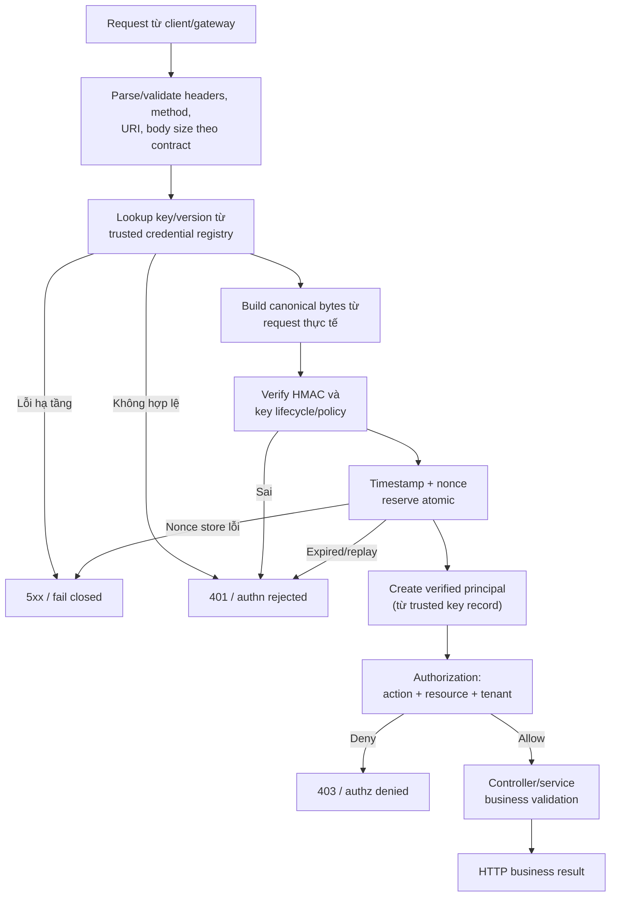
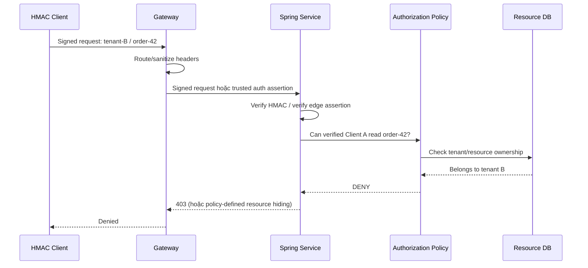

# Trộn authentication và authorization: anti-pattern nguy hiểm trong xác thực HMAC HTTP request

## 1. Vì sao đây là anti-pattern?

Trong module `SECURITY_AUTHENTICATION_HMAC_REQUEST_AUTHENTICATION`, client ký HTTP request bằng **HMAC với shared secret**. Server xác minh chữ ký trên **canonical request** bao gồm HTTP method, URI và các header hoặc body được ký theo hợp đồng; kiểm tra timestamp/nonce chống replay, key rotation và trạng thái credential. Chỉ sau khi các bước này thành công, hệ thống mới có cơ sở xác định **client/principal đã được xác thực**.

**Authentication (xác thực)** trả lời: “Bằng chứng HMAC của request này có hợp lệ, mới, chưa phát lại, được tạo bằng credential đang được phép hay không; credential đó thuộc principal nào?”

**Authorization (phân quyền)** trả lời: “Principal đã được xác thực này có được thực hiện **hành động cụ thể** trên **tài nguyên cụ thể**, trong **tenant/phạm vi cụ thể**, tại **thời điểm này** hay không?”

**Anti-pattern trộn authentication và authorization** xuất hiện khi code coi việc ký HMAC đúng là đủ quyền, dùng thông tin quyền do client tự khai để tạo `Authentication`, đặt logic nghiệp vụ vào HMAC verifier, hoặc trả sai trạng thái `401`/`403` làm che một lỗ hổng phân quyền.

Ví dụ một client có key HMAC hợp lệ dùng để **đọc đơn hàng của tenant A**:

```http
GET /api/tenants/tenant-b/orders/42 HTTP/1.1
X-Key-Id: partner-a-key-v3
X-Request-Timestamp: <valid-timestamp>
X-Request-Nonce: <new-nonce>
X-HMAC-Signature: <valid-signature-for-this-exact-request>
```

Chữ ký hoàn toàn có thể **hợp lệ**: client sở hữu đúng key và ký đúng path tenant B. Nhưng điều đó **không chứng minh** client có quyền đọc đơn hàng tenant B. Nếu server cho qua chỉ vì `signatureValid == true`, ứng dụng có lỗi **Broken Object Level Authorization (BOLA)/IDOR**.

Mục tiêu bài học là nhận diện, kiểm thử và sửa anti-pattern mà **không bỏ** các bảo đảm HMAC: canonical bytes nhất quán, so sánh chữ ký an toàn, freshness/nonce atomic, key rotation, gateway/proxy trust boundary và xử lý lỗi fail-closed.

### Kết quả học tập

Sau bài này, người học có thể:

1. Phân biệt HMAC proof-of-possession, identity/principal, credential policy và quyền truy cập tài nguyên.
2. Phát hiện các đoạn code “HMAC đúng ⇒ admin/allowed” và các biến thể tinh vi.
3. Thiết kế pipeline xác thực trước, phân quyền sau với đối tượng đã được xác minh.
4. Định nghĩa rõ HTTP `401`, `403` và `5xx`; không dùng lỗi một tầng để che tầng khác.
5. Cấu hình Spring Security MVC/WebFlux, method security và resource-level authorization.
6. Chống giả mạo tenant, scope, role, key ID và forwarded identity khi đi qua gateway.
7. Viết ma trận kiểm thử HMAC hợp lệ nhưng **không có quyền**, multi-tenant, rotation và replay.
8. Quan sát audit/metrics không tiết lộ shared secret, signature hoặc dữ liệu nhạy cảm.

## 2. Năm đối tượng phải phân biệt trong một request HMAC

Một request HMAC chứa nhiều thông tin nhìn giống “danh tính”, nhưng chúng có trạng thái tin cậy khác nhau.

| Khái niệm | Ví dụ | Ai cung cấp? | Điều chứng minh |
| --- | --- | --- | --- |
| **Claimed key ID** | `X-Key-Id: partner-a-v3` | HTTP client, **chưa tin cậy** | Chỉ là khóa tra cứu *được đề xuất* |
| **Shared secret/key record** | Secret version v3, key state ACTIVE | Credential registry/secret store do server kiểm soát | Chất liệu để xác minh MAC và lifecycle |
| **Signed request evidence** | MAC, timestamp, nonce, canonical method/URI/header/body | Client tạo; server tự xác minh | Request có bằng chứng sử dụng key hợp lệ trong phạm vi hợp đồng |
| **Verified principal** | `clientId=partner-a`, `tenantId=tenant-a` | Server ánh xạ từ key record **sau xác thực** | Danh tính/ứng dụng đã được xác thực |
| **Authorization decision** | `ALLOW orders:read tenant-a/order-42` | Policy engine/service theo thông tin tin cậy | Quyền trên hành động và đối tượng cụ thể |

**Một chữ ký HMAC hợp lệ không tự tạo quyền mới.** Chữ ký ràng buộc dữ liệu client đã gửi với một secret tin cậy; nếu client ký chuỗi `role=admin`, điều đó chỉ chứng minh client đã ký yêu cầu có chuỗi đó, **không chứng minh server đã cấp vai trò admin**.

Cũng không đồng nghĩa một key HMAC là danh tính người dùng cuối. Một integration client có thể thay mặt nhiều người dùng, nhưng **ủy quyền thay mặt** cần hợp đồng delegation/token và kiểm tra riêng; không mặc nhiên suy ra end-user identity chỉ từ key ID.

### 2.1. Những câu hỏi cần có câu trả lời riêng

- **Authentication:** Chữ ký có đúng secret version, algorithm và canonical request không? Timestamp còn hạn? Nonce chưa dùng? Key đã revoke chưa?
- **Identity resolution:** Key record đã xác minh thuộc client/tenant nào? Có bị disabled không? Có chính sách mapping nào?
- **Authorization:** Client có `orders:read` không? Đơn hàng này thuộc tenant nào? Client có được đọc đơn hàng này? Có hạn mức, trạng thái hay business policy ngăn không?
- **Business execution:** Request có hợp lệ theo nghiệp vụ? Đơn hàng tồn tại? Giao dịch có được ghi và có idempotency không?

Câu hỏi sau không thể được bỏ qua chỉ vì câu trước thành công.

## 3. Pipeline đúng: xác thực, định danh, phân quyền, rồi nghiệp vụ



Đây là trình tự **minh họa**. Một số bước validate timestamp về cú pháp/cửa sổ có thể diễn ra sớm để tiết kiệm chi phí, nhưng không được dùng điều đó để bỏ xác minh MAC. Điều kiện cốt lõi: **không có principal được xác thực trước khi đủ bằng chứng**, và **không có quyết định quyền chỉ dựa vào chữ ký đúng**.

Về mặt thiết kế, tách trách nhiệm:

| Thành phần | Trách nhiệm chính | Không nên làm |
| --- | --- | --- |
| `HmacRequestParser` | Parse/validate header, algorithm ID, kích thước, duplicate | Cấp role từ header client |
| `HmacRequestVerifier` | Dựng canonical bytes, xác minh MAC và freshness/nonce | Quyết định ownership từng order |
| `CredentialRegistry` | Key state/version, client identity và policy reference tin cậy | Tin `X-Tenant-Id` do client khai |
| `AuthenticationProvider/Manager` | Trả `Authentication` từ bằng chứng đã xác minh | Trả admin authentication khi HMAC match |
| `AuthorizationManager`/policy service | Kiểm tra authorities, tenant, resource ownership | Tính lại HMAC để “cấp quyền” |
| Controller/service | Thực thi khi đã qua check, kiểm tra business invariant | Dùng raw key ID thay resource policy |
| Audit logger | Ghi authn/authz decisions tách biệt | Dump secret, MAC, canonical string |

## 4. Anti-pattern số 1: “Signature hợp lệ ⇒ cho phép mọi thao tác”

Đây là hình thức rõ nhất nhưng dễ lọt vào code khi ban đầu API chỉ có một route.

### 4.1. Code sai

```java
// SAI: thành công cryptographic verification bị nhầm thành mọi quyền.
if (hmacVerifier.isValid(request)) {
    orderService.deleteOrder(request.getParameter("orderId"));
    response.setStatus(200);
} else {
    response.setStatus(401);
}
```

Nếu shared secret phục vụ tích hợp chỉ-đọc, người sở hữu key vẫn có thể gọi route xóa khi biết cách ký đúng method/path/body. Ký được request **không đồng nghĩa** được phép thực hiện hành động đó.

Một biến thể:

```java
// SAI: mọi client có HMAC đúng đều trở thành admin.
new UsernamePasswordAuthenticationToken(
        clientId,
        null,
        List.of(new SimpleGrantedAuthority("ROLE_ADMIN")));
```

Tạo token authenticated với `ROLE_ADMIN` ngay trong HMAC filter sẽ khiến mọi policy `hasRole("ADMIN")` chấp nhận. Đây là lỗi leo thang đặc quyền ở bước identity mapping.

### 4.2. Thiết kế đúng

Verifier trả về một đối tượng **verified identity** tối thiểu; authorities được lấy từ server-side policy của credential/client, không từ dữ liệu HTTP tùy ý:

```java
public record VerifiedHmacClient(
        String clientId,
        String tenantId,
        String storedKeyId,
        long credentialRevision,
        Set<String> allowedAuthorityNames) {
}
```

Trong kiến trúc đơn giản, sau khi verifier đã hoàn thành **MAC + timestamp + nonce + key-state**, có thể tạo `Authentication`:

```java
VerifiedHmacClient verified = verifier.verify(request);

List<GrantedAuthority> authorities =
        trustedPolicy.lookupAuthorities(
                verified.clientId(),
                verified.credentialRevision()).stream()
                .map(SimpleGrantedAuthority::new)
                .toList();

Authentication authentication =
        UsernamePasswordAuthenticationToken.authenticated(
                verified, null, authorities);
```

Đây là **đoạn minh họa**; `verifier` và `trustedPolicy` do ứng dụng định nghĩa. Phương thức factory `authenticated(...)` **không tự kiểm tra HMAC**: nếu code gọi nó trước verifier, ứng dụng vẫn có lỗ hổng. Khi policy lookup không sẵn sàng, phải xử lý theo chính sách fail-closed, không cấp authority rộng mặc định.

Ngay cả khi token có `orders:read`, vẫn phải kiểm tra **resource ownership** trong `tenantId` cụ thể.

## 5. Anti-pattern số 2: lấy role/scope/tenant từ header hoặc body đã được ký

Một lỗi tinh vi hơn:

```http
POST /api/orders HTTP/1.1
X-Key-Id: partner-a-v3
X-Tenant-Id: tenant-b
X-Role: admin
X-Request-Timestamp: ...
X-Request-Nonce: ...
X-HMAC-Signature: <valid-signature-over-all-signed-fields>
```

Developer cho rằng vì `X-Tenant-Id` và `X-Role` là **signed headers**, nên giá trị đó “đáng tin”. Thực tế client có shared secret có thể ký **bất kỳ giá trị nào** trong các trường mà hợp đồng cho phép họ đặt. HMAC bảo vệ khỏi sửa đổi bởi người không biết secret, **không buộc client chỉ gửi giá trị họ được cấp quyền**.

### 5.1. Code sai

```java
// SAI: claim do client kiểm soát, dù được ký, vẫn không cấp quyền.
if (hmacIsValid(request)) {
    String role = request.getHeader("X-Role");
    String tenant = request.getHeader("X-Tenant-Id");
    return createAuthentication(clientKeyId, role, tenant);
}
```

Cũng sai khi lấy `role=admin` từ JSON body có chữ ký và biến nó thành `GrantedAuthority("ROLE_ADMIN")`. Dữ liệu ký vẫn là **yêu cầu của client**, không phải quyết định của policy server.

### 5.2. Quy tắc đúng

- `tenantId` trong URL/header/body là **requested tenant**, không phải verified tenant.
- `scopes` trong HMAC request là **requested operations**, không phải scopes đã cấp.
- `keyId` là **lookup hint** trước verify, không phải authenticated client.
- Principal/authorities đến từ trusted credential record và policy.
- Nếu client yêu cầu tenant khác, kiểm tra quyền cross-tenant **sau xác thực** và từ chối khi không đủ điều kiện.

Có thể dùng client-supplied claims như **input cho authorization**: “Client A muốn sửa tenant B”, nhưng quyết định vẫn dựa trên policy của server.

## 6. Anti-pattern số 3: dùng key ID làm danh tính trước khi HMAC hợp lệ

Ví dụ:

```java
// SAI: principal được tạo dựa vào string do client tự khai.
String keyId = request.getHeader("X-Key-Id");
SecurityContextHolder.getContext().setAuthentication(
        UsernamePasswordAuthenticationToken.authenticated(
                keyId, null, List.of(
                        new SimpleGrantedAuthority("orders:write"))));

// HMAC được xác minh sau đó, hoặc có nhánh quên verify.
hmacVerifier.verify(request);
```

Vì header `X-Key-Id` chưa được chứng minh, attacker có thể gửi ID của client khác để nhận quyền nếu code sử dụng `Authentication` sớm, có lỗi xử lý exception hoặc downstream bắt đầu chạy trước verifier.

**Yêu cầu:** chỉ xây authenticated token **sau khi**:
1. Key ID đã được parse/validate, tra bản ghi tin cậy.
2. Key version/algorithm/protocol được server cho phép.
3. Canonical request được server tự dựng từ method/path/query/header/body đúng contract.
4. HMAC được xác minh.
5. Timestamp hợp lệ và nonce được reserve atomically.
6. Key state chưa revoked/expired và client identity được xác nhận.

Nếu nonce store timeout, không được “tạm” gắn principal rồi cho qua; đây là **authentication unavailable**, phải fail closed.

### 6.1. Lookup success chưa phải authentication success

Một request khai key ID đang tồn tại nhưng signature sai vẫn **chưa được xác thực**. Trong log, phân biệt `claimed_key_id_present` với `verified_client_tag`. Không gắn key ID do client tự khai vào `Authentication#getName()` trước khi verification thành công.

## 7. Anti-pattern số 4: nhét resource authorization vào HMAC verifier

Một team có thể muốn verifier trả về `true/false` cho cả chữ ký và quyền:

```java
// SAI THIẾT KẾ: trộn MAC verification với business ownership.
boolean verifyHmacAndPermission(HttpServletRequest request) {
    if (!verifySignature(request)) return false;

    String orderId = parseOrderIdFromUri(request);
    return orderRepository.belongsToClient(
            orderId, request.getHeader("X-Key-Id"));
}
```

Những vấn đề:

- Verifier phải hiểu route/resource schema; thêm API mới gây coupling.
- `false` không phân biệt invalid signature (`401`) với thiếu quyền (`403`).
- Truy vấn quyền dùng raw key ID chưa chắc là verified identity.
- Policy phức tạp như tenant membership, delegated access, trạng thái đơn hàng khó quản lý.
- Caching hoặc key rotation của verifier có thể vô tình cache quyền tài nguyên.
- Khi repository outage, code có thể gán lỗi thành bad credential hoặc tự bỏ qua check.

### 7.1. Phân tầng đúng

```text
HmacRequestVerifier.verify(request)
    -> VerifiedHmacClient

TrustedPrincipalMapper.map(verified)
    -> Authentication (authenticated, bounded authorities)

AuthorizationManager / application policy
    -> ALLOW or DENY(action, resource, tenant, context)

Business service
    -> data access / mutation với invariant thích hợp
```

Ví dụ resource policy:

```java
public boolean canReadOrder(
        VerifiedHmacClient principal,
        String requestedTenantId,
        String orderId) {

    if (!principal.allowedAuthorityNames()
            .contains("orders:read")) {
        return false;
    }

    if (!principal.tenantId().equals(requestedTenantId)) {
        return delegatedTenantPolicy.isAllowed(
                principal.clientId(), requestedTenantId, "orders:read")
            && orderRepository.belongsToTenant(
                orderId, requestedTenantId);
    }

    return orderRepository.belongsToTenant(
            orderId, principal.tenantId());
}
```

Đây là **pseudocode domain policy**: cần triển khai chính xác logic delegated access, query scoping, kiểm tra ownership và lỗi repository. Không coi `equals(tenantId)` là đầy đủ nếu entity có quy tắc sharing/owner khác. Khi repository/policy engine không truy cập được, phải **deny/fail closed**, không mặc định `true`.

### 7.2. Authorization có thể nằm ở nhiều lớp

Route-level authorization kiểm tra coarse authority (`orders:read`), còn service/repository kiểm tra tenant/resource ownership. Điều này không phải “trộn tầng”; đó là **phân quyền nhiều mức**, với trách nhiệm rạch ròi. Không nên chuyển resource ownership vào signer hoặc parser chỉ để giảm số class.

## 8. Anti-pattern số 5: lẫn lộn HTTP 401, 403 và 5xx

Một endpoint trả `401` cho mọi lỗi “security” sẽ khiến client nghĩ secret sai ngay cả khi HMAC đã được xác thực, hoặc hệ thống đang mất nonce store.

| Tình huống | Giai đoạn | Phản hồi thường phù hợp | Vì sao |
| --- | --- | --- | --- |
| Thiếu credential HMAC | Authentication | `401` | Chưa xác thực |
| Signature sai hoặc key revoked | Authentication | `401` | Bằng chứng/credential không hợp lệ |
| Timestamp out-of-window / nonce replay | Authentication/freshness | `401` theo contract | Chưa hoàn tất xác thực request mới |
| Duplicate/malformed auth headers | Input/authentication | `400` hoặc `401` theo contract | Input sai grammar, không nên `500` |
| HMAC đúng, thiếu `orders:read` | Authorization | `403` | Principal hợp lệ nhưng không có quyền |
| HMAC đúng, truy cập order tenant khác | Resource authorization | `403` hoặc `404` theo resource-hiding policy | Không được cấp quyền tài nguyên |
| Key/nonce store timeout | Authentication dependency | `503`/`5xx` phù hợp | **Không thể xác minh an toàn** |
| Policy engine outage | Authorization dependency | `5xx` phù hợp và **không thực thi** | Không có quyết định ALLOW đáng tin |
| HMAC + authz đều đúng nhưng body nghiệp vụ sai | Business validation | `400`/`422` tùy contract | Không phải lỗi HMAC |
| HMAC + authz đúng nhưng DB nghiệp vụ lỗi | Business processing | `5xx` phù hợp | Không đổi thành invalid signature |

### 8.1. Spring Security ExceptionTranslationFilter không thay thế verifier

Trong Servlet, `ExceptionTranslationFilter` xử lý `AuthenticationException` bằng `AuthenticationEntryPoint`; đối với `AccessDeniedException`, nó có thể gọi entry point nếu request là anonymous/remember-me hoặc dùng `AccessDeniedHandler` cho principal đã xác thực.

Vì vậy không thể nói máy móc “mọi `AccessDeniedException` luôn 403”. Điều quan trọng là **trạng thái authentication thực** và chính sách route.

Ví dụ cấu hình rõ error paths:

```java
http.exceptionHandling(errors -> errors
    .authenticationEntryPoint((request, response, ex) -> {
        response.setStatus(HttpServletResponse.SC_UNAUTHORIZED);
        response.setContentType("application/problem+json");
        response.getWriter().write(
            "{\"title\":\"Unauthorized\",\"status\":401}");
    })
    .accessDeniedHandler((request, response, ex) -> {
        response.setStatus(HttpServletResponse.SC_FORBIDDEN);
        response.setContentType("application/problem+json");
        response.getWriter().write(
            "{\"title\":\"Forbidden\",\"status\":403}");
    }));
```

Đây là ví dụ tĩnh để minh họa semantics; production cần chuẩn HTTP problem details, `WWW-Authenticate` phù hợp scheme nếu contract yêu cầu, encoding và centralized response handling. Không đưa `ex.getMessage()`, expected MAC hay key status vào response.

**HMAC filter chạy trước `ExceptionTranslationFilter` có thể phải tự gọi entry point**, bởi filter downstream chưa chạy để bắt exception. Không dựa vào assumption rằng mọi exception từ custom filter sẽ tự thành `401`.

## 9. Spring Security MVC: filter chỉ xác thực, route/method policy cấp quyền

Ở Spring MVC, có thể sử dụng `OncePerRequestFilter` kết hợp `SecurityFilterChain`. Trọng tâm là không để HMAC verifier kiểm tra order ownership hoặc tự cấp quyền admin.

### 9.1. Thiết kế filter tách trách nhiệm

```java
public final class HmacAuthenticationFilter
        extends OncePerRequestFilter {

    private final HmacRequestVerifier verifier;
    private final VerifiedClientAuthorities authorities;
    private final AuthenticationEntryPoint entryPoint;

    public HmacAuthenticationFilter(
            HmacRequestVerifier verifier,
            VerifiedClientAuthorities authorities,
            AuthenticationEntryPoint entryPoint) {
        this.verifier = verifier;
        this.authorities = authorities;
        this.entryPoint = entryPoint;
    }

    @Override
    protected void doFilterInternal(
            HttpServletRequest request,
            HttpServletResponse response,
            FilterChain chain)
            throws ServletException, IOException {

        final VerifiedHmacClient verified;
        final Authentication authentication;
        try {
            verified = verifier.verify(request);
            var granted = authorities.forVerifiedClient(verified);
            authentication =
                UsernamePasswordAuthenticationToken.authenticated(
                    verified, null, granted);
        } catch (AuthenticationException ex) {
            SecurityContextHolder.clearContext();
            entryPoint.commence(request, response, ex);
            return;
        }

        SecurityContext context =
                SecurityContextHolder.createEmptyContext();
        context.setAuthentication(authentication);
        SecurityContextHolder.setContext(context);

        try {
            // Nếu verifier đã tiêu thụ body, phải phát lại exact bytes
            // qua wrapper do verifier cung cấp cho filter chain.
            chain.doFilter(request, response);
        } finally {
            SecurityContextHolder.clearContext();
        }
    }
}
```

Đây là **khung minh họa**: `HmacRequestVerifier`, `VerifiedClientAuthorities` và `VerifiedHmacClient` là API ứng dụng giả định. Trong code thật phải bổ sung chính sách key/nonce store error tách với `AuthenticationException`, matcher route, request wrapper phát lại body, và handling async dispatch phù hợp.

Những điểm cốt lõi:

- Chỉ catch lỗi xác thực **quanh bước verify/map principal**, không bao `chain.doFilter(...)` để tránh biến lỗi authorization/controller thành `401`.
- Không tạo authenticated token nếu chỉ parse được `X-Key-Id`.
- Chỉ tạo authorities từ trusted policy; nếu policy store unavailable, fail closed.
- Với Servlet, `SecurityContextHolder` cần cleanup đúng vòng đời dispatch/async; trong dự án thực, dùng context strategy và cơ chế Spring Security phù hợp.
- `OncePerRequestFilter` cần được gắn đúng chain, tránh tự đăng ký lần hai như container filter.

### 9.2. SecurityFilterChain chỉ thể hiện coarse policy

```java
@Bean
SecurityFilterChain hmacApi(
        HttpSecurity http,
        HmacAuthenticationFilter hmacFilter) throws Exception {

    return http
        .securityMatcher("/api/**")
        .csrf(csrf -> csrf.disable()) // Chỉ cho API stateless, không cookie auth.
        .sessionManagement(session -> session
            .sessionCreationPolicy(SessionCreationPolicy.STATELESS))
        .authorizeHttpRequests(auth -> auth
            .requestMatchers(
                HttpMethod.GET, "/api/tenants/*/orders/**")
                .hasAuthority("orders:read")
            .requestMatchers(
                HttpMethod.POST, "/api/tenants/*/orders")
                .hasAuthority("orders:create")
            .anyRequest().denyAll())
        .addFilterBefore(
            hmacFilter, UsernamePasswordAuthenticationFilter.class)
        .build();
}
```

Mẫu code không đại diện toàn bộ ứng dụng. Nếu `/actuator/**` hoặc public endpoints tồn tại, cần security chain khác **với matcher rõ ràng**, default deny và thứ tự filter phù hợp. Regex/wildcard trong `requestMatchers` phải được kiểm tra theo matcher implementation/version cụ thể.

**Quan trọng:** `hasAuthority("orders:read")` chỉ xác nhận quyền loại thao tác; nó **không chứng minh** client được đọc mọi `orderId` của mọi tenant. Cần policy ở method/service layer.

### 9.3. Method-level + resource-level authorization

```java
@EnableMethodSecurity
@Configuration
class MethodSecurityConfig {
}

@Service
public class OrderQueryService {

    private final OrderAccessPolicy orderAccess;
    private final OrderRepository repository;

    public OrderQueryService(
            OrderAccessPolicy orderAccess,
            OrderRepository repository) {
        this.orderAccess = orderAccess;
        this.repository = repository;
    }

    @PreAuthorize("@orderAccess.canRead(authentication,"
            + " #tenantId, #orderId)")
    public OrderDto getOrder(
            String tenantId, String orderId) {

        // Repository vẫn nên truy vấn theo tenant để giảm BOLA/race.
        return repository.findByTenantIdAndOrderId(
                tenantId, orderId).orElseThrow(NotFoundException::new);
    }
}
```

`OrderAccessPolicy` kiểm tra principal đã verified, authority và ownership từ trusted store; các kiểu repository/DTO là code ứng dụng. `@PreAuthorize` chỉ phát huy tác dụng khi method security được bật và invocation đi **qua Spring proxy**; self-invocation trong cùng bean có thể bypass interceptor. Dùng integration tests cho cả đường controller → service, không chỉ gọi private helper.

Nếu tenant/resource được đổi giữa authorization check và mutation, có nguy cơ **time-of-check/time-of-use (TOCTOU)**. Với operations nhạy cảm, kết hợp filter theo tenant trong query/transaction/conditional update; không chỉ “kiểm tra trước rồi update ID bất kỳ”.

## 10. Spring WebFlux: authentication trong reactive chain, authorization theo Reactor Context

Trong WebFlux, authentication có thể dùng `AuthenticationWebFilter`, `ServerAuthenticationConverter` và `ReactiveAuthenticationManager`. Authorization có thể dùng `SecurityWebFilterChain`, reactive method security hoặc policy service bất đồng bộ.

### 10.1. Không nhầm converter với authenticator

`ServerAuthenticationConverter` có nhiệm vụ **đọc request và tạo authentication candidate chưa verified**. Nó không được biến `X-Key-Id` thành `authenticated=true`.

```java
// PSEUDOCODE: tạo candidate chưa xác thực từ request.
Mono<Authentication> convert(ServerWebExchange exchange) {
    HmacEvidence evidence = extractHeadersAndRequest(exchange);
    return Mono.just(
        new HmacAuthenticationCandidate(evidence)); // authenticated=false
}
```

`HmacAuthenticationCandidate` là class riêng do ứng dụng định nghĩa. Manager sẽ dựng canonical bytes, xác minh MAC, timestamp/nonce, key state và trả authentication thực sự. Không dùng `UsernamePasswordAuthenticationToken.authenticated(...)` ở converter.

### 10.2. Authorization tách biệt

Ví dụ policy reactive ở service:

```java
public Mono<OrderDto> readOrder(
        String tenantId,
        String orderId) {

    return ReactiveSecurityContextHolder.getContext()
        .map(SecurityContext::getAuthentication)
        .switchIfEmpty(Mono.error(
            new AccessDeniedException("Access denied")))
        .flatMap(authentication ->
            orderAccess.canReadReactive(
                authentication, tenantId, orderId))
        .flatMap(allowed -> {
            if (!allowed) {
                return Mono.error(
                    new AccessDeniedException("Access denied"));
            }
            return repository.findByTenantAndId(
                tenantId, orderId);
        });
}
```

Đoạn này là **mẫu logic minh họa**, không phải method security hoàn chỉnh; `orderAccess` và `repository` là reactive API ứng dụng. Policy trả **`Mono<Boolean>`** với quyết định từ trusted principal và resource. Nếu policy call lỗi, không `onErrorReturn(true)`. Cũng không tự `subscribe()` hoặc `block()` trong Netty event loop.

Trong ứng dụng thực, có thể chọn `@EnableReactiveMethodSecurity` và `@PreAuthorize`, hoặc `ReactiveAuthorizationManager`. Dù chọn công cụ nào, cần **một policy nguồn tin cậy** và tests chứng minh nhiều tenant.

### 10.3. Context propagation và thời điểm tạo principal

`ReactiveSecurityContextHolder` dùng Reactor Context; không tin `ThreadLocal` hay MDC như identity source xuyên scheduler. Những điểm cần kiểm tra:

- Authenticated principal chỉ được emit sau HMAC + freshness/nonce thành công.
- Khi `Mono` lỗi/cancel/retry, không phát business operation trước authz decision.
- Khi request body là `Flux<DataBuffer>`, quản lý size limit, pooled buffer release và replay exact bytes.
- Remote key/nonce/policy lookup không block event loop; đặt timeout/concurrency giới hạn.
- Không chuyển thông tin nhạy cảm như secret, supplied signature, canonical string vào Reactor Context hoặc trace baggage.
- Không reuse mutable authentication object giữa nhiều request.

## 11. Chữ ký HMAC đúng vẫn có thể là request vượt quyền: BOLA/IDOR

Hãy xét API:

```text
GET /api/tenants/{tenantId}/orders/{orderId}
```

Client A được xác thực là `tenant-a`, có authority `orders:read` cho tenant A. Request tới:

```text
GET /api/tenants/tenant-b/orders/42
```

vẫn có thể được ký hợp lệ với secret của A. Nếu server chỉ kiểm tra `hasAuthority("orders:read")`, nó có thể tiết lộ đơn hàng tenant B.

### 11.1. Cách bảo vệ nhiều tầng

1. **Authentication:** verified client A với key active, MAC đúng, timestamp/nonce mới.
2. **Coarse authorization:** có `orders:read`.
3. **Tenant authorization:** client được phép truy cập requested `tenant-b` hay không? Nếu không → deny.
4. **Object authorization:** `order-42` có thật thuộc tenant B và client có policy đọc nó không?
5. **Data access scope:** truy vấn được ràng buộc tenant/owner, không truy cập một record bất kỳ chỉ bằng global ID.
6. **Response shaping:** chỉ trả thuộc tính dữ liệu mà principal được quyền nhận.

Nếu policy cố ý che sự tồn tại của tài nguyên, API có thể trả `404` thay `403` ở tầng resource. Nhưng test nội bộ vẫn phải xác nhận **authorization denied**, không coi `404` do thiếu route là bằng chứng.

### 11.2. Data access scoping quan trọng hơn kiểm tra boolean đơn độc

```sql
-- Ví dụ truy vấn có tenant scope.
SELECT id, tenant_id, status
FROM orders
WHERE id = :order_id
  AND tenant_id = :authorized_tenant_id;
```

`:authorized_tenant_id` phải đến từ **policy quyết định đã được chứng thực**, không lấy trực tiếp từ path. Khi principal có delegated cross-tenant access, scope phải được policy engine tính rõ trước khi xây query.

Với thao tác ghi:

```sql
UPDATE orders
SET status = :new_status
WHERE id = :order_id
  AND tenant_id = :authorized_tenant_id
  AND status = :expected_old_status;
```

Kiểm tra số hàng bị cập nhật và business invariants trong transaction. Điều này giảm nguy cơ TOCTOU và “đã check một object nhưng update object khác”.

## 12. Key rotation và authorization policy là hai lifecycle khác nhau

HMAC key rotation có thể chuyển từ key v3 sang v4, giữ `v3` ở trạng thái `previous_allowed` trong overlap. Điều này **không tự thay đổi quyền của client**.

| Tình huống | Authentication | Authorization |
| --- | --- | --- |
| Key v4 active, signature đúng | Accepted | Vẫn kiểm tra scopes/tenant/resource |
| Key v3 trong overlap hợp lệ | Accepted theo policy | **Không** tự cấp quyền cao hơn |
| Key v3 revoked sau cutoff | Rejected | Không đánh giá như authenticated principal |
| Key v4 active nhưng quyền `orders:create` bị thu hồi | Accepted | `403` trên create |
| Key bị lộ, attacker ký đúng | Có thể vượt HMAC cho đến khi revoke | Policy vẫn phải hạn chế phạm vi quyền |
| Credential registry không truy cập được | Fail closed/`5xx` | Không tự dùng stale superuser policy |
| Policy store không truy cập được | HMAC có thể xác minh được | Không thực thi thao tác thiếu quyết định ALLOW |

### 12.1. Không gắn quyền vĩnh viễn vào key cache

Nếu cache record quyền trên key v3 trong 30 phút, admin thu hồi `orders:write` nhưng verifier vẫn cấp authority cũ đến hết TTL, đó là lỗi stale authorization. Tách:

- **Key material cache:** theo key lifecycle, revoke latency và secret manager policy.
- **Identity mapping cache:** client/tenant identity từ registry đáng tin.
- **Authorization policy cache:** version, invalidation, TTL và yêu cầu consistency riêng.

Nếu policy yêu cầu revoke gần như tức thời, cache quyền phải hỗ trợ invalidate/fencing phù hợp. Không dùng key rotation như biện pháp duy nhất để thu hồi quyền; quyền là một domain policy riêng, có thể thay đổi mà không cần thay shared secret.

### 12.2. Không coi signed scopes là server-issued scopes

Một số client có thể gửi `X-Requested-Scope: orders:write` trong signed headers để mô tả yêu cầu. Server phải đối chiếu với **granted scopes** từ registry; trường signed chỉ là “requested”, không thể nâng quyền.

## 13. Gateway/proxy: xác thực tại edge không thay cho phân quyền tài nguyên

Gateway có thể xác minh HMAC trước khi rewrite URL, hoặc chỉ forward request để service xác minh. Hai kiến trúc đều đòi hỏi trust boundary rõ.



### 13.1. Verify-at-service

Service tự dựng canonical request từ method, URI, headers/body theo hợp đồng. Nếu gateway rewrite public path thành internal path:

```text
Client signs:       /public/v2/tenants/tenant-b/orders/42
Gateway upstream:   /internal/tenants/tenant-b/orders/42
```

Verifier phải biết **đúng target được ký ở trust boundary**, không tự thử cả public/internal paths đến khi khớp. `Forwarded` có thông tin như `for`, `by`, `host`, `proto`, nhưng không chuẩn hóa original path/query; `X-Original-URI` hoặc `X-Forwarded-Prefix` phải được gateway sanitize/overwrite và service chỉ tin ingress được cấu hình.

Sau khi HMAC hợp lệ, service vẫn phải kiểm tra tenant/resource authorization.

### 13.2. Verify-at-edge

Nếu edge là điểm xác minh HMAC duy nhất, backend cần nhận **assertion danh tính có bảo vệ** (mTLS/network isolation, trusted headers được ghi đè, hoặc signed internal assertion có audience/expiry phù hợp). Service phải ngăn client gọi thẳng backend với:

```http
X-Verified-Client: admin
X-Verified-Tenant: tenant-b
X-Verified-Roles: ROLE_ADMIN
```

Một header có tên “Verified” **không làm nó đáng tin**. Dù assertion được chứng thực, edge có thể chỉ cấp coarse identity/roles; service vẫn cần resource-level authorization theo tenant/order.

### 13.3. Không quyết định quyền dựa trên URL trước khi xác minh route chính xác

Gateway có thể áp coarse policy như “route cần HMAC” nhưng không phải lúc nào cũng biết mapping order → tenant. Nếu chỉ so prefix `/api/tenants/tenant-a/**` rồi cho phép, encoded path, duplicate slash, path traversal hoặc rewrite có thể gây route confusion. Test cần bảo đảm **resource cuối cùng được xử lý** thuộc scope đã cho phép.

## 14. Anti-pattern số 6: dùng HMAC sai để đánh lừa phân quyền hoặc ngược lại

Một số anti-pattern không hiển nhiên:

### 14.1. Chữ ký sai nhưng access token khác được chấp nhận

```java
// SAI: HMAC fail -> chuyển sang scheme yếu hơn.
try {
    return verifyHmac(request);
} catch (BadCredentialsException ex) {
    return verifyLegacyApiKey(request);
}
```

Nếu route được quy định HMAC-only, fallback này tạo đường bỏ qua HMAC/anti-replay. Mỗi route phải có **allowed authentication schemes** rõ ràng. Một request mang HMAC sai không được “cứu” bằng legacy key chỉ vì code muốn giảm `401`.

### 14.2. Phân quyền deny nhưng code lại yêu cầu xác thực lần nữa

```text
HMAC valid -> principal=client-A -> lacks orders:delete
Server returns 401 "invalid HMAC"
Client retries with new secret or another scheme
```

Đây là sai semantics, gây retry và làm mờ nguyên nhân policy. Trường hợp đã authenticated nhưng thiếu quyền thường là `403`. Nếu tài nguyên bị che theo policy `404`, hãy giữ audit nội bộ thể hiện authz denial.

### 14.3. Authorization timeout được coi là ALLOW

```java
// SAI: thuận lợi vận hành nhưng fail-open quyền.
try {
    return policyService.isAllowed(principal, resource);
} catch (Exception ex) {
    return true;
}
```

Nếu policy engine không thể kết luận, không được thực hiện nghiệp vụ protected. Trả lỗi hạ tầng phù hợp (ví dụ `503`) thay vì gán mọi outage thành `401` hay mặc định ALLOW.

### 14.4. “Role admin” từ key version hoặc algorithm

`HMAC-SHA512` không có nghĩa request có quyền cao hơn `HMAC-SHA256`. Một key mới cũng không mặc nhiên là key admin. Crypto strength, signing protocol version và key lifecycle **không phải nguồn quyền**.

### 14.5. Authentication thành công nhưng controller đã chạy trước policy

Trong asynchronous/reactive pipeline, một side effect có thể bị kích hoạt sớm nếu developer tự `subscribe()` hoặc gọi service trước khi chờ authorization. Test phải kiểm tra handler/repository invocation khi policy deny, không chỉ HTTP status cuối.

## 15. Dữ liệu đã ký có thể mang yêu cầu phân quyền, nhưng không phải quyết định phân quyền

Có lúc ứng dụng cần ký `tenant-id` hoặc `resource-id` để ngăn trung gian thay target. Điều này **đúng và cần thiết** cho integrity. Sai lầm là suy từ “đã được ký” thành “đã được cấp phép”.

Ví dụ:

```text
Canonical request:
HMAC-REQ-V2
GET
/api/tenants/tenant-b/orders/42
x-requested-tenant:tenant-b
<BASE64_SHA256_OF_EMPTY_BODY>
1795834800
nonce-fresh-test
```

Nếu client A tự ký đúng, HMAC có thể pass. Authorization vẫn phải hỏi: client A có thuộc tenant B hoặc được ủy quyền đọc order 42 không?

Một policy có thể xem signed field `x-requested-tenant` như **input không bị tamper từ phía client**, nhưng dữ liệu này vẫn phải được kiểm tra với server-issued entitlements. Nếu policy không cho phép, trả deny ngay cả khi chữ ký khớp.

### 15.1. Nếu path bị sửa sau ký thì là lỗi authentication integrity

Giả sử client ký:

```text
GET /api/tenants/tenant-a/orders/42
```

rồi gateway/attacker đổi thành:

```text
GET /api/tenants/tenant-b/orders/42
```

nhưng giữ nguyên signature, server phải từ chối HMAC nếu canonical path khác. Đây là **signature mismatch/`401`**, không phải `403` resource-level decision. Để test authorization `403`, phải **ký lại đúng path tenant B** bằng key hợp lệ của client A, dùng timestamp/nonce mới. Nếu không, test 403 có thể đỗ giả vì signature fail.

### 15.2. Query/body tương tự

Đổi `quantity=1` thành `quantity=100` sau khi ký thuộc message integrity khi field được ký. Nhưng gửi `quantity=100` và ký **đúng từ đầu** vẫn cần business/policy check hạn mức. HMAC không tự cung cấp business authorization.

## 16. Audit và metrics: giữ ranh giới authn/authz trong dữ liệu quan sát

Nếu audit chỉ có `security_failed`, người vận hành không biết nên kiểm tra MAC, nonce, key store hay IAM policy.

Một event sequence minh họa:

```text
request_id=req-1001, hmac.authentication.accepted,
    verified_client_tag=c-7, route=orders_read
request_id=req-1001, authorization.denied,
    reason=tenant_mismatch, route=orders_read
request_id=req-1001, http_status=403
```

Request khác:

```text
request_id=req-1002, hmac.authentication.rejected,
    reason=signature_mismatch, route=orders_read
request_id=req-1002, http_status=401
```

Và outage:

```text
request_id=req-1003, hmac.authentication.unavailable,
    dependency=nonce_store, route=orders_read
request_id=req-1003, http_status=503
```

**Không phát** `hmac.authentication.accepted` chỉ vì MAC bytes trùng nếu nonce là replay hoặc key đã revoke. Accepted phải có nghĩa toàn bộ HMAC authentication policy hoàn thành.

### 16.1. Structured log an toàn

```json
{
  "event_type": "authorization.denied",
  "request_id": "req-1001",
  "route_template": "/api/tenants/{tenantId}/orders/{orderId}",
  "verified_client_tag": "client-tag-07",
  "action": "orders:read",
  "reason_code": "tenant_mismatch",
  "http_status": 403
}
```

`verified_client_tag` phải đến từ **verified credential** và được pseudonym hóa theo policy. Không log raw shared secret, supplied/expected signature, full canonical request, nonce hoặc URL/body có PII.

Không gắn **raw key ID chưa xác thực** vào `authenticated_client` của failure logs. Khi chưa có principal, ghi `key_id_present=true` hoặc nhóm kết quả, không quy kết người sở hữu key.

### 16.2. Metrics hữu hạn

| Meter gợi ý | Outcome/tag hữu hạn | Dùng để |
| --- | --- | --- |
| `hmac.authentication.outcomes` | `accepted`/`rejected`/`unavailable` | Chẩn đoán MAC/freshness/store |
| `hmac.authentication.rejected` | `signature_mismatch`/`replay`/`timestamp` | Phân loại authn |
| `api.authorization.outcomes` | `allowed`/`denied`/`unavailable` | Theo dõi quyền |
| `api.authorization.denied` | `missing_authority`/`tenant_mismatch`/`resource_policy` | Điều tra BOLA và policy |
| `http.server.requests` | route template, status | So đối chiếu kết quả HTTP |
| `credential.lifecycle.events` | `rotated`/`revoked`/`expired` | Theo dõi key changes |

Các tên riêng trong bảng là **gợi ý custom meters**, không mặc định Spring Boot sinh ra. Không đưa key ID, tenant ID thô, nonce, signature, order ID, raw URI/query làm metric labels. Với dữ liệu đủ nhạy cảm, cân nhắc sampling/retention/log access riêng theo audit policy.

### 16.3. Dấu hiệu anti-pattern từ production

- Nhiều `200` cho route sensitive nhưng không có `authorization.allowed` tương ứng.
- `401` tăng ngay sau thay đổi IAM nhưng HMAC verifier metric vẫn bình thường.
- Client dùng key chỉ-đọc lại có accepted `orders:delete`.
- Cross-tenant order reads sau đổi path/query hoặc gateway config.
- Sau key rotation, authorities bất ngờ thay đổi dù policy không thay.
- Service chạy tiếp khi authorization store outage.

Đây là **tín hiệu điều tra**, chưa tự chứng minh exploit. Cần correlation, code/config review, resource-level tests và kiểm tra độ đầy đủ log.

## 17. Ma trận kiểm thử để phát hiện trộn authentication với authorization

Chỉ test “HMAC đúng → 200” và “HMAC sai → 401” **không đủ**. Phải có **HMAC hợp lệ nhưng thiếu quyền**.

| Trường hợp | HMAC + nonce/key state | Quyền/policy | Kết quả mong đợi |
| --- | --- | --- | --- |
| Đọc order tenant A bởi client A | Hợp lệ, nonce mới | Có `orders:read`, đúng tenant | Thành công theo endpoint |
| Đọc order tenant B bởi client A | **Hợp lệ cho đúng path B**, nonce mới | Không quyền tenant B | `403` hoặc `404` theo hiding policy, no data |
| Xóa order bởi client read-only | Hợp lệ, nonce mới | Thiếu `orders:delete` | `403` |
| Tạo order bởi client writer | Hợp lệ | Có `orders:create`, đúng tenant | Có thể `201` nếu business hợp lệ |
| Chữ ký sai, client có nhiều quyền | **Sai** | Bất kể quyền | `401`, không authz as verified |
| Path sửa sau ký | **Sai** | Không đến authz | `401` |
| Body sửa sau ký | **Sai** | Không đến authz | `401` |
| Timestamp expired | Không vượt freshness | Bất kể quyền | Reject theo authn policy |
| Nonce replay | Không vượt atomic replay check | Bất kể quyền | Reject; không side effect |
| Key revoked nhưng MAC bytes đúng | Không eligible | Bất kể quyền | `401` |
| Key rotation previous allowed | Hợp lệ trong overlap | Quyền theo policy hiện hành | Allow/deny độc lập |
| Key v4 active, scope bị rút | Hợp lệ | Không còn `orders:write` | `403` |
| Policy store outage | Hợp lệ | Không thể quyết định | `5xx` phù hợp, fail closed |
| Nonce store outage | Không thể xác minh an toàn | Không đánh giá ALLOW | `5xx` phù hợp, fail closed |
| Header `X-Role: admin` tự khai | Hợp lệ kể cả khi header được ký | Quyền server không cho admin | `403` trên admin operation |
| `X-Key-Id` của client khác, signature sai | Sai | Không dùng claimed identity | `401`, không forged principal |
| Direct backend với `X-Verified-Client` giả | Không có trusted edge proof | Không đủ trust | Reject |
| Two-node same nonce | Tối đa một request authenticated | Chỉ request accepted xét quyền | Không double execution |
| Gateway rewrite public path đúng contract | Hợp lệ | Quyền vẫn kiểm tra tại service | Theo policy |
| User-supplied tenant/path encoded | Hợp lệ theo một canonical target | Resource policy dựa target thực | Không BOLA/traversal |

**Đối chứng bắt buộc:** Để chứng minh authorization denial, test phải dựng **signature HMAC hợp lệ trên chính target bị cấm**, không tái sử dụng chữ ký path cũ. Mỗi case dùng nonce mới trừ case replay, tránh `401` do nonce trùng che mất kết quả cần quan sát.

## 18. MockMvc integration tests: kiểm tra 401 khác 403

Với Spring Boot 3 và Spring Security 6, có thể dùng `@SpringBootTest` + `@AutoConfigureMockMvc` để chạy HMAC filter thực. Dùng credential test riêng, signer độc lập, fake/staging nonce store atomic và tài nguyên seed theo tenant.

### 18.1. HMAC hợp lệ nhưng không đủ quyền

```java
@SpringBootTest
@AutoConfigureMockMvc
class HmacAuthnAuthzMvcIT {

    @Autowired MockMvc mvc;
    @Autowired HmacTestSigner signer;

    @Test
    void validHmacWithoutDeleteAuthorityReturns403()
            throws Exception {

        SignedFixtureRequest signed = signer.sign(
                "DELETE",
                "/api/tenants/tenant-a/orders/42",
                new byte[0],
                freshTimestamp(),
                freshNonce(),
                "read-only-client-key");

        mvc.perform(delete("/api/tenants/tenant-a/orders/42")
                .header("X-Key-Id", signed.keyId())
                .header("X-Request-Timestamp", signed.timestamp())
                .header("X-Request-Nonce", signed.nonce())
                .header("X-HMAC-Signature", signed.signature()))
            .andExpect(status().isForbidden());
    }
}
```

`HmacTestSigner`, `SignedFixtureRequest`, `freshTimestamp()` và `freshNonce()` là test fixtures do project cung cấp; header names, signed headers, body hash và timestamp format phải tuân theo contract thật. Credential read-only phải **đang active và ký đúng request DELETE**, không bị chặn vì key/nonce.

Thêm Mockito spy hoặc test audit sink để xác nhận:
- `hmac.authentication.accepted` xuất hiện cho request.
- `authorization.denied` chỉ ra `missing_authority`.
- `orderService.delete(...)` không được gọi.
- Không xuất hiện `signature_mismatch` hoặc `replay_detected`.

### 18.2. Chữ ký sai phải dừng trước phân quyền

```java
@Test
void badSignatureReturns401WithoutEnteringBusiness() throws Exception {
    SignedFixtureRequest signed = signer.sign(
            "DELETE", "/api/tenants/tenant-a/orders/42",
            new byte[0], freshTimestamp(), freshNonce(),
            "read-only-client-key");

    mvc.perform(delete("/api/tenants/tenant-a/orders/42")
            .header("X-Key-Id", signed.keyId())
            .header("X-Request-Timestamp", signed.timestamp())
            .header("X-Request-Nonce", signed.nonce())
            .header("X-HMAC-Signature", "invalid-signature"))
       .andExpect(status().isUnauthorized());

    verifyNoInteractions(orderMutationService);
}
```

Đây là mẫu minh họa; trong test thật, `orderMutationService` là test spy, cần reset interaction history giữa các cases. Assertion `401` không đủ nếu request không khớp security chain hoặc đã bị chặn ở gateway khác; cần xác nhận verifier thực sự được gọi.

### 18.3. Cross-tenant test với HMAC đúng

```java
@Test
void signedRequestForOtherTenantStillHasNoAccess()
        throws Exception {

    String forbiddenTarget =
        "/api/tenants/tenant-b/orders/99";

    // Ký CHÍNH path tenant-b, không ký tenant-a rồi mutate.
    SignedFixtureRequest signed = signer.sign(
        "GET", forbiddenTarget, new byte[0],
        freshTimestamp(), freshNonce(), "tenant-a-client-key");

    mvc.perform(get(forbiddenTarget)
        .header("X-Key-Id", signed.keyId())
        .header("X-Request-Timestamp", signed.timestamp())
        .header("X-Request-Nonce", signed.nonce())
        .header("X-HMAC-Signature", signed.signature()))
      .andExpect(status().isForbidden());
}
```

Nếu API chủ động trả `404` khi không được phép thấy tài nguyên, cập nhật expected response theo policy và assert **internal authorization denied**; đừng coi `404` route missing là kiểm thử hoàn chỉnh. Seed tenant B/order 99 thật trong test database để positive control chứng minh route/resource tồn tại.

## 19. WebFlux và kiểm thử side effect không được subscribe khi deny

Ví dụ WebFlux dùng `WebTestClient` qua `SecurityWebFilterChain`:

```java
@Test
void validHmacButWrongScopeReturns403() {
    SignedFixtureRequest signed =
            signer.signForWriterRestrictedToTenantA(
                "POST",
                "/api/tenants/tenant-b/orders",
                jsonBytes,
                freshTimestamp(),
                freshNonce());

    webTestClient.post()
        .uri("/api/tenants/tenant-b/orders")
        .contentType(MediaType.APPLICATION_JSON)
        .headers(headers -> addSignedHeaders(headers, signed))
        .bodyValue(jsonBytes)
        .exchange()
        .expectStatus().isForbidden();

    verifyNoInteractions(orderWriteGateway);
}
```

`signForWriterRestrictedToTenantA`, `addSignedHeaders` và `orderWriteGateway` là test fixtures. Test phải chứng minh HMAC hợp lệ theo **exact body bytes**; `bodyValue(jsonBytes)` và signed body cần khớp encoding/serialization do client transport gửi.

Trong reactive chain, chỉ nhìn response chưa đủ nếu downstream `Mono` có side effect khi được tạo hoặc đã `subscribe()` riêng. Với service spy, kiểm tra reactive publisher không thực thi DB write khi authorization bị từ chối. Không dùng blocking driver trên Netty event loop chỉ để thuận tiện tạo policy.

### 19.1. Test khi policy dependency lỗi

Giả lập policy store timeout:
- HMAC vẫn được xác minh bằng credential test hợp lệ.
- Service **không trả `200`**, không bỏ qua tenant check.
- Trả lỗi phù hợp với outage (thường `5xx`) và audit `authorization.unavailable`.
- Không ghi principal đã “authorized” chỉ vì checker ném exception.
- Sau recovery, request mới có nonce mới được xử lý; không dùng lại nonce của request đã có kết quả không chắc chắn như một retry vô điều kiện.

## 20. Review checklist và phương án refactor anti-pattern

Khi review một module HMAC hiện hữu, dùng chuỗi câu hỏi sau:

### 20.1. Source of authority

- Có code `ROLE_ADMIN` hoặc `orders:write` được hard-code trong filter khi signature đúng không?
- Có dùng `X-Role`, `X-Tenant-Id`, `X-Scope` hoặc JSON field đã ký **làm quyền được cấp** không?
- Có ánh xạ claimed `X-Key-Id` vào principal trước verification không?
- Key rotation hoặc upgrade HMAC algorithm có vô tình tăng quyền không?
- Có cache granted authorities không có invalidation khi revoke scope không?

### 20.2. Pipeline boundaries

- HMAC verifier có gọi controller/repository để quyết định ownership không?
- Resource authorization có chạy **trước khi có verified principal** không?
- Khi HMAC sai/nonce replay, có nhánh vẫn cho downstream chạy không?
- Khi authorization deny, có bất kỳ side effect nào đã thực hiện trước quyết định không?
- Có filter/exception handler nào chuyển `403` thành `401` khiến SDK retry credential không?
- Key/nonce/policy store outage có bị convert thành allow hoặc 401 thay vì fail closed không?

### 20.3. Spring Security configuration

- Có bao nhiêu `SecurityFilterChain`/`SecurityWebFilterChain` và precedence của chúng?
- Custom HMAC filter có bị đăng ký trùng như Servlet filter toàn cục không?
- Có `permitAll` matcher quá rộng hoặc fallback legacy scheme không?
- Method security có bật và thực sự được gọi qua proxy chưa?
- Các route GET/POST/DELETE có policies phù hợp chưa?
- Tenant/object-level policy có được thực thi trong service/repository không?
- Với WebFlux, có `block()`, `subscribe()` thủ công hoặc context leakage không?

### 20.4. Canonical/security invariants

- Method, URI/path/query, signed headers/body có đúng hợp đồng client/gateway/server không?
- HMAC comparison có dùng bytes/algorithm allowlist và key state đúng không?
- Timestamp/nonce có chống replay nhiều instance bằng atomic operation không?
- Key revoked/expired có bị từ chối ngay cả khi MAC đúng không?
- Gateway có sanitize identity/forwarded headers và không cho bypass không?
- Đã test chữ ký **đúng cho target bị cấm** để chứng minh authorization chưa?
- Log/metrics có tách authentication accepted, authorization denied và dependency unavailable không?

### 20.5. Refactor có kiểm chứng

Một kế hoạch sửa lỗi nên:

1. Định nghĩa HMAC verifier trả `VerifiedHmacClient` chỉ sau khi đủ các điều kiện authentication.
2. Loại bỏ hard-coded admin/scope và mọi authority do client tự khai.
3. Tạo trusted identity mapping từ key registry.
4. Đặt coarse route permissions ở `SecurityFilterChain`/`SecurityWebFilterChain`.
5. Đặt tenant/resource ownership trong policy service và data access layer.
6. Chuẩn hóa `401`/`403`/`5xx`; xử lý fail-closed.
7. Thêm integration tests có **valid HMAC + denied resource** và không có side effects.
8. Test proxy/public target, key rotation, nonce replay và legacy fallback.
9. Giám sát sau rollout các event authn/authz, authorization deny rate và accidental `200`.
10. Kiểm thử regression với nhiều client/tenant và cache invalidation.

Không “sửa” anti-pattern bằng cách gọi `hmacVerifier.verify(...)` thêm lần nữa trong authorization policy. Điều đó có thể gây nonce replay ngay trong cùng request hoặc làm tiêu tốn tài nguyên, trong khi vấn đề quyền vẫn chưa được giải quyết.

## 21. Bài thực hành: HMAC hợp lệ không được phép xóa order tenant khác

### 21.1. Đề bài

Xây API Spring Boot bảo vệ bằng HMAC-SHA256, với signing contract bao gồm:

```text
HMAC-REQ-V2
METHOD
CANONICAL_PATH_AND_QUERY
content-type:VALUE_OR_EMPTY
BASE64(SHA256(EXACT_REQUEST_BODY_BYTES))
TIMESTAMP
NONCE
```

Client có credential key ID/version được tra từ registry; server dùng shared secret, key rotation, timestamp window và Redis nonce store atomic. API chạy sau gateway rewrite public `/v2/tenants/...` sang internal `/api/tenants/...`. Tài nguyên thuộc tenant, quyền có `orders:read`, `orders:create` và `orders:delete`.

Dữ liệu kiểm thử:

| Client đã xác thực | Thuộc tenant | Authorities | Ví dụ được phép |
| --- | --- | --- | --- |
| `client-reader-A` | `tenant-a` | `orders:read` | GET order của tenant A |
| `client-writer-A` | `tenant-a` | `orders:read`, `orders:create` | GET/POST ở tenant A |
| `client-admin-B` | `tenant-b` | `orders:read`, `orders:delete` | GET/DELETE thuộc tenant B |
| `unknown-key` | Không có | Không có | Không được xác thực |

### 21.2. Yêu cầu triển khai

1. **Tạo signer độc lập:** HMAC canonical method, URI/path/query, headers, raw body, timestamp, nonce; golden vectors dùng secret test.
2. **Tạo registry:** key version/status, trusted client ID, tenant mapping và authority policy references; không lưu quyền trong raw HTTP input.
3. **Tách verifier:** trả verified client sau MAC, timestamp, nonce atomic và key state; không gọi repository order ở verifier.
4. **Tạo Authentication:** principal từ record đã xác minh; authorities từ policy hiện hành.
5. **Tạo authorization:** route-level scopes và object-level tenant/order ownership; repository query có tenant scope.
6. **Test 401:** signature sai, missing credential, expired timestamp, replay, revoked key; controller không chạy.
7. **Test 403:** client-reader-A ký đúng `DELETE tenant-a/order-42` nhưng không có quyền; client-reader-A ký đúng `GET tenant-b/order-99` nhưng không có quyền tenant.
8. **Test positive:** client-reader-A đọc order thuộc tenant A; client-admin-B xóa order thuộc B; dùng nonce mới cho mỗi request.
9. **Test signed tampering:** ký tenant A, đổi path thành tenant B sau ký → signature mismatch (`401`), phân biệt với authorization deny.
10. **Test outage:** nonce store và policy store mất khả dụng → fail closed, không side effect.
11. **Test rotation:** key cũ allowed trong overlap và key revoked; thay đổi key không tự đổi quyền.
12. **Test gateway:** URI rewrite bảo toàn HMAC contract; client không giả mạo `X-Verified-Client`/`X-Original-URI` để có quyền tenant khác.
13. **Quan sát:** audit có `authn.accepted`/`authz.denied` độc lập; metrics không có raw key ID, nonce, signature hoặc order ID.
14. **Review caching:** khi authority bị revoke, client dù có HMAC đúng vẫn không thể tiếp tục thao tác dựa vào cached grants quá hạn chính sách.

### 21.3. Câu hỏi tự kiểm tra

- Nếu HMAC ký cả `X-Role: admin`, vì sao server không được dùng header đó để cấp `ROLE_ADMIN`?
- Khi client A ký đúng request đọc order B, lỗi thuộc authentication hay authorization?
- Tại sao kiểm thử path tampering không thay thế kiểm thử cross-tenant với HMAC hợp lệ?
- Vì sao trả `401` cho một principal đã xác thực nhưng thiếu quyền có thể làm client tự retry/downgrade?
- Nếu key v4 active nhưng client bị rút `orders:delete`, thay key có giải quyết được yêu cầu phân quyền không?
- Nếu nonce store timeout, có được dựng principal trước rồi trả quyền theo cache cũ không?
- Một edge gateway xác minh HMAC có làm cho service không cần resource-level authorization nữa không?
- Tại sao test chỉ nhìn HTTP `403` chưa đủ nếu controller đã ghi DB trước đó?
- Khi `policyService.isAllowed(...)` ném exception, hệ thống nên fail open hay fail closed?
- Vì sao `SecurityContextHolder`/Reactor Context không được nhận identity từ raw key ID chưa xác minh?

### 21.4. Tiêu chí hoàn thành

Một triển khai được xem là sửa được anti-pattern khi chứng minh đồng thời:

- **Authentication** chỉ xác nhận credential/key state, canonical HMAC, timestamp/nonce; không gán quyền do client tự khai.
- **Authorization** dựa trên verified principal và policy hiện hành, phân biệt authority loại thao tác với quyền trên từng tenant/resource.
- HMAC đúng nhưng thiếu quyền bị từ chối trước mọi business side effect, thường `403` hoặc `404` theo resource-hiding policy.
- Signature mismatch, replay, expired/revoked key không tạo authenticated principal và được phân loại `401`; dependency outage fail closed với lỗi `5xx` thích hợp.
- Key rotation, algorithm upgrade và signed metadata không tự cấp quyền.
- Gateway/proxy trust boundary và public/internal canonical URI được kiểm chứng bằng test đúng raw bytes.
- Không có fallback sang legacy auth, không tin identity/role headers do Internet tự gửi.
- Audit/log/metric tách authn và authz, không chứa shared secret, signature, raw nonce hoặc dữ liệu nhạy cảm.
- Integration tests bao gồm **valid HMAC + forbidden action/resource**, cross-tenant, retry/replay, multi-instance và policy-cache invalidation.

**Kết luận:** HMAC chứng minh quyền **sử dụng một credential để ký một HTTP request cụ thể** trong giới hạn freshness và key policy; nó **không** chứng minh client có quyền thực hiện mọi hành động trên mọi tài nguyên. Anti-pattern trộn authentication với authorization biến một bằng chứng mật mã đúng thành một quyền truy cập sai. Tách ranh giới xác thực–định danh–phân quyền–nghiệp vụ, kiểm tra tenant/resource bằng policy tin cậy và viết negative tests với **chữ ký hợp lệ nhưng quyền không hợp lệ** là cách bảo vệ hệ thống khỏi leo thang đặc quyền, BOLA và nhầm lẫn vận hành.
