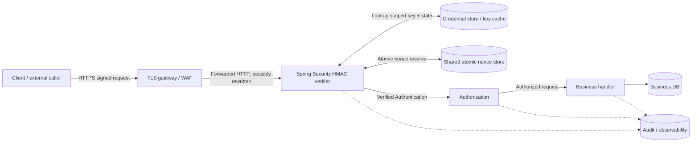
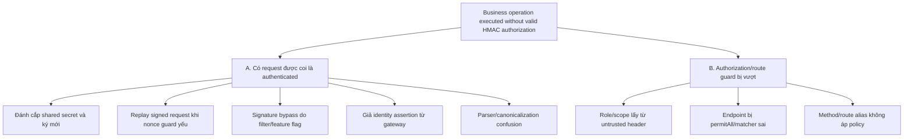

# Xác định threat model cho hệ thống xác thực HTTP request bằng HMAC

## 1. Bài toán thiết kế: xác thực HMAC đang chống lại ai?

Trong chương **Thiết kế HMAC system**, bước **Xác định threat model** đặt nền móng trước khi chọn thuật toán, viết filter hoặc triển khai Redis lưu nonce. HMAC có thể được tính đúng về mặt mật mã mà API vẫn không an toàn: một route không chạy filter, gateway tin header giả, client ký khác request server xử lý, hoặc request đã ký bị phát lại trong cửa sổ hiệu lực. Vì vậy, cần xác định **tài sản cần bảo vệ, kẻ tấn công có thể làm gì, ranh giới tin cậy ở đâu và mỗi biện pháp bảo vệ ngăn chính xác nguy cơ nào**.

Bài thuộc mô-đun `SECURITY_AUTHENTICATION_HMAC_REQUEST_AUTHENTICATION`, có mục tiêu thiết kế xác thực HTTP request bằng **HMAC với shared secret**, trên **canonical request** gồm method, URI, header và/hoặc body theo hợp đồng ký; xác minh chữ ký, chống replay bằng timestamp/nonce, quản lý key rotation, kiểm thử proxy/gateway và tách **authentication** khỏi **authorization**.

**Threat model** (mô hình đe dọa) không phải danh sách lỗ hổng có sẵn được sao chép vào tài liệu. Nó là giả thiết có thể kiểm chứng về hệ thống cụ thể: tác nhân đối kháng, điểm xâm nhập, tài sản, dữ liệu đi qua các trust boundary, cách tấn công khả thi, tác động, biện pháp giảm thiểu và **rủi ro còn lại**.

Sau bài này, người học có thể:

- Giới hạn phạm vi và xác định tài sản, mục tiêu an toàn, yêu cầu nghiệp vụ của API ký HMAC.
- Phân loại đối thủ không có secret, đối thủ biết secret, insider, caller qua proxy, client bị chiếm và thành phần nội bộ bị xâm nhập.
- Vẽ data-flow diagram, xác định nơi HMAC được verify và những chỗ không nên tin header/client identity.
- Dùng phương pháp STRIDE và abuse cases để tìm nguy cơ đối với canonicalization, body, timestamp/nonce, key lookup/rotation và authorization.
- Chọn security invariants và biến chúng thành kiến trúc, code guard, negative tests, metrics và runbook.
- Xây risk register có owner và bằng chứng chấp nhận/giảm thiểu rủi ro thay vì phát biểu chung “đã có HMAC nên an toàn”.

**Nguyên tắc xuất phát:** HMAC chứng minh request được tạo bằng một khóa chia sẻ hợp lệ và các **byte thực sự được ký** chưa bị thay đổi, theo giả định khóa vẫn bí mật. Nó **không tự mã hóa dữ liệu, không ngăn replay, không cấp quyền nghiệp vụ và không chứng minh không thể chối bỏ** giữa các bên cùng sở hữu khóa.

## 2. Xác định phạm vi và các giả định

Mọi threat model cần nêu phạm vi trước khi phân tích. Ví dụ xuyên suốt:

- Một đối tác gọi `POST /api/v1/orders?source=partner` qua HTTPS.
- Client được cấp `clientId`, `keyId` và một shared secret riêng theo credential scope.
- Client ký canonical request bằng HMAC-SHA256, gửi `X-Timestamp`, `X-Nonce`, `X-Signature`.
- Gateway terminate TLS, có thể rewrite URI và chuyển request tới hai instance Spring Security.
- Backend kiểm HMAC, key state, timestamp, nonce trên Redis dùng chung; sau đó Spring Security tạo principal và kiểm `orders:write` trước khi tạo đơn.
- Có API đọc dữ liệu khác, một số health endpoints công khai, và hành vi retry qua gateway/client.

**Các giả định này chỉ là mô hình giáo dục**, không phải cấu hình thực tế được xác nhận của một hệ thống nào. Với dự án thật, phải thay thế bằng sơ đồ triển khai, hợp đồng HMAC, loại key store, ingress, số vùng và chính sách nghiệp vụ hiện hành.

### 2.1. In scope / out of scope

| Nhóm | Trong phạm vi của bài | Ranh giới phải ghi riêng |
| --- | --- | --- |
| Client signer | Chọn credential, canonical request, ký và gửi bytes chính xác. | Cách OS lưu secret, secure enclave của từng nền tảng có thể cần threat model riêng. |
| Public HTTP ingress | TLS, gateway path/Host rewrite, rate limiting, identity forwarding. | DDoS volumetric ở hạ tầng mạng lớn cần nhóm network/platform phối hợp. |
| HMAC verifier | Parser, key lookup, signature comparison, freshness, replay. | Các primitive HMAC/JCA được giả định triển khai đúng, vẫn cần known-answer tests. |
| Spring Security | Filter chain, principal, authorities, error handling. | Logic nghiệp vụ khác như fraud, thanh toán và kiểm quyền chi tiết cần phân tích riêng. |
| Key/replay dependencies | Credential lifecycle, KMS/secret store, Redis atomicity/TTL/failover. | Compromise toàn quyền cloud account không thể giải quyết chỉ bằng HMAC code. |
| Observability | Audit, metric, log không lộ secret/nonce/body. | Hạ tầng SIEM và quy trình lưu chứng cứ cần chính sách tổ chức. |
| Data operations | Đơn hàng test, idempotency, side-effect guards. | Đảm bảo giao dịch xuyên hệ thống cần thêm mô hình dữ liệu/giao dịch riêng. |

Không tuyên bố “out of scope” đồng nghĩa “không có rủi ro”. Ví dụ khóa bị lộ từ máy client nằm ngoài phạm vi kiểm soát server, nhưng threat model của server **vẫn phải mô tả tác động và biện pháp revoke/rate limit/least privilege**.

### 2.2. Các câu hỏi xác định thiết kế

1. API phục vụ B2B server-to-server, mobile app hay browser? **Secret nhúng vào app/browser người dùng cuối không thể coi là bí mật bền vững**.
2. Dữ liệu nào thay đổi kết quả nghiệp vụ: path, query, body, header chọn tenant, region, scope hay idempotency key?
3. Client và server có kiểm soát cùng cách canonicalize không, hay có SDK bên thứ ba và proxy khác nhau?
4. Bên nào sở hữu shared secret? Ai có quyền rotate/revoke? Hạn tồn tại bao lâu và thông qua kênh nào key được cấp?
5. HMAC được kiểm **ở gateway**, **ở backend**, hay hai tầng? Backend có đường vào bỏ gateway không?
6. Có nhiều verifier node/region không? Có shared nonce store nhất quán không?
7. Độ trễ và availability yêu cầu ra sao nếu Redis/key store hỏng? Có thể trả 503 hay cần design HA an toàn?
8. HTTP requests có side effects không? Retry/idempotency được xử lý thế nào?
9. Có yêu cầu pháp lý/audit nào cần không thể chối bỏ? **Shared-key HMAC không đáp ứng non-repudiation bằng chứng mật mã giữa hai bên cùng biết key**.
10. Các hợp đồng HMAC cũ/mới có tồn tại song song? Minimum suite, key state và sunset có được thực thi đồng nhất không?

## 3. Tài sản cần bảo vệ và thuộc tính an toàn

Threat model nên gắn tài sản với hậu quả cụ thể. Không chỉ liệt kê “API” hoặc “Redis”.

| Asset | Mục tiêu an toàn | Tác động khi bị phá |
| --- | --- | --- |
| Shared secret HMAC | **Confidentiality** và integrity trong credential lifecycle. | Người biết key có thể ký request mới giả mạo client hợp lệ. |
| Mapping `clientId/keyId → secret/tenant` | Binding và isolation giữa khách hàng. | Cross-tenant authentication, principal hoặc quyền sai. |
| Canonical request contract | Integrity của method, target, signed headers và body. | Signed request có thể được diễn giải thành hành động khác. |
| Timestamp/nonce | Freshness, uniqueness và replay resistance. | Request đã ký có thể gây nhiều side effects. |
| Replay store state | Atomicity, consistency và retention đủ thời gian. | Race, TTL/eviction/failover cho phép reuse nonce. |
| Authentication decision | Chỉ request qua verify đúng mới tạo principal. | Signature bypass tại route/filter/gateway. |
| Authorization policy và authorities | Đúng quyền cho đúng principal/tenant. | Client có key chỉ đọc vẫn thực hiện giao dịch ghi. |
| Business operation/transaction ledger | Integrity, availability, idempotency. | Đơn hàng trùng, giao dịch trái phép, dữ liệu sai. |
| HTTP/TLS channel và gateway assertion | Confidentiality trong truyền dẫn, trusted identity ở service boundary. | Header giả, nghe lén dữ liệu, giả mạo proxy. |
| Audit/log/metrics | Integrity và giảm lộ dữ liệu nhạy cảm. | Thiếu bằng chứng sự cố, lộ secrets hoặc replay material. |
| Sự sẵn sàng của key store/Redis/verifier | Availability mà **không fail open**. | Outage hoặc bypass khi hệ thống ưu tiên 2xx bằng mọi giá. |

### 3.1. Mục tiêu bảo mật phải kiểm được

Ví dụ dùng các bất biến định lượng/logic:

- **A1 — Authentication:** Không request nào thuộc protected scope tạo business side effect trước khi HMAC, key state, timestamp và nonce hợp lệ.
- **A2 — Signed integrity:** Thay một trường **đã ký** trong method/URI/header/body mà giữ MAC cũ không được dẫn đến xác thực thành công.
- **A3 — Client isolation:** Credential tenant B không bao giờ tạo principal/authority của tenant A.
- **A4 — Replay:** Với một nonce trong đúng namespace/cửa sổ, **nhiều nhất một** request được chấp nhận qua guard ở toàn bộ verifier fleet.
- **A5 — Revocation:** Key đã `REVOKED` không được xác thực ngoài giới hạn stale-cache đã được policy cho phép (nếu có).
- **A6 — Authorization:** Request đã xác thực nhưng thiếu authority không được thực hiện operation bị cấm; HTTP thường là `403`.
- **A7 — Failure safety:** Khi không thể xác minh key/nonce đúng, protected operation **fail closed**.
- **A8 — Trust boundary:** Header client tự khai như `X-Authenticated-Client` không thể thay thế decision HMAC đã được gateway/backend xác thực.
- **A9 — Non-disclosure:** Log/metric/traces không tiết lộ secret, raw signature/nonce, full canonical message hoặc body nhạy cảm.

Những mục tiêu trên phải đi kèm test cụ thể; một bảng “Security goals: yes” không đủ giá trị kiểm chứng.

## 4. Năng lực và mục tiêu của tác nhân tấn công

Threat model phải nói **attacker có những quyền gì**, tránh vừa giả định không có key vừa phân tích mọi hành động như đã chiếm server.

### 4.1. Các nhóm đối thủ

| Tác nhân | Có thể làm gì | Không nên tự mặc định |
| --- | --- | --- |
| Caller Internet không có secret | Gửi HTTP tùy ý, sửa method/URI/header/body, đo status/latency, spam nonce/key IDs, thử route khác. | Không thể tự tạo MAC đúng với key bí mật entropy đủ, theo giả định crypto. |
| Đối thủ có bản signed request | Phát lại bytes/request, thử race giữa nhiều node và retry qua gateway. | Không tự sửa signed body rồi giữ tag hợp lệ nếu HMAC đúng. |
| Client/partner bị chiếm hoặc key bị lộ | Tạo MAC **mới** hợp lệ, timestamp và nonce mới trong scope key. | HMAC một mình không thể phân biệt client thật với attacker có cùng key. |
| Client hợp lệ nhưng malicious | Ký request trái ý định doanh nghiệp; thử API khác/tenant khác, rate abuse, dùng input hợp lệ gây lỗi. | “MAC hợp lệ” không có nghĩa request **được phép**. |
| Người kiểm soát mạng/proxy không tin cậy | Trì hoãn, ngắt, replay khi có được bytes, can thiệp header nếu có điểm plaintext/trust boundary yếu. | Khi TLS được xác minh đúng, không được giả định MITM đọc/sửa nội dung một cách dễ dàng. |
| Insider có quyền vào logs/CI/secrets | Có thể đọc secret nếu lưu sai, thay config/verifier, tạo credential mới tùy quyền. | HMAC không bảo vệ trước quyền quản trị vượt trội nếu không có phân tách nhiệm vụ/audit. |
| Gateway hoặc service account bị compromise | Có thể forge identity assertion nếu backend tin gateway tuyệt đối. | Bảo mật của edge verification phụ thuộc bảo mật và xác thực hop gateway→backend. |
| Adversary tạo tải | Body/header quá lớn, nhiều key lookup miss, replay-store contention, cố hết CPU/memory. | Không cần biết secret để tấn công availability. |

### 4.2. Mục tiêu của attacker

- **Giả mạo client** để tạo hoặc đọc dữ liệu.
- **Sửa ý nghĩa request** được xác thực: đổi người nhận tiền, tenant, route, quantity, body.
- **Phát lại** một request đã ký để nhân đôi hành động.
- **Vượt phạm vi quyền** khi có credential hợp lệ nhưng chỉ được dùng một operation.
- **Làm lộ secret** qua log, exception, CI, snapshot, debug endpoint hoặc telemetry.
- **Làm suy yếu scheme** qua downgrade, fallback key, body/signature truncation hoặc unsigned field.
- **Làm dịch vụ không khả dụng** bằng resource exhaustion hoặc phá key/replay store.
- **Che dấu hành động** bằng audit không đầy đủ, ID giả hoặc route bypass filter.

Năng lực attacker thay đổi theo giả định. Nếu shared secret đã bị lộ, hãy chuyển sang **credential-compromise threat model**; không tiếp tục tuyên bố HMAC bảo vệ được identity chỉ vì tag còn “đúng”.

## 5. Data-flow diagram và ranh giới tin cậy

Đặt thành phần đúng trên sơ đồ thực thi, chỉ rõ nơi dữ liệu đi từ **không tin cậy** sang **đã xác minh**.



**Các trust boundary chính:**

1. **Internet → TLS gateway:** mọi header/body/query/client ID/key ID do caller gửi đều không đáng tin. TLS bảo vệ đường truyền khi kiểm chứng peer đúng, nhưng không tự cấp principal nghiệp vụ.
2. **Gateway → backend:** ngay cả khi gateway được tin, backend phải xác thực **nguồn gateway và ý nghĩa metadata**. `X-Forwarded-*`, `Forwarded`, `X-Original-URI` hoặc `X-Authenticated-Client` do Internet caller tự gửi không thể được tin chỉ vì tên.
3. **Verifier → credential store:** key lookup dựa trên lookup hints chưa xác thực; kết quả phải bị ràng buộc với client/tenant và key state từ server.
4. **Verifier → nonce store:** chỉ nonce của request đã qua MAC/key/freshness mới được reserve; store phải atomic, shared và không bị evict sớm.
5. **Verifier → authorization:** một authenticated principal mới có thể được tạo; authorizations lấy từ server-side mapping, không copy `X-Roles` hay body do client gửi.
6. **Service → log/metrics/audit:** log là kênh dữ liệu khác, có thể ít quyền hoặc lưu lâu hơn; phải chủ động giảm dữ liệu nhạy cảm.
7. **Deploy/control plane → verifier:** config, policies, key revocations và routing có thể thay đổi ngoài code; phải có quyền quản trị, audit và kiểm drift.

### 5.1. Hai kiến trúc verify khác nhau

**Backend verify:** Gateway chỉ terminate TLS và forward, backend tái dựng canonical request, kiểm key/MAC/freshness/nonce trước khi tạo principal. Risk lớn nhất thường là proxy rewrite làm biến mất raw target/signed header, hoặc một backend route không chạy security chain.

**Gateway verify:** Gateway xác minh HMAC **trước rewrite** và chuyển identity assertion đáng tin tới backend. Risk lớn là backend có direct access hoặc nhận assertion do caller giả mạo. Cần bảo vệ đường gateway→backend (ví dụ mTLS + service authorization), strip/overwrite untrusted identity headers, và ràng buộc assertion với request/audience/policy; backend vẫn kiểm authorization.

Hai thiết kế đều có thể hợp lệ nếu trust boundary rõ. **Không** giả định “TLS termination = HMAC authentication”.

## 6. Phương pháp STRIDE cho HMAC HTTP

STRIDE là một cách hệ thống hóa câu hỏi đe dọa. Không cần xem nó như checklist đủ mọi rủi ro; mỗi trường hợp vẫn cần mô tả asset, precondition, đường tấn công, tác động và control.

| STRIDE | Nguy cơ trong HMAC request | Control cốt lõi |
| --- | --- | --- |
| **S — Spoofing** | Giả mạo `clientId`, key lookup cross-tenant, identity header giả, secret bị lộ. | HMAC keyed binding, scoped credential lookup, trusted gateway assertion, revoke/rotation. |
| **T — Tampering** | Đổi method/path/query/signed headers/body sau ký; gateway parser hiểu khác backend. | Canonical contract byte-level, ký đủ trường quan trọng, validate parser consistency, TLS. |
| **R — Repudiation** | Đối tác phủ nhận request hoặc audit không liên kết được action. | Audit với trusted IDs, decision events; ghi rõ HMAC shared secret **không** cung cấp non-repudiation mật mã. |
| **I — Information disclosure** | Secret ở logs/CI, raw body/query, key dump, attacker xem response. | Secret manager, least privilege, TLS, redact/allowlist logging, authorization cho tài nguyên đọc. |
| **D — Denial of service** | Body hashing/buffering lớn, key enumeration, Redis contention, time-skew flood. | Limits, rate/quota, bounded work, cache có TTL, backpressure, capacity, fail-closed. |
| **E — Elevation of privilege** | MAC hợp lệ nhưng thiếu quyền vẫn được tạo giao dịch, filter bypass, role header giả. | SecurityFilterChain đúng, principal từ verified key, authorization rõ ràng, negative tests. |

### Phân loại phụ trợ

Có thể xét thêm các threat từ chuỗi cung ứng, cấu hình cloud, dependency failure, privacy và recovery. STRIDE không thay kiểm thử replay hay rotation: hai nguy cơ đó cắt qua nhiều hạng mục và cần được nêu **riêng**.

## 7. Attack tree: làm sao một operation được thực thi trái phép?

Giả sử mục tiêu của attacker là **tạo đơn hàng tại endpoint chỉ cho đối tác đã xác thực**.



Cây mô tả **những hướng có thể dẫn tới hậu quả**, không kết luận đường nào tồn tại trong hệ thống thật. Khi workshop, mỗi nhánh cần được kiểm bằng cấu hình/flow thực và một test an toàn:

- `A1` → kiểm key provisioning, secret storage, revoke behavior và least privilege.
- `A2` → kiểm shared atomic nonce store, TTL, multi-node concurrent replay.
- `A3`/`B2` → kiểm full security chain, public route allowlist và handler side effects.
- `A4` → kiểm trust boundary, TLS/mTLS, ingress ACL, header strip/overwrite.
- `A5` → kiểm golden vectors và gateway request-target/header/body behavior.
- `B1`/`B3` → kiểm authority mapping server-side, mọi HTTP method/alias.

**Một chữ ký HMAC hợp lệ chưa đủ để cho phép business action.** Người có key hạn chế vẫn phải bị giới hạn theo authority, tenant và nghiệp vụ.

## 8. Risk register: ưu tiên dựa trên tình huống cụ thể

Một threat model vận hành được cần **risk register** có ID, tác động, bằng chứng, biện pháp và owner. Thang điểm minh họa dưới đây dùng Likelihood/Impact từ 1–5, `Risk=L×I`; đây **không phải chuẩn đánh giá bắt buộc hoặc một xác suất thực nghiệm**.

| ID | Đe dọa / precondition | Tác động | L×I minh họa | Mitigation và test bắt buộc |
| --- | --- | --- | ---: | --- |
| `T01` | Secret lộ từ CI/log/config | Forge signed requests trong credential scope | 4×5=20 | Secret manager, log scanning, rotation/revoke, test revoked key. |
| `T02` | Không ký method/path/query có ý nghĩa | Thay đổi operation/target sau ký | 3×5=15 | Signed-field threat review; method/URI mutation tests. |
| `T03` | Ký DTO nhưng HTTP gửi raw body khác | MAC không bảo vệ payload thực | 3×4=12 | Hash exact body bytes, regression body/gateway tests. |
| `T04` | Duplicate header/query parse khác các hop | Signed request mang ý nghĩa khác | 3×5=15 | Reject ambiguity, strict canonicalization, smuggling tests. |
| `T05` | Nonce local hoặc check-then-set | Concurrent replay qua nhiều node | 4×5=20 | Shared atomic reserve, multi-node race test. |
| `T06` | TTL nonce ngắn hơn freshness window | Replay sau khi nonce hết hạn | 3×5=15 | TTL proof + boundary tests + Redis capacity. |
| `T07` | Redis unavailable và verifier fail-open | Request chưa chống replay được nhận | 3×5=15 | Fail-closed fault injection/alert. |
| `T08` | Revoked key được cache quá lâu | Compromised key vẫn được accept | 4×5=20 | Invalidation/TTL/SLA, revoke-under-load tests. |
| `T09` | Gateway identity header được tin vô điều kiện | Fake principal không cần MAC | 3×5=15 | Trusted gateway mTLS, strip headers, direct-access tests. |
| `T10` | Security chain matcher/feature flag bỏ route | Unsigned request đi vào handler | 4×5=20 | Deny-by-default, route inventory, full-chain tests. |
| `T11` | Lẫn authentication và authorization | Read-only credential thực hiện write | 3×5=15 | Authority từ server, 403/side-effect tests. |
| `T12` | HMAC suite/version fallback không kiểm policy | Legacy/invalid scheme được dùng | 3×4=12 | Exact allowlist, key-suite binding, downgrade tests. |
| `T13` | Client/server clock skew và xử lý sai | False rejects hoặc replay window yếu | 3×4=12 | Clock health, fixed-clock tests, TTL margin. |
| `T14` | Body/header không giới hạn trước verify | CPU/memory/Redis exhaustion | 4×4=16 | Input limits, bounded buffering, rate limits, load tests. |
| `T15` | Log raw signature/nonce/body | Replay material/PII lộ, forensic risk | 4×4=16 | Safe logging policy, scans/audits. |
| `T16` | Rollback binary/Redis làm mất security state | Key/suite cũ sống lại hoặc replay state mất | 3×5=15 | Security policy floor, recovery runbook, negative rollback tests. |

Số điểm được **đặt giả định để dạy cách ưu tiên**; nhóm thực tế phải hiệu chỉnh theo exposure, số đối tác, giá trị giao dịch, khả năng attacker thu được request, controls đã có và impact pháp lý. Một nguy cơ có Impact 5 có thể cần xử lý ngay dù likelihood chưa đo được.

### 8.1. Cột còn thiếu nếu đem risk register vào production

Mỗi risk thực tế nên thêm: asset, trust boundary, attacker capability, owner, phát hiện, control hiện hữu, residual risk, deadline, đường bằng chứng, test ID, phiên bản deployment và người chấp thuận. Không đánh dấu “mitigated” nếu mới có một ticket chưa được deploy/test.

## 9. Threat: canonical request không bao phủ đủ dữ liệu

HMAC chỉ bảo vệ **những byte thật sự nằm trong thông điệp được MAC tính trên đó**. Một API có thể “ký request” nhưng thực chất chỉ ký method + timestamp, bỏ path, query hoặc body. Nếu target/header quyết định tài khoản, tenant hay operation, việc bỏ chúng khỏi signed fields có thể cho phép thay đổi ý nghĩa request mà chữ ký vẫn đúng.

### 9.1. Chọn phạm vi ký theo tác động nghiệp vụ

| Thành phần | Ví dụ rủi ro khi không ký | Hướng thiết kế |
| --- | --- | --- |
| HTTP method | `GET` thành `POST`/`DELETE` theo routing hợp lệ. | Ký method dạng có grammar cố định. |
| Path | `/accounts/A` thành `/accounts/B`. | Ký public request-target hoặc canonical target đã đặc tả. |
| Query | Thay `amount`, `tenant`, `redirect`, `page` hoặc tham số chọn tài nguyên. | Ký toàn bộ query theo quy tắc rõ, không drop duplicate keys. |
| Host/authority | Đổi virtual host/tenant/routing destination. | Nếu authority có ý nghĩa bảo mật, ràng buộc public authority từ nguồn tin cậy. |
| Selected headers | `Content-Type`, `X-Tenant`, idempotency key hoặc header ảnh hưởng nghiệp vụ. | Ký đúng signed header list, reject ambiguous duplicates. |
| Body | Đổi JSON amount, recipient, SKU, file contents. | Ký digest của **raw entity bytes** hoặc bytes theo một canonical-body contract riêng. |
| Version/algorithm | Thử chuyển suite hoặc canonical rules. | Ràng buộc suite/version vào canonical bytes và server allowlist. |
| Timestamp/nonce | Sửa freshness metadata để replay. | Bắt buộc ký cùng request và kiểm riêng độ mới. |
| Client/key ID | Gán một chữ ký sang client/tenant khác. | Ký IDs, scope key lookup đúng và không tạo principal trước verify. |

Không phải mọi API đều cần ký **mọi header**; các hop HTTP có thể thêm header hop-by-hop. Nhưng bất kỳ trường nào ảnh hưởng quyết định business/security cần được đánh giá, ghi rõ vì sao ký hoặc vì sao không ký. Không lấy “header không ký” làm input cho authority hay tài khoản nhận tiền.

### 9.2. Canonicalization là một protocol, không phải `toString()`

Hai phía phải thống nhất:

- Raw URI hay normalized URI; thứ tự query và cách percent-encode.
- Xử lý `%2F` so với `/`, `%20` so với `+`, upper/lower percent escapes.
- Duplicate query parameters, empty value, dấu `?` không có query.
- Header names case-insensitive, signed header order và cách xử lý OWS/duplicate values.
- Chữ mã hóa UTF-8, Unicode normalization policy, byte LF `0x0A` hay CRLF `0x0D0A`, trailing newline.
- Byte body nào được hash: entity bytes sau transfer framing, trước hoặc sau content-encoding theo contract.
- Scheme/authority và vị trí verify trước hoặc sau gateway rewrite.
- Signature encoding (hex/Base64, padding, tag length) và versioning.

**Không dùng một `Map<String,String>` để chuẩn hóa query có keys trùng** nếu contract cần giữ đủ đa giá trị. Không tự deserialize JSON rồi serialize lại và cho rằng body giống byte ban đầu.

## 10. Ví dụ signature contract để lập threat model

Để có một fixture nhất quán, ta định nghĩa một scheme minh họa `HMAC-V1`. **Đây không phải định dạng mặc định của Spring Security**, nên hệ thống thật phải công bố contract riêng và tạo golden vectors độc lập.

### 10.1. Các trường trên wire

```http
POST /api/v1/orders?source=partner HTTP/1.1
Host: api.example.test
Content-Type: application/json
X-Hmac-Version: HMAC-V1
X-Client-Id: partner-a
X-Key-Id: key-a-2026-11
X-Timestamp: 2026-11-28T03:00:00Z
X-Nonce: 8f247364-7d4b-479e-8c36-b640f1ad39a0
X-Signature: <base64-full-tag-from-test-secret>

{"sku":"P100","quantity":2}
```

Signature placeholder chỉ mang tính mô tả. Đừng đưa một tag giả làm golden vector; golden vector chuẩn phải chứa **test key không có quyền thật** và expected tag đã được tính độc lập.

### 10.2. Cấu trúc canonical request

Ví dụ V1 chọn **10 dòng**, nối bằng LF duy nhất, **không có LF cuối**:

```text
HMAC-V1
POST
/api/v1/orders?source=partner
authority:api.example.test
content-type:application/json
x-client-id:partner-a
x-key-id:key-a-2026-11
x-timestamp:2026-11-28T03:00:00Z
x-nonce:8f247364-7d4b-479e-8c36-b640f1ad39a0
body-sha256:<64 lowercase hex chars of SHA-256 raw body>
```

Một dòng version, một method, một target và bảy dòng field bằng **10 dòng**. Version, client ID, key ID, timestamp và nonce đều được MAC bảo vệ. V1 dùng `HmacSHA256` và tag đầy đủ **32 byte**, truyền Base64 chuẩn có padding. Body digest là SHA-256 của chính bytes gửi qua HTTP, không phải object JSON.

Ví dụ JSON `{"a":1}` và `{ "a": 1 }` khác byte nên digest khác. Body 0 byte có SHA-256 hex:

```text
e3b0c44298fc1c149afbf4c8996fb92427ae41e4649b934ca495991b7852b855
```

**Threat cần test:** client ký bytes A nhưng backend xử lý bytes B. Khi có reverse proxy hoặc body wrapper, verifier và handler **phải có cùng nguồn bytes theo contract**. Nếu handler đọc một payload khác, MAC hợp lệ không còn là bằng chứng cho hành động đã thực thi.

### 10.3. Golden vectors không dùng chung oracle

Cần lưu cố định secret giả, input request bytes, canonical expected bytes, SHA-256 body và expected HMAC tag. Ít nhất một signer/reference implementation phải **độc lập** với production verifier; không để signer test và server cùng gọi canonicalizer bị lỗi rồi đều chấp nhận.

Đổi LF cuối, thứ tự query hoặc parser xử lý headers phải làm **contract test phát hiện**. Nếu intentional change, version hóa chứ không cập nhật expected vô điều kiện.

## 11. Threat: signature bypass do route và security chain

Một ứng dụng có thể có verifier HMAC rất đúng nhưng **route không đi qua nó**.

Các đường dễ sai:

- Nhiều `SecurityFilterChain` với `securityMatcher` khác nhau; một chain public khớp trước protected chain.
- Một route mới hoặc alias `/api/v2/orders` không nằm trong matcher cũ.
- Filter bị disable bằng feature flag/test configuration hoặc chỉ chạy ở một số HTTP method.
- `permitAll` rộng ngoài ý định, endpoint mới không có deny-by-default.
- Basic/session/JWT tạo principal trước nên `authenticated()` được thỏa mãn, dù route yêu cầu **HMAC cụ thể**.
- Custom filter ném exception nhưng error handler cho qua hoặc business side effect đã chạy trước auth.
- Filter đăng ký cả trong Servlet container và Spring Security gây verify hai lần, nonce bị đánh dấu replay và nhóm vận hành “tắt tạm” guard.
- Trong reactive pipeline, `switchIfEmpty(chain.filter(exchange))` hoặc `onErrorResume(... -> chain.filter(exchange))` biến verify failure thành success.

### 11.1. Bất biến cho Spring Security

**Protected handler chỉ được chạy khi đã có kết quả verified HMAC phù hợp scheme yêu cầu**. Không dựa duy nhất vào `Authentication.isAuthenticated()` nếu nhiều cơ chế xác thực có thể đi vào route.

Trong Spring MVC, một custom `OncePerRequestFilter`/`AuthenticationProvider` cần được đặt đúng trong `SecurityFilterChain`, failure được map qua handler phù hợp. `ExceptionTranslationFilter` không tự bắt mọi exception ở mọi vị trí filter; phải kiểm full chain. Trong WebFlux, `AuthenticationWebFilter`/custom `WebFilter` phải compose asynchronous verification, bảo toàn Reactor Context và đợi completion trước downstream.

### 11.2. Một skeleton policy khái niệm

```java
@Bean
SecurityFilterChain partnerApi(
        HttpSecurity http,
        HmacAuthenticationFilter hmacFilter) throws Exception {

    http
        .sessionManagement(sm -> sm.sessionCreationPolicy(
            SessionCreationPolicy.STATELESS))
        .authorizeHttpRequests(auth -> auth
            .requestMatchers(HttpMethod.GET, "/health/live").permitAll()
            .requestMatchers("/api/partner/**").authenticated()
            .anyRequest().denyAll())
        .addFilterBefore(hmacFilter, AuthorizationFilter.class);

    return http.build();
}
```

**Đây chưa phải cấu hình đầy đủ**, vì `HmacAuthenticationFilter` chưa được định nghĩa. Filter phải áp chính sách HMAC riêng cho protected routes, giải quyết public route ngoại lệ, tạo principal **chỉ sau MAC/key/freshness/nonce**, và có failure handling nhất quán. `permitAll` chỉ là rule authorization; nó **không tự động ngăn custom filter chạy**.

Đối với endpoint tạo đơn, cần thêm authorization theo authority từ server-side credential, ví dụ `orders:write`. Nếu JWT/session cũng hoạt động, test các credential đó **không thể thay thế** HMAC khi route bắt buộc signed request.

## 12. Threat: replay và race condition ở nhiều verifier

### 12.1. Vì sao MAC đúng vẫn có thể nguy hiểm?

HMAC không có bộ nhớ. Một attacker có được request đã ký có thể gửi lại y hệt và MAC vẫn đúng. Không phải lúc nào HTTP server biết được đâu là lần gửi đầu.

Một thiết kế anti-replay thường kết hợp:

- Timestamp đã ký và một cửa sổ freshness hữu hạn.
- Nonce đã ký có đủ uniqueness trong đúng scope.
- Shared store chung mọi node verify, thao tác **atomic insert-if-absent**.
- TTL dài hơn toàn bộ khoảng mà request còn có thể được chấp nhận.
- Fail-closed behavior khi store không sẵn sàng/không đáng tin.

### 12.2. Bẫy check-then-set

```text
// Không an toàn nếu hai lệnh tách biệt:
IF NOT EXISTS(replayKey):
    SET(replayKey, "used")
    ACCEPT()
```

Node A và B có thể cùng thấy key chưa tồn tại và cùng cho request qua. Một API kho hỗ trợ thao tác nguyên tử như Redis:

```text
SET replay:<credential-scope>:<nonce> 1 NX PX <ttlMillis>
```

Đây là lệnh **minh họa**, yêu cầu áp `NX` và expiry trong cùng thao tác, đồng thời kiểm kết quả trả về. Nếu timeout xảy ra sau khi Redis đã ghi nhưng response mất, verifier **không được kết luận nonce chưa được reserve và cho request đi tiếp**; phải fail closed hoặc dùng một thiết kế recoverable đã được chứng minh.

### 12.3. TTL phải bao phủ freshness window

Giả sử server chấp nhận timestamp đến **300 giây trong quá khứ** và **30 giây trong tương lai**. Request đầu được nhận khi timestamp đang ở giới hạn +30 giây có thể vẫn được nhận gần 330 giây tiếp theo theo cùng clock. TTL nonce = 300 giây sẽ có **khoảng replay gap**.

Ước lượng bảo thủ:

```text
minimumTTL >= maxPast + maxFuture
              + maxRelativeVerifierClockSkew
              + operationalMargin
```

Công thức là khung lập capacity; cần chứng minh với time semantics của verifier/replay store và biên cho phép. TTL dài không đủ nếu Redis bị eviction/failover mất state; hệ thống phải giám sát resource và xử lý không tin cậy bằng containment/fail closed.

### 12.4. Nonce không phải idempotency key

Hai request có **nonce khác nhau** và chữ ký hợp lệ vẫn có thể gây hai lần tạo đơn. Ngăn double execution khi retry cần **idempotency key nghiệp vụ**, transaction/unique constraint hoặc cơ chế reconciliation phù hợp. Nonce bảo vệ cùng request đã ký bị replay; idempotency bảo vệ cùng ý định nghiệp vụ được gửi lại.

## 13. Threat: timestamp, clock skew và latency

Timestamp phải được ký và kiểm theo **trusted server clock**. Một client bị chỉnh giờ hoặc request bị queue vài phút có thể nhận 401 mà không phải attacker. Nhưng nới cửa sổ thời gian để chữa availability có thể làm tăng nguy cơ replay khi nonce guard yếu.

Threat model phải nêu:

- Format timestamp được ký (ví dụ UTC `yyyy-MM-dd'T'HH:mm:ss'Z'`, không đoán offset/epoch milliseconds).
- `maxPast` và `maxFuture` cùng quy tắc biên, theo policy thực tế.
- Sai số clock được chấp nhận ở client/server/gateway và các node verifier.
- Nguồn đồng bộ thời gian/monitoring và cách xử lý node clock không còn đáng tin.
- Nonce TTL đã xét `maxPast + maxFuture + relative skew`.
- Queueing, retry, load shed và network delay có thể làm signed request hết hạn.

Đối với một fixture với `now=03:00:00Z`, `maxPast=300s` và `maxFuture=30s`:

| Signed timestamp | Kết quả freshness minh họa |
| --- | --- |
| `02:55:00Z` | VALID tại biên dưới |
| `02:54:59Z` | EXPIRED |
| `03:00:30Z` | VALID tại biên trên |
| `03:00:31Z` | TOO_FAR_IN_FUTURE |

**Test lỗi expired phải ký request hợp lệ trên chính timestamp đã hết hạn**. Nếu sửa timestamp sau ký mà giữ MAC cũ, đó chỉ là test MAC mismatch. Sử dụng Java `Clock.fixed` trong unit/integration tests; không chỉnh system clock của CI/prod để kiểm.

Nếu không có trusted now vì NTP/host clock lệch vượt chính sách, **không bỏ kiểm timestamp**; gỡ verifier node khỏi protected traffic hoặc fail closed theo khả năng chịu lỗi đã thiết kế.

## 14. Threat: shared secret bị chiếm và vòng đời credential

### 14.1. Các đường rò key

- Hard-code secret trong source/repository, container image, mobile app hoặc browser JavaScript.
- CI variables bị hiển thị trong console, test artifacts, crash dump hoặc tracing.
- Log debug toàn bộ HMAC credentials, request headers hoặc cấu hình ứng dụng.
- Secret manager bị cấp quyền quá rộng; cùng credential dùng nhiều tenant/endpoint.
- Exfiltration từ client host bị compromise hoặc máy đối tác thiếu bảo vệ.
- Snapshot/backups hoặc môi trường staging copy key production.
- Key được truyền qua email/chat/ticket hoặc endpoint provisioning không được bảo vệ.

Một shared secret không thể được bảo vệ tuyệt đối ở client không đáng tin; nếu browser/mobile có người dùng cuối kiểm soát thiết bị, cần cân nhắc phương án khác (ví dụ token ngắn hạn, OAuth hoặc khóa bất đối xứng gắn thiết bị tùy threat model), thay vì khẳng định HMAC secret nhúng app là bí mật.

### 14.2. Controls

- Credential riêng theo client/tenant, audience/API và phạm vi quyền; không dùng một secret cho tất cả.
- Key đủ entropy từ CSPRNG, không là password dễ đoán hoặc chuỗi mẫu.
- Secret manager/KMS được kiểm quyền, encryption at rest/in transit, audit và phân tách vai trò.
- Key ID là **lookup hint**, không phải bằng chứng danh tính; lookup phải bị ràng buộc scope.
- Lifecycle `PREPARED → ACTIVE → VERIFY_ONLY → REVOKED/EXPIRED` theo policy; cấm dùng revoked key dù MAC tính đúng.
- Rotation có giai đoạn overlap hữu hạn, kiểm cache invalidation/revoke SLA.
- Không giữ `Mac` JCA stateful chung cho nhiều request/thread; nếu tái sử dụng có kiểm soát phải ràng buộc đúng key/version và concurrency.
- Khi key compromise, **revoke/rotate** và đánh giá request đã chấp nhận; đổi HMAC-SHA256 thành SHA512 mà giữ key đã lộ không sửa được giả mạo.

### 14.3. HMAC và khả năng chối bỏ

Vì **cả client và server cùng biết shared secret**, cả hai về mặt mật mã đều có thể tạo tag. Một bản HMAC tag không thể chứng minh trước bên thứ ba rằng chỉ client đã tạo request. Nếu bài toán cần chữ ký pháp lý/non-repudiation, phải thiết kế thêm chữ ký bất đối xứng, bảo vệ private key, audit và yêu cầu pháp lý phù hợp. Không tô vẽ HMAC thành digital signature có non-repudiation.

## 15. Threat: algorithm confusion, downgrade và key binding

Trong migration, server có thể hỗ trợ HMAC-V1/V2. Nguy cơ nảy sinh khi thuật toán trên header do client gửi được dùng trực tiếp trong JCA hoặc verifier thử nhiều khóa/thuật toán cho đến khi một tag khớp.

### Bất biến

1. Mỗi request tuyên bố một **suite/version có grammar**; map bằng server-side allowlist.
2. Suite/version nằm trong canonical signed data; không cho đổi header version mà giữ tag.
3. Credential record ràng buộc `allowedSuites` theo client/key và trạng thái key.
4. Chỉ verify **một** suite được phép, không fallback tùy tiện khi nhận 401/timeout.
5. Không nhận `none`, truncated tag, weak legacy algorithm ngoài policy.
6. V1 sau sunset và key revoked phải bị từ chối **dù có MAC đúng**.
7. Client minimum-suite policy cũng phải xuất phát từ provisioning đáng tin; support V1 không đồng nghĩa mọi client được dùng V1.

```java
// Không làm: chọn thuật toán trực tiếp từ header chưa tin cậy.
// Mac mac = Mac.getInstance(request.getHeader("X-Hmac-Algorithm"));

// Làm: xác định suite qua enum/allowlist và credential policy.
HmacSuite suite = HmacSuite.parseExact(
    declaredVersion, declaredAlgorithm);

if (!credential.allowedSuites().contains(suite)) {
    throw new BadCredentialsException("HMAC request rejected");
}
```

`HmacSuite` và `credential` là kiểu minh họa do dự án xây dựng. Key ID/version là hai chiều khác nhau: rotate secret không nhất thiết phải thay canonical protocol. Threat model phải phân biệt sự cố key lộ với lỗ hổng downgrade.

## 16. Threat: HTTP parser, proxy và request smuggling

HMAC không bảo vệ được nếu verifier và handler **không đồng ý về request nào đang được thực thi**.

### 16.1. Các kiểu ambiguity cần phân tích

| Input/hop | Rủi ro | Bất biến |
| --- | --- | --- |
| Path normalization | `/a/%2e%2e/b`, encoded slash hoặc duplicate slash được gateway/backend hiểu khác. | URI mà verifier ký phải là URI có hiệu lực theo route contract. |
| Query order/duplicates | `a=1&a=2` được parser A lấy đầu, parser B lấy cuối. | Contract xác định raw/normalized form, reject ambiguity nguy hiểm. |
| Header duplicate/OWS | Hai `X-Timestamp`/`Host`/`Content-Type`, parser gộp khác nhau. | Reject ambiguous signed headers; không tự chọn giá trị tùy hop. |
| Host/authority | HTTP/2 `:authority`, HTTP/1.1 `Host`, `X-Forwarded-Host` bị giả. | Canonical public authority từ nguồn tin cậy. |
| Method override | `X-HTTP-Method-Override` làm handler dùng method khác method được ký. | Không chấp nhận override ngoài signed routing policy. |
| Transfer framing | `Content-Length`/`Transfer-Encoding` mâu thuẫn hoặc nhiều `Content-Length`. | Gateway/backend parse nhất quán, chặn request smuggling; hash đúng entity bytes. |
| Content-Encoding | Proxy gzip/decompress làm body bytes đổi. | Hợp đồng rõ body bytes ở điểm verify; test biến đổi. |
| Header canonicalization | Header names case-insensitive nhưng values/duplicates không đồng nhất. | Canonical rules byte-level, versioned và có golden tests. |
| Error/retry path | Gateway retry POST đã có nonce, request vào handler nhiều lần. | Anti-replay + idempotency nghiệp vụ, không bypass trên retry. |

Không cần công bố một chuỗi khai thác request smuggling để xử lý nguy cơ: chỉ cần kiểm các cấu hình bất đồng parser đã được nhận diện, input limits và negative tests trong môi trường được phép.

### 16.2. Nếu gateway verify trước rewrite

Gateway cần xác minh HMAC trên **public target**, kiểm nonce/time/key và chuyển **assertion có ràng buộc** cho backend qua kênh xác thực. Backend phải chống `X-Authenticated-Client` do client tự gửi và chặn direct access ngoài trust boundary.

Nếu backend verify sau rewrite, cần một nguồn canonical public target đã được gateway bảo vệ hoặc một hợp đồng cố định về target backend. Không dùng `X-Original-URI` từ caller bất kỳ để “chữa” signature mismatch.

## 17. Threat: body handling và resource exhaustion

Một request hợp lệ có body lớn yêu cầu server đọc/hash bytes trước khi tạo principal nếu body nằm trong signed fields. Việc xác minh có thể trở thành **DoS surface** ngay cả khi attacker không biết key.

### 17.1. Input resource controls

- Giới hạn header count/size, URL/query length, body size và Content-Encoding ngay tại edge và backend.
- Kiểm format/limits trước các phép tính nặng; không phân bổ mảng theo `Content-Length` chưa tin cậy một cách vô hạn.
- Bounded buffering/spooling nếu handler cần đọc lại body. Với MVC, `ContentCachingRequestWrapper` **không tự** làm input stream đã tiêu thụ đọc lại được.
- Với WebFlux, `Flux<DataBuffer>` phải được lưu/forward có giới hạn và quản lý pooled buffer release trên complete/error/cancel.
- Giới hạn key lookup và replay store I/O cho request chưa chứng minh credential.
- Không thử nhiều thuật toán/keys và không so MAC theo một cách có thể tạo nhiều nhánh CPU đắt đỏ từ header attacker kiểm soát.
- Rate limiting, concurrency control, backpressure và deadline/timeouts theo threat model; không thay cho HMAC.
- Không đưa side effect hoặc decode payload nghiệp vụ có rủi ro cao lên trước verify khi chưa có lý do kiến trúc được kiểm chứng.

### 17.2. Giới hạn của phân tích hiệu năng

Một benchmark `Mac.doFinal()` không đại diện toàn đường HTTP. Chi phí lớn có thể ở body buffering, SHA-256 digest, credential lookup, Redis RTT, TLS/gateway và GC. Khi tải cao, không được **tắt nonce guard hoặc bỏ signed body** để cải thiện p99 mà vẫn quảng cáo là cùng một chính sách xác thực.

## 18. Java: guard cho HMAC ở mức byte

Ví dụ Java sau chỉ minh họa **primitive xác minh MAC** với contract giả định HMAC-SHA256. Nó không tự tạo authenticated principal hoặc xử lý timestamp/replay. Tất cả đầu vào trước đó phải được parser HTTP kiểm và canonical bytes phải được xây bởi **server** theo đặc tả được version hóa.

```java
import java.security.GeneralSecurityException;
import java.security.MessageDigest;
import java.util.Base64;
import javax.crypto.Mac;
import javax.crypto.spec.SecretKeySpec;

final class HmacSha256Primitive {

    private HmacSha256Primitive() {}

    static boolean verify(
            byte[] sharedSecret,
            byte[] canonicalBytes,
            String signatureBase64)
            throws GeneralSecurityException {

        if (sharedSecret == null || sharedSecret.length == 0
                || canonicalBytes == null
                || signatureBase64 == null
                || signatureBase64.length() > 64) {
            return false;
        }

        byte[] receivedTag;
        try {
            receivedTag =
                Base64.getDecoder().decode(signatureBase64);
        } catch (IllegalArgumentException ex) {
            return false;
        }

        if (receivedTag.length != 32) {
            return false;
        }

        // Contract demo yêu cầu Base64 chuẩn có padding;
        // decoder một mình chưa kiểm canonical encoding.
        if (!Base64.getEncoder()
                .encodeToString(receivedTag)
                .equals(signatureBase64)) {
            return false;
        }

        Mac mac = Mac.getInstance("HmacSHA256");
        mac.init(new SecretKeySpec(
            sharedSecret, "HmacSHA256"));

        byte[] expectedTag = mac.doFinal(canonicalBytes);

        // Không dùng Arrays.equals() để so secret MAC.
        return MessageDigest.isEqual(expectedTag, receivedTag);
    }
}
```

Các điểm kiểm bảo mật quan trọng:

- Giới hạn trên length của signature chỉ là một **budget minh họa** đủ cho tag HMAC-SHA256 Base64; grammar thực phải ghi rõ giới hạn và reject duplicate header trước đó.
- Có thể chọn cách parse Base64 nghiêm ngặt khác nhưng không chấp nhận các representation ngoài contract.
- `MessageDigest.isEqual` giúp tránh phép so sánh ngừng sớm theo byte, nhưng **không** bảo đảm toàn bộ endpoint không rò thời gian qua key lookup, lỗi parse hoặc khác biệt policy.
- `Mac` là stateful và không mặc định thread-safe; tạo instance riêng hoặc dùng reuse có lifecycle/thread-safety được kiểm chứng.
- Nếu secret lấy từ `X-Key-Id`, key lookup phải scoped theo client/tenant và key lifecycle. Không log secret hay expected MAC.
- `verify` trả `true` **chưa đủ**: key state/time/nonce/authorization vẫn cần kiểm trước handler.

### 18.1. Known-answer vector độc lập cho primitive

Với HMAC-SHA256, key gồm 20 byte `0x0b`, input ASCII `Hi There` có tag hex:

```text
b0344c61d8db38535ca8afceaf0bf12b
881dc200c9833da726e9376c2e32cff7
```

Ghép hai dòng thành 64 ký tự hex. Vector này kiểm **HMAC primitive**; nó **không** chứng minh canonical request của API đúng. Cần thêm golden request vectors độc lập cho method, URI, headers và body.

## 19. Java: thiết kế điều phối không fail open

Một cách giảm risk bypass là tách kiểu dữ liệu **chưa xác minh** và **đã xác minh**. Chỉ một component tin cậy được phép tạo kết quả `VerifiedHmacRequest` sau khi đủ điều kiện.

```java
// Pseudocode: các interface/records do ứng dụng định nghĩa.
// Đường đi không cấp quyền nếu MAC/key/time/nonce không đạt.

final class HmacRequestAuthenticator {

    private final CredentialRepository credentials;
    private final HmacRequestVerifier verifier;
    private final TrustedClock clock;
    private final AtomicNonceStore nonceStore;

    VerifiedHmacRequest authenticate(SignedHttpRequest req) {
        // Parse và giới hạn input trước khi gọi service này.
        Credential c = credentials.lookupScoped(
            req.claimedClient(), req.keyId());

        c.requireUsableFor(req.signatureSuite());
        verifier.requireValidMac(c.secret(), req);

        Instant now = clock.requireTrustedInstant();
        req.requireFreshAt(now);

        // Nonce có trong các field đã MAC bảo vệ;
        // TTL phải được tính theo freshness + skew policy.
        boolean isNew = nonceStore.reserveIfAbsent(
            c.replayScope(), req.signedNonce(),
            c.requiredNonceTtl());

        if (!isNew) {
            throw new BadCredentialsException("HMAC rejected");
        }

        return VerifiedHmacRequest.fromCredential(c);
    }
}
```

**Pseudocode, không phải lớp Spring có sẵn.** Exception từ credential/replay store **không được catch rồi bỏ qua để tạo principal**. Production cần phân loại store unavailable thành infrastructure/authentication failure theo contract, chẳng hạn 503 fail-closed. Trước khi reserve nonce, cần kiểm giá trị nonce grammar/size và các field đã được MAC bảo vệ; kết quả `VerifiedHmacRequest` chỉ mang identity/authorities từ credential record phía server.

Ở MVC/WebFlux, gọi business handler **chỉ sau** khi `authenticate` thành công. Nếu có cơ chế xác thực khác, một `isAuthenticated=true` không đồng nghĩa đạt **yêu cầu HMAC riêng** của route.

## 20. Negative tests biến threat model thành bằng chứng

Một threat model không kết thúc khi viết xong risk register. Mỗi threat phải có một **test có thể chứng minh control**, tốt nhất qua full chain.

| Test ID | Threat liên quan | Cách dựng case | Kết quả đúng |
| --- | --- | --- | --- |
| `S01` | `T10` filter/route bypass | Protected request **không có signature**. | Auth reject; handler/DB không đổi. |
| `S02` | `T02` signed field tampering | Ký method/path A, gửi method/path B còn tới verifier. | MAC mismatch; không side effect. |
| `S03` | `T03` body tampering | Ký raw body A, gửi raw body B. | MAC mismatch; handler không chạy. |
| `S04` | `T04` query/header ambiguity | Duplicate query/signed headers, encoded path. | Reject theo grammar, không parser divergence. |
| `S05` | `T09` gateway assertion spoof | Caller tự gửi `X-Authenticated-Client`. | Không cấp principal; direct backend không bypass. |
| `S06` | `T05` nonce race | Hai verifier cùng xử lý một nonce đồng thời. | Tối đa một request accepted. |
| `S07` | `T06` nonce TTL | First accept tại timestamp future boundary, retry trước freshness expiry. | Replay luôn bị từ chối. |
| `S08` | `T07` replay store outage | MAC/key/time đúng, Redis timeout. | Fail closed; không handler. |
| `S09` | `T08` key revoke | Tạo **MAC hợp lệ bằng key revoked**. | Reject do key state; không principal. |
| `S10` | `T01` client/key scope | Client A claim tenant B, tag từ key A. | Không cấp principal tenant B. |
| `S11` | `T12` algorithm downgrade | Suite V1 còn code nhưng policy V2-only. | V1 rejected dù MAC đúng. |
| `S12` | `T13` freshness | MAC đúng trên timestamp expired/future. | 401 auth failure, không side effect. |
| `S13` | `T11` authorization | MAC/key/time/nonce đúng, thiếu `orders:write`. | 403; không thực thi write. |
| `S14` | `T14` resource exhaustion | Huge body, many headers, malformed tag. | Limits/4xx; không OOM hoặc bypass. |
| `S15` | `T15` log leakage | Sinh input có marker secret/nonce giả, kiểm telemetry. | Không có marker nhạy cảm trong logs/metrics. |
| `S16` | `T16` rollback state | Restore replay snapshot cũ hoặc policy cũ ở lab. | Không chấp nhận replay/revoked key. |
| `S17` | Proxy rewrite | Public path/query/authority khác backend path. | Pass/fail theo verify point, không bỏ ký field. |
| `S18` | Alternate authentication | Bearer/session principal nhưng route bắt HMAC. | Không bypass HMAC assurance. |
| `S19` | Cancel / partial body | Client gửi chưa hết body rồi ngắt. | Không cấp authentication, release buffers. |
| `S20` | Retry/idempotency | Gateway retry signed POST sau upstream timeout. | Không nhân đôi side effects theo business contract. |

### 20.1. Test cần chứng minh đúng nguyên nhân

- Request có timestamp expired nhưng bị **sửa timestamp sau khi ký** chỉ kiểm MAC mismatch, không kiểm freshness. Phải ký hợp lệ trên chính timestamp cũ.
- Key revoked mà tag cố ý sai chỉ kiểm signature mismatch, không kiểm revocation.
- Duplicate nonce bị 429 bởi gateway trước khi tới replay guard không chứng minh atomicity. Cần test hai request thật sự tới cùng replay policy.
- 404/405 vì route không tồn tại không chứng minh HMAC từ chối method/path tampering. Chọn một route đủ để verifier chạy và kiểm internal reason/spy.
- Response 401 nhưng database đã tạo đơn vẫn là lỗi nghiêm trọng; assert **không side effect**.
- Happy-path signer và verifier dùng chung canonicalizer lỗi có thể tạo “test xanh giả”; dùng **reference signer độc lập** và golden vectors.

## 21. Spring MVC và WebFlux: test xuyên security boundary

### 21.1. MVC full-chain test

Ví dụ skeleton:

```java
@SpringBootTest
@AutoConfigureMockMvc
class HmacThreatModelMvcTest {

    @Autowired MockMvc mvc;

    @Test
    void unsignedOrderRequestIsNotAuthenticated()
            throws Exception {

        mvc.perform(post("/api/partner/orders")
                .contentType(MediaType.APPLICATION_JSON)
                .content("{\"clientOrderId\":\"lab-001\"}"))
            .andExpect(status().isUnauthorized());

        // Trong test đầy đủ:
        // assert không có OrderService.create()/DB side effect;
        // kiểm HMAC filter được chạy, reason MISSING_SIGNATURE.
    }
}
```

Test này chỉ có ý nghĩa khi `SecurityFilterChain` thật được nạp, route tồn tại và được định nghĩa phải dùng HMAC. `MockMvcBuilders.standaloneSetup(...)` không có security chain hoặc `@WithMockUser` có thể che bypass. Phải thêm test signed valid request **được chấp nhận** và signed-but-underprivileged request **bị 403**.

### 21.2. WebFlux full-chain test

```java
webTestClient.post()
    .uri("/api/partner/orders")
    .contentType(MediaType.APPLICATION_JSON)
    .bodyValue("{\"clientOrderId\":\"lab-001\"}")
    .exchange()
    .expectStatus().isUnauthorized();

// Chỉ dùng khi WebTestClient gắn đúng
// SecurityWebFilterChain / HTTP test server;
// đồng thời kiểm không có side effect.
```

`WebTestClient.bindToController(...)` đơn lẻ không bảo đảm đi qua HMAC `SecurityWebFilterChain`. Với WebFlux, kiểm `Flux<DataBuffer>` body được đọc/hash rồi forward đúng bytes tới handler, pooled buffers được release và Reactor Context không bị mất. Không dùng `block()` trên event loop để gọi Redis/key store; timeout hoặc cancel không được dẫn đến fallback đi tiếp.

### 21.3. End-to-end gateway test

Chạy một tập golden vectors qua **public HTTPS ingress** với hostname/cert được xác minh; test Host/authority, query encoding, signed headers, path rewrite, mTLS upstream và direct-backend bypass. Khi test concurrent replay, dùng nhiều verifier node với shared nonce store, không chỉ mock một node.

Kiểm thử cần được phép và dùng credential/dữ liệu giả; không áp tải hoặc thử route trên môi trường ngoài phạm vi phê duyệt.

## 22. Observability: phát hiện threat mà không lộ dữ liệu

Một thiết kế khó phát hiện bypass có thể mất event HMAC nhưng vẫn tăng business success. Vì vậy, monitoring cần đến từ **nhiều điểm độc lập**:

- Gateway: protected route traffic, status, upstream route và TLS errors.
- Verifier: `accepted/rejected/error`, MAC compare `match/mismatch`, key state, timestamp/replay reason.
- Credential/nonce store: lookup latency, invalidation, reserve duplicate/error, TTL/eviction.
- Authorization: 403/allowed decisions với route và authority class.
- Business audit: transaction IDs và sự kiện side effect với trusted request correlation ID.
- Deployment: policy generation, signer/verifier version, gateway config revision.
- Host/runtime: time sync, CPU/GC, memory, event-loop/thread pool saturation.

### 22.1. Schema audit event minh họa

```json
{
  "event": "hmac.authentication",
  "request_id": "example-2c84d9",
  "route_id": "orders_create",
  "verification_point": "backend",
  "contract_version": "HMAC-V1",
  "outcome": "REJECTED",
  "reason": "SIGNATURE_INVALID",
  "duration_ms": 5
}
```

`request_id` nên do hạ tầng tin cậy tạo hoặc chuẩn hóa, không lấy identity từ client header chưa được verify. `route_id`/`reason`/`contract_version` dùng enum hữu hạn. Không log shared secret, `X-Signature`, expected MAC, raw nonce, body, full canonical text, URI query chứa token hoặc nhiều ID vô hạn làm metric labels.

### 22.2. PromQL định hướng

Nếu ứng dụng xuất counters với tên minh họa:

```promql
sum by (route, reason) (
  rate(hmac_authentication_requests_total{
    outcome="rejected"
  }[5m])
)
```

```promql
sum by (route) (
  increase(hmac_replay_store_errors_total[5m])
)
```

```promql
sum by (route) (
  rate(hmac_signature_verifications_total{
    result="mismatch"
  }[5m])
)
```

Các metric name phụ thuộc exporter/Micrometer, không mặc định có sẵn. Một bypass có thể khiến **filter không chạy**, nên metric HMAC giảm về 0; muốn phát hiện cần đối chiếu business operation/ingress audit ở điểm **ngoài filter**. Không trừ mù quáng hai counters khác scope và kết luận breach nếu routing có legitimate gateway verification/retries/sampling.

## 23. Từ threat model sang security architecture decisions

Sau khi liệt kê threats, kiến trúc cần ra quyết định cụ thể, có owner và đường kiểm tra.

| Quyết định | Lý do dựa trên threat | Bằng chứng triển khai |
| --- | --- | --- |
| Ký method + public target + critical headers + body digest | Chống tampering đổi hành động/tài khoản/payload. | Signed-field spec và golden/mutation vectors. |
| Scoped key repository, key status và rotate/revoke | Chống spoofing/cross-tenant và key compromise. | Key lifecycle tests, audit, revoke SLA. |
| Nonce + signed timestamp + shared atomic store | Chống replay và race nhiều node. | Concurrent replay/TTL/failover tests. |
| No fail-open on key/replay dependency | Chống bypass lúc hệ thống gặp lỗi. | Fault-injection và no-side-effect assertions. |
| Verifier bắt buộc ở đúng trust boundary | Chống route/filter/gateway assertion bypass. | Full-chain MVC/WebFlux và edge tests. |
| Deny-by-default + explicit authorization | Chống elevation of privilege khi MAC đúng nhưng thiếu quyền. | 403 tests, route/authority inventory. |
| Input limits/backpressure/rate quotas | Giảm resource exhaustion trước authentication. | Load tests, memory/GC metrics. |
| TLS/mTLS và trusted header policy | Chống dữ liệu lộ trên kênh hoặc identity header giả. | Cert validation, direct-backend tests. |
| Versioned suite policy | Chống downgrade và algorithm confusion. | Migration matrix, sunset/revoked suite tests. |
| Safe audit + cross-layer correlation | Phát hiện signature bypass và điều tra được. | Log inspection, synthetic negative canaries. |

**Security architecture decision record (ADR)** nên nêu: threat ID, lựa chọn, phương án bị loại, trade-off latency/availability, rủi ro còn lại, người phê duyệt, test bắt buộc và sự kiện cần review lại. Threat model không phải một tài liệu hoàn thành một lần rồi lưu trữ.

## 24. Tình huống thực hành A: đổi đường dẫn qua gateway

**Bối cảnh:** Client ký `POST /public/api/v1/orders?source=partner`. Gateway strip prefix `/public` trước khi forward `/api/v1/orders`. Backend dùng `request.getRequestURI()` để canonicalize.

**Threat:** ký theo public target nhưng verify theo internal target; nhóm phát triển có thể bị cám dỗ **bỏ path khỏi HMAC** hoặc tin header `X-Original-URI` do caller tự đặt. Hai “fix” đều có thể mở tampering/request confusion.

**Threat-model exercise:**

1. Xác định asset: ý nghĩa routing và integrity của signed target.
2. Xác định boundary: client→gateway, gateway→backend.
3. Xác định source authority: gateway verify trước rewrite hay backend nhận public URI đã được xác thực.
4. Viết positive golden vector qua HTTPS ingress thật.
5. Viết negative test đổi path/query sau ký nhưng giữ tag.
6. Thử forged original-URI/header và đường direct backend.
7. Chốt ADR về điểm verify và header trust, không mở rộng signed-field exceptions.

**Kết luận:** lỗi đường đi không thể được giải quyết bằng việc âm thầm thu hẹp phạm vi MAC.

## 25. Tình huống thực hành B: Redis fail-open để giữ availability

**Bối cảnh:** Khi Redis timeout, code bắt exception rồi bỏ qua reserve nonce. Request có MAC đúng vẫn vào handler, hệ thống tiếp tục trả 201.

**Threat:** một signed request còn trong freshness window có thể được replay qua nhiều node. Kẻ tấn công **không cần biết secret** nếu đã có bản request hợp lệ.

**Threat-model exercise:**

1. Asset: integrity/idempotency của business operation, state anti-replay.
2. Attacker capability: nắm request đã ký, có thể gửi lại khi store outage.
3. Trust boundary: verifier→Redis, trạng thái “nonce mới” chỉ được tin từ thao tác atomic thành công.
4. Đặt invariant: store uncertain = **không tạo principal**, không side effect.
5. Fault injection: timeout trước/sau reserve, failover, eviction, node restart.
6. Kiểm TTL so với freshness window và tương đối clock skew.
7. Thiết kế outage handling: 503/controlled rejection, alert, HA/recovery và business reconciliation.

**Kết luận:** availability không thể được khôi phục bằng cách xóa điều kiện chống replay mà vẫn gọi đó là xác thực HMAC đầy đủ.

## 26. Tình huống thực hành C: client có key hợp lệ nhưng thiếu quyền

**Bối cảnh:** Partner có HMAC credential hợp lệ để đọc tồn kho. Do handler chỉ kiểm `Authentication.isAuthenticated()`, cùng client gọi `POST /orders` và tạo đơn hàng.

**Threat:** elevation of privilege; **không phải signature bypass** nếu MAC/key/time/nonce đúng. Sai ở authorization.

**Threat-model exercise:**

1. Xác định authority của mỗi credential từ server-side data.
2. Viết policy endpoint theo operation/tenant/resource: `inventory:read` khác `orders:write`.
3. Kiểm HMAC authentication thành công nhưng authorization phải trả `403` cho client đọc.
4. Assert DB không tạo đơn hàng và không phát outbound event.
5. Kiểm việc role/tenant không được lấy từ `X-Roles`, query hoặc JSON body.

**Kết luận:** “đã ký bằng shared secret” không có nghĩa được thực hiện mọi operation.

## 27. Runbook duy trì threat model theo vòng đời

Một mô hình đe dọa nên được review ở các mốc:

1. **Thiết kế API mới:** xác định dữ liệu cần ký, actors và ranh giới trust.
2. **Thêm route/method/tenant:** cập nhật route inventory và negative tests.
3. **Đổi gateway/TLS/proxy:** kiểm canonical target, trusted forwarding và direct access.
4. **Đổi Spring Security/runtime:** kiểm filter order, MVC/WebFlux body handling và exception mapping.
5. **Rotate/revoke key hoặc đổi suite:** kiểm credential policy, migration/sunset và rollback security floor.
6. **Đổi Redis/nonce schema/TTL:** kiểm atomicity, time sync, failover và state recovery.
7. **Phát hiện incident/signature mismatch:** cập nhật threat hypotheses từ bằng chứng, thêm regression.
8. **Thay business permission/idempotency:** cập nhật authorization và side-effect impact.
9. **Tăng tải / quy mô đa region:** xét queueing, concurrency, cache, nonces và clock drift.
10. **Định kỳ:** rà soát owners, open risks, mitigating controls có còn hoạt động sau deploy không.

### Bản mẫu ngắn cho một threat entry

```yaml
id: T05
title: Concurrent replay across HMAC verifier nodes
asset: replay_state_and_business_integrity
entry_point: public_https_partner_api
attacker_capability: possesses_a_valid_signed_request
trust_boundary: verifier_to_shared_nonce_store
preconditions:
  - same_nonce_can_arrive_at_two_nodes
  - nonce_reservation_not_atomic_or_not_shared
impact:
  - duplicate_business_side_effect
mitigation:
  - shared_atomic_insert_if_absent
  - ttl_covers_signed_timestamp_acceptance_window
  - fail_closed_when_store_uncertain
validation:
  - multi_node_concurrent_replay_test
  - redis_failover_and_ttl_boundary_test
owner: security_and_platform_team
residual_risk: review_after_evidence
```

Đây là template **trong bài**, không phải file bổ sung. Không để `residual_risk: review_after_evidence` trong tài liệu production rồi coi là đã chấp nhận rủi ro. Owner phải ghi đánh giá có bằng chứng và phê duyệt theo quy trình tổ chức.

## 28. Checklist nghiệm thu threat model HMAC

### Phạm vi và trust boundaries

- [ ] Hệ thống có danh sách protected routes/methods, public routes và owner rõ ràng.
- [ ] Biết điểm verify HMAC: edge, backend hay cả hai, cùng trusted identity assertions.
- [ ] Đã vẽ data flows client→gateway→verifier→credential/replay→authorization→handler.
- [ ] Đã ghi attacker capabilities cả trường hợp **không có key** và **key bị lộ**.
- [ ] Đã phân loại assets, tác động nghiệp vụ, availability và nguồn dữ liệu nhạy cảm.

### Signed request và identity

- [ ] Canonical contract versioned ghi rõ method, URI/query, headers/body, bytes/encoding và tag.
- [ ] Timestamp, nonce, client/key ID và suite/version được MAC bảo vệ.
- [ ] Đã phân tích mọi trường **không ký** có thể ảnh hưởng routing/authorization/business.
- [ ] Duplicate/ambiguous HTTP headers/query, Content-Encoding và proxy rewrite được xử lý rõ.
- [ ] Credential lookup scoped theo tenant/client/key ID, key state/allowed suite do server kiểm.
- [ ] Không nhúng shared secret production vào ứng dụng/browser không đáng tin.
- [ ] HMAC không bị trình bày như encryption hay non-repudiation.

### Replay, lifecycle và authorization

- [ ] Signed timestamp có freshness window, time source và clock skew policy.
- [ ] Shared nonce store atomic, TTL đúng, không fail open khi timeout/eviction/mất state.
- [ ] Concurrency multi-node/replay/TTL/failover đều có regression tests.
- [ ] Revoke/rotation và minimum suite không bị rollback vô tình.
- [ ] Chỉ tạo principal sau MAC/key/time/nonce; quyền lấy từ server.
- [ ] HMAC đúng nhưng không đủ authority bị 403, không thực hiện side effect.
- [ ] Có idempotency nghiệp vụ riêng cho operation có retry.

### Integration, telemetry và rủi ro còn lại

- [ ] Spring MVC/WebFlux full security chain được test, kể cả alternate auth/route.
- [ ] Gateway/TLS/mTLS/direct-backend access và forged forwarded identity có test.
- [ ] Body limits, memory/CPU/Redis timeouts và backpressure có controls.
- [ ] Audit liên kết authentication decision và business side effect bằng trusted IDs.
- [ ] Không log shared secret, full signature, raw nonce, body/canonical string nhạy cảm.
- [ ] STRIDE/risk register có owner, impact, mitigations, evidence và residual risk.
- [ ] Các thay đổi kiến trúc/incident được dùng để cập nhật threat model và test suite.
- [ ] Những rủi ro chưa kiểm chứng được ghi rõ, không đánh dấu hoàn thành chỉ vì có HMAC.

## 29. Câu hỏi tự đánh giá

1. Vì sao việc dùng HMAC-SHA256 đúng chưa đủ chứng minh API an toàn?
2. Những tài sản nào của một HMAC HTTP system cần được bảo vệ ngoài shared secret?
3. Khác biệt giữa đối thủ không có secret và đối thủ đã lấy được secret là gì?
4. HMAC có mã hóa body, bảo vệ response hoặc cung cấp non-repudiation không?
5. Một trường HTTP không nằm trong signed fields có thể gây tampering khi nào?
6. Vì sao signed raw target và URI mà backend thực thi phải thống nhất về ý nghĩa?
7. Duplicate query parameters/header values có thể tạo rủi ro parser disagreement thế nào?
8. Đâu là trust boundary giữa gateway HMAC verifier và backend chỉ nhận assertion?
9. Vì sao không thể tin `X-Authenticated-Client` do caller tự gửi?
10. Khi nhiều SecurityFilterChain cùng tồn tại, một route có thể bypass thế nào?
11. Vì sao `authenticated()` không nhất thiết chứng minh **HMAC authentication** đã được dùng?
12. Có MAC đúng nhưng timestamp cũ: đó có được cấp principal không?
13. Vì sao `EXISTS` rồi `SET` không bảo đảm chống replay ở hai node?
14. Với freshness past=300s, future=30s, vì sao nonce TTL=300s có thể không đủ?
15. Khi Redis reserve timeout không rõ đã ghi nonce hay chưa, vì sao fail-open nguy hiểm?
16. Nonce và business idempotency khác nhau ở đâu?
17. Nếu key V1 bị lộ, đổi sang HMAC-SHA512 nhưng dùng lại secret có giải quyết spoofing không?
18. Key revoked nhưng MAC đúng có được chấp nhận không? Vì sao?
19. Thuật toán trên HTTP header có được truyền trực tiếp vào `Mac.getInstance` không?
20. Vì sao body hashing trên object JSON serialize lại có thể không bảo vệ raw HTTP body?
21. Một client có secret hợp lệ nhưng thiếu `orders:write` phải nhận kết quả gì?
22. Nguy cơ DoS xuất hiện ở đâu trước khi server biết request có HMAC hợp lệ?
23. Vì sao test signer và verifier cùng dùng canonicalizer có thể cho kết quả xanh giả?
24. Trong threat model, làm sao biến một threat thành một negative test có bằng chứng?
25. Những trường nào phải có trong risk register ngoài “likelihood” và “impact”?
26. Khi rollback gateway hoặc Redis, những security invariants nào phải được giữ?
27. Tại sao một 401 không nhất thiết chứng minh signature verification đã chạy?
28. Nếu counter HMAC verification giảm về 0 còn handler successes tăng, cần điều tra gì?
29. Tại sao threat model cần cập nhật khi đổi Spring MVC sang WebFlux hoặc thay TLS termination?
30. Trong ba tình huống gateway rewrite, Redis fail-open và thiếu authority, đâu là tampering, replay và authorization risk?

**Ghi nhớ:** **Xác định threat model** là đưa ra một bản đồ có thể kiểm chứng về **ai có thể làm gì, qua ranh giới tin cậy nào, với tài sản nào và tác động ra sao**. Với hệ thống HMAC, mô hình phải bảo vệ **canonical request đúng bytes, credential scoped, key lifecycle, signed timestamp/nonce chống replay, gateway identity và Spring Security full chain**, đồng thời kiểm authorization riêng. Biến từng giả thuyết thành invariant, mitigation và negative/integration test; giữ fail-closed, không tiết lộ secret và liên tục cập nhật risk register sau mọi thay đổi kiến trúc.
