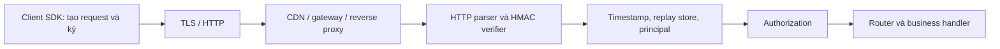
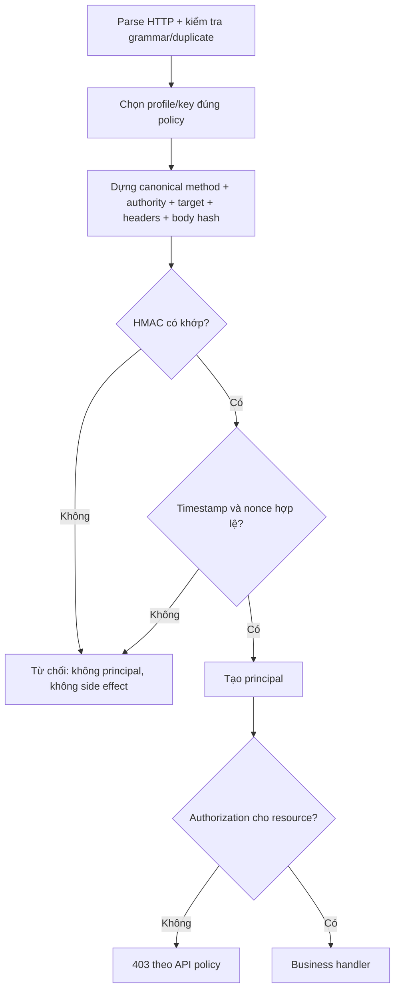

# Chọn thành phần request — Thiết kế phạm vi ký HMAC cho HTTP API

## 1. Quyết định quan trọng nhất không phải chọn SHA-256 hay SHA-512

Trong module **SECURITY_AUTHENTICATION_HMAC_REQUEST_AUTHENTICATION**, client và server sử dụng *shared secret* để tính và xác minh HMAC trên một **canonical request**. Có thể dùng HMAC-SHA256 với secret đủ mạnh và một phép so sánh chữ ký đúng cách, nhưng hệ thống vẫn có lỗ hổng nếu **chọn thiếu thành phần request cần bảo vệ**.

Ví dụ, chữ ký được tính trên `method + timestamp + nonce + body` nhưng bỏ `path`: cùng chữ ký có thể được dùng với một path khác trước khi nonce bị tiêu thụ, dù chữ ký HMAC không hề sai. Ngược lại, ký mọi byte header mà không có hợp đồng chuẩn hóa khiến client, gateway và backend có thể tạo chữ ký khác nhau chỉ vì header được sắp xếp hoặc chuyển tiếp khác đi.

**“Chọn thành phần request”** là quyết định thiết kế: những phần nào quyết định *ai*, *gọi hành động nào*, *trên tài nguyên nào*, *với dữ liệu nào* và *trong lần gửi nào* phải được ràng buộc bằng MAC? Những phần nào có thể thay đổi hợp lệ trong vận chuyển và không nên đưa vào chữ ký?

Kết quả học tập:

- Từ threat model, xác định các field **bắt buộc ký**, **ký theo ngữ cảnh** và **không ký có chủ đích**.
- Định nghĩa một signature profile đủ chính xác ở mức byte để SDK, gateway và backend triển khai giống nhau.
- Phân biệt raw path/query với URI đã decode/normalize; xác định điểm tin cậy khi qua proxy.
- Biết khi nào cần ký `Content-Type`, tenant, idempotency key, authority và body digest.
- Thiết kế timestamp/nonce, key ID, version, key rotation và kiểm tra quyền như các cơ chế phối hợp nhưng không thay thế nhau.
- Dùng Java 17/JUnit 5 kiểm chứng một thay đổi ở **thành phần được ký** làm chữ ký không còn hợp lệ, đồng thời tránh test giả do replay hoặc clock skew.

> **Nguyên tắc:** Nếu một thành phần làm thay đổi ý nghĩa bảo mật của request, phải có cách ràng buộc tính toàn vẹn của nó bằng hợp đồng ký hoặc một cơ chế tin cậy tương đương, được kiểm chứng trên đúng ranh giới xử lý. Không có một danh sách field HMAC bắt buộc duy nhất cho mọi hệ thống.

## 2. Bắt đầu từ threat model và đường đi HTTP

Trước khi viết `Mac.getInstance("HmacSHA256")`, hãy mô tả request đi qua đâu:



Tại mỗi điểm, cần trả lời:

1. **Điều gì thay đổi hành động?** Method, path, query hoặc header chức năng có thể dẫn đến route, tenant hoặc thao tác khác.
2. **Điều gì thay đổi dữ liệu?** Body bytes, định dạng `Content-Type`, header chọn phiên bản payload hoặc idempotency key.
3. **Điều gì quyết định danh tính credential?** Key ID, client/tenant scope và signature profile.
4. **Điều gì phân biệt lần gửi?** Timestamp và nonce được ký; replay store phải thực sự áp quy tắc chống phát lại.
5. **Điều gì bị proxy thay đổi?** Path prefix, percent-encoding, host, header, transfer encoding, nén body hoặc thứ tự query.
6. **Điều gì được phép nằm ngoài MAC?** Metadata quan sát như trace ID nếu hoàn toàn không ảnh hưởng authentication, authorization hoặc nội dung nghiệp vụ.

Kẻ tấn công không phải lúc nào cũng sửa được request trên kết nối TLS. Tuy nhiên, request có thể bị thay đổi ở client SDK, proxy cấu hình sai, thành phần trung gian được tin cậy quá mức, hoặc nơi một chữ ký hợp lệ bị tái sử dụng với các field chưa được bảo vệ. Threat model phải xem cả tình huống **thành phần nhận được đã khác thành phần client dự định ký**.

### Hai loại lỗi cần phân biệt

- **False acceptance:** server xác minh chữ ký thành công dù request đích đã thay đổi ở phần có ý nghĩa bảo mật. Ví dụ client ký `/orders/123`, nhưng backend xử lý `/orders/999` mà không kiểm tra path integrity.
- **False rejection:** request hợp lệ bị từ chối vì các bên chọn cùng field nhưng canonicalize khác nhau. Ví dụ client ký `/a%2Fb`, gateway decode thành `/a/b` trước khi backend dựng chuỗi ký.

Mục tiêu thiết kế là vừa ngăn false acceptance, vừa có hợp đồng nhất quán để tránh false rejection không cần thiết.

## 3. Ma trận chọn thành phần request

| Thành phần | Khuyến nghị | Vì sao | Điểm cần chốt trong contract |
| --- | --- | --- | --- |
| Signature profile/version | **Ký** | Tránh đổi cách diễn giải request hoặc downgrade âm thầm | Tên version, algorithm, canonical schema |
| Key ID | **Ký** | Ràng buộc thông điệp với credential được chọn | Phạm vi key theo client/tenant; key rotation |
| HTTP method | **Ký** | Phân biệt `GET`, `POST`, `DELETE`… | Case, method token, phép chuẩn hóa được phép |
| Path | **Ký** | Ràng buộc endpoint/tài nguyên | Raw/canonical path, prefix qua proxy, percent-encoding |
| Query string | **Ký** nếu ảnh hưởng tài nguyên, dữ liệu hoặc hành động; thường chọn ký toàn bộ | Tránh sửa filter, ID, amount hoặc hành vi | Thứ tự, duplicate, dấu `+`, percent-encoding, empty value |
| Authority/Host | **Ký khi ảnh hưởng định tuyến, tenant hoặc API đích** | Chống nhầm virtual host hoặc tenant theo host | Host/port, chữ hoa/thường, trusted ingress |
| `Content-Type` | **Ký khi quyết định cách giải mã/ý nghĩa body** | Chuyển kiểu parse có thể đổi semantics | Whitespace, charset, tham số, duplicate |
| Body | **Ký digest của đúng body bytes** nếu body có ý nghĩa | Ngăn sửa payload sau khi client ký | Raw bytes, compression boundary, streaming, size limit |
| Timestamp | **Ký** nếu dùng freshness | Không cho sửa thời điểm yêu cầu | Epoch seconds/millis, grammar, clock window |
| Nonce | **Ký** nếu dùng anti-replay | Không cho đổi nonce của request đã ký | Sinh nonce, namespace, TTL, atomic reserve |
| Client/tenant ID trong header | **Ký hoặc ràng buộc qua credential và policy đáng tin cậy** | Tránh nhầm scope, cross-tenant | Header origin, key lookup, authorization |
| `Idempotency-Key` | **Ký nếu header quyết định idempotency nghiệp vụ** | Tránh thay khóa xử lý trùng | Grammar, scope, TTL, trùng header |
| `Content-Encoding` và header chọn diễn giải body | **Ký hoặc kiểm soát qua contract tin cậy** | Tránh sai nghĩa byte trước/sau giải nén | Điểm lấy body bytes, cách giải nén |
| `X-Trace-Id`, `Traceparent` | **Có thể không ký** nếu chỉ dùng quan sát | Tránh lỗi khi proxy thêm trace | Tuyệt đối không dùng chúng làm danh tính hoặc quyền nếu không bảo vệ |
| `Connection`, `Transfer-Encoding`, hop-by-hop headers | **Không ký trực tiếp** trong đa số contract | Có thể được proxy đổi hợp lệ | Bảo vệ ý nghĩa payload ở lớp tương ứng |
| `Authorization` / credential headers | **Thiết kế riêng**, không ký nguyên văn chữ ký của chính nó | Tránh vòng lặp tự tham chiếu | Ký version, key ID, timestamp, nonce; xác định chính xác header nào tham gia |

“**Ký**” ở đây có nghĩa đưa thành phần vào canonical message trước khi tính HMAC; việc ký chỉ có tác dụng với **giá trị thực sự được verify**, không phải giá trị nằm trong một header không đáng tin cậy khác.

### Quy tắc chọn theo câu hỏi “nếu thay field này thì sao?”

Với từng field, hãy tạo phép thử phản thực tế: giữ nguyên mọi thành phần khác, đổi duy nhất field đó, rồi hỏi liệu request có chọn **đối tượng, hành động, quyền hoặc dữ liệu** khác không. Nếu có, field phải được ký hoặc được ràng buộc bằng cơ chế tin cậy khác có thể chứng minh được.

Ví dụ: `X-Trace-Id` chỉ được dùng trong log thì có thể không ký. Nhưng nếu đội phát triển về sau dùng trace ID làm khóa idempotency, thiết kế phải được đánh giá lại: cùng field đó giờ đã ảnh hưởng nghiệp vụ, và quyết định ban đầu không còn phù hợp.

## 4. Một signature profile minh họa, tự chứa và xác định được byte

Giả sử API chỉ phục vụ trên authority cố định `api.example.test` qua gateway tin cậy. Các request cần ký:

```http
POST /v1/orders?customer=a%2Fb HTTP/1.1
Host: api.example.test
Content-Type: application/json
X-HMAC-Version: hmac-v2
X-Key-Id: partner-42-key-a
X-Timestamp: 1795800000
X-Nonce: nonce-4f0b92ec47a1
X-Signature: <base64url-khong-padding>

{"sku":"A1","quantity":2}
```

Ví dụ này có **chữ ký placeholder**, không phải một request có thể gửi nguyên văn. Timestamp trong ví dụ chỉ dùng minh họa; test HTTP phải sử dụng timestamp còn trong cửa sổ được phép.

Hợp đồng minh họa `hmac-v2` gồm các quy định:

- Thuật toán: **HMAC-SHA-256**; MAC đầy đủ 32 byte, mã hóa **Base64url không padding** khi truyền.
- Key: tra theo `(client/tenant, keyId, profile)`; client không được chọn secret tùy ý. Mỗi profile/client có key entropy đủ mạnh, có trạng thái ACTIVE/REVOKED và chính sách rotation.
- Body digest: **SHA-256** của body bytes tại ranh giới ký đã chốt, biểu diễn thành **64 ký tự hex chữ thường**.
- Chuỗi canonical: **10 dòng**, mã hóa UTF-8, nối bằng LF (`\n`), **không có LF cuối**; cấm LF/CR không hợp lệ trong giá trị field.
- Authority: lower-case hostname từ **trusted ingress**; ví dụ không có port và chỉ chấp nhận `api.example.test`. Hệ thống nhiều host/port phải đặc tả cách chuẩn hóa riêng.
- Target: **raw origin-form request-target** gồm path và query theo hợp đồng, không có fragment. Trong ví dụ, `/v1/orders?customer=a%2Fb` và `/v1/orders?customer=a/b` là hai giá trị khác nhau.
- `Content-Type`: yêu cầu **một giá trị duy nhất**, hợp đồng minh họa chỉ hỗ trợ `application/json` hoặc `application/octet-stream`, chính xác chữ thường và không có tham số. Dự án thực có thể cần quy tắc charset/parameter riêng.
- Timestamp: epoch **seconds** là chữ số ASCII; kiểm tra cửa sổ thời gian. Nonce: chuỗi ASCII 8–64 ký tự theo grammar, sau HMAC hợp lệ phải reserve nguyên tử.
- Signature version, key ID, method, authority, target, content type, timestamp, nonce và digest đều **được ký**.

Một canonical request cụ thể:

```text
HMAC-REQUEST
hmac-v2
partner-42-key-a
POST
api.example.test
/v1/orders?customer=a%2Fb
application/json
1795800000
nonce-4f0b92ec47a1
<lowercase-hex-SHA256-of-raw-body>
```

**Vì sao ký version và key ID?** Đổi `hmac-v2` thành profile khác hoặc đổi key ID sau khi ký phải làm thay đổi thông điệp được xác minh. Đăng ký key và allowed profile ở server là kiểm soát **bổ sung**: một chữ ký đúng bằng legacy secret không cho phép vượt qua quyết định ngừng profile cũ.

**Vì sao có `HMAC-REQUEST` ở dòng đầu?** Đây là *domain separator* giúp phân biệt chữ ký dùng cho HTTP authentication với một mục đích khác. Không nên dùng chung secret giữa những protocol khác nhau dù có domain separator; tách key theo mục đích vẫn là cách làm tốt.

**Giới hạn của contract này:** Nó không ký những header khác `Content-Type`. Nếu `Accept-Language`, `X-Tenant-Id`, `Idempotency-Key` hoặc một header chọn phiên bản nghiệp vụ ảnh hưởng đến authorization, side effect hay diễn giải body, phải bổ sung vào **một signature profile được version hóa** hoặc bảo vệ qua cơ chế tin cậy khác. Không được giả định rằng HMAC tự bảo vệ mọi HTTP header.

## 5. Method, path và query: bảo vệ “đi đâu, làm gì”

### 5.1. Method

Hai request có cùng URI/body nhưng khác method có thể có ý nghĩa bảo mật rất khác: `GET /orders/123` và `DELETE /orders/123` không thể chia sẻ một chữ ký. Ký method chính là ràng buộc hành động HTTP.

Contract phải quy định cách biểu diễn: ví dụ chấp nhận phương thức token và không tự đổi case trong verifier, hoặc dùng một tập method đã thống nhất. Không ký `request.getMethod()` ở một phía và một method override header chưa được tin cậy ở phía còn lại.

### 5.2. Path

Path thường định danh endpoint và resource. Nếu bỏ path, chữ ký có thể hợp lệ cho tài nguyên không phải mục tiêu ký ban đầu. Ký route template `/orders/{id}` **không đủ** để bảo vệ `id` nếu ID xác định tài nguyên. Phải bảo vệ giá trị path mà router thực sự sử dụng.

Với gateway rewrite `/api/v1/orders/123` thành `/v1/orders/123`, hãy xác định liệu verifier chạy **trước rewrite** hay backend được cung cấp canonical target đáng tin cậy sau rewrite. Không dùng `X-Original-URI` do client tự gửi như bằng chứng của path ban đầu.

### 5.3. Query string

Query không chỉ là “tham số tùy chọn”: `?customer=a`, `?amount=100` hoặc `?action=cancel` có thể thay nghĩa request. Nếu bỏ query, chỉ cần đổi query là có thể giữ nguyên HMAC dù nghiệp vụ khác.

Khi ký query, cần quyết định rõ:

- Ký **nguyên raw query** theo thứ tự trên wire hay parse rồi sắp xếp lại? Ví dụ ở bài chọn raw target, nên thay thứ tự `a=1&b=2` thành `b=2&a=1` sẽ đổi chữ ký.
- Duplicate `id=1&id=2` xử lý thế nào? Client và server không được “chọn giá trị đầu” ở một bên và “chọn giá trị cuối” ở bên kia.
- `+` và `%20` có được coi tương đương không? Đây là quy tắc encoding/parser, không nên tự đoán.
- Khi không có query, biểu diễn là `/orders` hay `/orders?`? Hợp đồng phải có một giá trị xác định.
- Chữ hoa/thường của hex percent-encoding, slash mã hóa và dot segments có được normalize không?

Nếu chọn normalize, phải công bố **thuật toán canonicalization chính xác** và kiểm thử các byte nhận được ở hai phía. Tránh sửa mismatch bằng cách thử nhiều biến thể target cho tới khi một chữ ký khớp.

## 6. Authority và signed headers: chỉ ký những gì có ý nghĩa, nhưng không bỏ sót ranh giới tin cậy

### Khi nào cần ký authority?

Nếu cùng một IP/gateway phục vụ nhiều virtual host hoặc tenant qua host, thay `api.tenant-a.test` thành `api.tenant-b.test` có thể làm request đi tới một phạm vi dữ liệu khác. Khi đó authority (hostname/port đã chuẩn hóa theo contract) nên là signed component hoặc phải được ràng buộc với client/route qua chính sách ingress tin cậy.

Ở HTTP/1.1, authority thường liên quan `Host`; ở HTTP/2 là `:authority`. Không nên ký chuỗi bất kỳ từ `X-Forwarded-Host` do client tự gửi. Gateway phải validate và xác định authority có thẩm quyền, loại bỏ header forward giả mạo, rồi truyền giá trị tin cậy nếu backend verify.

### Header nào nên ký?

Đặt câu hỏi một header có thể làm thay đổi:

- **Ý nghĩa payload:** `Content-Type`, `Content-Encoding`, phiên bản schema.
- **Phạm vi định danh/quyền:** `X-Tenant-Id`, client-specific routing.
- **Hành vi nghiệp vụ:** `Idempotency-Key`, header chọn loại yêu cầu hoặc tính năng có tác động.
- **Cache / signing contract:** Header có thể ảnh hưởng nội dung được xử lý/được ký, nếu có rủi ro confusion.

Những header hop-by-hop hoặc trace mà proxy được phép sinh ra thường **không** nên ký nếu chúng không ảnh hưởng an ninh/nghiệp vụ. Nếu chúng thực sự cần được dùng cho quyết định tin cậy, hãy chuyển quyết định đó sang một nguồn xác thực hoặc đưa thành phần tương ứng vào contract.

### Cách chuẩn hóa header cũng là một phần của hợp đồng

HTTP field name **không phân biệt hoa/thường**, nhưng field value có thể phân biệt tùy định nghĩa. Ví dụ:

```http
Content-Type: application/json
content-type: application/octet-stream
```

Nếu API chỉ cho một `Content-Type`, hai dòng trên là **duplicate** theo tên header và phải bị xử lý theo policy — không được để gateway chọn một giá trị còn backend chọn giá trị khác.

Các yêu cầu nên đặt ra:

1. Liệt kê chính xác **tên header được ký** (tên canonical thường viết chữ thường) và quy tắc value.
2. Kiểm tra header thiếu, trùng, quá dài, chứa control characters, CR/LF, obs-fold hoặc format không hợp lệ.
3. Không trim/merge/sort giá trị một cách ngầm định khi contract không cho phép.
4. Nếu cho phép header đa giá trị, quy định cách serialize và thứ tự; nếu không cần, đơn giản hơn là **từ chối duplicate** đối với header ký.
5. Có phép thử differential qua reverse proxy và framework, vì Java `Map<String, String>` có thể đã làm mất thông tin duplicate ngay từ trước.

Đừng đưa chính `X-Signature` vào chuỗi canonical một cách tự tham chiếu; thông thường ký **version, key ID và thông tin request**, còn chữ ký được đính kèm sau.

## 7. Body: raw bytes, digest, content encoding và streaming

Hầu hết API `POST`/`PUT`/`PATCH` dùng body để tạo hoặc cập nhật dữ liệu. Bỏ body khỏi HMAC khiến kẻ có thể thay payload mà vẫn giữ chữ ký cho phần còn lại, nếu không có lớp bảo vệ tương đương. Cách phổ biến là ký **SHA-256 digest của body bytes** thay vì nối body lớn vào canonical string.

Cần định nghĩa rõ **“body bytes”** là byte nào:

- Được lấy **trước hay sau** giải nén `Content-Encoding: gzip`?
- Là bytes HTTP entity sau khi lớp transfer framing (`chunked`) đã được tách hay là bytes trước framing?
- Có middleware nào đọc rồi deserialize/serialize lại JSON, đổi whitespace hoặc thứ tự field trước khi verifier đọc không?
- Với multipart, file upload, binary payload và charset khác UTF-8, có bắt buộc băm raw bytes không?
- Với body trống, digest có phải SHA-256 của **chuỗi byte rỗng** không?
- Size limit, streaming, cancellation và timeout áp dụng ở tầng nào?

Trong ví dụ bài học, ký `SHA-256` của body bytes **sau khi HTTP transfer framing được xử lý nhưng trước bất kỳ biến đổi nội dung nào do ứng dụng thực hiện**. Nếu gateway hoặc HTTP stack tự giải nén trước khi verifier nhận body, phải đặc tả điểm đặt verifier và Content-Encoding nhất quán; không được giả định SHA-256 của compressed bytes bằng SHA-256 của decompressed bytes.

Để xử lý body lớn, verifier có thể tính digest **theo luồng**, với giới hạn kích thước và thời gian; không cần giữ toàn bộ body trong bộ nhớ chỉ để tính MAC. Nếu downstream handler cần đọc lại body, thiết kế cache/spool/stream-wrapper phù hợp và hạn chế tài nguyên. Đừng để filter đọc cạn stream rồi handler nhận body rỗng hoặc khác với bytes đã ký.

### JSON cùng nghĩa nhưng khác byte

Hai body:

```json
{"amount":100,"currency":"VND"}
```

và

```json
{"currency":"VND", "amount":100}
```

thường biểu diễn dữ liệu nghiệp vụ giống nhau, nhưng **raw bytes khác nhau**. Với hợp đồng ký raw body bytes, chữ ký phải khác. Nếu muốn ký một JSON semantic canonical form, cần có tiêu chuẩn canonical JSON cụ thể và triển khai thống nhất các trường hợp số, Unicode, thứ tự key, null, duplicate key... Không đơn giản parse rồi serialize ở client và server theo mặc định framework.

## 8. Timestamp, nonce, key ID và version: tránh nhầm integrity với authentication

### Timestamp và nonce phải được ký nhưng vẫn phải được kiểm tra

Nếu timestamp không được ký, người khác có thể sửa thời gian để kéo dài hiệu lực của request. Nếu nonce không được ký, nó có thể bị thay để né kiểm tra replay. Nhưng **đưa timestamp/nonce vào canonical message mới chỉ ràng buộc chúng với chữ ký**, chưa đủ để chống replay.

Server cần:

- Parse timestamp theo đơn vị và grammar cố định, kiểm tra giờ hiện hành và clock skew.
- Kiểm tra nonce có đủ uniqueness theo hợp đồng; reserve bằng thao tác nguyên tử (`SET NX`/`putIfAbsent` hoặc tương đương) trên replay store dùng chung.
- Có TTL ít nhất tương ứng với cửa sổ tiếp nhận được xác định; tránh race khi nhiều request đồng thời đến các node khác nhau.
- Định nghĩa namespace của nonce theo principal/tenant hoặc phạm vi đã chốt; không vô tình cho cùng principal replay qua key ID/profile khác chỉ vì replay key chứa version.
- Xác định fail-closed/failure mode khi replay store unavailable, đặc biệt với endpoint có side effect.

Lý tưởng là chỉ reserve nonce **sau khi** MAC và freshness hợp lệ, **trước khi** gọi nghiệp vụ. Như vậy một request giả với chữ ký sai không dễ chiếm nonce của request thật. Request đã qua reserve nonce nhưng bị lỗi mạng có thể được retry bằng nonce **mới**, kết hợp **idempotency key** để tránh tạo nghiệp vụ hai lần.

### Key ID và version: chọn đúng credential/profile

Key ID và version được client khai báo nhưng **chưa phải bằng chứng đã xác thực**. Server dùng chúng để tra đúng key và profile **được đăng ký và còn hiệu lực** theo scope client/tenant. Mỗi request chỉ verify theo **một profile** đã được phép; không thử lần lượt nhiều thuật toán, secret hay canonicalization cho tới khi một cách khớp.

Với key rotation, có thể có khoảng thời gian nhiều key ACTIVE/VERIFY_ONLY theo policy, nhưng nếu secret bị compromise phải revoke; tiếp tục verify bằng secret đã lộ vẫn cho phép kẻ có secret tạo request mới. Profile version ràng buộc chữ ký với một signature contract, không phải bản thân sự cấp quyền.

### Xác thực không phải phân quyền

Sau khi key đúng, MAC đúng và anti-replay đúng, principal có thể được xác thực. **Authorization** vẫn phải kiểm tra quyền với method, resource, tenant, object ownership và action. Nếu MAC hợp lệ cho một path nhưng principal không được phép truy cập path đó, hệ thống phải từ chối ở tầng phân quyền — đây không phải HMAC mismatch.

## 9. Java 17: xây canonical bytes theo một contract tường minh

Đoạn mã dưới đây là **reference signer/verifier tối giản** cho `hmac-v2` ở mục 4, chỉ sử dụng JDK 17. Nó minh họa việc ký đầy đủ các trường đã chọn; không phải mã production-ready. HTTP parser, giới hạn tài nguyên, truy xuất key, freshness timestamp, atomic nonce, reverse-proxy trust và Spring Security filter phải được triển khai tại tầng tương ứng.

Để giữ ví dụ có thể kiểm thử độc lập, quy tắc đầu vào rất chặt: authority bắt buộc là `api.example.test`; `Content-Type` chỉ nhận hai giá trị; request-target là origin-form ASCII, có percent-encoding hợp lệ và không có CR/LF/fragment. Trong production có thể có nhiều host, port, Unicode/IDN và loại content type hơn; phải version hóa quy tắc đó, không sao chép ràng buộc demo một cách máy móc.

```java
import javax.crypto.Mac;
import javax.crypto.spec.SecretKeySpec;
import java.nio.charset.StandardCharsets;
import java.security.GeneralSecurityException;
import java.security.MessageDigest;
import java.util.Base64;
import java.util.HexFormat;

public final class HmacRequestComponents {
    private HmacRequestComponents() {}

    public record Parts(
            String profile,
            String keyId,
            String method,
            String authority,
            String rawTarget,
            String contentType,
            String timestamp,
            String nonce,
            byte[] body) {}

    private static void requireValid(Parts p) {
        if (p == null || !"hmac-v2".equals(p.profile())
                || p.keyId() == null
                || !p.keyId().matches("[A-Za-z0-9._-]{1,64}")
                || p.method() == null
                || !p.method().matches("[A-Z]{1,16}")
                || !"api.example.test".equals(p.authority())
                || p.rawTarget() == null
                || p.rawTarget().length() > 2048
                || !p.rawTarget().startsWith("/")
                || !( "application/json".equals(p.contentType())
                    || "application/octet-stream".equals(p.contentType()))
                || p.timestamp() == null
                || !p.timestamp().matches("[0-9]{1,19}")
                || p.nonce() == null
                || !p.nonce().matches("[A-Za-z0-9_-]{8,64}")
                || p.body() == null || p.body().length > 1024 * 1024) {
            throw new IllegalArgumentException("Invalid signed request fields");
        }

        // Demo raw request-target: chỉ chấp nhận ASCII hiển thị,
        // không có fragment và percent-encoding phải đủ 2 hex digits.
        String target = p.rawTarget();
        for (int i = 0; i < target.length(); i++) {
            char c = target.charAt(i);
            if (c < 0x21 || c > 0x7e || c == '#') {
                throw new IllegalArgumentException("Invalid request-target");
            }
            if (c == '%') {
                if (i + 2 >= target.length()
                        || !isHex(target.charAt(i + 1))
                        || !isHex(target.charAt(i + 2))) {
                    throw new IllegalArgumentException("Invalid percent escape");
                }
                i += 2;
            }
        }

        // Bảo đảm timestamp là số nguyên dương có thể biểu diễn.
        try {
            if (Long.parseLong(p.timestamp()) <= 0) {
                throw new IllegalArgumentException("Invalid timestamp");
            }
        } catch (NumberFormatException overflow) {
            throw new IllegalArgumentException("Invalid timestamp", overflow);
        }
    }

    private static boolean isHex(char c) {
        return (c >= '0' && c <= '9')
                || (c >= 'a' && c <= 'f')
                || (c >= 'A' && c <= 'F');
    }

    // Package-private để test golden canonical bytes riêng.
    static String canonical(Parts p) throws GeneralSecurityException {
        requireValid(p);
        String bodySha256 = HexFormat.of().formatHex(
                MessageDigest.getInstance("SHA-256").digest(p.body()));

        return String.join("\n",
                "HMAC-REQUEST",
                p.profile(),
                p.keyId(),
                p.method(),
                p.authority(),
                p.rawTarget(),
                p.contentType(),
                p.timestamp(),
                p.nonce(),
                bodySha256);
    }

    private static byte[] mac(byte[] secret, Parts p)
            throws GeneralSecurityException {
        if (secret == null || secret.length == 0) {
            throw new IllegalArgumentException("Missing HMAC secret");
        }
        Mac hmac = Mac.getInstance("HmacSHA256");
        hmac.init(new SecretKeySpec(secret, "HmacSHA256"));
        return hmac.doFinal(
                canonical(p).getBytes(StandardCharsets.UTF_8));
    }

    public static String sign(byte[] secret, Parts p)
            throws GeneralSecurityException {
        return Base64.getUrlEncoder().withoutPadding()
                .encodeToString(mac(secret, p));
    }

    public static boolean verify(
            byte[] secret, Parts p, String encodedSignature)
            throws GeneralSecurityException {
        if (encodedSignature == null || encodedSignature.length() > 128) {
            return false;
        }

        final byte[] supplied;
        try {
            supplied = Base64.getUrlDecoder().decode(encodedSignature);
        } catch (IllegalArgumentException malformed) {
            return false;
        }
        if (supplied.length != 32
                || !Base64.getUrlEncoder().withoutPadding()
                        .encodeToString(supplied).equals(encodedSignature)) {
            return false;
        }

        return MessageDigest.isEqual(mac(secret, p), supplied);
    }
}
```

**Điều ví dụ thực sự bảo đảm:** cùng `Parts` hợp lệ và cùng secret cho ra cùng 32-byte HMAC; sửa method, authority, target, content type, key ID, timestamp, nonce hoặc body làm đổi canonical message và không thể dùng lại chữ ký cũ (trừ va chạm MAC có xác suất không đáng kể).

**Điều ví dụ chưa bảo đảm:** `Parts` được dựng từ HTTP request thật hay không; `api.example.test` có phải authority được gateway tin cậy xác nhận hay không; key ID có thuộc principal và trạng thái ACTIVE hay không; timestamp có còn mới, nonce đã dùng, quyền truy cập phù hợp và handler có bị gọi sai hay không. Ngoài ra `byte[] body` trong record có thể bị sửa bởi code khác sau khi tạo: production nên bảo đảm snapshot bất biến hoặc digest streaming tại ranh giới có quyền kiểm soát. Đừng chỉ đưa một object `Parts` do client tự tạo vào verifier rồi coi đó là HTTP authentication hoàn chỉnh.

## 10. JUnit 5: chứng minh field được chọn thật sự tham gia MAC

Test sau dùng chính `HmacRequestComponents` ở mục 9. Timestamp là **fixture cố định**; đây là unit test MAC, không phải test HTTP freshness. Secret là chuỗi giả chỉ dùng kiểm thử.

```java
import org.junit.jupiter.api.Test;

import java.nio.charset.StandardCharsets;
import java.security.GeneralSecurityException;

import static org.junit.jupiter.api.Assertions.assertEquals;
import static org.junit.jupiter.api.Assertions.assertFalse;
import static org.junit.jupiter.api.Assertions.assertThrows;
import static org.junit.jupiter.api.Assertions.assertTrue;

class HmacRequestComponentsTest {
    private static final byte[] TEST_SECRET =
            "test-only-secret-for-signer-verifier"
                    .getBytes(StandardCharsets.UTF_8);

    private static byte[] bytes(String value) {
        return value.getBytes(StandardCharsets.UTF_8);
    }

    private static HmacRequestComponents.Parts parts(
            String keyId, String method, String authority,
            String rawTarget, String contentType,
            String timestamp, String nonce, byte[] body) {
        return new HmacRequestComponents.Parts(
                "hmac-v2", keyId, method, authority, rawTarget,
                contentType, timestamp, nonce, body);
    }

    private static HmacRequestComponents.Parts baseline() {
        return parts(
                "partner-42-key-a", "POST", "api.example.test",
                "/v1/orders?customer=a%2Fb", "application/json",
                "1795800000", "nonce-4f0b92ec47a1",
                bytes("{\"sku\":\"A1\",\"quantity\":2}"));
    }

    @Test
    void baselineIsValidAndVersionedCanonicalStringIsDeterministic()
            throws GeneralSecurityException {
        var p = baseline();
        String signature = HmacRequestComponents.sign(TEST_SECRET, p);
        assertTrue(HmacRequestComponents.verify(TEST_SECRET, p, signature));

        var empty = parts(
                "partner-42-key-a", "POST", "api.example.test",
                "/v1/orders?customer=a%2Fb", "application/json",
                "1795800000", "nonce-4f0b92ec47a1", new byte[0]);
        String knownEmptySha256 =
                "e3b0c44298fc1c149afbf4c8996fb924"
              + "27ae41e4649b934ca495991b7852b855";
        assertEquals(
                String.join("\n",
                        "HMAC-REQUEST", "hmac-v2",
                        "partner-42-key-a", "POST", "api.example.test",
                        "/v1/orders?customer=a%2Fb", "application/json",
                        "1795800000", "nonce-4f0b92ec47a1",
                        knownEmptySha256),
                HmacRequestComponents.canonical(empty));
    }

    @Test
    void changingTargetOrMethodInvalidatesOriginalSignature()
            throws GeneralSecurityException {
        var p = baseline();
        String signature = HmacRequestComponents.sign(TEST_SECRET, p);

        assertFalse(HmacRequestComponents.verify(
                TEST_SECRET,
                parts(p.keyId(), p.method(), p.authority(),
                        "/v1/orders?customer=a/b", p.contentType(),
                        p.timestamp(), p.nonce(), p.body()),
                signature));

        assertFalse(HmacRequestComponents.verify(
                TEST_SECRET,
                parts(p.keyId(), "PUT", p.authority(),
                        p.rawTarget(), p.contentType(),
                        p.timestamp(), p.nonce(), p.body()),
                signature));
    }

    @Test
    void changingContentTypeOrBodyInvalidatesOriginalSignature()
            throws GeneralSecurityException {
        var p = baseline();
        String signature = HmacRequestComponents.sign(TEST_SECRET, p);

        // Trong fixture chỉ api.example.test được phép làm authority.
        // Kiểm tra đổi value của header được ký với hai content type hợp lệ.
        assertFalse(HmacRequestComponents.verify(
                TEST_SECRET,
                parts(p.keyId(), p.method(), p.authority(),
                        p.rawTarget(), "application/octet-stream",
                        p.timestamp(), p.nonce(), p.body()),
                signature));

        assertFalse(HmacRequestComponents.verify(
                TEST_SECRET,
                parts(p.keyId(), p.method(), p.authority(),
                        p.rawTarget(), p.contentType(),
                        p.timestamp(), p.nonce(),
                        bytes("{\"sku\":\"A1\",\"quantity\":9}")),
                signature));
    }

    @Test
    void unexpectedAuthorityIsRejectedByTheFixturePolicy() {
        var p = baseline();
        assertThrows(IllegalArgumentException.class,
                () -> HmacRequestComponents.sign(
                        TEST_SECRET,
                        parts(p.keyId(), p.method(), "other.example.test",
                                p.rawTarget(), p.contentType(),
                                p.timestamp(), p.nonce(), p.body())));
    }

    @Test
    void keyTimestampAndNonceAreBoundToTheSignature()
            throws GeneralSecurityException {
        var p = baseline();
        String signature = HmacRequestComponents.sign(TEST_SECRET, p);

        assertFalse(HmacRequestComponents.verify(
                TEST_SECRET,
                parts("partner-42-key-b", p.method(), p.authority(),
                        p.rawTarget(), p.contentType(),
                        p.timestamp(), p.nonce(), p.body()),
                signature));

        assertFalse(HmacRequestComponents.verify(
                TEST_SECRET,
                parts(p.keyId(), p.method(), p.authority(),
                        p.rawTarget(), p.contentType(),
                        "1795800001", p.nonce(), p.body()),
                signature));

        assertFalse(HmacRequestComponents.verify(
                TEST_SECRET,
                parts(p.keyId(), p.method(), p.authority(),
                        p.rawTarget(), p.contentType(),
                        p.timestamp(), "nonce-4f0b92ec47a2", p.body()),
                signature));
    }
}
```

Test `changingContentTypeOrBodyInvalidatesOriginalSignature` kiểm tra thay `Content-Type` và body; `unexpectedAuthorityIsRejectedByTheFixturePolicy` kiểm tra policy chặn host ngoài phạm vi. Authority được cố định bằng grammar fixture; để test **hai authority hợp lệ** có MAC khác nhau, cần mở rộng profile thành multi-host và ràng buộc authority được trusted ingress xác định, rồi thêm negative test thay host mà giữ chữ ký cũ. Không nên biến trường `Host` tùy ý do client gửi thành bằng chứng tin cậy chỉ để test được.

Unit test trên chỉ chứng minh các trường đã đưa vào **công thức HMAC**. Vì signer và verifier dùng chung hàm canonical, hai bên có thể cùng mắc lỗi; cần **golden vectors độc lập** từ một client SDK khác triển khai hoặc từ đặc tả byte-level được kiểm chứng.

## 11. Kiểm thử tích hợp qua Spring Security và proxy/gateway

Khi triển khai với Spring MVC (`OncePerRequestFilter`) hoặc WebFlux (`WebFilter`), hãy kiểm thử theo chuỗi thực:

1. HTTP stack đọc request và chặn header/target malformed, oversized, duplicate, control characters.
2. HMAC filter xác định version, client scope/key ID và authority/target/body bytes theo contract.
3. Key registry tra secret còn hiệu lực đúng profile, tính MAC và so sánh trên chữ ký được decode đúng định dạng.
4. Kiểm tra freshness timestamp; reserve nonce nguyên tử trước khi tạo authenticated principal.
5. Authorization kiểm tra method, route, principal, tenant và resource.
6. Handler chỉ chạy sau khi các bước trước thành công.



### Bộ ca test bắt buộc

| Mutation / tình huống | Kỳ vọng |
| --- | --- |
| Request hợp lệ, key ACTIVE, timestamp mới, nonce mới | HMAC và anti-replay thành công; authorization xử lý tiếp |
| Đổi method khi giữ chữ ký | HMAC mismatch |
| Đổi path `/orders/123` → `/orders/999` | HMAC mismatch |
| Đổi raw query, thứ tự, duplicate parameter | Theo raw-target contract: HMAC mismatch nếu bytes khác |
| Đổi authority mà backend vẫn route khác | Bị từ chối bởi authority binding hoặc HMAC |
| Đổi `Content-Type` giữa hai giá trị hợp lệ của profile | HMAC mismatch |
| Đổi body bytes, JSON whitespace hoặc UTF-8 | HMAC mismatch nếu contract ký raw bytes |
| Body `gzip` bị giải nén ở gateway khác ranh giới đã ký | Phát hiện canonical mismatch; không bypass |
| Sửa timestamp đã ký | MAC mismatch hoặc freshness reject, xác định rõ đúng nhánh |
| Dùng lại nonce đã reserve | Replay reject; không tạo side effect |
| Hai request cùng nonce vào nhiều node | Tối đa một lần reserve nonce thành công trong namespace quy định |
| Đổi key ID hoặc version sau khi ký | Policy reject hoặc MAC mismatch; không fallback |
| Key bị revoke vẫn tạo chữ ký đúng | Phải bị từ chối do key policy |
| Missing/duplicate signed header (kể cả đổi hoa/thường tên) | Từ chối theo contract parser |
| Header trace do proxy thêm | Không làm sai HMAC nếu trace không nằm trong profile ký |
| Header `X-Original-URI` do client đặt | Không được xem là trusted original target |
| `GET` / `POST` đã auth nhưng principal thiếu quyền | Phân quyền từ chối, không nhầm thành lỗi HMAC |
| Request fail authentication | Không có principal, handler và side effect |
| URL chứa `%2F`, `%2E`, slash kép, query trống | Nhất quán giữa client/gateway/backend theo golden vectors |

**Chống test giả:** Không dùng lại nonce đã được positive request tiêu thụ khi kiểm thử mutation; request âm phải có nonce **mới**, ký lại trên nội dung *gốc* rồi mới mutate đúng một trường. Nếu dùng cùng nonce, server có thể reject do replay và test không chứng minh MAC bao phủ field đó. Đối với case thay timestamp, cần tách test MAC binding và test freshness window.

MockMvc/WebTestClient có thể chuẩn hóa request-target hoặc header trước khi ứng dụng thấy chúng. Các ca liên quan **raw HTTP bytes, HTTP/2 `:path`, Host/authority và gateway rewrite** phải được chạy thêm trên HTTP server/gateway thực tế trong test environment.

## 12. Những anti-pattern khi chọn trường cần ký

**Chỉ ký body.** Endpoint/path hoặc method không được ràng buộc; cùng payload có thể có ý nghĩa khác ở route khác. Khắc phục bằng ký method, target và thành phần routing liên quan.

**Ký path nhưng bỏ query.** Query có thể chứa ID, filter, operation hoặc giá trị nghiệp vụ. Nếu query làm đổi ý nghĩa request, phải bảo vệ nó.

**Ký request URI lấy sau proxy rewrite nhưng client ký URI bên ngoài.** Hai bên không thống nhất byte; dễ phát sinh 401 hàng loạt. Phải chọn ranh giới verify hoặc trusted mapping rõ và test xuyên gateway.

**Ký header tùy tiện theo thứ tự thư viện trả về.** Header field name không phân biệt hoa/thường, duplicate và whitespace có thể được xử lý khác giữa client/gateway/backend. Cần một danh sách signed headers và normalization contract cố định.

**Hash body sau khi deserialize JSON.** Body bytes hoặc thứ tự field có thể khác ở hai phía. Nếu ký raw body, tính digest trước khi biến đổi; nếu ký semantic JSON, dùng canonical JSON được đặc tả riêng.

**Dựa vào `X-Forwarded-Host`/`X-Original-URI` do client cung cấp.** Những header này không tự trở thành dữ liệu tin cậy. Chỉ tin sau khi gateway đáng tin cậy sanitize, overwrite và bảo vệ tuyến nội bộ.

**Không ký timestamp hoặc nonce nhưng vẫn nói có anti-replay.** Attacker có thể thay thành phần chống replay khi MAC không ràng buộc nó. Đồng thời ký thôi chưa đủ: phải có freshness và atomic replay store.

**Coi HMAC hợp lệ là được phép mọi hành động.** Credential có thể thuộc tenant khác hoặc không có quyền trên tài nguyên. Authorization phải chạy riêng, sau authentication.

**Sửa mismatch bằng cách thử mọi canonical biến thể.** Thử raw/decoded/normalized path, nhiều thuật toán hoặc secret cho tới khi khớp tạo algorithm/canonicalization confusion. Hãy version hóa signature profile và chỉ verify một profile đã được server cho phép.

## 13. Bài tập thiết kế và tiêu chí hoàn thành

### Bài tập A — Lập bảng chọn thành phần

Thiết kế HMAC cho `POST /tenants/{tenantId}/payments?dryRun=false` với body JSON và header `Idempotency-Key`. Hãy nêu chính xác field nào được ký và vì sao, cách serialize chúng trong canonical request, phần nào cần kiểm tra bằng authorization, và cách xử lý retry khi response mất.

### Bài tập B — Ranh giới proxy

Một gateway đổi public path `/api/v1/orders/123` thành `/v1/orders/123`. Hãy chọn vị trí verify, viết một golden canonical request, mô tả cách backend kiểm tra route được xử lý là route đã được ký, và giải thích vì sao không thể tin `X-Original-URI` từ client.

### Bài tập C — Header và body mutation

Mở rộng `HmacRequestComponentsTest` để thêm test: content type có charset, body rỗng, JSON cùng nghĩa khác whitespace, query có duplicate và malformed percent escape. Phân biệt các trường hợp **không hợp lệ theo parser** với các trường hợp **có cú pháp hợp lệ nhưng HMAC mismatch**.

### Bài tập D — Timestamp/nonce/key rotation

Thiết kế test end-to-end với một request hợp lệ, một request sửa nonce sau ký, một request dùng lại nonce nhưng MAC vẫn đúng, và một request ký đúng bằng key đã revoked. Với mỗi tình huống, nêu bước từ chối đúng và assertion rằng handler chưa được gọi.

### Điều kiện nghiệm thu thiết kế

Một phạm vi ký HMAC được coi là thiết kế tốt khi:

- Mọi field quyết định action, resource, tenant, cách parse body và nghiệp vụ đều được bảo vệ hoặc có cơ chế tin cậy độc lập được chứng minh.
- Contract nêu rõ byte encoding, newline, thứ tự, signed headers, duplicate policy, raw/canonical path/query và body digest boundary.
- SDK, gateway và backend dùng **cùng test vectors độc lập** cho cả trường hợp hợp lệ và mutation có chủ đích.
- Signature version, key ID, timestamp và nonce được ràng buộc vào MAC; key policy, freshness và replay store vẫn được thực thi riêng.
- Thay một field đã ký làm request bị từ chối **vì đúng lý do**, không phải do nonce test đã dùng hoặc clock bị lệch.
- Authentication thành công không tự bỏ qua authorization; failure không được tạo principal hoặc side effect.
- Có kế hoạch key rotation, migration signature profile, telemetry an toàn và kiểm thử qua các tuyến proxy/gateway được hỗ trợ.

**Ghi nhớ:** HMAC bảo vệ **đúng những thành phần thực sự có trong canonical request**. Chọn field phải dựa trên ý nghĩa bảo mật và điểm xử lý của HTTP request: **method, target, authority khi liên quan routing, signed headers, body digest, version, key ID, timestamp và nonce**. Một hợp đồng ký tốt vừa chống thay đổi ý nghĩa request vừa đủ xác định để client, gateway và backend tái tạo cùng byte, sau đó vẫn kiểm tra chống replay và phân quyền độc lập.
