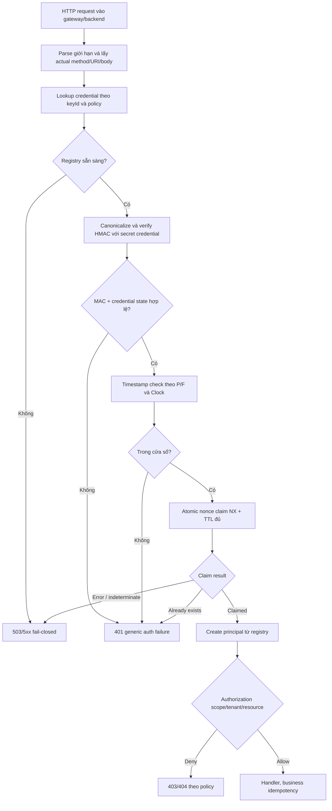
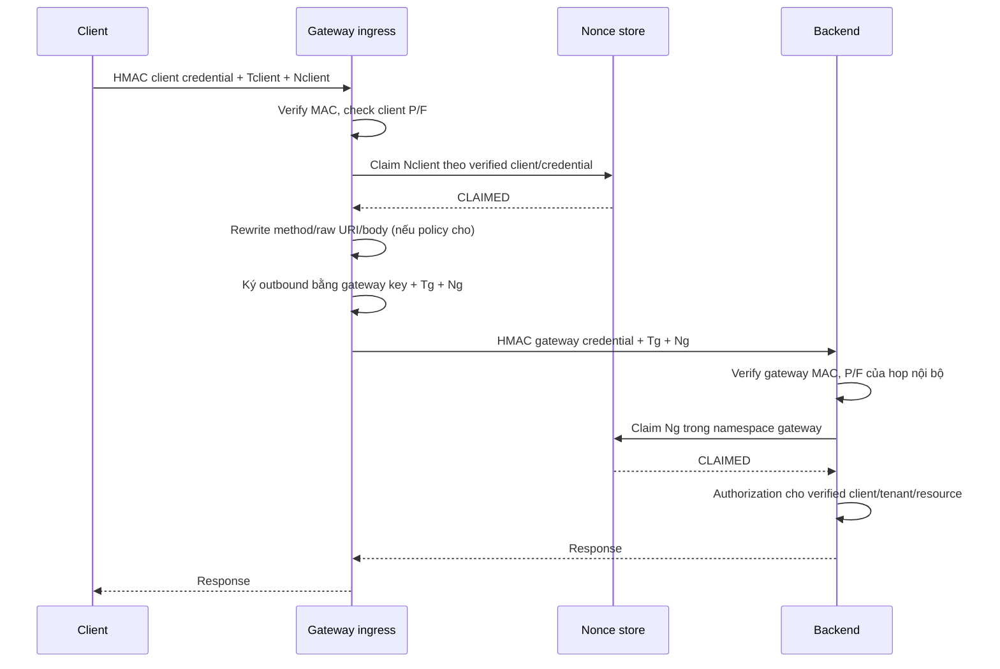

# Chọn replay window: cân bằng độ tin cậy và chống phát lại request HMAC

## 1. Mục tiêu và ngữ cảnh hệ thống

Bài **Chọn replay window** thuộc chương **Thiết kế HMAC system**, trong module **SECURITY_AUTHENTICATION_HMAC_REQUEST_AUTHENTICATION**. Module tập trung xác thực HTTP request bằng **HMAC với shared secret** và **canonical request** có thể ràng buộc HTTP method, URI, header và byte body theo hợp đồng ký. Một thiết kế đủ an toàn phải xác minh chữ ký, kiểm soát **timestamp/nonce** chống replay, quản lý key rotation, kiểm thử gateway/proxy và phân biệt **authentication (xác thực)** với **authorization (phân quyền)**.

Một chữ ký HMAC đúng về mật mã không có nghĩa request chỉ được thực thi một lần. Ai nắm được một request đã ký hợp lệ — qua retry, log rò rỉ, proxy bị kiểm soát hay một đường mạng có quyền quan sát — có thể gửi lại toàn bộ request. Chữ ký vẫn đúng, vì bytes đã ký không đổi.

**Replay window** là khoảng thời gian mà server có thể chấp nhận timestamp của request, theo chính sách clock skew và độ trễ. Để hạn chế việc dùng lại request **trong khoảng thời gian đó**, cần thêm **nonce uniqueness guard** có trạng thái, được áp dụng nguyên tử trên đúng namespace và giữ đủ lâu.

Sau bài học, người học có thể:

1. Phân biệt **timestamp freshness window**, **nonce retention window**, **credential validity** và **business idempotency**.
2. Chọn giới hạn timestamp **quá khứ** và **tương lai** một cách có căn cứ từ độ lệch đồng hồ, network/queue latency, đặc điểm đối tác và threat model.
3. Tính và kiểm chứng thời gian lưu nonce tối thiểu khi cửa sổ chấp nhận bất đối xứng.
4. Thiết kế triển khai anti-replay cho nhiều node/region, atomic claim, lỗi Redis và key rotation.
5. Viết Java 17 dùng `Clock` kiểm tra timestamp, test biên và minh họa Redis `SET NX EX`.
6. Nhận diện rủi ro khi proxy rewrite, retry, streaming body, time sync và cache/DR failover.
7. Thiết lập metric, canary, SLA/SLO và quy trình thay đổi replay window không fail-open.

## 2. Replay window là gì và không phải gì?

Hãy tách bốn quyết định khác nhau:

| Quyết định | Câu hỏi cần trả lời | Tín hiệu/nguồn dữ liệu |
|---|---|---|
| **MAC integrity** | Request có được ký bằng đúng secret, canonical bytes có nguyên vẹn không? | HMAC trên actual method/URI/headers/body |
| **Timestamp freshness** | Timestamp được ký còn nằm trong khoảng server chấp nhận không? | Signed timestamp, server clock, `pastAllowance`, `futureAllowance` |
| **Nonce uniqueness** | Nonce đã được claim trong namespace và khoảng còn hiệu lực chưa? | Store nguyên tử dùng chung các verifier liên quan |
| **Authorization và business idempotency** | Principal có quyền gì, cùng giao dịch có nên tạo side effect lần nữa không? | Registry/policy, scope, tenant, idempotency key |

HMAC có thể chứng minh **một bên biết shared secret**, không tự chứng minh người ký còn hợp lệ sau revoke, không đảm bảo uniqueness, và không tự cấp quyền tài nguyên. Timestamp và nonce chỉ có ý nghĩa an toàn khi chúng **được ràng buộc vào dữ liệu được MAC bảo vệ** hoặc cơ chế tin cậy tương đương; nếu attacker thay được timestamp/nonce không cần ký lại, anti-replay bị vô hiệu.

**Định nghĩa làm việc trong bài:**

- `pastAllowance=P`: độ cũ lớn nhất của timestamp mà server cho phép, tính theo seconds.
- `futureAllowance=F`: timestamp được phép “đi trước” đồng hồ server tối đa bao lâu.
- `timestamp=T`: thời điểm UTC/Unix seconds do signer khai và **ký**.
- `serverNow=S`: thời điểm kiểm tra freshness tại verifier, cùng đơn vị với T.
- `nonce=N`: giá trị duy nhất theo namespace policy, do signer tạo cho một outbound attempt.
- `nonceTTL=L`: thời gian giữ state để không chấp nhận lại cùng N khi timestamp T vẫn hợp lệ.

Quy tắc minh họa có **hai biên bao gồm**:

\[
-F \le S-T \le P
\]

Tương đương:

\[
T-F \le S \le T+P
\]

Suy ra **độ rộng cửa sổ chấp nhận của cùng timestamp T là \(P+F\)**, chưa tính sai số lượng tử hóa/margin. Đây là kết quả quan trọng để lựa chọn nonce retention.

### 2.1. Ví dụ cửa sổ bất đối xứng

Giả sử nhóm kiến trúc chọn thử nghiệm:

```text
pastAllowance    = 120 giây
futureAllowance  = 30 giây
requestTimestamp = T

Thời điểm server nhận/verify hợp lệ:
  từ T - 30 giây
  đến T + 120 giây
```

Cửa sổ hợp lệ rộng **150 giây**, không phải chỉ 120 giây. Nếu nonce N được claim ngay ở `T-30` rồi Redis xóa key sau 120 giây, tới `T+90` timestamp T **vẫn hợp lệ** và cùng N có thể được claim lại. Đó là một lỗ hổng replay, dù mỗi lần kiểm tra timestamp riêng lẻ đều đúng.

**Chú ý:** 120/30 giây chỉ là bộ số minh họa để giải thích thiết kế, không phải tham số mặc định dành cho mọi API hoặc tiêu chuẩn bắt buộc của HMAC.

### 2.2. Timestamp-only không phải chống replay một lần

Nếu chỉ kiểm tra timestamp và signature:

```text
Request R có MAC hợp lệ, timestamp T.
S = T + 1s  → accept
S = T + 3s  → accept
S = T + 6s  → accept
...
S = T + P   → accept
```

Một attacker đã có bản sao R có thể phát lại nhiều lần trong window. Rút ngắn P/F giảm khoảng khai thác nhưng **không** làm request trở thành one-time. Cần nonce store có tính nhất quán theo phạm vi, hoặc một giao thức bảo vệ replay khác có security proof riêng.

## 3. Threat model trước khi chọn số giây

Không chọn cửa sổ vì “API khác dùng 5 phút” khi chưa hiểu nguồn phát request và mức độ rủi ro.

### 3.1. Những bên có thể gửi lại request

- **Client SDK:** HTTP middleware retry lại nguyên request khi timeout/reset.
- **Gateway/proxy:** retry outbound sau pool timeout nhưng giữ nonce/chữ ký trước đó.
- **Message-driven integration:** worker consume lại một event và tái sử dụng signed request template.
- **Bên được cấp secret:** có thể tự ký một request hoàn toàn mới; nonce không ngăn hành vi cố ý của chủ credential.
- **Bên thu thập request đã ký:** không có secret nhưng có thể replay proof cũ khi thời gian còn hợp lệ, tùy vị trí, khả năng quan sát và transport protection.
- **Kẻ chiếm quyền credential:** có secret và có thể ký request/timestamp/nonce mới; việc giảm window **không thay thế revoke/rotation**.

### 3.2. Phân tầng rủi ro

| Use case | Tác động nếu replay thành công | Đặc điểm độ trễ | Hướng đánh giá |
|---|---|---|---|
| GET dữ liệu ít nhạy cảm, không có side effect | Có thể tăng tải hoặc lộ dữ liệu nếu authorization sai | Thường thấp | Freshness chặt, quota; vẫn cần authz |
| POST tạo order/payment | Trùng nghiệp vụ, tài chính, đối soát | Có thể có retries/timeouts | Nonce guard + business idempotency bắt buộc |
| Webhook đối tác batch | Hàng đợi, job retry, đồng hồ đa hệ thống | Độ trễ cao hơn direct API | Phân biệt thời điểm ký và thời điểm gửi, ký lại khi dispatch |
| Mobile/edge/offline | Clock drift, mạng gián đoạn | Biến thiên lớn | Không mở window vô hạn; cải thiện time sync, deferred signing |
| Gateway→backend nội bộ | Có thể thấp khi nội bộ ổn định | Network tốt nhưng có pool/queue | Pin audience/hop, chống retry reuse nonce |
| API quản trị đặc quyền | Thay khóa, xóa tài nguyên, nâng quyền | Thường yêu cầu mạnh | Window hẹp nếu vận hành cho phép; xác minh authz/policy nghiêm ngặt |
| Hệ thống đa region active-active | Round-trip dài, failover khó | Biến thiên và consistency challenge | Thiết kế store có nhất quán phù hợp, không “giải” bằng tăng window |

Không có phép biến đổi đơn giản “window nhỏ → luôn an toàn hơn”: một window quá nhỏ làm nhiều client hợp lệ bị 401 và gây retry loop, tăng load và làm đội vận hành bị cám dỗ tắt anti-replay. Phải cân bằng **security target** và **reliability SLO** nhưng không chấp nhận fail-open.

## 4. Hiểu clock skew và latency bằng công thức

Một client ký request tại thời điểm thực `t0`. Đồng hồ client có độ lệch `δ` so với đồng hồ server (δ dương nghĩa là client **đi trước**). Request mất `d` giây từ lúc ký cho tới lúc verifier kiểm tra freshness, bao gồm network, queue, proxy, body upload và xử lý trước bước kiểm tra nếu có.

```text
Client signed timestamp T ≈ t0 + δ
Server checks at S       ≈ t0 + d

S - T ≈ d - δ
```

Điều kiện chấp nhận:

\[
-F \le d-\delta \le P
\]

Công thức này cho thấy:

- **Client đi trước** 40 giây, network+queue 2 giây: `S-T≈-38s`; cần future allowance đủ cho độ lệch này.
- **Client đi sau** 45 giây, delay 10 giây: `S-T≈55s`; cần past allowance bao phủ cả độ trễ và clock lag.
- **Client đúng giờ** nhưng ký request rồi xếp hàng 180 giây trước khi gửi: `S-T≈180s`; P nhỏ hơn 180 sẽ từ chối, dù mạng chỉ mất 1 giây.

**Không suy clock skew chỉ từ độ trễ HTTP request**, vì d và δ cộng/trừ trong cùng quan sát. Phải kết hợp NTP/chrony metrics từ node, nguồn clock của client (nếu có độ tin cậy), mốc signer, queue duration và request metadata đã được xác minh.

### 4.1. Những nguồn tạo d và δ

| Nguồn | Ảnh hưởng | Cách xử lý ưu tiên |
|---|---|---|
| Đồng hồ mobile/IoT sai | δ dương hoặc âm lớn | Đồng bộ giờ, hướng dẫn SDK, hạn chế offline signing |
| Request được ký lúc enqueue | d bằng thời gian chờ hàng đợi | **Ký gần thời điểm outbound send**, không tăng window để chịu backlog vô hạn |
| Upload body lớn hoặc mạng chậm | d tăng tới khi verifier đủ dữ liệu tính MAC | Giới hạn body, timeout upload, đo stage latency |
| Proxy nhiều hop, CDN/WAF | d và queue tăng không ổn định | Instrument từng hop, đo correlation |
| Server autoscale/GC/event-loop blocking | d tăng tại verifier | Khắc phục saturation, backpressure, không tự nới window |
| NTP step/clock jump | S nhảy trước/sau | Cảnh báo clock health, thử boundary; fail-closed khi time source không đáng tin |
| Đơn vị epoch sai | T milliseconds nhưng parser hiểu seconds | Contract bắt buộc về đơn vị, test parser |
| Timezone local time | Date string không có offset, DST ambiguity | **Unix timestamp UTC** hoặc định dạng chuẩn có offset |

**Không** sử dụng local timezone string như `"2026-11-28 10:00"` làm timestamp ký nếu contract không quy định offset/timezone. Unix seconds là một lựa chọn đơn giản; phải thống nhất đơn vị và cách parse.

### 4.2. Quantization và ranh giới inclusive/exclusive

Nếu signer dùng epoch **seconds** và verifier lấy `Clock.instant()` có nanoseconds, cùng một “giây” có thể lệch gần 1 giây tùy làm tròn. Cần định nghĩa rõ:

- Timestamp là số nguyên **Unix seconds**, không phải milliseconds.
- Verifier lấy `clock.instant().getEpochSecond()` hay so `Instant` ở độ phân giải nào?
- Biên `S-T=P` là **được chấp nhận** hay **bị từ chối**?
- Biên `S-T=-F` tương tự.
- Có hỗ trợ leap seconds/clock smearing theo policy hệ thống không?
- TTL nonce có margin đủ cho rounding, clock drift giữa node và scheduling không?

Đề xuất hợp đồng đơn giản cho bài này: so sánh **giây Unix nguyên** tại một thời điểm kiểm tra được định nghĩa, chấp nhận cả hai biên `-F` và `P`. Nếu production dùng millisecond/nanosecond, công thức vẫn đúng nhưng test và TTL phải dùng cùng độ phân giải.

## 5. Chọn P và F như thế nào?

Một quy trình ra quyết định gồm:

1. Đo/ước lượng **signed-at → verifier-check latency** trên các cohort/route thật, không chỉ TCP RTT.
2. Đo clock offset đáng tin của signer hoặc lập mức hỗ trợ dự kiến theo loại client.
3. Chọn **tolerance phía quá khứ P** để bao phủ negative clock skew và tail latency được chấp nhận.
4. Chọn **tolerance phía tương lai F** để bao phủ positive clock skew được chấp nhận, không tăng bằng P một cách máy móc.
5. Xác định chính sách khi vượt ngưỡng: 401 chung, sửa đồng hồ hoặc ký lại attempt; không auto-backdate/backfill.
6. Tính nonce TTL, Redis capacity, consistency, failover và chi phí của cửa sổ đó.
7. Kiểm thử boundary, giả lập clock skew, retry/network delays và thử nghiệp vụ.
8. Cố định policy/version, rollout theo cohort và quan sát error rate trước khi mở rộng.

Một lựa chọn bất đối xứng thường hợp lý vì d phần lớn **làm request cũ đi**, không làm timestamp ở tương lai; F cần xử lý clock chạy trước, còn P phải xử lý clock chạy sau **cộng** thời gian transit. Nhưng tỷ lệ cụ thể phải theo dữ liệu và threat model.

### 5.1. Bài tính kích thước minh họa

Giả sử nhóm API thu được các giả định để thiết kế thử nghiệm:

```text
Độ lệch client phía chậm lớn nhất được hỗ trợ: 45s
Độ lệch client phía nhanh lớn nhất được hỗ trợ: 20s
Độ trễ từ ký tới verify ở tail được hỗ trợ: 12s
Sai số parse/rounding/processing margin: 3s

P cần bao phủ 45 + 12 + 3 = 60s
F cần bao phủ ~20 + 3 = 23s (có thể làm tròn 25s)

Thiết kế đánh giá:
  pastAllowance P = 60s
  futureAllowance F = 25s
  timestamp acceptance width = 85s
```

Đây là **ví dụ tính toán từ giả định**, không phải kết quả đo ngoài đời. Khi client có thể ký trước rồi chờ queue 10 phút, mô hình không còn phù hợp; cách tốt hơn là **ký tại thời điểm gửi**, hoặc dùng workflow/giao thức khác được thiết kế cho delayed delivery, không nới P thành vô hạn.

### 5.2. Đặt tiêu chí SLO và security objective

| Tiêu chí | Ví dụ câu hỏi | Nguồn bằng chứng |
|---|---|---|
| Legitimate freshness rejection | Bao nhiêu request hợp lệ bị từ chối do clock/latency? | Auth decision reason + verified credential events |
| Replay attempts rejected | Có chặn cùng proof gửi lại trong toàn window? | Concurrency/negative canaries + Redis metrics |
| Dependency availability | Redis lỗi có khiến auth fail-closed đúng 5xx? | Chaos test, 503, store timeouts |
| Clock health | Có node lệch giờ vượt budget không? | Host NTP metrics, clock drift alerts |
| Operational latency | Tail latency có đẩy signer-to-verifier delay vượt P? | Stage timings/tracing |
| Client support | Có SDK ký ở mỗi attempt, không cache nonce? | Client conformance contract tests |
| State cost | Store có đủ bộ nhớ/capacity cho TTL dự kiến không? | Cardinality, Redis used_memory, evictions |

Một hệ thống có thể chọn nhiều profile/window khác nhau theo **audience hoặc class credential được server xác định**, nhưng phải cẩn thận: nếu requester tự khai `X-Replay-Window: 3600` và server tin header này, attacker có thể tự mở rộng thời gian chấp nhận. Profile phải **pin trong server-side policy**, và nếu policy/version được truyền trên wire cần được MAC bảo vệ và kiểm tra nhất quán.

## 6. Công thức TTL nonce: phần dễ sai nhất

Giả sử một request có timestamp T. Theo điều kiện `T-F ≤ S ≤ T+P`, nonce N có thể được claim lần đầu tại **thời điểm sớm nhất** `S₀=T-F`, nếu signer clock đi trước đúng F. Một bản sao request vẫn có thể đạt timestamp check tới **thời điểm muộn nhất** `S₁=T+P`.

Khoảng cần nhớ N ít nhất:

\[
S_1-S_0 = P+F
\]

Do đó với retention tính từ **lúc nonce được claim**:

\[
\boxed{L \ge P+F+M}
\]

Trong đó M là margin cho lượng tử hóa giây, clock skew giữa các verifier/Redis, scheduling, expiration semantics, propagation và các giả định consistency. Thực tế cần tránh equality sát hạn khi hai node có đồng hồ chênh; dùng margin có cơ sở, không đặt bằng 0 một cách tùy tiện.

### 6.1. Ví dụ cụ thể với P=120s, F=30s

```text
Timestamp: T
Earliest accepted: T - 30s
Latest accepted:   T + 120s
Window width:      150s

Sai:
  Redis SET NX EX 120
  nonce có thể hết hạn tại T + 90s
  trong khi request vẫn hợp lệ tới T + 120s

Đúng trong thiết kế ví dụ:
  nonce TTL = 170s (150s + 20s margin)
  nonce tồn tại tới T + 140s nếu claim sớm nhất
  khi request hết freshness ở T+120s, store vẫn còn state
```

Không dùng công thức `TTL=P` khi F khác 0. Khi P/F thay đổi ở runtime, các key được claim trước đó có thể có TTL cũ: **nới window** mà không bảo vệ nonce state cũ có thể tạo replay bypass.

### 6.2. Time-of-check và TTL phải cùng một định nghĩa

Một thiết kế khác có thể lưu expiration **tuyệt đối** theo timestamp:

```text
nonceExpiresAt = T + P + margin
```

Cách này có thể giảm state retention nếu request lần đầu được claim muộn, nhưng cần xác minh clock domain, Redis expiration và time alignment cẩn thận. Không đơn giản chuyển `expiresAt` từ client sang Redis như dữ liệu đáng tin: giá trị T đã được ký nhưng client có thể hợp lệ với clock skew; server vẫn phải kiểm tra window rồi mới tính expiration theo policy.

Dù dùng fixed TTL hay absolute expiration, bất biến là:

> Với mọi thời điểm mà một proof vẫn vượt qua kiểm tra timestamp, nonce đã claim cho proof đó **chưa được phép biến mất** khỏi phạm vi uniqueness của verifier.

### 6.3. Đồng hồ giữa các node

Nếu gateway A và B có clock offset khác nhau, A có thể claim nonce rồi B vẫn coi timestamp hợp lệ **muộn hơn** so với ước lượng trên clock của A. M phải bao phủ offset liên node theo time-sync SLO hoặc cần một nguồn thời gian nhất quán hơn.

Đồng bộ NTP/chrony không đảm bảo hai máy có đồng hồ hoàn toàn bằng nhau. Hãy đưa bounded skew vào threat model và chaos tests. Nếu clock monitor phát hiện lệch ngoài ngưỡng hỗ trợ, cân nhắc **degrade/fail-closed** theo chính sách thay vì bí mật tăng window cho một node lỗi.

### 6.4. Rolling policy change

Giả sử hôm qua `P=60,F=20,L=100` nhưng hôm nay muốn `P=300,F=60`. Các nonce được claim trước khi đổi có thể đã hết hạn từ lâu, trong khi signed timestamp cũ có thể được chấp nhận theo policy mới. Ngay cả khi những request đó trước đây đã được xử lý, sau thay đổi chúng có thể bị accept lại.

Biện pháp:

- Ưu tiên **giảm** window có kiểm chứng thay vì nới rộng đột ngột.
- Với window tăng, áp dụng policy version/epoch mới chỉ cho **newly issued credentials/requests** hoặc chỉ áp dụng sau thời điểm an toàn mà old signed requests đã hết cửa sổ cũ và không thể trở lại hợp lệ.
- Nếu cần hỗ trợ credential cũ, duy trì replay state đủ lâu, thiết kế transition đảm bảo các proof được claim theo TTL cũ không hồi sinh.
- Không chỉ sửa TTL của **new writes** rồi mặc định mọi nonce cũ đều được giữ đủ.
- Test old proof đã xử lý trước thời điểm đổi ở mọi ranh giới; có phương án rollout/rollback không fail-open.

Nếu window được **thu hẹp**, cũng phải kiểm tra tác động tới legitimate clients và các request đang chờ queue; không tự ý biến request đã được nhận nhưng chưa verify thành trường hợp được miễn timestamp.

## 7. Dung lượng replay store và giá phải trả của window rộng

Mỗi request có MAC hợp lệ và timestamp hợp lệ có thể tạo **một nonce entry mới**. Nếu tốc độ accepted nonce claims trung bình là R requests/second và TTL là L seconds, số key còn sống ở trạng thái ổn định xấp xỉ:

\[
N \approx R \times L
\]

Đây là một ứng dụng của quan hệ **rate × lifetime**, chưa tính burst, failover, memory fragmentation, replication và dữ liệu quản trị Redis.

Ví dụ (chỉ minh họa):

```text
Verified requests trung bình: 8.000 / giây
TTL nonce:                 170 giây

Số nonce keys còn sống ≈ 8.000 × 170 = 1.360.000
```

Nếu tổng chi phí effective một key Redis (key/value/metadata/allocator overhead) là B bytes, bộ nhớ xấp xỉ `N×B`, nhưng B **phải đo** bằng workload/key lengths/Redis version thực tế, không dùng một số tuyệt đối bịa đặt. Thêm dự phòng cho:

- Burst traffic, retry storm và verified unauthorized requests.
- Redis replica và AOF/RDB nếu dùng; bộ nhớ nhân theo node/replication topology.
- Keyspace overhead, eviction metadata, fragmentation, network egress và ops/sec.
- Multi-tenant namespace, credential rotation, canary test keys.
- Store failover và nhu cầu đồng nhất trạng thái sau phục hồi.

**Quan trọng:** nonce replay không đơn giản là “mỗi request thành công 2xx có một key”. Sau MAC/freshness pass, nhiều request bị **403 authorization** vẫn có thể đã claim nonce; capacity planning nên dùng tốc độ **nonce claims thành công**, không chỉ business successes.

### 7.1. Trade-off dung lượng và an ninh

| Thay đổi | Lợi ích tiềm năng | Giá/rủi ro |
|---|---|---|
| Giảm P | Giảm cửa sổ chấp nhận timestamp cũ, có thể giảm TTL | Tăng 401 cho queue/network/slow clocks |
| Giảm F | Giảm khả năng timestamp tương lai được chấp nhận | Tăng 401 cho client clock nhanh |
| Tăng L vượt tối thiểu | Thêm safety margin | Tốn RAM/ops nếu giữ key quá lâu |
| Tăng P/F | Ít freshness false rejection hơn | Tăng exposure window và nonce state |
| Giảm TTL dưới P+F | Giảm RAM tức thì | **Không chấp nhận**: replay bypass |
| Evict nonce keys khi Redis thiếu RAM | Tránh OOM tạm thời | **Không chấp nhận cho anti-replay safety** nếu key mất trước freshness expiry |
| Gộp namespace giữa tenant không liên quan | Ít cấu hình hơn | Collision và availability/DoS không cần thiết |

Nếu Redis sắp hết RAM, **không** bật eviction policy cho phép xóa nonce entries còn cần thiết để “giảm 401”. Có thể scale store, partition theo namespace có atomicity rõ, giảm nguồn request lỗi hoặc fail-closed khi không thể giữ bảo đảm.

## 8. Nonce uniqueness namespace: credential hay client?

**Một nonce chỉ có nghĩa trong một namespace.** Hai request cùng chuỗi N có thể được xem là trùng hoặc không tùy policy.

| Namespace | Ví dụ | Khi phù hợp |
|---|---|---|
| Credential-scoped | `nonce:<credentialId>:<nonce>` | Mỗi credential có stream nonce riêng |
| Verified-client + audience | `nonce:<ownerId>:<audience>:<nonce>` | Uniqueness phải xuyên old/new keys của cùng client |
| Tenant-scoped | `nonce:<tenantId>:<nonce>` | Có yêu cầu đặc biệt cross-client trong tenant; dễ gây collision |
| Per-node/local map | `nonce:<nodeId>:<nonce>` | **Không phù hợp** nếu request có thể đến node khác |
| Raw client ID header | `nonce:<X-Client-Id>:<nonce>` | **Không an toàn** nếu claim trước khi xác minh HMAC |

Định danh sử dụng trong namespace phải đến từ **credential registry đã được đối chiếu với MAC**, không tự tin một giá trị do requester khai. Nonce phải được MAC bảo vệ cùng timestamp/method/URI/body theo contract.

### 8.1. Key rotation và cross-key replay

Trong thời gian hai credential old/new cùng ACTIVE:

```text
credential-old, nonce N42 → accepted
credential-new, nonce N42 → có thể accepted tiếp nếu namespace per-key
```

Đây không nhất thiết vi phạm **per-credential uniqueness** đã công bố. Nhưng nếu business/security yêu cầu uniqueness ở mức client, phải dùng namespace theo **verified owner+audience**, hướng dẫn SDK sinh N không trùng xuyên key và test migration.

**Dù cùng nonce bị chặn, một client còn hai key có thể tạo N42 và N43 cho cùng một thanh toán.** Nonce guard không thay thế **idempotency key** của nghiệp vụ; key này nên ổn định qua retries và được bảo vệ integrity khi truyền.

### 8.2. Kích thước và privacy của nonce key

Không đưa raw nonce, raw signature hoặc key material vào Prometheus labels. Redis key có thể chứa một nonce đã qua hash/encoding bounded theo policy, ví dụ SHA-256 của nonce có entropy cao. Nếu raw nonce cần được che khỏi người có quyền xem keyspace, cân nhắc keyed pseudonymization riêng; không coi SHA-256 của nonce yếu là bảo vệ bí mật.

Ngăn nonce rất dài hoặc ký tự điều khiển tạo key quá lớn/khó parse. Đặt giới hạn size/syntax trước khi tới Redis và kiểm thử duplicate metadata headers qua proxy.

## 9. Thiết kế pipeline xác thực an toàn

Một flow điển hình:



**Thứ tự kiểm tra timestamp và HMAC** có thể khác tùy design chống DoS; một timestamp sai do header chưa được chứng minh không được quy cho verified client. Trong pipeline mẫu, chỉ khi MAC pass mới có bằng chứng liên kết request với credential. Dù sắp thứ tự nào, không **claim nonce cho request có MAC sai**, không cho qua khi store không rõ trạng thái và không dùng cache principal theo TCP/TLS connection.

### 9.1. Thời điểm lấy serverNow phải rõ ràng

Nếu request mất 90 giây để gửi body mà verifier chỉ kiểm tra timestamp lúc vừa thấy headers, một request có thể vượt freshness trước khi MAC/body hoàn thành. Điều này làm “window” thực tế không giống contract.

Một lựa chọn dễ kiểm chứng: lấy `serverNow` **ngay trước khi đưa ra quyết định freshness và nonce claim sau khi toàn bộ signed body đã có đủ để verify**, với deadline cho body upload/canonicalization. Nếu muốn check timestamp sơ bộ ở header để từ chối sớm, **kiểm tra lại** tại thời điểm quyết định cuối.

Cần xác định rõ giới hạn request-body streaming và memory, kiểm thử WebFlux `DataBuffer` handling, cancellation và proxy forwarding. Không để slowloris giữ một request “được timestamp pass từ lâu” rồi hoàn thành sau hàng chục phút.

### 9.2. Canonical request giữ nguyên

Ví dụ contract:

```text
HMAC-REQ-1
<METHOD>
<RAW_PATH>
<RAW_QUERY_OR_EMPTY>
<KEY_ID>
<TIMESTAMP_SECONDS>
<NONCE>
<LOWERCASE_SHA256_BODY_BYTES>
```

Timestamp/nonce phải được ký **cùng** method, raw URI và body digest. Gateway đổi method/URI/body sau ingress verify phải **ký lại** outbound với key/timestamp/nonce của gateway, không chuyển nguyên signature client sang backend.

Không ký một JSON object đã parse rồi serialize lại nếu hợp đồng yêu cầu hash trên **exact bytes** nhận được. Không tin `X-Original-URI` chưa được xác thực như raw URI thực tế ở điểm verify. Định nghĩa signed headers và duplicate-header rule để gateway/backend không dùng hai cách canonical khác nhau.

## 10. Java 17: kiểm tra timestamp window với Clock injection

Đoạn Java dưới đây là một component minh họa **chỉ cho timestamp freshness**. Nó tách policy quá khứ/tương lai, kiểm tra kiểu dữ liệu và cho phép `Clock.fixed` trong JUnit. Production phải dùng cùng contract về epoch seconds, size và signed field, và **không gọi component này thay cho HMAC/nonce verifier**.

### 10.1. Timestamp policy và kết quả rõ ràng

```java
import java.time.Clock;
import java.time.Duration;
import java.time.Instant;
import java.time.DateTimeException;
import java.util.Objects;

enum TimestampDecision {
    ACCEPT,
    TOO_OLD,
    TOO_FAR_IN_FUTURE,
    MALFORMED
}

final class ReplayWindowPolicy {
    private final Duration pastAllowance;
    private final Duration futureAllowance;
    private final Duration nonceMargin;
    private final Clock clock;

    ReplayWindowPolicy(
            Duration pastAllowance,
            Duration futureAllowance,
            Duration nonceMargin,
            Clock clock) {

        this.pastAllowance = Objects.requireNonNull(pastAllowance);
        this.futureAllowance = Objects.requireNonNull(futureAllowance);
        this.nonceMargin = Objects.requireNonNull(nonceMargin);
        this.clock = Objects.requireNonNull(clock);

        if (pastAllowance.isNegative()
                || futureAllowance.isNegative()
                || nonceMargin.isNegative()) {
            throw new IllegalArgumentException("Negative window");
        }
        // Contract ví dụ dùng integer seconds ở cả hai phía.
        if (pastAllowance.getNano() != 0
                || futureAllowance.getNano() != 0
                || nonceMargin.getNano() != 0) {
            throw new IllegalArgumentException(
                    "Window must have whole-second resolution");
        }
    }

    TimestampDecision evaluate(String signedEpochSeconds) {
        if (signedEpochSeconds == null
                || !signedEpochSeconds.matches("[0-9]{1,13}")) {
            return TimestampDecision.MALFORMED;
        }

        final Instant signedAt;
        try {
            signedAt = Instant.ofEpochSecond(
                    Long.parseLong(signedEpochSeconds));
        } catch (NumberFormatException | DateTimeException invalid) {
            return TimestampDecision.MALFORMED;
        }

        // Dùng cùng resolution epoch seconds mà wire contract yêu cầu.
        Instant now = Instant.ofEpochSecond(
                clock.instant().getEpochSecond());
        if (signedAt.isBefore(now.minus(pastAllowance))) {
            return TimestampDecision.TOO_OLD;
        }
        if (signedAt.isAfter(now.plus(futureAllowance))) {
            return TimestampDecision.TOO_FAR_IN_FUTURE;
        }
        return TimestampDecision.ACCEPT;
    }

    Duration nonceRetention() {
        return pastAllowance.plus(futureAllowance).plus(nonceMargin);
    }
}
```

**Lưu ý triển khai:**

- `[0-9]{1,13}` chỉ là guard minh họa về kích thước/cú pháp; API thật có thể yêu cầu dạng canonical nghiêm hơn (ví dụ không leading zero) để signer/verifier không diễn giải khác nhau.
- `Instant.ofEpochSecond` và `Duration` xử lý thời gian UTC độc lập timezone; nếu input vượt range hoặc cộng/trừ tràn, phải **reject/fail-closed**, không fallback sang window vô hạn.
- Policy mẫu chấp nhận hai biên, vì `isBefore` và `isAfter` chỉ reject khi **vượt** mốc.
- Nếu `P=F=0` và timestamp integer seconds khớp, acceptance thực tế là trong đúng giây đó; TTL nonce không thể là 0. Production phải đặt **min TTL dương** và rounding/margin.
- `nonceRetention()` là **giá trị yêu cầu tối thiểu theo công thức**, chưa kiểm tra Redis capacity hoặc thực tế time-sync. Kiểm tra `nonceRetention()>0` trước khi dùng để claim Redis.
- Không đưa `TimestampDecision` chi tiết ra public response nếu hợp đồng dùng 401 chung; internal telemetry có thể phân loại reason nhưng không tạo key/clock oracle không cần thiết.

### 10.2. JUnit 5 kiểm thử các biên

```java
import static org.junit.jupiter.api.Assertions.*;

import java.time.Clock;
import java.time.Duration;
import java.time.Instant;
import java.time.ZoneOffset;
import org.junit.jupiter.api.Test;

class ReplayWindowPolicyTest {
    private final Instant t0 = Instant.parse(
            "2026-11-28T10:00:00Z");

    private ReplayWindowPolicy policyAt(Instant now) {
        return new ReplayWindowPolicy(
                Duration.ofSeconds(120),
                Duration.ofSeconds(30),
                Duration.ofSeconds(20),
                Clock.fixed(now, ZoneOffset.UTC));
    }

    @Test
    void acceptsBothInclusiveBoundaries() {
        ReplayWindowPolicy p = policyAt(t0);

        // Server now=t0; signed timestamp từ 120s trước
        // đến 30s tương lai đều được chấp nhận.
        assertEquals(TimestampDecision.ACCEPT,
                p.evaluate(Long.toString(t0.minusSeconds(120)
                        .getEpochSecond())));
        assertEquals(TimestampDecision.ACCEPT,
                p.evaluate(Long.toString(t0.plusSeconds(30)
                        .getEpochSecond())));
    }

    @Test
    void rejectsImmediatelyOutsideBoundaries() {
        ReplayWindowPolicy p = policyAt(t0);
        assertEquals(TimestampDecision.TOO_OLD,
                p.evaluate(Long.toString(t0.minusSeconds(121)
                        .getEpochSecond())));
        assertEquals(TimestampDecision.TOO_FAR_IN_FUTURE,
                p.evaluate(Long.toString(t0.plusSeconds(31)
                        .getEpochSecond())));
    }

    @Test
    void rejectsMalformedAndWrongEpochUnits() {
        ReplayWindowPolicy p = policyAt(t0);
        assertEquals(TimestampDecision.MALFORMED,
                p.evaluate("not-a-time"));
        assertEquals(TimestampDecision.MALFORMED,
                p.evaluate("999999999999999999999999"));
        // Milliseconds trông như số hợp lệ, nhưng quá xa tương lai.
        assertEquals(TimestampDecision.TOO_FAR_IN_FUTURE,
                p.evaluate(Long.toString(t0.toEpochMilli())));
    }

    @Test
    void nonceTtlCoversEntireAsymmetricWindow() {
        ReplayWindowPolicy p = policyAt(t0);
        assertEquals(Duration.ofSeconds(170),
                p.nonceRetention());
    }

    @Test
    void sameTimestampRemainsAcceptableNearLastInstant() {
        Instant signedAt = t0;
        ReplayWindowPolicy p = policyAt(t0.plusSeconds(120));
        assertEquals(TimestampDecision.ACCEPT,
                p.evaluate(Long.toString(signedAt.getEpochSecond())));

        ReplayWindowPolicy tooLate = policyAt(
                t0.plusSeconds(121));
        assertEquals(TimestampDecision.TOO_OLD,
                tooLate.evaluate(Long.toString(
                        signedAt.getEpochSecond())));
    }
}
```

Đây là **unit tests cho timestamp function**, không chứng minh Redis chống replay. Test Redis ở mục sau phải dùng cùng policy và TTL để kiểm tra state sống qua toàn window.

**Một chi tiết quan trọng:** test ở `t0` chỉ mô phỏng một verifier clock; multi-node test còn phải thay offset của A/B, khả năng NTP jump và race ở biên.

## 11. Redis atomic claim: một lần trong namespace đã chọn

Pattern minh họa:

```text
SET hmac:nonce:v1:<verifiedCredentialId>:<nonceDigest> 1 NX EX 170
```

Nó tạo key và expiration trong **một lệnh Redis**, tránh race của `GET` rồi `SET`. `170` ở đây đến từ `P=120,F=30,M=20` của ví dụ, **không** phải cấu hình universal.

Trong Spring Data Redis reactive, một hàm guard có thể dùng `ReactiveStringRedisTemplate`:

```java
import java.time.Duration;
import java.util.Objects;

import org.springframework.data.redis.core.ReactiveStringRedisTemplate;
import reactor.core.publisher.Mono;

enum NonceClaimResult {
    CLAIMED,
    ALREADY_EXISTS
}

final class NonceStoreUnavailableException extends RuntimeException {
    NonceStoreUnavailableException(Throwable cause) {
        super("Nonce store unavailable", cause);
    }
}

final class ReactiveNonceClaimGuard {
    private final ReactiveStringRedisTemplate redis;
    private final Duration ttl;

    ReactiveNonceClaimGuard(
            ReactiveStringRedisTemplate redis,
            Duration ttl) {
        this.redis = Objects.requireNonNull(redis);
        if (ttl.isZero() || ttl.isNegative()) {
            throw new IllegalArgumentException(
                    "Nonce TTL must be positive");
        }
        this.ttl = ttl;
    }

    Mono<NonceClaimResult> claim(
            String verifiedCredentialId,
            String boundedNonceDigest) {
        String key = "hmac:nonce:v1:"
                + safe(verifiedCredentialId) + ":"
                + safe(boundedNonceDigest);

        return redis.opsForValue()
                .setIfAbsent(key, "1", ttl)
                .switchIfEmpty(Mono.error(
                        new IllegalStateException(
                                "Empty nonce claim result")))
                .map(inserted -> inserted
                        ? NonceClaimResult.CLAIMED
                        : NonceClaimResult.ALREADY_EXISTS)
                .onErrorMap(error -> !(error instanceof
                        NonceStoreUnavailableException),
                        NonceStoreUnavailableException::new);
    }

    private static String safe(String value) {
        if (value == null ||
                !value.matches("[A-Za-z0-9._-]{1,128}")) {
            throw new IllegalArgumentException(
                    "Invalid nonce key segment");
        }
        return value;
    }
}
```

Ở đây `boundedNonceDigest` đã được **chuẩn hóa/băm theo contract**, không lấy raw nonce không giới hạn từ header. `verifiedCredentialId` phải được xác định từ credential registry sau MAC verification; nếu muốn uniqueness theo verified client, đổi namespace theo policy.

**Điểm cần harden khi đưa vào thực tế:**

- `setIfAbsent(key,"1",ttl)` là API Spring Data Redis nhằm thực thi SET NX cùng expiration; kiểm thử với phiên bản driver/Redis thực dùng.
- `ALREADY_EXISTS` và **lỗi kết nối/timeout** là hai kết quả khác nhau. Khi server không chắc Redis đã ghi gì, **fail-closed**, trả public 503/5xx theo contract.
- Ví dụ wrap mọi lỗi reactive thành store unavailable để làm rõ fail-closed; production nên tách I/O error, timeout, validation/bug, cancellation và xử lý status/telemetry chính xác.
- Không gọi `block()`/`subscribe()` thủ công trong WebFlux authentication filter; ghép `Mono` vào reactive chain.
- Redis key prefix/namespace, hash encoding và TTL phải giống nhau trên các verifier liên quan.
- Nếu Redis cluster có failover/replication không bảo đảm không mất acknowledged nonce writes, đây **không phải** phép chứng minh chống replay toàn cụm; cần thiết kế consistency và fault model riêng.
- Không đặt Redis eviction policy có thể loại nonce state đang còn cần thiết; thiếu state phải gây fail-closed theo threat model đã cam kết.

### 11.1. Tại sao không dùng GET rồi SET?

```text
Gateway A: GET N → missing
Gateway B: GET N → missing
Gateway A: SET N → success
Gateway B: SET N → success

Cả hai request được accept (SAI).
```

Atomic `SET NX EX` trên **cùng một authoritative keyspace** có thể cho phép tối đa một claim trong điều kiện Redis hoạt động đúng theo phạm vi nhất quán. Nếu gateway A và B gửi tới hai Redis masters active-active không đồng bộ hoặc A tới local cache, đảm bảo đó **không tự còn đúng**.

### 11.2. Kết quả Redis không rõ

```text
Gateway → Redis: SET NX EX
Redis ghi key thành công
Mạng ngắt trước response
Gateway không thể biết kết quả lệnh
```

Không suy “key chưa tồn tại” để cho request pass; cũng không gán sự kiện chắc chắn là replay. Phân loại `NONCE_STORE_UNAVAILABLE` hoặc `CLAIM_INDETERMINATE`, ghi telemetry hạn chế dữ liệu và trả 503/5xx fail-closed. Khi retry nghiệp vụ, dùng timestamp/nonce/signature mới cùng **business idempotency key** nếu operation có side effect.

## 12. Kiểm thử TTL ở hai đầu cửa sổ

Một test sát biên phải dựng **cùng proof đã ký đúng**, không chỉ unit test timestamp:

```text
Given:
  timestamp của proof = T
  P = 120s, F = 30s, nonce TTL L = 170s
  credential ACTIVE, MAC đúng trên actual canonical bytes
  Redis namespace test trống

Step 1: clock A = T - 30s
  gửi request proof N
  timestamp pass, nonce CLAIMED
  authentication pass

Step 2: clock B = T + 119s
  gửi lại CHÍNH proof N (không tạo nonce mới)
  timestamp pass, Redis ALREADY_EXISTS
  authentication fail 401; handler không chạy lần hai

Step 3: clock B = T + 120s
  gửi lại proof N
  nếu contract chấp nhận inclusive boundary:
    timestamp vẫn pass, Redis vẫn ALREADY_EXISTS

Step 4: clock B = T + 121s
  gửi lại proof N
  timestamp TOO_OLD, reject dù key nonce còn hoặc không

Step 5: giả lập TTL chỉ 120s thay vì 170s
  test PHẢI phát hiện một thời điểm trong window
  mà nonce hết hạn nhưng timestamp vẫn pass
```

**Quan trọng với test framework:** dùng fake clock **có kiểm soát** cho timestamp và Redis time/TTL (hoặc cơ chế kiểm thử thời gian có thể điều khiển được). Chỉ đổi `Clock.fixed` trong JVM không làm TTL Redis ngoài đời nhảy theo; một test thật có thể dùng Redis TTL nhỏ hơn theo tỷ lệ test và chờ có giới hạn trong môi trường test, hoặc dùng fake nonce store có semantics đủ chính xác để test policy logic, sau đó integration test Redis riêng.

Chạy thêm test với clocks A/B lệch ±skew đã hỗ trợ, failover và nhiều pods. Không nên tuyên bố an toàn multi-region chỉ vì một test mock store pass.

## 13. HTTP status và error contract khi freshness fail

| Điều kiện | Public HTTP thường dùng | Internal reason | Điểm cần lưu ý |
|---|---:|---|---|
| MAC sai/key unknown/revoked | **401** | `INVALID_MAC`/`UNKNOWN_KEY`/`REVOKED` | Không tiết lộ key existence/public expected MAC |
| MAC hợp lệ, timestamp quá cũ | **401** | `TIMESTAMP_TOO_OLD` | Cần NTP/latency triage |
| MAC hợp lệ, timestamp quá tương lai | **401** | `TIMESTAMP_FUTURE` | Tìm client clock fast/unit mismatch |
| MAC hợp lệ, nonce đã claim | **401** | `NONCE_REPLAY` | Không gọi handler lần nữa |
| Redis unavailable hoặc claim indeterminate | **503/5xx** | `NONCE_STORE_UNAVAILABLE` | Fail-closed, không giả thành replay |
| Credential registry unavailable | **503/5xx** | `CREDENTIAL_STORE_UNAVAILABLE` | Không đoán key invalid |
| MAC + freshness pass nhưng thiếu quyền | **403**/404 policy | `ACCESS_DENIED` | Authentication ≠ authorization |
| Quota/rate limited | **429** | `RATE_LIMITED` | Throttle policy riêng |
| Body/header vượt giới hạn | **413/431** hoặc parser-specific status | `INPUT_LIMIT` | Có thể bị reject trước HMAC |

Public response có thể dùng Problem Details:

```http
HTTP/1.1 401 Unauthorized
WWW-Authenticate: HMAC realm="partner-api"
Content-Type: application/problem+json
Cache-Control: no-store
X-Request-Id: req-freshness-test

{
  "type": "about:blank",
  "title": "Unauthorized",
  "status": 401,
  "detail": "Authentication is required or invalid.",
  "code": "AUTHENTICATION_FAILED",
  "requestId": "req-freshness-test"
}
```

`HMAC` trong `WWW-Authenticate` ở đây là **scheme riêng theo API contract**, không mặc nhiên là scheme chuẩn mà mọi thư viện HTTP hỗ trợ. Public response có thể gộp timestamp/replay/MAC failure để tránh oracle; internal log có reason hữu hạn và correlation ID theo RBAC. Không lộ shared secret, expected MAC, raw nonce hoặc thông tin trạng thái credential nhạy cảm.

## 14. Retry và queue: giảm 401 bằng cách ký đúng thời điểm

Một lỗi tích hợp phổ biến:

```text
10:00:00 Client ký request, timestamp T, nonce N
10:04:00 Request nằm trong queue / HTTP retry middleware
10:04:01 Client gửi lại nguyên signature T/N
10:04:02 Server thấy request quá hạn hoặc replay
```

**Không nên tăng P lên nhiều phút chỉ để một SDK được phép cache signed request lâu.** Cách đúng là định nghĩa **outbound attempt**:

1. Xây lại request với actual method/raw URI/signed headers/body bytes cuối cùng.
2. Tạo timestamp mới sát thời điểm dispatch.
3. Tạo **nonce mới và độc lập** cho attempt đó.
4. Ký lại toàn bộ canonical request bằng credential active.
5. Gửi; nếu retry được phép, trở lại bước 1, giữ business idempotency key của cùng operation.
6. Nếu có HTTP redirect, không chuyển signature cũ sang origin/method mới; signer phải ràng buộc target thực tế và policy.

### 14.1. Một ví dụ payment

```text
Logical operation:
  paymentId=pay-001
  idempotencyKey=idem-001

Attempt #1:
  timestamp=T1, nonce=N1, signature=HMAC1
  backend có thể đã commit, response mất

Attempt #2:
  timestamp=T2, nonce=N2, signature=HMAC2
  auth pass nếu window/policy đúng
  business layer trả kết quả cũ từ idem-001,
  không tạo payment thứ hai
```

Nonce mới **không chứng minh** operation chưa từng diễn ra. Thời gian wait/retry của nghiệp vụ có thể lớn hơn P mà vẫn an toàn nếu mỗi attempt được ký ở thời điểm gửi, không tái sử dụng proof cũ.

### 14.2. Webhook và offline clients

Nếu một webhook được sinh tại `t0` nhưng dự kiến tới server tại `t0+2h`, việc ký ngay từ `t0` với P=120s chắc chắn không phù hợp. Hai hướng:

- **Sign at dispatch:** event payload có ID/idempotency riêng, worker ký HTTP request khi thật sự gửi.
- **Giao thức đặc biệt cho delayed evidence:** server-issued challenge, sequence number, transactional envelope hoặc signed event có expiry riêng; cần threat model mới, không chỉ đổi P/F cho mọi endpoint.

Đối với client offline/IoT, có thể cần mô hình đồng bộ thời gian khi reconnect hoặc protocol asynchronous, thay vì kéo replay window lên hàng giờ cho tất cả client.

## 15. Gateway/proxy và nhiều tầng HMAC

Trong kiến trúc có re-sign, **mỗi hop có replay policy và nonce store domain riêng**:



Nếu backend reject vì gateway re-sign reuse Ng ở lần retry, không được tăng `client_to_gateway` replay metric như thể client Internet gửi thêm request. Đồng thời **timestamp ở ingress** không được tự thay bằng gateway timestamp trong khi vẫn giữ signature client: mọi thay đổi metadata đã ký đòi chữ ký mới dưới credential đúng trust boundary.

### 15.1. Khác biệt P/F theo hop

Có thể chọn:

```text
Client → gateway:
  P_client = 120s, F_client = 30s

Gateway → backend:
  P_internal = 30s, F_internal = 5s
```

Đây là ví dụ phân tầng, không phải chỉ tiêu bắt buộc. Backend nội bộ có thể có clock sync tốt hơn, nhưng latency do queue/pool/GC vẫn cần đo. Gateway phải ký outbound **sát lúc gửi**, với policy nội bộ được pin, không đơn giản dùng timestamp từ client để giảm một bước mã hóa.

### 15.2. Proxy biến đổi canonical fields

Cần kiểm thử:

- Percent-encoding, case-sensitive raw path, query ordering và duplicate query params.
- HTTP method đúng thực nhận, method override header có được phép không.
- Signed headers qua proxy, duplicate/multi-value/case/whitespace normalization.
- Body digest tính trên exact bytes của request tại điểm verify; chunked transfer framing và Content-Encoding theo hợp đồng.
- HTTP/1.1 vs HTTP/2, keep-alive và stream multiplexing: **không reuse auth/nonce state theo connection**.
- Gateway rewrite trước hoặc sau verify, khả năng body đã được đọc/buffer có giới hạn.
- Direct backend path bypass gateway và region có replay store riêng.

Một lỗi canonical mismatch gây `INVALID_MAC`, **không** tự chứng minh replay window sai. Khi debug, tách nguyên nhân chính xác để không sửa P/F vô nghĩa.

## 16. Multi-instance, multi-region và tính nhất quán

Redis `SET NX` chỉ cho tính nguyên tử ở phạm vi **một keyspace authoritative có semantics phù hợp**. Nó không bảo đảm tính chất toàn cầu nếu mỗi region có một store độc lập hoặc replication/failover có thể làm mất acknowledged writes.

### 16.1. Những lựa chọn kiến trúc

| Mô hình | Ưu điểm | Rủi ro/điều kiện |
|---|---|---|
| Một Redis authoritative cluster trong cùng region cho một namespace | Triển khai đơn giản, atomic per key | Latency/failure domain; failover và durability vẫn cần review |
| Sticky route cùng client vào một region | Giảm cross-region state traffic | Routing bypass/failover phải duy trì sticky invariant |
| Nhiều region cùng ghi độc lập | Latency thấp từng region | **Không có global at-most-once** nếu thiếu cơ chế coordination |
| Consensus/strongly consistent store phù hợp | Ràng buộc uniqueness nhiều node tốt hơn | Cost/latency/availability trade-off |
| Server-issued one-time challenge/sequence | Có thể phù hợp một số API hoặc device | Cần state và protocol mới, không tự miễn consistency |
| Redis local cache `contains(N)` | Nhanh | **Không đủ** khi request đổi node |

Không tuyên bố “chống replay toàn cầu” nếu kiến trúc thật chỉ chống replay **trong region**. Nếu threat model cho phép attacker thử cùng proof ở hai region, request có thể được chấp nhận hai lần khi nonce state không phối hợp. Các cơ chế bổ sung như routing affinity phải được kiểm thử failover và direct paths.

### 16.2. Redis replication và failover

Ngay cả khi hai request tới cùng Redis primary, failover sau ghi có thể làm mất state chưa được replicate/durable theo guarantee triển khai. Khi primary mới không còn nonce key đó, cùng proof có thể được claim lại trong timestamp window.

Cần xác định:

- Mô hình durability/replication được chấp nhận đối với một nonce acknowledged.
- Điều gì xảy ra khi failover không chứng minh được state trước đó.
- Có pause/fail-closed cho verification tới khi state đáng tin phục hồi không.
- RTO/RPO, capacity và latency có phù hợp với authentication workload không.
- Chaos tests phải mô phỏng acknowledged write → failover → replay lại signed proof.

Dùng `WAIT` hoặc replication acknowledgments có thể giảm nguy cơ ở một số thiết kế nhưng **không tự đồng nghĩa với linearizability/durable write guarantee trong mọi failure mode**. Không nâng mức cam kết chống replay chỉ vì bật một Redis option mà chưa có threat-model review.

### 16.3. Khi dependency lỗi

| Tình huống | Phản ứng đúng |
|---|---|
| Redis `SET NX` trả duplicate xác định | 401 generic; internal `NONCE_REPLAY` |
| Redis timeout trước response | 503/5xx fail-closed; internal `CLAIM_INDETERMINATE` |
| Registry/credential store unavailable | 503/5xx fail-closed |
| Node mất kết nối Redis | Không bypass nonce vì “chỉ tạm thời” |
| Redis memory pressure/eviction | Chặn/khôi phục capacity, không xóa state còn hiệu lực |
| Gateway restart | Không coi local memory trống là nonce store mới hợp lệ |
| Clock drift vượt policy | Cảnh báo/khống chế, không tự nới F/P trên node lỗi |

## 17. Quan sát và hiệu chỉnh replay window từ số liệu

Dữ liệu vận hành phải phân biệt timestamp failure, MAC failure, nonce replay và infrastructure outage. Một dashboard 401 chung **không đủ** để chọn lại P/F.

### 17.1. Metric đề xuất

| Metric | Labels gợi ý (hữu hạn) | Mục đích |
|---|---|---|
| `hmac_auth_decisions_total` | `hop,reason,outcome,region` | Phân loại HMAC/freshness/replay |
| `hmac_timestamp_rejections_total` | `direction=past/future,hop` | Biết nên điều tra P hay F |
| `hmac_verified_timestamp_delta_seconds` histogram | `hop,route_class,region` | Phân phối `S-T` sau MAC verification |
| `hmac_nonce_claims_total` | `result=claimed/replay/error,hop` | Kiểm tra anti-replay store |
| `hmac_nonce_store_latency_seconds` histogram | `region,operation` | Redis latency/p99 |
| `hmac_nonce_store_errors_total` | `reason,region` | Timeout/connection/unknown |
| `hmac_policy_revision_lag_seconds` | `region,hop` | Rolling change và revocation freshness |
| `hmac_gateway_retries_total` | `reason,hop` | Retry impact |
| `hmac_client_sign_to_verify_seconds` (nếu chứng minh được) | `client_class,hop` | D và clock offset; không đoán từ request đơn lẻ |
| `http_server_requests_seconds` | `route_template,status` | Customer-facing latency |

**Không đưa key ID, nonce, signature, raw URI, request ID hoặc tenant tùy ý vào Prometheus label**. Nếu cần per-client diagnostic, dùng protected event store theo RBAC và chỉ gán identity khi đã có chứng cứ MAC phù hợp.

### 17.2. PromQL minh họa

```promql
# Freshness rejects theo hướng trong 5 phút
sum by (direction, hop) (
  rate(hmac_timestamp_rejections_total[5m])
)
```

```promql
# Tỷ lệ replay claims theo hop
sum by (hop) (
  rate(hmac_nonce_claims_total{result="replay"}[5m])
)
```

```promql
# Lỗi nonce store không được coi là replay
sum by (region) (
  rate(hmac_nonce_store_errors_total[5m])
)
```

Khi timestamp delta histogram chỉ ghi request đã MAC verify, nó có thể không bao gồm unknown/revoked key hoặc invalid MAC. Biểu đồ từ các client hợp lệ thường đủ để **hiệu chỉnh reliability budget**, nhưng không được dùng làm chứng cứ mọi attacker input cũng có clock offset như thế.

Đặt alert theo baseline, lượng mẫu tối thiểu, đường lỗi và customer impact. Một client sai đồng hồ có thể làm tỷ lệ quá khứ lớn nhưng không đại diện cho toàn hệ thống; đừng tăng window của toàn bộ tenant vì một SDK lỗi.

### 17.3. Telemetry khi request bị từ chối

Nếu MAC chưa verify, `timestamp` là dữ liệu do requester tự khai. Không ghi thống kê “clock skew của verified partner A” chỉ dựa trên `X-Key-Id=A` và `X-Timestamp` của request sai MAC. Một attacker có thể gửi giá trị T rất lớn để làm hỏng dashboard, log hoặc gây metric cardinality.

Ghi bounded, sanitized reason/route/hop và mức attribution; dùng security event store có kiểm soát cho điều tra sâu. Không tiết lộ server expected timestamp range cụ thể theo từng key nếu tạo oracle nhạy cảm, trừ khi hợp đồng công khai cho phép và đã được review.

## 18. Kiểm thử chức năng và acceptance matrix

Một replay-window test suite cần chứng minh **không có false accept** đồng thời tránh false positive do request bị 401 vì nguyên nhân khác.

| ID | Test | Kết quả mong đợi |
|---|---|---|
| W01 | Timestamp đúng `S=T` | Freshness ACCEPT |
| W02 | Timestamp đúng biên cũ `T=S-P` | ACCEPT nếu inclusive |
| W03 | Timestamp cũ hơn 1 giây `T=S-P-1` | TOO_OLD |
| W04 | Timestamp đúng biên tương lai `T=S+F` | ACCEPT |
| W05 | Timestamp mới hơn 1 giây `T=S+F+1` | TOO_FAR_IN_FUTURE |
| W06 | Epoch milliseconds được gửi khi contract đòi seconds | Reject, không auto-convert |
| W07 | Timestamp malformed/overflow/negative ngoài contract | Reject an toàn, không crash |
| W08 | Timestamp bị sửa sau ký | Invalid MAC, không claim nonce |
| W09 | Nonce bị sửa sau ký | Invalid MAC, không claim nonce |
| W10 | MAC hợp lệ, T trong window, N mới | Claim success, auth tiếp tục |
| W11 | Gửi lại cùng signed proof trong window | 401 replay, không handler lần hai |
| W12 | Proof cũ ngoài window nhưng nonce key đã hết TTL | 401 TOO_OLD, không chấp nhận |
| W13 | Claim sớm nhất `T-F` và replay ở `T+P` | Replay vẫn bị chặn |
| W14 | TTL nhỏ hơn `P+F` | Negative security test phát hiện acceptance |
| W15 | Kiểm tra seconds rounding ở biên | Phù hợp documented inclusive/exclusive semantics |
| W16 | Clock A/B lệch trong budget được hỗ trợ | Không có replay bypass |
| W17 | Clock một node nhảy vượt budget | Alert/fail-closed theo policy |
| W18 | Redis claim đồng thời hai gateway nodes | Tối đa một accepted claim |
| W19 | Redis timeout trước/ sau commit | 503/5xx fail-closed |
| W20 | Redis key eviction/failover làm mất state | Security test phát hiện, kiến trúc có biện pháp |
| W21 | Gateway proxy đổi raw path/body sau ký | MAC fail; không nhầm freshness |
| W22 | HTTP/2 nhiều streams trên cùng socket | Auth/nonce per request |
| W23 | Client retry cùng signature/nonce | 401 replay, lỗi SDK được phát hiện |
| W24 | Client retry với nonce/timestamp/HMAC mới | Auth có thể pass; idempotency business được giữ |
| W25 | Client clock nhanh gần F | ACCEPT/REJECT đúng biên |
| W26 | Client clock chậm gần P cộng latency | ACCEPT/REJECT đúng biên |
| W27 | Slow body upload/queue trước final verification | Check timestamp tại decision point cuối |
| W28 | Credential revoked nhưng MAC vẫn đúng | 401, không cho qua bằng nonce mới |
| W29 | HMAC đúng nhưng scope không đủ | 403/404 theo policy, không gộp freshness |
| W30 | Redis/registry down nhưng valid request | 503/5xx, không fail-open |
| W31 | Gửi cùng nonce trên old/new key cùng client | Theo namespace đã công bố |
| W32 | Nới window nhưng old nonce state TTL ngắn | Transition test không cho replay hồi sinh |
| W33 | Region A claim, region B nhận lại | Theo global consistency guarantee |
| W34 | DR failover với cache/nonce snapshot cũ | Không chấp nhận lại proof đã claim |
| W35 | Parser nhận duplicate timestamp/nonce headers | Reject hoặc canonicalize duy nhất theo contract |
| W36 | Signature valid, body quá lớn | 413 và resource limit; không buffer vô hạn |
| W37 | Input timestamp quá xa tương lai | Reject, không tạo Redis key sống vô hạn |
| W38 | Multiple credential clientId tự khai | Principal/namespace từ registry, không spoof |
| W39 | Nonce store memory pressure | Fail-closed/capacity scaling, không evict unsafe |
| W40 | Retry POST có nonce mới nhưng cùng idempotency key | Một business outcome theo contract |

### 18.1. Tránh false positive trong test

Một request nhận 401 chưa chứng minh replay guard an toàn nếu:

- MAC đã sai hoặc credential không tồn tại.
- Timestamp quá hạn tại lần gửi thứ hai.
- HTTP route trả 404/405 trước khi chạy HMAC verifier.
- Nonce chưa từng được claim bởi test fixture ban đầu.
- Request body/method/URI bị thay giữa hai lần gửi.
- Redis lỗi nhưng exception bị map nhầm thành 401.
- Một gateway nào đó cho pass nhưng test chỉ gọi một node.

Kiểm thử replay cần positive control **lần đầu có MAC và timestamp hợp lệ, claim N thành công**; lần thứ hai gửi **cùng signed proof trong window** phải bị từ chối **vì nonce đã tồn tại** theo kênh test nội bộ. Kiểm tra handler/DB/outbox không thực thi lần hai.

## 19. Vận hành thay đổi replay window

### 19.1. Runbook trước thay đổi

1. Chốt version canonical/timestamp contract và trách nhiệm đồng hồ của client/server.
2. Đo signed-to-verified latency, skew và freshness rejects cho từng cohort/route.
3. Review threat model: bearer-like replay exposure, sensitive operations, credential compromise risk.
4. Tính P/F/nonce TTL/M và Redis key capacity, network ops, replica/failover budget.
5. Đánh giá multi-region consistency và các direct backend paths.
6. Tạo golden test vectors, fake clock boundary tests, concurrency/chaos canaries.
7. Phê duyệt policy version, ownership, deadline, rollback và monitoring.
8. Kiểm tra client SDK ký **mỗi attempt** và idempotency không phụ thuộc nonce.

### 19.2. Deploy và canary

```text
PREPARE:
  triển khai code hiểu policy version mới
  xác nhận Redis capacity và keyspace namespace

CANARY:
  một cohort credential/route do server chọn
  positive signed request và negative replay proofs
  kiểm tra old policy requests trong transition

EXPAND:
  bật dần các cohort, theo dõi freshness errors/replay/503
  đảm bảo mọi node/gateway/DR áp cùng policy revision

VERIFY:
  test T-F / T+P, TTL và failover
  SDK retry + business idempotency
  không có fail-open hoặc bypass route

CLOSE:
  ghi rollout decision và baseline mới, giữ audit có quyền
```

Không thay P/F “nóng” theo request header không có xác thực. Nếu cần rollback, bảo đảm policy cũ không làm chấp nhận lại proof đã xử lý: **thu hẹp hoặc nới rộng window ở thời điểm khác nhau có tác động khác nhau đến nonce state**. Khi nghi state bị mất, an toàn hơn là fail-closed cho đến khi kiến trúc cung cấp bảo đảm thích hợp.

### 19.3. Khi alert tăng đột biến

| Dấu hiệu | Ưu tiên điều tra | Không làm |
|---|---|---|
| `TIMESTAMP_TOO_OLD` tăng sau SDK release | Sign-at-dispatch, queue, clock client | Nới P vô hạn |
| `TIMESTAMP_FUTURE` tăng một vùng | NTP/clock, epoch unit | Tin server time tự khai từ client |
| `NONCE_REPLAY` tăng sau gateway retry change | Outbound re-sign per attempt | Xóa Redis nonce keys |
| Redis timeout tăng | Capacity/connectivity/cluster, fail-closed | Map timeout thành success/duplicate |
| 401 sau key rotation | Key state, signer keyId, canonical | Bật lại revoked key |
| Client POST retries gây đơn hàng trùng | Idempotency layer | Coi nonce mới là đủ ngăn duplicate |
| Tỷ lệ replay về 0 đột ngột | Kiểm tra exporter/store state, synthetic canary | Kết luận đã an toàn ngay |

## 20. Bài thực hành thiết kế replay window

### Bối cảnh

Hệ thống có API `POST /partner/payments`, sử dụng HMAC-SHA256 với canonical:

```text
HMAC-REQ-1
POST
/partner/payments
<QUERY_OR_EMPTY>
<KEY_ID>
<TIMESTAMP_SECONDS>
<NONCE>
<LOWERCASE_SHA256_BODY>
```

Có ba nhóm signer: backend-to-backend nội bộ, đối tác SaaS và client edge được phép offline ngắn. Gateway Spring WebFlux xác minh ingress HMAC, Redis shared claim nonce, gateway ký lại request tới backend bằng secret nội bộ khác. Payment có business idempotency key, Redis có một region chính và kế hoạch DR.

### Nhiệm vụ

1. **Inventory thời gian:** đo hoặc đưa ra giả định có nguồn về skew, sign-to-verifier delay, tail latency và time-sync SLO của ba nhóm.
2. **Định nghĩa policy:** chọn `P` và `F` riêng theo trusted credential/audience profile; giải thích vì sao không cho request tự yêu cầu window khác.
3. **Tính nonce TTL:** suy từ earliest/latest accept, cộng margin phù hợp và ước lượng số key `R×L`. Trình bày rủi ro capacity/eviction.
4. **Lập bảng boundary:** tạo request T, kiểm tra tại `T-F-1`, `T-F`, `T`, `T+P`, `T+P+1` theo inclusive contract.
5. **Code freshness:** viết Java 17 với `Clock.fixed`, parser Unix seconds và reject malformed/milliseconds.
6. **Code nonce claim:** dùng Redis atomic NX + TTL; tách result CLAIMED/ALREADY_EXISTS/UNKNOWN, không claim trước MAC.
7. **Test early claim:** gửi signed proof lần đầu tại `T-F` rồi gửi lại tại `T+P`; replay phải bị chặn. Cho TTL quá ngắn và chứng minh negative test fail.
8. **Multi-node:** chạy hai verifier cùng claim N và kiểm tra tối đa một accepted result; xem xét Redis failover mất write.
9. **Gateway:** client HMAC ingress nonce C, gateway HMAC outbound nonce G; mô phỏng retry outbound và sửa re-sign per attempt.
10. **Retry/idempotency:** timeout sau khi backend tạo payment, client ký retry với nonce mới nhưng cùng business idempotency key; không tạo payment thứ hai.
11. **Policy change:** nới P từ 60 thành 120 giây; giải thích vì sao Redis key TTL cũ có thể tạo replay bypass và xây transition plan.
12. **Observability:** dashboard timestamp delta, old/future rejects, Redis claims, dependency errors và per-hop latency; cấm labels high-cardinality.
13. **Chặn fail-open:** Redis timeout, registry failure, clock drift vượt policy, region DR state stale; xác minh status/mapping/handler side effects.
14. **Viết ADR ngắn:** mục tiêu, số liệu, lựa chọn P/F/L, trade-offs, capacity, incident rollback và bộ test chấp nhận.

### Câu hỏi tự đánh giá

1. Replay window dựa trên timestamp khác nonce TTL ở điểm nào?
2. Vì sao HMAC đúng vẫn không ngăn một người phát lại nguyên request đã ký?
3. Viết điều kiện chấp nhận timestamp với `P` và `F`.
4. Nếu client clock đi trước 40 giây còn delay 3 giây, `S-T` bằng khoảng bao nhiêu và F cần đáp ứng gì?
5. Vì sao client clock chậm và queue latency cùng làm tăng yêu cầu P?
6. Khi P=120 giây, F=30 giây, vì sao nonce TTL=120 giây là sai?
7. Khi nonce đã claim tại `T-F`, nó cần tồn tại tới thời điểm nào?
8. Vì sao cần margin ngoài công thức P+F?
9. Tăng window có thể làm **nonce đã hết hạn trước đó** hồi sinh bằng cách nào?
10. Vì sao nonce store local map không bảo vệ multi-node replay?
11. Redis `SET NX EX` bảo vệ điều gì, còn replication/failover có thể làm mất bảo đảm gì?
12. Tại sao Redis timeout không được coi là ALREADY_EXISTS hoặc CLAIMED?
13. Khi nonce mới nhưng payment idempotency key cũ, hai tầng bảo vệ khác nhau như thế nào?
14. Vì sao không được tăng window toàn hệ thống chỉ để hỗ trợ client ký sẵn request chờ queue hàng giờ?
15. Với key rotation, namespace per credential và per verified client có khác nhau ra sao?
16. Gateway có được reuse nonce/signature client khi re-sign outbound không?
17. Tại sao một test 401 do timestamp hết hạn không chứng minh replay guard đã chặn nonce?
18. Vì sao cần kiểm tra freshness ở decision point cuối nếu body upload rất chậm?
19. Khi Redis mất acknowledged nonce state sau failover, nguy cơ gì xuất hiện?
20. Trước khi công bố replay window an toàn, cần những số liệu, test và bảo đảm nhất quán nào?

**Kết quả cần đạt:** người học thiết kế và bảo vệ được quyết định **chọn replay window** cho hệ thống HMAC request authentication: xác định P/F theo clock skew và latency thực, giữ nonce đủ ít nhất `P+F+margin`, kiểm tra timestamp/nonce được MAC bảo vệ, claim nguyên tử trong namespace đúng, chịu được multi-node/rotation/gateway retry theo security contract, phân biệt lỗi 401/403/503, đo capacity và triển khai thay đổi có test biên, failover và không fail-open.
