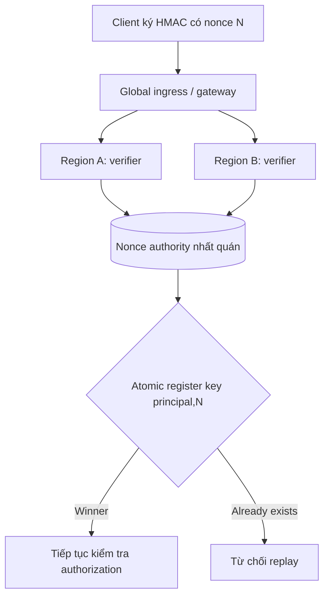

# Chọn nonce store cho hệ thống xác thực HTTP request bằng HMAC

## 1. Nonce store giải quyết vấn đề gì?

Trong module **`SECURITY_AUTHENTICATION_HMAC_REQUEST_AUTHENTICATION`**, client ký HTTP request bằng HMAC và một shared secret. Chuỗi byte được ký (*canonical request*) có thể gồm method, URI/query, các header đã thống nhất, body digest, timestamp và nonce. Server xác minh chữ ký, thiết lập danh tính client rồi mới kiểm tra quyền truy cập API và tài nguyên.

**HMAC hợp lệ chứng minh người gửi có khả năng dùng secret và các trường đã ký không bị sửa**, nhưng không tự chứng minh request chỉ được xử lý một lần. Ai có được một HTTP request đã ký hợp lệ có thể phát lại **nguyên các byte đã ký** trong khoảng thời gian timestamp còn được chấp nhận. Nếu đây là lệnh `POST /v1/transfers`, việc phát lại có thể dẫn đến nhiều lần thực hiện cùng một thao tác nếu hệ thống thiếu chống replay và idempotency.

Timestamp giới hạn *khoảng thời gian* được phép gửi request. **Nonce** (*number used once*) là một giá trị duy nhất được ký cùng request để server nhận biết request đã từng được chấp nhận. **Nonce store** là thành phần ghi lại nonce đã dùng trong phạm vi tin cậy đủ rộng, có thể được mọi instance xác minh HMAC truy cập, và bảo đảm hai yêu cầu đồng thời với cùng nonce không cùng thành công.

Chọn nonce store là một quyết định **thiết kế hệ thống HMAC**: nó ảnh hưởng trực tiếp đến khả năng chống replay, độ trễ xác thực, khả năng chịu lỗi, dung lượng, topology đa vùng và quy trình vận hành. Chọn sai có thể làm kiểm tra chữ ký vẫn đúng nhưng hai replica vẫn chấp nhận cùng một nonce.

### Ba tình huống giúp thấy rõ nhu cầu

1. **Một instance:** request có nonce `N` đến hai lần; lần thứ hai phải bị từ chối trong cửa sổ thời gian, kể cả chữ ký vẫn đúng.
2. **Nhiều replica:** request có nonce `N` được gửi gần như đồng thời đến replica A và B. Nếu mỗi replica chỉ nhớ nonce trong heap riêng, cả hai có thể xử lý request.
3. **Nhiều version/key:** client đang xoay shared secret hoặc chuyển từ signature profile `hmac-v1` sang `hmac-v2`. Cùng một principal phát lại nonce `N` qua hai phiên bản; nếu replay state bị tách một cách vô ý, request có thể được nhận hai lần.

Mục tiêu không phải lưu mọi request mãi mãi. Nonce store chỉ cần giữ bằng chứng đã sử dụng **trong toàn bộ cửa sổ còn có thể chấp nhận timestamp**, với một thao tác đăng ký nguyên tử và chính sách lỗi xác thực an toàn.

## 2. Các bất biến an toàn phải có trước khi chọn công nghệ

| Bất biến | Ý nghĩa trong hệ thống HMAC | Hậu quả nếu vi phạm |
| --- | --- | --- |
| **MAC và body digest phải đúng trước khi ghi nonce** | Chỉ request thực sự được xác thực mới được chiếm nonce. | Request giả có MAC sai có thể chiếm nonce hợp lệ hoặc bơm đầy kho. |
| **Thao tác “chưa tồn tại → ghi” phải nguyên tử** | Hai request cùng nonce chỉ có tối đa một request đăng ký thành công. | Race condition khiến cả hai request được chấp nhận. |
| **Chung phạm vi giữa các instance** | Các verifier phục vụ cùng principal phải nhìn thấy cùng replay state. | Replay qua instance khác hoặc vùng khác được nhận. |
| **Khóa nonce theo danh tính đáng tin** | Dựa trên principal/credential binding đã xác minh, không dựa riêng vào header do client tự khai. | Đổi key ID/tenant header để né kiểm tra hoặc gây nhiễu cho client khác. |
| **TTL phủ toàn bộ khoảng chấp nhận timestamp** | Nonce chưa được quên khi bản request cũ còn được chấp nhận theo thời gian. | Replay ở cuối cửa sổ sau khi bản ghi hết hạn. |
| **Lỗi store phải fail-closed** | Không xác thực thành công khi không thể khẳng định nonce chưa dùng. | Redis/DB timeout biến thành cơ chế bỏ qua chống replay. |
| **Có giới hạn chi phí lưu trữ/tra cứu** | Tải hợp lệ với nonce mới có tốc độ cao không làm tăng trạng thái vô hạn. | Hết bộ nhớ, eviction sớm hoặc nghẽn xác thực. |
| **Không thay thế authorization/idempotency** | Chống replay một nonce không quyết định quyền tenant và không xử lý mọi dạng gửi lại nghiệp vụ. | MAC đúng nhưng sai quyền, hoặc lệnh có nonce khác vẫn gây side effect trùng. |

Để khó đoán và tránh trùng ngoài ý muốn, nonce phía client nên được sinh bằng **CSPRNG**, ví dụ tối thiểu 128 bit ngẫu nhiên theo chính sách thiết kế, rồi encode bằng một format đã được chốt. Không dùng counter cục bộ dễ reset, timestamp đơn lẻ hoặc `java.util.Random` làm nguồn entropy cho nonce. Với nhiều tiến trình client, cần bảo đảm tính duy nhất trên toàn bộ phạm vi principal, không chỉ một process.

**Nonce phải được đưa vào chính canonical request được MAC bảo vệ**. Nếu nonce chỉ nằm trong header không ký, attacker có thể thay nonce của request bị phát lại bằng nonce mới trong khi giữ nguyên MAC; lúc đó replay store bị vô hiệu hóa. Timestamp, key ID và version profile cũng cần được ràng buộc theo contract ký tương ứng.

## 3. Khóa lưu nonce: chọn phạm vi uniqueness như thế nào?

Một thiết kế thường dùng khóa logic:

```text
replay-scope = authenticatedPrincipalId
nonce-key    = SHA-256(lengthPrefix(principalId) || principalId || nonceBytes)
store-key    = "hmac:replay:schema1:" + lowercaseHex(nonce-key)
```

Đây là **cách biểu diễn minh họa**, không phải canonical request hay một chuẩn nonce key chung. `lengthPrefix` chỉ một encoding có phân định ranh giới rõ để tránh ghép chuỗi mơ hồ; `SHA-256` dùng để tạo khóa lưu có độ dài giới hạn, **không thay cho HMAC xác thực HTTP**. Nếu identifier/nonce nhạy cảm, có thể dùng HMAC với một secret riêng phía server để tạo fingerprint; phải quản lý vòng đời secret đó và ảnh hưởng khi xoay khóa fingerprint. Không ghi raw nonce, shared secret hoặc request body nhạy cảm vào khóa/giá trị cache có thể bị thu thập qua log.

### Chọn principal, key ID, endpoint hay version?

| Phạm vi khóa | Lợi ích | Nguy cơ / điều kiện |
| --- | --- | --- |
| **Principal + nonce** | Thường bảo toàn uniqueness xuyên key rotation và signature version của cùng client. | Cần chính sách client đảm bảo nonce duy nhất cho mọi request; chuẩn hóa principal thật chính xác. |
| Principal + key ID + nonce | Tách replay state theo credential, tiện thống kê rotation. | Cùng nonce có thể được dùng lại qua key mới nếu không có lớp liên kết; phải là quyết định có chủ đích. |
| Principal + version + nonce | Dễ phân biệt profile ký. | Có thể cho phép một nonce được chấp nhận lần nữa qua v1/v2, nên thường không phù hợp khi muốn uniqueness xuyên migration. |
| Principal + endpoint + nonce | Tiết kiệm xung đột giữa endpoint. | Một nonce có thể được phát lại ở endpoint khác nếu hợp đồng không ràng buộc method/path/endpoint; cần phân tích threat model. |
| Chỉ nonce trên toàn hệ thống | Đơn giản về mặt ý tưởng. | Dễ gây xung đột giữa client, khiến một client vô tình/độc hại chiếm nonce của người khác. |
| Chỉ IP hoặc `X-Client-Id` chưa xác thực | Không phù hợp. | Proxy/NAT và header giả làm sai phạm vi, có thể gây denial of service hoặc bypass. |

**Mặc định thực dụng cho API theo client là `(authenticated principal, nonce)`**, áp dụng nhất quán trên toàn bộ replica và signature profile mà principal đó được phép sử dụng. Cấu hình cụ thể phải phù hợp yêu cầu nghiệp vụ và threat model; ví dụ hai workload độc lập cùng dùng một principal nhưng sinh nonce từ cùng bộ đếm có thể cần tách principal thay vì nới lỏng replay scope.

Không đưa **MAC của request** làm khóa chống replay duy nhất: khi đổi secret hoặc profile, hai MAC của cùng nonce có thể khác nhau; lại có nguy cơ lưu dữ liệu chữ ký nhạy cảm. Trường dữ liệu cần thống nhất là *nonce đã được xác thực trong phạm vi principal*, không phải chuỗi chữ ký.

## 4. Tính TTL từ cửa sổ timestamp: bẫy thường gặp

Giả sử server chấp nhận timestamp `t` khi thời gian server `now` thỏa:

```text
t - futureTolerance <= now <= t + pastTolerance
```

Trong đó `futureTolerance` cho phép timestamp được ký ở tương lai bao lâu và `pastTolerance` cho phép chấp nhận request sau thời điểm ký bao lâu. `t` đã nằm trong MAC, còn `now` lấy từ đồng hồ đáng tin của verifier.

Nếu chính sách là **±5 phút**, đặt `futureTolerance = pastTolerance = 300 giây`. Một request được nhận ở thời điểm **sớm nhất** `now = t - 300` vẫn có thể được chấp nhận đến `t + 300`: tổng khoảng còn lại là **600 giây**. Vì vậy, **lưu nonce đúng 300 giây kể từ lần nhận đầu có thể quá ngắn**, tạo khe cho replay ở cuối cửa sổ.

Một cách tính TTL an toàn theo timestamp đã xác minh:

```text
latestAcceptTime = signedAt + pastTolerance
expiresAt        = latestAcceptTime + operationalSafetyMargin
ttl              = expiresAt - now
```

Với `t = 12:05:00`, `now = 12:00:00`, `pastTolerance = 300 s` và `safetyMargin = 15 s`, bản ghi cần giữ đến **12:10:15**, tức TTL **615 giây** kể từ 12:00. Nếu nhận request tại 12:09:00, TTL tương ứng là 75 giây. Margin là khoản dự phòng clock/drift và độ trễ triển khai theo chính sách; không được dùng margin để âm thầm nới cửa sổ chấp nhận timestamp.

**Phân biệt hai cơ chế:** thời điểm *được phép xác thực* vẫn bị chặn bởi `latestAcceptTime`; TTL của nonce record có thể dài hơn một chút để bảo thủ. Sau khi timestamp đã hết hạn, request phải bị chặn ở bước thời gian ngay cả khi nonce record đã bị xóa. Thực tế còn phải xử lý clock drift giữa các replica, độ chính xác TTL của backend và các thay đổi đồng hồ trong vận hành.

### Kiểm thử biên thời gian bắt buộc

| Tình huống | Kỳ vọng |
| --- | --- |
| Request có `t = now`, nonce mới | Được phép tiếp tục xác minh HMAC và đăng ký nonce. |
| Request có `t = now + futureTolerance` | Ở biên hợp lệ theo hợp đồng; TTL đủ cho toàn bộ `futureTolerance + pastTolerance`. |
| Request có `t > now + futureTolerance` | Từ chối vì quá tương lai, không đăng ký nonce. |
| Request có `t = now - pastTolerance` | Ở biên hợp lệ; đăng ký nonce tối thiểu đến hết mốc chấp nhận và margin. |
| Request có `t < now - pastTolerance` | Từ chối vì đã quá hạn. |
| Phát lại lúc `now` vẫn nằm trong cửa sổ | Từ chối vì nonce đã tồn tại, kể cả khi key/profile được xoay. |
| Clock của replica A/B lệch trong mức cho phép | Không instance nào chấp nhận replay do bản ghi bị xóa trước khả năng chấp nhận của instance khác. |

Để các test này lặp lại được, inject `Clock` hoặc dùng fake clock/đồng hồ test; tránh dựa trên `Thread.sleep()` và thời gian thực của CI. Khi dùng cơ sở dữ liệu có TTL **xóa bất đồng bộ**, cần xét cả độ trễ dọn bản ghi và cách điều kiện ghi xử lý record đã hết hạn: bản ghi tồn tại lâu hơn có thể dẫn đến từ chối nhầm, còn xóa quá sớm có thể gây replay.

## 5. So sánh lựa chọn nonce store

Không có lựa chọn tốt nhất tuyệt đối. Quyết định tùy vào số instance, topology vùng, yêu cầu thông lượng, độ bền của trạng thái và chi phí mỗi lần xác minh.

| Loại store | Tính nguyên tử và chia sẻ | TTL/cleanup | Điểm mạnh | Rủi ro / dùng khi |
| --- | --- | --- | --- | --- |
| **Map/cache trong JVM** (`ConcurrentHashMap`, Caffeine) | Có thể dùng put-if-absent nguyên tử *trong một process*, **không chia sẻ giữa replica**. | Tự quản expiry/eviction. | Rẻ, tiện unit test hoặc một instance được cô lập nghiêm ngặt. | Không phù hợp load balancing nhiều node, rolling deploy, restart hoặc multi-region chung principal. |
| **Redis** với `SET key value NX PX ttl` | Nguyên tử trên primary thực hiện lệnh; chia sẻ giữa các verifier cùng topology. | TTL theo key. | Độ trễ thấp, API phù hợp replay guard, thực dụng cho nhiều API. | Eviction, failover mất write đã ACK, async replication, split-brain/multi-region cần thiết kế rõ. |
| **SQL database** với unique constraint/insert giao dịch | Có thể cung cấp uniqueness nguyên tử trong một DB authority. | Cleanup job / partitioning theo thời gian. | Tính bền, transaction, audit, ràng buộc chặt. | Chi phí ghi và index, lock contention, số row lớn, dọn TTL chậm; cần capacity planning. |
| **Key-value/NoSQL có conditional insert** | Phụ thuộc vào bảo đảm **conditional write nhất quán** cho cùng key và vùng. | Native TTL hoặc background cleanup tùy dịch vụ. | Dễ scale theo key, thuận tiện hạ tầng managed. | Không suy rằng TTL/replication hay eventually consistent read đủ chống replay; phải chứng minh atomic admission. |
| **Cache có thể tự eviction** | Có thể có add-if-absent nhưng key bị xóa dưới áp lực bộ nhớ. | Expiry và eviction theo cache. | Nhanh/đơn giản. | Evict nonce trước TTL sẽ cho phép replay; chỉ dùng nếu bảo đảm giữ replay state hoặc có tầng bền vững bổ sung. |
| **Bloom filter thuần** | Membership xác suất, khó biểu diễn insert nguyên tử và TTL/window. | Cần chia epoch/filter. | Tiết kiệm bộ nhớ ở quy mô lớn. | False positive từ chối request hợp lệ; không dùng làm nguồn quyết định duy nhất nếu không đáp ứng yêu cầu chính xác/concurrency. |

### Hướng chọn nhanh theo quy mô

- **Một instance cho bài lab:** bộ nhớ nội bộ có thể dùng để minh họa `putIfAbsent`, nhưng phải ghi rõ giới hạn khi chuyển sang nhiều replica.
- **API stateless chạy nhiều replica trong một vùng:** Redis độc lập, có TTL và atomic conditional insert là ứng viên thường gặp; đánh giá eviction, failover và độ bền theo SLO bảo mật.
- **Dịch vụ cần transactional durability chặt hoặc đã có SQL làm nguồn ghi nhất quán:** bảng nonce với unique constraint và chiến lược phân vùng/dọn dẹp có thể phù hợp; đo write latency/IOPS và chi phí dọn dữ liệu.
- **Nhiều vùng cùng tiếp nhận request của cùng principal:** chọn một authority có ghi điều kiện đủ mạnh trên toàn phạm vi, hoặc định tuyến cùng principal tới một vùng/home-region có nonce authority; **không** tạo replay store độc lập tại mỗi vùng nếu cần uniqueness toàn hệ thống.

## 6. Mẫu Redis: `SET ... NX ... PX` và fail-closed

Redis thường được lựa chọn vì hỗ trợ trực tiếp một thao tác **ghi khi chưa tồn tại kèm TTL**:

```text
SET hmac:replay:schema1:<nonceFingerprint> 1 NX PX <ttlMillis>
```

`NX` yêu cầu chỉ ghi nếu key chưa tồn tại. `PX` đặt thời gian sống theo mili giây **trong cùng lệnh**. Kết quả thành công biểu thị request giành được quyền dùng nonce; kết quả không ghi vì đã có key biểu thị replay. Không triển khai hai lệnh `EXISTS` rồi `SET`, vì hai replica có thể cùng đọc “chưa tồn tại” và cùng ghi sau đó.

```text
Replica A                         Redis                         Replica B
---------                         -----                         ---------
MAC valid, nonce N                                             MAC valid, nonce N
       |                                                          |
       +--- SET key(N) 1 NX PX ttl ---> [insert OK]                |
       |                                                          |
       |                    <--- SET key(N) 1 NX PX ttl -----------+
       |                         [key exists]                     |
     ACCEPT                                                       REJECT replay
```

**Điều kiện quan trọng:** `ACCEPT` ở sơ đồ nghĩa là **qua replay guard**, chưa phải cho phép nghiệp vụ. Tầng authorization vẫn có thể từ chối do principal thiếu quyền; nonce đã được đánh dấu dùng và không được “trả lại” chỉ vì nghiệp vụ trả 403/500. Hệ thống phải thiết kế retry/idempotency riêng cho nghiệp vụ.

### 6.1. Mã Java với Spring Data Redis (minh họa phần nonce store)

Ví dụ dưới đây cố ý tách **lớp lưu nonce** khỏi HMAC verifier. Caller bắt buộc đã kiểm tra MAC, body digest, key state, principal và timestamp trước khi gọi `reserveAfterSuccessfulMac`. Không gọi hàm này với principal lấy trực tiếp từ header chưa xác thực.

```java
import java.nio.charset.StandardCharsets;
import java.security.MessageDigest;
import java.security.NoSuchAlgorithmException;
import java.time.Duration;
import java.time.Instant;
import java.util.HexFormat;
import org.springframework.data.redis.core.StringRedisTemplate;

public final class RedisReplayGuard {
    public enum Result { RESERVED, REPLAY, STORE_UNAVAILABLE }

    private static final Duration PAST_TOLERANCE = Duration.ofMinutes(5);
    private static final Duration SAFETY_MARGIN = Duration.ofSeconds(15);
    private final StringRedisTemplate redis;

    public RedisReplayGuard(StringRedisTemplate redis) {
        this.redis = redis;
    }

    /** Gọi duy nhất sau khi MAC, body digest, policy và timestamp đã hợp lệ. */
    public Result reserveAfterSuccessfulMac(
            String authenticatedPrincipalId,
            String signedNonce,
            Instant signedAt,
            Instant now) {

        // Lớp verify phía trước phải giới hạn format/entropy nonce,
        // và áp dụng futureTolerance/pastTolerance cho signedAt.
        Instant expiration = signedAt.plus(PAST_TOLERANCE).plus(SAFETY_MARGIN);
        Duration ttl = Duration.between(now, expiration);
        if (ttl.isZero() || ttl.isNegative()) {
            return Result.STORE_UNAVAILABLE; // Caller phải fail-closed.
        }

        // Quy ước cả principalId và nonce chỉ gồm các ký tự được allowlist,
        // không chứa ':'; production có thể dùng length-prefix serializer.
        String fingerprint = sha256Hex(
                authenticatedPrincipalId + ":" + signedNonce);
        String key = "hmac:replay:schema1:" + fingerprint;

        try {
            // Tương ứng SET key 1 NX PX <ttl>. Không dùng exists()+set().
            Boolean written = redis.opsForValue().setIfAbsent(key, "1", ttl);
            if (written == null) return Result.STORE_UNAVAILABLE;
            return written ? Result.RESERVED : Result.REPLAY;
        } catch (RuntimeException redisFailure) {
            // Ghi telemetry đã khử dữ liệu nhạy cảm ở tầng vận hành.
            return Result.STORE_UNAVAILABLE;
        }
    }

    private static String sha256Hex(String data) {
        try {
            byte[] raw = MessageDigest.getInstance("SHA-256")
                    .digest(data.getBytes(StandardCharsets.UTF_8));
            return HexFormat.of().formatHex(raw);
        } catch (NoSuchAlgorithmException unavailable) {
            throw new IllegalStateException("SHA-256 unavailable", unavailable);
        }
    }
}
```

Mã ví dụ yêu cầu **Java 17+** cho `HexFormat`, Spring Data Redis với API `setIfAbsent(key, value, Duration)`. Quy tắc ghép `principal + ":" + nonce` chỉ phù hợp nếu hợp đồng **thực sự giới hạn** hai identifier không chứa dấu hai chấm; production nên dùng length-prefix hoặc byte serializer được định nghĩa rõ để tránh mơ hồ. Prefix `hmac:replay:schema1:` là **version schema của store key**, không phải signature version; nó phải giữ ổn định khi chuyển HMAC từ v1 sang v2 nếu cần uniqueness xuyên profile.

Code **không** minh họa việc lấy secret hay tính HMAC. Caller phải coi `REPLAY` và `STORE_UNAVAILABLE` đều là kết quả **không cho authenticated request đi tiếp**; phân loại lỗi nội bộ cho vận hành, còn status HTTP cụ thể do contract API quy định. Không nên biến timeout Redis thành “nonce chưa tồn tại”. Nếu mất kết nối sau khi lệnh ghi có thể đã thành công, từ chối lần thử đó để bảo thủ; retry cùng nonce có thể bị chặn và client cần cơ chế retry có nonce mới cùng idempotency key nghiệp vụ.

### 6.2. Redis vận hành thực tế cần chú ý gì?

**Một lệnh `SET NX` nguyên tử trên primary chưa đồng nghĩa bảo đảm không mất write trong mọi lần failover.** Redis dùng replica bất đồng bộ thông thường có thể mất một bản ghi nonce vừa được primary ACK nếu failover xảy ra trước khi replica nhận được write; một bản replay sau đó có thể được chấp nhận. Vì vậy phải đánh giá threat model và RPO cho *replay state*, không chỉ RPO dữ liệu nghiệp vụ.

- Chọn topology **một writer authority phù hợp cho cùng nonce key**; nếu chạy multi-region active-active, cần cơ chế điều phối mạnh hoặc định tuyến, không dựa trên hai cache độc lập và replication eventual để bảo đảm uniqueness.
- Cân nhắc persistence (AOF), replica acknowledgments, fencing/failover policy và giám sát replication lag theo mức rủi ro. Lệnh `WAIT` có thể giảm xác suất thiếu dữ liệu ở replica nhưng **không biến Redis replication thành giao thức consensus** hoặc bảo đảm durability tuyệt đối.
- Dùng chính sách bộ nhớ phù hợp, tránh **eviction nonce trước TTL**; quota/memory monitoring và sizing là bắt buộc. Một `maxmemory-policy` cho phép eviction có thể phá anti-replay dù TTL vẫn còn.
- Không cấu hình fallback cho phép request đi qua khi Redis timeout, command bị từ chối do thiếu bộ nhớ, connection pool nghẽn hoặc replica chưa sẵn sàng.
- Không để key ID, raw nonce, MAC hay principal nhạy cảm lộ qua Redis key, audit log hoặc metric cardinality cao. Quản lý network ACL, TLS, quyền truy cập store và backup theo chính sách vận hành.

Nếu yêu cầu an toàn cần sự bảo đảm nghiêm ngặt hơn mô hình failover của Redis hiện tại, nên ưu tiên kho dữ liệu có **conditional write và consistency/durability** được đặc tả đáp ứng threat model, dù chi phí mỗi request cao hơn.

## 7. Phương án SQL/NoSQL và lựa chọn đa vùng

### 7.1. SQL với unique constraint

Một bảng replay state có thể dùng khóa duy nhất:

```sql
CREATE TABLE hmac_seen_nonce (
    principal_nonce_fingerprint CHAR(64) PRIMARY KEY,
    expires_at TIMESTAMPTZ NOT NULL
);
```

Khi MAC hợp lệ, server `INSERT` trong transaction:

```sql
INSERT INTO hmac_seen_nonce(principal_nonce_fingerprint, expires_at)
VALUES (:fingerprint, :expires_at)
ON CONFLICT (principal_nonce_fingerprint) DO NOTHING;
```

Số hàng ghi thành công bằng **1** nghĩa là lần đầu, bằng **0** nghĩa là replay. Unique constraint xử lý được cạnh tranh giữa nhiều request vào cùng database authority. Đây là ví dụ cú pháp kiểu PostgreSQL; hệ quản trị khác có phương thức insert có điều kiện khác. Không dùng `SELECT ... WHERE NOT EXISTS` rồi `INSERT` ngoài transaction/unique constraint vì race tương tự Redis `EXISTS` rồi `SET`.

Việc xóa các dòng `expires_at` cũ phải có chiến lược **phân vùng theo thời gian / batch cleanup / retention** và kiểm thử race với insert. Không đặt điều kiện nhận request chỉ dựa vào việc record đã bị cleanup; kiểm tra timestamp phải chạy độc lập. Với tốc độ xác thực cao, số bản ghi/index lớn có thể khiến write latency, vacuum và transaction log thành điểm nghẽn; cần kiểm thử tải trước khi chọn.

### 7.2. NoSQL/managed key-value

Nếu dùng DynamoDB hoặc một kho key-value managed tương đương, cần một primitive **conditional put** đủ mạnh cho cùng replay key. Điều kiện phải chạy ở authority nhất quán để hai request đồng thời không cùng được chấp nhận. TTL được thực thi bằng background deletion ở một số hệ thống; do đó **TTL metadata không có nghĩa bản ghi biến mất ngay đúng hạn**. Định nghĩa rõ yêu cầu cho request khi một record đã quá hạn nhưng còn tồn tại: có thể từ chối bảo thủ; nếu cho phép ghi đè record quá hạn, phải chứng minh timestamp window đã hết trước khi chấp nhận lại nonce và không có race phá tính duy nhất.

Không dựa vào một lượt đọc **eventually consistent** theo kiểu `get -> if absent -> put` để chống replay; tất cả quyết định phải dựa trên thao tác ghi có điều kiện mà cơ sở dữ liệu thực sự bảo đảm.

### 7.3. Cùng principal xuất hiện ở nhiều region

Sơ đồ cần chọn một miền ghi nhất quán:



Nếu hai region dùng hai Redis độc lập và đồng bộ bất đồng bộ, cùng nonce có thể được ghi thành công ở cả hai bên trước khi bản ghi kịp truyền. Thay vào đó, cân nhắc **home region cho principal** hoặc cơ chế global conditional write thực sự có guarantee phù hợp. Khi đường mạng liên vùng bị chia cắt, chính sách ưu tiên an toàn phải xác định: **không xác minh thành công nếu không thể đăng ký nonce ở authority**. Đổi lấy nhất quán là độ trễ liên vùng, nguy cơ giảm availability và nhu cầu disaster recovery có thiết kế.

## 8. Dung lượng, thông lượng và bảo vệ store trước tải bất thường

Nếu trung bình có `R` request **đã xác thực, nonce mới** mỗi giây, thời gian lưu trung bình `T` giây, số bản ghi đang tồn tại ở trạng thái ổn định xấp xỉ:

\[
N \approx R \times T
\]

Ví dụ `R = 2.000 request/s`, `T = 600 s` thì khoảng **1.200.000 nonce keys** đồng thời. Nếu `T = 615 s`, con số tăng thành **1.230.000 keys**. Tổng byte RAM/disk phụ thuộc kích thước key, value, metadata TTL, overhead allocator, index/hash table, replication/persistence và chính sách của nhà cung cấp; **không** được lấy `64 byte SHA-256 hex` làm toàn bộ chi phí mỗi record. Cần benchmark với dữ liệu/key shape thực tế và dành capacity cho peak, replication và sự cố.

Các chỉ số nên đo:

| Nhóm | Chỉ số | Ý nghĩa |
| --- | --- | --- |
| Correctness | Số lần reserve success/replay conflict, số request replay accepted | Bất biến quan trọng nhất: replay accepted phải bằng 0 trong mô hình đã chốt. |
| Latency | p50/p95/p99 của `SET NX` hoặc conditional insert; timeout | Store là một phần đường critical path của request. |
| Capacity | Key count/bytes, bộ nhớ, TTL distribution, eviction | Phát hiện hết bộ nhớ hoặc nguy cơ quên nonce trước hạn. |
| Durability | Replica lag, write failures, failover count, RPO quan sát | Đánh giá nguy cơ mất một nonce ACK trong sự cố. |
| Cost | Write QPS/IOPS, connection pool, shard hot keys, transaction log | Chọn backend và quota hợp lý. |
| Auth outcome | HMAC valid/invalid, timestamp expired, nonce replay, key revoked | Phân biệt lỗi authentication với authorization hoặc store failure. |
| Traffic | Accepted request RPS theo client class, rejected ingress RPS | Dự đoán tăng trưởng trạng thái và phát hiện abuse. |

**Thứ tự xử lý giúp giảm chi phí:** trước khi ghi nonce, kiểm tra các điều kiện rẻ và an toàn như size limit, signature profile được hỗ trợ, key ID format, timestamp, key state, body digest và MAC. Một request có **MAC sai** không được tạo entry replay. Tuy vậy, kẻ có key hợp lệ vẫn có thể gửi lượng lớn nonce mới; cần quota theo principal sau xác thực, rate limit theo nguồn trước xác thực và giới hạn tài nguyên/kết nối, không chỉ dựa vào key ID chưa xác minh để áp quota.

Với body lớn, xác định rõ byte được hash trước hay sau gateway/decompression; giới hạn kích thước và thời gian đọc body để không bị request chưa tin cậy chiếm memory. Với WebFlux, không gom `Flux<DataBuffer>` vô hạn; với Servlet, kiểm tra việc đọc/caching body ở filter trước khi downstream đọc lại. HMAC verifier phải tạo principal **sau khi** MAC và replay đạt, rồi ủy quyền theo tenant/resource được server ràng buộc, không lấy quyền từ header tự khai.

## 9. Vì sao nonce store không thay thế idempotency key?

Nonce bảo vệ **tính mới của một lần xác thực HTTP**, còn idempotency bảo vệ **ngữ nghĩa của một hành động nghiệp vụ**. Hai yêu cầu khác nhau có thể cùng mục đích nhưng ký bằng hai nonce mới, vì vậy đều vượt qua replay guard.

Ví dụ client gửi `POST /v1/payments` với nonce `N1`; server ghi nonce thành công, tạo thanh toán nhưng response bị mất trên mạng. Client retry bằng nonce **mới** `N2` để vượt qua replay guard: MAC hợp lệ và nonce mới, nhưng nếu không có idempotency key hoặc cơ chế kiểm soát transaction, nghiệp vụ có thể tạo thêm thanh toán.

Giải pháp là một **idempotency key có hợp đồng riêng**, được ràng buộc với principal, operation và nội dung nghiệp vụ phù hợp; các retry cùng hành động có thể dùng lại idempotency key nhưng phải ký bằng nonce mới. Idempotency store cần chính sách kết quả, retention và tính nguyên tử theo nghiệp vụ. Không làm `nonce == idempotencyKey` một cách mặc định vì hai loại key có mục tiêu/TTL khác nhau.

Nonce đã reserve khi MAC hợp lệ thường nên giữ ở trạng thái đã dùng **ngay cả khi** tầng nghiệp vụ trả `403`, `409` hoặc `5xx`; không xóa nonce để “cho phép retry” vì có thể tái mở cửa sổ replay. Retry nên là request mới, nonce mới và idempotency key cũ nếu cần giữ cùng hành động.

## 10. Bộ kiểm thử bắt buộc cho quyết định chọn nonce store

| ID | Tình huống | Kỳ vọng |
| --- | --- | --- |
| N01 | MAC hợp lệ, timestamp trong cửa sổ, nonce mới | Đúng một lần reserve thành công; chỉ sau đó mới tiếp tục authentication. |
| N02 | Gửi lại **nguyên request ký hợp lệ** cùng nonce | Từ chối replay trong toàn bộ cửa sổ. |
| N03 | 32 hoặc 100 request đồng thời cùng nonce trên nhiều replica | **Chỉ một** atomic insert thành công, số request authenticated tối đa một. |
| N04 | Nonce giống nhau nhưng MAC sai | Không ghi nonce mới, không làm cạn replay store. |
| N05 | Request có MAC đúng nhưng client/key/profile bị cấm | Không được authenticated; không thực hiện reserve vô ích. |
| N06 | Principal A và B dùng cùng nonce | Theo scope `(principal, nonce)`, có thể cùng được nhận độc lập nếu MAC/policy đều đúng. |
| N07 | Một principal dùng cùng nonce qua key rotation/v1/v2 | Request thứ hai bị chặn nếu contract chọn uniqueness theo principal xuyên profile. |
| N08 | Timestamp ở biên sớm nhất `t = now + futureTolerance` | TTL đủ đến `t + pastTolerance + margin`; không có replay gap. |
| N09 | Timestamp quá cũ hoặc quá tương lai | Bị từ chối trước khi lưu nonce, có fixed clock để kiểm tra biên. |
| N10 | Key hết hạn TTL trong store nhưng timestamp vẫn còn hợp lệ do cấu hình sai | Test phải phát hiện **lỗi thiết kế TTL**; không chấp nhận replay. |
| N11 | Redis/DB timeout, mất mạng, transaction conflict chưa rõ kết quả | Fail-closed, không cho request đi qua như nonce chưa tồn tại. |
| N12 | Failover ngay sau write được ACK | Đánh giá khả năng mất replay state; kiểm chứng bảo đảm RPO/theo topology đã chọn. |
| N13 | Hai region nhận cùng nonce gần như đồng thời | Cùng một authority/conditional write nên không hai request cùng thành công. |
| N14 | Burst với nhiều **nonce mới có MAC hợp lệ** | Store có capacity, quota, latency và không eviction nonce chưa hết TTL. |
| N15 | MAC đúng nhưng principal không được quyền trên resource | Authentication và nonce registration có thể thành công; authorization vẫn phải từ chối. |
| N16 | Cùng yêu cầu nghiệp vụ được ký bằng hai nonce khác nhau | Replay guard nhận cả hai; idempotency policy mới có nhiệm vụ ngăn side effect trùng. |
| N17 | Query/path/body bị proxy thay đổi so với canonical request đã ký | HMAC fail theo contract; không ghi nonce hoặc tạo principal. |
| N18 | Store bị restart/upgrade/scale, record cần giữ chưa hết hạn | Không xuất hiện trạng thái chấp nhận replay do mất dữ liệu sớm. |

**Không dùng chữ ký giả để test replay.** Nếu MAC sai, verifier có thể từ chối ở bước so sánh HMAC mà chưa từng chạy vào nonce store; test đó không chứng minh được atomicity. Để test N03, gửi nhiều bản sao của **một request đã ký đúng** với cùng principal, timestamp và nonce qua load balancer tới nhiều replica. Đếm số lần store trả success và số lần nghiệp vụ được vào sau replay guard. Nếu test endpoint có authorization/side effect, phân biệt rõ authenticated count với business success count.

### 10.1. Khung kiểm thử concurrency (pseudocode)

```java
// Pseudocode: chạy với nonce store thực dùng chung, fixture có MAC hợp lệ.
String signedRequest = fixtureWithValidHmacAndNonce("fixed-nonce-for-test");
int parallel = 32;
CountDownLatch start = new CountDownLatch(1);
List<Future<Response>> calls = new ArrayList<>();

for (int i = 0; i < parallel; i++) {
    calls.add(executor.submit(() -> {
        start.await();
        return sendViaLoadBalancer(signedRequest);
    }));
}
start.countDown();

List<Response> results = collect(calls);
assertEquals(1, countAuthenticatedByReplayGuard(results));
assertEquals(31, countReplayRejected(results));
```

Đây là **pseudocode** để diễn đạt test case, không phải lớp JUnit có thể copy/chạy nguyên xi; cần fixture/cấu hình auth thật, clock ổn định và khởi tạo replay state sạch cho phạm vi test. Nếu các request thất bại trước khi vào replay guard do thiếu quyền hoặc timestamp lỗi, test phải báo **không hợp lệ** chứ không được kết luận đã chống replay. Trên nhiều replica, ghi thêm dấu hiệu instance đã xử lý để bảo đảm test thật sự bao phủ concurrency phân tán.

## 11. Runbook vận hành khi nonce store có sự cố

### Khi timeout hoặc store unavailable

1. Kiểm tra phạm vi ảnh hưởng, độ trễ và tỷ lệ timeout của `reserve`, trạng thái network/connection pool, CPU/memory/eviction và replica lag.
2. Bật circuit breaker/backpressure ở **tầng từ chối an toàn** nếu cần, nhưng **không** bật cơ chế bỏ qua nonce để tăng tỷ lệ thành công.
3. Đảm bảo response công khai không lộ key ID/raw nonce/secret; log nội bộ phân loại `replay`, `store_unavailable`, `invalid_mac`, `expired`, `authorization_denied` bằng nhãn hữu hạn.
4. Khi hồi phục, kiểm chứng cùng nonce không được nhận hai lần, kể cả sau failover; nếu backend đã làm mất state, xác định phạm vi rủi ro và cân nhắc ngừng nhận request trong phần cửa sổ thời gian liên quan theo quy trình sự cố.
5. Điều tra và sửa điều kiện tạo sự cố: capacity quá nhỏ, eviction, timeout, replication lag, quá nhiều key ID lạ hoặc signer dùng nonce không duy nhất.

### Khi nhiều request hợp lệ bị chặn replay

Kiểm tra client có đang dùng lại nonce do khởi động lại process, dùng `timestamp + counter`, cache signed request hoặc retry nguyên chữ ký cũ không. Kiểm tra server bind đúng principal, không dùng nonce global gây đụng nhau giữa các khách hàng và không tái sử dụng idempotency key như nonce. Với UUID/random nonce đủ mạnh, va chạm ở quy mô nhỏ rất hiếm; nếu hàng loạt `replay` xuất hiện, ưu tiên điều tra cách sinh nonce, phạm vi key và behavior retry.

### Khi dọn TTL hoặc chuyển store

Không reset replay state bằng cách `FLUSHDB` hoặc chuyển sang store mới rỗng trong lúc timestamp của request cũ vẫn còn hiệu lực: việc đó có thể tạo cửa sổ replay. Khi thay Redis bằng SQL/NoSQL hoặc thay cluster/region, phải chọn một **cutover plan** bảo toàn trạng thái đang hiệu lực hoặc giữ chặn/dual-check theo chính sách nhất quán cho đến khi cửa sổ cũ hết hạn. Không để hai verifier độc lập cùng chấp nhận nonce ở hai store trong giai đoạn chuyển đổi. Sau cutover, dùng request đã ký hợp lệ trước đó để xác minh replay vẫn bị từ chối.

## 12. Tình huống thiết kế: API thanh toán có ba replica

**Bối cảnh:** API `POST /v1/payments` sử dụng HMAC-SHA-256 theo canonical contract đã công bố: ký method, path, header quan trọng, digest byte body, key ID, timestamp và nonce. Server chấp nhận timestamp ±300 giây, chạy ba replica sau gateway, dự kiến **2.000 request HMAC hợp lệ/s** ở tải ổn định, có kế hoạch key rotation và đổi signature profile trong năm sau.

**Lựa chọn ban đầu:** Redis được quản lý trong cùng region có `SET ... NX ... PX`, với namespace replay **`(authenticated principal, nonce)`** dùng xuyên key/profile. Mỗi nonce có TTL tính theo `signedAt + 300s + safetyMargin - now`, không mặc định 300 giây từ lần nhận. Với tối đa khoảng 615 giây theo ví dụ và 2.000 request/s, có khoảng **1,23 triệu key** khi tải ổn định; capacity thật phải benchmark với overhead Redis/replication và peak traffic.

**Điều kiện trước khi chọn Redis cho production:** chứng minh tất cả replica sử dụng cùng authority, concurrency test một winner, không có eviction sớm, lỗi store fail-closed, backup/failover đạt RPO replay mong muốn, monitoring có thể phát hiện mất write/lag, gateway không thay byte đã ký và authorization vẫn kiểm tra quyền thanh toán theo tenant. Nếu hệ thống cần bảo đảm không mất một lần reserve đã ACK ngay cả khi failover bất thường, cân nhắc database/conditional store với tính bền và nhất quán cao hơn hoặc phương án kiến trúc thay đổi.

**Mở rộng multi-region:** không nhân đôi Redis độc lập rồi dùng asynchronous replication để suy ra chống replay toàn cục. Đánh giá định tuyến theo home region của principal hoặc global write authority; chi phí latency và tradeoff availability phải được thể hiện trong quyết định kiến trúc.

**Bài tập:** hãy đề xuất một sơ đồ phân tán cho ba replica, chỉ rõ thời điểm MAC được xác minh, nơi lấy principal, cách ghi atomic nonce, TTL, cách fail-closed và vị trí authorization. Sau đó viết test gửi 32 bản sao có MAC đúng qua cả ba replica, test với timestamp tương lai sát biên, test chuyển key ID nhưng giữ nonce và test retry payment với nonce mới cùng idempotency key.

## 13. Checklist để chốt quyết định chọn nonce store

- [ ] Nonce và timestamp được MAC bảo vệ theo canonical contract; format/entropy nonce có giới hạn.
- [ ] Scope uniqueness được đặc tả theo principal/credential, bao gồm quy tắc khi key rotation và signature version thay đổi.
- [ ] Store cung cấp **atomic conditional insert** trên toàn miền verifier có thể tiếp nhận cùng principal.
- [ ] Nonce chỉ được reserve sau khi body digest, HMAC, key state và policy version đã hợp lệ.
- [ ] TTL được tính phủ cả **future tolerance + past tolerance** ở trường hợp nhận sớm nhất; có margin phù hợp và test biên.
- [ ] Lỗi store, timeout hoặc kết quả ghi không rõ dẫn đến fail-closed; không fallback vào cache local thiếu nhất quán.
- [ ] Topology replica, failover, durability/replication và kịch bản mất write đã được đánh giá theo threat model.
- [ ] Không có eviction hoặc cleanup sớm làm mất nonce còn trong cửa sổ nhận timestamp.
- [ ] Có giới hạn size/rate/quota và capacity theo RPS × TTL; chi phí key, metric, replication và peak đã được benchmark.
- [ ] Replay guard và idempotency key nghiệp vụ có mục tiêu, scope và retention tách biệt.
- [ ] Authorization theo tenant/resource chạy sau khi principal xác thực; gateway/proxy được kiểm thử với đúng canonical bytes.
- [ ] Đã kiểm thử duplicate, concurrency nhiều replica, multi-region, clock skew, key rotation, failover, timeout và cutover store.
- [ ] Runbook vận hành có cảnh báo latency, key count, eviction, replay conflict, dependency outage và khả năng thu hồi an toàn.

**Kết luận:** nonce store phù hợp là nơi có thể **ghi một nonce đúng một lần trong toàn bộ miền xác thực**, giữ record đủ lâu so với cửa sổ timestamp và từ chối an toàn khi không thể bảo đảm tính duy nhất. Redis `SET NX` thường là lựa chọn thực dụng cho API đa replica một vùng; SQL hoặc kho conditional write mạnh hơn có thể phù hợp khi yêu cầu durability và nhất quán cao. Dù chọn công nghệ nào, chống replay vẫn phải gắn chặt với canonical HMAC request, vòng đời key, proxy/gateway và kiểm tra phân quyền độc lập.
