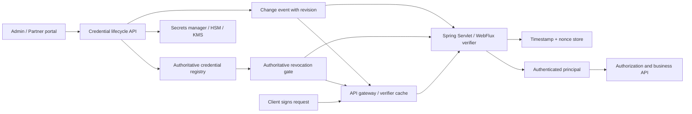
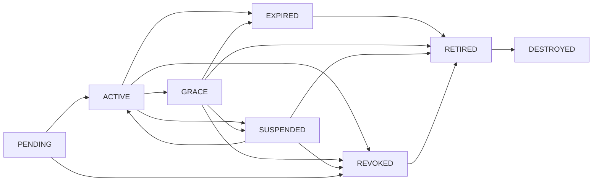

# Chọn key lifecycle cho hệ thống xác thực HTTP request bằng HMAC

## 1. Bài toán thiết kế: key không chỉ là một chuỗi secret

Trong module `SECURITY_AUTHENTICATION_HMAC_REQUEST_AUTHENTICATION`, client và server chia sẻ một **secret** để tạo/xác minh HMAC trên **canonical HTTP request** gồm method, URI, header hoặc body theo hợp đồng ký. Bước kiểm tra HMAC chỉ chứng minh bên gửi có khả năng sử dụng secret tương ứng; hệ thống vẫn cần chống replay bằng timestamp/nonce, phân quyền theo principal/scope và xử lý các biến đổi tại proxy/gateway.

**Key lifecycle** là tập hợp chính sách và thao tác cho một credential từ lúc được yêu cầu cấp, tạo key, phân phối, kích hoạt, sử dụng, xoay vòng, tạm khóa, thu hồi, hết hạn đến khi hủy vật liệu bí mật. **Chọn key lifecycle** là quyết định kiến trúc: hệ thống chấp nhận bao nhiêu phiên bản key cùng lúc, chúng được tạo và phân phối thế nào, ai được quyền điều khiển trạng thái, thời gian chấp nhận old key bao lâu, và yêu cầu nhất quán khi revoke là gì.

Ví dụ: nếu một đối tác thanh toán đã bị lộ secret, việc thay chuỗi cấu hình tại một pod **không đủ**. API gateway hoặc service ở region khác có thể vẫn xác minh bằng key cache; key cũ có thể còn `ACTIVE` trong credential registry; thiết bị client có thể chưa nhận được key mới. Một lifecycle thiếu ràng buộc sẽ biến “rotation” thành khoảng thời gian tiếp tục chấp nhận request giả mạo.

**Mục tiêu học tập**

1. Chọn mô hình key lifecycle dựa trên blast radius, khả năng cập nhật client, độ nhạy của API và yêu cầu availability.
2. Thiết kế key version, trạng thái và các chuyển tiếp nhất quán, có audit.
3. Phân biệt rotation thường lệ, suspension, emergency revocation, expiry và destruction.
4. Tổ chức key distribution, overlap, cache invalidation và kiểm tra từ gateway tới Java/Spring verifier.
5. Kiểm chứng thiết kế bằng test cho cutover, replay, stale cache, đa vùng, lỗi key lookup và authorization.

## 2. Đặt câu hỏi trước khi chọn chính sách

Không có một chu kỳ rotation hay một thời hạn grace mặc định phù hợp cho mọi hệ thống. Kiến trúc sư phải viết rõ các giả định và mức rủi ro:

| Câu hỏi | Tác động đến key lifecycle |
|---|---|
| Key dùng cho **một client**, một thiết bị, một integration, một tenant hay cả hệ thống? | Càng nhiều bên dùng chung secret, **blast radius** khi lộ càng lớn; khó thu hồi riêng lẻ. |
| Ai giữ secret: ứng dụng server-to-server, gateway, thiết bị IoT hay đối tác bên ngoài? | Khả năng lưu an toàn, nhận key mới và tự động cutover khác nhau. |
| Client có thể cập nhật đồng bộ hay nhiều phiên bản triển khai chậm? | Quyết định có cần overlap nhiều key version và thời gian chuyển tiếp tối đa. |
| Key dùng để ký API đọc hay API chuyển tiền/ghi dữ liệu quan trọng? | Endpoint nhạy cảm thường đòi hỏi giới hạn phiên xác thực và hiệu lực revoke chặt hơn. |
| Server xác minh tại gateway, ứng dụng, nhiều region hay ở nhiều lớp? | Quyết định control plane, revision, invalidation và revocation gate. |
| Khi credential registry/KMS lỗi, hệ thống muốn tiếp tục phục vụ đến mức nào? | Phải cân đối **fail closed** với availability; cache stale tạo cửa sổ rủi ro. |
| Khi phát hiện lộ key, tối đa sau bao lâu mọi verifier phải từ chối? | Quyết định SLO thu hồi và có cần đọc trạng thái có tính nhất quán mạnh. |
| Cần điều tra hành vi cũ, giữ metadata hoặc secret theo quy định nào? | Quyết định retention và lịch destruction; không đồng nghĩa tiếp tục cho phép authentication. |

Các yêu cầu dưới đây là **ví dụ thiết kế**, không phải ngưỡng chuẩn bắt buộc:

```text
Use case:             Merchant API server-to-server
Credential scope:     1 credential family / merchant / environment
Key versions:         1 ACTIVE + tối đa 1 GRACE trong rotation thông thường
HMAC algorithm:       HMAC-SHA-256, contract version được đăng ký
Secret generation:    32 byte ngẫu nhiên từ CSPRNG cho mỗi key version
Rotation cadence:     theo risk policy và lịch vận hành đã phê duyệt
Grace during rotation: khoảng ngắn, có giới hạn và giám sát
Emergency revocation: chặn old key bất kể grace còn hay không
Replay control:       timestamp + atomic nonce store dùng chung
Authorization:        tenant/scope/resource sau xác thực
```

Độ dài 32 byte ngẫu nhiên độc lập là lựa chọn thực tế mạnh cho HMAC-SHA-256; sức mạnh thực tế còn phụ thuộc cách tạo, bảo vệ và sử dụng key. Với HMAC-SHA-512 hay yêu cầu khác phải quyết định theo thuật toán và chính sách riêng. Đừng coi tên thuật toán `HmacSHA256` là lý do để dùng secret ngắn/dễ đoán như mật khẩu con người.

## 3. So sánh các phương án lifecycle

### 3.1. Static key, manual rotation và versioned rotation

| Phương án | Cách hoạt động | Ưu điểm | Nhược điểm / điều kiện chọn |
|---|---|---|---|
| **Static shared key** | Một secret dùng lâu, cập nhật thủ công khi cần. | Đơn giản cho PoC/hệ thống thử nghiệm. | Rủi ro tích lũy, khó revoke không gián đoạn, không phù hợp hệ thống production nhạy cảm. |
| **Manual scheduled rotation** | Người vận hành cấp secret mới định kỳ, phối hợp client rồi chuyển. | Có quy trình kiểm soát, phù hợp số client rất nhỏ. | Dễ bỏ sót, lệch giờ, dùng secret cũ quá lâu; phải có audit và expiry cứng. |
| **Versioned key lifecycle** | Mỗi client có key versions riêng, trạng thái/hiệu lực rõ, overlap có giới hạn. | Phù hợp integration server-to-server, dễ canary/cutover/revoke từng version. | Cần credential registry, policy control plane, key distribution và xử lý cache nhất quán. |
| **Short-lived credentials** | Key phát hành với thời hạn ngắn; client làm mới tự động. | Giới hạn tuổi key nếu không thể thu hồi ngay. | Đòi hỏi cơ chế cấp phát đáng tin, client ổn định, thời gian/chính sách clock skew; key bị lộ vẫn có thể bị dùng trước expiry. |
| **Derived per-purpose keys** | Key dẫn xuất từ root/master secret theo tenant/mục đích/version và KDF có domain separation. | Giảm lượng secret phải phân phối nội bộ trong một số kiến trúc. | Lộ master có thể ảnh hưởng nhiều derived keys; phức tạp về domain, KDF, rotation và boundary. Không tự động thay thế per-client independent secret. |

**Khuyến nghị cho bài toán server-to-server có nhiều đối tác:** ưu tiên **versioned key lifecycle với secret riêng cho mỗi client/môi trường**, có rotation được tự động hóa và thủ tục revoke khẩn. Đây là phương án tham chiếu để triển khai phần sau, không phủ nhận các thiết kế chuyên biệt cần short-lived hoặc cryptographic key derivation.

### 3.2. Định danh key và phạm vi tách biệt

Không dùng duy nhất `keyId` làm danh tính hoặc quyền. Hệ thống nên tra theo **phạm vi đăng ký**:

```text
(environment, tenantId, clientId, keyId, algorithm/contractVersion)
    -> key metadata + protected secret reference
```

Quy tắc:

- Tách secret giữa **production/staging/development**, giữa các client và các miền tin cậy. Key dùng ở staging không được xác thực request production.
- `keyId` là identifier để lookup, **không phải secret**; vẫn cần giới hạn ký tự, độ dài và khả năng bị liệt kê.
- Ràng buộc `clientId`, `keyId` và version vào thông điệp đã ký theo hợp đồng, ví dụ ký chúng trong canonical headers, hoặc có cơ chế ràng buộc key selection chặt chẽ tương đương. Không cho attacker đổi key identifier để chuyển principal/tenant.
- Thuộc tính principal, role/scope phải lấy từ registry đáng tin **sau khi HMAC hợp lệ**, không lấy trực tiếp từ request chưa xác thực.
- Mỗi key version có secret **mới, độc lập**. Không nhân bản một secret thành nhiều `keyId` rồi nghĩ có thể revoke riêng biệt: nếu secret vật lý chung thì compromise ảnh hưởng mọi định danh sử dụng nó.

## 4. Kiến trúc control plane và data plane

Tách rõ **quản lý vòng đời** khỏi **đường xác minh request**:



**Control plane** chịu trách nhiệm phát hành secret, quyền người vận hành, hai bước phê duyệt khi cần, version, thời hạn, chuyển trạng thái, audit và phát sự kiện invalidation. **Data plane** nhận HTTP request, tra đúng key, kiểm tra trạng thái, dựng canonical bytes, xác minh HMAC, kiểm tra timestamp/nonce rồi tạo principal đã được xác thực.

Hai lớp thường có các mức nhất quán khác nhau:

- Registry phải có một **nguồn có thẩm quyền**, không để pod A tự đổi key A thành `ACTIVE` trong khi pod B coi `REVOKED`.
- Cache có thể giảm latency nhưng **revision/key state phải tăng đơn điệu**; nhận `REVOKED rev=18` rồi không được ghi đè bằng `ACTIVE rev=17` đến muộn.
- Nếu doanh nghiệp yêu cầu revoke gần như tức thì, cần một **revocation gate**/điểm kiểm tra trạng thái đủ nhất quán tại request path hoặc ingress; invalidation event và TTL đơn lẻ **không chứng minh** revoke tức thì.
- Khi registry/gate không khả dụng, endpoint yêu cầu HMAC cần **fail closed** theo policy đã định, không bỏ authentication hoặc dùng key cache vô hạn. Thiết kế HA, read performance và hạn mức có thể giảm ảnh hưởng availability.

### 4.1. Chọn nơi giữ secret

| Mô hình | Khi nào phù hợp | Đánh đổi |
|---|---|---|
| Secret manager, verifier được phép lấy secret tại runtime | Client-server HMAC cần shared secret và verifier tự tính MAC. | Secret có thể hiện diện trong RAM của verifier; cần quyền tối thiểu, TTL, tránh log/dump và chiến lược cache. |
| Key-service tập trung xác minh MAC | Muốn hạn chế phân phối secret sang các service ứng dụng. | Thêm network hop, latency, throughput/availability dependency; phải truyền đúng canonical bytes và context key/algorithm. |
| HSM/KMS hỗ trợ HMAC verification phù hợp | Muốn kiểm soát hoạt động mật mã tại dịch vụ bảo vệ khóa. | Phải xác minh API và cách provision shared secret thực tế; non-exportable key không tự nhiên “chia sẻ được” với client. Không giả định mọi KMS đều có cùng tính năng. |

Ngay cả khi secret được bọc bằng KMS trong DB, **metadata state** vẫn cần kiểm tra. Xóa vật liệu khỏi một node không phải thao tác revoke toàn cụm; ngược lại, chuyển metadata sang `REVOKED` không tự xóa mọi bản sao secret cũ trong backup/cache.

## 5. Chọn state machine cho key version

Key version và client identity là hai thực thể khác nhau. Một client có thể có **một key đang ký** và **một key cũ đang trong cửa sổ chấp nhận**, nhưng vòng đời từng key phải được quản lý độc lập.

| Trạng thái | Có thể dùng để xác minh request **mới**? | Ý nghĩa |
|---|---|---|
| `PENDING` | Không. | Secret đã được tạo/provision, chưa đến thời điểm kích hoạt. |
| `ACTIVE` | Có, nếu trong hiệu lực và hợp đồng ký đúng. | Key version hiện được phép sử dụng. |
| `GRACE` | Có **trong cửa sổ cho phép**; không phải khuyến khích client tiếp tục ký. | Old key trong planned rotation, không bị compromise. |
| `SUSPENDED` | Không. | Tạm dừng để điều tra hoặc xử lý vận hành; mở lại đòi hỏi phê duyệt/chính sách. |
| `REVOKED` | **Không, vĩnh viễn với phiên bản này.** | Key mất tin cậy; là trạng thái terminal về quyền xác thực. |
| `EXPIRED` | Không. | Đã hết hạn sử dụng; phát hành version mới thay vì nới hạn bất ngờ. |
| `RETIRED` | Không. | Đã kết thúc chấp nhận, metadata giữ để audit/retention. |
| `DESTROYED` | Không. | Material không còn được phục vụ; metadata/tombstone cần thiết có thể tiếp tục lưu theo policy. |

Sơ đồ chuyển tiếp **minh họa**, không phải đầy đủ mọi edge được cho phép:



Với state machine thật, `SUSPENDED → ACTIVE` chỉ được cho phép khi nguyên nhân đình chỉ đã được xử lý **và credential chưa từng bị tuyên bố compromise**; nếu compromise thì phải chuyển `REVOKED`, không tái kích hoạt. Không tự gia hạn key đã `EXPIRED` bằng thay timestamp tại DB. Các transitions ngoài sơ đồ (ví dụ `PENDING → DESTROYED` khi hủy cấp phát) phải được định nghĩa tường minh trong policy.

### 5.1. Bất biến quan trọng

1. **Không resurrect:** một version `REVOKED` không quay lại `ACTIVE/GRACE` do rollback, event trễ hoặc job rotation.
2. **Không quá thời gian:** trạng thái `ACTIVE` không vượt quá `expiresAt`; `GRACE` không vượt quá **cả** `graceUntil` và `expiresAt`.
3. **Không cross-tenant:** một key được tìm thấy ở tenant A không tạo authentication cho tenant B.
4. **Không chia lại secret:** tạo version mới thì sinh secret độc lập, không đổi label của secret cũ.
5. **Không chấp nhận key chưa cấp quyền:** key `PENDING`/`SUSPENDED` không dùng để xác minh dù MAC toán học khớp.
6. **Không bỏ bước chống replay:** key state hợp lệ + HMAC match vẫn phải kiểm tra timestamp/nonce theo hợp đồng và phân quyền.
7. **Không dựa vào clock client để quyết định state:** thời gian hiệu lực dùng clock đáng tin ở server; skew của timestamp request là chính sách khác.
8. **Mọi thay đổi có revision/audit:** cập nhật nguyên tử, tránh lost update khi admin thu hồi đồng thời với rotation scheduler.

## 6. Dữ liệu vòng đời và API điều khiển

Ví dụ metadata của **một key version**, không chứa secret thô:

```json
{
  "environment": "prod",
  "tenantId": "tenant-vn-01",
  "clientId": "merchant-a",
  "keyId": "hmac-2026-11-b",
  "credentialFamily": "merchant-a-orders",
  "algorithm": "HmacSHA256",
  "canonicalContract": "hmac-request-v2",
  "secretRef": "secrets-manager://merchant-a/orders/version-b",
  "state": "ACTIVE",
  "revision": 27,
  "createdAt": "2026-11-28T00:00:00Z",
  "notBefore": "2026-11-28T02:00:00Z",
  "expiresAt": "2027-02-28T02:00:00Z",
  "graceUntil": null,
  "revokedAt": null,
  "lastRotatedBy": "credential-rotation-service"
}
```

Cấu trúc metadata có thể thêm `reasonCode`, `incidentId`, `issuedBy`, `lastUsedAt`, `clientAckAt`, `regionRevision` và retention policy. Tuy nhiên, không dùng `lastUsedAt` làm chứng cứ duy nhất về hoạt động của client: event có thể bị trễ, mất hoặc bị attacker cố tạo traffic.

**Phân loại các mốc thời gian:**

- `createdAt`: lúc material/record được tạo; không đồng nghĩa bắt đầu chấp nhận.
- `notBefore`: request mới chỉ được xác minh từ thời điểm này; server clock là nguồn quyết định.
- `expiresAt`: giới hạn cuối cùng của thời gian xác thực key, dạng khoảng `[notBefore, expiresAt)`.
- `graceUntil`: giới hạn **sớm hơn hoặc bằng expiresAt** khi old key ở `GRACE` sau rotation.
- `revokedAt`: thời điểm ra quyết định revoke tại nguồn có thẩm quyền; không thay thế bằng giờ máy từng pod.
- `destroyAfter` nếu có: mốc quản lý key material dựa trên retention/evidence; **không** là thời điểm key ngừng xác thực (việc đó xảy ra trước).

Các thao tác control plane có thể thiết kế là `issueKeyVersion`, `ackDelivery`, `activate`, `startGrace`, `suspend`, `revoke`, `retire`, `destroy`. Mỗi API phải có authorization riêng, idempotency key cho request quản trị khi thích hợp, audit và cập nhật có điều kiện bằng revision/ETag.

### 6.1. Vì sao cần CAS và revision?

Giả sử job rotation định chuyển `ACTIVE rev=40 → GRACE rev=41` trong lúc nhân sự an ninh đã chuyển `ACTIVE rev=40 → REVOKED rev=41`. Nếu job viết mù không kiểm tra revision, key revoked có thể được mở lại.

Hợp đồng cập nhật minh họa:

```text
revoke(tenantId, clientId, keyId, expectedRevision=40, incidentId)
  -> atomically state=REVOKED, revision=41, revokedAt=serverTime

startGrace(tenantId, clientId, keyId, expectedRevision=40, graceUntil)
  -> conflict if revision no longer equals 40
```

Sau conflict, control plane phải **đọc trạng thái authoritative và đánh giá lại**, không retry mù `startGrace` cho key đã `REVOKED`. Một key `REVOKED` được coi là terminal về authentication, kể cả khi metadata còn tồn tại hoặc secret còn trong backup phục vụ pháp chứng.

## 7. Cấp phát, kích hoạt và giao secret cho client

### 7.1. Provisioning

Quy trình điển hình:

1. **Định danh client:** xác minh doanh nghiệp/hệ thống được cấp credential, tenant, environment, endpoint/scope được phép, người nhận và kênh liên lạc.
2. **Sinh secret:** dùng CSPRNG với entropy đủ lớn, key mới độc lập; tạo `keyId` mới và metadata trạng thái `PENDING`. Không tự dùng password, UUID, timestamp hoặc hash đơn giản của client ID làm shared secret.
3. **Lưu an toàn:** ghi vật liệu vào secret manager/KMS/HSM theo khả năng hỗ trợ và quyền tối thiểu; metadata dùng secret reference. Không chép secret vào config repository, log, issue tracker hoặc email thường.
4. **Giao cho client:** dùng kênh bảo mật, cấp quyền đúng người nhận, giới hạn số lần hiển thị/thu hồi quyền phân phối; audit sự kiện delivery. Với HMAC chia sẻ bí mật, phía client **phải có khả năng dùng secret**, nên yêu cầu kênh cấp phát và bảo vệ secret phía client là rủi ro thực tế.
5. **Kiểm tra trước kích hoạt:** cho client chuẩn bị phiên bản SDK, ký test request theo canonical contract chính xác với method, raw URI, signed headers và body bytes.
6. **Kích hoạt có điều kiện:** khi verifier/gateway đã nhận biết key version mới, kích hoạt trạng thái `ACTIVE` tại `notBefore` đã lên lịch; không mở xác thực chỉ vì secret đã được tạo hoặc đã được gửi.

### 7.2. Nguyên tắc đối với secret material

Ví dụ Java sinh key cho **môi trường thử nghiệm/đăng ký**:

```java
import java.security.SecureRandom;
import java.util.Arrays;

final class HmacSecretProvisioning {
    private static final SecureRandom RANDOM = new SecureRandom();

    static void issueNewVersion(SecretStore secretStore, String secretRef) {
        byte[] keyBytes = new byte[32]; // 256 bit ngẫu nhiên cho HmacSHA256
        RANDOM.nextBytes(keyBytes);
        try {
            // SecretStore là interface giả định, không in keyBytes ra log.
            // API thật phải truyền an toàn và xác nhận đúng version.
            secretStore.createSecretVersion(secretRef, keyBytes);
        } finally {
            Arrays.fill(keyBytes, (byte) 0);
        }
    }

    interface SecretStore {
        void createSecretVersion(String ref, byte[] keyBytes);
    }
}
```

`Arrays.fill` chỉ giảm thời gian tồn tại của **mảng đang quản lý**, không bảo đảm xóa mọi bản sao trong JVM, client SDK hoặc secret store. Một số API nội bộ có thể copy mảng; memory dump, tracing và exception vẫn phải được bảo vệ. Không tạo secret thật trong unit test bằng cách dùng dữ liệu sản xuất. Key provisioning có thể do dedicated control-plane service thực hiện, thay vì chạy trong request verifier.

## 8. Planned rotation: chọn cửa sổ overlap đúng

Rotation theo kế hoạch cần phân biệt **client đang ký bằng key nào** với **server đang chấp nhận key nào**. Có thể đổi dần client sang B trong khi server vẫn chấp nhận A ngắn hạn, nhưng sau thời hạn grace A phải bị từ chối.

### 8.1. Timeline minh họa

| Giai đoạn | Key A (old) | Key B (new) | Việc cần làm |
|---|---|---|---|
| T0 — Bình thường | `ACTIVE` | Chưa tồn tại | Client ký bằng A. |
| T1 — Issue | `ACTIVE` | `PENDING` | Sinh B, phân phối B an toàn, test golden vector. |
| T2 — Warm-up | `ACTIVE` | `PENDING` | Gateway và verifier đã hỗ trợ lookup B; xác minh client readiness và replication. |
| T3 — Activate B | `GRACE` | `ACTIVE` | Client bắt đầu ký bằng B; A còn được chấp nhận trong cửa sổ đã phê duyệt. |
| T4 — End grace | `RETIRED/EXPIRED` | `ACTIVE` | A không xác thực request mới; quét traffic legacy và stale cache. |
| T5 — Retention cleanup | Metadata giữ theo policy, material có thể bị hủy | `ACTIVE` | Hủy secret A khi không còn cần thiết cho evidence/retention. |

Ví dụ hệ thống chọn grace **30 phút** vì có deployment theo vùng và SDK đối tác tự động cutover. Đây là **tham số giả định để thảo luận**, không phải giá trị khuyến nghị cố định. Nếu client offline nhiều ngày, việc tự động kéo dài grace vô hạn sẽ tăng cửa sổ rủi ro; cần giải pháp khác như kế hoạch cập nhật thiết bị, tách cohort hoặc credential ngắn hạn.

**Dual-key verification khác dual signing.** Trong rotation thông thường, client gửi **một** chữ ký HMAC với `keyId` A hoặc B; server chọn đúng key đang hợp lệ, không cần client ký hai lần. Dual signing (hai MAC trên một request) chỉ cần khi hợp đồng migration được thiết kế yêu cầu hoặc shadow testing. Dù dùng cách nào cũng không được thử mọi key ngẫu nhiên đến khi MAC khớp.

### 8.2. Bảo đảm cutover

Điều kiện đưa B vào `ACTIVE` nên gồm:

- Registry và tất cả điểm xác minh nhận key metadata/secret hoặc có đường lookup mới; client đã xác minh kênh nhận secret và contract ký.
- Hợp đồng canonicalization của B rõ ràng; nếu đổi thuật toán hoặc signed headers phải có contract version/golden vectors riêng.
- Replay store không tách biệt thiếu chủ đích theo A/B khiến cùng nonce được chấp nhận hai lần; timestamp/nonce vẫn ký trong message theo hợp đồng.
- Hệ thống có dashboard tỷ lệ request theo key version **không log raw signature**, có cảnh báo A còn được dùng sát hạn grace.
- Quyết định khi B không hoạt động là **tạm dừng cutover, rollback có phê duyệt nếu A vẫn đáng tin**, không tự hồi sinh A đã `REVOKED`.

Kết thúc grace phải được bảo vệ ở **request path** bằng kiểm tra giờ server và trạng thái, không chỉ chờ scheduler đổi dòng trong DB. Scheduler trễ không được kéo dài thời gian chấp nhận A ngoài policy.

## 9. Emergency revoke, suspension và destruction

### 9.1. Thu hồi khẩn là quyết định ưu tiên an ninh

Khi shared secret bị lộ hoặc nghi bị dùng sai phép, cần:

1. Xác định chính xác `clientId/keyId` và **mọi reference đang dùng cùng secret vật lý**. Nếu nhiều client chung secret, phạm vi compromise phải mở rộng tương ứng.
2. Chuyển version bị ảnh hưởng sang `REVOKED` tại nguồn có thẩm quyền bằng cập nhật nguyên tử/audit; không chờ hết `graceUntil`.
3. Kích hoạt revocation event/gate, kiểm tra mọi gateway, verifier, region, replica và cache không còn chấp nhận old key, kể cả request **ký hợp lệ** bằng secret cũ.
4. Cô lập key issuance API nếu tài khoản client hoặc operator có khả năng bị chiếm quyền; không để bên tấn công cấp key thay thế cho chính mình.
5. Điều tra request đã thực thi, token/session dẫn xuất, hàng đợi và transaction nghiệp vụ trong cửa sổ nghi ngờ; revoke không tự hoàn tác side effect.
6. Sửa nguồn rò rỉ, xác minh người nhận rồi cấp **secret mới**, không tái sử dụng key compromise.

`SUSPENDED` là biện pháp có thể tạm thời, hữu ích khi cần dừng key trong lúc điều tra chưa kết luận. Nhưng một khi đã xác nhận secret mất tin cậy và đặt `REVOKED`, không dùng thao tác “unsuspend” để mở lại.

### 9.2. Revocation effectiveness window

Cần định nghĩa rõ:

```text
revocationEffectivenessWindow =
  thời điểm verifier cuối cùng ngừng chấp nhận key
  - thời điểm revoke được commit tại nguồn có thẩm quyền
```

Với TTL cache 5 phút, **không thể tuyên bố key bị chặn tức thì** chỉ vì DB đã cập nhật. Một giải pháp có thể dùng invalidation event + revision tăng đơn điệu; giải pháp cần cam kết hiệu lực chặt hơn phải có revocation gate/barrier đủ nhất quán và fail closed nếu không thể kiểm chứng. Đặc biệt cần kiểm thử node offline rồi quay lại, lag ở read replica và event đến sai thứ tự.

Với request đang chạy, một phép đọc `ACTIVE` trước lúc revoke rồi tính HMAC sau lúc revoke có thể tạo race. Đối với API ghi nhạy cảm, cần định nghĩa điểm quyết định chấp nhận, đồng bộ hóa/barrier phù hợp, cân nhắc kiểm tra revision trước side effect và theo dõi request in-flight; **kiểm tra lại một lần** mà không có hợp đồng concurrency không bảo đảm tuyệt đối.

### 9.3. Retire và destroy

**Retire** chấm dứt quyền xác thực; **destroy** làm vật liệu không còn khả dụng theo policy sau giai đoạn audit/retention. Đừng xóa vội mọi bằng chứng điều tra chỉ vì cần ngừng chấp nhận key. Ngược lại, giữ secret cũ vĩnh viễn trong backup không giới hạn cũng tăng bề mặt rủi ro. Cần thời hạn giữ, phân quyền, evidence và quy trình purge/crypto-erase được phê duyệt.

Không tái sử dụng `keyId` đã từng thuộc một version, vì snapshot/cache/log cũ có thể gây nhầm trạng thái. Giữ tombstone/revocation metadata theo chính sách để các node hồi phục từ backup không khởi tạo lại key revoked thành active.

## 10. Gắn lifecycle vào request authentication của Java/Spring

Chọn lifecycle chỉ có ý nghĩa khi **mọi đường xác thực HTTP** thực thi cùng quy tắc. Quy trình tối thiểu:

1. Parse contract, identifier và signed headers theo định dạng nghiêm ngặt; reject missing/duplicate/invalid values.
2. Lookup đúng key version theo client/tenant; kiểm tra `ACTIVE/GRACE` và validity window; trạng thái từ nguồn đủ đáng tin, không lấy secret khác làm fallback.
3. Lấy material từ secret manager/key service; dựng **chính xác canonical bytes** của method, raw URI, signed headers và body theo contract; xác minh HMAC với đúng thuật toán, encoding, độ dài và so sánh MAC byte bằng phương pháp thích hợp như `MessageDigest.isEqual` sau khi validate đầu vào.
4. Kiểm tra timestamp freshness và nonce bằng thao tác atomic *insert-if-absent* theo phạm vi đúng; đánh dấu nonce chỉ sau khi đủ chữ ký bắt buộc đã hợp lệ.
5. Kiểm tra trạng thái/revision qua revocation gate theo yêu cầu nhất quán; không biến lỗi gate/lookup/nonce store thành permit-all.
6. Dựng principal từ credential đã xác minh, sau đó kiểm tra authorization (tenant, role, scope, resource). HMAC không tự cấp mọi quyền.

### 10.1. Java 17: policy cho cửa sổ key

Đoạn code sau minh họa **hàm đánh giá trạng thái thuần**, không phải implement HMAC verifier hoàn chỉnh:

```java
import java.time.Instant;
import java.util.Objects;

final class HmacKeyLifecyclePolicy {
    enum State {
        PENDING, ACTIVE, GRACE, SUSPENDED,
        REVOKED, EXPIRED, RETIRED, DESTROYED
    }

    record KeyVersion(
        String clientId,
        String keyId,
        State state,
        Instant notBefore,
        Instant expiresAt,
        Instant graceUntil,
        long revision
    ) {
        KeyVersion {
            Objects.requireNonNull(clientId);
            Objects.requireNonNull(keyId);
            Objects.requireNonNull(state);
            Objects.requireNonNull(notBefore);
            Objects.requireNonNull(expiresAt);
            if (!notBefore.isBefore(expiresAt)) {
                throw new IllegalArgumentException("Invalid key validity window");
            }
            if (state == State.GRACE &&
                (graceUntil == null || !graceUntil.isAfter(notBefore) ||
                 graceUntil.isAfter(expiresAt))) {
                throw new IllegalArgumentException("Invalid grace window");
            }
            if (revision < 0) {
                throw new IllegalArgumentException("Negative revision");
            }
        }

        boolean mayVerifyAt(Instant serverNow) {
            Objects.requireNonNull(serverNow);
            if (state != State.ACTIVE && state != State.GRACE) {
                return false;
            }
            // Half-open interval [notBefore, expiresAt).
            if (serverNow.isBefore(notBefore) || !serverNow.isBefore(expiresAt)) {
                return false;
            }
            // Grace must stop at the earlier of graceUntil and expiresAt.
            return state != State.GRACE || serverNow.isBefore(graceUntil);
        }
    }
}
```

Hàm `mayVerifyAt` **không truy cập trạng thái authoritative**, không xử lý CAS, không xác minh ownership/clientId, không thực hiện HMAC, nonce hay authorization. Nó chỉ là lớp điều kiện cục bộ: verifier phải tra đúng record và kiểm tra revocation consistency theo yêu cầu trước khi cho request đi tiếp. Các object và thời gian ở production phải qua validation/registry; `notBefore` và `expiresAt` dùng **clock của server**, không lấy từ header request.

### 10.2. Java/JUnit 5: test trạng thái và biên thời gian

```java
import org.junit.jupiter.api.Test;
import java.time.Instant;

import static org.junit.jupiter.api.Assertions.*;

class HmacKeyLifecyclePolicyTest {
    private static final Instant START = Instant.parse("2026-11-28T00:00:00Z");
    private static final Instant GRACE_END =
        Instant.parse("2026-11-28T00:30:00Z");
    private static final Instant EXPIRES =
        Instant.parse("2026-11-28T01:00:00Z");

    private static HmacKeyLifecyclePolicy.KeyVersion key(
            HmacKeyLifecyclePolicy.State state) {
        return new HmacKeyLifecyclePolicy.KeyVersion(
            "merchant-a", "hmac-a",
            state, START, EXPIRES, GRACE_END, 21);
    }

    @Test
    void activeKeyWorksInsideWindowNotAfterExpiry() {
        var active = key(HmacKeyLifecyclePolicy.State.ACTIVE);
        assertFalse(active.mayVerifyAt(START.minusNanos(1)));
        assertTrue(active.mayVerifyAt(START));
        assertTrue(active.mayVerifyAt(EXPIRES.minusNanos(1)));
        assertFalse(active.mayVerifyAt(EXPIRES));
    }

    @Test
    void graceStopsAtCutoffEvenBeforeExpiry() {
        var old = key(HmacKeyLifecyclePolicy.State.GRACE);
        assertTrue(old.mayVerifyAt(GRACE_END.minusNanos(1)));
        assertFalse(old.mayVerifyAt(GRACE_END));
    }

    @Test
    void revokedAndSuspendedMustNeverVerify() {
        assertFalse(key(HmacKeyLifecyclePolicy.State.REVOKED)
            .mayVerifyAt(START.plusSeconds(10)));
        assertFalse(key(HmacKeyLifecyclePolicy.State.SUSPENDED)
            .mayVerifyAt(START.plusSeconds(10)));
    }
}
```

Trong Spring Security Servlet, state guard có thể nằm trong `AuthenticationProvider`/verifier được gọi bởi `OncePerRequestFilter`; WebFlux dùng `ReactiveAuthenticationManager` hoặc `WebFilter` với lookup non-blocking. Đừng block event loop khi gọi registry/secrets manager, cũng đừng đọc body hai lần nếu canonicalization cần raw bytes. Cả hai stack phải cùng reject `REVOKED` ngay cả khi MAC đúng, cùng sử dụng nonce store và revocation policy.

### 10.3. Phản hồi lỗi và audit

Client gửi key không tồn tại/đã revoked thường nhận lỗi authentication theo hợp đồng (ví dụ `401` với scheme thích hợp). Backend lookup/gate không khả dụng có thể trả lỗi vận hành (ví dụ `503`), **nhưng không xác thực request**. Chi tiết `KEY_REVOKED`, `KEY_NOT_FOUND`, `LOOKUP_UNAVAILABLE`, `MAC_MISMATCH`, `REPLAY` nên ghi ở metric/audit nội bộ có kiểm soát; public response tránh trở thành oracle để liệt kê key.

Không log shared secret, raw signature/expected MAC, canonical request chứa payload nhạy cảm hay full Authorization header. Dùng request ID, route template, key version đã cho phép, reason class, latency và revision. Hạn chế cardinality khi đưa client/key IDs vào metric labels.

## 11. Lựa chọn policy theo ba kịch bản điển hình

| Kịch bản | Lifecycle phù hợp để cân nhắc | Lưu ý bắt buộc |
|---|---|---|
| **API B2B thanh toán**, đối tác tự quản lý server | Key version riêng per merchant/environment, scheduled rotation có overlap ngắn và revoke gate phù hợp rủi ro. | Anti-replay, idempotency, bảo vệ secret phía client, phân quyền đơn hàng/merchant. |
| **Service-to-service nội bộ**, triển khai hoàn toàn tự động | Secret ngắn hạn hoặc per-workload có automated provisioning, rotation và registry/KMS trung tâm. | Nếu hạ tầng hỗ trợ workload identity/mTLS, cũng phải đánh giá liệu HMAC shared secret có còn cần thiết thay vì mặc định duy trì. |
| **Thiết bị/offline client**, kết nối không liên tục | Per-device key, khả năng overlap/cutover theo cohort, chính sách thu hồi và kế hoạch cập nhật khi client offline. | Không tăng grace vô hạn; có thể phải chấp nhận giảm availability của thiết bị chưa cập nhật để bảo đảm an ninh. |

Đây là các mẫu để **đưa ra quyết định**, không phải bắt buộc áp dụng công nghệ giống nhau. Nhìn từ góc độ thiết kế hệ thống, tiêu chí quan trọng là biết được **ai đang giữ secret**, **key nào còn được chấp nhận**, **bao lâu old key ngừng có hiệu lực**, và **cách chứng minh tất cả điểm xác minh tuân thủ**.

## 12. Ma trận kiểm thử lifecycle trước production

| Test | Thiết lập / tình huống | Tiêu chí PASS |
|---|---|---|
| Key mới `PENDING` | Client đã có B, ký MAC chính xác trước activation. | Từ chối; không bỏ qua `notBefore`. |
| Boundary activation | Clock server ngay trước/đúng `notBefore`. | Trước mốc từ chối, tại mốc áp dụng đúng policy. |
| Normal ACTIVE | B `ACTIVE`, ký đúng canonical contract, timestamp/nonce hợp lệ. | Authentication thành công, rồi kiểm tra authorization. |
| End expiry | B `ACTIVE` nhưng `serverNow >= expiresAt`. | Từ chối dù scheduler chưa chuyển sang `EXPIRED`. |
| Rotation overlap | A `GRACE`, B `ACTIVE`, cả hai có secret khác nhau. | A/B dùng đúng keyId có thể hợp lệ trong window; không trộn secret. |
| Grace cutoff | A ký đúng nhưng `serverNow >= graceUntil`. | Từ chối dù DB vẫn mang nhãn `GRACE`. |
| Emergency revoke | A đã `REVOKED`, timestamp mới, nonce mới, HMAC **đúng**. | Vẫn từ chối ở tất cả verifier/gateway/region. |
| Revocation race | Rotation scheduler và security operator cập nhật cùng revision. | CAS/conflict bảo đảm không ghi đè `REVOKED` bằng `GRACE`. |
| Event out-of-order | Cache nhận `REVOKED rev18` rồi `ACTIVE rev17`. | Giữ trạng thái mới và từ chối key. |
| Node restart/restore | Pod mới đọc snapshot từ trước revoke. | Kiểm tra authoritative revision trước khi chấp nhận. |
| Registry outage | Không tra được key state. | Fail closed theo policy, không thử default key. |
| Key material unavailable | Metadata có B nhưng secret manager lỗi. | Không bỏ HMAC; trả lỗi vận hành có telemetry. |
| Wrong tenant/algorithm | Client giả mạo keyId của tenant khác hoặc version không hỗ trợ. | Không cross-tenant, không thuật toán fallback tùy ý. |
| Proxy rewrite | Gateway đổi raw URI, header/body trong đường ký. | Signature mismatch được chẩn đoán theo canonical contract; không bỏ kiểm tra. |
| Replay across versions | Cùng nonce được gửi một lần bằng A rồi bằng B. | Nonce store nguyên tử với scope phù hợp ngăn replay xuyên rotation. |
| Concurrency | Nhiều request cùng nonce/giữa lúc revoke. | Không double-spend; revocation window được đo và báo trung thực. |
| Authz separation | HMAC hợp lệ bằng B nhưng thiếu scope. | Authentication pass, authorization deny. |
| Destroyed key | Version A đã hủy material, request hoặc backup cũ vẫn nhắc A. | Không khôi phục thành `ACTIVE` và không xác thực. |

Kiểm thử revoke **phải dùng request có chữ ký thực sự hợp lệ từ secret đã bị revoke**; nếu test dùng signature sai thì `401` không chứng minh logic trạng thái có tác dụng. Các ca thời gian dùng fake clock; test riêng **timestamp freshness** của request và **key validity window** để không lẫn nguyên nhân. Nonce mới cần dùng cho từng phép thử độc lập; replay test cố ý dùng lại nonce.

## 13. Runbook quyết định và vận hành

**Khi thiết kế mới**, người chịu trách nhiệm kiến trúc nên lập hồ sơ quyết định (*architecture decision record*) ghi rõ:

1. **Credential scope:** một key family theo client/workload/tenant nào; độc lập ra sao giữa môi trường và API.
2. **Cryptography:** HMAC algorithm, entropy/length của key, canonical contract version, định dạng `keyId` và key ownership binding.
3. **Lifecycle:** state machine, hiệu lực, cadence rotation, grace maximum, concurrency rules và transition approvals.
4. **Storage/distribution:** nguồn tạo secret, secret store/KMS, kênh đưa tới client, đối tượng được phép xem, retention/destruction.
5. **Data plane:** nơi lookup/xác minh (gateway/app), cache TTL, gate/revision, hành vi khi dependency outage, replay store.
6. **SLO:** thời gian propagation kích hoạt key mới, thời gian thu hồi hiệu lực toàn cụm, latency p95/p99, alert thresholds và business disruption budget.
7. **Recovery:** rollback khi key B lỗi nhưng A chưa compromise; quy trình không thể rollback key A đã revoked; xử lý request in-flight và session/token phát sinh.

**Khi vận hành rotation thường kỳ**, theo dõi readiness của client, trạng thái/phiên bản tại từng region, tỷ lệ request còn dùng old key, sự kiện thiếu nonce, lỗi canonical và key lookup. Đến hạn grace phải chặn A theo policy thay vì chờ con người nhớ tắt. Không kéo dài grace chỉ để biểu đồ `401` đẹp hơn mà bỏ qua risk review.

**Khi có sự cố**, ưu tiên bảo đảm lệnh revoke đã có hiệu lực ở mọi đường xác thực, cô lập nơi chưa đồng bộ, phát hành secret mới qua kênh khác nếu kênh cũ bị nghi xâm nhập, đánh giá side effects và ghi lại incident timeline. Không tuyên bố thành công chỉ vì một bảng DB có `state=REVOKED`.

### Bài tập thiết kế

Giả sử một nền tảng có 200 merchant dùng HMAC trên API tạo giao dịch. Có ba region, API gateway kiểm tra trước, Spring WebFlux cũng có khả năng xác thực, và client cũ cập nhật cấu hình từ vài phút đến vài ngày. Đội vận hành muốn hạn chế gián đoạn khi rotation nhưng có yêu cầu chặn khẩn key bị lộ.

Hãy đưa ra một **key lifecycle cụ thể**: chọn per-merchant/per-environment key family; xác định `PENDING/ACTIVE/GRACE/REVOKED`, expiry và thời gian grace có giới hạn; nêu cách warm-up B, cutover A→B, cơ chế invalidation/gate, trường hợp key lookup timeout, bài test request ký đúng bằng A sau revoke, và cách ghi audit không lộ secret/signature. Sau đó giải thích điều gì thay đổi nếu phát hiện 20 merchant đang dùng **cùng một secret vật lý**.

**Tiêu chí đánh giá:** thiết kế phải có bất biến “revoked không sống lại”, replay và authorization độc lập, không nhầm client key ID với principal, không có silent fallback sang key cũ, có số đo hiệu lực thu hồi toàn cụm và có kế hoạch phục hồi không làm mất bằng chứng điều tra.

**Kết luận:** lifecycle phù hợp không đồng nghĩa “đổi key thường xuyên nhất”. Đó là một **hợp đồng vận hành có thể kiểm chứng**, gồm phạm vi credential đủ hẹp, secret có entropy cao, key version và trạng thái rõ ràng, rotation có giới hạn, revoke hiệu lực thật tại mọi verifier, chống replay và phân quyền đầy đủ. Khi những điều kiện này được xác định trước, hệ thống HMAC mới có thể thay đổi khóa mà không làm yếu chính sách xác thực trong lúc migration hoặc sự cố.
