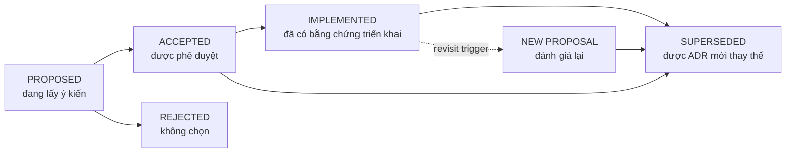
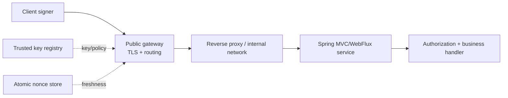

# Ghi lại quyết định khi thiết kế hệ thống xác thực HTTP request bằng HMAC

## 1. Bài toán: thiết kế an toàn phải có trí nhớ và bằng chứng

Trong module `SECURITY_AUTHENTICATION_HMAC_REQUEST_AUTHENTICATION`, một HTTP client tạo chữ ký HMAC bằng **shared secret** trên **canonical request**. Hợp đồng ký có thể bao gồm method, URI/query, signed headers và body hoặc body digest. Backend hoặc gateway cần chọn đúng secret theo key ID, xác minh MAC, kiểm tra timestamp/nonce chống replay, xử lý key rotation và **phân biệt authentication với authorization**.

Những lựa chọn này không chỉ là vài dòng code Java. Chẳng hạn, “server nên ký URL gốc hay URL sau khi proxy rewrite?”, “nonce lưu theo key ID hay client ID?”, “khi kho nonce lỗi có cho request đi tiếp không?” đều ảnh hưởng trực tiếp tới **tính đúng và độ an toàn** của giao thức. Nếu quyết định chỉ tồn tại trong đầu một người hoặc ở một cuộc thảo luận bị trôi, nhóm khác có thể sửa nó mà không biết vì sao quy tắc ban đầu được chọn.

**Ghi lại quyết định** là công việc tạo, rà soát và duy trì một tập **Architecture Decision Records (ADRs)** cùng các hợp đồng và bằng chứng liên quan. Một ADR tốt trả lời: *Chúng ta quyết định điều gì, trong bối cảnh nào, đã cân nhắc những phương án nào, vì sao chấp nhận phương án này, cái giá phải trả và cách biết nó vẫn đúng?*

Bài thuộc chương **Thiết kế HMAC system**, tập trung vào cách lưu quyết định bảo mật để nhiều nhóm client, gateway, Spring Security, SRE và security review cùng hiểu một hệ thống.

Sau bài học, người học có thể:

- Nhận diện quyết định kiến trúc **đáng ghi ADR**, khác với chi tiết triển khai nhỏ.
- Viết ADR có bối cảnh, ràng buộc, lựa chọn, lý do, hệ quả, tác động bảo mật và điều kiện xem xét lại.
- Dùng **hợp đồng canonical bytes và golden test vectors** làm bằng chứng thực thi, thay vì chỉ viết khẩu hiệu “ký request”.
- Ghi rõ quyết định về trust boundary, key registry/rotation, replay store, error semantics và phân quyền.
- Liên kết quyết định với test JUnit, `MockMvc`, `WebTestClient`, gateway E2E, giám sát và runbook.
- Quản lý đề xuất, phê duyệt, thay thế và ngừng quyết định khi hệ thống phát triển.
- Tránh đưa shared secret, raw signature hoặc thông tin nhạy cảm vào tài liệu thiết kế.

## 2. Vì sao HMAC cần quyết định được ghi lại tường minh?

HMAC-SHA-256 có thể được triển khai đúng về toán học nhưng request verification vẫn sai vì **hai bên không đồng ý thế nào là cùng một request**.

Ví dụ:

```text
Client ký:
  POST /public-api/orders?b=2&a=1

Gateway rewrite:
  POST /internal/orders?b=2&a=1

Backend lấy URI đã rewrite để tính lại HMAC.
Kết quả: signature mismatch dù client và server dùng đúng secret.
```

Một người có thể đề xuất “bỏ path khỏi chữ ký để khỏi lỗi”; người khác thêm header `X-Original-URI` rồi backend tin trực tiếp. Hai cách sửa nhanh đó có thể làm suy yếu ràng buộc giữa **hành động được ký** và **hành động thực sự được xử lý**.

Một ADR phải ghi được:

1. Đâu là **trust boundary** được phép dựng canonical request?
2. Representation nào của URI/header/body được bảo vệ?
3. Intermediary nào có quyền rewrite? Việc rewrite diễn ra trước hay sau verify?
4. Nếu client gửi header forwarded giả, ai xóa hoặc kiểm tra nó?
5. Request sai hợp đồng bị từ chối ở gateway hay backend?
6. Bộ kiểm thử nào chứng minh quyết định được giữ nguyên sau khi đổi proxy?

Khi có ADR và test đi kèm, nhóm triển khai không phải đoán. Họ vẫn có thể đề xuất thay đổi, nhưng đó trở thành một **quyết định mới có đánh giá rủi ro**, không phải “refactor vô hại”.

## 3. Phân biệt ADR, specification, runbook, threat model và code

| Artifact | Trả lời câu hỏi | Ví dụ trong HMAC | Không nên thay thế cho |
| --- | --- | --- | --- |
| **ADR** | *Vì sao chọn cách này thay cách khác?* | Vì sao verify trước gateway rewrite | Byte-level canonical specification |
| **Protocol/specification** | *Chính xác bytes và response phải thế nào?* | Signed header order, UTF-8, LF, body digest | Lý do và trade-off của ADR |
| **Threat model** | *Ai có thể tấn công và mục tiêu nào cần bảo vệ?* | Replay, key confusion, request-target mismatch | Quyết định được phê duyệt |
| **Test vectors/contract tests** | *Implementation có theo spec không?* | Canonical hex, HMAC bytes và expected status | Đánh giá chi phí/độ vận hành |
| **Code/config** | *Hệ thống hiện đang làm gì?* | Java `AuthenticationProvider`, gateway route | Lý do đã chọn kiến trúc |
| **Runbook** | *Khi vận hành/sự cố, làm gì và ai làm?* | Revoke key, fail-closed nonce outage, rollback | Spec của giao thức |
| **Change/incident record** | *Khi nào, ai đã thay đổi và kết quả ra sao?* | Cutoff secret A, incident replay | Kiến trúc mục tiêu lâu dài |

Một câu “HMAC ký cả query string” trong ADR **không đủ** để viết signer. Spec cần xác định nguyên văn: raw query hay query sau decode, có giữ thứ tự và duplicate parameters không, percent-encoding xử lý thế nào.

Ngược lại, chỉ có Java source tạo MAC cũng **không trả lời** vì sao nhóm chọn ký raw URL thay vì query sorted; reviewer cần cả hai loại tài liệu.

## 4. Khi nào một quyết định xứng đáng có ADR?

Một thay đổi nên có ADR nếu nó:

- Tác động tới **security boundary**, danh tính client, phạm vi quyền hoặc dữ liệu đã ký.
- Thay đổi một giao thức giữa **nhiều hệ thống/đối tác** và có chi phí tương thích.
- Có nhiều lựa chọn thực tế với trade-off rõ ràng về tính an toàn, latency hoặc availability.
- Khó đảo ngược sau khi SDK/credential đã được phát hành.
- Có thể tạo **downgrade**, replay, key confusion hoặc bypass nếu người vận hành hiểu sai.
- Đòi hỏi phối hợp gateway, backend, secret management và nhiều vùng triển khai.
- Cần audit, phê duyệt bảo mật hoặc bằng chứng compliance theo chính sách tổ chức.

Một đổi tên biến Java hoặc cách chia class nội bộ thường **không cần ADR riêng** nếu không đổi hợp đồng hay trust boundary. Nhưng một thay đổi nhỏ trông giống refactor—chẳng hạn chuyển từ `getRequestURI()` sang `getServletPath()` trong canonicalizer—có thể ảnh hưởng bytes được ký và **cần đánh giá ADR/spec**.

**Quy tắc thực hành:** Nếu một thành viên mới hỏi “Vì sao không làm theo cách đơn giản hơn?” và câu trả lời liên quan tới rủi ro lâu dài, nên ghi lại quyết định.

## 5. Cấu trúc tối thiểu của một ADR bảo mật

Một ADR có thể ngắn nhưng phải **đủ để kiểm chứng**:

| Trường | Nội dung cần ghi | Sai lầm thường gặp |
| --- | --- | --- |
| **ID / tiêu đề** | Mã ổn định, một quyết định rõ | Một ADR ôm mọi thứ về HMAC |
| **Trạng thái** | Proposed, Accepted, Superseded, Rejected... | Không biết decision đã có hiệu lực chưa |
| **Ngày, owner, reviewers** | Ai chịu trách nhiệm và ai phê duyệt | Chỉ có tên một tác giả đã rời nhóm |
| **Bối cảnh / problem** | Hệ thống, yêu cầu, sự cố kích hoạt | Viết chung “để bảo mật hơn” |
| **Constraints & assumptions** | HTTPS, API gateway, client/platform, SLA | Giấu giả định khiến quyết định mau lỗi thời |
| **Options considered** | Ít nhất các phương án khả thi cùng trade-off | Chỉ mô tả phương án thắng |
| **Decision** | Câu khẳng định không mơ hồ | “Có thể dùng A hoặc B” |
| **Rationale** | Vì sao ưu tiên A theo threat model | “Vì team thích A” |
| **Consequences** | Điều cải thiện, chi phí, rủi ro còn lại | Chỉ nêu ưu điểm |
| **Enforcement/verification** | Tests, metrics, config gates, acceptance criteria | Không có cách biết code lệch quyết định |
| **Rollout/reversal** | Versioning, canary, rollback theo policy | “Rollback nếu lỗi” nhưng không nói làm sao |
| **Revisit triggers/links** | Khi nào xem xét lại, spec/test/runbook liên quan | ADR bị đóng băng dù hạ tầng đã thay |

Security ADR nên nói rõ **rủi ro được chấp nhận**, người phê duyệt và điều kiện hết hạn/đánh giá lại; đừng viết “risk accepted” không có owner, rationale hoặc thời điểm.

## 6. Vòng đời ADR: quyết định không bất biến mãi



Trạng thái là **quy ước của tổ chức**; không có một bộ nhãn bắt buộc cho mọi dự án. Nếu sử dụng `Accepted` và `Implemented` riêng, cần giải thích:

- `Accepted`: kiến trúc đã được duyệt, chưa chắc production đã tuân thủ.
- `Implemented`: đã có code/config và **bằng chứng test/deployment** chứng minh phần liên quan.
- `Superseded`: quyết định cũ được thay bằng ADR mới có tham chiếu ngược.
- `Rejected`: đã cân nhắc nhưng không triển khai; lưu lại lý do để tránh tranh luận lặp.

Không **sửa lặng lẽ** một ADR đã accepted để biến quyết định cũ thành quyết định mới. Nếu thay đổi có tác động bảo mật/tương thích, tạo ADR mới, ghi `Supersedes: ADR-...` và cập nhật liên kết ở ADR cũ. Có thể sửa lỗi chính tả hoặc làm rõ không đổi nghĩa qua review thông thường.

**Lưu ý thực tế:** trạng thái ADR không phải runtime feature flag. Backend chỉ nhận v2 sau khi code và policy được triển khai; một dòng `Status: Accepted` trong Markdown không thay đổi verifier.

## 7. Danh mục quyết định tối thiểu của một HMAC system

Thay vì một ADR dài 40 trang, hãy lập **decision catalog** và quản lý phụ thuộc:

| ID minh họa | Quyết định | Câu hỏi cần chốt | Bằng chứng |
| --- | --- | --- | --- |
| ADR-001 | Canonical request contract | Raw URI? Header nào? Body bytes? Encoding? | Golden vectors + contract tests |
| ADR-002 | Vị trí xác minh HMAC | Gateway trước rewrite hay backend? | Gateway E2E + trust boundary diagram |
| ADR-003 | Key registry và secret storage | Key ID, trạng thái, secretRef ở đâu? | Rotation/revocation tests |
| ADR-004 | Timestamp và nonce scope | Window, TTL, atomicity, multi-region? | Replay/concurrency/failover tests |
| ADR-005 | Suite/algorithm agility | HmacSHA256? Supported versions? Cutoff? | Negative downgrade vectors |
| ADR-006 | Authentication → authorization | Principal/tenant/authorities đến từ đâu? | 401/403 and cross-tenant tests |
| ADR-007 | Error semantics và fail closed | Sai MAC khác dependency outage thế nào? | Fault injection, response assertions |
| ADR-008 | Client SDK contract/migration | Version negotiation, retry, compatibility? | Consumer/provider contract tests |
| ADR-009 | Observability và audit | Log gì, redaction, privacy, labels? | Audit schema/redaction tests |
| ADR-010 | Vận hành/incident & rollback | Nếu nonce store lỗi hoặc secret lộ thì sao? | Runbook exercise |

Đây là **mã ADR ví dụ** cho bài học, không khẳng định repository thực tế đã có những ADR này. Với dự án thật, chọn ID và đường dẫn theo quy ước riêng.

Một ADR có thể phụ thuộc vào các ADR khác: quyết định xác minh ở gateway (ADR-002) ảnh hưởng URI của ADR-001; quyết định nonce global (ADR-004) ảnh hưởng địa điểm thực hiện auth và failover; quyết định secret rotation (ADR-003) ảnh hưởng migration (ADR-008). Nếu đổi một mắt xích, phải rà soát các mắt xích phụ thuộc.

## 8. Ghi quyết định canonical request ở mức byte, không chỉ ý tưởng

Chữ ký HMAC bảo vệ **bytes chính xác của canonical request**. Đây thường là quyết định có phạm vi ảnh hưởng rộng nhất tới tương thích client/server.

Ví dụ hợp đồng **HMAC-REQ-V2 minh họa**, dùng:

- `X-Hmac-Version: hmac-req-v2`, được ràng buộc bằng dòng domain prefix `HMAC-REQ-V2` và kiểm tra header khớp chính xác.
- Method đúng dạng uppercase theo HTTP contract; thay `POST` thành `PUT` làm dữ liệu ký thay đổi.
- Raw external path/query **tại điểm được chọn trong ADR về gateway**, không sort/query decode ngầm.
- Các header có tên lower-case, không trùng, cú pháp/value được validate và sắp đúng thứ tự cố định.
- `X-Key-Id`, `X-Nonce`, `X-Timestamp` và digest body đều được ký.
- `X-Content-SHA256` là hex lowercase SHA-256 của **exact body bytes**, không phải JSON object được serialize lại.
- Kết quả MAC `HmacSHA256` đầy đủ **32 bytes**, encode Base64 chuẩn trong `X-Signature`.

Ví dụ canonical bytes nhìn dưới dạng UTF-8 text, nối các dòng bằng LF `0x0A`, **không có LF cuối**:

```text
HMAC-REQ-V2
POST
/integrations/orders?source=partner
content-type:application/json
x-content-sha256:<64-lowercase-hex>
x-key-id:partner-orders-2026b
x-nonce:nonce-example-000001
x-timestamp:2026-11-28T03:15:00Z
```

Khi viết ADR, không nên chỉ chép ví dụ này rồi coi là spec hoàn chỉnh. Cần ghi thêm:

| Điểm cần quyết định | Câu hỏi làm rõ |
| --- | --- |
| URI/query | Raw hay normalized? Percent-encoding hex case? Query order/duplicate? |
| Headers | Tên case-insensitive, xử lý OWS và duplicate value thế nào? |
| `Content-Type` | Signed exact media type hay cho phép tham số charset? |
| Body | Hash bytes trước/sau `Content-Encoding`? Giới hạn kích thước? |
| Timestamp | ISO-8601 UTC hay epoch? Precision, skew, inclusive boundaries? |
| Nonce | Charset, entropy, uniqueness scope, TTL, atomicity? |
| Key ID | Signed? Single-valued? Key registry version/cutoff? |
| Signature | Base64 hay base64url? Padding, full/truncated MAC, validation? |
| Version | Supported/cutoff, downgrade behavior? |
| HTTP transport | HTTP/1.1/2/3 và proxy có biến đổi nào được phép? |

**ADR trả lời tại sao** chọn contract này; **protocol spec** chịu trách nhiệm mô tả chính xác để các implementation độc lập tạo cùng bytes. Golden vectors chứng minh client/server đang thực hiện đúng spec.

## 9. Ghi những phương án bị loại để chống “sửa nhanh” về sau

Một mục `Options considered` tốt có thể trông như sau:

| Phương án ký URI | Ưu điểm | Rủi ro/chi phí | Quyết định ví dụ |
| --- | --- | --- | --- |
| Raw request-target bên ngoài, verify tại edge trước rewrite | Ràng buộc hành động mà client gửi | Gateway giữ verifier/registry và anti-replay | **Chọn** khi edge là trust boundary |
| Raw request-target bên ngoài, verify backend với trusted forwarding | Backend giữ auth logic | Cần bảo vệ tuyệt đối nguồn forwarded target | Có thể chọn nếu thiết kế được tin cậy |
| URI sau gateway rewrite, client biết internal path | Backend dễ tính lại | Lộ chi tiết route nội bộ, coupling SDK với gateway | Không chọn cho public integration |
| Bỏ URI khỏi MAC | Ít mismatch khi rewrite | Không ràng buộc đích request; có thể mở cross-route reuse | **Loại** |
| Thử nhiều URI normalization đến khi MAC khớp | “Tương thích” nhiều client | Mở rộng tập request hợp lệ; audit khó hiểu | **Loại** |

Đừng biến các phương án bị loại thành lỗ hổng “được cho phép trong trường hợp đặc biệt” mà không đánh giá ADR mới. Cần ghi điều gì **sẽ phá giả định ban đầu**: ví dụ kiến trúc chuyển HMAC verify từ gateway về backend hoặc bổ sung proxy rewrite mới.

## 10. Quyết định key ID, secret và key rotation cần có audit trail

Một HMAC system có thể lưu nhiều key versions cho cùng verified client:

```text
clientId: partner-orders
tenant: tenant-a

keyId=partner-orders-2026a
  suite=HmacSHA256, state=RETIRING, acceptedUntil=T

keyId=partner-orders-2026b
  suite=HmacSHA256, state=ACTIVE, acceptedUntil=T2
```

ADR về key lifecycle nên chốt:

1. **Key ID là lookup hint**, không phải credential tự nó. Chỉ registry đáng tin mới biết key ID thuộc client/tenant nào.
2. Mỗi key version tham chiếu **secret khác nhau**, có algorithm suite, trạng thái và effective window tường minh.
3. Verifier chỉ thử **đúng một key** theo ID đã validate; không fallback qua các secrets khác khi MAC sai.
4. `PREPARED`/`REVOKED` không được xác thực; `RETIRING` chỉ được chấp nhận trước cutoff đã phê duyệt.
5. Shared secret nằm trong secret manager/HSM hoặc storage có kiểm soát; không hard-code vào Java, image, logs, SDK công khai.
6. Clock dùng để quyết định cutoff là **server clock**, không phải timestamp client tự khai.
7. Caching phải có revocation semantics rõ; không để một pod dùng mãi key đã thu hồi.

**Decision record không được chứa raw secret.** ADR nên ghi một `secretRef` giả hoặc tên lớp storage, cùng chính sách provisioning/rotation. Vật liệu mật mã thật phải ở môi trường quản lý credential có phân quyền.

Việc thay secret **khác** việc thay canonical contract/algorithm; nếu cả ba cùng đổi, ghi rõ quan hệ và thứ tự migration để người kiểm thử biết chiều nào có lỗi.

## 11. Quyết định chống replay là một quyết định về consistency

Timestamp giới hạn thời gian hiệu lực của chữ ký; nonce ngăn việc **dùng lại cùng thông điệp đã ký** trong khoảng cho phép. Nếu HMAC request được chấp nhận trên nhiều instances/regions, một bộ nhớ nonce cục bộ từng pod không đạt global uniqueness.

ADR phải mô tả một **replay invariant** có thể kiểm tra, ví dụ:

> Đối với mỗi `verifiedClientId + nonce` và trong toàn bộ cửa sổ có thể chấp nhận timestamp, tối đa một request đã được xác minh HMAC có thể claim thành công tại mọi ingress được phép.

Những quyết định kèm theo:

| Khía cạnh | Ví dụ quyết định | Hệ quả phải kiểm thử |
| --- | --- | --- |
| Nonce scope | `verifiedClientId + nonce`, không tách ngầm theo key version | Replay qua key rotation vẫn bị chặn |
| Store | Shared atomic store với `insert-if-absent` | Hai requests đồng thời chỉ một claim thành công |
| TTL | Tính từ signed timestamp + allowed skew + safety margin | Không mất marker khi request còn hợp lệ |
| Clock | Server time, cấu hình skew rõ | Boundary tests quanh thời điểm hết hạn |
| Failures | Store unavailable → **fail closed** | Không có side effect khi timeout |
| Failover | Consistency yêu cầu trong multi-region | Không chấp nhận cả A và B sau split-brain |
| Order | MAC/key status hợp lệ trước nonce claim | Request MAC sai không “đốt” nonce client |

Với điều kiện freshness `abs(serverNow - signedTimestamp) <= allowedSkew`, marker cần được giữ tới khi timestamp không còn được chấp nhận. Nếu TTL tính từ **lần claim đầu**, thời gian có thể cần tới gần **`2 × allowedSkew + margin`** vì request đầu đến sớm trong window và replay đến muộn. Quy tắc chính xác phụ thuộc contract (biên thời gian inclusive/exclusive, skew bất đối xứng, clock drift).

Chỉ ghi “Redis lưu nonce 5 phút” mà không có replay invariant là **chưa đủ**. Redis hoạt động bình thường cũng chưa tự chứng minh multi-region atomicity: failover/replication có thể làm mất hoặc phân tách marker. ADR phải ghi rõ kiến trúc consistency, failure mode và cách xử lý khi không đạt.

## 12. Quyết định đặt xác thực tại gateway hay backend



Trong hình là **phương án verify tại gateway**. Nếu chọn phương án này, ADR phải khẳng định:

- Gateway xác minh HMAC **trước** khi rewrite những phần nằm trong canonical request.
- Gateway kiểm tra key status, signature, timestamp và claim nonce trước khi chuyển request vào backend.
- Backend **không tin** header `X-Verified-Client` do client Internet tự gửi; gateway phải xóa các header identity từ phía ngoài.
- Gateway truyền verified identity/authorities tối thiểu qua **kênh nội bộ đã xác thực và chống sửa đổi**, ví dụ mTLS kèm policy hoặc signed internal assertion.
- Backend vẫn thực thi **authorization/tenant ownership** và không mở đường public bypass gateway.
- Có kiểm soát khi gateway lỗi, region failover, bypass qua internal route hoặc một service tiếp nhận request không qua edge.

Nếu chọn **verify tại backend**, ADR phải giải quyết cách backend nhận đúng external path/query và signed headers sau proxy; không tin `X-Original-URI` hoặc `X-Forwarded-*` tự khai. Có thể chọn giải pháp forwarding đáng tin được gateway tạo sau khi scrub và bảo vệ qua nội bộ, hoặc thiết kế contract ký representation thực sự backend nhận.

**Đừng để hai nơi cùng tự nhận là nguồn sự thật** nhưng dùng canonical contract khác nhau. Một hệ thống có thể có defense-in-depth, song phải ghi rõ chức năng từng bước và điều kiện principal được tạo.

## 13. Ghi quyết định về Spring Security và phân quyền

HMAC là **authentication**. Nó chứng minh request do bên biết secret của một key version còn hiệu lực tạo ra và vẫn hợp lệ theo hợp đồng; nó **không tự cấp quyền**.

ADR bảo mật nên chỉ ra:

1. Key registry sau MAC hợp lệ cung cấp `verifiedClientId` và tenant mapping.
2. Spring MVC dùng `OncePerRequestFilter`/`AuthenticationManager`/`AuthenticationProvider` theo security chain thực tế; WebFlux có thể dùng `AuthenticationWebFilter`/`ReactiveAuthenticationManager`.
3. Chỉ tạo authenticated `Authentication` khi signature, key status, timestamp và nonce claim đều thành công.
4. Authorities do **policy server** cấp; không lấy danh sách quyền trực tiếp từ một unsigned header như `X-Roles`.
5. Controller/service kiểm tra permission như `ORDER_CREATE` và resource ownership trước khi thực hiện side effect.
6. Nếu client đổi key A sang B trong rotation, principal/permissions **không tự đổi** trừ khi registry/policy có quyết định riêng.

Ví dụ bảng quyết định:

| Request | Authentication | Authorization | HTTP thường dùng |
| --- | --- | --- | --- |
| Key ID không tồn tại | Thất bại | Không chạy | `401` |
| MAC sai hoặc nonce replay | Thất bại | Không chạy | `401` |
| Key revoked dù MAC toán học đúng | Thất bại | Không chạy | `401` |
| MAC hợp lệ, thiếu `ORDER_CREATE` | Thành công | Từ chối | `403` |
| MAC hợp lệ, client khác tenant | Thành công | Từ chối hoặc che tồn tại theo policy | `403`/`404` |
| MAC hợp lệ, quyền và ownership đúng | Thành công | Thành công | Mã nghiệp vụ phù hợp |

Các status là ví dụ hợp đồng API; header syntax malformed có thể bị HTTP parser từ chối bằng `400` trước authentication. `401` phải kèm HTTP authentication challenge `WWW-Authenticate` phù hợp scheme được API công bố, không vô tình trả `Bearer` nếu endpoint chỉ hỗ trợ HMAC.

**ADR phải xác định tầng chịu trách nhiệm** cho `401` và `403`. Nếu filter trả `403` cho MAC sai, nhóm vận hành có thể chẩn đoán nhầm lỗi authorization và mở rộng quyền thay vì sửa signer.

## 14. Ghi quyết định lỗi hạ tầng và fail closed

Một hệ thống HMAC phụ thuộc vào **credential registry/secret manager**, **crypto provider** và **nonce store**. Availability của các phụ thuộc đó là một phần thiết kế bảo mật, không phải chỉ là việc của SRE sau này.

| Failure | Phản ứng an toàn | Điều không được làm |
| --- | --- | --- |
| Secret provider unavailable | Fail closed, lỗi server phù hợp, thường `503` | Dùng secret hard-code dự phòng |
| Key registry lookup timeout | Không tạo principal | Thử mọi key đang cache hoặc tin client ID |
| Nonce store timeout/unknown commit | Không cho nghiệp vụ chạy | `onErrorReturn(true)` hoặc bỏ nonce check |
| Crypto provider lỗi | Không coi signature hợp lệ | Trả `200` để đạt SLA |
| Gateway không xác minh được | Chặn hoặc cô lập route theo runbook | Forward header “verified” từ client |
| Policy cache không chắc đã nhận revocation | Hạn chế/fail closed theo threat model | Tiếp tục verify key revoked vô thời hạn |

ADR cần ghi rõ **cách phân biệt lỗi credential với lỗi hạ tầng**, bởi vì chúng ảnh hưởng cách client retry. Client gửi MAC sai không thể sửa bằng retry mù; key store outage có thể cần backoff, monitoring và idempotency.

Trong WebFlux, mọi bước async phải được compose vào reactive chain **trước** khi handler chạy. Không `block()` trên event loop, không `subscribe()` thủ công rồi cho phép downstream đi tiếp. Trong Servlet, filter/`SecurityContext` phải được quản lý đúng khi request async hoặc exception xảy ra.

## 15. Mẫu ADR Markdown có thể dùng lại

Sau đây là **mẫu tài liệu**, không chứa secrets hay đường dẫn bắt buộc phải áp dụng trong dự án:

```markdown
# ADR-XXX: <Một quyết định rõ ràng>

- Status: Proposed | Accepted | Implemented | Superseded
- Date (UTC): YYYY-MM-DD
- Owners: <vai trò/nhóm chịu trách nhiệm>
- Reviewers: <Security, API, SDK, SRE, ...>
- Scope: <service, endpoints, clients, environments>
- Supersedes / Superseded by: <ADR IDs nếu có>

## Context
Nêu bài toán, threat model, ràng buộc và sự kiện kích hoạt.

## Decision drivers
- Thuộc tính bảo mật cần giữ
- Compatibility/client constraints
- Performance, availability, operating cost

## Options considered
| Option | Benefits | Risks/costs |
| --- | --- | --- |
| A | ... | ... |
| B | ... | ... |

## Decision
Chọn một phương án và các bất biến không được vi phạm.

## Rationale
Vì sao phương án thắng theo security/operational goals.

## Consequences and residual risks
- Ưu điểm, nhược điểm, dependency mới
- Failure modes, mitigations, risk owner

## Enforcement and evidence
- Protocol spec / golden vectors
- Unit, integration, E2E, chaos tests
- Runtime config, metrics, audit, runbook

## Rollout, rollback, revisit triggers
- Ai phê duyệt, canary/cutoff, điều kiện dừng
- Điều kiện phải mở ADR thay thế

## References
- Threat-model ID, spec ID, test suite, runbook, related ADRs
```

**Mẫu này không nên được copy thành “quy trình đủ an toàn” nếu các mục vẫn để `...`.** Một ADR được chấp nhận phải có quyết định cụ thể, bằng chứng hoặc kế hoạch kiểm chứng được phân công và những ràng buộc thực sự của hệ thống.

## 16. Ví dụ ADR hoàn chỉnh: xác minh tại gateway trước khi rewrite

Đây là một **tình huống giả lập** để minh họa cách lập luận, không phải mô tả triển khai đang tồn tại:

```markdown
# ADR-002: Verify HMAC ở public gateway trước route rewrite

- Status: Accepted
- Date (UTC): 2026-11-28
- Owners: API Platform + Security Architecture
- Reviewers: Client SDK, Backend, SRE
- Scope: /public-api/integrations/*, production ingress
- Related: ADR-001 canonical request; ADR-004 replay store

## Context
Client ký external raw request-target. Gateway rewrite:
/public-api/integrations/orders -> /internal/orders.
Backend không thể tự suy ra external target một cách an toàn
nếu chỉ nhìn URI đã rewrite hoặc X-Original-URI tự khai.

## Decision drivers
- Chữ ký phải bảo vệ operation client thực sự gửi
- Chặn spoofed identity headers
- Không cho phép direct backend bypass
- Cần hỗ trợ HTTP/1.1 và HTTP/2

## Options considered
1. Verify ở gateway trước rewrite
   + Có đúng external target
   - Gateway cần key registry, anti-replay và on-call
2. Verify ở backend qua trusted forwarded target
   + Auth logic tập trung trong Spring
   - Cần bảo vệ forwarding semantics rất chặt
3. Bỏ path/query khỏi HMAC
   - Không được chọn: mất binding của operation

## Decision
Gateway verify HMAC trước rewrite, kiểm tra key status,
timestamp và atomic nonce claim. Chỉ khi đạt, gateway
forward identity tối thiểu qua một kênh nội bộ được xác thực.
Gateway xóa mọi incoming X-Verified-Client và các identity
headers do Internet có thể tự khai. Backend deny direct public
traffic và vẫn kiểm tra authorization/tenant ownership.

## Consequences and residual risks
- Tăng trách nhiệm vận hành của edge/auth service
- Gateway outage có thể làm API không xác thực được
- Internal assertion cần TTL và ràng buộc context phù hợp
- Backend route không được bypass gateway

## Enforcement and evidence
- Golden HMAC vectors cho external URI/query
- E2E: signed external path -> rewrite -> đúng principal
- E2E: forged X-Verified-Client -> không được chấp nhận
- E2E: direct backend call -> bị chặn
- Replay concurrent across gateway instances -> tối đa 1 accept
- Fail-closed khi key registry/nonce store unavailable

## Rollout and revisit triggers
- Canary trên một cohort, rollback chỉ khi policy cho phép
- Revisit nếu API chuyển sang backend-direct authentication
  hoặc bổ sung một ingress không qua gateway
```

### 16.1. Vì sao ví dụ này tốt hơn “Gateway xử lý auth”

Nó mô tả **trust boundary**, dữ liệu nào được ký, bước nào xảy ra trước rewrite, kênh chuyển identity nội bộ và các trường hợp phải bị chặn. Nó cũng thừa nhận chi phí: thêm dependency và vận hành ở gateway.

Nếu chỉ ghi “Gateway xử lý auth vì nhanh”, team backend có thể vô tình tin một `X-Verified-Client` do Internet gửi, tạo authentication bypass. ADR đầy đủ phải dẫn tới **negative tests** cho giả mạo identity và direct backend access.

### 16.2. Đừng quên domain separation của internal assertion

Nếu gateway gửi signed internal assertion cho backend, đó là **giao thức riêng**: phải xác định issuer/audience, expiry, signature/key lifecycle, scope/route/request binding và chống replay theo nhu cầu. Không reuse trực tiếp HTTP shared secret của đối tác để ký assertion nội bộ. ADR gateway phải tham chiếu design của assertion thay vì chỉ nói “header nội bộ đáng tin”.

## 17. Ví dụ ADR thứ hai: nonce dùng chung và fail closed

Một ADR khác có thể tóm tắt:

```markdown
# ADR-004: Atomic nonce claim theo verified client

- Status: Accepted
- Scope: mọi HMAC request có side effects
- Related: ADR-001 canonical signed timestamp/nonce,
           ADR-002 location of verification

## Context
API có nhiều gateway instances và hai key versions cùng
ACTIVE/RETIRING trong secret rotation.

## Options considered
A. In-memory nonce set per instance
   - Loại: request chuyển instance có thể replay thành công
B. Shared atomic insert-if-absent store
   - Chọn: bảo đảm một claim thành công theo scope
C. Chỉ dựa vào timestamp
   - Loại: không chặn replay trong allowed skew window

## Decision
Nonce scope = (verifiedClientId, signedNonce), không mặc định
phân theo keyId. Chỉ claim sau HMAC/key status hợp lệ.
Claim atomic với TTL bao phủ toàn freshness window.
Store error/timeout -> fail closed, không tiếp tục handler.

## Consequences
Dependency latency, availability và consistency của nonce store
trở thành một phần authentication SLO.

## Evidence
JUnit + integration replay tests; concurrent 2-instance test;
rotation cross-key test; TTL boundary; store failover tests;
MockMvc/WebTestClient negative and positive controls.
```

**Lưu ý:** shared store chỉ đáp ứng global uniqueness nếu kiến trúc thật cung cấp consistency yêu cầu. Nếu nhiều vùng active-active dùng kho không đồng bộ, phải thiết kế thêm routing, một điểm claim có tính nhất quán hoặc giới hạn ingress để tránh hai vùng cùng chấp nhận nonce. Cụm từ “dùng Redis” tự nó không phải bằng chứng.

## 18. Chuyển ADR thành contract tests và golden vectors

Một ADR chấp nhận canonicalization phải được hiện thực hóa thành **testable contract**. Ví dụ fixture cho mỗi trường hợp:

```yaml
caseId: hmac-req-v2-post-valid
contract: HMAC-REQ-V2
method: POST
rawTarget: /integrations/orders?source=partner
headers:
  Content-Type: application/json
  X-Hmac-Version: hmac-req-v2
  X-Key-Id: partner-orders-2026b
  X-Timestamp: "2026-11-28T03:15:00Z"
  X-Nonce: nonce-example-000001
bodyUtf8: '{"orderId":"O-17"}'
bodyDigestEncoding: lowercase-hex-sha256
canonicalBytesHex: "<compute-from-reviewed-golden-vector>"
expectedMacHex: "<compute-using-test-only-secret>"
expectedResult: AUTHENTICATED
```

Các giá trị `<...>` là **placeholder của mẫu fixture**, không phải golden vector đã tính. Fixture production-quality phải có bytes thực, key giả có độ dài xác định, MAC expected độc lập và test kiểm tra exact canonical bytes. Không ghi shared secret thật vào repository.

### 18.1. Ma trận biến đổi theo quyết định

| Mutation | Quy tắc trong ADR/spec | Kết quả test |
| --- | --- | --- |
| `X-Key-Id` bị sửa sau ký | Key ID được MAC bảo vệ | `401` |
| `X-Timestamp` bị sửa sau ký | Timestamp được MAC bảo vệ | `401` |
| `X-Nonce` bị sửa hoặc dùng lại | Nonce được ký và claim atomic | `401` |
| Method `POST` → `PUT` | Method nằm trong canonical | `401` |
| Raw query đổi thứ tự | Contract ký raw query | `401` nếu signature giữ nguyên |
| Body đổi một byte, digest/MAC cũ | Digest của exact body bytes | `401` |
| Tên header đổi casing | Tên field canonical lowercase | MAC không đổi nếu semantics không đổi |
| Duplicate key ID/nonce | Single-valued credential contract | Reject ambiguity |
| Gateway rewrite sau edge verify | Verify trước rewrite, protected assertion | Không đổi authenticated identity |
| `X-Verified-Client` tự khai | Scrub ở gateway | Không thể giả mạo principal |
| Key revoked nhưng MAC đúng | Lifecycle policy thắng phép so MAC | `401` |
| Nonce store outage | Fail closed | Lỗi server, không side effect |
| HMAC đúng nhưng thiếu authority | Authentication != authorization | `403` |

**Positive controls rất quan trọng:** một test “sửa timestamp → `401`” có thể xanh giả nếu request gốc cũng không bao giờ qua được authentication vì clock test sai. Phải kiểm tra request gốc với `Clock.fixed`, key test hợp lệ, nonce mới và quyền thích hợp **thành công trước** rồi mới đánh giá mutation.

## 19. Ví dụ Java: biến hợp đồng thành phép thử độc lập

Một helper nhỏ có thể kiểm tra giá trị vàng của canonical request, không cần khởi tạo Spring context. Đối với v2 minh họa, tên signed headers đã có thứ tự cố định:

```java
import java.nio.charset.StandardCharsets;
import java.security.MessageDigest;
import java.util.Base64;
import java.util.HexFormat;
import javax.crypto.Mac;
import javax.crypto.spec.SecretKeySpec;

public final class HmacDecisionContract {
    private HmacDecisionContract() {}

    public static byte[] canonicalPost(
            String rawTarget,
            String keyId,
            String timestamp,
            String nonce,
            byte[] exactBodyBytes) throws Exception {
        byte[] bodyHash = MessageDigest.getInstance("SHA-256")
                .digest(exactBodyBytes);
        String canonical = String.join("\n",
                "HMAC-REQ-V2",
                "POST",
                rawTarget,
                "content-type:application/json",
                "x-content-sha256:" + HexFormat.of().formatHex(bodyHash),
                "x-key-id:" + keyId,
                "x-nonce:" + nonce,
                "x-timestamp:" + timestamp);
        return canonical.getBytes(StandardCharsets.UTF_8);
    }

    public static String signForTest(
            byte[] testSecret, byte[] canonical) throws Exception {
        Mac mac = Mac.getInstance("HmacSHA256");
        mac.init(new SecretKeySpec(testSecret, "HmacSHA256"));
        return Base64.getEncoder().encodeToString(mac.doFinal(canonical));
    }

    public static boolean verifyMacForTest(
            byte[] testSecret, byte[] canonical,
            String signatureBase64) throws Exception {
        final byte[] received;
        try {
            received = Base64.getDecoder().decode(signatureBase64);
        } catch (IllegalArgumentException ex) {
            return false; // Không chấp nhận chữ ký sai encoding.
        }
        if (received.length != 32) return false; // HMAC-SHA-256 đầy đủ.

        Mac mac = Mac.getInstance("HmacSHA256");
        mac.init(new SecretKeySpec(testSecret, "HmacSHA256"));
        byte[] expected = mac.doFinal(canonical);
        return MessageDigest.isEqual(expected, received);
    }
}
```

Đoạn mã **minh họa riêng cho POST JSON v2**, không phải canonicalizer production. `verifyMacForTest` từ chối Base64 sai và chữ ký không đủ 32 byte, rồi dùng `MessageDigest.isEqual` so MAC bytes thay vì `String.equals` trên chữ ký; trong ứng dụng thật còn cần quy tắc encoding canonical và giới hạn kích thước header ở HTTP boundary. Ví dụ chưa validate raw target, duplicate/malformed HTTP headers, timestamp window, body size, key status hoặc nonce uniqueness; các giá trị truyền vào phải được parser chặt chẽ trước đó. Trong production, không nhận `canonical` do client gửi và không sử dụng key test hard-code làm credential thật.

Ví dụ JUnit 5 kiểm tra một quan hệ cần được spec bảo vệ:

```java
import static org.junit.jupiter.api.Assertions.assertArrayEquals;
import static org.junit.jupiter.api.Assertions.assertFalse;
import java.nio.charset.StandardCharsets;
import java.util.Arrays;
import org.junit.jupiter.api.Test;

class CanonicalDecisionTest {
    private static final byte[] BODY =
            "{\"orderId\":\"O-17\"}"
                .getBytes(StandardCharsets.UTF_8);

    @Test
    void canonicalBytesAreDeterministic() throws Exception {
        byte[] a = HmacDecisionContract.canonicalPost(
                "/integrations/orders?source=partner",
                "partner-orders-2026b",
                "2026-11-28T03:15:00Z",
                "nonce-example-000001",
                BODY);
        byte[] b = HmacDecisionContract.canonicalPost(
                "/integrations/orders?source=partner",
                "partner-orders-2026b",
                "2026-11-28T03:15:00Z",
                "nonce-example-000001",
                BODY);
        assertArrayEquals(a, b);
    }

    @Test
    void changingSignedKeyIdChangesCanonicalBytes() throws Exception {
        byte[] a = HmacDecisionContract.canonicalPost(
                "/integrations/orders", "key-a",
                "2026-11-28T03:15:00Z", "nonce-1234567890123456", BODY);
        byte[] b = HmacDecisionContract.canonicalPost(
                "/integrations/orders", "key-b",
                "2026-11-28T03:15:00Z", "nonce-1234567890123456", BODY);
        assertFalse(Arrays.equals(a, b));
    }
}
```

Hai test trên chỉ kiểm tra **quan hệ bytes** của helper; chúng **không** chứng minh parser/server không bỏ signature check. Để chứng minh quyết định kiến trúc, cần test độc lập với expected vectors và integration tests gửi HTTP thật qua security chain.

## 20. Từ ADR tới Spring MVC, WebFlux và gateway E2E

Một traceability matrix giúp reviewer biết bằng chứng nằm ở đâu:

| Quyết định | Unit/contract | Spring integration | Gateway E2E/chaos |
| --- | --- | --- | --- |
| Ký đúng canonical method/URI/headers/body | Golden vector, mutation tests | `MockMvc`/`WebTestClient` với filter thật | Rewrite, encoding, H1/H2 |
| Key ID gắn một key version | Registry and MAC tests | Unknown/revoked/wrong-key `401` | Cache stale, cutoff ở mọi region |
| Timestamp và nonce atomic | Window/TTL/concurrency tests | Replay `401`, không side effect | Multi-instance/failover |
| Verify ở gateway trước rewrite | Contract of identity assertion | Backend rejects untrusted identity | Forged header/direct-backend tests |
| Fail closed khi dependency lỗi | Fault injection | `503`, security context rỗng | Outage/timeout edge cases |
| AuthN khác AuthZ | Authority mapping tests | HMAC pass nhưng thiếu quyền `403` | Cross-tenant routing |
| Tránh log secret | Redaction unit test | Error/audit assertions | Gateway/access log scan |

### 20.1. Spring MVC

Dùng `@SpringBootTest` và `@AutoConfigureMockMvc(addFilters = true)` cho những endpoint HMAC thật. Test phải dùng test key còn hiệu lực, fixed `Clock` và nonce store cô lập; không thay xác thực HMAC bằng `@WithMockUser`. Với request sai, kiểm tra không có authenticated principal và **không có business side effect**.

Nếu ADR đặt verify ở gateway, integration test backend nên kiểm tra **trust boundary của assertion nội bộ** thay vì giả định backend sẽ tự verify lại external HMAC. Đối với đường gateway, test phải có một component xác minh HMAC thật hoặc sandbox gateway với cấu hình phù hợp.

### 20.2. Spring WebFlux

Với `AuthenticationWebFilter`/`ReactiveAuthenticationManager`, HMAC, key lookup và reactive nonce claim phải hoàn tất **trước** khi handler chạy. Khi đọc `Flux<DataBuffer>` để hash body, phải giới hạn dung lượng, release đúng và replay body cho downstream. Không `block()` trên event loop hoặc gọi `subscribe()` thủ công rồi bỏ qua lỗi.

`WebTestClient` nên có positive controls, tampering negative tests, key revoked tests, provider timeout và kiểm tra status/side effects. Một test chỉ thấy `401` không đủ xác định lỗi ở canonicalization hay freshness.

### 20.3. Gateway/proxy

Kiểm thử HTTP/1.1 → HTTP/2/HTTP/3 khi được hỗ trợ; tên header case-insensitive, connection-specific fields, duplicate header handling, URI rewrite, signed body bytes và `Host`/`:authority`. Không ký transport framing như `Transfer-Encoding` nếu contract bảo vệ body application bytes; không bỏ signed URI khỏi MAC để qua được proxy.

Mỗi lần thay đổi gateway route hoặc HTTP library, cần chạy lại các test liên quan ADR-001/ADR-002 ngay cả khi code Java không đổi.

## 21. Ghi rủi ro tồn dư và kế hoạch quan sát quyết định

Không có kiến trúc nào không có trade-off. Một ADR được chấp nhận nên có **risk register nhỏ**:

| Residual risk | Mitigation | Owner | Trigger xem xét lại |
| --- | --- | --- | --- |
| Gateway verify làm tăng dependency/latency | Cache key theo policy, benchmark, SLO | Platform/SRE | p95 auth latency vượt SLO |
| Nonce store thành single dependency | HA + fail-closed, capacity tests | SRE | Outage hoặc failover không đáp ứng consistency |
| SDK clients cập nhật chậm | Versioned contract, migration cohorts | API/Partner team | Legacy traffic sát cutoff |
| Key revocation không tới mọi vùng | Config version, invalidation, active probes | Security/Platform | Valid revoked MAC được chấp nhận |
| Logs có thể lộ signature/body | Redaction schema, access controls | Observability/Security | Audit scan phát hiện dữ liệu nhạy cảm |
| Proxy rewrite thay đổi | Golden E2E vectors và canary | Gateway team | Thay route, HTTP stack hoặc TLS termination |

Không đặt một “risk owner” vô danh. Trong dự án thật, chủ sở hữu là một **vai trò/nhóm có trách nhiệm** và phải có cách nhận cảnh báo, phê duyệt thay đổi, lên lịch review.

### 21.1. Observability không được trở thành nơi lộ secret

Các metric có ích:

- `hmac_auth_attempts_total` với outcome và route template.
- `hmac_auth_failures_total` với reason enum như `mac_mismatch`, `nonce_replay`, `key_unusable`.
- `hmac_nonce_claims_total` với claimed/replayed/error.
- `hmac_auth_dependency_errors_total` theo key store/nonce store.
- `hmac_auth_verification_seconds` để quan sát latency.
- Audit event có request correlation, contract/policy version và **verified client reference** khi đã xác thực.

Không đưa shared secret, raw `X-Signature`, nonce, raw URI/query, client ID không giới hạn hoặc expected MAC vào Prometheus labels. Dùng route templates và reason enums hữu hạn để tránh cardinality cao và rò rỉ dữ liệu.

Một failed request khai `X-Key-Id` không được ghi là “client X đã xác thực” chỉ vì ID đó tồn tại; danh tính đáng tin chỉ có sau MAC hợp lệ theo policy.

## 22. Cập nhật quyết định khi incident hoặc migration làm thay đổi giả định

Ví dụ sự kiện đòi ADR mới hoặc review lại:

1. **Replay incident:** cache cục bộ cho phép hai instances nhận cùng nonce. ADR nonce mới phải ghi consistency model và bài test multi-region, không chỉ “tăng TTL”.
2. **Key compromise:** secret hard-code bị lộ. ADR credential storage/rotation có thể thay đổi từ environment variable sang managed secret provider, với kế hoạch invalidate cache.
3. **Gateway migration:** thêm reverse proxy mới rewrite path. ADR về vị trí verify và external URI representation phải được rà soát, kể cả khi không đổi MAC algorithm.
4. **Algorithm retirement:** tổ chức ngừng nhận một suite cũ. Cần ADR về server allowlist/cutoff, không silent fallback.
5. **Thay đổi business authorization:** client có HMAC hợp lệ nhưng tenant ownership thay đổi. ADR về verified identity/authority phải được xem lại, không coi key ID là role.

Quy trình thay quyết định:

```text
Thay đổi bối cảnh / incident evidence
    -> tạo proposal/ADR mới
    -> cập nhật threat model + options
    -> review với Security, API, SDK, Gateway, SRE
    -> phê duyệt và phát hành spec/version mới nếu cần
    -> golden vectors + integration/E2E tests
    -> rollout có kiểm soát và quan sát
    -> đánh dấu ADR cũ Superseded, lưu liên kết lịch sử
```

Khi API có nhiều client độc lập, không âm thầm sửa canonicalization của v1 để “chuẩn hóa tốt hơn”: MAC bytes của v1 đã là giao thức triển khai thực tế. Thay đổi không tương thích phải có **contract version, migration window và cutoff** với bằng chứng các clients đã chuyển.

## 23. Anti-pattern trong việc ghi lại quyết định

| Anti-pattern | Hậu quả | Cách sửa |
| --- | --- | --- |
| “Dùng HMAC vì bảo mật” | Không rõ ký gì, bảo vệ ai | Ghi threat model, signed fields và trust boundary |
| ADR chỉ mô tả thư viện Java | Không rõ giao thức/đa ngôn ngữ | Kèm byte-level spec và golden vectors |
| ADR không nêu phương án bị loại | Người sau lặp lại thiết kế rủi ro | Ghi trade-offs và lý do từ chối |
| Tài liệu đã Accepted nhưng code chưa triển khai | Hiểu nhầm hệ thống đã an toàn | Phân biệt Accepted/Implemented và evidence |
| Sửa ADR cũ không lịch sử | Không biết tại sao client legacy lỗi | Supersede bằng ADR/version mới |
| Copy secret thật vào ví dụ | Credential bị lộ qua repo | Dùng test-only placeholders/references |
| Ghi “Redis chống replay” | Không nêu atomicity/TTL/consistency | Viết invariant và concurrency/failover test |
| Ghi “gateway tin header nội bộ” | Có thể nhận spoofed identity từ client | Mô tả scrub + protected internal assertion |
| Tài liệu hóa “fallback để tương thích” | Mở downgrade và key confusion | Một request, một key và một version được phép |
| Không có owner/revisit trigger | ADR lỗi thời | Gắn owner và điều kiện review |
| Không đo tác động vận hành | Khó phát hiện outage/bypass | SLO, fail-closed tests, metrics và runbook |

ADR tốt không cần dài, nhưng phải làm một thay đổi kiến trúc **có thể bị phản biện, kiểm thử và kiểm toán**. Một tài liệu dài chỉ lặp khẩu hiệu không có invariants vẫn yếu hơn một ADR ngắn với quyết định và bằng chứng rõ ràng.

## 24. Bài thực hành: lập bộ decision records cho HMAC system

Giả sử tổ chức có:

- Client `partner-reporting` thuộc `tenant-a`, có `ORDER_READ`.
- Client `partner-fulfillment` thuộc `tenant-b`, có `ORDER_READ` và `ORDER_CREATE`.
- `GET /integrations/orders/{id}` và `POST /integrations/orders`.
- API gateway rewrite `/public-api` thành `/internal`, backend Spring MVC hoặc WebFlux.
- Hệ thống nhiều instances, có key rotation và nonce store dùng chung.

Thực hiện:

1. **Vẽ trust boundaries:** client signer, TLS termination/gateway, backend, key registry, secret provider, nonce store và business handler.
2. **Lập decision catalog:** ít nhất canonical contract, vị trí verify, nonce consistency, key rotation và authN/authZ.
3. **Viết ADR-001:** nêu raw URI/query, signed headers, body digest, timestamp/nonce, UTF-8/LF, version, Base64 signature; ghi rõ ít nhất hai phương án canonicalization bị loại.
4. **Viết ADR-002:** chọn verify tại gateway hoặc backend; ghi lý do và cách ngăn spoofed identity/direct bypass.
5. **Viết ADR-004:** quyết định nonce scope qua các key versions, atomic store, TTL, failover và `503` khi dependency lỗi.
6. **Tạo protocol spec và golden vectors:** với key giả, exact canonical bytes, expected HMAC, positive/negative mutations.
7. **Viết JUnit tests:** determinism, wrong key ID, đổi method/URI/body, timestamp mutation, duplicate header và nonce replay.
8. **Viết `MockMvc`/`WebTestClient` tests:** HMAC đúng → authenticated principal; MAC sai → `401`; đúng MAC thiếu quyền → `403`; dependency lỗi → fail closed.
9. **Kiểm thử gateway E2E:** route rewrite, header spoofing, H1/H2, direct backend bypass và một request đã ký được replay qua hai instances.
10. **Lập bảng traceability:** mỗi security invariant liên kết ADR, spec, test và metric/audit.
11. **Mô phỏng sự cố:** key bị revoke nhưng một region vẫn accept do cache stale; viết proposal thay ADR/key policy và điều kiện rollout.
12. **Review quyết định:** có security owner, phương án bị loại, residual risks và ngày/sự kiện xem xét lại.

### Câu hỏi tự kiểm tra

**1. ADR có thể thay thế protocol spec HMAC không?** Không. ADR giải thích vì sao chọn cách thiết kế; spec phải định nghĩa bytes chính xác để client/server độc lập triển khai.

**2. Vì sao phải ghi các phương án bị loại?** Để tránh người sau tái sử dụng cách “sửa nhanh” đã có rủi ro, như bỏ URI khỏi MAC hoặc thử nhiều secret.

**3. Ghi “nonce dùng Redis” đã đủ không?** Chưa. Cần nonce scope, atomicity, TTL, consistency/failover, fail-closed behavior và test.

**4. Key ID là danh tính client đã xác thực chưa?** Chưa. Key ID chỉ giúp tra secret; phải có MAC hợp lệ, key status và freshness để tạo verified principal.

**5. Khi API gateway rewrite path, ADR cần nói gì?** Nơi verify, representation nào được ký, trust boundary và bảo vệ identity assertion qua nội bộ.

**6. Một ADR Accepted đã chứng minh production tuân thủ chưa?** Chưa. Cần trạng thái implemented và bằng chứng code/config, tests và deployment thực tế.

**7. Có nên ghi shared secret vào ADR để reviewer tái hiện test?** Không. Dùng test-only secrets/vectors và `secretRef` không nhạy cảm; credential thật thuộc secret manager.

**8. HMAC hợp lệ nhưng không có `ORDER_CREATE` trả gì?** Thường `403` theo authorization; authentication và phân quyền phải được ghi riêng.

**9. Khi đổi canonical bytes của v1, có thể sửa ADR cũ rồi deploy không?** Không nên. Cần đánh giá backward compatibility, version mới, golden vectors và kế hoạch migration.

**10. Điều gì chứng minh ADR fail closed khi nonce store hỏng?** Fault-injection integration/E2E test xác nhận request không có principal và không phát sinh side effect; status server phù hợp.

## 25. Checklist trước khi phê duyệt một HMAC security decision

| Câu hỏi kiểm tra | Có/Chưa |
| --- | --- |
| Có ID, status, owner, reviewers, scope và ngày quyết định? |  |
| Bối cảnh và threat model giải thích lý do thay đổi? |  |
| Đã mô tả các phương án thay thế và vì sao loại? |  |
| Signed data được xác định **ở mức byte**, có protocol version và encoding? |  |
| Vị trí verify/trust boundary qua gateway/proxy rõ ràng? |  |
| Key ID → secret/key status/client mapping đến từ registry tin cậy? |  |
| Có anti-replay invariant, nonce scope/atomicity/TTL/failover? |  |
| Có khác biệt authN/authZ, 401/403/503 và fail closed? |  |
| Có test vectors và positive/negative integration/E2E tests? |  |
| Có risk owner, telemetry/redaction, incident/runbook links? |  |
| Có migration, cutoff, rollback và revisit triggers phù hợp? |  |
| ADR không chứa secret thật, raw signature hay dữ liệu cá nhân? |  |

Một ADR còn nhiều ô “Chưa” không nhất thiết bị loại ngay: nó có thể ở **Proposed** với các action items rõ ràng. Nhưng một quyết định bảo mật quan trọng chưa chốt **invariants, owners và bằng chứng kiểm thử** thì không nên được mô tả là đã hoàn thành.

## 26. Ghi nhớ

**Ghi lại quyết định là một phần của thiết kế bảo mật HMAC, không phải thủ tục giấy tờ sau khi viết code.** Một ADR hữu ích nói rõ bối cảnh, phương án, lựa chọn, hệ quả, rủi ro tồn dư và bằng chứng để xác nhận hệ thống tuân thủ. Hợp đồng byte-level, golden vectors, security integration tests và gateway E2E là cách biến những quyết định đó thành hành vi quan sát được.

Với HTTP HMAC, hãy ghi đặc biệt rõ **canonical method/URI/signed headers/body**, key ID/secret lifecycle, timestamp/nonce chống replay, trust boundary qua gateway/proxy, fail closed khi dependency lỗi và **authorization theo principal/tenant đã xác thực**. Khi hoàn cảnh thay đổi, tạo quyết định mới có liên kết lịch sử, version và migration có kiểm soát; không “sửa” giao thức ngầm để vượt một test đang lỗi.

Một hệ thống đáng tin không chỉ có chữ ký đúng, mà còn biết **vì sao chữ ký ấy có nghĩa gì, kiểm tra ở đâu, rủi ro còn lại là gì và làm thế nào chứng minh quyết định vẫn được giữ nguyên khi hệ thống phát triển**.
