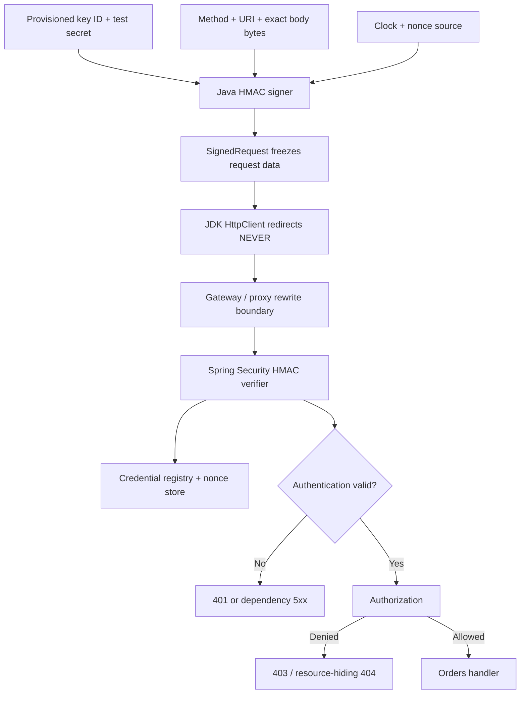

# Dự án thực hành: Viết client signer HMAC cho HTTP request bằng Java 17

## 1. Mục tiêu và bài toán nghiệp vụ

Trong module `SECURITY_AUTHENTICATION_HMAC_REQUEST_AUTHENTICATION`, client và server dùng **shared secret** để tạo và xác minh HMAC trên **canonical HTTP request**, bao gồm HTTP method, URI, header hoặc body theo hợp đồng ký. Server còn kiểm tra timestamp/nonce để chống replay, quản lý key rotation, tương thích gateway/proxy và tách **authentication** khỏi **authorization**.

**Đề bài:** tự xây một client signer Java 17 ký request đến `orders-api`. Client phải ký chính xác method, raw path/query, `Content-Type`, body bytes, timestamp và nonce, sau đó gửi request thật qua JDK `HttpClient`. Bản hoàn thiện có test vectors độc lập, positive/negative integration tests, kiểm thử proxy và runbook xử lý lỗi.

API trong lab:

- `GET /api/orders/{id}`: đọc đơn hàng.
- `POST /api/orders`: tạo đơn hàng bằng JSON.
- `POST /api/orders/preview`: xem trước không gây side effect.

Tất cả endpoint là **fixture học tập** trong hệ thống do bạn sở hữu. Không thử credential hay mutation trên hệ thống của bên thứ ba khi chưa có quyền.

### 1.1. Các đầu ra cần nộp

| Đầu ra | Nội dung |
| --- | --- |
| Signing contract | Định nghĩa canonical field order, encoding, newline, algorithm, key ID và error contract |
| `HmacRequestSigner` | Java 17, ký method/URI/header/exact body, trả request có chữ ký |
| HTTP adapter | JDK `HttpClient`, không serialize lại body, không tự follow redirect hoặc downgrade |
| Credential fixture | Key ID + shared secret **test-only**, `Clock` và nonce source được inject |
| Golden vectors | Canonical bytes và Base64 MAC do một reference implementation độc lập xác nhận |
| Unit tests | Empty body, Unicode, query encoding, body mutation, bất biến input |
| Server integration | HMAC đúng, sai, timestamp/nonce replay, rotation, `401`/`403`/`5xx` |
| Gateway E2E | Ký public path, proxy rewrite, spoofed forwarded metadata và signed-header mutation |
| Runbook | Triaging lỗi, bảo vệ secret, checklist nghiệm thu |

Client signer không quyết định credential có quyền `orders:create` hay không. Nó tạo **bằng chứng sở hữu shared secret cho một request cụ thể**; server mới đưa ra quyết định xác thực và phân quyền.

## 2. Nguyên nhân signer thường sai dù HMAC-SHA256 đúng

Có ba lớp cần đồng nhất:

1. **Mật mã:** bytes đưa vào HMAC và shared secret phải đúng; `SHA-256(body)` không phải HMAC.
2. **Canonicalization:** client/server dựng cùng một chuỗi byte từ method, request target, signed headers, body hash, timestamp/nonce.
3. **Transport:** HTTP client và gateway thực sự gửi/forward đúng những thành phần đã được ký.

Ví dụ client ký:

```text
POST /api/orders
{"sku":"A","quantity":2}
```

nhưng library phát:

```text
POST /api/orders/
{ "quantity": 2, "sku": "A" }
```

Nếu path và raw body được ký, hai request trên phải tạo chữ ký khác. Không được “sửa” bằng cách cho server thử nhiều dạng path/JSON cho đến khi MAC khớp.

Một lỗi khác là client ký đúng `DELETE /api/orders/42` bằng credential chỉ-đọc. HMAC có thể **hoàn toàn hợp lệ**; server vẫn phải từ chối thao tác thiếu quyền, thường trả `403`. **HMAC không thay authorization**.

## 3. Ranh giới tin cậy và cấu trúc dự án

Có thể tổ chức project Java theo gợi ý:

```text
hmac-client-lab/
  src/main/java/example/hmac/
    HmacRequestSigner.java
    DemoClient.java
  src/test/java/example/hmac/
    SignerGoldenVectorTest.java
    SignerMutationTest.java
    HmacHttpIntegrationTest.java
    GatewayContractTest.java
  src/test/resources/
    golden-vectors/
  docs/
    hmac-v1-contract.md
    client-runbook.md
```



Client signer không tự xác minh nonce đã được dùng trên server, không cấp quyền tenant và không tin header `X-Verified-Client` do Internet tự khai.

## 4. Hợp đồng HMAC-REQ-V1 của lab

**Không tồn tại một format canonical HMAC mặc định dùng chung cho mọi API.** Bài thực hành chọn một hợp đồng minh họa duy nhất:

| Thành phần | Quy tắc |
| --- | --- |
| Protocol | Literal `HMAC-REQ-V1` |
| Algorithm | Wire ID `HMAC-SHA256`; Java JCA `HmacSHA256` |
| Key ID | Header `X-Key-Id`, grammar ASCII |
| Method | Uppercase ASCII, lab hỗ trợ GET/POST/PUT/PATCH/DELETE |
| URI | `raw path` và `?raw query` nếu query **có mặt** |
| Signed header | `content-type` với value chính xác hoặc chuỗi rỗng nếu absent |
| Body digest | Base64 chuẩn có padding của `SHA-256(exact request entity bytes)` |
| Timestamp | Unix epoch **seconds**, dạng decimal ASCII |
| Nonce | Base64url không padding của 16 byte từ `SecureRandom` |
| MAC | `HMAC-SHA256(secret, UTF8(canonical))`; không truncate |
| Signature | Base64 chuẩn có padding, header `X-HMAC-Signature` |
| Newline | Một byte LF `0x0A` giữa các dòng, **không có LF cuối** |

Wire headers thêm `X-HMAC-Version`, `X-HMAC-Alg`, `X-Key-Id`, `X-Timestamp` và `X-Nonce`. Tên header HTTP không phân biệt chữ hoa/thường, còn value canonical trong hợp đồng này được xử lý chính xác như quy định.

### 4.1. Canonical string chính xác

Chín dòng nối bằng `\n`:

```text
HMAC-REQ-V1
alg:HMAC-SHA256
kid:<KEY_ID>
method:<UPPERCASE_METHOD>
target:<RAW_PATH_WITH_OPTIONAL_QUESTION_QUERY>
content-type:<CONTENT_TYPE_VALUE_OR_EMPTY>
body-sha256:<BASE64_SHA256_EXACT_BODY>
timestamp:<UNIX_EPOCH_SECONDS>
nonce:<NONCE>
```

`<...>` là placeholder **chỉ để diễn giải**; phải thay bằng giá trị thực trước ký. Version, algorithm và key ID đều **nằm trong MAC input**, giúp tránh một chữ ký bị diễn giải dưới metadata khác. Server vẫn bắt buộc kiểm tra allowlist algorithm và key policy, không tin client tự chọn một primitive bất kỳ.

Ví dụ:

```http
POST /api/orders?region=vn HTTP/1.1
Host: 127.0.0.1:8080
Content-Type: application/json
X-HMAC-Version: HMAC-REQ-V1
X-HMAC-Alg: HMAC-SHA256
X-Key-Id: lab-key-v1
X-Timestamp: 1795834800
X-Nonce: AQIDBAUGBwgJCgsMDQ4PEA
X-HMAC-Signature: <REAL_BASE64_MAC>

{"sku":"A-12","quantity":2}
```

Timestamp cố định và nonce tuần tự trên chỉ dành cho **test vector**, không phải request production. Không gửi lại nhiều request với cùng nonce khi server bật anti-replay.

### 4.2. Những trường không được ký trong contract này

Contract minh họa **không ký scheme/hostname/port**. Đây là giới hạn có chủ đích, không phải khuyến nghị phổ quát. Production cần TLS, audience/service binding và có thể version hóa contract để ký host hoặc authority. Cùng một chữ ký không được tùy tiện sử dụng cho dịch vụ khác có request target giống nhau.

Nếu API production có canonical query normalization, phải công bố một **version mới hoặc một quy tắc đã được đóng băng**, không lén thay parser ở một phía.

## 5. Bất biến đầu vào của signer

Signer phải:

1. Nhận key ID đúng grammar, giới hạn độ dài và không có ký tự điều khiển.
2. Dùng shared secret đủ entropy; lab yêu cầu ít nhất 32 bytes **test-only**.
3. Chỉ ký URI HTTP(S) tuyệt đối, có host, không chứa user info hoặc fragment.
4. Chuẩn hóa method sang uppercase và từ chối method ngoài hợp đồng.
5. Dùng `Content-Type` đúng value sẽ gửi; reject CR/LF/control chars.
6. Freeze một bản copy của `byte[]` body trước khi hash.
7. Lấy timestamp từ `Clock`, nonce từ nguồn duy nhất cho mỗi request.
8. Tính SHA-256 trên **exact bytes**, rồi HMAC trên canonical UTF-8.
9. Tạo `HttpRequest` từ dữ liệu đã đóng băng; không serialize JSON lại.
10. Không tự follow redirect hoặc tự retry `POST` bằng một chữ ký cũ.

### 5.1. Body rỗng là 0 byte, không phải chuỗi `null`

Giá trị thực cho mảng byte rỗng:

```text
SHA256(empty_bytes) Base64:
47DEQpj8HBSa+/TImW+5JCeuQeRkm5NMpJWZG3hSuFU=
```

`{}` là 2 byte, `null` là 4 byte, JSON có whitespace/thứ tự field khác thì raw digest có thể khác dù nghiệp vụ hiểu tương đương. HTTP chunked framing không phải entity bytes được ký trong contract lab.

## 6. Luồng xử lý trước khi gửi HTTP request

```text
Input: keyId, shared secret, method, absolute URI, Content-Type, exactBody
  -> validate key/method/URI/header/size
  -> clone body bytes
  -> raw target = raw path + optional ?raw query
  -> timestamp = UTC epoch seconds
  -> nonce = secure 16 random bytes Base64url
  -> bodyHash = Base64(SHA256(body bytes))
  -> canonical = 9 lines joined by LF without trailing LF
  -> mac = HMAC-SHA256(secret, UTF8(canonical))
  -> signature = Base64(mac)
  -> SignedRequest(method, URI, exact body, signed headers)
  -> JDK HttpClient sends same bytes
  -> inspect status without leaking credential/signature
```

## 7. Mã nguồn Java 17: HmacRequestSigner.java

Đây là một triển khai **thuần JDK** có thể dùng làm điểm khởi đầu. Caller tự tạo body bytes; signer không gọi JSON serializer. `Clock` và nonce source được inject để unit test deterministic, còn đường production dùng `SecureRandom`.

```java
package example.hmac;

import java.net.URI;
import java.net.http.HttpRequest;
import java.nio.charset.StandardCharsets;
import java.security.GeneralSecurityException;
import java.security.MessageDigest;
import java.security.SecureRandom;
import java.time.Clock;
import java.time.Duration;
import java.util.Base64;
import java.util.Locale;
import java.util.Objects;
import java.util.Set;
import java.util.function.Supplier;
import javax.crypto.Mac;
import javax.crypto.spec.SecretKeySpec;

public final class HmacRequestSigner {
    public static final String VERSION = "HMAC-REQ-V1";
    public static final String ALGORITHM = "HMAC-SHA256";
    private static final String JCA_MAC = "HmacSHA256";
    private static final Set<String> METHODS =
            Set.of("GET", "POST", "PUT", "PATCH", "DELETE");

    private final String keyId;
    private final SecretKeySpec signingKey;
    private final Clock clock;
    private final Supplier<String> nonceSource;

    public HmacRequestSigner(
            String keyId, byte[] secret,
            Clock clock, Supplier<String> nonceSource) {

        if (keyId == null ||
                !keyId.matches("[A-Za-z0-9._-]{1,128}")) {
            throw new IllegalArgumentException("Invalid key ID");
        }

        Objects.requireNonNull(secret, "secret");
        if (secret.length < 32) {
            throw new IllegalArgumentException(
                    "Require >=32 bytes of HMAC test secret");
        }

        this.keyId = keyId;
        this.signingKey = new SecretKeySpec(secret, JCA_MAC);
        this.clock = Objects.requireNonNull(clock, "clock");
        this.nonceSource = Objects.requireNonNull(
                nonceSource, "nonceSource");
    }

    public static Supplier<String> secureNonceSource() {
        SecureRandom random = new SecureRandom();
        return () -> {
            byte[] bytes = new byte[16];
            random.nextBytes(bytes);
            return Base64.getUrlEncoder()
                    .withoutPadding()
                    .encodeToString(bytes);
        };
    }

    public SignedRequest sign(
            String method, URI absoluteUri,
            String contentType, byte[] exactBody)
            throws GeneralSecurityException {

        Objects.requireNonNull(method, "method");
        Objects.requireNonNull(absoluteUri, "absoluteUri");
        Objects.requireNonNull(exactBody, "exactBody");

        String wireMethod = method.toUpperCase(Locale.ROOT);
        if (!METHODS.contains(wireMethod)) {
            throw new IllegalArgumentException(
                    "Unsupported HTTP method");
        }

        validateUri(absoluteUri);

        String ct = contentType == null ? "" : contentType;
        if (ct.chars().anyMatch(c -> c < 32 || c == 127)) {
            throw new IllegalArgumentException(
                    "Invalid Content-Type");
        }

        byte[] body = exactBody.clone();
        if (wireMethod.equals("GET") && body.length != 0) {
            throw new IllegalArgumentException(
                    "GET body unsupported by lab contract");
        }

        String target = rawTarget(absoluteUri);
        String timestamp = Long.toString(
                clock.instant().getEpochSecond());

        String nonce = Objects.requireNonNull(
                nonceSource.get(), "nonce");

        if (!nonce.matches("[A-Za-z0-9_-]{16,128}")) {
            throw new IllegalArgumentException(
                    "Invalid nonce format");
        }

        String bodyHash = Base64.getEncoder()
                .encodeToString(
                    MessageDigest.getInstance("SHA-256")
                        .digest(body));

        String canonical = String.join("\n",
                VERSION,
                "alg:" + ALGORITHM,
                "kid:" + keyId,
                "method:" + wireMethod,
                "target:" + target,
                "content-type:" + ct,
                "body-sha256:" + bodyHash,
                "timestamp:" + timestamp,
                "nonce:" + nonce);

        Mac mac = Mac.getInstance(JCA_MAC);
        mac.init(signingKey);
        String signature = Base64.getEncoder()
                .encodeToString(mac.doFinal(
                    canonical.getBytes(StandardCharsets.UTF_8)));

        return new SignedRequest(
                absoluteUri, wireMethod, ct, body,
                keyId, timestamp, nonce, signature);
    }

    private static void validateUri(URI uri) {
        String scheme = uri.getScheme();
        if (!uri.isAbsolute()
                || scheme == null
                || (!scheme.equalsIgnoreCase("http")
                    && !scheme.equalsIgnoreCase("https"))
                || uri.getHost() == null
                || uri.getRawUserInfo() != null
                || uri.getRawFragment() != null) {
            throw new IllegalArgumentException(
                    "Expected absolute HTTP(S) URI without userinfo/fragment");
        }
    }

    private static String rawTarget(URI uri) {
        String path = uri.getRawPath();
        if (path == null || path.isEmpty()) {
            path = "/";
        }
        String query = uri.getRawQuery();
        return path + (query == null ? "" : "?" + query);
    }

    public record SignedRequest(
            URI uri, String method, String contentType,
            byte[] body, String keyId, String timestamp,
            String nonce, String signature) {

        public SignedRequest {
            Objects.requireNonNull(uri, "uri");
            Objects.requireNonNull(method, "method");
            Objects.requireNonNull(contentType, "contentType");
            Objects.requireNonNull(body, "body");
            Objects.requireNonNull(keyId, "keyId");
            Objects.requireNonNull(timestamp, "timestamp");
            Objects.requireNonNull(nonce, "nonce");
            Objects.requireNonNull(signature, "signature");
            body = body.clone();
        }

        @Override
        public byte[] body() {
            return body.clone();
        }

        public HttpRequest toHttpRequest() {
            HttpRequest.BodyPublisher publisher =
                    body.length == 0
                    ? HttpRequest.BodyPublishers.noBody()
                    : HttpRequest.BodyPublishers
                            .ofByteArray(body.clone());

            HttpRequest.Builder builder = HttpRequest
                    .newBuilder(uri)
                    .timeout(Duration.ofSeconds(10))
                    .method(method, publisher);

            if (!contentType.isEmpty()) {
                builder.header("Content-Type", contentType);
            }

            return builder
                    .header("X-HMAC-Version", VERSION)
                    .header("X-HMAC-Alg", ALGORITHM)
                    .header("X-Key-Id", keyId)
                    .header("X-Timestamp", timestamp)
                    .header("X-Nonce", nonce)
                    .header("X-HMAC-Signature", signature)
                    .build();
        }

        @Override
        public String toString() {
            return "SignedRequest[redacted]";
        }
    }
}
```

### 7.1. Giải thích những quyết định cốt lõi

- `SecretKeySpec` tạo bản sao key bytes tại lúc khởi tạo; tuy nhiên đây **không phải** cơ chế đảm bảo zeroization bộ nhớ.
- `Mac` được tạo cho mỗi request, tránh chia sẻ instance có state giữa nhiều thread.
- `Clock` inject được nên test cùng một timestamp mà không phụ thuộc wall-clock.
- `SecureRandom` sinh nonce mới trên các request production; nonce cố định chỉ thuộc vector unit test.
- `URI.getRawPath()` và `URI.getRawQuery()` tránh tự decode rồi serialize lại target.
- `String.join("\n", ...)` cố định LF trên Windows/Linux.
- Body được copy khi signing và mỗi lần caller đọc, nên sửa mảng caller sau ký không thay bytes đã hash.
- `HttpRequest.BodyPublishers.ofByteArray(...)` gửi chính body đã đóng băng, không chạy JSON serializer lần hai.
- `SignedRequest.toString()` đã redacted; vẫn cần tránh log getters, headers hoặc raw body.
- Lab không ký host/scheme, vì thế production cần đánh giá audience binding và gateway trust policy.

**Giới hạn:** Java `URI`/`HttpClient` có thể chuẩn hóa một số request target khi gửi; với percent-encoded slash, dot segment, query rỗng và duplicate slashes, phải kiểm tra HTTP bytes thực đến server. Ở ingress, path mơ hồ nên được reject/normalize theo contract thống nhất; **không** nới lỏng firewall chỉ để signature pass.

## 8. DemoClient.java: ký rồi gửi local request

```java
package example.hmac;

import java.net.URI;
import java.net.http.HttpClient;
import java.net.http.HttpResponse;
import java.nio.charset.StandardCharsets;
import java.time.Clock;
import java.util.Arrays;
import java.util.Base64;

public final class DemoClient {
    public static void main(String[] args) throws Exception {
        String secretB64 =
                System.getenv("LAB_HMAC_SECRET_BASE64");

        if (secretB64 == null || secretB64.isBlank()) {
            throw new IllegalStateException(
                    "Set a TEST-ONLY LAB_HMAC_SECRET_BASE64");
        }

        byte[] secret = Base64.getDecoder().decode(secretB64);

        try {
            URI uri = URI.create(
                    "http://127.0.0.1:8080/api/orders");

            HmacRequestSigner signer =
                    new HmacRequestSigner(
                        "lab-key-v1",
                        secret,
                        Clock.systemUTC(),
                        HmacRequestSigner.secureNonceSource());

            byte[] json = """
                    {"sku":"A-12","quantity":2}
                    """.trim().getBytes(StandardCharsets.UTF_8);

            var signed = signer.sign(
                    "POST", uri, "application/json", json);

            HttpClient http = HttpClient.newBuilder()
                    .followRedirects(HttpClient.Redirect.NEVER)
                    .build();

            HttpResponse<Void> response = http.send(
                    signed.toHttpRequest(),
                    HttpResponse.BodyHandlers.discarding());

            System.out.println(
                    "HTTP status: " + response.statusCode());
        } finally {
            // Chỉ xóa bản sao của caller, không đảm bảo JVM
            // hoặc SecretKeySpec không còn bản sao nào khác.
            Arrays.fill(secret, (byte) 0);
        }
    }
}
```

Đây là client **lab-only**: không gửi đến hệ thống Internet mặc định. Server localhost phải được cấu hình một test credential `lab-key-v1` cùng secret, đúng HMAC-REQ-V1, timestamp window và nonce store. Trong production, dùng secret manager hoặc kênh provisioning được bảo vệ; môi trường ngoài loopback phải dùng TLS và xác minh danh tính server.

`HttpClient.Redirect.NEVER` giúp tránh đưa chữ ký cũ sang một target khác. Nếu business cho phép redirect, caller phải xác thực đích/audience mới, **ký lại bằng nonce/timestamp mới**, quản lý idempotency và không gửi secret sang host không đáng tin.

## 9. Golden vectors và reference signer độc lập

Một client signer không được coi là chính xác chỉ vì production verifier, khi dùng lại cùng code canonicalizer, chấp nhận chữ ký. Nếu cả hai cùng sai theo một cách, test vẫn xanh. Cần **golden vectors độc lập** cho phương thức, raw URI, Content-Type, body bytes, thời gian, nonce, canonical bytes và expected MAC.

| Field | Vector minh họa |
| --- | --- |
| `keyId` | `lab-key-v1` |
| `secret` | 32 byte test-only: hex `01 02 ... 20` |
| `method` | `POST` |
| `target` | `/api/orders?region=vn` |
| `contentType` | `application/json` |
| `body` | `{"sku":"A-12","quantity":2}` |
| `timestamp` | `1795834800` |
| `nonce` | `AQIDBAUGBwgJCgsMDQ4PEA` |
| `expectedCanonical` | 9 dòng LF, không LF cuối |
| `expectedSignature` | Base64 từ implementation độc lập đã được kiểm chứng |

### 9.1. Python reference signer để đối chiếu Java

Đoạn Python sau là **ví dụ học tập để người học tự chạy**, dùng một secret test công khai, không được dùng cho production:

```python
import base64
import hashlib
import hmac

secret = bytes(range(1, 33))  # Public test-only vector.
kid = "lab-key-v1"
body = b'{"sku":"A-12","quantity":2}'
digest = base64.b64encode(
    hashlib.sha256(body).digest()).decode("ascii")

canonical = "\n".join([
    "HMAC-REQ-V1",
    "alg:HMAC-SHA256",
    "kid:" + kid,
    "method:POST",
    "target:/api/orders?region=vn",
    "content-type:application/json",
    "body-sha256:" + digest,
    "timestamp:1795834800",
    "nonce:AQIDBAUGBwgJCgsMDQ4PEA",
])

mac = hmac.new(secret, canonical.encode("utf-8"),
               hashlib.sha256).digest()
print("canonical =", repr(canonical))
print("sha256-body =", digest)
print("signature-base64 =", base64.b64encode(mac).decode())
```

Ghi kết quả thực rồi **pin** vào golden vector của test Java. Không ghi placeholder thành expected signature; không lấy chính `HmacRequestSigner.sign()` làm oracle. Test HMAC-SHA256 primitive riêng bằng known-answer vectors công khai (ví dụ RFC 4231) trước khi debug HTTP canonicalization.

### 9.2. Cấu hình Java fixed input

```java
Clock fixed = Clock.fixed(
    Instant.ofEpochSecond(1795834800L), ZoneOffset.UTC);

byte[] testSecret = new byte[32];
for (int i = 0; i < testSecret.length; i++) {
    testSecret[i] = (byte) (i + 1);
}

HmacRequestSigner fixture = new HmacRequestSigner(
    "lab-key-v1", testSecret, fixed,
    () -> "AQIDBAUGBwgJCgsMDQ4PEA");
```

Cần import `Instant` và `ZoneOffset`. Nonce cố định chỉ dùng trong vector unit test; không gửi nhiều lần tới server bật replay defense.

## 10. Unit tests cho signer

### 10.1. Deterministic HMAC khi input không đổi

```java
@Test
void fixedVectorMatchesIndependentReference() throws Exception {
    var fixture = publicVectorSigner();

    byte[] body = "{\"sku\":\"A-12\",\"quantity\":2}"
        .getBytes(StandardCharsets.UTF_8);

    var signed = fixture.sign("POST",
        URI.create("http://127.0.0.1:8080/api/orders?region=vn"),
        "application/json", body);

    assertEquals(
        pinnedReferenceSignature(),
        signed.signature());
}
```

`publicVectorSigner()` và `pinnedReferenceSignature()` là test helpers cần hiện thực từ vector ở mục 9. Đây không phải là code đầy đủ có thể chạy độc lập, vì giá trị expected cần được reference signer tạo và review.

### 10.2. Defensive copy cho body

```java
@Test
void callerCannotMutateSignedBody() throws Exception {
    byte[] input = "original".getBytes(StandardCharsets.UTF_8);

    var signed = signerWithFreshNonce().sign(
        "POST", URI.create("https://api.example.test/api/orders"),
        "text/plain", input);

    input[0] = (byte) 'X';
    byte[] exposed = signed.body();
    exposed[1] = (byte) 'Y';

    assertArrayEquals(
        "original".getBytes(StandardCharsets.UTF_8),
        signed.body());
}
```

`signerWithFreshNonce()` là helper trong test. Test các đầu vào invalid: key ID rỗng/CRLF/quá dài; secret null/không đủ policy; URI không phải HTTP(S), user info/fragment; method lạ; Content-Type chứa control chars; nonce source trả sai grammar; GET có body.

Không in secret, raw signature hoặc payload nhạy cảm trong assertion failure output.

## 11. Exact body bytes, JSON và Unicode

Đừng gọi JSON serializer **một lần để ký và một lần nữa để gửi**. Có thể giữ raw body:

```java
byte[] body = objectMapper.writeValueAsBytes(orderPayload);
var signed = signer.sign("POST", uri, "application/json", body);
HttpRequest wireRequest = signed.toHttpRequest();
```

`objectMapper` là Jackson nếu dự án dùng; signer thuần JDK ở mục 7 **không** phụ thuộc Jackson. Body có thể là binary `application/octet-stream` hoặc UTF-8 với tiếng Việt/emoji:

```java
byte[] body = "{\"message\":\"Xin chào Việt Nam 🌿\"}"
        .getBytes(StandardCharsets.UTF_8);

var signed = signer.sign(
        "POST", uri, "application/json;charset=UTF-8", body);
```

`application/json;charset=UTF-8` và `application/json` khác nhau nếu contract ký raw header value. `{"x":1}` và `{ "x": 1 }` có thể có cùng nghĩa nghiệp vụ nhưng khác bytes, tạo body SHA-256 khác.

Với streaming body lớn, cần two-pass hashing và **repeatable publisher** bảo đảm phát đúng bytes đã hash, có giới hạn kích thước/memory. Đừng đọc `InputStream` một lần rồi giả định có thể phát lại nguyên bytes.

## 12. Raw URI và những biến thể phải kiểm tra

Trong lab, `target = raw path + optional ?raw query`:

| URI | Canonical target |
| --- | --- |
| `https://api.test/api/orders/42` | `/api/orders/42` |
| `https://api.test/api/orders?a=1&b=2` | `/api/orders?a=1&b=2` |
| `https://api.test/api/orders?b=2&a=1` | `/api/orders?b=2&a=1` |
| `https://api.test/api/orders?x=1&x=2` | `/api/orders?x=1&x=2` |
| `https://api.test/api/orders?q=a%20b` | `/api/orders?q=a%20b` |
| `https://api.test/api/orders/%34%32` | `/api/orders/%34%32` |
| `https://api.test/` | `/` |

Không tự sort query parameters, decode `%2F`, đổi dấu `+` thành `%20` hoặc ký Spring route pattern `/api/orders/{id}` thay path thật `/api/orders/42`. Duplicate query keys có thể ảnh hưởng semantics, vì vậy phải đặc tả chính sách rõ.

`URI.getRawPath()` và `getRawQuery()` chỉ là dữ liệu phía client; Java `HttpClient`/gateway có thể normalize request target. Test raw path với encoded slash, trailing slash, duplicate slash, dot segments, empty query và verify byte/route thực tế tại server.

Fragment `#...` không được gửi trong HTTP request target; signer lab từ chối URI chứa fragment. Nếu Spring `StrictHttpFirewall` hoặc ingress từ chối malformed URI trước verifier, `400` có thể là kết quả bảo mật hợp lệ, không phải lý do nới lỏng firewall.

## 13. Timestamp, nonce và chống replay

### 13.1. Chọn Clock và định dạng timestamp

```java
String timestamp = Long.toString(
        Clock.systemUTC().instant().getEpochSecond());
```

Lab dùng **Unix epoch seconds**, không phải milliseconds hay local datetime. Acceptance window phải do server contract quy định (ví dụ `±300s` cho bài thử), bao gồm clock skew tolerance, thời điểm biên và các tình huống request xếp hàng.

Timestamp do client tự khai vẫn là input chưa được tin trước khi HMAC được xác minh. Parser có thể kiểm tra grammar/độ dài sớm, nhưng không được cấp principal từ một timestamp “hợp lệ”.

### 13.2. Nonce ngẫu nhiên ở client, atomic reserve ở server

`secureNonceSource()` trong mục 7 sinh 16 byte từ `SecureRandom` rồi encode Base64url không padding. Mỗi request phải có nonce mới. Server dùng scope theo credential/key thích hợp và atomic reservation, ví dụ Redis `SET key value NX EX ttl` hoặc unique constraint tương đương. Các replica không thể dùng `HashSet` riêng để chống replay phân tán.

TTL phải bảo đảm nonce đã được chấp nhận còn được ghi nhớ suốt khoảng request timestamp **còn có thể hợp lệ**, kể cả phần skew/window. Không lấy ngẫu nhiên “TTL 60s” khi server cho phép timestamp lâu hơn.

### 13.3. Retry sau timeout và idempotency

```text
Client gửi POST signed với nonce N.
Server verify, reserve N, tạo order.
Response bị mất trên mạng.
Client gửi lại POST y nguyên với nonce N.
Server trả replay rejection: hành vi đúng.
```

Nếu client ký lại với nonce M, đây là **request mới** đối với anti-replay và có thể tạo order thứ hai. Nonce không thay thế **business idempotency key**. Với API ghi, chỉ retry khi có chiến lược idempotency, timeout budget và policy được phê duyệt. Không tự retry bằng secret/key khác hay Basic/API key legacy.

### 13.4. Dependency outage phải fail closed

Khi key store hoặc nonce store không thể trả quyết định an toàn, server không được cho request vào handler chỉ vì HMAC bytes khớp. Response thường là `503`/`5xx` theo API; client áp bounded backoff/circuit breaker, không bỏ nonce.

## 14. Key rotation, credential scope và algorithm agility

### 14.1. Key ID là lookup hint, không phải danh tính

`X-Key-Id` chỉ giúp server chọn credential record. Trước MAC verification, client có thể tự khai bất kỳ ID nào. Server xác định principal **sau khi** xác minh MAC, key state, timestamp và nonce; sau đó mới áp authority/tenant policy.

Shared secret phải được provisioning an toàn, có entropy, scope dịch vụ/tenant và version rõ ràng. Không đưa raw secret vào header, URL hoặc log.

### 14.2. Key rotation

| Key version | State/policy | Cách client sử dụng |
| --- | --- | --- |
| `lab-key-v1` | Previous allowed trong overlap | Chỉ ký đến cutoff đã công bố |
| `lab-key-v2` | Current active | Dùng secret/key ID mới |
| `lab-key-v0` | Revoked | Tuyệt đối không được server chấp nhận |

Thay key không thay đổi quyền của principal. HMAC được xác minh đúng bằng secret cũ **vẫn phải bị từ chối** nếu key đã revoked. Client không thử tất cả key/algorithm đến khi HTTP status thành công.

### 14.3. Algorithm agility

Lab cố định `HMAC-SHA256`. Khi cần `HMAC-SHA512`, phải có algorithm allowlist per credential, protocol/canonical version, signed algorithm ID, signature length mới, test vectors và migration cutoff. Không truyền raw `X-HMAC-Alg` vào `Mac.getInstance(...)` và không chấp nhận `alg=none`.

## 15. Authentication khác authorization trong thực hành

| Request | Authentication | Authorization | Kỳ vọng |
| --- | --- | --- | --- |
| GET order tenant A của client A | HMAC đúng, nonce mới | Có `orders:read`, đúng tenant | Thành công |
| DELETE order bằng key chỉ-đọc | HMAC đúng, nonce mới | Không có `orders:delete` | `403` |
| GET order tenant B bằng key tenant A | **HMAC đúng cho path B** | Không có quyền tenant B | `403` hoặc `404` theo hiding policy |
| GET path B nhưng giữ signature path A | Signature mismatch | Không vào authorization | `401` |
| Key revoked nhưng MAC đúng | Key lifecycle fail | Không có verified identity | `401` |
| Nonce store timeout | Không thể hoàn tất authn | Không được cho ALLOW | `5xx`, fail closed |

HMAC chứng minh **bằng chứng sử dụng credential** cho một request; nó không cấp toàn quyền tài nguyên. Khi viết authorization test, phải ký **chính path bị cấm** bằng key test hợp lệ và nonce mới. Nếu ký path A rồi gửi path B, chỉ kiểm tra được message integrity, không chứng minh authorization.

Không lấy `X-Role`, `X-Tenant-Id` hoặc `X-Key-Id` do client tự khai thành role/tenant đã được cấp, kể cả khi những header này được ký HMAC.

## 16. Integration tests với Spring Boot verifier thật

Test server cần chạy full `SecurityFilterChain` (Servlet MVC) hoặc `SecurityWebFilterChain` (WebFlux), key registry test, nonce store có atomic semantics và policy service đủ để phân biệt authentication/authorization.

### 16.1. Bộ ba kiểm thử path binding

**Case A — Baseline:**

```text
signed_target = /api/orders/42
sent_target   = /api/orders/42
nonce         = fresh-A
expected      = authentication accepted
```

**Case B — Changed path:**

```text
signed_target = /api/orders/42
sent_target   = /api/orders/43
nonce         = fresh-B (chưa từng được dùng)
signature     = chữ ký cho /42, GIỮ NGUYÊN
expected      = 401 signature mismatch
```

**Case C — Positive control:**

```text
signed_target = /api/orders/43
sent_target   = /api/orders/43
nonce         = fresh-C
expected      = authentication accepted
```

Nếu Case B dùng lại nonce Case A, `401` có thể do replay, dẫn đến **false positive**. Nếu path B không tồn tại, request có thể bị `404` trước verifier. Case C xác nhận path B là protected route hợp lệ.

### 16.2. Helper mutation chỉ nằm trong test source

```java
static HttpRequest tamperUriForTest(
        HmacRequestSigner.SignedRequest signed,
        URI mutatedUri) {

    HttpRequest.Builder b = HttpRequest
            .newBuilder(mutatedUri)
            .method(signed.method(),
                HttpRequest.BodyPublishers.ofByteArray(
                    signed.body()));

    if (!signed.contentType().isEmpty()) {
        b.header("Content-Type", signed.contentType());
    }

    return b.header("X-HMAC-Version",
                    HmacRequestSigner.VERSION)
            .header("X-HMAC-Alg",
                    HmacRequestSigner.ALGORITHM)
            .header("X-Key-Id", signed.keyId())
            .header("X-Timestamp", signed.timestamp())
            .header("X-Nonce", signed.nonce())
            .header("X-HMAC-Signature", signed.signature())
            .build();
}
```

Helper giữ body/header/signature cũ **nhưng thay URI trên wire**, để kiểm tra server có bind path vào HMAC. Không đưa helper này vào API production.

### 16.3. HTTP integration qua transport thật

```java
var signed = signer.sign(
        "GET",
        URI.create("http://127.0.0.1:" + port
                + "/api/orders/42"),
        "",
        new byte[0]);

var result = httpClient.send(
        signed.toHttpRequest(),
        HttpResponse.BodyHandlers.discarding());

assertEquals(200, result.statusCode());
```

`signer`, `httpClient` và `port` là fixtures. Status 200 chỉ đúng khi test server có resource/quyền tương ứng. Cần thêm spy/audit để chắc chắn HMAC verifier đã xử lý request, không phải một `permitAll` endpoint.

### 16.4. Test bằng MockMvc/WebTestClient

```java
var signed = signer.sign(
        "POST",
        URI.create("http://localhost/api/orders"),
        "application/json",
        exactJsonBytes);

mockMvc.perform(post("/api/orders")
        .contentType(signed.contentType())
        .content(signed.body())
        .header("X-HMAC-Version",
                HmacRequestSigner.VERSION)
        .header("X-HMAC-Alg",
                HmacRequestSigner.ALGORITHM)
        .header("X-Key-Id", signed.keyId())
        .header("X-Timestamp", signed.timestamp())
        .header("X-Nonce", signed.nonce())
        .header("X-HMAC-Signature", signed.signature()))
    .andExpect(status().isCreated());
```

Đây là snippet test giả định POST tạo đơn hàng trả `201`. Đừng dùng `@AutoConfigureMockMvc(addFilters=false)` vì điều đó bỏ qua security chain. Với WebFlux, `WebTestClient` phải dùng `SecurityWebFilterChain` thật; cần size limits, release `DataBuffer` và phát lại exact body bytes cho handler. Không dùng `block()` trên event loop.

### 16.5. Side-effect assertions

Đối với invalid MAC, replay, wrong tenant hoặc missing scope, kiểm tra không có business side effects:

```java
verifyNoInteractions(orderMutationService);
```

Nếu Mockito spy có lịch sử từ test khác, reset fixture mỗi test. Với WebFlux, kiểm tra cả publisher không được subscribe sớm khi authentication/authorization bị từ chối.

## 17. Gateway/proxy và public canonical target

Public URI client ký có thể là:

```text
https://api.example.test/public/v1/orders/42
```

Gateway chuyển đến:

```text
http://orders-svc:8080/internal/orders/42
```

Nếu contract yêu cầu ký **public request target**, verifier cần xác minh HMAC tại edge trước rewrite, hoặc service phải nhận **original target từ metadata proxy đáng tin**. Không “thử lần lượt public/internal path đến khi signature khớp”.

`Forwarded` theo RFC 7239 có `for`, `by`, `host`, `proto`, **không tiêu chuẩn hóa original path/query**. Header tùy biến `X-Original-URI`, `X-Forwarded-Prefix` phải được ingress strip/overwrite nếu client cung cấp và chỉ nhận từ proxy trusted.

### 17.1. Test gateway E2E

| Case | Kỳ vọng |
| --- | --- |
| Sign public path A, gateway rewrite hợp lệ | HMAC accepted |
| Sign A, gửi B với signature A, nonce mới | HMAC rejected |
| Gateway đổi signed Content-Type/body | Signature mismatch |
| Query order bị thay trong raw query contract | Signature mismatch |
| Client tự gửi `X-Original-URI` giả | Không thay trusted canonical target |
| Key thuộc service audience khác | Bị từ chối theo credential scope |
| Signed request đi thẳng service | Vẫn tuân security trust boundary |
| Key revoked hoặc nonce store outage | Reject/fail closed, không chạy controller |

Chỉ test localhost không chứng minh public API và gateway tương thích. Cần test với đúng proxy config hoặc môi trường mô phỏng trust boundary đã xác minh.

## 18. Test matrix bảo mật tổng hợp

| Nhóm | Test | Kỳ vọng |
| --- | --- | --- |
| Crypto | SHA256 empty bytes | Known-answer Base64 |
| Crypto | HMAC-SHA256 vector | Khớp reference độc lập |
| Canonical | Same input, fixed time/nonce | Deterministic |
| Canonical | Mutate method/path/query/header/body | Reject |
| Canonical | Body JSON whitespace hoặc Unicode thay | Digest khác nếu bytes khác |
| Canonical | Percent encoding/empty query | Theo raw target contract |
| Input | Header thiếu/trùng/malformed Base64 | Reject không 500 parser |
| Input | URI không hợp lệ, fragment | Signer fail sớm |
| Freshness | Current timestamp | Accepted với MAC đúng |
| Freshness | Expired/future timestamp | Rejected |
| Freshness | Replay cùng nonce | Rejected lần hai |
| Freshness | Concurrency hai replica cùng nonce | Tối đa một accepted |
| Credential | Active/previous allowed | Accepted đúng policy |
| Credential | Revoked/unknown | Rejected |
| Authorization | HMAC đúng thiếu quyền | 403 |
| Authorization | HMAC đúng nhưng sai tenant | Denied |
| Failure | Key store/nonce store timeout | 5xx, fail closed |
| Gateway | Public target/rewrite | Theo contract |
| Gateway | Spoof forwarded headers | Không bypass |
| Transport | Redirect/timeout | Không tự retry gây double operation |
| Privacy | Log/trace/metrics | Không lộ secret/MAC/body |
| Concurrency | Parallel sign() | Chữ ký đúng, nonce độc lập |

Một assertion “status khác 200” không đủ. Test mutation phải chứng minh verifier thực sự nhận request và từ chối vì signed-field mismatch, không phải chỉ do `404`, `403` hoặc nonce replay.

## 19. HTTP response, lỗi và chính sách retry phía client

| Response | Diễn giải sơ bộ | Cách xử lý |
| --- | --- | --- |
| `2xx` | Endpoint xử lý thành công theo contract | Đọc body/status nghiệp vụ; không mặc định mọi business success là 200 |
| `400` | Input sai cú pháp/contract | Sửa URI, header, body; không retry vô hạn |
| `401` | Chưa hoàn tất HMAC authentication | Kiểm tra clock/nonce/key/version/canonical bytes; **không fallback Basic/API key** |
| `403` | Principal có thể đã authenticated nhưng thiếu quyền | Kiểm tra scopes, tenant/resource ownership |
| `404` | Route/resource không tồn tại hoặc policy che tài nguyên | Không đồng nhất với signature mismatch |
| `409` | Conflict/idempotency theo nghiệp vụ | Theo idempotency contract |
| `429` | Rate limiting | Backoff có giới hạn, kiểm tra retry safety |
| `5xx` | Server/dependency không có kết quả hợp lệ | Bounded retry/circuit breaker; không bypass HMAC |
| Network timeout | Không biết server đã xử lý request hay chưa | Kiểm tra idempotency/trạng thái giao dịch, không gửi lại POST mù quáng |

HTTP status chỉ là một phần của bằng chứng: proxy có thể trả lỗi trước HMAC verifier. Test integration cần audit/spy kiểm tra security stage để không quy kết sai.

### 19.1. Không dùng 401 làm tín hiệu downgrade

Sai:

```text
HMAC-SHA256 401 -> thử HMAC-SHA512
HMAC-SHA512 401 -> thử Basic
Basic 401 -> thử legacy API key
```

Một `401` có thể do signer hash body sai, clock skew, nonce replay, key đã revoke hoặc gateway rewrite. Chuyển xuống scheme yếu hơn không sửa nguyên nhân và có thể mở đường tấn công. Chỉ chuyển protocol/algorithm theo **chính sách đã xác thực**, có version và cutoff.

### 19.2. Không tự sửa raw target ở retry

Nếu server trả `307` hoặc `308`, HTTP method/body có thể được giữ nhưng URI đã đổi. Chữ ký cũ không còn hợp lệ nếu signed target khác. Client phải xác thực redirect destination/audience, quyết định request có được lặp hay không, ký lại với nonce mới và dùng idempotency nếu API có side effect.

## 20. Bảo vệ secret, signature và dữ liệu quan sát

**Shared secret là credential bảo mật**, không phải dữ liệu debug. Một client signer production cần:

1. Không hard-code hoặc commit secret production vào source, test vector, CI artifact hay issue tracker.
2. Dùng secret manager/provisioning được xác thực, key ID/version rõ ràng, quyền tối thiểu.
3. Không truyền raw secret qua URL/query, không log header `X-HMAC-Signature`, expected MAC hoặc full canonical string.
4. Không log raw body/query khi có token hoặc PII; không ghi secret vào tracing baggage/attributes.
5. Dùng TLS với server identity validation cho kết nối mạng ngoài loopback.
6. Đặt `HttpClient.Redirect.NEVER`; không tự chuyển credential đến host lạ.
7. Giữ test key tách khỏi production; public golden vector key **không được** gắn vào server production.
8. Không dùng raw key ID, nonce, signature, order ID hay URI làm metric labels.
9. Khi rotate, quản lý secret cũ theo lifecycle, revoke đúng cutoff; không log cả old/new keys.
10. Nếu có dấu hiệu key lộ, áp incident runbook: hạn chế truy cập chứng cứ, rotate/revoke và đánh giá phạm vi.

`toString()` đã redacted trong ví dụ chỉ chặn một đường log. Các getters `signature()`, `nonce()` và `body()` vẫn cung cấp dữ liệu; JSON reflection serializer, HTTP wiretap, proxy access log và exception dumps có thể làm lộ nếu không cấu hình bảo vệ.

### 20.1. Metrics hữu hạn cho integration tests

Có thể dùng các event/metric phía server, nếu ứng dụng có instrument:

```text
hmac.authentication.outcome=accepted|rejected|unavailable
hmac.authentication.reason=invalid_signature|replay|expired|...
hmac.authorization.outcome=allowed|denied
hmac.credential.key_class=current|previous_allowed
hmac.gateway.route_class=orders
```

Những tên trên là **gợi ý custom metrics**, không phải các meter mặc định của Spring Boot. Không xem `X-Key-Id` do client khai là verified client identity trước khi xác minh MAC/freshness.

## 21. Kế hoạch thực hành theo từng chặng

### Chặng A — Đặc tả trước khi viết code

1. Viết canonical nine-line format với LF và no trailing newline.
2. Quy định raw URI/path/query, Content-Type value và exact body bytes.
3. Định nghĩa Unix epoch seconds, nonce format, signature Base64.
4. Định nghĩa key ID/algorithm/protocol version và credential scope.
5. Soạn ít nhất ba golden vectors: empty body, JSON Unicode, encoded query.
6. Chỉ rõ giới hạn host không được ký trong v1 và khuyến nghị audience policy.

**Điều kiện qua chặng:** hai người viết signer độc lập có thể dựng cùng canonical bytes từ cùng request, không cần đoán cách encode.

### Chặng B — Java signer và transport

1. Xây `HmacRequestSigner` theo mục 7.
2. Cấu hình `Clock` và `Supplier<String>` nonce source.
3. Validate URI/method/header/body-size, freeze body bytes.
4. Hash exact body, HMAC canonical string, Base64 signature.
5. Tạo `SignedRequest` và `HttpRequest` có cùng method/URI/body/headers.
6. Vô hiệu redirect tự động và retry tùy tiện.
7. Bảo vệ secret/signature khỏi log và test failure dumps.

**Điều kiện qua chặng:** golden vectors khớp oracle độc lập; mutation của caller không làm thay đổi signed body.

### Chặng C — Tích hợp server

1. Tạo credential test active và key registry có lifecycle.
2. Cho request đi qua HMAC security filter/manager thật.
3. Kiểm thử success/invalid signature/expired timestamp/nonce replay.
4. Thử key rotation overlap, revoked key và signature sai length.
5. Test `401` khác `403`, resource/tenant authorization và no-side-effect.
6. Test key store/nonce store timeout: **fail closed**.
7. Chạy concurrency test cùng nonce trên nhiều replica.

**Điều kiện qua chặng:** HMAC đúng không bypass quyền; request sai không vào business; replay bị chặn nguyên tử.

### Chặng D — Gateway, CI và vận hành

1. Test public target qua gateway rewrite.
2. Test spoof forwarded/original URI và signed header mutation.
3. Kiểm tra Java client phát raw URI thực, nhất là percent encoding.
4. Kiểm tra logs/traces/metrics và artifact không chứa credential.
5. Tích hợp golden-vector unit tests và security integration vào CI.
6. Viết runbook `401`/`403`/`5xx`, key rotation và gateway deployment.

**Điều kiện qua chặng:** một signed request có kết quả đúng **ở public entrypoint**, không chỉ trong unit test.

## 22. Lỗi thường gặp và cách chẩn đoán

| Dấu hiệu | Nguyên nhân có thể | Kiểm tra |
| --- | --- | --- |
| Mọi request trả `401` | Secret/key ID/contract version/timestamp sai | Golden vector, key registry test |
| GET thành công, POST JSON `401` | JSON serializer/body bytes hoặc Content-Type khác | Ký và gửi cùng `byte[]` |
| Chỉ Windows fail | CRLF từ `System.lineSeparator()` | Pin LF `0x0A` |
| Chỉ path encoded fail | Percent decoding/URI normalization | Wire capture + firewall policy |
| Local success nhưng gateway fail | Rewrite path/query/header hoặc body encoding | Test public target qua proxy |
| Signature sai sau redirect | Gửi signature cũ sang URI mới | Disable auto redirect và re-sign theo policy |
| Request sau retry bị replay | Nonce cũ đã reserve | Phân biệt timeout, idempotency |
| Client ở timezone khác bị 401 | Epoch millis vs seconds/local time | UTC epoch seconds và clock sync |
| Request `403` dù HMAC đúng | Thiếu authority hoặc sai tenant | Authorization policy, không đổi secret mù quáng |
| Key v1 chạy, key v2 fail | Key version/secret ref không khớp | Registry + rotation cutoff |
| 5xx khi Redis lỗi | Anti-replay fail closed | Khôi phục dependency, không bỏ check |
| Test path tamper pass sai | Nonce trùng hoặc route 404 | Fresh nonce + positive control |
| CPU tăng khi sign concurrency | Shared mutable `Mac` hoặc crypto allocations | Per-call Mac, benchmark profile |
| Log lộ signature | Wiretap/debug/exception dump | Redaction allowlist, security logging tests |

Không khắc phục một `401` bằng cách bỏ path khỏi canonical string hoặc bỏ nonce check. Đó có thể làm bài demo “chạy” nhưng xóa mất các bảo đảm xác thực.

## 23. Nâng cấp sau khi đã hoàn thành bản cơ bản

Các mở rộng nên dùng signing contract có version và test vectors riêng:

- Ký nhiều header qua allowlist và canonical rules cho duplicate/whitespace.
- Ký host/audience để ngăn cross-service replay; kiểm tra HTTP/2 `:authority`.
- HMAC-SHA512 với algorithm negotiation đã xác thực, không chấp nhận `alg=none`.
- Streaming hash và repeatable publishers, có max body size.
- Credential provider từ secret manager/KMS, key rotation có cutoff và cache invalidation.
- Cross-language golden vectors (Go/JavaScript/Python/Java).
- Synthetic signed probe không gây side effect qua gateway nhiều vùng.
- Test raw percent-encoded URI và proxy canonical target under HTTP/1.1/2.
- Reactive clients/WebFlux, backpressure, timeout và DataBuffer retention.
- Thread-safe high-throughput signing, không dùng chung mutable `Mac`.

Không thêm “thử tất cả key/protocol/algorithm đến khi server trả 200”. Cần một lựa chọn được chứng thực, policy rõ ràng và không downgrade.

## 24. Checklist nghiệm thu dự án

| Tiêu chí | Bằng chứng |
| --- | --- |
| Protocol contract rõ | Chín dòng canonical, LF, encoding, URI, body, version |
| HMAC primitive đúng | Known-answer test độc lập |
| Golden vectors HTTP | Canonical bytes + signature khớp reference signer |
| Input frozen | Sửa caller byte[] sau ký không đổi request |
| Clock/nonce đúng | Epoch seconds, SecureRandom, fixed nonce chỉ ở unit |
| Wire transport đúng | JDK HttpClient không serialize lại hoặc auto redirect |
| Authentication đúng | Valid accepted; mutation/expired/replay rejected |
| Authorization tách biệt | Valid HMAC nhưng thiếu scope/tenant vẫn bị từ chối |
| Key rotation | Current/previous/revoked được kiểm tra |
| Fail-closed | Key/nonce/policy unavailable không có side effect |
| Gateway compatible | Public path qua rewrite, spoofing negative cases |
| Secure logging | Không lộ secret/signature/body nhạy cảm |
| Test đáng tin | Fresh nonce cho mutation, positive control path B |
| Documentation | Code, golden vectors, test output, runbook lỗi |

### Phân bổ điểm gợi ý

| Nhóm | Tỷ trọng |
| --- | ---: |
| Contract và canonicalization | 25% |
| Java signer và HTTP transport | 25% |
| Golden vectors và unit tests | 15% |
| Integration HMAC/anti-replay/authz | 20% |
| Gateway, privacy, operations | 15% |

Đây là **thang đánh giá học tập**, không phải tiêu chuẩn chứng nhận bảo mật. Nếu thiếu chống replay hoặc authorization tests, không nên coi ứng dụng “an toàn” chỉ vì tính điểm tổng cao.

## 25. Câu hỏi tự đánh giá và kết luận

**Câu 1.** Nếu client có shared secret và ký đúng `DELETE /api/orders/42`, server bắt buộc cho xóa không?  
**Trả lời:** Không. Đúng HMAC chỉ chứng minh request được ký với credential hợp lệ; quyền xóa thuộc authorization.

**Câu 2.** Tại sao không deserialize JSON rồi serialize lại ở phía server để tính HMAC?  
**Trả lời:** Nếu contract ký exact raw bytes, serialization có thể đổi whitespace/field order/encoding và làm digest khác.

**Câu 3.** Khi nonce store hỏng, HMAC đúng có đủ để tiếp tục nhận request không?  
**Trả lời:** Không. Không đảm bảo anti-replay; phải fail closed theo chính sách.

**Câu 4.** Có thể reuse signature khi redirect chỉ đổi host không?  
**Trả lời:** Contract lab không ký host nhưng credential vẫn phải có audience/scope; không tự gửi signed request đến service/host mới. Với production cân nhắc bind host/audience trong version mới.

**Câu 5.** Vì sao test ký path A rồi gửi B cần nonce mới và positive control B?  
**Trả lời:** Để tách signature mismatch khỏi replay/404, chứng minh verifier thực sự bảo vệ request target.

**Câu 6.** Khi server tìm được key ID trong registry, có thể tạo principal ngay không?  
**Trả lời:** Chưa. Key ID do client khai, cần MAC, key state, timestamp và nonce thành công trước.

**Câu 7.** Có thể đổi `HmacSHA256` thành `HmacSHA512` trong code mà không nâng version contract không?  
**Trả lời:** Không mặc định. Algorithm ID, signed metadata, signature length, allowlist, golden vectors và migration phải được định nghĩa đồng bộ.

**Kết luận:** Viết **client signer HMAC** đúng không chỉ là gọi `Mac.getInstance("HmacSHA256")`. Cần ký **đúng canonical method, raw request target, signed header, exact body bytes, timestamp, nonce và key version**, rồi phát chính request đã ký qua HTTP transport. Golden vectors độc lập, negative mutation tests, chống replay, gateway compatibility và phân biệt authentication/authorization là những bằng chứng cần thiết để dự án thực sự đạt mục tiêu. Một chữ ký hợp lệ bảo vệ tính xác thực/toàn vẹn của **request cụ thể**, nhưng **quyền thực hiện nghiệp vụ luôn do server quyết định**.


