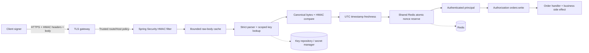
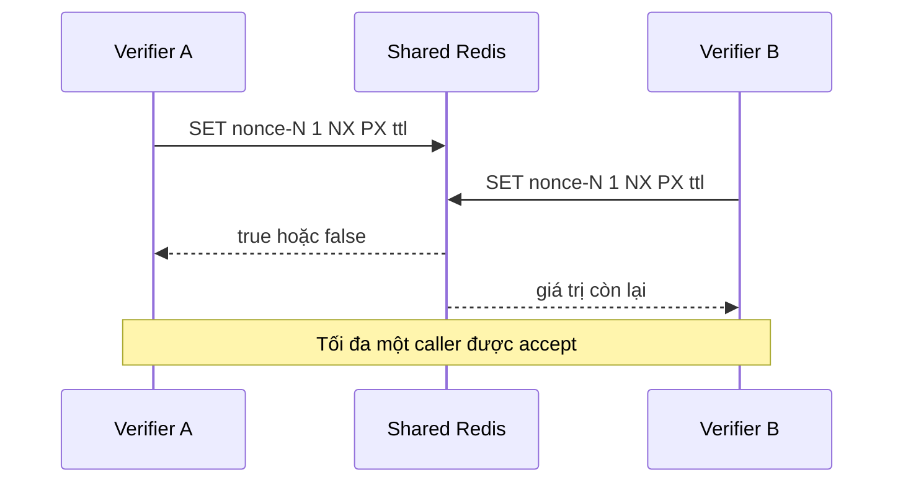

# Viết server verifier: dự án thực hành xác thực HTTP request bằng HMAC

## 1. Đề bài và kết quả cần bàn giao

Trong chương **Dự án thực hành**, bài **Viết server verifier** yêu cầu xây dựng phía server tiếp nhận HTTP request đã ký, tái tạo **canonical request**, xác minh HMAC, từ chối yêu cầu quá hạn/phát lại và thiết lập danh tính cho Spring Security **chỉ sau khi tất cả điều kiện xác thực đạt**.

Phạm vi học tập của `SECURITY_AUTHENTICATION_HMAC_REQUEST_AUTHENTICATION` là xác thực HTTP request bằng **shared secret**, ký method, URI, header hoặc body theo hợp đồng; chống replay bằng timestamp/nonce; quản lý key rotation, kiểm thử với proxy/gateway và **phân biệt authentication với authorization**. Đây là một bài **hands-on server-side**: ngoài hiểu cơ chế, người học cần ghép các thành phần thành một API chạy được trong lab và chứng minh các trường hợp lỗi được chặn trước khi thực hiện nghiệp vụ.

**Bối cảnh demo:** Một đối tác `partner-a` gọi `POST /api/partner/orders?source=partner` để tạo đơn hàng. Client có `clientId`, `keyId` và secret. Backend Spring Boot kiểm HMAC-SHA256, timestamp, nonce trên Redis; khi hợp lệ, nó tạo `Authentication` với authority được cấp từ credential record phía server. Một request có chữ ký đúng nhưng thiếu `orders:write` vẫn phải nhận `403`.

### Kết quả bắt buộc

Sau khi thực hiện, người học cần có:

- Một hợp đồng ký `HMAC-V1` **ở cấp byte**, đủ để client và server ở hai ngôn ngữ tạo cùng MAC.
- Bộ xác minh gồm parser/validator, credential lookup theo client–key, canonicalizer, HMAC verifier, freshness checker và replay guard.
- Một `SecurityFilterChain` không tạo bypass ở protected routes, không cấp principal dựa trên header tự khai.
- Giới hạn body/input để tránh DoS và request wrapper cho phép controller đọc lại **đúng byte đã ký**.
- Redis nonce reservation nguyên tử và **fail closed** khi không biết chắc nonce còn mới.
- Endpoint nghiệp vụ kiểm authorization riêng với authentication.
- Bộ unit/integration/security tests có negative cases, side-effect assertions và thử nghiệm gateway.
- Tài liệu vận hành ngắn: cấu hình secret, policy time/nonce, key rotation, observability, hạn chế mẫu demo và cách nâng cấp production.

**Ranh giới:** Mọi ví dụ là **mẫu triển khai học tập**, sử dụng secret giả và dữ liệu kiểm thử. Không triển khai nguyên xi vào production nếu chưa có secret manager, credential lifecycle/HA, test proxy thực tế, security review và fault-injection tương ứng. Tài liệu minh họa mã cho nhiều file Java, nhưng **bài Knowledge này không tự tạo các file dự án**.

## 2. Năng lực tối thiểu và công nghệ đề xuất

Giả định Java 17+ và một ứng dụng Spring Boot 3.x dùng Spring Security 6.x. Các API chính được minh họa là Spring MVC/Servlet; với WebFlux cần một hiện thực reactive riêng, không copy `OncePerRequestFilter` sang `WebFilter` rồi cho rằng semantics giống nhau.

| Thành phần | Công nghệ demo | Vai trò |
| --- | --- | --- |
| HTTP server | Spring Boot Web / Spring MVC | Nhận HTTP, điều phối đến controller. |
| Security | Spring Security `SecurityFilterChain`, `OncePerRequestFilter` | Bảo vệ route, quản lý principal và authorization. |
| HMAC/JCA | `javax.crypto.Mac`, `SecretKeySpec` | Tính tag HMAC-SHA256. |
| Body digest | `MessageDigest` SHA-256 | Tạo lowercase hex từ exact raw entity bytes. |
| Time | `Instant` và injectable `Clock` | Kiểm timestamp UTC với cửa sổ thời gian xác định. |
| Credential repository | Demo in-memory từ cấu hình môi trường | Tra secret và authority theo client/key, làm mẫu cho secret manager thật. |
| Replay store | Spring Data Redis `StringRedisTemplate` | `SET NX` cùng TTL, chia sẻ giữa các verifier. |
| Tests | JUnit 5, Spring Boot Test, MockMvc, test Redis | Kiểm canonical/MAC, filter, replay, 401/403/side effects. |
| Proxy test | HTTPS ingress/nginx/gateway trong lab | Xác minh signed target/headers sau TLS termination và rewrite. |

Một phần `build.gradle` có thể khai báo:

```groovy
dependencies {
    implementation 'org.springframework.boot:spring-boot-starter-web'
    implementation 'org.springframework.boot:spring-boot-starter-security'
    implementation 'org.springframework.boot:spring-boot-starter-data-redis'

    testImplementation 'org.springframework.boot:spring-boot-starter-test'
    testImplementation 'org.springframework.security:spring-security-test'
    testRuntimeOnly 'org.junit.platform:junit-platform-launcher'
}
```

Cần khai báo Spring Boot plugin/BOM phiên bản cụ thể **tương thích với dự án** và Java toolchain 17+ ở phần build ngoài đoạn trích. Không mặc định một version mới bất kỳ tương thích với hệ thống thật; kiểm migration guide/framework phiên bản được chọn. Để test Redis, dùng một instance test cô lập hoặc Testcontainers theo quy trình dự án, **không kết nối Redis production**.

### Cấu trúc nguồn gợi ý

```text
src/main/java/com/example/hmac/
  HmacDemoApplication.java
  HmacSecurityConfig.java
  CachedBodyRequest.java
  HmacAuthenticationFilter.java
  HmacRequestVerifier.java
  CredentialRepository.java
  DemoCredentialRepository.java
  NonceStore.java
  RedisNonceStore.java
  OrderController.java
  OrderService.java

src/test/java/com/example/hmac/
  HmacCanonicalVectorTest.java
  HmacRequestVerifierTest.java
  HmacMvcSecurityIntegrationTest.java
  ReplayStoreIntegrationTest.java
  GatewayContractTest.java
```

Đây là **sơ đồ kết quả thực hành**, không phải danh sách file đã được tự động tạo. Các khối mã sau sử dụng package `com.example.hmac`, trình bày tập trung vào logic; khi chuyển vào IDE cần thêm imports tương ứng. Một vài snippet phụ trợ là pseudocode/test skeleton và được ghi rõ, không được coi là test đã chạy.

## 3. Hợp đồng HMAC-V1: phải chốt trước khi viết code

Đề bài chọn **một** định dạng ký minh họa để tránh signer và verifier tự chọn chuẩn hóa khác nhau. Nó **không** phải định dạng có sẵn của Spring Security.

### 3.1. HTTP request

```http
POST /api/partner/orders?source=partner HTTP/1.1
Host: api.example.test
Content-Type: application/json
X-Hmac-Version: HMAC-V1
X-Client-Id: partner-a
X-Key-Id: key-a-01
X-Timestamp: 2026-11-28T03:00:00Z
X-Nonce: 8f247364-7d4b-479e-8c36-b640f1ad39a0
X-Signature: <Base64 của tag HMAC-SHA256 32 byte>

{"sku":"P100","quantity":2}
```

Đoạn này là **wire fixture có placeholder**, chưa phải một request đã ký hợp lệ. Khi chạy lab, thay timestamp bằng thời điểm hiện tại theo clock lab, tạo UUID v4 mới và tính signature từ secret test.

Các quy tắc:

1. `X-Hmac-Version` phải đúng `HMAC-V1`; version được đưa vào dòng đầu canonical request.
2. `X-Client-Id` và `X-Key-Id` phải có đúng một giá trị theo grammar hữu hạn và **được ký**; đây chỉ là lookup hints trước khi xác minh.
3. `X-Timestamp` có đúng một giá trị UTC giây nguyên `yyyy-MM-dd'T'HH:mm:ss'Z'`, ví dụ `2026-11-28T03:00:00Z`.
4. `X-Nonce` là UUID v4 lowercase chuẩn, phải mới trong namespace của credential; **được ký**.
5. `X-Signature` là Base64 chuẩn **có padding** của 32-byte tag, nên dài 44 ký tự với SHA-256; không ký chính header signature.
6. HTTP method là uppercase ASCII; public request-target sử dụng **raw path và raw query theo contract**, không tự sort query hoặc decode percent escapes.
7. `Host` của lab phải là `api.example.test`, được server đối chiếu với expected authority; production phải có chính sách public authority và trusted proxy phù hợp.
8. `Content-Type` trong demo phải đúng `application/json`, không tự thêm `charset`. Đây là rule demo nhằm làm rõ signed header grammar.
9. Body hash là SHA-256 của **exact HTTP entity bytes được handler sử dụng**, không phải JSON object parse/serialize lại.
10. Header duplicate/CRLF, URI nhập nhằng, signature không chuẩn và body quá lớn bị từ chối trước khi cấp principal.

### 3.2. Canonical request 10 dòng

Ký 10 dòng dưới đây, nối bằng LF `0x0A`, **không có LF cuối**:

```text
HMAC-V1
POST
/api/partner/orders?source=partner
authority:api.example.test
content-type:application/json
x-client-id:partner-a
x-key-id:key-a-01
x-timestamp:2026-11-28T03:00:00Z
x-nonce:8f247364-7d4b-479e-8c36-b640f1ad39a0
body-sha256:<64 lowercase hex of SHA-256 over raw body bytes>
```

Đếm chính xác: 1 version + 1 method + 1 raw target + 7 field lines = **10 dòng**. Dòng cuối luôn chứa 64 ký tự hex lowercase do tính digest thật, không giữ placeholder.

```text
rawBody       = UTF8('{"sku":"P100","quantity":2}')
bodyHash      = SHA256(rawBody)
canonical     = UTF8(join10LinesUsingLFWithoutTrailingLF)
tag           = HMAC_SHA256(sharedSecretBytes, canonical)
X-Signature   = standardBase64(tag)
```

Ví dụ SHA-256 của **body rỗng 0 byte** là:

```text
e3b0c44298fc1c149afbf4c8996fb92427ae41e4649b934ca495991b7852b855
```

Đây **không** phải tag của request POST tạo đơn. Golden vector cuối cùng phải ghi test secret bytes, raw body bytes, expected canonical hex và expected HMAC Base64 **được đối chiếu bằng signer độc lập**, không dùng cùng production canonicalizer để tính expected.

### 3.3. Phân biệt wire bytes với ngữ nghĩa HTTP

Các cặp sau có thể có ý nghĩa tương đương với JSON/query parser nhưng **không tương đương byte** dưới HMAC-V1:

| Input | Biến thể | Hệ quả |
| --- | --- | --- |
| Query | `?a=1&b=2` và `?b=2&a=1` | Raw target khác, MAC khác. |
| Encoding | `%20` và `+` | Không tự đổi biểu diễn trước khi verify. |
| Query duplicate | `?tag=a&tag=b` và `?tag=b` | Không dùng Map làm mất tham số. |
| JSON | `{"a":1}` và `{ "a": 1 }` | Raw body digest khác. |
| Unicode | `é` dạng dựng sẵn/tổ hợp | UTF-8 bytes có thể khác dù hiển thị giống. |
| Header | `application/json` và `application/json;charset=UTF-8` | Demo quy định exact value, không tự nới grammar. |
| Line endings | LF và CRLF/trailing LF | Canonical bytes khác, tag khác. |
| Body | Không có byte và text `{}` | SHA-256 khác. |

HMAC thành công chỉ chứng minh **phạm vi đã ký**. Nếu header chọn tenant, idempotency key hoặc path routing có vai trò bảo mật, hãy đưa chúng vào signed fields của contract thật hoặc không dùng giá trị không ký làm input có thẩm quyền.

## 4. Kiến trúc server verifier và ranh giới tin cậy



Mọi bước từ client đến verifier đều chứa dữ liệu **chưa đáng tin**. Header `X-Client-Id` chưa tạo principal; bản body đã được đọc chưa được phép xử lý nghiệp vụ trước MAC; một kết quả Redis timeout **không phải** xác nhận nonce mới.

**Bất biến cần test:**

- Filter phải chạy trên **mọi route protected**, không chỉ một controller happy-path.
- Chỉ sau MAC/key/timestamp/nonce đạt mới tạo `Authentication`; authority lấy từ record server-side.
- Một request tag sai/thiếu, expired, replay hoặc key revoked **không được gọi business service**.
- Nếu replay store hỏng, protected operation **fail closed**; ví dụ trả 503, không tạo principal.
- Nếu HMAC hợp lệ nhưng thiếu authority `orders:write`, Spring Security trả **403** và không thực thi controller.
- Gateway phải giữ đúng public target hoặc tự verify trước rewrite rồi truyền assertion có xác thực, không tin `X-Original-URI` từ client.

### 4.1. Ngữ nghĩa status trong demo

| Kết quả | Status minh họa | Hành vi |
| --- | --- | --- |
| Thiếu/sai signature, key sai/revoked, timestamp expired/future, nonce replay | 401 | Không cấp identity, không handler. |
| Raw body quá giới hạn | 413 | Không tiếp tục đọc/buffer không giới hạn. |
| Replay store không khả dụng hoặc lỗi crypto hạ tầng | 503 | **Fail closed**, không handler. |
| Principal HMAC hợp lệ nhưng thiếu `orders:write` | 403 | Đã authenticated, bị authorization từ chối. |
| Đơn hàng hợp lệ, auth/authz đạt | 201 | Chỉ một business create; response có ID. |
| JSON body sai cấu trúc sau verify | 400 | Authentication có thể đã đạt; lỗi payload khác lỗi MAC. |

Đây là **quyết định contract của demo**, không phải mã trạng thái bắt buộc của mọi API. `401` có semantics HTTP challenge (`WWW-Authenticate`); khi thiết kế scheme HMAC header custom, cần mô tả authentication challenge và trả response phù hợp. Không trả lý do chi tiết về key tồn tại/revoked cho người gửi chưa xác thực.

## 5. Các pha triển khai và cách kiểm tiến độ

| Pha | Việc làm | Điều kiện hoàn thành |
| --- | --- | --- |
| P1 | Chốt HMAC-V1 contract, golden bytes/tag. | Hai signer độc lập tạo cùng expected; test input mutation có kết quả rõ. |
| P2 | Đọc body có giới hạn, parse headers nghiêm ngặt. | Header duplicate/malformed và body lớn bị reject. |
| P3 | Key repository scoped và HMAC compare. | Tag đúng/mismatch, key state, tenant isolation đều test được. |
| P4 | Timestamp, nonce store atomic + TTL. | Expired/future/replay và Redis failure fail closed. |
| P5 | Spring Security filter + controller. | 201 cho valid, 401/403/413/503 đúng nguyên nhân, không side effects khi bị cấm. |
| P6 | Full-chain/gateway/replay concurrency tests. | Không bypass qua proxy/route/method hoặc nhiều node. |
| P7 | Runbook, audit/metrics, lifecycle keys. | Có alert/fail-safe plan và test rotation/revocation. |

Không nhận “P5 hoàn thành” chỉ vì một request trả `201`: nếu filter vô tình không chạy, endpoint cũng có thể 201. Cần **negative canaries** và side-effect assertions.

## 6. Chuẩn bị ứng dụng và dữ liệu lab

### 6.1. Configuration

Dùng secret thử nghiệm được tạo ngẫu nhiên (ít nhất 32 byte) và cung cấp qua biến môi trường/config secret. Không hard-code production secret vào Java, Git, Docker image hay log.

```yaml
# application.yml - ví dụ nội dung để người học tự tạo trong project lab
server:
  port: 8080

spring:
  data:
    redis:
      host: localhost
      port: 6379

demo:
  hmac:
    secret-base64: ${DEMO_HMAC_SECRET_BASE64:}
```

Lệnh tạo secret test trên hệ thống có OpenSSL:

```bash
openssl rand -base64 32
```

Đưa output vào `DEMO_HMAC_SECRET_BASE64` **trên shell lab an toàn**; đừng commit hoặc paste secret thật vào log/ticket. Trong pipeline production, dùng secret manager/KMS và quyền truy cập tối thiểu, key rotation và audit.

**Chú ý cấu hình:** `demo.hmac.secret-base64` là ví dụ; nếu biến chưa được cấp, ứng dụng nên **fail startup**, không tự dùng secret mặc định như `password123`. Spring Boot Test có thể đặt một secret giả cố định riêng cho test.

### 6.2. DemoApplication và Clock

```java
package com.example.hmac;

import java.time.Clock;
import org.springframework.boot.SpringApplication;
import org.springframework.boot.autoconfigure.SpringBootApplication;
import org.springframework.context.annotation.Bean;

@SpringBootApplication
public class HmacDemoApplication {
    public static void main(String[] args) {
        SpringApplication.run(HmacDemoApplication.class, args);
    }

    @Bean
    Clock utcClock() {
        return Clock.systemUTC();
    }
}
```

`Clock.systemUTC()` cung cấp UTC wall-clock của host, **không bảo đảm host đã được đồng bộ**. NTP/chrony, clock skew limits và readiness của node verifier vẫn cần giám sát. Với unit test, inject `Clock.fixed` để kiểm biên thời gian mà không chỉnh system clock.

## 7. Credential repository: không biến client ID thành principal

### 7.1. Interface và record

```java
package com.example.hmac;

import java.time.Instant;
import java.util.Optional;
import java.util.Set;

enum KeyStatus {
    ACTIVE, VERIFY_ONLY, REVOKED, EXPIRED
}

record Credential(
    String clientId,
    String keyId,
    byte[] secretBytes,
    KeyStatus status,
    Instant notBefore,
    Instant notAfter,
    Set<String> authorities
) {
    boolean canVerifyAt(Instant now) {
        return (status == KeyStatus.ACTIVE
                    || status == KeyStatus.VERIFY_ONLY)
                && !now.isBefore(notBefore)
                && now.isBefore(notAfter);
    }
}

interface CredentialRepository {
    Optional<Credential> findScoped(String clientId, String keyId);
}
```

**Lưu ý:** record với `byte[]` chỉ dùng để mô tả demo; byte array mutable cần lifecycle riêng, không đưa secret vào `toString()`, debugger dumps hoặc logs. Nếu thay bằng data class tự log mọi property, nguy cơ lộ key tăng. Production secret nên được truy cập bằng cơ chế được kiểm quyền, có cache policy, rotation/revocation và quy tắc xóa khỏi bộ nhớ phù hợp nền tảng.

### 7.2. In-memory repository dành riêng cho lab

```java
package com.example.hmac;

import java.time.Instant;
import java.util.Base64;
import java.util.Optional;
import java.util.Set;
import org.springframework.beans.factory.annotation.Value;
import org.springframework.stereotype.Component;

@Component
final class DemoCredentialRepository implements CredentialRepository {
    private final Credential labKey;

    DemoCredentialRepository(
            @Value("${demo.hmac.secret-base64:}") String base64) {
        if (base64 == null || base64.isBlank()) {
            throw new IllegalStateException(
                "Lab HMAC secret must be configured");
        }
        byte[] bytes = Base64.getDecoder().decode(base64);
        if (bytes.length < 32) {
            throw new IllegalStateException(
                "Lab secret must contain at least 32 bytes");
        }

        this.labKey = new Credential(
            "partner-a", "key-a-01", bytes, KeyStatus.ACTIVE,
            Instant.parse("2020-01-01T00:00:00Z"),
            Instant.parse("2035-01-01T00:00:00Z"),
            Set.of("orders:write")
        );
    }

    @Override
    public Optional<Credential> findScoped(
            String clientId, String keyId) {
        if (labKey.clientId().equals(clientId)
                && labKey.keyId().equals(keyId)) {
            return Optional.of(labKey);
        }
        return Optional.empty();
    }
}
```

Mốc hiệu lực rộng là **đơn giản hóa cho lab**, không phải key rotation policy production. Để test `403`, thay/tiêm một credential test chỉ có `orders:read` rồi gửi một request ký đúng bằng secret đó. Không tự sửa `X-Roles` trên HTTP để thêm quyền, vì authority phải xuất phát từ repository **sau verify**.

### 7.3. Threat model cho credential

- `clientId` và `keyId` trước MAC chỉ là lookup hints; chúng cần validate grammar, size và rate limit.
- Key ID có thể trùng giữa hai tenant; repository phải query theo **cặp client/tenant scope + key ID**, không thử mọi secret trên toàn hệ thống.
- Key `REVOKED` phải bị từ chối ngay cả khi MAC đúng. Trạng thái `VERIFY_ONLY` có nghĩa server tạm xác minh trong overlap window; về mặt mật mã, server không thể biết client có **tiếp tục ký request mới bằng key cũ** hay không nếu còn secret.
- Ở production, cache credential có giới hạn staleness, invalidate khi revoke và audit thay đổi policy; không fail-open nếu key store không đáng tin.
- HMAC là khóa đối xứng; cả client và server biết secret, nên tag **không có tính non-repudiation** như chữ ký bất đối xứng.

## 8. Bounded raw-body wrapper cho Spring MVC

Verifier cần hash body trước khi cho controller đọc `@RequestBody`. Nếu đọc `request.getInputStream()` mà không cache và phát lại, controller có thể nhận stream rỗng. `ContentCachingRequestWrapper` không tự bảo đảm một stream đã bị consume có thể đọc lại theo cách bạn muốn; vì vậy demo dùng wrapper rõ ràng, bounded.

```java
package com.example.hmac;

import java.io.BufferedReader;
import java.io.ByteArrayInputStream;
import java.io.IOException;
import java.io.InputStreamReader;
import java.nio.charset.StandardCharsets;
import jakarta.servlet.ReadListener;
import jakarta.servlet.ServletInputStream;
import jakarta.servlet.http.HttpServletRequest;
import jakarta.servlet.http.HttpServletRequestWrapper;

final class BodyTooLarge extends RuntimeException {}

final class CachedBodyRequest extends HttpServletRequestWrapper {

    private final byte[] body;

    private CachedBodyRequest(
            HttpServletRequest original, byte[] body) {
        super(original);
        this.body = body;
    }

    static CachedBodyRequest read(
            HttpServletRequest request, int maxBytes)
            throws IOException {

        if (request.getContentLengthLong() > maxBytes) {
            throw new BodyTooLarge();
        }

        byte[] bytes = request.getInputStream()
            .readNBytes(maxBytes + 1);

        if (bytes.length > maxBytes) {
            throw new BodyTooLarge();
        }
        return new CachedBodyRequest(request, bytes);
    }

    byte[] bodyBytes() {
        return body;
    }

    @Override
    public int getContentLength() {
        return body.length;
    }

    @Override
    public long getContentLengthLong() {
        return body.length;
    }

    @Override
    public ServletInputStream getInputStream() {
        ByteArrayInputStream cursor =
            new ByteArrayInputStream(body);

        return new ServletInputStream() {
            @Override
            public int read() {
                return cursor.read();
            }

            @Override
            public boolean isFinished() {
                return cursor.available() == 0;
            }

            @Override
            public boolean isReady() {
                return true;
            }

            @Override
            public void setReadListener(ReadListener listener) {
                throw new UnsupportedOperationException(
                    "Synchronous MVC demo only");
            }
        };
    }

    @Override
    public BufferedReader getReader() throws IOException {
        return new BufferedReader(new InputStreamReader(
            getInputStream(), StandardCharsets.UTF_8));
    }
}
```

**Giới hạn rõ ràng:** đây là wrapper **synchronous Servlet MVC lab**, không hỗ trợ asynchronous `ReadListener` semantics hoặc upload streaming lớn. Không copy nó sang async processing hoặc WebFlux. Production cần xem body limit, content encoding, Servlet container limits, request parsing, chunked transfer, cancellation, memory budgets và error handling. `readNBytes(max+1)` tạo buffer có giới hạn, không cấp phát theo `Content-Length` attacker tự khai; tuy vậy cần thêm giới hạn request/header tại gateway, container và timeout đọc body.

**Bất biến:** controller chỉ nhận lại `bodyBytes()` mà verifier vừa hash. Nếu gateway thay body (ví dụ decompress), hợp đồng phải xác định byte nào được ký **tại điểm verify**, không âm thầm parse JSON rồi serialize khác.

## 9. HMAC verifier: parser, canonicalizer và HMAC compare

### 9.1. Kiểu kết quả và lỗi

```java
package com.example.hmac;

import java.util.Set;

final class HmacRejected extends RuntimeException {}
final class AuthDependencyUnavailable extends RuntimeException {
    AuthDependencyUnavailable(Throwable cause) { super(cause); }
}

record VerifiedIdentity(
    String clientId,
    Set<String> authorities
) {}
```

Chỉ có verifier tin cậy được tạo `VerifiedIdentity` sau **tất cả điều kiện**. Trong dự án lớn nên giới hạn constructor/factory và không dùng kết quả verify từ client payload. Hai exception giúp filter demo map lỗi xác thực sang `401` và lỗi hạ tầng sang `503`, nhưng response public không tiết lộ key tồn tại, trạng thái secret hay expected MAC.

### 9.2. Đọc header chính xác một giá trị

```java
package com.example.hmac;

import java.util.Collections;
import java.util.List;
import jakarta.servlet.http.HttpServletRequest;

final class StrictHmacHeaders {
    private StrictHmacHeaders() {}

    static String one(
            HttpServletRequest request,
            String name, int maxChars) {

        List<String> values =
            Collections.list(request.getHeaders(name));

        if (values.size() != 1) {
            throw new HmacRejected();
        }

        String value = values.get(0);
        if (value == null || value.isBlank()
                || value.length() > maxChars
                || !value.equals(value.trim())
                || value.indexOf(',') >= 0
                || value.indexOf('\r') >= 0
                || value.indexOf('\n') >= 0) {
            throw new HmacRejected();
        }

        return value;
    }
}
```

Phương thức từ chối duplicate **mà Servlet API còn quan sát được** và một số dạng giá trị bị gộp bằng dấu phẩy. Đây chưa phải HTTP parser/smuggling defense đầy đủ: gateway và container phải chặn framing ambiguity (ví dụ `Content-Length`/`Transfer-Encoding` mâu thuẫn), giới hạn header/URL và dùng cùng ngữ nghĩa về request-target. Java Servlet API có thể đã chuẩn hóa đầu vào trước khi code này chạy; cần integration test qua stack thật.

### 9.3. Verifier hoàn chỉnh của lab

```java
package com.example.hmac;

import java.nio.charset.StandardCharsets;
import java.security.GeneralSecurityException;
import java.security.MessageDigest;
import java.time.Clock;
import java.time.Duration;
import java.time.Instant;
import java.time.format.DateTimeParseException;
import java.util.Base64;
import java.util.HexFormat;
import java.util.Set;
import java.util.regex.Pattern;
import javax.crypto.Mac;
import javax.crypto.spec.SecretKeySpec;
import org.springframework.stereotype.Service;

@Service
final class HmacRequestVerifier {

    private static final String AUTHORITY = "api.example.test";
    private static final Duration MAX_PAST =
        Duration.ofSeconds(300);
    private static final Duration MAX_FUTURE =
        Duration.ofSeconds(30);

    // 300 + 30 + 10 giây bound skew + 20 giây margin.
    private static final Duration NONCE_TTL =
        Duration.ofSeconds(360);

    private static final Pattern CLIENT_ID =
        Pattern.compile("[a-z0-9-]{1,64}");
    private static final Pattern KEY_ID =
        Pattern.compile("[A-Za-z0-9._-]{1,64}");
    private static final Pattern UTC_SECONDS =
        Pattern.compile(
            "\\d{4}-\\d{2}-\\d{2}T\\d{2}:\\d{2}:\\d{2}Z");
    private static final Pattern UUID_V4 =
        Pattern.compile(
            "[0-9a-f]{8}-[0-9a-f]{4}-4[0-9a-f]{3}-" +
            "[89ab][0-9a-f]{3}-[0-9a-f]{12}");

    private final CredentialRepository credentials;
    private final NonceStore nonceStore;
    private final Clock clock;

    HmacRequestVerifier(
            CredentialRepository credentials,
            NonceStore nonceStore,
            Clock clock) {
        this.credentials = credentials;
        this.nonceStore = nonceStore;
        this.clock = clock;
    }

    VerifiedIdentity verify(CachedBodyRequest request) {
        String version = StrictHmacHeaders.one(
            request, "X-Hmac-Version", 16);
        String clientId = StrictHmacHeaders.one(
            request, "X-Client-Id", 64);
        String keyId = StrictHmacHeaders.one(
            request, "X-Key-Id", 64);
        String timestamp = StrictHmacHeaders.one(
            request, "X-Timestamp", 30);
        String nonce = StrictHmacHeaders.one(
            request, "X-Nonce", 36);
        String signature = StrictHmacHeaders.one(
            request, "X-Signature", 44);
        String host = StrictHmacHeaders.one(
            request, "Host", 255);
        String contentType = StrictHmacHeaders.one(
            request, "Content-Type", 100);

        if (!"HMAC-V1".equals(version)
                || !CLIENT_ID.matcher(clientId).matches()
                || !KEY_ID.matcher(keyId).matches()
                || !UUID_V4.matcher(nonce).matches()
                || !AUTHORITY.equals(host)
                || !"application/json".equals(contentType)) {
            throw new HmacRejected();
        }

        String path = request.getRequestURI();
        String query = request.getQueryString();
        if (!"/api/partner/orders".equals(path)
                || (query != null && query.length() > 512)) {
            throw new HmacRejected();
        }

        String rawTarget =
            path + (query == null ? "" : "?" + query);

        String method = request.getMethod();
        if (!"POST".equals(method)) {
            throw new HmacRejected();
        }

        Instant signedAt = parseTimestamp(timestamp);
        Instant now = clock.instant();

        Credential credential = credentials
            .findScoped(clientId, keyId)
            .orElseThrow(HmacRejected::new);

        if (!credential.canVerifyAt(now)) {
            throw new HmacRejected();
        }

        byte[] receivedTag = parseTag(signature);

        try {
            String bodyHash = HexFormat.of().formatHex(
                MessageDigest.getInstance("SHA-256")
                    .digest(request.bodyBytes()));

            String canonical = String.join("\n",
                "HMAC-V1",
                method,
                rawTarget,
                "authority:" + AUTHORITY,
                "content-type:" + contentType,
                "x-client-id:" + clientId,
                "x-key-id:" + keyId,
                "x-timestamp:" + timestamp,
                "x-nonce:" + nonce,
                "body-sha256:" + bodyHash);

            Mac mac = Mac.getInstance("HmacSHA256");
            mac.init(new SecretKeySpec(
                credential.secretBytes(), "HmacSHA256"));

            byte[] expected = mac.doFinal(
                canonical.getBytes(StandardCharsets.UTF_8));

            if (!MessageDigest.isEqual(expected, receivedTag)) {
                throw new HmacRejected();
            }
        } catch (GeneralSecurityException ex) {
            throw new AuthDependencyUnavailable(ex);
        }

        if (signedAt.isBefore(now.minus(MAX_PAST))
                || signedAt.isAfter(now.plus(MAX_FUTURE))) {
            throw new HmacRejected();
        }

        // Chỉ reserve nonce sau MAC/key/freshness.
        boolean isNew = nonceStore.reserve(
            credential.clientId(),
            credential.keyId(),
            nonce,
            NONCE_TTL);

        if (!isNew) {
            throw new HmacRejected();
        }

        return new VerifiedIdentity(
            credential.clientId(),
            credential.authorities());
    }

    private static Instant parseTimestamp(String wire) {
        if (!UTC_SECONDS.matcher(wire).matches()) {
            throw new HmacRejected();
        }
        try {
            Instant parsed = Instant.parse(wire);
            // Reject form không đúng UTC giây nguyên/canonical.
            if (!parsed.toString().equals(wire)) {
                throw new HmacRejected();
            }
            return parsed;
        } catch (DateTimeParseException ex) {
            throw new HmacRejected();
        }
    }

    private static byte[] parseTag(String wire) {
        if (wire.length() != 44) {
            throw new HmacRejected();
        }
        try {
            byte[] decoded = Base64.getDecoder().decode(wire);
            if (decoded.length != 32
                    || !Base64.getEncoder().encodeToString(
                        decoded).equals(wire)) {
                throw new HmacRejected();
            }
            return decoded;
        } catch (IllegalArgumentException ex) {
            throw new HmacRejected();
        }
    }
}
```

**Đây là phần trung tâm của dự án.** Tất cả điều kiện đều bắt buộc; một lỗi ở bước sau không được tạo principal tạm. `MessageDigest.isEqual` hỗ trợ so MAC byte array mà không dừng ngay theo byte sai đầu tiên; nó không tự làm toàn bộ endpoint có thời gian phản hồi giống nhau. Không ghi expected tag, canonical bytes, secret, body hoặc raw nonce vào log.

### 9.4. Những điểm cần review trước production

- Demo khóa `AUTHORITY` và `path` để tập trung bài học. Trong hệ thống nhiều route, dùng **route policy table** được review, canonicalize đúng target và yêu cầu quyền theo từng route; không sửa thành một `startsWith("/api")` tùy tiện.
- `getRequestURI()` và `getQueryString()` là góc nhìn của **Servlet container**; qua proxy/HTTP/2, byte gốc và cách normalization có thể khác. Test trên public gateway thực; không tin `X-Original-URI` từ client.
- Key lookup/policy store thực tế phải có error semantics, cache staleness và revoke/rotation. Ví dụ lab repository không giải quyết secret-store HA.
- Input validation và credential lookup trước HMAC có thể tạo DoS/timing differences; cần rate limits, bounded parser, generic response, key enumeration mitigation. Thứ tự parse–MAC–freshness có thể điều chỉnh để chặn request clearly invalid trước khi dùng crypto, miễn không tạo principal/nonce reservation sai.
- `Credential.canVerifyAt` cần review về các khoảng chồng lấn key, pending/revoked status và **không mặc định** dùng key VERIFY_ONLY để ký mới.
- Không dùng Java `Mac` chung cho nhiều thread; ví dụ tạo instance mới trên từng request.
- `NonceStore.reserve` là bước phụ thuộc hạ tầng; timeout hoặc kết quả không xác định **không** được coi là nonce mới.
- Auth success chỉ mang authorities lấy từ credential; client không được tự cấp `ROLE_ADMIN` qua header/query/body.

## 10. Redis replay guard: atomicity và fail-closed

### 10.1. Interface và implementation

```java
package com.example.hmac;

import java.time.Duration;

interface NonceStore {
    boolean reserve(
        String clientId,
        String keyId,
        String nonce,
        Duration ttl);
}
```

```java
package com.example.hmac;

import java.time.Duration;
import org.springframework.dao.DataAccessException;
import org.springframework.data.redis.core.StringRedisTemplate;
import org.springframework.stereotype.Component;

@Component
final class RedisNonceStore implements NonceStore {

    private final StringRedisTemplate redis;

    RedisNonceStore(StringRedisTemplate redis) {
        this.redis = redis;
    }

    @Override
    public boolean reserve(
            String clientId,
            String keyId,
            String nonce,
            Duration ttl) {

        if (ttl.isNegative() || ttl.isZero()) {
            throw new IllegalArgumentException(
                "Nonce TTL must be positive");
        }

        String key = "hmac:replay:v1:" +
            clientId + ":" + keyId + ":" + nonce;

        try {
            Boolean inserted = redis.opsForValue()
                .setIfAbsent(key, "1", ttl);

            // null/unknown outcome không được coi là success.
            if (inserted == null) {
                throw new AuthDependencyUnavailable(
                    new IllegalStateException(
                        "Redis nonce outcome unknown"));
            }
            return inserted;
        } catch (DataAccessException ex) {
            throw new AuthDependencyUnavailable(ex);
        }
    }
}
```

`setIfAbsent(key,value,ttl)` thể hiện thao tác Redis tương đương một lệnh **`SET key value NX PX ttl`**. Nó khác nguy hiểm `EXISTS` rồi `SET`: hai verifier có thể đọc “chưa tồn tại” cùng lúc rồi cả hai nhận request. Redis trả `false` nghĩa nonce đã có → `401`; Redis timeout/null/error → **503 fail closed**, không cho handler chạy.

### 10.2. Vì sao demo đặt TTL 360 giây?

Freshness của demo:

```text
serverNow - 300s <= signedTimestamp <= serverNow + 30s
```

Một request đầu tiên có signed timestamp tương lai 30 giây còn có thể được chấp nhận tối đa **330 giây** theo cùng clock. Để bảo vệ giữa nhiều verifier, cần xét **chênh lệch tương đối giữa các node**, sự trì hoãn xử lý và store:

```text
minimumTTL >= 300 + 30 + boundedRelativeClockSkew + safetyMargin
           = 300 + 30 + 10 + 20
           = 360 giây (ví dụ giả định)
```

Nếu topology không bảo đảm offset tương đối không vượt 10 giây, phép tính **không còn được chứng minh**. Cần giám sát clock source/uncertainty, loại node lệch giờ khỏi protected traffic hoặc tăng bound **qua security review** đồng thời tăng TTL/capacity. Không mở cửa sổ vô hạn để hết 401.

### 10.3. Những giới hạn Redis quan trọng

- **Eviction:** key bị xóa sớm dù TTL dài có thể tạo replay gap. Kiểm `maxmemory-policy`, capacity và behavior khi Redis hết bộ nhớ; prefer fail closed khi không thể reserve.
- **Failover/replication:** Redis replication có thể bất đồng bộ. Sau failover một acknowledged nonce write có thể bị mất nếu cấu hình durability/topology không bảo đảm; phải đánh giá RPO phù hợp security requirement, không chỉ kiểm Redis còn ping được.
- **Restore snapshot:** khôi phục state cũ có thể **quên nonce đã dùng**, không được coi replay store là cache thông thường.
- **Multi-region:** một store không nhất quán giữa vùng có thể cho cùng nonce đi qua các cụm. Cần xác định nơi nào có quyền verify và consistency model.
- **Atomic reserve kết quả không rõ:** nếu request Redis timeout sau khi ghi nhưng trước response, server không được suy “insert thất bại, cho qua”; fail closed.
- **TTL và key scope:** nếu thay namespace khi đổi key/suite, phải giữ bảo vệ của các nonce còn hiệu lực và có test cross-key/rolling migration.
- **Idempotency:** nonce không ngăn hai request có nonce **khác nhau** cùng tạo đơn; cần idempotency key hoặc transaction rule nghiệp vụ riêng.

## 11. Spring Security filter: tạo identity sau verifier

### 11.1. Filter xử lý 401/413/503, không nuốt lỗi của controller

```java
package com.example.hmac;

import java.io.IOException;
import java.util.List;
import jakarta.servlet.FilterChain;
import jakarta.servlet.ServletException;
import jakarta.servlet.http.HttpServletRequest;
import jakarta.servlet.http.HttpServletResponse;
import org.springframework.security.authentication.UsernamePasswordAuthenticationToken;
import org.springframework.security.core.GrantedAuthority;
import org.springframework.security.core.authority.SimpleGrantedAuthority;
import org.springframework.security.core.context.SecurityContext;
import org.springframework.security.core.context.SecurityContextHolder;
import org.springframework.web.filter.OncePerRequestFilter;

final class HmacAuthenticationFilter
        extends OncePerRequestFilter {

    private static final int MAX_BODY_BYTES = 64 * 1024;
    private final HmacRequestVerifier verifier;

    HmacAuthenticationFilter(HmacRequestVerifier verifier) {
        this.verifier = verifier;
    }

    @Override
    protected void doFilterInternal(
            HttpServletRequest request,
            HttpServletResponse response,
            FilterChain chain)
            throws ServletException, IOException {

        CachedBodyRequest wrapped;
        VerifiedIdentity verified;

        try {
            wrapped = CachedBodyRequest.read(
                request, MAX_BODY_BYTES);
            verified = verifier.verify(wrapped);
        } catch (BodyTooLarge ex) {
            response.sendError(413);
            return;
        } catch (HmacRejected ex) {
            response.sendError(401);
            return;
        } catch (AuthDependencyUnavailable ex) {
            response.sendError(503);
            return;
        }

        List<GrantedAuthority> granted =
            verified.authorities().stream()
                .map(SimpleGrantedAuthority::new)
                .map(a -> (GrantedAuthority) a)
                .toList();

        var authentication =
            UsernamePasswordAuthenticationToken
                .authenticated(
                    verified.clientId(),
                    null,
                    granted);

        SecurityContext context =
            SecurityContextHolder.createEmptyContext();
        context.setAuthentication(authentication);
        SecurityContextHolder.setContext(context);

        try {
            // Quan trọng: dùng chính wrapped request,
            // handler đọc đúng body bytes đã ký.
            chain.doFilter(wrapped, response);
        } finally {
            SecurityContextHolder.clearContext();
        }
    }
}
```

**Vì sao tách `chain.doFilter` ra ngoài khối catch?** Một lỗi nghiệp vụ/controller không được bị phân loại nhầm thành `SIGNATURE_INVALID` hoặc bị filter nuốt rồi tự “retry authentication”. Exception handler của ứng dụng xử lý lỗi business riêng.

**Vì sao không annotate filter `@Component`?** Trong Spring Boot, một `Filter` là bean có thể được auto-register ở Servlet container. Nếu lại `addFilterBefore` trong Spring Security, filter có nguy cơ chạy **hai lần** và request thứ hai gặp `NONCE_REPLAY`. Demo tạo filter trực tiếp khi xây `SecurityFilterChain` và **không tạo bean Filter auto-register**. Với dự án có lifecycle DI khác, cần dùng `FilterRegistrationBean#setEnabled(false)` hoặc cấu hình tương đương, rồi integration test xác nhận chỉ verify một lần.

**Servlet async/error dispatch:** mẫu synchronous MVC không hỗ trợ quy trình async body read/write; `OncePerRequestFilter` còn có behavior cho ERROR/ASYNC dispatch. Cần kiểm dispatch types, security context propagation và idempotency của filter khi bật async/error routing; không dùng cùng mã cho WebFlux.

### 11.2. Đừng dùng authenticated principal đến từ cơ chế khác

Trong chain yêu cầu HMAC, bật Basic/Form/session authentication có thể cho một principal `isAuthenticated=true` bypass yêu cầu ký request. Demo dùng stateless HMAC filter với chain riêng; không dựa vào `@WithMockUser` trong integration tests để chứng minh HMAC.

Nếu hệ thống phải hỗ trợ JWT hoặc mTLS cho route khác, cấu hình các **SecurityFilterChain có scope không chồng lấn nguy hiểm** hoặc policy kiểm authentication assurance cụ thể, không chỉ kiểm cờ authenticated.

## 12. SecurityFilterChain: protected route và fallback deny

```java
package com.example.hmac;

import org.springframework.context.annotation.Bean;
import org.springframework.context.annotation.Configuration;
import org.springframework.core.annotation.Order;
import org.springframework.http.HttpMethod;
import org.springframework.security.config.annotation.web.builders.HttpSecurity;
import org.springframework.security.config.annotation.web.configurers.AbstractHttpConfigurer;
import org.springframework.security.config.http.SessionCreationPolicy;
import org.springframework.security.web.SecurityFilterChain;
import org.springframework.security.web.access.intercept.AuthorizationFilter;

@Configuration
class HmacSecurityConfig {

    @Bean
    @Order(1)
    SecurityFilterChain partnerHmacChain(
            HttpSecurity http,
            HmacRequestVerifier verifier) throws Exception {

        http
            .securityMatcher("/api/partner/**")
            // Chỉ phù hợp API stateless không dựa trên cookie.
            .csrf(AbstractHttpConfigurer::disable)
            .httpBasic(AbstractHttpConfigurer::disable)
            .formLogin(AbstractHttpConfigurer::disable)
            .sessionManagement(sm -> sm.sessionCreationPolicy(
                SessionCreationPolicy.STATELESS))
            .authorizeHttpRequests(auth -> auth
                .requestMatchers(
                    HttpMethod.POST, "/api/partner/orders")
                    .hasAuthority("orders:write")
                .anyRequest().denyAll())
            .addFilterBefore(
                new HmacAuthenticationFilter(verifier),
                AuthorizationFilter.class);

        return http.build();
    }

    @Bean
    @Order(2)
    SecurityFilterChain fallbackChain(HttpSecurity http)
            throws Exception {

        http
            .csrf(AbstractHttpConfigurer::disable)
            .httpBasic(AbstractHttpConfigurer::disable)
            .formLogin(AbstractHttpConfigurer::disable)
            .authorizeHttpRequests(auth -> auth
                .requestMatchers(
                    HttpMethod.GET, "/health/live")
                    .permitAll()
                .anyRequest().denyAll());

        return http.build();
    }
}
```

**Những ranh giới cần xác minh bằng test:**

- Chỉ chain đầu tiên match `/api/partner/**` mới chạy HMAC filter; chain fallback deny mọi route khác ngoại trừ health-check được công bố.
- `.hasAuthority("orders:write")` là **authorization** sau authentication; không thay điều kiện MAC. User có HMAC đúng nhưng chỉ `orders:read` phải bị 403.
- `permitAll` không tự bỏ custom filters trong cùng chain; demo đặt health route ở **fallback chain**.
- `addFilterBefore(..., AuthorizationFilter.class)` chỉ định vị trí tương đối. Không mặc định `ExceptionTranslationFilter` sẽ bắt mọi exception từ custom filter. Demo tự xử lý 401/413/503 trước `chain.doFilter`; các handler khác vẫn xử lý exception của downstream.
- CSRF disable chỉ phù hợp API stateless không sử dụng browser cookie/session để xác thực; nếu có cookie-based credentials, threat model CSRF khác.
- Nếu có context path, MVC servlet path hoặc proxy rewrite, `securityMatcher` có thể nhìn path khác; bắt buộc test qua topology thực, không giả định pattern trong source luôn đủ.
- Route mới phải được thêm có chủ đích; không sửa `anyRequest().denyAll()` thành `permitAll()` cho tiện.

### 12.1. Controller minh họa không dùng header để xác định danh tính

```java
package com.example.hmac;

import java.util.concurrent.atomic.AtomicLong;
import org.springframework.http.HttpStatus;
import org.springframework.http.ResponseEntity;
import org.springframework.security.core.Authentication;
import org.springframework.stereotype.Service;
import org.springframework.web.bind.annotation.*;
import org.springframework.web.server.ResponseStatusException;

record CreateOrder(String sku, int quantity) {}
record CreatedOrder(String orderId, String clientId) {}

@Service
final class OrderService {
    private final AtomicLong counter = new AtomicLong();

    String create(String sku, int quantity, String clientId) {
        long id = counter.incrementAndGet();
        return "order-" + id;
    }

    long totalCreated() {
        return counter.get();
    }
}

@RestController
@RequestMapping("/api/partner")
final class OrderController {
    private final OrderService orders;

    OrderController(OrderService orders) {
        this.orders = orders;
    }

    @PostMapping("/orders")
    ResponseEntity<CreatedOrder> create(
            @RequestBody CreateOrder request,
            Authentication authentication) {

        if (request.sku() == null
                || request.sku().isBlank()
                || request.quantity() <= 0) {
            throw new ResponseStatusException(
                HttpStatus.BAD_REQUEST, "Invalid order");
        }

        String id = orders.create(
            request.sku(), request.quantity(),
            authentication.getName());

        return ResponseEntity.status(HttpStatus.CREATED)
            .body(new CreatedOrder(
                id, authentication.getName()));
    }
}
```

`OrderService` chỉ đếm thao tác tạo để làm rõ **side effect** và assertions, không là repository thật. Controller lấy `clientId` từ `Authentication` đã qua verifier, **không** từ `X-Client-Id` hoặc JSON body. Với nghiệp vụ production, phải có transaction/idempotency, dữ liệu order được validate, authorization theo tenant/resource và audit.

Một `nonce` mới không phải idempotency key: hai POST cùng nội dung với nonce khác nhau vẫn có thể tạo hai đơn; cần `Idempotency-Key` được ký và lưu transaction outcome nếu API cho phép retry.

## 13. Client signer độc lập cho fixture

Để thử verifier, cần một signer test **không gọi code của HmacRequestVerifier**. Đây là công cụ xác minh interoperability và tạo request hợp lệ, không phải phần production server.

```java
import java.nio.charset.StandardCharsets;
import java.security.MessageDigest;
import java.time.Instant;
import java.time.temporal.ChronoUnit;
import java.util.Base64;
import java.util.HexFormat;
import java.util.UUID;
import javax.crypto.Mac;
import javax.crypto.spec.SecretKeySpec;

final class LabSigner {
    static String sign(
            byte[] secret,
            String target,
            byte[] body,
            String timestamp,
            String nonce) throws Exception {

        String digest = HexFormat.of().formatHex(
            MessageDigest.getInstance("SHA-256").digest(body));

        String canonical = String.join("\n",
            "HMAC-V1",
            "POST",
            target,
            "authority:api.example.test",
            "content-type:application/json",
            "x-client-id:partner-a",
            "x-key-id:key-a-01",
            "x-timestamp:" + timestamp,
            "x-nonce:" + nonce,
            "body-sha256:" + digest);

        Mac mac = Mac.getInstance("HmacSHA256");
        mac.init(new SecretKeySpec(
            secret, "HmacSHA256"));

        return Base64.getEncoder().encodeToString(
            mac.doFinal(canonical.getBytes(
                StandardCharsets.UTF_8)));
    }

    static String freshTimestamp() {
        return Instant.now()
            .truncatedTo(ChronoUnit.SECONDS).toString();
    }

    static String freshNonce() {
        return UUID.randomUUID().toString();
    }
}
```

**Độ độc lập:** `LabSigner` tự xây canonical string và MAC, không gọi implementation server. Để có **golden vector đủ mạnh**, expected canonical bytes và tag vẫn cần được **đối chiếu thêm với nguồn độc lập** (ví dụ script thư viện mật mã khác/known-answer vector đã được review) rồi lưu cố định. Hai bản Java cùng copy một lỗi đặc tả có thể cùng pass.

### 13.1. Gửi request local bằng curl

Trong lab, start Redis test, Spring Boot ở `localhost:8080` và dùng host header giả theo contract. Giả sử body thực sự gửi là:

```text
{"sku":"P100","quantity":2}
```

Bằng `LabSigner.sign(...)`, tính timestamp/nonce mới và Base64 tag cho **đúng byte body**. Sau đó dùng shell đã được cấu hình quoting đúng:

```bash
curl -i 'http://localhost:8080/api/partner/orders?source=partner' \
  -X POST \
  -H 'Host: api.example.test' \
  -H 'Content-Type: application/json' \
  -H 'X-Hmac-Version: HMAC-V1' \
  -H 'X-Client-Id: partner-a' \
  -H 'X-Key-Id: key-a-01' \
  -H 'X-Timestamp: <FRESH_UTC_SECONDS>' \
  -H 'X-Nonce: <FRESH_UUID_V4>' \
  -H 'X-Signature: <BASE64_TAG_FROM_LABSIGNER>' \
  --data-binary '{"sku":"P100","quantity":2}'
```

**Lệnh là template**, sẽ bị 401 khi chưa thay placeholders, và HTTP plaintext **chỉ để test loopback**. Đường public phải là HTTPS với certificate/hostname validation; không dùng `-k` để bỏ TLS verification. Việc thay body bằng một text có thêm newline, thay thứ tự query hoặc có charset trong `Content-Type` sẽ khiến request không khớp byte đã ký.

Trên PowerShell, shell quoting và `curl` có thể hoạt động khác bash; dùng công cụ HTTP client/IDE phù hợp hoặc test MockMvc để bảo đảm exact bytes, thay vì sao chép lệnh bash rồi giả định request giống nhau.

## 14. Unit test 1: HMAC primitive và canonical bytes

### 14.1. Known-answer HMAC-SHA256

Một known-answer vector cho `HmacSHA256`: key 20 byte `0x0b`, message `Hi There` (ASCII) có tag hex:

```text
b0344c61d8db38535ca8afceaf0bf12b
881dc200c9833da726e9376c2e32cff7
```

Hai dòng là cách hiển thị; ghép thành **64 hex ký tự**. Test primitive độc lập:

```java
@Test
void hmacSha256PrimitiveMatchesKnownAnswer()
        throws Exception {

    byte[] key = new byte[20];
    java.util.Arrays.fill(key, (byte) 0x0b);

    Mac mac = Mac.getInstance("HmacSHA256");
    mac.init(new SecretKeySpec(key, "HmacSHA256"));

    byte[] actual = mac.doFinal(
        "Hi There".getBytes(StandardCharsets.US_ASCII));

    assertEquals(
        "b0344c61d8db38535ca8afceaf0bf12b" +
        "881dc200c9833da726e9376c2e32cff7",
        HexFormat.of().formatHex(actual));
}
```

Primitive PASS **không chứng minh** canonical URI/body đúng. Cần test golden vector cho cả canonical request.

### 14.2. Canonical regression fixtures

Tạo test fixture được review chứa:

```yaml
scenarioId: post-order-001
contract: HMAC-V1
method: POST
rawTarget: /api/partner/orders?source=partner
authority: api.example.test
contentType: application/json
clientId: partner-a
keyId: key-a-01
timestamp: "2026-11-28T03:00:00Z"
nonce: "8f247364-7d4b-479e-8c36-b640f1ad39a0"
bodyUtf8: '{"sku":"P100","quantity":2}'
testSecretEncoding: base64
expectedCanonicalHex: "<REVIEWED_CANONICAL_HEX>"
expectedHmacBase64: "<REVIEWED_HMAC_BASE64>"
```

Đây chỉ là **mẫu dữ liệu**, không phải fixture đã được tính. **Không** để các placeholder trong CI rồi tuyên bố contract test PASS. Cần điền expected đã đối chiếu độc lập, sau đó snapshot bất biến được review. Test phải so byte canonical, body digest và MAC với expected, không chỉ kiểm độ dài Base64 hoặc HTTP 201.

### 14.3. Mutation tests cấp byte

| Thay đổi | Mong đợi |
| --- | --- |
| Giữ signature của body A nhưng gửi body B | 401, không gọi service. |
| Giữ signature nhưng thay raw URI/query | 401 nếu request vẫn tới verifier, không chỉ 404 của router. |
| Giữ signature nhưng đổi signed timestamp/nonce | 401 vì MAC sai; test freshness/replay riêng. |
| Đổi `application/json` thành `application/json;charset=UTF-8` | Demo reject grammar/contract. |
| Header signature thiếu, double header hoặc Base64 tag bị cắt | Reject, không tạo principal. |
| Body trống vs JSON `{}` | Digest khác, chữ ký khác. |
| Query order/percent encoding biến đổi | MAC khác theo V1 raw-target contract. |

## 15. Unit test 2: timestamp, key state và nonce

### 15.1. Cửa sổ thời gian

Với `Clock.fixed(2026-11-28T03:00:00Z)`, `MAX_PAST=300s` và `MAX_FUTURE=30s`:

| Signed timestamp đã ký hợp lệ | Kỳ vọng |
| --- | --- |
| `2026-11-28T02:55:00Z` | Pass tại biên dưới. |
| `2026-11-28T02:54:59Z` | Reject expired. |
| `2026-11-28T03:00:00Z` | Pass. |
| `2026-11-28T03:00:30Z` | Pass tại biên trên. |
| `2026-11-28T03:00:31Z` | Reject future. |
| `2026-11-28T10:00:00+07:00` | Reject wire format dù có cùng instant. |
| `2026-11-28T03:00:00.000Z` | Reject vì demo chỉ nhận UTC giây nguyên. |

**Test expired/future phải có MAC hợp lệ trên timestamp đó.** Nếu chỉ đổi timestamp header sau khi ký, server reject vì MAC mismatch, nên không chứng minh freshness check chạy.

### 15.2. Key state

Test ít nhất:

- `ACTIVE` + MAC đúng + nonce mới → pass.
- `VERIFY_ONLY` trong cửa sổ hiệu lực + MAC đúng → server có thể accept theo policy chuyển tiếp.
- `REVOKED` + **MAC tính đúng bằng secret cũ** → 401, không side effect.
- `EXPIRED` hoặc ngoài `notBefore/notAfter` → 401.
- Key của tenant B nhưng request claim tenant A → không tạo principal A.
- Secret store unavailable → không giả dùng key mặc định; fail closed.

`VERIFY_ONLY` không chứng minh client đã ngừng ký mới bằng secret cũ. Việc server chấp nhận request trong overlap là quyết định policy; cần sunset cụ thể và invalidation/revoke sau thời hạn.

### 15.3. Replay theo thứ tự

Một bộ fake `NonceStore` cho unit tests có thể dùng `ConcurrentHashMap.newKeySet()` để mô phỏng atomic insert trong một process. **Không** được dùng fake này làm giải pháp multi-node production.

```java
final class FakeNonceStore implements NonceStore {
    private final java.util.Set<String> seen =
        java.util.concurrent.ConcurrentHashMap.newKeySet();

    @Override
    public boolean reserve(
            String clientId, String keyId,
            String nonce, java.time.Duration ttl) {
        return seen.add(clientId + ":" + keyId + ":" + nonce);
    }
}
```

Fixture:

1. Ký một request hợp lệ với nonce N.
2. Lần 1, verify thành công và reserve N.
3. Lần 2 gửi **chính request đó** trong freshness window → `HmacRejected` vì duplicate nonce.
4. Sử dụng nonce M mới, timestamp hợp lệ và MAC được tính lại → verifier pass.
5. Stub `NonceStore` ném `AuthDependencyUnavailable` → không trả `VerifiedIdentity` và không cho handler chạy.

Chạy test Redis thật riêng để kiểm `SET NX TTL`, eviction, failover và consistency giữa node. Fake store không tự có TTL hoặc replica behavior.

## 16. Integration test: MockMvc với SecurityFilterChain thật

### 16.1. Khung cấu hình kiểm thử

Có thể dùng Spring Boot Test để nạp toàn bộ `SecurityFilterChain` và một Redis test instance. Đặt test secret riêng **không phải production credential**. Ví dụ base64 của 32 byte 0..31 là:

```text
AAECAwQFBgcICQoLDA0ODxAREhMUFRYXGBkaGxwdHh8=
```

Một khung test:

```java
@SpringBootTest(properties = {
    "demo.hmac.secret-base64=" +
    "AAECAwQFBgcICQoLDA0ODxAREhMUFRYXGBkaGxwdHh8=",
    "spring.data.redis.host=localhost",
    "spring.data.redis.port=6379"
})
@AutoConfigureMockMvc
class HmacMvcSecurityIntegrationTest {

    @Autowired MockMvc mvc;
    @Autowired OrderService orders;

    @Test
    void unsignedOrderCannotCreateSideEffect()
            throws Exception {

        long before = orders.totalCreated();

        mvc.perform(post(
                "/api/partner/orders?source=partner")
                .header("Host", "api.example.test")
                .contentType(MediaType.APPLICATION_JSON)
                .content(
                    "{\"sku\":\"P100\",\"quantity\":2}"))
            .andExpect(status().isUnauthorized());

        assertEquals(before, orders.totalCreated());
    }
}
```

Đây là **khung test**, cần thêm imports JUnit/MockMvc và một Redis test instance đang chạy để kiểm signed success/replay. Test trên kiểm “không signature → 401, không side effect”, nhưng phải thêm instrumentation/probe chứng minh HMAC filter **thực sự được gọi**, tránh 401 từ chain khác gây test xanh giả.

### 16.2. Positive signed request

Bổ sung một test theo các bước:

1. Dùng `LabSigner` độc lập, cùng test secret, ký **exact body bytes** và raw target `/api/partner/orders?source=partner`.
2. Sinh timestamp mới trong cửa sổ và UUID v4 mới, tránh nonce đã tồn tại từ test khác.
3. Gửi MockMvc với `Host`, `Content-Type`, `X-Hmac-Version`, `X-Client-Id`, `X-Key-Id`, `X-Timestamp`, `X-Nonce`, `X-Signature` và `.content(bodyBytes)`.
4. Assert HTTP `201`, response `clientId=partner-a`, `OrderService.totalCreated()` tăng **đúng một**.
5. Gửi lại **exact same request** → HTTP `401`, totalCreated giữ nguyên.
6. Tạo request mới nonce khác → `201` nếu không có idempotency constraint.

Một pattern gọi MockMvc minh họa:

```java
byte[] body = "{\"sku\":\"P100\",\"quantity\":2}"
    .getBytes(StandardCharsets.UTF_8);
String timestamp = LabSigner.freshTimestamp();
String nonce = LabSigner.freshNonce();

String signature = LabSigner.sign(
    testSecret,
    "/api/partner/orders?source=partner",
    body, timestamp, nonce);

mvc.perform(post("/api/partner/orders?source=partner")
        .header("Host", "api.example.test")
        .header("X-Hmac-Version", "HMAC-V1")
        .header("X-Client-Id", "partner-a")
        .header("X-Key-Id", "key-a-01")
        .header("X-Timestamp", timestamp)
        .header("X-Nonce", nonce)
        .header("X-Signature", signature)
        .contentType(MediaType.APPLICATION_JSON)
        .content(body))
    .andExpect(status().isCreated());
```

`testSecret` là biến fixture phải giải mã từ Base64 test credential; đoạn này là **test body snippet** đặt trong lớp có `mvc` và imports. Để kiểm time boundary deterministic, thay `Clock` bean ở môi trường test bằng `Clock.fixed` qua một `@TestConfiguration` có `@Primary`, và ký timestamp cố định tương ứng. Không sửa system clock của CI.

### 16.3. Negative integration matrix

| ID | Request | Mong đợi và điều cần quan sát |
| --- | --- | --- |
| `I01` | Thiếu `X-Signature` | 401; không service/DB side effect. |
| `I02` | Base64 signature malformed / truncated | 401; không crash hoặc fallback. |
| `I03` | Ký body A, gửi body B | 401; handler không đọc/không lưu B. |
| `I04` | Đổi query đã ký sau khi sign | 401 vì MAC mismatch; test route vẫn tới verifier. |
| `I05` | Signed timestamp quá khứ với MAC hợp lệ | 401 do freshness, không nhầm signature invalid. |
| `I06` | Signed timestamp tương lai vượt biên, MAC hợp lệ | 401, không lưu nonce. |
| `I07` | Nonce đã reserve | 401; side effect không tăng. |
| `I08` | Key revoked/expired, MAC hợp lệ | 401 do key policy. |
| `I09` | Client ID A, key B | 401; không cross-tenant identity. |
| `I10` | Duplicate `X-Timestamp`/signature | 401, không parser ambiguity. |
| `I11` | Unsupported `X-Hmac-Version`/algorithm | 401; không tự fallback. |
| `I12` | Body dài hơn 64 KiB | 413; không OOM. |
| `I13` | Redis unavailable/timeout | 503; không authenticated principal/side effect. |
| `I14` | HMAC hợp lệ nhưng chỉ `orders:read` | 403; phân biệt authentication/authorization. |
| `I15` | Public `GET /health/live` | Theo policy public đã công bố, không qua HMAC route. |
| `I16` | Route alias/HTTP method khác hoặc Bearer/Basic auth | Không bypass yêu cầu HMAC của route protected. |
| `I17` | Gateway forged identity/forwarded headers | Không cấp principal từ header client tự khai. |
| `I18` | Cùng nonce qua hai node đồng thời | **Tối đa một** request vượt replay guard. |
| `I19` | Redis key bị evict/restore snapshot cũ | Test phát hiện mất anti-replay guarantee, không fail-open. |
| `I20` | HMAC hợp lệ, JSON body sai | Authentication có thể pass, validation trả 400; không gộp tất cả vào MAC failure. |

**Không được chỉ assert HTTP status.** Một request có thể nhận 401 sau khi handler đã tạo đơn rồi gặp exception; cần kiểm service/DB/side-effect. 404/405 có thể xuất hiện trước verifier, không chứng minh signature integrity.

## 17. Test Redis atomicity, TTL và race condition

### 17.1. Case concurrency

Với hai verifier node A/B, cùng request được ký với nonce N và timestamp trong cửa sổ:



Về semantics: **chỉ một** trong hai lệnh có thể insert thành công khi Redis bảo đảm atomicity. Đo end-to-end số order creations và reason codes. Nếu dùng hai Redis independent caches, cả hai có thể trả true và test phải phát hiện lỗ hổng.

### 17.2. TTL boundary

Một test hồi quy quan trọng:

- Cửa sổ quá khứ 300s, tương lai 30s, TTL 360s.
- Ký với timestamp ở `now + 30s`, reserve ngay.
- Kiểm request lặp khi timestamp còn thuộc cửa sổ hợp lệ nhưng sát thời điểm hết TTL.
- Nó **phải bị từ chối do replay**.
- Sau khi timestamp hết cửa sổ, dù nonce key đã expire thì request cũng phải bị freshness checker từ chối.

**Cẩn thận khi test:** Inject Java `Clock.fixed` không làm thời gian của Redis thực tiến theo. Unit test dùng fake store có fake time; integration test TTL/Redis phải kiểm bằng thời gian thực có điều phối hoặc một môi trường store kiểm soát được thời gian. Đừng viết test cố định `Clock.offset(+360s)` rồi kết luận Redis TTL đã hết.

### 17.3. Không dùng snapshot restore như thao tác rollback vô hại

Redis snapshot restore có thể xóa nonce đã chấp nhận nhưng timestamp vẫn còn hiệu lực. Nếu replay state không còn đáng tin, protected operations cần containment/fail closed hoặc cơ chế khôi phục **đã được thiết kế và chứng minh**, không chỉ kiểm Redis `PING`. Cần kiểm failover semantics khi dùng replication bất đồng bộ.

## 18. Kiểm thử proxy/gateway và TLS termination

MockMvc chỉ kiểm application/Servlet stack, **không kiểm** toàn bộ thực tế HTTP parser, TLS gateway và đường public target.

### 18.1. Những giả định của demo

- `Host=api.example.test` được chuyển đến verifier đúng như contract.
- Gateway không strip/normalize `/api/partner/orders` và raw query trước khi backend ký, hoặc verifier được đặt **tại gateway trước rewrite**.
- `Content-Type` và raw body bytes không bị rewrite/decompress ngoài hợp đồng.
- Gateway loại bỏ/ghi đè trusted forwarding/identity headers từ client.
- Backend không có đường vào public bypass gateway, hoặc vẫn thực hiện HMAC verification bắt buộc.
- TLS certificate và hostname được kiểm; mTLS giữa edge và backend nếu trust boundary yêu cầu.

### 18.2. Test matrix gateway

| Thay đổi gateway | Rủi ro | Kết quả phải chứng minh |
| --- | --- | --- |
| Strip path prefix | Signed public URI khác backend URI. | Verify tại đúng điểm, không bỏ path khỏi MAC. |
| Query reorder/percent decode | Client/server canonical bytes khác. | Positive golden vectors và negative mutation đúng contract. |
| Host/authority forwarding | Server thấy internal host. | Authority tin cậy được bảo toàn/xác thực. |
| Duplicate signed headers | Gateway/backend lấy giá trị khác nhau. | Reject ambiguity trên đường thật. |
| Body encoding rewrite | MAC tính trên bytes khác handler dùng. | Chữ ký bảo vệ chính body có hiệu lực. |
| HTTP/2 ↔ HTTP/1.1 | `:authority`/`Host` và framing khác. | Không request smuggling/parser disagreement. |
| Retry upstream | Cùng nonce có thể được gửi lại. | Replay guard, business idempotency hoạt động đúng. |
| Forged `X-Authenticated-Client` | Backend tin header do caller đặt. | Không bypass filter hoặc assertion trust boundary. |
| Direct-backend request | Bỏ qua gateway policy. | Không vào protected handler chưa verify. |
| TLS/mTLS cert lỗi | Peer/gateway không đáng tin. | Fail closed, không disable certificate verification. |

**Không “chữa” mismatch bằng cách bỏ URI, Host hoặc body khỏi signed fields.** Nếu proxy cần rewrite, chọn kiến trúc verify point/canonical target có thẩm quyền và cập nhật contract/verification tests.

## 19. Key rotation và contract versioning trong project

Dù lab có một credential, bài cần chỉ ra đường mở rộng:

1. Provision `key-a-02` mới với secret CSPRNG, scope đúng client và `ACTIVE`.
2. Triển khai verifier hỗ trợ **key mới** tới mọi node/gateway có quyền verify.
3. Trong overlap hữu hạn, key cũ `VERIFY_ONLY` vẫn có thể được server xác minh theo policy.
4. Chuyển client signer sang key mới, giám sát usage theo metadata enum/route (không gắn secret/raw key ID thành metric label vô hạn).
5. Sau cutoff/revoke, key cũ bị `REVOKED`, MAC đúng với secret cũ vẫn phải bị từ chối.
6. Kiểm cache invalidation, cross-tenant scope, Redis nonce namespace và khả năng rollback an toàn.

**Key rotation không bắt buộc đổi `HMAC-V1`.** Một đợt đổi từ HMAC-SHA256 sang SHA512 hoặc đổi canonical rules lại là **signature contract/suite migration**; cần version rõ, allowlist theo credential, golden vectors và chống downgrade.

Không tự động thử mọi key cũ/mới trên một request. Verifier chọn credential theo client+key ID được ký, kiểm state và xác minh **đúng một key**. Nếu key có nguy cơ bị lộ, revoke/rotate; việc chỉ nới timestamp window không giải quyết.

## 20. Observability: metric và audit vừa đủ

Verifier có thể đang bị bypass hoàn toàn; khi đó metric tính **bên trong filter** có thể giảm, còn business success vẫn tăng. Do đó cần telemetry tại ingress, verifier, authorization và business operation.

| Nguồn | Tín hiệu | Lưu ý |
| --- | --- | --- |
| Gateway | Protected route requests, error/status, upstream | Không suy mọi 401 do signature. |
| Verifier | `accepted/rejected/error` theo reason enum | Missing header có thể reject trước MAC compare. |
| MAC compare | `match/mismatch` | Chỉ đếm request thật sự so MAC. |
| Freshness | timestamp expired/future/malformed | Không gắn raw timestamp vào label. |
| Replay store | `new/duplicate/error`, RTT, eviction | Không log nonce hay full Redis key. |
| Credential | key state reject, lookup/cache health | Không tiết lộ secret/key existence ra response. |
| Authorization | allowed/denied | 403 khác 401. |
| Business audit | Tạo đơn, client identity đã xác minh | So với trusted auth decision/request ID. |
| Deployment | Spring/gateway version, policy generation | Phát hiện drift giữa nodes. |

Ví dụ metric schema (tên minh họa):

```text
hmac_authentication_requests_total{route="orders_create",outcome="accepted"} 100
hmac_authentication_requests_total{route="orders_create",outcome="rejected",reason="signature_invalid"} 7
hmac_authentication_requests_total{route="orders_create",outcome="error",reason="replay_store_unavailable"} 2
```

Ví dụ PromQL:

```promql
sum by (route, outcome, reason) (
  rate(hmac_authentication_requests_total[5m])
)
```

```promql
sum by (route) (
  increase(hmac_replay_store_errors_total[5m])
)
```

Metric names phụ thuộc cấu hình Micrometer/Prometheus thực tế. Không dùng raw clientId/keyId/signature/nonce/URI query làm label vì dễ lộ dữ liệu và cardinality bùng nổ.

### 20.1. Audit sự kiện tối thiểu

```json
{
  "event": "hmac.authentication",
  "request_id": "lab-a05c2",
  "route_id": "orders_create",
  "contract_version": "HMAC-V1",
  "verification_point": "backend",
  "decision": "REJECTED",
  "reason": "SIGNATURE_INVALID"
}
```

`request_id` do trusted ingress hoặc application tạo và chuẩn hóa; `reason` là enum nội bộ. Không ghi shared secret, expected MAC, full signature, raw body, nonce, canonical text hay full headers. Nếu phát hiện secret đã có trong logs/CI artifacts, phải coi đó là sự cố credential và tiến hành revoke/rotation, không chỉ xóa một dòng log.

## 21. Lỗi thực hành thường gặp và cách chẩn đoán

| Triệu chứng | Nguyên nhân có thể | Kiểm tra đúng |
| --- | --- | --- |
| Tất cả request 401 | Secret encoding sai, Host/URI/body khác canonical, clock/key lỗi. | Test primitive, golden bytes, signed request test với fixture. |
| MockMvc pass nhưng gateway 401 | Rewrite signed target/Host/Content-Type/body, HTTP parser khác. | End-to-end public ingress vectors. |
| Request đầu 201, request sau 401 cùng nonce | **Hành vi đúng** của replay guard. | Gửi nonce mới và ký lại cho positive test. |
| Cùng nonce tạo hai đơn ở hai node | Redis check-then-set/local store/lost state. | Atomicity/concurrent test + Redis topology. |
| Controller nhận body rỗng | Verifier đọc stream mà không replay wrapper. | Body wrapper/replay, integration payload assertion. |
| 403 dù MAC đúng | Principal không có `orders:write`. | Kiểm authorities server-side, không tắt HMAC. |
| 401 sau rotate key | Cache stale, wrong key ID, verify-only/revoked policy. | Credential state và node deployment matrix. |
| 401 do timestamp | Client clock/queue delay hoặc signed timestamp format. | MAC đúng trên timestamp cũ, Clock.fixed, clock health. |
| 503 khi Redis timeout | **Fail closed đúng kỳ vọng**. | Khôi phục store/HA, không chuyển sang allow-all. |
| Filter chạy hai lần | Bean auto registration + `addFilterBefore`. | Kiểm registration, event count, nonce reservation count. |
| High memory/GC | Body buffering quá lớn hoặc pooled buffers không giải phóng. | Limit, memory profiling, load test. |
| Proxy identity header được tin | Trust boundary sai, direct backend bypass. | Header spoof tests và mTLS/ingress ACL. |

## 22. Tiêu chí nghiệm thu và cách chấm dự án

Bài thực hành đạt khi **có bằng chứng kiểm thử**, không chỉ tồn tại các class Java.

| Hạng mục | Trọng số gợi ý | Tiêu chí chấp nhận |
| --- | ---: | --- |
| Contract và golden vectors | 15% | Canonical bytes 10 dòng, đúng digest/tag và UTF-8/URI rules. |
| HMAC verifier + strict parser | 20% | HMAC-SHA256, Base64 canonical, scoped credential, body limit; không bypass. |
| Timestamp + replay | 20% | Window boundaries, atomic nonce/TTL, multi-node và fail-closed behavior. |
| Spring Security + authorization | 15% | Protected chain, principal sau verify, 201/401/403 đúng, không side effects khi reject. |
| Security tests | 15% | Positive, negative, revoked, cross-tenant, body tampering và failure injection. |
| Gateway/interoperability | 10% | Public target/TLS/proxy/trusted headers được kiểm qua HTTP stack thật. |
| Runbook và observability | 5% | Log/metric an toàn, key rotation và incident response phù hợp. |

**Các lỗi loại trực tiếp dù tổng điểm cao:** chấp nhận request thiếu MAC, fail-open khi Redis/key store lỗi, dùng `X-Client-Id` trực tiếp làm principal, tái sử dụng key revoked, nonce reservation không nguyên tử, không kiểm authorization hoặc ký một body nhưng xử lý body khác.

### Checklist cuối cùng

- [ ] Có `HMAC-V1` contract rõ encoding, timestamp, nonce và signed fields.
- [ ] Secret thử nghiệm nằm trong config/env; server fail startup nếu chưa được cấp.
- [ ] Key lookup theo client/key scope; test `REVOKED`/`EXPIRED`, cross-tenant.
- [ ] Parse strict một giá trị cho signed headers, validate signature Base64 đúng length/canonical form.
- [ ] Raw body được đọc có giới hạn, hash SHA-256 đúng byte và chuyển cho handler nguyên vẹn.
- [ ] Canonical request đúng 10 dòng LF, không newline cuối, HMAC-SHA256 tag 32 byte.
- [ ] MAC comparison sử dụng primitive phù hợp và không log expected tag.
- [ ] Timestamp UTC và freshness window có test biên, dùng injectable Clock.
- [ ] Nonce được ký, reserve atomically qua store chung, TTL đủ past/future/skew.
- [ ] Redis unavailable/unknown outcome trả fail-closed, không side effect.
- [ ] Filter chạy đúng một lần và ở đúng protected SecurityFilterChain.
- [ ] Authentication principal chỉ được tạo sau verify; authority từ server.
- [ ] Request HMAC hợp lệ nhưng thiếu `orders:write` bị 403.
- [ ] Có tests 201/401/403/413/503 và đối chiếu business side effects.
- [ ] Có race test hai verifier, nonce TTL boundary và Redis failover/eviction assessment.
- [ ] Đã test gateway TLS, public URI/Host, duplicate headers và direct-backend bypass.
- [ ] Có golden vectors được đối chiếu độc lập; không auto-update expected khi test đỏ.
- [ ] Logging không lộ secret, signature, nonce, body/canonical text nhạy cảm.
- [ ] Có kế hoạch key rotation, revocation, version/suite migration và rollback không hạ security floor.

## 23. Bài tập mở rộng

1. **Thêm route GET có signed query:** thiết kế policy `inventory:read` và test credential chỉ đọc không được POST.
2. **Thêm Idempotency-Key:** ký header, lưu kết quả nghiệp vụ theo client/key và kiểm retry có nonce mới không tạo đơn trùng.
3. **Thêm key rotation:** hai key ID, overlap `VERIFY_ONLY` hữu hạn, revoke và cache invalidation tests.
4. **Triển khai nhiều verifier:** load balancer + Redis shared, concurrency test cùng nonce.
5. **Đổi cấu hình gateway:** strip prefix hoặc rewrite Host; chọn verify point/trusted metadata, giữ HMAC integrity.
6. **Thử WebFlux tương đương:** thay Servlet wrapper bằng `ServerWebExchangeDecorator`/bounded `DataBuffer` handling, giữ Reactor Context và fault injection.
7. **Thêm suite HMAC-V2:** đổi thuật toán/tag/version qua allowlist, giữ golden vectors V1/V2 và chống downgrade.
8. **Thêm audit correlation:** mỗi authenticated business operation trỏ tới trusted HMAC decision ID, không để client tự cung cấp danh tính.
9. **Đưa credential vào secret manager:** không hard-code lab repository, kiểm revoke SLA và fail-closed khi store unavailable.
10. **Fault injection/soak:** Redis timeout, gateway retry, client clock skew, partial body/cancel và resource-exhaustion tests theo quyền hạn.

Mọi mở rộng đều phải giữ **negative security tests** cốt lõi; tăng tính năng không được khiến filter bỏ kiểm HMAC.

## 24. Câu hỏi tự kiểm tra

1. Vì sao cần chốt canonical contract trước khi viết `HmacRequestVerifier`?
2. HMAC-SHA256 chứng minh điều gì, và điều gì nằm ngoài phạm vi MAC nếu không được ký?
3. Vì sao `X-Client-Id`/`X-Key-Id` chỉ là lookup hints trước authentication?
4. Một key có MAC đúng nhưng `REVOKED` được chấp nhận không? Vì sao?
5. Tại sao việc hash JSON object được serialize lại có thể khác hash body thực gửi?
6. `ContentCachingRequestWrapper` có tự làm một ServletInputStream đã đọc có thể đọc lại không?
7. Vì sao `bodyBytes()` cần có giới hạn và được chuyển nguyên vẹn cho controller?
8. Header duplicate có thể tạo parser disagreement giữa gateway và backend ra sao?
9. Với V1 demo, canonical request có bao nhiêu dòng, dấu nối là LF hay CRLF, có LF cuối không?
10. Tag HMAC-SHA256 đầy đủ có bao nhiêu byte và dài bao nhiêu ký tự Base64 chuẩn có padding?
11. Vì sao cần kiểm Base64 canonical encoding thay vì chỉ decode thành byte array?
12. Timestamp expired test đúng có cần tạo lại MAC trên timestamp cũ hay không?
13. `Clock.systemUTC()` có bảo đảm máy chủ đồng bộ NTP không?
14. Nonce TTL cần tính cả future window và relative clock skew vì sao?
15. Tại sao Redis `EXISTS` rồi `SET` tách biệt không chống được concurrent replay?
16. Redis `setIfAbsent(key,value,ttl)` trả null hoặc ném lỗi thì verifier phải làm gì?
17. Vì sao không được restore nonce store từ snapshot cũ rồi coi là an toàn?
18. Nonce và Idempotency-Key giải quyết hai vấn đề khác nhau như thế nào?
19. Vì sao không annotate cùng HMAC filter là Spring bean và lại tự add vào SecurityFilterChain mà không kiểm auto-registration?
20. Khi custom filter trả 401, tại sao vẫn cần test route chain thực và no-side-effect?
21. Một principal từ Basic/Session/JWT có được thay yêu cầu HMAC của một route bắt buộc signed request không?
22. Vì sao `hasAuthority("orders:write")` không thay thế `HmacRequestVerifier`?
23. Khi client gửi request signed hợp lệ nhưng chỉ có `orders:read`, HTTP response mong đợi là gì?
24. Nếu body, Host hoặc URI bị gateway rewrite, nơi nào nên verify HMAC?
25. Nếu request HTTP bị 404/405 trước khi đến verifier, test đó có chứng minh MAC protection không?
26. Tại sao signer và verifier không nên dùng chung một oracle để sinh golden expected?
27. Vì sao cần kiểm HTTP 503 khi replay store hỏng chứ không chỉ 201/401?
28. Trong production, những khác biệt nào giữa in-memory demo key repository và secret manager thật cần xử lý?
29. Khi HMAC success nhưng business operation retry, làm sao tránh tạo hai đơn với nonce khác nhau?
30. Những thành phần nào bắt buộc phải có trong bằng chứng nghiệm thu khi đưa HMAC verifier qua gateway thật?

**Ghi nhớ:** **Viết server verifier** là xây một **đường đi xác thực đóng kín**, không chỉ gọi `Mac.doFinal()`. Bảo vệ đúng byte của method/URI/header/body, ràng buộc secret theo client/key, kiểm MAC trước khi tạo identity, dùng timestamp/nonce chống replay nguyên tử với TTL và fail closed, rồi áp Spring Security authorization riêng. Hoàn thành dự án chỉ khi cả positive lẫn negative cases, multi-node replay, proxy/gateway và **không có side effect khi bị từ chối** đều được chứng minh bằng kiểm thử.
