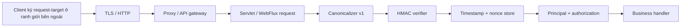
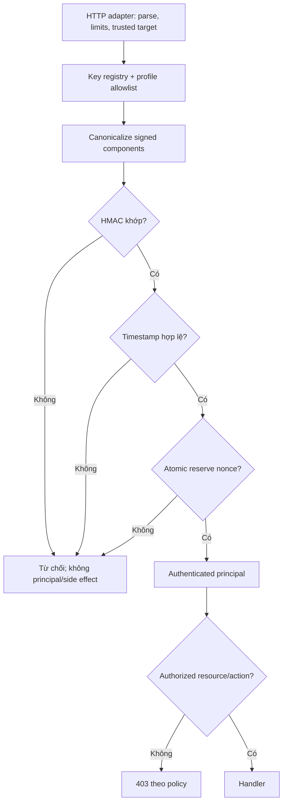

# Canonicalize HTTP request — Dự án thực hành xây hợp đồng ký HMAC có thể kiểm chứng

## 1. Bối cảnh và mục tiêu dự án

Trong module **SECURITY_AUTHENTICATION_HMAC_REQUEST_AUTHENTICATION**, client và server sử dụng một **shared secret** để xác thực HTTP request bằng HMAC. Chữ ký được tính trên một **canonical request** — biểu diễn byte xác định của method, URI, những header được chọn và body hoặc body digest. Timestamp/nonce giúp chống replay, key rotation quản lý vòng đời secret, còn kiểm tra quyền là trách nhiệm của tầng authorization sau khi xác thực.

Vấn đề thực tế là một HTTP request có thể có nhiều cách biểu diễn tương đương hoặc không tương đương: `/a%2Fb` và `/a/b`, chữ hoa/chữ thường tên header, nhiều query parameter cùng tên, body JSON được serialize khác nhau, hoặc gateway tự động thay đổi path prefix. Nếu client và server không có **hợp đồng canonicalization chính xác tới byte**, hai hậu quả đều có thể xảy ra:

- **False rejection:** request hợp lệ bị từ chối vì hai phía băm dữ liệu khác nhau.
- **False acceptance:** request bị đổi ở một field có ý nghĩa bảo mật nhưng chữ ký vẫn hợp lệ vì field đó không được ký hoặc bị chuẩn hóa không đúng với route thực thi.

**Đề bài thực hành:** Thiết kế và viết một bộ canonicalization cho HTTP request, tạo chữ ký HMAC-SHA256 từ canonical bytes, viết test chứng minh các thành phần được ký đều ảnh hưởng tới chữ ký, rồi kiểm tra tích hợp với Spring Security và gateway. Không triển khai thêm một API xác thực khác ngoài phạm vi bài.

### Sản phẩm cần nộp

| Sản phẩm | Yêu cầu quan sát được |
| --- | --- |
| Signature profile | Ghi rõ field ký, thứ tự, ký tự phân cách, charset, URI và header policy |
| Canonicalizer Java 17 | Cùng request hợp lệ luôn tạo cùng canonical bytes; input mơ hồ bị từ chối |
| Signer/verifier | HMAC-SHA256, signature Base64url không padding và so sánh MAC đúng cách |
| Bộ JUnit 5 | Positive, golden vector và negative test đổi từng trường được ký |
| HTTP integration test | Tách lỗi HMAC, timestamp, nonce, key policy và authorization |
| Gateway contract test | Kiểm chứng request-target/header/body không bị diễn giải lệch khi qua proxy |
| Tài liệu vận hành | Lưu ý về key rotation, replay store, log an toàn và giới hạn của mã mẫu |

Bài tập có thể được dùng như một dự án nhỏ độc lập hoặc phần nền cho `OncePerRequestFilter` trong Spring MVC / `WebFilter` trong Spring WebFlux. Các ví dụ dưới đây **không phải triển khai HMAC authentication production-ready**: chúng minh họa canonical bytes và phần xác minh chữ ký, không cung cấp toàn bộ quản trị credential, HTTP parser, clock policy hay replay store.

## 2. Phân tích yêu cầu bảo mật trước khi viết code

Xét API tạo đơn hàng:

```http
POST /v1/orders?customer=a%2Fb HTTP/1.1
Host: api.example.test
Content-Type: application/json
X-Tenant-Id: tenant-a
X-HMAC-Version: hmac-v1
X-Key-Id: partner-42-key-a
X-Timestamp: 1795800000
X-Nonce: nonce-4f0b92ec47a1
X-Signature: <base64url-no-padding>

{"sku":"A1","quantity":2}
```

Đây chỉ là request minh họa: timestamp cố định không được sử dụng để vượt qua kiểm tra freshness thật và chữ ký trong dấu `<...>` chưa được tính.

Các câu hỏi thiết kế:

1. Nếu thay `POST` thành `DELETE`, chữ ký phải thất bại hay không? **Có**, method xác định hành động.
2. Nếu thay `/v1/orders` bằng `/v1/payments`, chữ ký có được giữ nguyên không? **Không**, path là đích nghiệp vụ.
3. Nếu thay `customer=a%2Fb` thành `customer=a/b`, có được coi tương đương không? Với profile **ký raw request-target** trong bài: **không**.
4. Nếu thay `X-Tenant-Id` thành `tenant-b`, chuyện gì xảy ra? Chữ ký phải không còn khớp; sau xác thực vẫn phải kiểm tra tenant ownership.
5. Nếu thay body thành `{"sku":"A1","quantity":9}` thì sao? Digest khác nên MAC khác.
6. Nếu gateway thêm `Traceparent`, chữ ký có nhất thiết thay đổi? **Không**, nếu trường trace hoàn toàn không quyết định quyền hoặc nghiệp vụ và contract không ký nó.
7. Nếu timestamp và nonce được ký, hệ thống đã chống replay chưa? **Chưa**; phải kiểm tra cửa sổ thời gian và reserve nonce nguyên tử trong store dùng chung.
8. Nếu HMAC đúng thì người gửi có quyền tạo đơn cho mọi tenant không? **Không**; authorization phải kiểm tra phạm vi của principal.

### Threat model tối thiểu

| Tác nhân / ranh giới | Nguy cơ | Kiểm soát của bài |
| --- | --- | --- |
| Request bị sửa giữa lúc ký và lúc verify | Đổi path/query/body/tenant làm sai ý nghĩa | Ký mọi thành phần có ý nghĩa bảo mật |
| Proxy hoặc framework | Decode path, thay query order, gộp header | Hợp đồng raw target và header, gateway integration test |
| Client dùng credential không thuộc tenant | Cross-tenant request | Key registry scope + ký tenant + authorization |
| Kẻ tấn công có một request đã ký | Replay request cũ | Timestamp đã ký + nonce đã ký + atomic replay store |
| Client hoặc secret bị compromise | Tạo request mới với HMAC đúng | Key revoke/rotation, phân quyền và giám sát; MAC không tự ngăn |
| Nhiều signature profile | Downgrade, thử nhiều thuật toán/keys | Version được ký, allowlist profile, không fallback |

**Mục tiêu cụ thể** ở bước canonicalizer là xác định **chính xác dữ liệu được đưa vào MAC**. Chống replay, cấp quyền, rate limiting và bảo vệ secret là yêu cầu tích hợp độc lập.

## 3. Chốt signature profile trước khi code

Hợp đồng minh họa đặt tên `hmac-v1`. Tên version này có ý nghĩa **chỉ trong dự án mẫu**. Nếu dự án thực đã dùng `v1` theo cách khác, phải đặt một profile mới; không sửa nghĩa của một version đã phát hành.

### 3.1. Danh sách thành phần ký

| Thứ tự dòng | Nội dung canonical | Quy tắc |
| --- | --- | --- |
| 1 | `HMAC-REQUEST` | Domain separator cố định |
| 2 | `hmac-v1` | Signature profile cố định, phân biệt hoa/thường |
| 3 | `keyId` | ASCII, 1–64 ký tự trong tập cho phép |
| 4 | `METHOD` | Token viết hoa, độ dài 1–16 |
| 5 | `authority` | Host tin cậy đã canonicalize; demo cho hai host cụ thể |
| 6 | `rawRequestTarget` | Origin-form path kèm query nếu có; không có fragment |
| 7 | `content-type:<value>` | Tên header chữ thường, value theo danh sách cho phép |
| 8 | `x-tenant-id:<value>` | Tên header chữ thường, tenant ID theo grammar |
| 9 | `timestamp` | Epoch **seconds**, chuỗi thập phân canonical không có số 0 thừa |
| 10 | `nonce` | ASCII 16–64 ký tự, đã ràng buộc bằng HMAC |
| 11 | `bodySha256` | 64 chữ số hexadecimal chữ thường của SHA-256(body bytes) |

**Chuỗi chuẩn:** 11 dòng UTF-8, nối với một ký tự LF `\n` giữa hai dòng, **không có LF cuối**. Không dùng `System.lineSeparator()` hoặc ký trực tiếp bản hiển thị JSON/HTTP. HMAC dùng `HmacSHA256` và secret riêng cho client/profile; output đầy đủ 32 byte, biểu diễn Base64url **không padding** trên wire.

### 3.2. Canonical request minh họa

```text
HMAC-REQUEST
hmac-v1
partner-42-key-a
POST
api.example.test
/v1/orders?customer=a%2Fb
content-type:application/json
x-tenant-id:tenant-a
1795800000
nonce-4f0b92ec47a1
<lowercase-hex-SHA256-of-raw-body>
```

Chuỗi trên chỉ là **mẫu cấu trúc**, vì dòng cuối là placeholder. Trong test sẽ có canonical string hoàn chỉnh với SHA-256 của body rỗng hoặc body đã biết.

### 3.3. Những quyết định có chủ đích

- **Raw origin-form target:** giữ nguyên path/query theo biểu diễn đã được thỏa thuận, ví dụ `/v1/orders?customer=a%2Fb`. Không âm thầm percent-decode, decode slash, sort query hay bỏ query.
- **Authority:** demo chỉ chấp nhận `api.example.test` và `api-backup.example.test`, không có port. Hệ thống thật phải quy định host/port, virtual host/tenant và nguồn dữ liệu tin cậy.
- **Signed headers:** chỉ ký `Content-Type` và `X-Tenant-Id` trong bài. Cả hai bắt buộc hiện diện đúng một lần, không nhận duplicate theo cách viết hoa/thường khác nhau.
- **Content-Type:** chỉ dùng `application/json` hoặc `application/octet-stream` không tham số để test hành vi signed header. Không mặc định mọi API sản xuất phải giới hạn hai loại đó.
- **Body:** SHA-256 của body bytes sau HTTP transfer framing và **trước** bất kỳ deserialize/serialize, JSON reformat hoặc giải nén nào do thành phần ứng dụng thực hiện. Nếu gateway giải nén trước verifier, hai bên phải chọn lại điểm lấy bytes hoặc phiên bản hợp đồng.
- **Key scope:** ký key ID, nhưng server **vẫn** phải tra secret theo chủ thể/tenant/profile và trạng thái credential do server quản lý.
- **Header trace:** không ký khi chỉ phục vụ observability. Nếu về sau header được dùng để quyết định xử lý, phải đánh giá lại signature profile.

### 3.4. Kỹ thuật chống nhập nhằng chuỗi

Nối dòng bằng LF chỉ an toàn nếu các field không thể lén chứa LF/CR và có grammar xác định. Vì thế bài mẫu từ chối các giá trị không hợp lệ ngay tại canonicalization.

Không cho phép một bên ký chuỗi `Content-Type` đã trim còn bên kia ký chuỗi gốc; không cho phép một node lấy tham số query đầu tiên còn node khác lấy tham số cuối cùng. Nếu muốn canonicalize query theo thứ tự tham số hoặc ký một tập header có đa giá trị, phải viết **đặc tả serialization có thể kiểm chứng độc lập** trước khi triển khai.

## 4. Ranh giới HTTP parser và gateway

Một hệ thống có thể có nhiều lớp nhìn thấy các biểu diễn URI khác nhau:



Các trường hợp phải phân tích:

- `/v1/orders/a%2Fb` và `/v1/orders/a/b` có thể được router hiểu khác sau decode. Với raw-target profile, đây là **hai giá trị ký khác nhau**.
- `/orders?a=1&b=2` và `/orders?b=2&a=1` là hai chuỗi ký khác nhau; kể cả khi nghiệp vụ coi cùng nghĩa, **contract này không sort query**.
- `/orders?id=1&id=2` phải giữ nguyên duplicate query trong raw target; lớp nghiệp vụ phải có chính sách parse rõ ràng.
- `Host` HTTP/1.1 và `:authority` HTTP/2 cần ánh xạ về một authority đã được nguồn đáng tin cậy xác nhận, không lấy tùy ý từ `X-Forwarded-Host` do client gửi.
- HTTP field names không phân biệt hoa/thường. Nếu có cả `Content-Type` và `content-type`, parser phải báo **duplicate**; không cho gateway và backend chọn hai giá trị khác nhau.
- Header `X-Original-URI` / `Forwarded` do client tự gửi không phải bằng chứng đáng tin cậy về URI ngoài. Nếu gateway cần truyền URI ban đầu cho verifier, gateway phải strip mọi header cùng tên từ client, tự tạo lại và bảo vệ tuyến nội bộ.
- Với body `gzip`, streaming, multipart hoặc binary, phải xác định byte nào được băm. Ký JSON object sau khi parse không tương đương ký raw body bytes.

**Giới hạn rõ ràng của mã Java ở phần 6:** Nó nhận một object chứa `rawTarget` và `headers` đã được HTTP adapter trích xuất đúng. Mã không chứng minh HTTP server có thể truy cập raw wire bytes đã đi qua gateway; bước đó đòi hỏi kiểm thử với HTTP stack và proxy thật.

## 5. Chuẩn bị cấu trúc dự án và quy trình thực hiện

Một cách tổ chức dự án thực hành đề xuất (chỉ là cấu trúc gợi ý, **không phải các file được tạo sẵn**):

```text
hmac-canonical-practice/
  src/main/java/example/security/
    CanonicalHttpRequest.java
    HmacAuthenticationFilter.java     # Bài mở rộng
    CredentialRegistry.java            # Bài mở rộng
    NonceStore.java                    # Bài mở rộng
  src/test/java/example/security/
    CanonicalHttpRequestTest.java
    HttpGatewayContractTest.java       # Bài mở rộng
  docs/
    signature-profile-v1.md            # Bài mở rộng
    test-vectors.json                  # Bài mở rộng
```

Trình tự triển khai khuyến nghị:

1. **Viết test vector cho canonical string** khi chưa triển khai HMAC, để tránh trộn lỗi canonicalization với lỗi crypto.
2. Cài đặt validation đối với input mơ hồ: signed header duplicate/missing, percent-encoding hỏng, CR/LF, version không biết, timestamp overflow.
3. Xây hàm tạo canonical string và HMAC signer/verifier với key fixture.
4. Viết property/mutation test: đổi duy nhất một field đã ký và xác nhận chữ ký cũ không còn được chấp nhận.
5. Gắn vào HTTP adapter; đảm bảo body bytes và raw target có cùng ý nghĩa với phần sẽ đi vào business handler.
6. Kết hợp key registry, timestamp/nonce, authorization và test xuyên gateway.
7. Tài liệu hóa giới hạn, hợp đồng migration và cách xử lý lỗi an toàn.

Không nên đẩy code thẳng vào Spring Security filter trước khi canonical contract đã có golden vectors ổn định.

## 6. Java 17: canonicalizer và HMAC signer/verifier tham chiếu

Lớp sau chỉ dùng Java 17 standard library. Nó gồm validation cho **profile minh họa**, hàm tạo chuỗi chuẩn, ký HMAC-SHA256 và verify Base64url không padding. Bản triển khai thật phải giới hạn kích thước ở **HTTP parser trước khi dựng object**, kiểm tra key có quyền theo client/tenant, và xử lý timestamp/nonce/authorization ở tầng riêng.

```java
import javax.crypto.Mac;
import javax.crypto.spec.SecretKeySpec;
import java.nio.charset.StandardCharsets;
import java.security.GeneralSecurityException;
import java.security.MessageDigest;
import java.util.Base64;
import java.util.HexFormat;
import java.util.List;
import java.util.Map;
import java.util.Set;

public final class CanonicalHttpRequest {
    private CanonicalHttpRequest() {}

    public record Request(
            String version,
            String keyId,
            String method,
            String authority,
            String rawTarget,
            Map<String, List<String>> headers,
            String timestamp,
            String nonce,
            byte[] body) {}

    private static final Set<String> AUTHORITIES =
            Set.of("api.example.test", "api-backup.example.test");
    private static final Set<String> CONTENT_TYPES =
            Set.of("application/json", "application/octet-stream");

    private static boolean hexDigit(char c) {
        return (c >= '0' && c <= '9')
                || (c >= 'a' && c <= 'f')
                || (c >= 'A' && c <= 'F');
    }

    private static void validateRawTarget(String target) {
        if (target == null || target.length() > 2048
                || !target.startsWith("/")) {
            throw new IllegalArgumentException("Invalid request-target");
        }
        // Demo: chấp nhận origin-form ASCII hiển thị không có fragment
        // hoặc backslash. Mọi percent-escape phải đủ hai hex digits.
        for (int i = 0; i < target.length(); i++) {
            char c = target.charAt(i);
            if (c <= 0x20 || c >= 0x7f || c == '#' || c == '\\') {
                throw new IllegalArgumentException("Invalid request-target");
            }
            if (c == '%') {
                if (i + 2 >= target.length()
                        || !hexDigit(target.charAt(i + 1))
                        || !hexDigit(target.charAt(i + 2))) {
                    throw new IllegalArgumentException("Bad percent-escape");
                }
                i += 2;
            }
        }
    }

    // Nhận cấu trúc header GIỮ ĐƯỢC duplicate từ HTTP adapter.
    // Không dùng Map<String,String> đã gộp giá trị ở một tầng trước.
    private static String uniqueSignedHeader(
            Map<String, List<String>> headers, String expectedName) {
        if (headers == null) {
            throw new IllegalArgumentException("Missing headers");
        }
        String found = null;
        for (var entry : headers.entrySet()) {
            String name = entry.getKey();
            if (name != null && name.equalsIgnoreCase(expectedName)) {
                List<String> values = entry.getValue();
                if (found != null || values == null || values.size() != 1
                        || values.get(0) == null) {
                    throw new IllegalArgumentException(
                            "Duplicate or malformed signed header");
                }
                found = values.get(0);
            }
        }
        if (found == null) {
            throw new IllegalArgumentException("Missing signed header");
        }
        return found;
    }

    private static void validate(Request r) {
        if (r == null
                || !"hmac-v1".equals(r.version())
                || r.keyId() == null
                || !r.keyId().matches("[A-Za-z0-9._-]{1,64}")
                || r.method() == null
                || !r.method().matches("[A-Z]{1,16}")
                || !AUTHORITIES.contains(r.authority())
                || r.timestamp() == null
                || !r.timestamp().matches("[1-9][0-9]{0,18}")
                || r.nonce() == null
                || !r.nonce().matches("[A-Za-z0-9_-]{16,64}")
                || r.body() == null || r.body().length > 1024 * 1024) {
            throw new IllegalArgumentException("Invalid signed fields");
        }
        try {
            Long.parseLong(r.timestamp());
        } catch (NumberFormatException overflow) {
            throw new IllegalArgumentException("Timestamp overflow", overflow);
        }
        validateRawTarget(r.rawTarget());

        String contentType =
                uniqueSignedHeader(r.headers(), "content-type");
        String tenant =
                uniqueSignedHeader(r.headers(), "x-tenant-id");
        if (!CONTENT_TYPES.contains(contentType)
                || !tenant.matches("[a-z0-9-]{1,32}")) {
            throw new IllegalArgumentException("Invalid signed headers");
        }
    }

    public static String canonical(Request r)
            throws GeneralSecurityException {
        validate(r);
        String contentType =
                uniqueSignedHeader(r.headers(), "content-type");
        String tenant =
                uniqueSignedHeader(r.headers(), "x-tenant-id");
        String bodyHash = HexFormat.of().formatHex(
                MessageDigest.getInstance("SHA-256").digest(r.body()));

        return String.join("\n",
                "HMAC-REQUEST",
                r.version(),
                r.keyId(),
                r.method(),
                r.authority(),
                r.rawTarget(),
                "content-type:" + contentType,
                "x-tenant-id:" + tenant,
                r.timestamp(),
                r.nonce(),
                bodyHash);
    }

    private static byte[] mac(byte[] secret, Request r)
            throws GeneralSecurityException {
        if (secret == null || secret.length < 32) {
            throw new IllegalArgumentException("Invalid secret length");
        }
        Mac engine = Mac.getInstance("HmacSHA256");
        engine.init(new SecretKeySpec(secret, "HmacSHA256"));
        return engine.doFinal(
                canonical(r).getBytes(StandardCharsets.UTF_8));
    }

    public static String sign(byte[] secret, Request r)
            throws GeneralSecurityException {
        return Base64.getUrlEncoder().withoutPadding()
                .encodeToString(mac(secret, r));
    }

    public static boolean verify(
            byte[] secret, Request r, String wireSignature)
            throws GeneralSecurityException {
        if (wireSignature == null || wireSignature.length() > 128) {
            return false;
        }
        final byte[] supplied;
        try {
            supplied = Base64.getUrlDecoder().decode(wireSignature);
        } catch (IllegalArgumentException malformed) {
            return false;
        }
        if (supplied.length != 32
                || !Base64.getUrlEncoder().withoutPadding()
                        .encodeToString(supplied).equals(wireSignature)) {
            return false;
        }
        return MessageDigest.isEqual(mac(secret, r), supplied);
    }
}
```

### Ý nghĩa của các quyết định trong code

- Hàm `canonical()` dựng đúng **11 dòng**, không phụ thuộc thứ tự lặp của `Map` bởi vì nó đọc riêng hai header đã chọn và ghi chúng theo thứ tự cố định.
- `uniqueSignedHeader()` nhận biết `Content-Type` và `content-type` là **cùng tên**. Nếu cả hai có mặt hoặc một tên có nhiều giá trị, phải từ chối; code không tự chọn một giá trị.
- `validateRawTarget()` từ chối percent-encoding sai cú pháp, control characters, fragment và backslash theo policy demo, nhưng **không thực hiện routing hoặc path normalization**.
- `bodyHash` tính trên byte[] được cung cấp. Một HTTP adapter production phải bảo đảm đó là **đúng body bytes mà handler sẽ xử lý**, không phải một bản đã tự serialize lại.
- `version` và `keyId` là dữ liệu ký; chúng vẫn phải được đối chiếu với key registry và **server-side allowed profile policy**.
- Base64url được kiểm tra cả độ dài decoded tag và dạng biểu diễn không padding. `MessageDigest.isEqual` được sử dụng để so sánh byte MAC sau khi kiểm tra độ dài.

**Giới hạn cần nói rõ:** kiểm tra `secret.length >= 32` chỉ xác nhận **độ dài**, không bảo đảm entropy hay việc secret có bị lộ. Trong production, secret nên là byte ngẫu nhiên sinh bởi CSPRNG và quản lý qua secret manager. `Request.body` và `Request.headers` có thể bị mutate nếu người gọi tái sử dụng object mutable; phải tạo snapshot bất biến hoặc tính digest trong một chu trình kiểm soát trước khi ký/xác minh. Các lỗi validation trong code ném `IllegalArgumentException`: HTTP filter production phải bắt và ánh xạ thành phản hồi từ chối an toàn, **không để thành lỗi 500 hoặc bỏ qua auth**.

## 7. JUnit 5: golden string, mutation test và parser rejection

Test sử dụng lớp `CanonicalHttpRequest` ở mục 6. Test fixture có timestamp cố định để chứng minh **cryptographic binding**, không phải đánh giá freshness. Các test qua HTTP stack phải dùng thời điểm hợp lệ và nonce mới.

```java
import org.junit.jupiter.api.Test;

import java.nio.charset.StandardCharsets;
import java.security.GeneralSecurityException;
import java.util.List;
import java.util.Map;

import static org.junit.jupiter.api.Assertions.assertEquals;
import static org.junit.jupiter.api.Assertions.assertFalse;
import static org.junit.jupiter.api.Assertions.assertThrows;
import static org.junit.jupiter.api.Assertions.assertTrue;

class CanonicalHttpRequestTest {
    private static final byte[] TEST_SECRET =
            "test-only-canonical-hmac-secret-very-long"
                    .getBytes(StandardCharsets.UTF_8);

    private static byte[] bytes(String text) {
        return text.getBytes(StandardCharsets.UTF_8);
    }

    private static Map<String, List<String>> signedHeaders() {
        return Map.of(
                "Content-Type", List.of("application/json"),
                "X-Tenant-Id", List.of("tenant-a"));
    }

    private static CanonicalHttpRequest.Request request(
            String target, String authority, Map<String, List<String>> headers,
            byte[] body, String nonce) {
        return new CanonicalHttpRequest.Request(
                "hmac-v1", "partner-42-key-a", "POST", authority,
                target, headers, "1795800000", nonce, body);
    }

    private static CanonicalHttpRequest.Request baseline() {
        return request(
                "/v1/orders?customer=a%2Fb",
                "api.example.test",
                signedHeaders(),
                bytes("{\"sku\":\"A1\",\"quantity\":2}"),
                "nonce-4f0b92ec47a1");
    }

    @Test
    void goldenCanonicalStringForEmptyBodyHasElevenLines()
            throws GeneralSecurityException {
        var emptyBody = request(
                "/v1/orders?customer=a%2Fb", "api.example.test",
                signedHeaders(), new byte[0], "nonce-4f0b92ec47a1");

        // SHA-256(empty bytes) là giá trị đã biết, không do signer tự suy.
        String expected = String.join("\n",
                "HMAC-REQUEST", "hmac-v1", "partner-42-key-a",
                "POST", "api.example.test",
                "/v1/orders?customer=a%2Fb",
                "content-type:application/json",
                "x-tenant-id:tenant-a",
                "1795800000", "nonce-4f0b92ec47a1",
                "e3b0c44298fc1c149afbf4c8996fb924"
                        + "27ae41e4649b934ca495991b7852b855");

        assertEquals(expected, CanonicalHttpRequest.canonical(emptyBody));
    }

    @Test
    void stableSignatureRegardlessOfHeaderNameCase()
            throws GeneralSecurityException {
        var original = baseline();
        String signature = CanonicalHttpRequest.sign(TEST_SECRET, original);

        var lowerCaseHeaders = request(
                original.rawTarget(), original.authority(),
                Map.of("content-type", List.of("application/json"),
                       "x-tenant-id", List.of("tenant-a")),
                original.body(), original.nonce());

        assertTrue(CanonicalHttpRequest.verify(
                TEST_SECRET, original, signature));
        assertTrue(CanonicalHttpRequest.verify(
                TEST_SECRET, lowerCaseHeaders, signature));
    }

    @Test
    void changingTargetAuthorityOrBodyInvalidatesSignature()
            throws GeneralSecurityException {
        var r = baseline();
        String signature = CanonicalHttpRequest.sign(TEST_SECRET, r);

        assertFalse(CanonicalHttpRequest.verify(TEST_SECRET,
                request("/v1/orders?customer=a/b", r.authority(),
                        r.headers(), r.body(), r.nonce()),
                signature));

        assertFalse(CanonicalHttpRequest.verify(TEST_SECRET,
                request(r.rawTarget(), "api-backup.example.test",
                        r.headers(), r.body(), r.nonce()),
                signature));

        assertFalse(CanonicalHttpRequest.verify(TEST_SECRET,
                request(r.rawTarget(), r.authority(),
                        r.headers(), bytes("{\"sku\":\"A1\",\"quantity\":9}"),
                        r.nonce()),
                signature));
    }

    @Test
    void changingSignedHeaderOrNonceInvalidatesSignature()
            throws GeneralSecurityException {
        var r = baseline();
        String signature = CanonicalHttpRequest.sign(TEST_SECRET, r);

        var otherTenant = Map.of(
                "Content-Type", List.of("application/json"),
                "X-Tenant-Id", List.of("tenant-b"));
        assertFalse(CanonicalHttpRequest.verify(TEST_SECRET,
                request(r.rawTarget(), r.authority(),
                        otherTenant, r.body(), r.nonce()),
                signature));

        var otherContentType = Map.of(
                "Content-Type", List.of("application/octet-stream"),
                "X-Tenant-Id", List.of("tenant-a"));
        assertFalse(CanonicalHttpRequest.verify(TEST_SECRET,
                request(r.rawTarget(), r.authority(),
                        otherContentType, r.body(), r.nonce()),
                signature));

        assertFalse(CanonicalHttpRequest.verify(TEST_SECRET,
                request(r.rawTarget(), r.authority(),
                        r.headers(), r.body(), "nonce-4f0b92ec47a2"),
                signature));
    }

    @Test
    void rejectsDuplicateHeadersAndMalformedPercentEscape() {
        var r = baseline();
        var duplicate = Map.of(
                "Content-Type", List.of("application/json"),
                "content-type", List.of("application/octet-stream"),
                "X-Tenant-Id", List.of("tenant-a"));

        assertThrows(IllegalArgumentException.class,
                () -> CanonicalHttpRequest.canonical(
                        request(r.rawTarget(), r.authority(),
                                duplicate, r.body(), r.nonce())));

        assertThrows(IllegalArgumentException.class,
                () -> CanonicalHttpRequest.canonical(
                        request("/v1/orders?name=%XZ", r.authority(),
                                r.headers(), r.body(), r.nonce())));
    }
}
```

### Tại sao cần cả golden test và mutation test?

- **Golden test** ở trên chốt canonical string có 11 dòng, tên header chữ thường, thứ tự, ký tự xuống dòng và digest body rỗng. Nó giảm rủi ro thay đổi schema vô ý.
- **Mutation test** chứng minh một chữ ký tạo cho request A không thể dùng lại ở request B khi **một field đã ký** thay đổi.
- **Parser rejection test** chứng minh input mơ hồ không được “tùy tiện sửa cho đúng” trước khi MAC được tính.

Tuy nhiên, signer và verifier trong ví dụ dùng **cùng hàm canonical()**, nên cả hai có thể cùng mắc lỗi. Dự án nên có một bộ **golden signature vectors độc lập** được tạo bởi một implementation thứ hai hoặc một đặc tả đối chiếu độc lập, gồm canonical bytes, secret fixture, expected 32-byte MAC và Base64url; không coi test ký rồi tự verify là đủ chứng minh tính tương tác giữa các hệ thống.

## 8. Trường hợp biên cần thêm vào bộ test

### Path và query

| Đầu vào A / B | Kỳ vọng theo raw-target profile |
| --- | --- |
| `/a%2Fb` / `/a/b` | Khác canonical bytes, không dùng lại chữ ký |
| `/orders` / `/orders/` | Khác |
| `/orders?x=1&y=2` / `/orders?y=2&x=1` | Khác |
| `/orders?id=1&id=2` / `/orders?id=2&id=1` | Khác |
| `/%7Euser` / `/~user` | Khác nếu raw bytes khác |
| `/orders?` / `/orders` | Khác theo contract raw origin-form; bảo đảm HTTP stack giữ được khác biệt |
| `/orders?name=%ZZ` | Parser reject: percent escape sai |
| `/orders?name=a%20b` / `/orders?name=a+b` | Khác theo raw-target contract |
| `/a/../b` / `/b` | Phải kiểm tra routing và chính sách normalize; demo ký khác nhưng không bảo đảm backend xử lý khác |

### Header và body

| Biến thể | Kỳ vọng |
| --- | --- |
| `Content-Type` đổi tên thành `content-type`, cùng value | Cùng canonical request |
| Có cả `Content-Type` và `content-type` | Từ chối duplicate |
| Header `X-Tenant-Id` bị đổi value | MAC mismatch |
| Header `X-Trace-Id` do proxy thêm | Không ảnh hưởng MAC nếu không nằm trong profile ký |
| JSON cùng nghĩa, khác whitespace | MAC mismatch khi ký raw body bytes |
| Body rỗng | SHA-256 của zero-length bytes |
| Body gzip trước/sau giải nén | Digest khác; chỉ một boundary được chấp nhận |
| Body có bytes UTF-8 tiếng Việt | Digest tính trên **bytes**, không tự Unicode-normalize |
| Body vượt giới hạn | Từ chối sớm theo HTTP/resource policy, không giữ vô hạn trong RAM |

### Key, timestamp, nonce và signature

- Version thiếu hoặc khác `hmac-v1`: từ chối theo profile, không thử thuật toán khác.
- Key ID khác nhưng giữ chữ ký: không còn ràng buộc; server không được fallback sang key cũ.
- Timestamp thay đổi sau khi ký: MAC phải sai; timestamp quá cũ còn có thể bị chặn trước bước này theo policy.
- Nonce khác nhưng giữ chữ ký: MAC phải sai; nonce đã dùng với chữ ký đúng phải bị replay store chặn.
- Signature Base64url sai, có padding không hợp đồng hoặc decode không đúng 32 byte: từ chối có kiểm soát.
- Hai request cùng nonce trên hai node: chỉ một thao tác reserve nonce có thể thành công nếu scope giống nhau.
- Key đã `REVOKED` nhưng ký đúng: từ chối bởi key policy, không tạo principal.

## 9. Tích hợp Spring MVC/WebFlux: không để canonicalizer tự thành bộ xác thực

Trong Spring MVC, có thể đặt logic ở `OncePerRequestFilter`; trong WebFlux dùng `WebFilter`. Cần tách ba khối:

1. **HTTP adapter:** parse request, kiểm tra duplicate, lựa chọn raw target/authority tin cậy, bảo toàn body bytes và giới hạn kích thước.
2. **Cryptographic verifier:** canonicalize đúng profile, chọn key từ registry theo client/tenant, tính HMAC và so sánh signature.
3. **Authentication orchestration:** timestamp freshness, reserve nonce nguyên tử, tạo principal, tiếp tục qua authorization và chỉ sau đó thực thi handler.



**Không đọc body hai lần theo hai bản khác nhau.** Với request body streaming, hoặc tính digest trong khi đọc và cung cấp lại đúng bytes cho downstream, hoặc dùng cơ chế cache/spool có giới hạn. HMAC không bảo vệ payload nghiệp vụ nếu verifier băm body A nhưng handler xử lý body B do reserialization hoặc middleware thay đổi.

**Không tin identity header từ client.** Nếu gateway verify HMAC rồi truyền principal đến backend, gateway cần xóa các header nhận dạng tương ứng từ client và chỉ truyền danh tính qua kênh nội bộ đáng tin cậy. Backend phải có policy chặn đường bypass gateway hoặc tự kiểm tra lại xác thực.

**Không biến lỗi parsing thành 500.** Một input có `%ZZ`, duplicate header hoặc signature quá dài phải bị từ chối an toàn, có reason code trong audit nội bộ, không tiết lộ secret/key status qua thông báo công khai.

## 10. Kiểm thử qua gateway và proxy

Mock MVC/WebFlux có thể normalize header và URI trước khi filter nhận được. Vì vậy cần kiểm thử qua **HTTP server và gateway thật** đối với các byte có thể bị biến đổi.

| Ca kiểm thử gateway | Bằng chứng cần thu |
| --- | --- |
| Public path `/api/v1/orders` được strip prefix | Verifier ký đúng target đã chọn trong contract |
| `%2F`, `%2E`, slash kép, trailing slash | Client, gateway, backend thống nhất hoặc từ chối có chủ đích |
| Query duplicate và query order | Không có tầng tự sort/merge ngoài hợp đồng |
| HTTP/1.1 `Host` và HTTP/2 `:authority` | Authority có cùng quy tắc canonical |
| Header `Content-Type` viết khác case | Cùng canonical value |
| Header `Content-Type` duplicate khác case | Bị từ chối trước MAC |
| Proxy thêm `Traceparent` | Không làm sai signature vì trường này không được ký |
| Client tự gửi `X-Original-URI` | Không thể giả mạo target tin cậy |
| Gateway giải nén `gzip` | Body digest được tính tại đúng boundary được công bố |
| Backend được gọi thẳng, bỏ qua gateway | Bị chặn hoặc tự verify theo policy |
| Nhiều node/region trong rolling deploy | Cùng test vectors, không có node nhận profile cũ sai chính sách |
| Rewrite target sau khi verify tại gateway | Backend xử lý đúng route đã được gắn với principal/authorization |

Không nên thu raw shared secret, chữ ký hoặc body nhạy cảm vào log để debug. Test environment có thể dùng test hook để xem canonical bytes của **dữ liệu giả**, kèm request ID và revision gateway; production nên chỉ ghi reason code, profile, key ID đã kiểm soát, route template và metrics cần thiết.

## 11. Đánh giá bài thực hành theo milestone

| Milestone | Bằng chứng hoàn thành | Lỗi thường gặp |
| --- | --- | --- |
| M1 — Chốt contract | Có tài liệu 11 dòng, encoding, URI/header/body policy | Dùng “ký URI” nhưng không nói raw hay normalized |
| M2 — Viết canonicalizer | Input hợp lệ sinh deterministic string; malformed bị reject | Dùng `Map<String,String>` làm mất duplicate |
| M3 — Ký và verify | MAC 32 byte, Base64url không padding, constant-time compare | So sánh chuỗi signature tùy tiện, chấp nhận MAC rút gọn |
| M4 — Golden test | Expected canonical bytes độc lập và một bộ vector ngoại vi | Chỉ sign rồi tự verify bằng cùng code |
| M5 — Mutation tests | Sửa method/target/tenant/header/body/timestamp/nonce phải không dùng lại MAC | Test thất bại do nonce cũ, không do field ký |
| M6 — HTTP integration | HTTP parser + key registry + freshness + nonce + authorization đúng thứ tự | Tạo principal trước khi anti-replay hoàn tất |
| M7 — Gateway contract | Request thật qua proxy khớp profile; path rewrite rõ ràng | Tin `X-Original-URI` từ client |
| M8 — Vận hành | Revoke key, metric phân loại lỗi, test no-side-effect | Chỉ đổi key ID mà không rotate secret |

### Điều kiện chấp nhận cuối

Một bài đạt yêu cầu khi:

- Có **một hợp đồng byte-level duy nhất** cho profile được sử dụng, không phụ thuộc kết quả may rủi của HTTP framework.
- Chuỗi canonical có thể so sánh với golden vector, và mỗi field được ký có test mutation riêng.
- Không có cách **thử nhiều canonical biến thể/secret/thuật toán** để tìm chữ ký khớp.
- Raw request-target được hiểu thống nhất qua gateway và routing; không dùng header forward do client đặt làm nguồn đáng tin.
- Header duplicate và input sai encoding bị từ chối có kiểm soát.
- Body digest bảo vệ đúng bytes sẽ được xử lý, kể cả JSON, binary, UTF-8 và body rỗng theo contract.
- Key ID, version, timestamp và nonce nằm trong chuỗi ký, đồng thời key policy, freshness và replay reservation được kiểm tra riêng.
- Request đã xác thực vẫn qua authorization; mọi authentication failure không gọi business handler.
- Có kế hoạch key rotation, version migration và logging an toàn cho production.

## 12. Bài tập mở rộng và câu hỏi phản biện

**Bài tập A — Header có ý nghĩa nghiệp vụ.** Thêm `Idempotency-Key` vào profile mới `hmac-v2`; trình bày lý do cần ký, grammar, duplicate policy, vị trí dòng mới và test chứng minh thay header làm MAC sai. Không sửa nghĩa của `hmac-v1` đã công bố.

**Bài tập B — Query canonicalization.** Thiết kế một profile mới *chủ động* sắp xếp tham số query theo thuật toán công bố. Phải xử lý duplicate name, duplicate value, percent-encoding, `+`, `%20`, empty value và query trống. Viết test vector độc lập và giải thích vì sao không được trộn verifier raw-target v1 với verifier sorted-query mới.

**Bài tập C — Streaming body.** Với upload 100 MB, thay `byte[] body` bằng cơ chế digest streaming có giới hạn. Đảm bảo handler dùng đúng payload đã ký và không xảy ra tình trạng stream bị tiêu thụ trước khi xử lý.

**Bài tập D — Replay store.** Dùng Redis `SET key value NX EX` hoặc một atomic reservation tương đương để chống dùng lại nonce giữa nhiều node. Thiết kế namespace theo principal/tenant, TTL theo freshness window và cách fail-closed. Test hai request đồng thời cùng nonce.

**Bài tập E — Key rotation.** Cấp một key mới có `keyId` khác, dùng shared secret mới và cấu hình policy rõ ràng. Kiểm tra key cũ còn được verify trong cửa sổ rotation bình thường, nhưng phải bị từ chối khi `REVOKED`; đặc biệt không giữ khả năng verify bằng secret đã bị compromise.

**Bài tập F — Threat model proxy.** Giả sử client ký `/public/v1/orders?x=1` và gateway chuyển thành `/internal/orders?x=1`. Thiết kế một trong hai phương án: verify ở gateway **trước rewrite** hoặc backend nhận trusted original target được gateway bảo vệ. Đưa ra test chứng minh một header client tự gửi không thể điều khiển canonical target.

**Câu hỏi tự kiểm tra:** Tại sao ký đủ body nhưng bỏ path vẫn nguy hiểm? Vì sao tên header không phân biệt hoa/thường nhưng value cần quy tắc riêng? Tại sao MAC đúng chưa phải chống replay? Tại sao không dùng `401` đơn độc làm oracle cho test mutation? Nếu client và server cùng dùng một canonicalizer sai, cần bằng chứng độc lập nào để phát hiện?

**Kết luận:** *Canonicalize HTTP request* không phải thao tác nối vài chuỗi rồi gọi HMAC. Đây là quá trình **chuyển HTTP request thành một thông điệp byte-level duy nhất, bao phủ đúng những quyết định bảo mật và có thể tái tạo nhất quán qua client, gateway và backend**. Khi đã làm đúng điều này, chữ ký HMAC mới có ý nghĩa; timestamp/nonce, key rotation và phân quyền tiếp tục hoàn thiện bảo vệ toàn bộ request.
