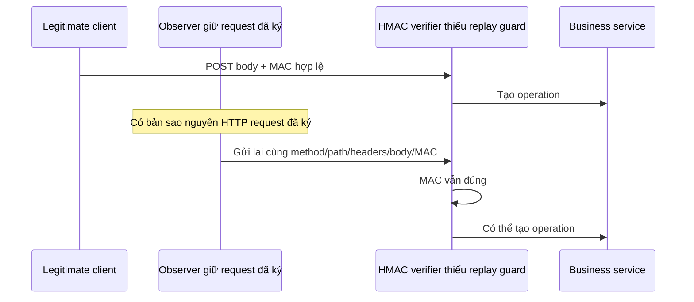
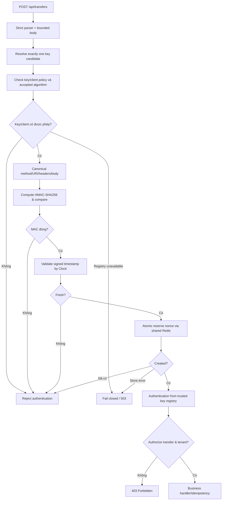

# Dự án thực hành: Thêm timestamp và nonce vào xác thực HTTP HMAC

## 1. Bài toán dự án và kết quả cần bàn giao

Trong module `SECURITY_AUTHENTICATION_HMAC_REQUEST_AUTHENTICATION`, ứng dụng dùng **shared secret** để ký HTTP request bằng HMAC. Client và server phải thống nhất cách tạo **canonical request** từ method, URI/query, các header được ký và/hoặc body. Verifier kiểm MAC, quản lý key/version, xử lý ảnh hưởng proxy/gateway và tạo danh tính để tầng **authorization** xét quyền. Dự án này bổ sung **timestamp và nonce chống replay**, không thay thế bước kiểm chữ ký hoặc phân quyền.

**Tình huống:** Nhóm đã có một API `POST /api/transfers` chỉ kiểm HMAC-SHA256. Người ngoài ghi lại được một HTTP request đã ký thành công (ví dụ qua log bị lộ hoặc đường truyền bị kiểm soát ở một điểm yếu). Khi gửi lại nguyên request, MAC vẫn đúng vì bytes không đổi. Nếu server không quản lý thời gian và nonce, lệnh có thể được xử lý lần nữa.

**Yêu cầu sản phẩm:** Nâng cấp API để mỗi request được chấp nhận phải:

1. Có `X-Hmac-Timestamp` thuộc cửa sổ thời gian được phép.
2. Có `X-Hmac-Nonce` ngẫu nhiên và **chưa từng được dùng** trong phạm vi client đã xác minh, khi timestamp còn hợp lệ.
3. Ký **cả timestamp và nonce trong canonical request** để attacker không thể sửa chúng mà giữ MAC cũ.
4. Được verify bằng đúng key đang được phép dùng; key ID chỉ là **selector**, không phải danh tính đã được tin.
5. Chỉ chạy controller/ghi dữ liệu **sau** MAC, timestamp, atomic nonce reservation và client policy đều thành công.
6. Vẫn kiểm `GrantedAuthority`, tenant và tài nguyên riêng ở tầng authorization.

**Đầu ra thực hành:** Một Spring Boot Java API demo, một client signer dùng JCA, một Redis-backed nonce repository, unit/integration tests, distributed replay test, các biểu đồ cơ bản và một báo cáo kiểm chứng được yêu cầu. Ví dụ sử dụng dữ liệu giả, key thử nghiệm, không giao dịch tài chính thật.

### 1.1. Tiêu chí chấm hoàn thành

| Điều kiện | Hành vi phải chứng minh |
| --- | --- |
| Request ký đúng, timestamp còn fresh, nonce mới | Xác thực thành công nếu key/client/scope hợp lệ |
| Phát lại **cùng signed request** trong cửa sổ | Lần đầu có thể thành công; lần sau bị từ chối `NONCE_REPLAY` |
| Nonce cũ nhưng thay timestamp và giữ MAC | Từ chối `SIGNATURE_INVALID` vì signed bytes đã đổi |
| Timestamp quá cũ hoặc quá xa tương lai | Từ chối; **không** tạo business side effect |
| Hai requests trùng nonce đến hai app instances cùng lúc | **Tối đa một** request qua atomic reservation |
| Nonce store unavailable | **Fail closed**; không chuyển sang local cache hoặc bỏ nonce check |
| Client A và client B dùng cùng chuỗi nonce | Độc lập **nếu** namespace theo verified client |
| Key khác cùng client dùng lại nonce | Vẫn bị từ chối **nếu** namespace theo verified client |
| HMAC hợp lệ nhưng không có quyền `TRANSFER_CREATE` | **403**, không tạo transfer |
| HTTP header HMAC thiếu, mơ hồ hoặc sai format | Không tạo `Authentication` |

**Không đạt:** Chỉ viết `Map<String, Boolean>` trong bộ nhớ để demo rồi coi hệ thống đã chống replay đa instance; để client tự chọn key/role được tin; log raw shared secret/signature/nonce; hoặc tắt timestamp/nonce ở một route nhằm “giảm lỗi”.

## 2. Kiến thức nền: vì sao signature đúng vẫn có thể bị replay?

HMAC bảo vệ **tính toàn vẹn và tính xác thực của message** khi secret chưa lộ, nhưng không tự chứng minh **message chỉ được dùng một lần**.



Để giảm nguy cơ này ta dùng **hai lớp bổ sung**:

- **Timestamp:** Giới hạn thời gian request còn được xem xét, giảm thời gian hữu dụng của một bản sao.
- **Nonce (number used once):** Định danh lần sử dụng credential trong một phạm vi đã thống nhất; verifier lưu dấu hiệu đã dùng và **từ chối sử dụng lại** khi timestamp vẫn còn hiệu lực.

Timestamp **không đủ**: cùng request có thể bị gửi lại nhiều lần trong 5 phút. Nonce **không đủ** khi không có tuổi thọ: muốn chặn replay vĩnh viễn sẽ phải lưu mọi nonce mãi mãi. Kết hợp timestamp và nonce cho phép **bộ nhớ có thời hạn** với bảo đảm được mô tả rõ.

**Giới hạn:** Nếu attacker đã biết shared secret, họ có thể tạo **nonce/timestamp mới và MAC mới**. Khi đó phải revoke key/client, điều tra và cấp secret mới. Timestamp/nonce chống **replay của signed request cũ**, không chặn giả mạo bằng secret đã lộ.

## 3. Chốt hợp đồng ký trước khi viết code

### 3.1. HTTP request mẫu

Đối với lab, chọn duy nhất một contract có prefix `HMAC-REQ-V1`:

```http
POST /api/transfers?mode=demo HTTP/1.1
Host: localhost:8080
Content-Type: application/json
X-Hmac-Key-Id: demo-client-v1
X-Hmac-Timestamp: 2026-11-28T08:00:00Z
X-Hmac-Nonce: 00112233445566778899aabbccddeeff
X-Hmac-Signature: <64-lowercase-hex-characters>

{"transferId":"demo-001","amount":100}
```

Timestamp và nonce trong request trên chỉ phục vụ **test với đồng hồ cố định**. Client thực phải lấy timestamp hiện tại từ đồng hồ đáng tin và nonce ngẫu nhiên, **không** hardcode giá trị trong ví dụ.

### 3.2. Canonical request bytes

Giao thức của lab nối **đúng 8 dòng** bằng byte LF (`0A`), **không có LF cuối**:

```text
HMAC-REQ-V1
POST
/api/transfers?mode=demo
content-type:application/json
x-hmac-key-id:demo-client-v1
x-hmac-timestamp:2026-11-28T08:00:00Z
x-hmac-nonce:00112233445566778899aabbccddeeff
<sha256-hex-of-raw-body>
```

Trong đó:

| Thành phần | Quy tắc cho lab |
| --- | --- |
| Prefix | Chuỗi ASCII `HMAC-REQ-V1`, cố định và được ký |
| HTTP method | `POST`, chữ hoa theo hợp đồng |
| Request target | `/api/transfers?mode=demo`; dùng raw path/query của request **tại điểm verify đã định** |
| `Content-Type` | **Đúng một** giá trị `application/json`; header name canonical lowercase |
| Key ID | `demo-client-v1`, **được ký**, và map tới key owner từ registry |
| Timestamp | ISO-8601 UTC **đúng giây**, dạng `yyyy-MM-ddTHH:mm:ssZ`, được ký |
| Nonce | **16 bytes CSPRNG**, truyền dưới dạng **32 ký tự hex lowercase**, được ký |
| Body digest | `SHA-256(rawBodyBytes)`, biểu diễn 64 ký tự lowercase hex |
| MAC | `HMAC-SHA256(secretBytes, UTF8(canonicalText))`, 32 bytes |
| Signature header | Hex lowercase 64 ký tự; **không tự đưa signature vào message ký** |

**Không tự tái serialize JSON** để tính digest; hai JSON có cùng nghĩa nhưng bytes khác vẫn có digest khác. Chưa hỗ trợ `Content-Encoding`/nén trong lab để tránh sai khác giữa raw và decoded body; nếu cần, phải định nghĩa representation được ký và kiểm qua gateway.

Về URI/query, bài chọn **raw target** do một backend Servlet trực tiếp nhận sau khi ingress đã thống nhất với client. Nếu có reverse proxy rewrite path hoặc `Forwarded`/`X-Original-URI`, phải xác định điểm verify và trusted metadata trước; **không** dùng header external target do internet tự khai làm nguồn canonical.

### 3.3. Điều kiện parse nghiêm ngặt

Trên mọi protected request, validator phải áp:

- Mỗi `X-Hmac-Key-Id`, `X-Hmac-Timestamp`, `X-Hmac-Nonce`, `X-Hmac-Signature` và `Content-Type` có **đúng một giá trị** theo hợp đồng, không chấp nhận duplicate occurrences hoặc comma-combined security header.
- Key ID có format đã định, tối đa 64 ký tự; không dùng key ID như client identity trước MAC.
- Timestamp phải đúng định dạng UTC/giây; reject timezone lệch, fraction hoặc khoảng trắng ngoài contract.
- Nonce đúng `[0-9a-f]{32}`; signature đúng `[0-9a-f]{64}`.
- Raw body giới hạn tối đa 1 MiB **trước khi** thực hiện buffer/hash và gọi business handler.
- URI/query/body/header có thể chứa input chưa tin cậy; mọi route và format phải được kiểm trước key lookup/Redis.

Parser được phép trả một public error chung để tránh key enumeration; nội bộ dùng reason code hữu hạn để test và quan sát. Format là **một phần của giao thức**, không tùy tiện trim/normalize vì muốn “hỗ trợ nhiều client”.

## 4. Thiết kế timestamp window và TTL cho nonce

### 4.1. Chọn cửa sổ minh họa

Cho lab:

```text
maxPast   = 5 phút
maxFuture = 1 phút
ttlMargin = 30 giây

Accept iff:
  serverNow - maxPast <= signedAt <= serverNow + maxFuture
```

Các dấu bằng có chủ đích: đúng biên được chấp nhận, vượt biên một nano/millisecond (tùy precision contract) sẽ bị từ chối. Ví dụ sử dụng timestamp chính xác **đến giây** nên unit test cần rõ khi nào làm tròn thời gian server; một request có `signedAt=08:00:00Z` và `serverNow=08:05:00.001Z` đã vượt biên 5 phút.

**Không lấy thời gian từ timestamp do client ký để quyết định key đã revoke/activate chưa.** Key lifecycle state và `acceptUntil` phải xét theo đồng hồ server/policy tin cậy. Một request có timestamp cũ nhưng MAC đúng **không** được dùng key đã REVOKED.

### 4.2. TTL tối thiểu cần tính như thế nào?

Giả sử một request được accept tại thời điểm `t0`, có `signedAt <= t0+maxFuture`. Request giống hệt chỉ còn fresh cho đến `signedAt+maxPast`, chậm nhất là:

\[
t_0+\mathrm{maxFuture}+\mathrm{maxPast}
\]

Vì vậy có thể giữ nonce trong Redis kể từ reservation ít nhất:

```text
nonceTtl = maxPast + maxFuture + ttlMargin
         = 5 phút + 1 phút + 30 giây
         = 6 phút 30 giây
```

Giữ lâu hơn thời gian thực tế cần thiết cho một số nonce là chấp nhận được trong lab: dễ kiểm và không tạo khoảng cửa sổ request còn fresh nhưng nonce đã bị xóa. Nếu tối ưu TTL theo từng signedAt, công thức cần dựa trên **expiry absolute** và trusted `serverNow`, sau đó làm tròn **theo hướng không hết hạn sớm**.

**Giả định bảo đảm:** Shared nonce store đủ nhất quán trong suốt freshness window. Nếu Redis failover có thể đánh mất reservation vừa ghi, việc tính TTL đúng **chưa** bảo đảm chống replay qua failover; phải đánh giá consistency/durability theo mức rủi ro API.

### 4.3. Java dùng `Clock` có thể inject

```java
import java.time.Clock;
import java.time.Duration;
import java.time.Instant;
import java.time.format.DateTimeParseException;
import java.util.Objects;
import java.util.regex.Pattern;

final class TimestampPolicy {
    static final Duration MAX_PAST = Duration.ofMinutes(5);
    static final Duration MAX_FUTURE = Duration.ofMinutes(1);
    static final Duration TTL_MARGIN = Duration.ofSeconds(30);
    static final Duration NONCE_TTL =
        MAX_PAST.plus(MAX_FUTURE).plus(TTL_MARGIN);

    // Format UTC đến giây; không nhận fraction hoặc offset khác Z.
    private static final Pattern WIRE_TIMESTAMP = Pattern.compile(
        "\\d{4}-\\d{2}-\\d{2}T\\d{2}:\\d{2}:\\d{2}Z"
    );

    private final Clock clock;

    TimestampPolicy(Clock clock) {
        this.clock = Objects.requireNonNull(clock);
    }

    Instant validateAndReturnNow(String value) {
        if (value == null ||
            !WIRE_TIMESTAMP.matcher(value).matches()) {
            throw new InvalidHmacRequest("TIMESTAMP_MALFORMED");
        }

        final Instant signedAt;
        try {
            signedAt = Instant.parse(value);
        } catch (DateTimeParseException exception) {
            throw new InvalidHmacRequest("TIMESTAMP_MALFORMED");
        }

        Instant now = clock.instant();
        if (signedAt.isBefore(now.minus(MAX_PAST)) ||
            signedAt.isAfter(now.plus(MAX_FUTURE))) {
            throw new InvalidHmacRequest("TIMESTAMP_OUT_OF_WINDOW");
        }
        return now;
    }
}
```

`InvalidHmacRequest` là exception domain do dự án tạo, mang **reason code nội bộ**, không phải class có sẵn của Java/Spring. Ở production, còn cần clock synchronization (NTP/chrony), time monitoring và kiểm skew giữa vùng. **Không nới `maxPast` vô hạn khi đồng hồ sai**: sửa clock/client và có kế hoạch rollout phù hợp.

## 5. Nonce: cách tạo, phạm vi duy nhất và những điều không được làm

### 5.1. Tạo nonce ngẫu nhiên phía client

Nonce không phải password nhưng phải đủ khó đoán, tránh collision và có format rõ. Cho lab, chọn **16 bytes từ `SecureRandom`**:

```java
import java.security.SecureRandom;
import java.util.HexFormat;

final class NonceGenerator {
    private final SecureRandom random = new SecureRandom();

    String nextNonceHex() {
        byte[] bytes = new byte[16];  // 128 bits
        random.nextBytes(bytes);
        return HexFormat.of().formatHex(bytes);
    }
}
```

Không dùng `Math.random()`, đồng hồ millis, bộ đếm cục bộ có thể reset khi restart, UUID tự dựng sai format hoặc chuỗi `"nonce-1"` hardcode cho client thật. Test có thể cố tình dùng nonce cố định để kiểm replay, nhưng phải **cô lập khỏi production**.

### 5.2. Scope theo danh tính đã được xác thực

Thiết kế lab:

```text
trustedClientRef = keyRegistry.ownerOf(verifiedKey)
nonceNamespace   = (trustedClientRef, nonce)
```

Không dùng **raw `X-Client-Id` chưa xác thực** làm namespace. Không chỉ scope theo `keyId`, vì trong khoảng rotation client có thể ký lại cùng nonce dưới key version khác. Với client-wide anti-replay, hai keys của cùng client phải cùng tranh một reservation.

Client A và B có thể cùng sinh một chuỗi nonce và được xử lý độc lập nếu namespace là `(client, nonce)`. Nhưng nếu cùng request đã được chấp nhận một lần bởi A, việc A đổi key/algorithm/route trong cửa sổ không tự làm nonce có thể dùng lại.

### 5.3. Định dạng Redis key không cần lộ nonce

Không đặt raw nonce và raw client ID vào Redis key nếu policy vận hành không cho phép. Trong lab có thể dùng:

```text
nonceRecordKey = "hmac:nonce:v1:" +
                 hex(SHA256(UTF8(trustedClientRef) || 0x00 ||
                            HEX_DECODE(nonceHex)))
```

Nonce đã được validate là 16 bytes ngẫu nhiên, nên fingerprint SHA-256 trong Redis key không có thông tin dễ đoán như một mã thứ tự nhỏ. Tuy nhiên, nếu tổ chức coi clientRef nhạy cảm hoặc nonce có entropy thấp, cần xem lại việc hash/dictionary và có thể dùng một **secret telemetry/store HMAC key riêng**. Redis key **không** dùng làm identity hoặc audit ID; tuyệt đối không in raw nonce vào log/metrics.

### 5.4. Thứ tự reserve là một invariant

**Đúng:** Parse hạn chế tài nguyên → chọn key hợp lệ → xây canonical bytes → tính và so MAC → kiểm timestamp → **atomic reserve nonce** → tạo `Authentication` → authorization.

**Sai:** Reserve nonce ngay sau khi đọc header, **trước khi MAC khớp**. Nếu attacker biết nonce hợp lệ nhưng không có secret, họ có thể cố chiếm nonce của client thật và tạo lỗi availability.

**Sai:** Gọi `exists(nonce)` rồi `set(nonce)` trong hai thao tác. Hai app instances có thể cùng thấy “chưa tồn tại”, cả hai accept.

## 6. Redis: một thao tác reserve-if-absent có expiry nguyên tử

### 6.1. Vì sao dùng Redis thay `ConcurrentHashMap`?

`ConcurrentHashMap` có thể chứng minh ý tưởng trong unit test **một JVM**, nhưng nếu gateway/backend có nhiều processes, mỗi instance giữ map riêng sẽ **không chia sẻ trạng thái replay**. Một central nonce store được thiết kế theo consistency domain và giới hạn TTL cho phép các instances quyết định trên một nguồn state chung.

Đối với Redis, thao tác tham chiếu là:

```text
SET <nonce-record-key> "1" NX PX 390000
```

Redis `SET NX` chỉ tạo key khi chưa tồn tại, `PX` đặt expiry cùng thao tác. **Không** dùng `GET` rồi `SET` hoặc `SETNX` rồi `EXPIRE` tách riêng vì có race và có thể sinh key thiếu TTL khi process chết ở giữa.

### 6.2. Spring Data Redis repository

```java
import java.nio.charset.StandardCharsets;
import java.security.MessageDigest;
import java.security.NoSuchAlgorithmException;
import java.time.Duration;
import java.util.HexFormat;
import org.springframework.dao.DataAccessException;
import org.springframework.data.redis.core.StringRedisTemplate;

final class RedisNonceStore {
    private final StringRedisTemplate redis;

    RedisNonceStore(StringRedisTemplate redis) {
        this.redis = redis;
    }

    void reserveOrReject(
        String trustedClientRef,
        String nonceHex,
        Duration ttl
    ) {
        // Bắt buộc đã kiểm MAC, client policy và timestamp trước khi gọi.
        if (trustedClientRef == null ||
            trustedClientRef.isBlank() ||
            nonceHex == null ||
            !nonceHex.matches("[0-9a-f]{32}") ||
            ttl == null || ttl.isZero() || ttl.isNegative()) {
            throw new InvalidHmacRequest("NONCE_MALFORMED");
        }

        String recordKey = recordKey(trustedClientRef, nonceHex);
        final Boolean created;
        try {
            // API SET-if-absent với TTL trong cùng thao tác Redis.
            created = redis.opsForValue()
                .setIfAbsent(recordKey, "1", ttl);
        } catch (DataAccessException exception) {
            throw new HmacDependencyUnavailable(
                "NONCE_STORE_UNAVAILABLE", exception
            );
        }

        if (created == null) {
            throw new HmacDependencyUnavailable(
                "NONCE_STORE_UNAVAILABLE"
            );
        }
        if (!created) {
            throw new InvalidHmacRequest("NONCE_REPLAY");
        }
    }

    private static String recordKey(String clientRef, String nonceHex) {
        try {
            MessageDigest sha = MessageDigest.getInstance("SHA-256");
            sha.update(clientRef.getBytes(StandardCharsets.UTF_8));
            sha.update((byte) 0x00);
            sha.update(HexFormat.of().parseHex(nonceHex));
            return "hmac:nonce:v1:" +
                HexFormat.of().formatHex(sha.digest());
        } catch (NoSuchAlgorithmException exception) {
            throw new IllegalStateException(
                "SHA-256 provider unavailable", exception
            );
        }
    }
}
```

`InvalidHmacRequest` và `HmacDependencyUnavailable` là **domain exceptions** sẽ được định nghĩa tại lớp ứng dụng, không thuộc Spring Data Redis. Code không cần import `ByteBuffer` (có thể bỏ khi tích hợp); phần còn lại minh họa thao tác đồng bộ **phù hợp Spring MVC**, không gọi trực tiếp trong Netty event loop của WebFlux.

**Giới hạn Redis:** `SET NX PX` bảo đảm tính nguyên tử của thao tác trên một Redis primary trong điều kiện vận hành bình thường. Trong failover/replication bất đồng bộ, reservation đã ACK có thể mất nếu chưa được durable/replicated theo guarantee đã chọn. Với API giá trị cao, phải đánh giá Redis topology, durability/consistency, failure mode và có thể dùng một storage/transaction model mạnh hơn; **không tuyên bố Redis mặc định cho exactly-once business execution**.

### 6.3. Fail closed và giới hạn tài nguyên

- Redis timeout/network error → `HmacDependencyUnavailable`, không tự fallback sang in-memory nonce map.
- Redis trả `false` → `NONCE_REPLAY`, không cho controller chạy.
- TTL phải dương và có policy; tránh TTL = 0 hoặc “lưu vĩnh viễn”.
- Giới hạn độ dài nonce/key ID trước Redis lookup để ngăn input abuse và cache/cardinality pressure.
- Không log Redis record key cho từng request hoặc chứa raw secret/nonce.
- Tránh dùng cùng Redis namespace cho môi trường test và production; tách hẳn logical deployment/credentials.

## 7. Canonicalizer và HMAC signer trong Java

### 7.1. Dựng canonical bytes độc lập với thời gian hệ thống

```java
import java.nio.charset.StandardCharsets;
import java.security.MessageDigest;
import java.security.NoSuchAlgorithmException;
import java.util.HexFormat;

final class HmacCanonicalizer {
    byte[] build(
        String method,
        String rawTarget,
        String contentType,
        String keyId,
        String timestamp,
        String nonce,
        byte[] rawBody
    ) {
        if (!"POST".equals(method) ||
            !"/api/transfers?mode=demo".equals(rawTarget) ||
            !"application/json".equals(contentType)) {
            throw new InvalidHmacRequest("SIGNED_FIELDS_INVALID");
        }
        try {
            String bodyDigest = HexFormat.of().formatHex(
                MessageDigest.getInstance("SHA-256").digest(rawBody)
            );
            String canonicalText = String.join("\n",
                "HMAC-REQ-V1",
                method,
                rawTarget,
                "content-type:" + contentType,
                "x-hmac-key-id:" + keyId,
                "x-hmac-timestamp:" + timestamp,
                "x-hmac-nonce:" + nonce,
                bodyDigest
            );
            return canonicalText.getBytes(StandardCharsets.UTF_8);
        } catch (NoSuchAlgorithmException exception) {
            throw new IllegalStateException(
                "SHA-256 provider unavailable", exception
            );
        }
    }
}
```

Để snippet tập trung vào canonicalization, phần format validation của key ID/timestamp/nonce và body-size check đặt tại strict parser ở tầng ngoài. Lab cố ý dùng **so khớp raw target chính xác**: chỉ `/api/transfers?mode=demo` hợp lệ. Khi mở rộng endpoint, cần routing contract/allowlist có kiểm soát, không dùng `startsWith("/api/transfers")` vì có thể vô tình nhận `/api/transfers-evil`; tuyệt đối không suy route hợp lệ chỉ từ một prefix trong canonicalizer.

### 7.2. MAC signer và so chữ ký

```java
import java.security.MessageDigest;
import java.util.HexFormat;
import javax.crypto.Mac;
import javax.crypto.spec.SecretKeySpec;

final class HmacSha256 {
    byte[] sign(byte[] secretBytes, byte[] canonicalBytes) {
        try {
            Mac mac = Mac.getInstance("HmacSHA256");
            mac.init(new SecretKeySpec(secretBytes, "HmacSHA256"));
            return mac.doFinal(canonicalBytes);
        } catch (Exception exception) {
            throw new IllegalStateException(
                "HMAC provider unavailable or key invalid",
                exception
            );
        }
    }

    boolean matches(
        byte[] secretBytes,
        byte[] canonicalBytes,
        String signatureHex
    ) {
        if (signatureHex == null ||
            !signatureHex.matches("[0-9a-f]{64}")) {
            return false;
        }
        byte[] supplied = HexFormat.of().parseHex(signatureHex);
        byte[] expected = sign(secretBytes, canonicalBytes);
        return MessageDigest.isEqual(expected, supplied);
    }
}
```

`Mac` là object mutable, không chia sẻ một instance unsynchronized giữa requests. Đừng so MAC bằng `String.equals` trên chữ ký gốc, đừng tạo `new String(macBytes)`, và đừng gửi expected MAC về client khi verify thất bại. `MessageDigest.isEqual` giúp so byte arrays an toàn hơn vòng lặp dừng sớm, nhưng **không làm toàn pipeline constant-time** do key lookup/format checks và policy branches.

Khi project tăng nhiều key/algorithms, phải có **allowlist** và key metadata cho từng thuật toán; không truyền raw header algorithm vào `Mac.getInstance` và không thử mọi secret cho đến khi match.

### 7.3. Known-answer test trước khi triển khai HTTP

Một vector HMAC-SHA256 chuẩn từ RFC 4231 (case 1):

```text
Key bytes : 0x0b lặp 20 lần
Message   : ASCII "Hi There"
Expected  : b0344c61d8db38535ca8afceaf0bf12b881dc200c9833da726e9376c2e32cff7
```

Phép test này kiểm primitive/JCA. Đối với HTTP, còn cần **golden canonical bytes** với method/URI/header/body digest và expected signature tính độc lập, không dùng chính hàm signer dưới test để sinh expected rồi so với nó. Đặc biệt test thay một byte timestamp hoặc nonce làm MAC đổi.

## 8. Luồng xác thực sau khi thêm timestamp và nonce



### 8.1. Service orchestration pseudocode

```java
// Pseudocode: các interface/DTO do dự án định nghĩa.
VerifiedClient authenticate(HmacHttpRequest request) {
    ParsedHmacHeaders headers = parser.parseStrict(request);
    byte[] body = bodyReader.readAtMost(request, 1_048_576);

    KeyMetadata key = keyRegistry
        .resolveExactlyOne(headers.keyId());
    keyPolicy.requireAcceptable(key, request.trustedRouteId());

    byte[] canonical = canonicalizer.build(
        request.method(),
        request.rawTarget(),
        headers.contentType(),
        headers.keyId(),
        headers.timestamp(),
        headers.nonce(),
        body
    );
    if (!hmacSha256.matches(
            key.secretBytes(), canonical, headers.signatureHex())) {
        throw new InvalidHmacRequest("SIGNATURE_INVALID");
    }

    timestampPolicy.validateAndReturnNow(headers.timestamp());
    ClientMetadata client = clientRegistry
        .requireActiveAndFresh(key.trustedClientRef());

    // Chỉ tiêu thụ nonce SAU MAC và freshness thành công.
    nonceStore.reserveOrReject(
        client.internalClientRef(),
        headers.nonce(),
        TimestampPolicy.NONCE_TTL
    );
    return verifiedClientFactory.fromRegistry(key, client);
}
```

`HmacHttpRequest`, `ParsedHmacHeaders`, `KeyMetadata`, `ClientMetadata` và các helper là abstractions của project, **không phải API có sẵn của Spring**. Đây là thứ tự tham chiếu. Nếu hệ thống kiểm key/client state trước MAC để tiết kiệm chi phí, không được tiết lộ key tồn tại/trạng thái qua response, không tạo principal sớm và vẫn phải kiểm state đủ mới khi quyết định.

### 8.2. Nonce phải được consume một lần, không “release” vì business fail

Khi Redis reserve thành công, nonce được xem là **đã sử dụng** dù controller trả 403, validation 400 hay business 500 về sau. **Không xóa record nonce sau lỗi nghiệp vụ** để cho client gửi lại nguyên request. Một request mới cần nonce/timestamp/signature mới và nếu là lệnh có side effects phải dùng **business idempotency** riêng.

### 8.3. Quy định lỗi ở ranh giới authn

| Trường hợp | HTTP đề xuất cho lab | Không được xảy ra |
| --- | --- | --- |
| Thiếu/sai format HMAC header | 401 (hoặc 400 theo contract thống nhất) | Tiếp tục xử lý controller |
| Signature sai | 401 | Tiết lộ expected MAC/key existence |
| Timestamp ngoài window | 401 | Bỏ check để giảm clock-skew errors |
| Nonce đã dùng | 401 | Xóa record rồi cho qua |
| Key/client bị revoke | 401 | Thử key/legacy algorithm khác |
| Redis/key registry unavailable | **503/5xx** và fail closed | Bỏ nonce, dùng in-memory fallback |
| HMAC hợp lệ nhưng thiếu authority/tenant | **403** | Gán ROLE_ADMIN từ header client |
| HMAC + quyền hợp lệ | Business response | Tạo side effect trùng do retry |

Không trả reason `NONCE_REPLAY`/`KEY_REVOKED` chi tiết cho caller khi có nguy cơ credential enumeration; giữ **reason code nội bộ** và một public error chung.

## 9. Cấu trúc project và các mốc triển khai

Không cần tạo các file này trong repo học liệu; đây là **đề xuất cấu trúc của project thực hành** để người học tự xây:

```text
hmac-timestamp-nonce-lab/
  pom.xml
  src/main/java/lab/hmac/
    HmacLabApplication.java
    api/TransferController.java
    api/TransferRequest.java
    security/HmacAuthenticationFilter.java
    security/StrictHmacHeaderParser.java
    security/HmacCanonicalizer.java
    security/HmacSha256.java
    security/TimestampPolicy.java
    security/RedisNonceStore.java
    security/HmacKeyRegistry.java
    security/HmacAuthenticationService.java
    security/SecurityConfiguration.java
    business/TransferService.java
  src/test/java/lab/hmac/
    HmacPrimitiveTest.java
    TimestampPolicyTest.java
    RedisNonceStoreIntegrationTest.java
    HmacMvcSecurityTest.java
    HmacReplayConcurrencyTest.java
    GatewayCompatibilityTest.java
  client-demo/
    HmacClientSigner.java
```

### 9.1. Các thư viện và môi trường

Đề xuất **Java 17+**, Spring Boot tương thích Spring Security 6+, Spring MVC, Spring Data Redis, JUnit 5, Testcontainers Redis (tùy môi trường), cùng một Redis thử nghiệm. Các dependency chức năng:

```xml
<dependencies>
  <dependency>
    <groupId>org.springframework.boot</groupId>
    <artifactId>spring-boot-starter-web</artifactId>
  </dependency>
  <dependency>
    <groupId>org.springframework.boot</groupId>
    <artifactId>spring-boot-starter-security</artifactId>
  </dependency>
  <dependency>
    <groupId>org.springframework.boot</groupId>
    <artifactId>spring-boot-starter-data-redis</artifactId>
  </dependency>
  <dependency>
    <groupId>org.springframework.boot</groupId>
    <artifactId>spring-boot-starter-test</artifactId>
    <scope>test</scope>
  </dependency>
  <dependency>
    <groupId>org.springframework.security</groupId>
    <artifactId>spring-security-test</artifactId>
    <scope>test</scope>
  </dependency>
</dependencies>
```

Đây là **đoạn dependencies**, không phải một `pom.xml` hoàn chỉnh; project cần Spring Boot parent/BOM, plugins, Java version và tùy chọn test container phù hợp. Không dùng Redis production để thử replay/fault injection.

### 9.2. Chia thành milestones có thể kiểm

| Mốc | Công việc | Bằng chứng bàn giao |
| --- | --- | --- |
| M0 — Baseline | API HMAC ký method/target/body, key từ registry | Request hợp lệ được xử lý, golden vector |
| M1 — Contract | Thêm timestamp/nonce signed fields và strict parser | Byte-level canonical tests; tampering rejected |
| M2 — Freshness | Inject `Clock`, kiểm hai biên thời gian | Unit tests không dùng `Thread.sleep` |
| M3 — Anti-replay | Redis atomic `SET NX PX`, client-scoped namespace | Sequential replay + TTL tests |
| M4 — Security chain | Filter/Web request body replay, identity/authority | `MockMvc` tests 401/403 và no side effects |
| M5 — Distributed | Hai instances, concurrency và Redis outage | At-most-one reservation; fail closed |
| M6 — Operations | Gateway test, metrics, documentation, incident plan | Dashboard/QA evidence và checklist |

**Definition of Done:** M0–M6 phải có cả positive và negative evidence; không chỉ đếm tests xanh, mà kiểm chắc **lý do request bị từ chối** và có/không có business side effects.

## 10. Kết nối vào Spring Security MVC và giữ nguyên raw body

### 10.1. Thiết kế đường bảo vệ

Lab dùng Spring MVC và một `SecurityFilterChain` stateless cho `/api/**`. Authentication filter phải được chạy **cả khi request thiếu HMAC header**, không chỉ khi có một header signature; nếu không, attacker có thể bỏ header để bypass matcher.

```java
import org.springframework.context.annotation.Bean;
import org.springframework.http.HttpMethod;
import org.springframework.security.config.annotation.web.builders.HttpSecurity;
import org.springframework.security.config.http.SessionCreationPolicy;
import org.springframework.security.web.SecurityFilterChain;
import org.springframework.security.web.authentication.UsernamePasswordAuthenticationFilter;

@Bean
SecurityFilterChain transferSecurityChain(
    HttpSecurity http,
    HmacAuthenticationFilter hmacFilter
) throws Exception {
    return http.securityMatcher("/api/**")
        .csrf(csrf -> csrf.disable()) // Chỉ cho demo stateless đã review.
        .sessionManagement(session -> session
            .sessionCreationPolicy(SessionCreationPolicy.STATELESS))
        .authorizeHttpRequests(auth -> auth
            .requestMatchers(HttpMethod.POST, "/api/transfers")
                .hasAuthority("TRANSFER_CREATE")
            .anyRequest().denyAll())
        .addFilterBefore(
            hmacFilter, UsernamePasswordAuthenticationFilter.class)
        .build();
}
```

Đây là snippet cấu hình, cần đặt trong `@Configuration` phù hợp và wire các beans thực. `csrf.disable()` **không** phải mặc định an toàn cho ứng dụng dùng cookie/session; chỉ dùng cho lab API stateless đã phân tích CSRF. Tránh vừa đăng ký cùng custom filter như một **Servlet container filter** vừa thêm vào `SecurityFilterChain`, vì nó có thể chạy hai lần và reserve nonce lặp, làm request hợp lệ bị báo replay.

### 10.2. Đọc body có giới hạn rồi cung cấp lại cho controller

Khi body nằm trong signed bytes, verifier cần hash **đúng raw bytes** mà handler sẽ dùng. Servlet request input stream thường chỉ đọc một lần. Lab có thể:

1. Chặn request có body lớn hơn 1 MiB, đọc tối đa **1 MiB + 1 byte** để phát hiện overflow.
2. Cache bytes trong **một request-scoped wrapper**; không cache global, không ghi ra disk/log.
3. Dùng bytes đó làm `SHA-256(rawBody)` khi canonicalize.
4. Truyền wrapper vào `filterChain.doFilter(...)` để `@RequestBody` còn đọc được chính bytes đã verify.
5. Release tham chiếu khi request kết thúc; nếu hệ thống có async/streaming cần thiết kế khác và test vòng đời `DataBuffer`/Servlet async.

Một wrapper tối thiểu cho **Servlet đồng bộ**:

```java
import jakarta.servlet.ReadListener;
import jakarta.servlet.ServletInputStream;
import jakarta.servlet.http.HttpServletRequest;
import jakarta.servlet.http.HttpServletRequestWrapper;
import java.io.BufferedReader;
import java.io.ByteArrayInputStream;
import java.io.InputStreamReader;
import java.nio.charset.StandardCharsets;

final class CachedJsonBodyRequest extends HttpServletRequestWrapper {
    private final byte[] bytes;

    CachedJsonBodyRequest(
        HttpServletRequest request, byte[] body
    ) {
        super(request);
        this.bytes = body.clone();
    }

    @Override
    public ServletInputStream getInputStream() {
        ByteArrayInputStream source = new ByteArrayInputStream(bytes);
        return new ServletInputStream() {
            @Override
            public int read() { return source.read(); }

            @Override
            public boolean isFinished() {
                return source.available() == 0;
            }

            @Override
            public boolean isReady() { return true; }

            @Override
            public void setReadListener(ReadListener listener) {
                // Chỉ dành cho synchronous Servlet lab.
                throw new UnsupportedOperationException(
                    "Async IO not supported by lab wrapper"
                );
            }
        };
    }

    @Override
    public BufferedReader getReader() {
        return new BufferedReader(new InputStreamReader(
            getInputStream(), StandardCharsets.UTF_8
        ));
    }

    @Override
    public int getContentLength() { return bytes.length; }

    @Override
    public long getContentLengthLong() { return bytes.length; }
}
```

Wrapper không hỗ trợ Servlet asynchronous read listener, multipart hoặc form-body parameter parsing. **Không bê nguyên vào production** có streaming/async/large bodies. Luôn tính giới hạn trước khi allocate và đảm bảo downstream không nhận body **khác** với bytes đã ký.

Một helper giới hạn body:

```java
// Java 17+, synchronous Servlet demo.
static byte[] boundedBody(
    HttpServletRequest request
) throws IOException {
    final int maxBytes = 1_048_576;
    byte[] bytes = request.getInputStream().readNBytes(maxBytes + 1);
    if (bytes.length > maxBytes) {
        throw new RequestBodyTooLarge();
    }
    return bytes;
}
```

`RequestBodyTooLarge` do project định nghĩa để map thành **413 Payload Too Large**; đừng catch rồi báo `SIGNATURE_INVALID`. Có thể thêm bảo vệ ingress `Content-Length`, transfer-encoding, request timeout, và giới hạn query/header size.

### 10.3. Authentication filter phải bắt lỗi đúng ranh giới

```java
// Pseudocode bên trong OncePerRequestFilter.doFilterInternal(...).
// Chỉ catch lỗi từ bước authenticate, KHÔNG catch downstream.
final CachedJsonBodyRequest wrapped;
final VerifiedClient verified;
try {
    byte[] bytes = boundedBody(request);
    wrapped = new CachedJsonBodyRequest(request, bytes);
    verified = hmacAuthService.authenticate(wrapped, bytes);
} catch (RequestBodyTooLarge exception) {
    writeProblemResponse(response, 413, "Payload Too Large");
    return;
} catch (InvalidHmacRequest exception) {
    writeProblemResponse(response, 401, "Unauthorized");
    return;
} catch (HmacDependencyUnavailable exception) {
    writeProblemResponse(response, 503, "Service Unavailable");
    return;
}

SecurityContext context = SecurityContextHolder.createEmptyContext();
context.setAuthentication(new UsernamePasswordAuthenticationToken(
    verified.principal(), null, verified.authorities()
));
SecurityContextHolder.setContext(context);
try {
    filterChain.doFilter(wrapped, response);
} finally {
    SecurityContextHolder.clearContext();
}
```

Đoạn trên minh họa **luồng**, không phải mã copy-paste độc lập: `hmacAuthService`, `VerifiedClient`, `writeProblemResponse`, các exceptions và wiring do dự án định nghĩa. Cần đảm bảo `InvalidHmacRequest` không chứa raw secret/nonce trong message trả client. Các exception từ `filterChain.doFilter` **không** bị catch rồi đổi thành 401. Cơ chế xử lý `AuthenticationException` của Spring Security phải đúng với filter order; nếu custom filter chạy trước `ExceptionTranslationFilter`, phải tự gọi entry point/handler của bước authenticate khi thích hợp.

**Giới hạn về cleanup:** Cách quản lý `SecurityContextHolder` trên đây phù hợp minh họa đồng bộ; phải điều chỉnh đúng security context persistence và asynchronous request propagation trong ứng dụng thật. Không dùng một singleton mutable `Authentication` chung giữa requests.

### 10.4. Endpoint nghiệp vụ tối giản

```java
record CreateTransferRequest(
    String transferId,
    long amount
) {}

@RestController
final class TransferController {
    private final TransferService service;

    TransferController(TransferService service) {
        this.service = service;
    }

    @PostMapping(
        path = "/api/transfers",
        consumes = "application/json"
    )
    ResponseEntity<?> create(
        @RequestBody CreateTransferRequest input,
        Authentication authenticated
    ) {
        // Principal phải do key registry/policy tin cậy tạo.
        VerifiedPrincipal principal =
            (VerifiedPrincipal) authenticated.getPrincipal();
        return ResponseEntity.status(201).body(
            service.createDemoTransfer(principal, input)
        );
    }
}
```

`TransferService` phải kiểm tenant/resource scope nếu nghiệp vụ có nhiều tenants, lưu transaction hoặc idempotency key có constraint phù hợp. **Một HMAC hợp lệ không cho quyền chuyển tiền của tenant khác.** Ví dụ lab chỉ dùng số tiền giả và không kết nối thanh toán thật.

## 11. Client signer: ký cả timestamp và nonce, dùng đúng body bytes

Client cũng cần dùng một canonicalizer tương thích **về contract** với server; không nên dùng chung implementation trong contract tests duy nhất, vì hai bên có thể cùng sai.

### 11.1. Chuẩn bị signer với `Clock` và `SecureRandom`

```java
import java.net.URI;
import java.net.http.HttpClient;
import java.net.http.HttpRequest;
import java.net.http.HttpResponse;
import java.nio.charset.StandardCharsets;
import java.security.SecureRandom;
import java.time.Clock;
import java.time.Instant;
import java.time.temporal.ChronoUnit;
import java.util.HexFormat;

final class DemoHmacClient {
    private final Clock clock;
    private final byte[] secret;
    private final String keyId;
    private final SecureRandom random = new SecureRandom();
    private final HmacCanonicalizer canonicalizer =
        new HmacCanonicalizer();
    private final HmacSha256 signer = new HmacSha256();

    DemoHmacClient(Clock clock, String keyId, byte[] secret) {
        this.clock = clock;
        this.keyId = keyId;
        this.secret = secret.clone();
    }

    HttpRequest signedPost(
        URI serverBase,
        byte[] jsonBody
    ) {
        String method = "POST";
        String rawTarget = "/api/transfers?mode=demo";
        String timestamp = Instant.now(clock)
            .truncatedTo(ChronoUnit.SECONDS)
            .toString();
        byte[] nonceBytes = new byte[16];
        random.nextBytes(nonceBytes);
        String nonce = HexFormat.of().formatHex(nonceBytes);

        byte[] canonical = canonicalizer.build(
            method,
            rawTarget,
            "application/json",
            keyId,
            timestamp,
            nonce,
            jsonBody
        );
        String signature = HexFormat.of().formatHex(
            signer.sign(secret, canonical)
        );

        URI uri = serverBase.resolve(rawTarget);
        return HttpRequest.newBuilder(uri)
            .header("Content-Type", "application/json")
            .header("X-Hmac-Key-Id", keyId)
            .header("X-Hmac-Timestamp", timestamp)
            .header("X-Hmac-Nonce", nonce)
            .header("X-Hmac-Signature", signature)
            .POST(HttpRequest.BodyPublishers.ofByteArray(jsonBody))
            .build();
    }
}
```

Sử dụng:

```java
// Test-only key lấy từ fixture/secret provider, không commit vào Git.
DemoHmacClient client = new DemoHmacClient(
    Clock.systemUTC(),
    "demo-client-v1",
    testKeyBytes
);
byte[] body = "{\"transferId\":\"demo-001\",\"amount\":100}"
    .getBytes(StandardCharsets.UTF_8);
HttpRequest request = client.signedPost(
    URI.create("http://localhost:8080"),
    body
);
HttpResponse<String> response = HttpClient.newHttpClient()
    .send(request, HttpResponse.BodyHandlers.ofString());
```

Đoạn này **không** in các security headers lên console; trong production dùng **HTTPS**, không gửi HMAC credential qua HTTP không mã hóa. `localhost` chỉ dành cho lab cô lập. `HttpClient` của Java và server có thể normalize URI khác nhau trong các ca query phức tạp; project nên có golden vectors/real-proxy tests trước khi mở rộng canonicalization.

### 11.2. Cố tình tạo request replay để quan sát

Đừng gọi `client.signedPost(...)` hai lần để làm replay test: mỗi lần signer sinh nonce/timestamp khác, nên đó là **hai request mới**, không phải phát lại cùng credential.

Đúng:

```java
HttpRequest oneSignedRequest = client.signedPost(serverBase, body);
HttpResponse<String> first = http.send(
    oneSignedRequest,
    HttpResponse.BodyHandlers.ofString()
);
HttpResponse<String> replay = http.send(
    oneSignedRequest,
    HttpResponse.BodyHandlers.ofString()
);

// Lab kỳ vọng lần 1 có thể 201, lần 2 là 401.
// Nếu client chỉ có READ authority, lần 1 sẽ 403 sau authn;
// nonce vẫn đã được tiêu thụ, lần 2 vẫn phải bị chặn replay.
```

Để kiểm nguyên nhân, dùng **server-side test reason event** với test tenant; không yêu cầu API public trả cụ thể “NONCE_REPLAY”.

## 12. Unit tests cho timestamp và canonical binding

### 12.1. Test đúng biên thời gian, không `sleep`

```java
import static org.junit.jupiter.api.Assertions.*;
import java.time.Clock;
import java.time.Instant;
import java.time.ZoneOffset;
import org.junit.jupiter.api.Test;

class TimestampPolicyTest {
    private final Instant now =
        Instant.parse("2026-11-28T08:00:00Z");
    private final TimestampPolicy policy = new TimestampPolicy(
        Clock.fixed(now, ZoneOffset.UTC)
    );

    @Test
    void acceptsNowAndExactlyBothBounds() {
        assertDoesNotThrow(() ->
            policy.validateAndReturnNow(now.toString()));
        assertDoesNotThrow(() ->
            policy.validateAndReturnNow(
                now.minusSeconds(300).toString()));
        assertDoesNotThrow(() ->
            policy.validateAndReturnNow(
                now.plusSeconds(60).toString()));
    }

    @Test
    void rejectsOutsideBothBounds() {
        assertThrows(InvalidHmacRequest.class, () ->
            policy.validateAndReturnNow(
                now.minusSeconds(301).toString()));
        assertThrows(InvalidHmacRequest.class, () ->
            policy.validateAndReturnNow(
                now.plusSeconds(61).toString()));
    }

    @Test
    void rejectsNonContractTimestampFormats() {
        for (String value : new String[] {
            "2026-11-28T08:00:00+00:00",
            "2026-11-28T08:00:00.000Z",
            " 2026-11-28T08:00:00Z",
            "2026-11-28",
            ""
        }) {
            assertThrows(InvalidHmacRequest.class,
                () -> policy.validateAndReturnNow(value));
        }
    }
}
```

**Chú ý:** API chấp nhận timestamp đến giây, trong khi `Clock` thực tế có precision tới nanos/millis. Test vượt biên 1 ms cần điều khiển **clock của server** và phân biệt “đúng biên giây” với fraction không được cho phép trong wire timestamp.

### 12.2. Test timestamp và nonce phải nằm trong MAC

```java
@Test
void modifyingTimestampOrNonceChangesMac() {
    byte[] body = "{\"transferId\":\"demo-001\",\"amount\":100}"
        .getBytes(StandardCharsets.UTF_8);
    byte[] key = "test-only-long-random-key-bytes".getBytes(
        StandardCharsets.UTF_8);

    byte[] original = canonicalizer.build(
        "POST", "/api/transfers?mode=demo", "application/json",
        "demo-client-v1", "2026-11-28T08:00:00Z",
        "00112233445566778899aabbccddeeff", body
    );
    byte[] changedTime = canonicalizer.build(
        "POST", "/api/transfers?mode=demo", "application/json",
        "demo-client-v1", "2026-11-28T08:00:01Z",
        "00112233445566778899aabbccddeeff", body
    );
    byte[] changedNonce = canonicalizer.build(
        "POST", "/api/transfers?mode=demo", "application/json",
        "demo-client-v1", "2026-11-28T08:00:00Z",
        "00112233445566778899aabbccddeefe", body
    );

    assertFalse(Arrays.equals(
        hmacSha256.sign(key, original),
        hmacSha256.sign(key, changedTime)
    ));
    assertFalse(Arrays.equals(
        hmacSha256.sign(key, original),
        hmacSha256.sign(key, changedNonce)
    ));
}
```

Đoạn test giả định đã khởi tạo `canonicalizer`/`hmacSha256`, import `StandardCharsets` và `Arrays`. Nó chứng minh tamper làm MAC thay đổi ở implementation hiện tại; **golden-vector độc lập** còn cần để bắt lỗi signer và verifier cùng canonicalize sai.

### 12.3. Thứ tự kiểm phải được test, không chỉ suy từ code

Một test quan trọng:

1. Request có nonce N nhưng **MAC sai**, được gửi trước.
2. Request mới mang nonce N nhưng **MAC đúng** và timestamp hợp lệ, được gửi sau.
3. Request hợp lệ phải có thể thành công nếu N chưa được dùng bởi request hợp lệ khác.

Nếu bước 2 bị `NONCE_REPLAY`, verifier có thể đã **reserve nonce trước MAC**, một lỗ hổng availability. Test thêm signature có 63/65 ký tự, duplicate headers, body-size limit và unknown key ID để chứng minh input bị loại trước khi dùng Redis quá mức.

## 13. Integration test Redis: một nonce chỉ được reserve một lần

### 13.1. Test cơ bản ở repository

```java
@Test
void sameClientNonceCanOnlyBeReservedOnce() {
    String client = "test-client-01";
    String nonce = "00112233445566778899aabbccddeeff";
    Duration ttl = TimestampPolicy.NONCE_TTL;

    assertDoesNotThrow(() ->
        redisNonceStore.reserveOrReject(client, nonce, ttl));

    assertThrows(InvalidHmacRequest.class, () ->
        redisNonceStore.reserveOrReject(client, nonce, ttl));
}

@Test
void equalNonceAcrossDifferentVerifiedClientsIsIndependent() {
    String nonce = "11223344556677889900aabbccddeeff";
    Duration ttl = TimestampPolicy.NONCE_TTL;
    assertDoesNotThrow(() ->
        redisNonceStore.reserveOrReject("client-A", nonce, ttl));
    assertDoesNotThrow(() ->
        redisNonceStore.reserveOrReject("client-B", nonce, ttl));
}
```

Hai test trên cần **Redis thật trong môi trường test**, không mock `StringRedisTemplate` trả true/false cố định. Dùng Testcontainers/Redis riêng, isolate prefix/flush test database theo chuẩn tổ chức. Khi key đã được reserve, cần kiểm TTL dương và record có expiry; không dùng `Thread.sleep(390000)` cho test thường xuyên.

### 13.2. Test đồng thời trong một Redis instance

```java
@Test
void concurrentRequestsAllowAtMostOneReservation()
    throws Exception {
    int attempts = 24;
    CountDownLatch ready = new CountDownLatch(attempts);
    CountDownLatch start = new CountDownLatch(1);
    ExecutorService pool = Executors.newFixedThreadPool(attempts);
    try {
        List<Future<Boolean>> results = new ArrayList<>();
        String nonce = "ffeeddccbbaa00998877665544332211";
        for (int i = 0; i < attempts; i++) {
            results.add(pool.submit(() -> {
                ready.countDown();
                start.await();
                try {
                    redisNonceStore.reserveOrReject(
                        "client-A", nonce,
                        TimestampPolicy.NONCE_TTL);
                    return true;
                } catch (InvalidHmacRequest replay) {
                    return false;
                }
            }));
        }
        assertTrue(ready.await(5, TimeUnit.SECONDS));
        start.countDown();

        int accepted = 0;
        for (Future<Boolean> result : results) {
            if (result.get(10, TimeUnit.SECONDS)) {
                accepted++;
            }
        }
        assertEquals(1, accepted);
    } finally {
        start.countDown();
        pool.shutdownNow();
    }
}
```

Đây là **fragment** đặt trong test class có `redisNonceStore` thực; cần import `java.util.*`, `java.util.concurrent.*`, JUnit assertions. Catch chỉ `InvalidHmacRequest` là replay; nếu Redis có lỗi dependency, future phải fail để test không nhầm outage với kết quả “nonce đã dùng”. Dùng nonce riêng mỗi lần chạy hoặc isolation/cleanup để lần chạy lại không bị 0 accepted.

### 13.3. Test đa instance thực

Unit concurrency trên cùng một repository object **chưa chứng minh** các process độc lập dùng chung nonce state. Hãy chạy:

```text
Client signed request
      |
  Load balancer
    /      \
App A      App B      (hai Java processes, caches riêng)
    \      /
      Redis            (shared nonce reservation)
```

Kế hoạch:

1. Boot hai backend instances trỏ tới cùng Redis test.
2. Cấp cùng client/key test và policy revision.
3. Dùng **chính cùng signed request** gửi đồng thời hai lần qua hai instances, không tạo nonce mới.
4. Kỳ vọng **tối đa một** request qua replay guard; request còn lại nhận reject theo contract.
5. Kiểm tổng số business side effects **không lớn hơn một**.
6. Lặp khi key rotation K1/K2 overlap nhưng cùng verified client/nonce; namespace không được tách theo key ID.
7. Kiểm lỗi Redis timeout/failover trong lab, xác định consistency guarantee thực tế và fail-closed behavior.

Một thủ thuật test dùng hai objects nhưng cùng `ConcurrentHashMap` sẽ **che lỗi distributed replay**. Nếu Redis dùng replication bất đồng bộ và failover, test phải đo bảo đảm riêng; không coi 100 lần thành công trong lab là chứng minh chính thức cho mọi sự cố.

## 14. Test HTTP hoàn chỉnh qua Spring Security

### 14.1. Những assertion cần có

Với `MockMvc` gắn filter chain thật:

- Positive baseline: key ACTIVE, MAC đúng, timestamp fresh, nonce mới, authority `TRANSFER_CREATE` → 201.
- Replay: gửi **cùng request** lần hai → 401, reason test hook `NONCE_REPLAY`, không có transfer thứ hai.
- Timestamp hết hạn: chữ ký **được tính đúng trên timestamp hết hạn** → 401 reason `TIMESTAMP_OUT_OF_WINDOW`.
- Signature tamper: một signed field thay byte nhưng giữ MAC → 401 reason `SIGNATURE_INVALID`.
- Unknown/revoked key → 401; Redis/key registry outage → 503, không gọi controller.
- Client thiếu quyền → 403; kết quả này **khác** credential failure.
- Duplicate header/malformed nonce/body quá lớn → reject theo parser/body policy.

**Không dùng `@WithMockUser` để chứng minh HMAC verifier chạy**, vì annotation có thể tạo `Authentication` trực tiếp.

### 14.2. MockMvc test mẫu

```java
@Test
void replayedSignedTransferDoesNotExecuteAgain() throws Exception {
    // Clock.fixed trong app test context và Redis test isolated.
    SignedFixture fixture = testSigner.signedTransfer(
        "demo-client-v1",
        "00112233445566778899aabbccddeeff",
        "{\"transferId\":\"demo-001\",\"amount\":100}"
    );

    mockMvc.perform(fixture.toMockMvcRequest())
        .andExpect(status().isCreated());
    mockMvc.perform(fixture.toMockMvcRequest())
        .andExpect(status().isUnauthorized());

    assertEquals(1, transferRepository
        .countByTransferId("demo-001"));
    assertEquals("NONCE_REPLAY", testSecurityEvents
        .lastFailureReasonFor(fixture.requestId()));
}
```

`SignedFixture`/`testSigner`/`testSecurityEvents` là **test helper phải tự xây**, không có sẵn trong Spring. `fixture.toMockMvcRequest()` cần tạo **hai request builders độc lập cùng bytes/headers**, tránh một servlet request object đã bị tiêu thụ body. `testSecurityEvents` chỉ ghi reason code/opaque request ID, không giữ raw signature/nonce/secret.

### 14.3. Regression quan trọng: 401 không đủ

Nếu timestamp fixture quá hạn và MAC sai, cả hai requests trả 401; điều đó **không chứng minh anti-replay**. Test phải bảo đảm:

1. Request đầu 201 hoặc ít nhất đã pass authn và reserve nonce.
2. Request thứ hai dùng **cùng nonce và cùng signed bytes**.
3. Reason nội bộ ghi `NONCE_REPLAY` thay vì `SIGNATURE_INVALID` hoặc `TIMESTAMP_OUT_OF_WINDOW`.
4. Business side effects được đo không tăng.

Nếu test có authority chỉ READ, request đầu có thể nhận 403 sau khi authn đã pass/reserve nonce; khi đó test muốn chứng minh replay phải dùng **authn event** và kiểm lần hai bị chặn bởi replay, không chỉ nhìn status 403/401.

## 15. Tách replay protection khỏi business idempotency

Giả sử client đã gửi một lệnh chuyển tiền giả thành công nhưng không nhận được response vì proxy timeout.

```mermaid
sequenceDiagram
    participant C as Client
    participant V as HMAC verifier
    participant N as Nonce store
    participant B as Business
    C->>V: POST transfer K; nonce N1, MAC1
    V->>N: Reserve (client,N1)
    N-->>V: CREATED
    V->>B: Create transfer K
    B-->>V: Commit operation K
    Note over C,V: HTTP response lost
    C->>V: Retry same signed request N1/MAC1
    V->>N: Reserve (client,N1)
    N-->>V: ALREADY_EXISTS
    V-->>C: 401 replay
    C->>V: New signed request N2/MAC2 + same Idempotency-Key K
    V->>N: Reserve (client,N2)
    N-->>V: CREATED
    V->>B: Reconcile K, do not create a duplicate
```

**Nonce** ràng buộc một lần dùng credential. **Idempotency key** đại diện cho một logical operation có thể được retry với các signed requests khác nhau. Đừng dùng nonce làm idempotency key nghiệp vụ, và đừng bỏ replay check chỉ vì gateway muốn retry POST.

Cho dự án thực hành, service có thể giữ một unique constraint kiểu:

```text
UNIQUE (verified_client_ref, idempotency_key)
```

`Idempotency-Key` nên được đưa vào signed headers hoặc được ràng buộc với request và verified client một cách tương đương; nếu không, caller/intermediary có thể thay nó gây tác dụng không mong muốn. Nghiệp vụ cũng phải kiểm **request payload hash** khi cùng idempotency key được dùng với nội dung khác, thay vì trả nhầm kết quả lệnh cũ.

Không tuyên bố **exactly-once business execution** chỉ vì Redis `SET NX` hoạt động: database transaction, retry, queue và idempotency vẫn là những tầng riêng.

## 16. Mở rộng tùy chọn: Spring WebFlux và reactive nonce store

Dự án chính dùng **Spring MVC**. Nếu người học chuyển sang WebFlux, tuyệt đối không bê `StringRedisTemplate` đồng bộ vào Netty event loop. Dùng `ReactiveStringRedisTemplate` hoặc một non-blocking Redis driver với semantics **set-if-absent + TTL** tương đương, đồng thời giữ nguyên thứ tự security.

### 16.1. Reactive pipeline tham chiếu

```java
// Pseudocode WebFilter: mọi helper trả Mono, không block/subscribe.
return reactiveHmacVerifier.verifySignatureAndKey(exchange)
    .flatMap(verified -> timestampPolicyReactive
        .requireFresh(verified.signedTimestamp())
        .thenReturn(verified))
    .flatMap(verified -> reactiveClientPolicy
        .requireActiveAndFresh(verified.trustedClientRef())
        .thenReturn(verified))
    .flatMap(verified -> reactiveNonceStore
        .reserveAtomicallyOrReject(
            verified.trustedClientRef(),
            verified.nonce(),
            TimestampPolicy.NONCE_TTL)
        .thenReturn(verified))
    .flatMap(verified ->
        chain.filter(verified.replayableExchange())
            .contextWrite(
                ReactiveSecurityContextHolder.withAuthentication(
                    verified.authentication()
                )
            )
    );
```

Các helper ở đây là abstractions của project, **không phải Spring API có sẵn**. `verifySignatureAndKey` phải kiểm MAC với raw bytes trước khi nonce reserve. Không gọi `subscribe()` thủ công bên trong filter để reserve nonce “song song”; mọi bước phải nằm trong **cùng reactive chain**. Request bị cancel giữa chừng không được tạo `Authentication` trước khi bước verify hoàn tất.

### 16.2. Reactive Redis và cancellation

Một đoạn dùng API Spring Data Redis dạng khái niệm:

```java
Mono<Void> reserve(
    String trustedClientRef,
    String nonceHex,
    Duration ttl
) {
    String key = secureRecordKey(trustedClientRef, nonceHex);
    return reactiveRedis.opsForValue()
        .setIfAbsent(key, "1", ttl)
        .switchIfEmpty(Mono.error(
            new HmacDependencyUnavailable("NONCE_STORE_UNAVAILABLE")))
        .flatMap(created -> {
            if (!created) {
                return Mono.<Void>error(
                    new InvalidHmacRequest("NONCE_REPLAY"));
            }
            return Mono.<Void>empty();
        })
        .onErrorMap(
            DataAccessException.class,
            error -> new HmacDependencyUnavailable(
                "NONCE_STORE_UNAVAILABLE", error)
        );
}
```

Đoạn này minh họa trách nhiệm của reactive adapter; `secureRecordKey` và `reactiveRedis` cần được triển khai/wire, domain exceptions thuộc project. **Cancellation không được “hoàn tác” reservation** đã được Redis thực hiện. Khi `setIfAbsent` đã thành công nhưng client disconnect, nonce vẫn phải tồn tại đến expiry: request credential đã được sử dụng. Ngược lại, việc client cancel **trước** khi reserve thành công không cho phép kết luận nonce đã dùng; kiểm kết quả bằng monitoring/idempotency, không tự phát lại request có thể đã được xử lý.

### 16.3. Body lifecycle với WebFlux

`Flux<DataBuffer>` có thể là single-use. Nếu verifier đọc body để hash rồi handler không đọc được body, dự án sẽ gặp lỗi nghiệp vụ ngay khi HMAC pass. Cần:

- Buffer body có giới hạn, chỉ giữ trong request scope.
- Tạo `ServerHttpRequestDecorator`/`ServerWebExchangeDecorator` replay body đã verify để downstream dùng đúng bytes.
- Release/ref-count `DataBuffer` đúng theo Reactor Netty/Spring contract, tránh memory leak/double release.
- Không lưu body/signature/secret trong `Context` hoặc persistent telemetry.
- Test body lớn, streaming, client cancel và retry; nếu chưa hỗ trợ streaming, từ chối có kiểm soát.

**Không bao giờ đặt principal vào Reactor Context từ một shadow verifier**. Chỉ đường active sau khi HMAC, timestamp, nonce và client policy thành công được cấp `Authentication`; authorization tiếp tục kiểm authority/tenant.

## 17. Gateway/proxy và HTTP phiên bản khác nhau

### 17.1. Trường hợp backend nhận path khác client ký

Ví dụ:

```text
Client ký:    POST /api/transfers?mode=demo
Gateway đổi:  POST /internal/transfers?mode=demo
Backend thấy: POST /internal/transfers?mode=demo
```

Nếu client ký **external raw target** nhưng backend tính HMAC trên **internal path**, chữ ký sẽ sai. Đây là lỗi hợp đồng ký hoặc vị trí verify, không được chữa bằng cách **bỏ URI khỏi canonical request**.

Hai mô hình thường dùng:

1. **Gateway verify** trên external target trước khi rewrite; backend chỉ tin verified identity assertion qua kênh gateway→backend đã xác thực và được ràng buộc scope.
2. **Backend verify** sử dụng trusted external target đã được gateway xác lập, sau khi strip/overwrite header do internet client giả mạo; phải đảm bảo target ký và request backend thực thi tương ứng.

Không lấy `X-Original-URI`, `X-Forwarded-*` hoặc `X-Verified-Client` **do internet caller tự gửi** làm trusted input.

### 17.2. Ma trận kiểm qua gateway

| Trường hợp | Expected |
| --- | --- |
| HTTP/1.1 header name `X-Hmac-Nonce` | Header name được nhận diện case-insensitively, signed canonical lowercase |
| HTTP/2 lowercase header names | Canonical bytes nhất quán theo contract |
| Gateway gộp duplicate security header | Edge/backend reject ambiguity, không chọn first/last |
| Gateway sửa `Content-Type` value | Nếu signed bytes đổi, MAC mismatch theo contract |
| Gateway reserialize JSON body | MAC mismatch nếu digest ký raw bytes |
| Gateway rewrite raw target | Verify theo trusted contract, không bỏ ký URI |
| Hai verifiers cùng reserve nonce một request | **Không** được tiêu thụ cùng namespace hai lần |
| Gateway retry signed POST sau upstream timeout | Không bypass replay guard; business idempotency xử lý retry hợp lệ |
| Direct-to-backend ingress còn mở | Không bypass HMAC chain và gateway trust boundary |
| Gateway chuyển header `X-Verified-Client` | Backend chỉ tin qua authenticated gateway connection/policy |

HTTP/1.1 và HTTP/2 có wire framing/header serialization khác nhau; giao thức ký phải định nghĩa **canonical representation** chứ không giả định wire bytes của hai phiên bản giống hệt.

### 17.3. Một điểm tiêu thụ nonce có thẩm quyền

Nếu gateway đã verify HMAC và reserve nonce trong Redis, backend **không** được reserve lại cùng `(verifiedClientRef, nonce)` để “chắc ăn”: request thật sẽ bị xem là replay ngay lần đầu. Thiết kế cần:

- Một điểm authoritative HMAC+replay check; hoặc
- Hai **hop-specific authentication contracts** rõ ràng, nonce/credential/identity assertion độc lập và bảo vệ đường nối giữa hops.

Không xử lý double reservation bằng cách “nếu backend thấy nonce đã tồn tại thì cho qua”, vì attacker có thể lợi dụng điều đó để bypass replay protection.

## 18. Observability và xử lý sự cố

### 18.1. Những metric nên thu

| Metric minh họa | Ý nghĩa | Nhãn phù hợp |
| --- | --- | --- |
| `hmac_authentication_total` | Pass/reject/error của authn | `outcome`, `reason_code`, `route_id` |
| `hmac_nonce_reservations_total` | Reserve thành công, replay, lỗi store | `outcome`, `region` |
| `hmac_nonce_store_duration_seconds` | Latency atomic reservation | `outcome`, region hữu hạn |
| `hmac_timestamp_rejections_total` | Freshness failures | `reason=too_old/too_future/malformed` |
| `hmac_signature_mismatch_total` | MAC mismatch sau parsing | `route_id` |
| `hmac_key_lookup_errors_total` | Registry/secret provider outage | `source`, `reason` |
| `hmac_authorization_denied_total` | Authenticated client thiếu quyền | `route_id`, `policy_id` |
| `hmac_body_rejections_total` | Request vượt kích thước | `route_id` |

Tên metrics **không phải mặc định của Micrometer/Spring Security**. Không gắn raw key ID, nonce, signature, secret, request-specific path/query hay client ID làm Prometheus labels: vừa có nguy cơ lộ dữ liệu, vừa làm tăng cardinality theo request.

### 18.2. Hai truy vấn quan sát mẫu

Giả sử ứng dụng xuất các counters theo tên như bảng trên:

```promql
# Tỷ lệ authn bị từ chối trong 5 phút, trên tổng authn attempts
sum(rate(hmac_authentication_total{outcome="rejected"}[5m]))
/
clamp_min(sum(rate(hmac_authentication_total[5m])), 0.000001)
```

```promql
# Mỗi giây có bao nhiêu nonce replays bị chặn
sum(rate(hmac_nonce_reservations_total{outcome="replay"}[5m]))
```

Tăng 401 sau rollout có thể do timestamp client quá lệch, canonical body/path bị gateway sửa, key bị revoke hoặc Redis outage **không được map thành 401**. Phải so event reason code nội bộ và đường đi request thay vì tắt replay protection.

### 18.3. Playbook khi replay spike

```text
Signal: NONCE_REPLAY tăng mạnh trên POST /api/transfers.

1. Phân biệt caller retry do timeout với replay thật bằng
   route-level metrics + trusted request/operation IDs.
2. Kiểm gateway có retry nguyên signed POST không.
3. Kiểm nonce scope dùng trusted clientRef và không bị
   tách theo key version/algorithm.
4. Kiểm Redis latency, failover, TTL, eviction và error rate.
5. Kiểm cả signature mismatch và timestamp rejection.
6. Giữ replay guard active; nếu dependency lỗi thì fail closed.
7. Dùng synthetic test keys để tái hiện; không log nonce thật.
8. Khắc phục retry/idempotency hoặc key compromise theo root cause.
```

### 18.4. Playbook khi Redis không khả dụng

```text
Signal: NONCE_STORE_UNAVAILABLE hoặc p95 nonce reserve tăng.

Contain:
  - Chặn xác thực không đủ bằng chứng (503), không dùng map local.
  - Giảm concurrency/rate ở edge theo policy đã phê duyệt.
  - Cảnh báo operations/security, không ghi raw credentials.

Investigate:
  - Redis connection pool, auth, network, memory, timeouts.
  - Eviction policy: nonce record không được mất trước TTL.
  - Replication/failover: ACK ghi có bị mất không?
  - Chỉ một authoritative store/namespace cho verifier cluster?

Recover:
  - Khôi phục store theo runbook và kiểm consistency guarantee.
  - Re-run golden signed fixtures và multi-instance replay test.
  - Theo dõi error/replay trends; không reset toàn bộ nonce keys bừa bãi.
```

Một Redis `maxmemory-policy` kiểu eviction có thể xóa nonce còn fresh dưới áp lực bộ nhớ. Đối với replay store quan trọng, nên cấu hình capacity/eviction policy phù hợp (ví dụ **noeviction + fail-closed** khi thiếu memory thay vì evict nonce đang còn hạn), theo dõi dung lượng và kiểm tải trước release.

## 19. Ma trận kiểm thử nghiệm thu toàn dự án

Mỗi ca có **precondition, mutation, expected HTTP/reason và side effects**. Tất cả requests được ký bằng **test-only keys**; đồng hồ cố định chỉ dùng ở lab.

| ID | Tình huống | Kỳ vọng |
| --- | --- | --- |
| PRJ-01 | MAC hợp lệ, timestamp hiện tại, nonce mới | Authn PASS; đủ quyền mới 201 |
| PRJ-02 | Gửi lại y nguyên signed request | Request sau reject `NONCE_REPLAY` |
| PRJ-03 | Nonce mới nhưng giữ MAC của request cũ | Reject `SIGNATURE_INVALID` |
| PRJ-04 | Thay timestamp nhưng giữ signature cũ | Reject `SIGNATURE_INVALID` |
| PRJ-05 | SignedAt đúng `serverNow-maxPast` | Boundary accepted nếu còn các điều kiện |
| PRJ-06 | SignedAt cũ hơn quá 1 giây | `TIMESTAMP_OUT_OF_WINDOW` |
| PRJ-07 | SignedAt đúng `serverNow+maxFuture` | Boundary accepted |
| PRJ-08 | SignedAt tương lai quá 1 giây | `TIMESTAMP_OUT_OF_WINDOW` |
| PRJ-09 | Timestamp khác ISO-UTC seconds contract | Reject `TIMESTAMP_MALFORMED` |
| PRJ-10 | Thiếu timestamp/nonce header | Reject, không tạo principal |
| PRJ-11 | Duplicate nonce/timestamp header | Reject ambiguity |
| PRJ-12 | Nonce không đủ 32 lowercase hex | Reject trước Redis lookup |
| PRJ-13 | Nonce do client sinh 16 bytes SecureRandom | Format đúng, không hardcode |
| PRJ-14 | MAC không đủ 64 lowercase hex | Reject |
| PRJ-15 | Body đổi một byte, giữ signature cũ | Reject |
| PRJ-16 | Method/path/query đổi, giữ MAC cũ | Reject theo signed contract |
| PRJ-17 | Content-Type khác canonical signed value | Reject |
| PRJ-18 | Body lớn hơn 1 MiB | 413; không allocate vô hạn |
| PRJ-19 | MAC sai dùng nonce N; sau đó MAC đúng dùng N | Request MAC đúng **không** bị chiếm nonce |
| PRJ-20 | Cùng nonce N từ client A và B | Độc lập theo verified-client scope |
| PRJ-21 | Cùng nonce N từ K1 và K2 của client A | Từ chối lần sau theo client scope |
| PRJ-22 | 24 concurrent reservations cùng client/nonce | Đúng một reservation mới thành công |
| PRJ-23 | Hai app processes, cùng signed request | Tối đa một authn PASS theo consistency guarantee |
| PRJ-24 | Nonce store timeout/unavailable | 503/fail closed; không gọi controller |
| PRJ-25 | Redis key mất trước khi timestamp hết freshness | Test phải phát hiện violation; sửa TTL/eviction |
| PRJ-26 | Key unknown/revoked | 401, không fallback key |
| PRJ-27 | Client revoked dù key ACTIVE | Reject client-level gate |
| PRJ-28 | HMAC đúng, thiếu `TRANSFER_CREATE` | **403**, không tạo transfer |
| PRJ-29 | HMAC đúng, truy cập tenant khác | 403/404 theo resource policy |
| PRJ-30 | HTTP/2 lowercase security headers | Contract vẫn hoạt động theo name canonical |
| PRJ-31 | Gateway rewrite signed path/body | Reject hoặc verify đúng trusted target; không tắt ký |
| PRJ-32 | Gateway retry signed POST | Replay bị chặn; side effect không trùng |
| PRJ-33 | Client retry logical operation với nonce mới | Idempotency trả kết quả cũ, không duplicate |
| PRJ-34 | Hai verifiers cùng reserve một request | Test phát hiện double reservation sai kiến trúc |
| PRJ-35 | Client disconnect sau Redis reserve | Không xóa nonce để cho request cũ replay |
| PRJ-36 | Log/metrics chứa sentinel nonce/secret | Redaction PASS, không phát tán giá trị |
| PRJ-37 | Spring Security chain matcher/permitAll sai | Test chứng minh protected route không bypass |
| PRJ-38 | Redis failover/eviction trong staging | Đánh giá chính xác consistency guarantee, không tuyên bố quá mức |

**Đối chiếu kết quả:** Một 401 không đủ để xem test security PASS. Ví dụ PRJ-02 chỉ PASS nếu request đầu thực sự được xác thực và nonce reserve, request thứ hai bị `NONCE_REPLAY`; PRJ-26 phải là key policy rejection chứ không phải timestamp ngoài cửa sổ; PRJ-28 phải có HMAC hợp lệ và xác nhận `AuthorizationFilter` từ chối.

## 20. Hướng dẫn nộp bài và tự đánh giá

### 20.1. Hồ sơ bàn giao đề xuất

Nhóm học viên có thể nộp:

1. **README của project lab:** Threat model, HMAC wire contract, signed fields, nonce scope, timestamp window, TTL derivation và assumptions.
2. **Source code:** Client signer, canonicalizer, timestamp validator, Redis nonce store, Spring MVC filter, API demo và configuration.
3. **Known-answer vectors:** Key test, canonical bytes expected, SHA-256 body digest, HMAC expected được duyệt độc lập.
4. **Unit test report:** Freshness boundaries, canonical timestamp/nonce binding, strict parser và key state.
5. **Integration test report:** Redis `SET NX PX`, request đầu/lần replay, body replay wrapper, 401/403/503 và business side effects.
6. **Distributed test evidence:** Sơ đồ hai app instances, nonce store chung, request IDs và kết quả at-most-one pass.
7. **Gateway compatibility evidence:** Path/header/body profile, HTTP/1.1 và HTTP/2 nếu lab hỗ trợ, trust boundary.
8. **Operational checklist:** Monitoring reason codes, Redis outage, clock skew, key revoke/rotate, quota và privacy.

Không đưa **real secrets, signatures còn hiệu lực, raw nonce production hoặc dữ liệu tenant thật** vào hồ sơ nộp.

### 20.2. Rubric tự đánh giá

| Tiêu chí | Tỷ trọng gợi ý | Mức đạt |
| --- | ---: | --- |
| Canonical request và signed timestamp/nonce | 20% | Bytes nhất quán, tamper làm MAC fail |
| Timestamp freshness và test biên | 15% | `Clock` injectable, old/future reject, TTL giải thích được |
| Redis nonce atomicity và fault handling | 25% | `SET NX` + TTL, multi-instance, fail closed |
| Spring Security authentication/authorization | 15% | No bypass, chính xác 401/403/503, không side effect sai |
| Client signer và compatibility gateway | 10% | Nonce CSPRNG, body bytes, proxy/HTTP contract |
| Security/operations evidence | 15% | Redaction, telemetry, key lifecycle, runbook và tests |

Tổng **100%**; các tiêu chí chống replay nguyên tử, signature binding và fail-closed nên được xem là **bắt buộc**, không bù bằng điểm documentation.

### 20.3. Nâng cấp dành cho người học muốn thử sức

- Thêm signed `Idempotency-Key`, tạo unique constraint theo `verifiedClientRef` và operation key, kiểm retry sau lost response.
- Bổ sung key rotation K1/K2, chứng minh nonce uniqueness **theo client** chứ không theo key ID.
- Chạy gateway thật HTTP/2→HTTP/1.1 và so canonical target khi rewrite.
- Thêm `Testcontainers`/CI integration chạy hai app processes với Redis cô lập.
- Thử Redis failover trong staging và viết báo cáo **những trường hợp không thể bảo đảm tuyệt đối**.
- Xây dashboard phân biệt `SIGNATURE_INVALID`, `TIMESTAMP_OUT_OF_WINDOW`, `NONCE_REPLAY` và `NONCE_STORE_UNAVAILABLE`.
- Chuyển phiên bản MVC sang WebFlux với `ReactiveSecurityContextHolder`, non-blocking Redis và body lifecycle.

## 21. Những anti-pattern phải tránh trong lời giải

| Anti-pattern | Tại sao sai | Thay bằng |
| --- | --- | --- |
| Nonce không được đưa vào HMAC | Attacker sửa nonce, giữ MAC cũ | Ký nonce và timestamp cùng method/path/body |
| Chỉ timestamp, không có nonce | Có thể replay nhiều lần trong window | Atomic nonce reservation |
| Chỉ nonce, không expiry | Store phình vô hạn hoặc eviction sớm | Timestamp window + TTL được chứng minh |
| `get` rồi `set` trong Redis | Check-then-act race | `SET NX PX` atomic |
| In-memory nonce map ở mỗi node | Multi-instance replay | Shared consistency domain |
| Scope nonce theo `keyId` khi policy yêu cầu theo client | Dùng lại nonce sau key rotation | Stable verified clientRef namespace |
| Reserve nonce trước verify MAC | Attacker chiếm nonce client thật | Verify MAC rồi reserve |
| Redis timeout thì “cho qua để giữ uptime” | Fail-open tạo replay window | Fail closed/503 |
| Xóa nonce khi controller trả 500 | Request cũ dùng lại được | Giữ nonce, business idempotency riêng |
| So MAC bằng vòng lặp short-circuit | Có timing differences | Byte comparison phù hợp |
| Dùng `LocalDateTime.now()` không timezone | Không rõ UTC/clock skew | `Clock` + `Instant` UTC |
| Sinh nonce bằng counter/timestamp đơn thuần | Collision/đoán được hoặc reset | CSPRNG đủ entropy |
| Hash JSON sau deserialize/serialize | Bytes body có thể đổi | Hash raw body bytes |
| Tin `X-Original-URI` client tự khai | Canonical target spoofing | Trusted ingress rewrite contract |
| Ghi signature/nonce vào logs | Rò credential hoặc dữ liệu nhạy cảm | Redacted reason codes, opaque IDs |
| Coi HMAC đúng là được phép mọi route | BOLA/cross-tenant | Authorization riêng từ registry |

## 22. Checklist cuối dự án

1. **Hợp đồng ký cố định:** Method, raw target/query, signed Content-Type, key ID, timestamp, nonce và SHA-256 raw body digest.
2. **Timestamp/nonce có trong canonical bytes:** Không thể sửa chúng mà giữ MAC cũ.
3. **Timestamp UTC đến giây:** Strict parsing và `Clock` inject để test cả hai biên.
4. **Cửa sổ đã công bố:** `maxPast`, `maxFuture`; không nới tự động khi lỗi client.
5. **Nonce đủ entropy:** 16-byte `SecureRandom`, 32-hex lowercase, format/length bounded.
6. **Scope tin cậy:** Dùng verified clientRef lấy từ key registry sau MAC, không raw header caller.
7. **Reserve nguyên tử:** `SET NX` cùng TTL; không `exists` + `insert`, không xóa nonce sau business fail.
8. **TTL được chứng minh:** Bao phủ tối đa cửa sổ freshness cộng safety margin; test eviction/failover.
9. **Bảo vệ multi-instance:** Tất cả verifiers dùng một nonce consistency domain, không node-local fallback.
10. **Fail closed:** Redis/key registry lỗi không tạo Authentication; map dependency error tách credential failures.
11. **Filter đúng thứ tự:** HMAC/freshness/nonce trước controller; Authentication từ trusted metadata.
12. **Authorization riêng:** `TRANSFER_CREATE`, tenant/resource ownership; 403 khác 401.
13. **Body được verify cũng là body được xử lý:** Bounded wrapper, không reserialize JSON.
14. **Không bỏ qua proxy:** URI rewrite, HTTP versions, duplicate headers và trusted identity assertions.
15. **Không double reserve:** Gateway/backend rõ điểm authoritative consume nonce.
16. **Test có baseline:** Lần đầu authenticated, lần sau cùng signed request bị `NONCE_REPLAY`.
17. **Test key rotation:** Same nonce không “sống lại” qua key version mới của cùng client.
18. **Test client retry:** Request mới có nonce mới, business idempotency không nhân đôi side effect.
19. **Telemetry bảo mật:** Reason codes hữu hạn, không raw shared secret/signature/nonce/body.
20. **Có bằng chứng vận hành:** Monitoring clock/Redis, cleanup, failover, rollback không hạ chuẩn.

**Kết luận thực hành:** Thêm timestamp và nonce vào HMAC không phải chỉ bổ sung hai headers. Người học cần **ký hai giá trị này trong canonical bytes, xác minh cửa sổ thời gian bằng đồng hồ server, tiêu thụ nonce atomically trên tất cả verifiers, không fail open khi store lỗi và giữ nguyên kiểm quyền nghiệp vụ**. Một bài làm đạt yêu cầu phải tái hiện được request hợp lệ, replay tuần tự, replay đồng thời nhiều instance, Redis outage, key rotation và retry nghiệp vụ — đồng thời chứng minh **request bị từ chối không tạo business side effect**. Đó là ranh giới giữa một ví dụ HMAC “có chữ ký đúng” và một hệ thống xác thực HTTP có khả năng chống replay được kiểm chứng.
