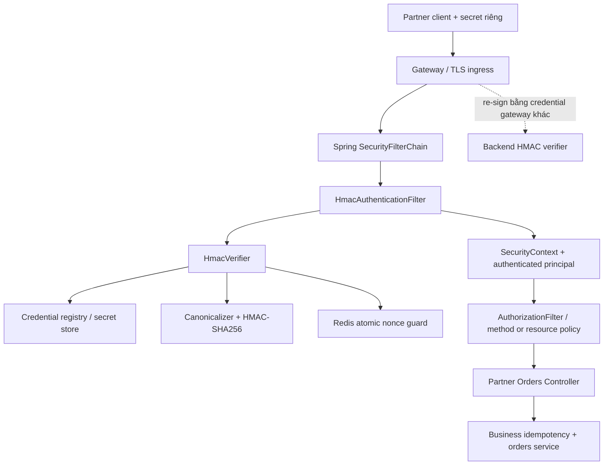
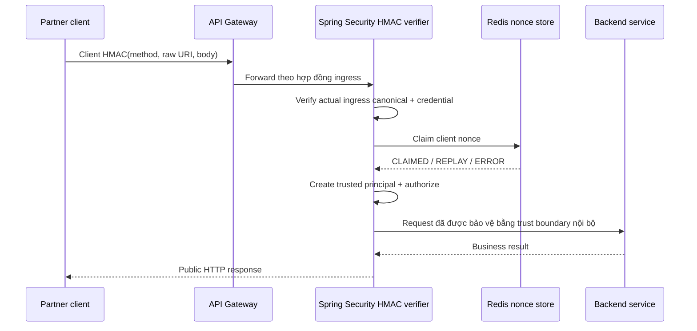
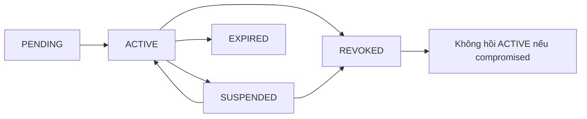

# Tích hợp Spring Security: dự án thực hành xác thực HTTP request bằng HMAC

## 1. Đề bài dự án

Bài **Tích hợp Spring Security** thuộc chương **Dự án thực hành** của module **SECURITY_AUTHENTICATION_HMAC_REQUEST_AUTHENTICATION**. Dự án yêu cầu thiết kế và triển khai xác thực HTTP request bằng **HMAC với shared secret**, ký một **canonical request** bao gồm phương thức HTTP, URI, key ID, timestamp, nonce và digest của byte body theo hợp đồng. Hệ thống phải xác minh MAC, chống replay, quản lý vòng đời credential, kiểm tra proxy/gateway và phân biệt rõ **authentication (xác thực)** với **authorization (phân quyền)**.

Thay vì viết một hàm `verifyHmac(...)` đứng riêng rồi coi là hoàn thành, người học phải đưa verifier vào **Spring Security filter chain**, tạo security principal đúng nguồn tin cậy, phân quyền ở endpoint và xử lý đường lỗi. Bài chọn **Spring Boot 3.x + Spring Security 6.x trên Servlet/Spring MVC, Java 17+** làm triển khai chính. Phần WebFlux được trình bày riêng như phương án mở rộng; **không** sao chép trực tiếp mã đọc request body của Servlet sang WebFlux.

### Bối cảnh

Xây dựng `Partner Orders API` gồm:

- `GET /api/partner/whoami`: trả về định danh client đã xác thực.
- `GET /api/partner/tenants/{tenantId}/orders/{orderId}`: yêu cầu scope `orders:read` và quyền của tenant tương ứng.
- `POST /api/partner/tenants/{tenantId}/orders`: yêu cầu scope `orders:write`; body JSON được MAC bảo vệ; hệ thống chống tạo đơn trùng khi HTTP retry.
- `GET /actuator/health`: có chính sách riêng, không dùng HMAC như nghiệp vụ.
- Gateway ở phía trước có thể rewrite đường dẫn hoặc ký lại request sang backend nội bộ; các bên phải đồng thuận **điểm ký/verify**.

Hai client test là `partner-a` và `partner-b`. Mỗi client có **key ID và secret độc lập**, được ràng buộc với tenant, audience, scopes, trạng thái `ACTIVE/REVOKED` và thuật toán ký. Không có secret global dùng chung mọi client.

**Mục tiêu bàn giao:** một cấu trúc dự án có các class filter, canonicalizer, verifier, credential repository, nonce guard, security configuration, controller, error writer và test suite; kèm quyết định kiến trúc, test cases, hướng dẫn vận hành và bằng chứng kiểm thử. Các đoạn mã trong bài là **mẫu ghép thành dự án**, cần thay triển khai secret store và cấu hình theo hệ thống thực; không được tự nhận đã chạy Gradle hoặc test nếu chưa thực thi.

### Tiêu chí hoàn thành

1. Một request hợp lệ với key ACTIVE, MAC đúng, timestamp trong window và nonce mới được đưa vào Spring Security dưới principal của đúng credential.
2. Key unknown/revoked, MAC sai, timestamp quá hạn hoặc replay **không** tạo `Authentication` và không gọi business handler.
3. MAC hợp lệ nhưng thiếu scope/tenant phải bị **403** hoặc 404 theo policy, không biến thành lỗi xác thực 401.
4. Credential registry/Redis không sẵn sàng gây **503/5xx fail-closed**, không bị xem là “nonce chưa tồn tại”.
5. Đổi method/URI/query/body/header đã ký sau khi ký làm signature fail; proxy và gateway không được che lỗi này bằng normalization mơ hồ.
6. Request HMAC sai không được claim nonce; nonce hợp lệ bị claim nguyên tử và không sống ngắn hơn cửa sổ freshness.
7. Secret A không thể giả danh credential B; key revoke/rotation và keep-alive/HTTP/2 không làm bypass xác thực.
8. Test API bằng `MockMvc`, unit tests và Redis integration/chaos tests, có positive controls và negative assertions ở đúng hop.

## 2. Kiến trúc và trust boundary



**Ranh giới tin cậy quan trọng:**

- Client khai `X-Key-Id` để verifier **tra cứu** credential, nhưng giá trị đó **không tự chứng minh danh tính**.
- Registry tin cậy xác định `ownerClientId`, `tenantId`, `scopes`, `audience`, `algorithm`, `state` và secret của credential.
- Chỉ khi MAC, freshness, nonce và policy đều pass mới tạo `Authentication`. Spring Security sẽ áp **authorization** dựa trên principal thực.
- Một request có thể được xác thực nhưng không được phép thao tác trên tenant/resource được yêu cầu.
- Client-facing HMAC secret khác internal gateway→backend re-sign secret. Hợp đồng ingress không được tái sử dụng sau proxy rewrite khi bytes đã ký đã thay đổi.
- Nonce store và policy/revocation state phải có semantics phù hợp khi có nhiều pods/regions; không dựa vào biến static hoặc HTTP connection.

### 2.1. Phân công responsibility

| Thành phần | Trách nhiệm | Không được làm |
|---|---|---|
| `SecurityFilterChain` | Chọn route bảo vệ, thứ tự filter, stateless policy và 401/403 | Cho business route permitAll vô ý |
| `HmacAuthenticationFilter` | Lấy request body bytes có giới hạn, gọi verifier, set security context | Tin header client ID như principal; tự tạo auth khi lỗi |
| `HmacVerifier` | Credential lookup, MAC, timestamp, nonce, trả principal đã xác minh | Fallback secret global hoặc bỏ nonce khi Redis timeout |
| `Canonicalizer` | Biểu diễn method/raw URI/query/body thống nhất | Tự sắp query hoặc parse/re-serialize JSON khi contract không cho |
| `CredentialRepository` | Key ID → metadata/secret theo owner, state, audience, expiry | Trả cùng secret cho mọi tenant; coi store outage như unknown |
| `NonceGuard` | Atomic claim theo verified credential/client, TTL đủ | Dùng GET rồi SET; lưu local theo pod |
| `AuthorizationFilter`/business guard | Scope/tenant/resource permission | Gộp thiếu quyền vào invalid HMAC |
| `ProblemWriter`/entry points | Status, challenge và public error contract ổn định | Trả expected MAC, raw secret, key existence |
| `OrderService` | Idempotency và nghiệp vụ | Dùng HMAC nonce làm business idempotency key |

## 3. Chuẩn hóa hợp đồng ký trước khi viết filter

Chọn một **hợp đồng minh họa** cố định, không giả định Spring Security có sẵn chuẩn “HMAC-REQ-1”:

```text
HMAC-REQ-1
<METHOD>
<RAW_REQUEST_PATH>
<RAW_QUERY_OR_EMPTY>
<KEY_ID>
<TIMESTAMP_SECONDS>
<NONCE>
<LOWERCASE_HEX_SHA256_OF_BODY_BYTES>
```

Các dòng được nối bằng **LF** (`\n`), encode UTF-8, **không có LF cuối**. Dùng HMAC-SHA256 trên toàn bộ canonical bytes:

```text
expectedMac = HMAC_SHA256(secret_of_keyId, UTF8(canonical))
X-Signature = Base64URL_NoPadding(expectedMac)
```

Output HMAC-SHA256 là **32 byte**, Base64URL không padding dài **43 ký tự**. Body hash SHA-256 **không có khóa**, nhưng được HMAC bảo vệ vì nằm trong canonical. Giá trị timestamp ở **Unix seconds UTC**, không phải milliseconds.

### 3.1. Ví dụ request

```http
POST /api/partner/tenants/tenant-a/orders?source=mobile HTTP/1.1
Host: api.example.test
Content-Type: application/json
X-Key-Id: partner-a-k1
X-Timestamp: 1795852800
X-Nonce: mZ9kqYQd77hS3kGJw8eBvQ
X-Signature: <BASE64URL_HMAC_SHA256>

{"sku":"book-42","quantity":2}
```

Hợp đồng chỉ có **một** header của mỗi loại. Duplicate `X-Key-Id`/`X-Timestamp`/`X-Nonce`/`X-Signature` phải bị từ chối để tránh gateway dùng giá trị đầu còn backend dùng giá trị cuối. Giá trị timestamp và nonce phải được ký; client có thể ký lại request hợp lệ với timestamp/nonce mới, nhưng không được sửa header đã ký mà giữ signature cũ.

### 3.2. Những quyết định phải ghi thành ADR

- `RAW_REQUEST_PATH` là request-target raw path ở **đúng hop**. Trong Servlet, `getRequestURI()` có thể bao gồm context path và chịu ảnh hưởng container/proxy; phải đo bằng integration tests trên deployment thật. Ví dụ chọn context path trống.
- `RAW_QUERY` giữ **đúng thứ tự, ký tự percent-encoding và dấu bằng** như request thực nhận; không tự sort map query sau khi ký.
- Body hash trên **byte request body nhận được**, không hash JSON đã parse/serialize lại.
- Content-Encoding, signed headers và trust-boundary rewrite phải được định nghĩa nếu chúng ảnh hưởng nghĩa của request. Nếu request có `Content-Encoding` thay đổi nội dung diễn giải, cần bảo vệ nó bằng signed header hoặc chính sách cố định. Ví dụ dự án giả định chỉ nhận JSON UTF-8 không nén.
- `keyId` trỏ tới credential có `algorithm=HMAC-SHA256` và `canonicalVersion=HMAC-REQ-1` cố định. Header `X-Alg` không được tùy ý chọn `Mac.getInstance(...)`.
- Giới hạn method, path/query, header sizes, body size và Content-Type. Parser phải reject CR/LF và duplicate signing fields.
- Nếu reverse proxy rewrite URI, gateway **verify ingress trước rewrite** hoặc ký lại request outbound bằng credential riêng; không “thay canonical cho dễ pass”.

## 4. Cấu trúc source và dependencies

Một cấu trúc gợi ý (không cần tạo tất cả trong bài Markdown này):

```text
src/main/java/com/example/partner/
  PartnerApplication.java
  security/
    HmacSecurityConfig.java
    HmacAuthenticationFilter.java
    HmacVerifier.java
    HmacCanonicalizer.java
    HmacCredential.java
    CredentialRepository.java
    HmacPrincipal.java
    ReplayGuard.java
    RedisReplayGuard.java
    CachedBodyRequest.java
    AuthProblemWriter.java
    BadHmacException.java
    AuthDependencyException.java
  orders/
    PartnerOrdersController.java
    OrderService.java
    TenantAuthorization.java
src/main/resources/
  application.yml
src/test/java/com/example/partner/
  HmacVerifierTest.java
  PartnerHmacMvcTest.java
  RedisReplayGuardIntegrationTest.java
  GatewayReSignContractTest.java
```

Dependencies trong dự án Gradle dùng Spring Boot plugin/BOM đã được quản lý:

```groovy
dependencies {
    implementation 'org.springframework.boot:spring-boot-starter-web'
    implementation 'org.springframework.boot:spring-boot-starter-security'
    implementation 'org.springframework.boot:spring-boot-starter-data-redis'
    implementation 'org.springframework.boot:spring-boot-starter-actuator'
    implementation 'org.springframework.boot:spring-boot-starter-validation'

    testImplementation 'org.springframework.boot:spring-boot-starter-test'
    testImplementation 'org.springframework.security:spring-security-test'
    // Redis integration có thể dùng Testcontainers/Redis theo cấu hình CI.
}
```

Ví dụ dùng **Spring Boot 3.x, Java 17+ và namespace `jakarta.servlet`**. Người học phải kiểm tra dependency compatibility của phiên bản Spring đã chọn, không trộn `javax.servlet` của Spring 5 với `jakarta.servlet`. Không có yêu cầu chạy Gradle trong bước viết bài này.

### 4.1. Cấu hình vận hành minh họa

```yaml
spring:
  application:
    name: partner-orders-api
  data:
    redis:
      host: "\${REDIS_HOST:localhost}"
      port: 6379

partner:
  hmac:
    audience: orders-api
    past-window-seconds: 120
    future-window-seconds: 30
    nonce-margin-seconds: 20
    max-body-bytes: 1048576
```

Không đưa production secret vào `application.yml`. Đường kết nối Redis, credential registry/vault và mọi biến hạ tầng cần được quản lý qua secret store/environment với quyền thích hợp. Trong production phải cấu hình timeout, TLS, pool, health/metrics, backpressure và fail-closed.

## 5. Model credential: identity đến từ registry

Credential có **secret riêng**, và sau khi verify sẽ sinh principal từ registry:

```java
package com.example.partner.security;

import java.nio.charset.StandardCharsets;
import java.security.GeneralSecurityException;
import java.security.Principal;
import java.time.Instant;
import java.util.Arrays;
import java.util.Objects;
import java.util.Set;

import javax.crypto.Mac;
import javax.crypto.spec.SecretKeySpec;

public record HmacPrincipal(
        String clientId,
        String tenantId,
        Set<String> scopes) implements Principal {

    @Override
    public String getName() {
        return clientId;
    }
}

public final class HmacCredential {
    private final String credentialId;
    private final String keyId;
    private final String clientId;
    private final String tenantId;
    private final String audience;
    private final Set<String> scopes;
    private final Instant notBefore;
    private final Instant expiresAt;
    private final boolean active;
    private final byte[] secret;

    public HmacCredential(
            String credentialId,
            String keyId,
            String clientId,
            String tenantId,
            String audience,
            Set<String> scopes,
            Instant notBefore,
            Instant expiresAt,
            boolean active,
            byte[] secret) {
        this.credentialId = Objects.requireNonNull(credentialId);
        this.keyId = Objects.requireNonNull(keyId);
        this.clientId = Objects.requireNonNull(clientId);
        this.tenantId = Objects.requireNonNull(tenantId);
        this.audience = Objects.requireNonNull(audience);
        this.scopes = Set.copyOf(scopes);
        this.notBefore = Objects.requireNonNull(notBefore);
        this.expiresAt = Objects.requireNonNull(expiresAt);
        this.active = active;
        this.secret = Arrays.copyOf(
                Objects.requireNonNull(secret), secret.length);
        if (secret.length < 32) {
            throw new IllegalArgumentException("HMAC key too short");
        }
    }

    public boolean usableAt(Instant now, String expectedAudience) {
        return active
                && audience.equals(expectedAudience)
                && !now.isBefore(notBefore)
                && now.isBefore(expiresAt);
    }

    public String credentialId() { return credentialId; }
    public String keyId() { return keyId; }

    public HmacPrincipal principal() {
        return new HmacPrincipal(clientId, tenantId, scopes);
    }

    // Không có getter secret, không để secret xuất hiện trong toString/log.
    public byte[] mac(byte[] canonicalBytes) {
        try {
            Mac hmac = Mac.getInstance("HmacSHA256");
            hmac.init(new SecretKeySpec(secret, "HmacSHA256"));
            return hmac.doFinal(canonicalBytes);
        } catch (GeneralSecurityException failure) {
            throw new IllegalStateException(
                    "Approved HMAC algorithm unavailable", failure);
        }
    }
}
```

**Lưu ý khi chuyển thành project thật:** Java chỉ cho một `public` top-level type cùng tên file; tách `HmacPrincipal` và `HmacCredential` thành **hai file riêng** như cấu trúc ở mục 4. Code block ghép lại để tiện đọc. `byte[]` được copy vào object nhưng JVM có thể còn các bản sao; production nên dùng vault/HSM/secret-handle, cache giới hạn và tránh ghi key vào logs, heap dumps hay API response.

### 5.1. Repository interface và lỗi dependency

```java
package com.example.partner.security;

import java.util.Optional;

public interface CredentialRepository {
    // Empty = keyId thực sự không tồn tại theo nguồn dữ liệu đáng tin.
    // Lỗi DB/KMS/vault cần ném exception riêng, KHÔNG trả Empty.
    Optional<HmacCredential> findByKeyId(String keyId);
}

public final class AuthDependencyException extends RuntimeException {
    public AuthDependencyException(String message, Throwable cause) {
        super(message, cause);
    }
}

public final class BadHmacException extends RuntimeException {
    public BadHmacException() {
        super("Invalid authentication proof");
    }
}
```

Tách mỗi `public` class/interface thành file Java tương ứng. Triển khai `CredentialRepository` production cần đảm bảo:

- Lookup theo key ID giới hạn kích thước/cú pháp, tránh query injection hoặc cardinality abuse.
- Mỗi credential thuộc một owner/tenant và có secret độc lập; không dùng `GLOBAL_SECRET` fallback.
- `ACTIVE/REVOKED`, `notBefore/expiresAt`, `audience`, algorithm và canonical version phải được enforce.
- Cache cần freshness guarantee để key đã revoke không được accept trên pod cũ hoặc DR.
- Khi registry unavailable, **không** coi đó là unknown key và không cho request đi tiếp.
- Phân quyền truy cập secret store theo least privilege; client không được truy xuất secret của client khác.

Nếu multi-algorithm migration được hỗ trợ, thay `HmacSHA256` hard-coded bằng **enum allowlist đã pin theo credential**, không lấy tên algorithm tự do từ header.

## 6. Canonicalizer: byte body thực, URI thực tại boundary

Một class minh họa xử lý HMAC-REQ-1:

```java
package com.example.partner.security;

import java.nio.charset.StandardCharsets;
import java.security.MessageDigest;
import java.security.NoSuchAlgorithmException;
import java.util.HexFormat;
import java.util.Set;

import jakarta.servlet.http.HttpServletRequest;

public final class HmacCanonicalizer {
    private static final Set<String> METHODS = Set.of(
            "GET", "HEAD", "POST", "PUT", "PATCH", "DELETE");

    public byte[] bytes(
            HttpServletRequest request,
            byte[] bodyBytes,
            String keyId,
            String timestamp,
            String nonce) {
        String method = request.getMethod();
        String path = request.getRequestURI();
        String query = request.getQueryString() == null
                ? "" : request.getQueryString();

        if (!METHODS.contains(method)
                || path == null || !path.startsWith("/")) {
            throw new BadHmacException();
        }
        noLineBreaks(path);
        noLineBreaks(query);
        token(keyId, 1, 64);
        token(timestamp, 1, 13);
        token(nonce, 16, 128);

        final byte[] digest;
        try {
            digest = MessageDigest.getInstance("SHA-256")
                    .digest(bodyBytes);
        } catch (NoSuchAlgorithmException failure) {
            throw new IllegalStateException(failure);
        }

        String canonical = String.join("\n",
                "HMAC-REQ-1",
                method,
                path,
                query,
                keyId,
                timestamp,
                nonce,
                HexFormat.of().formatHex(digest));
        return canonical.getBytes(StandardCharsets.UTF_8);
    }

    private static void noLineBreaks(String value) {
        if (value.indexOf('\n') >= 0 || value.indexOf('\r') >= 0) {
            throw new BadHmacException();
        }
    }

    private static void token(String text, int min, int max) {
        if (text == null
                || text.length() < min || text.length() > max
                || !text.matches("[A-Za-z0-9._-]+")) {
            throw new BadHmacException();
        }
    }
}
```

**Ràng buộc quan trọng:**

- `getRequestURI()` phải khớp với phần signer coi là raw path. Kiểm thử container, reverse proxy, context path và percent-encoding; không suy đoán chúng đều giống nhau trên mọi môi trường.
- `getQueryString()` không tự sort/decode, giữ thứ tự thực nhận. Hai query tương đương về ý nghĩa nhưng khác byte có thể sinh MAC khác; đó là hành vi hợp đồng.
- Body digest tính trên `bodyBytes` mà filter đã lấy từ Servlet stream, trước khi controller parse JSON. Không tự chuyển `{"a":1}` thành `{"a": 1}` rồi hash.
- Demo này không ký `Content-Type`/`Content-Encoding`. Production cần quyết định ràng buộc các header ảnh hưởng đến diễn giải body, hoặc enforce giá trị cố định và test proxy. Ví dụ endpoint chỉ cho JSON UTF-8, không nén.
- Nếu client gửi HTTP request trên đường có thể bị rewrite, gateway cần verify ở ingress trước biến đổi và ký lại outbound dưới secret riêng.
- Hợp đồng có **một phiên bản** và HMAC-SHA256 pinned trong service; không chấp nhận `alg=none`, unknown algorithm hay phép thử MAC theo nhiều key để “tìm cái đúng”.

## 7. Verifier: chọn credential, xác minh MAC, freshness và nonce

### 7.1. ReplayGuard abstraction

```java
package com.example.partner.security;

import java.time.Duration;

public interface ReplayGuard {
    // Normal return: nonce đã claim lần đầu.
    // BadHmacException: nonce đã tồn tại.
    // AuthDependencyException: store unavailable/unknown result.
    void claim(String credentialId, String nonce, Duration ttl);
}
```

Định nghĩa này cố ý không có `isUsed()` rồi `markUsed()`, vì hai thao tác riêng có race khi nhiều node chạy đồng thời.

### 7.2. Verifier đồng bộ dành cho Spring MVC

```java
package com.example.partner.security;

import java.nio.charset.StandardCharsets;
import java.security.MessageDigest;
import java.time.Clock;
import java.time.Duration;
import java.time.Instant;
import java.util.Base64;
import java.util.Enumeration;
import java.util.Optional;

import jakarta.servlet.http.HttpServletRequest;

public final class HmacVerifier {
    private static final Duration PAST = Duration.ofSeconds(120);
    private static final Duration FUTURE = Duration.ofSeconds(30);
    private static final Duration NONCE_TTL = Duration.ofSeconds(170);
    private static final String AUDIENCE = "orders-api";

    private final CredentialRepository repository;
    private final ReplayGuard nonceGuard;
    private final HmacCanonicalizer canonicalizer;
    private final Clock clock;

    public HmacVerifier(
            CredentialRepository repository,
            ReplayGuard nonceGuard,
            HmacCanonicalizer canonicalizer,
            Clock clock) {
        this.repository = repository;
        this.nonceGuard = nonceGuard;
        this.canonicalizer = canonicalizer;
        this.clock = clock;
    }

    public HmacPrincipal verify(
            HttpServletRequest request,
            byte[] body) {

        // Duplicate header và chuỗi thiếu header đều thất bại.
        String keyId = oneHeader(request, "X-Key-Id");
        String timestamp = oneHeader(request, "X-Timestamp");
        String nonce = oneHeader(request, "X-Nonce");
        String signature = oneHeader(request, "X-Signature");

        Optional<HmacCredential> resolved =
                repository.findByKeyId(keyId);
        HmacCredential credential = resolved
                .orElseThrow(BadHmacException::new);

        Instant now = Instant.ofEpochSecond(
                clock.instant().getEpochSecond());
        if (!credential.usableAt(now, AUDIENCE)) {
            throw new BadHmacException();
        }

        byte[] canonical = canonicalizer.bytes(
                request, body, keyId, timestamp, nonce);
        byte[] expected = credential.mac(canonical);

        byte[] received;
        try {
            if (signature.length() != 43) {
                throw new BadHmacException();
            }
            received = Base64.getUrlDecoder().decode(signature);
            if (received.length != 32
                    || !Base64.getUrlEncoder().withoutPadding()
                            .encodeToString(received)
                            .equals(signature)) {
                throw new BadHmacException();
            }
        } catch (IllegalArgumentException invalid) {
            throw new BadHmacException();
        }

        if (!MessageDigest.isEqual(expected, received)) {
            throw new BadHmacException();
        }

        final Instant signedAt;
        try {
            if (!timestamp.matches("[0-9]{1,13}")) {
                throw new BadHmacException();
            }
            signedAt = Instant.ofEpochSecond(
                    Long.parseLong(timestamp));
        } catch (RuntimeException malformed) {
            throw new BadHmacException();
        }

        // Check ở thời điểm cuối gần nonce claim hơn, không dựa vào
        // thời điểm vừa nhận headers khi body còn đang upload.
        Instant checkedAt = Instant.ofEpochSecond(
                clock.instant().getEpochSecond());
        if (signedAt.isBefore(checkedAt.minus(PAST))
                || signedAt.isAfter(checkedAt.plus(FUTURE))) {
            throw new BadHmacException();
        }

        // Chỉ claim sau khi MAC và timestamp đã hợp lệ.
        nonceGuard.claim(
                credential.credentialId(), nonce, NONCE_TTL);

        // Principal chỉ lấy từ registry sau khi xác thực hoàn chỉnh.
        return credential.principal();
    }

    private static String oneHeader(
            HttpServletRequest request,
            String name) {
        Enumeration<String> values = request.getHeaders(name);
        if (values == null || !values.hasMoreElements()) {
            throw new BadHmacException();
        }
        String value = values.nextElement();
        if (values.hasMoreElements() || value == null
                || value.length() > 256) {
            throw new BadHmacException();
        }
        return value;
    }
}
```

**Vì sao thứ tự quan trọng?**

1. Lookup registry để lấy secret **riêng cho credential**. Không tạo principal từ `X-Key-Id` hoặc `X-Client-Id` khi chưa verify.
2. Tính MAC theo canonical bytes thực nhận. Không chỉ kiểm tra chữ ký của body rồi bỏ method/URI.
3. Dùng `MessageDigest.isEqual` trên MAC thô cùng độ dài; không dùng vòng lặp tự viết dừng ở byte đầu tiên sai.
4. Kiểm tra timestamp đã **được MAC bảo vệ**. Demo dùng P=120 s và F=30 s, chấp nhận hai biên; đó là thông số cần ADR, không phải chuẩn universal.
5. Claim nonce nguyên tử **sau** MAC/freshness, tránh attacker gửi MAC sai để đốt nonce của client hợp lệ.
6. Chỉ sau đó mới tạo `HmacPrincipal` với tenant/scopes lấy từ registry.

**Giới hạn có chủ đích của mã minh họa:**

- Demo giữ P/F/TTL và AUDIENCE ở constant để tập trung tích hợp; production lấy từ policy server-side theo credential/audience và validate không để header requester tự mở rộng window.
- `NONCE_TTL=170s` xuất phát từ `P+F+margin=120+30+20`. Nếu thay P/F mà không thay TTL sẽ có nguy cơ nonce hết hạn khi timestamp còn hợp lệ; với policy rolling change còn phải bảo vệ nonce state đã ghi theo TTL cũ.
- Cần harden error phân loại và giới hạn trước lookup: code demo đã kiểm tra chiều dài header, canonicalizer kiểm tra token nhưng registry lookup đang diễn ra trước validation token. Production nên validate cú pháp/độ dài `keyId` trước DB query và chuẩn hóa duplicate header handling qua gateway.
- Body/header/path size limits, timestamp overflow, data races khi policy revoke, secret retrieval và timing side channel phải được kiểm thử riêng.
- `repository.findByKeyId` phải ném lỗi dependency khi không thể lookup, và upper layer chuyển thành **503**, không trả `Optional.empty()`.
- Nếu thư viện mã hóa/entropy/driver Redis báo lỗi, không được coi MAC hợp lệ hoặc “nonce còn mới”.
- Với credential bị revoke, verifier từ chối dù có HMAC đúng với secret cũ; cache policy phải có freshness và propagation cam kết.

### 7.3. Không tự retry HMAC verification với khóa khác

Code sau là **anti-pattern**:

```java
// KHÔNG LÀM: cho request tự thử tất cả secrets của mọi client.
for (byte[] secret : allPartnerSecrets) {
    if (hmacMatches(secret, request)) {
        return authenticationFromClaimedClientId();
    }
}
```

Nó phá ranh giới owner, làm timing oracle, mở đường fallback algorithm và khó revoke độc lập. Chọn đúng credential theo key ID, kiểm tra policy và MAC đúng **một** thuật toán pinned cho credential đó.

## 8. Redis nonce guard: at-most-one atomic claim

Dùng Spring Data Redis đồng bộ cho Servlet stack:

```java
package com.example.partner.security;

import java.nio.charset.StandardCharsets;
import java.security.MessageDigest;
import java.security.NoSuchAlgorithmException;
import java.time.Duration;
import java.util.HexFormat;

import org.springframework.dao.DataAccessException;
import org.springframework.data.redis.core.StringRedisTemplate;

public final class RedisReplayGuard implements ReplayGuard {
    private final StringRedisTemplate redis;

    public RedisReplayGuard(StringRedisTemplate redis) {
        this.redis = redis;
    }

    @Override
    public void claim(
            String credentialId,
            String nonce,
            Duration ttl) {
        if (ttl.isZero() || ttl.isNegative()) {
            throw new IllegalArgumentException("Invalid nonce TTL");
        }
        if (credentialId == null
                || !credentialId.matches("[A-Za-z0-9._-]{1,128}")) {
            throw new IllegalArgumentException(
                    "Invalid trusted credential ID");
        }
        if (nonce == null
                || !nonce.matches("[A-Za-z0-9_-]{16,128}")) {
            throw new BadHmacException();
        }

        String key = "hmac:nonce:v1:"
                + credentialId + ":" + sha256Hex(nonce);

        try {
            // Redis SET key value NX EX / PX theo ttl.
            Boolean inserted = redis.opsForValue()
                    .setIfAbsent(key, "1", ttl);
            if (inserted == null) {
                throw new AuthDependencyException(
                        "Indeterminate nonce claim", null);
            }
            if (!inserted) {
                throw new BadHmacException();
            }
        } catch (DataAccessException unavailable) {
            // Timeout có thể đến sau khi Redis đã ghi nonce.
            // Không cho qua, không khẳng định là replay.
            throw new AuthDependencyException(
                    "Nonce store unavailable", unavailable);
        }
    }

    private static String sha256Hex(String nonce) {
        try {
            return HexFormat.of().formatHex(
                    MessageDigest.getInstance("SHA-256").digest(
                            nonce.getBytes(StandardCharsets.UTF_8)));
        } catch (NoSuchAlgorithmException unavailable) {
            throw new IllegalStateException(unavailable);
        }
    }
}
```

`setIfAbsent(key, value, ttl)` sử dụng thao tác Redis SET với điều kiện NX và expiration theo Spring Data Redis/driver. Một lệnh nguyên tử quan trọng hơn việc thử `GET` rồi `SET` riêng lẻ. Trong tích hợp thực phải kiểm tra driver, timeout, Redis topology, replication/failover và semantics theo version.

**Giới hạn:**

- Hash nonce trong Redis key giúp giữ key bounded; không được coi SHA-256 của nonce như bí mật mã hóa. Nếu cần che nonce khỏi người xem Redis keyspace, cân nhắc keyed pseudonymization theo threat model.
- Demo namespace theo `credentialId`. Nếu yêu cầu uniqueness xuyên old/new credentials của cùng client, dùng `verifiedClientId+audience+nonce` và cập nhật contract SDK.
- Multi-region có thể cần một authoritative store/strong consistency hoặc routing đảm bảo uniqueness; hai Redis masters tách rời **không** tự bảo đảm at-most-once toàn cầu.
- Redis eviction, failover mất acknowledged writes hoặc `FLUSHDB` có thể làm replay guard mất state; các lỗi đó phải được đánh giá và test.
- Khi nonce đã claim mà client mất response, retry **cùng proof** phải bị chặn. Client cần ký attempt mới với timestamp/nonce mới; business idempotency tránh tạo đơn trùng.
- Chưa có rate limiting và monitoring trong class mẫu; production phải bổ sung để kiểm soát brute-force/nonce flooding mà không dùng claimed key ID làm verified identity.

## 9. Đọc body trong Servlet filter mà downstream vẫn đọc được

Một lỗi tích hợp rất thường gặp: filter gọi `request.getInputStream().readAllBytes()` để tính SHA-256, sau đó gọi `chain.doFilter(request,response)`. Controller `@RequestBody` nhận body **rỗng** vì input stream đã bị tiêu thụ. `ContentCachingRequestWrapper` thường cache **khi downstream đọc**, không tự biến input stream thành nguồn có thể đọc lại tùy ý sau khi filter đã đọc hết. Bài dùng wrapper riêng để minh họa request **synchronous MVC** có thể đọc lại.

### 9.1. CachedBodyRequest có giới hạn

```java
package com.example.partner.security;

import java.io.BufferedReader;
import java.io.ByteArrayInputStream;
import java.io.IOException;
import java.io.InputStreamReader;
import java.nio.charset.Charset;
import java.nio.charset.StandardCharsets;

import jakarta.servlet.ReadListener;
import jakarta.servlet.ServletInputStream;
import jakarta.servlet.http.HttpServletRequest;
import jakarta.servlet.http.HttpServletRequestWrapper;

public final class CachedBodyRequest extends HttpServletRequestWrapper {
    private final byte[] body;

    public CachedBodyRequest(
            HttpServletRequest request,
            int maxBodyBytes) throws IOException {
        super(request);
        if (maxBodyBytes <= 0) {
            throw new IllegalArgumentException("Invalid body limit");
        }
        if (request.getContentLengthLong() > maxBodyBytes) {
            throw new BodyTooLargeException();
        }
        byte[] loaded = request.getInputStream()
                .readNBytes(maxBodyBytes + 1);
        if (loaded.length > maxBodyBytes) {
            throw new BodyTooLargeException();
        }
        this.body = loaded;
    }

    public byte[] bodyBytes() {
        return body.clone();
    }

    @Override
    public ServletInputStream getInputStream() {
        ByteArrayInputStream input = new ByteArrayInputStream(body);
        return new ServletInputStream() {
            @Override public int read() {
                return input.read();
            }

            @Override public boolean isFinished() {
                return input.available() == 0;
            }

            @Override public boolean isReady() {
                return true;
            }

            @Override public void setReadListener(
                    ReadListener listener) {
                // Demo chỉ hỗ trợ synchronous MVC.
                throw new UnsupportedOperationException(
                        "Async Servlet I/O requires dedicated wrapper");
            }
        };
    }

    @Override
    public BufferedReader getReader() throws IOException {
        String encoding = getCharacterEncoding();
        Charset charset = encoding == null
                ? StandardCharsets.ISO_8859_1
                : Charset.forName(encoding);
        return new BufferedReader(
                new InputStreamReader(getInputStream(), charset));
    }
}

final class BodyTooLargeException extends RuntimeException {
}
```

**Không dùng nguyên lớp này cho async Servlet I/O hoặc upload lớn**: `setReadListener` chưa được triển khai, toàn bộ body được buffer trong RAM. Với body vài MiB theo tải lớn, cần chiến lược bounded streaming/digest, non-blocking backpressure, spooling được kiểm soát hoặc thay đổi điểm verify. Dự án thực hành giới hạn body **1 MiB** và dùng Servlet MVC đồng bộ. Nếu content length không có (chunked), `readNBytes(max+1)` vẫn ngăn cấp phát vô hạn; server/proxy còn phải có upload timeout, header/body limits và cancellation.

`getReader()` dùng encoding được Servlet request khai; việc hash body chỉ dùng **byte[] raw** chứ không dựa kết quả chuyển thành text. Nếu Content-Encoding/charset có vai trò trong business semantics, phải được enforce/signed theo contract.

## 10. Public error semantics: 401, 403, 413 và 503

Security filter chạy **trước controller**, nên không thể kỳ vọng một `@RestControllerAdvice` xử lý đúng mọi exception từ filter. Dùng `AuthenticationEntryPoint`/`AccessDeniedHandler` và error writer chia sẻ; các lỗi dependency trong custom filter phải được map rõ.

### 10.1. Problem writer

```java
package com.example.partner.security;

import java.io.IOException;
import jakarta.servlet.http.HttpServletResponse;

public final class AuthProblemWriter {
    private AuthProblemWriter() {}

    public static void unauthorized(
            HttpServletResponse response) throws IOException {
        write(response, 401, "Unauthorized",
                "AUTHENTICATION_FAILED", true);
    }

    public static void forbidden(
            HttpServletResponse response) throws IOException {
        write(response, 403, "Forbidden",
                "ACCESS_DENIED", false);
    }

    public static void unavailable(
            HttpServletResponse response) throws IOException {
        write(response, 503, "Service Unavailable",
                "AUTH_SERVICE_UNAVAILABLE", false);
    }

    public static void tooLarge(
            HttpServletResponse response) throws IOException {
        write(response, 413, "Content Too Large",
                "PAYLOAD_TOO_LARGE", false);
    }

    private static void write(
            HttpServletResponse response,
            int status,
            String title,
            String code,
            boolean challenge) throws IOException {
        response.resetBuffer(); // Gọi trước khi response committed.
        response.setStatus(status);
        response.setCharacterEncoding("UTF-8");
        response.setContentType("application/problem+json");
        response.setHeader("Cache-Control", "no-store");
        if (challenge) {
            response.setHeader("WWW-Authenticate",
                    "HMAC realm=\"partner-api\"");
        }
        // Giá trị title/code/status chỉ từ hằng do server kiểm soát.
        response.getWriter().write(
                "{\"type\":\"about:blank\","
                + "\"title\":\"" + title + "\","
                + "\"status\":" + status + ","
                + "\"code\":\"" + code + "\"}");
    }
}
```

Scheme `HMAC` trong `WWW-Authenticate` là **scheme riêng được API định nghĩa**. Cần tài liệu hóa header/realm và kiểm thử SDK. Không đưa `invalid_mac`, `unknown_key`, expected MAC hoặc trạng thái credential chi tiết ra public response nếu những thông tin đó cần được che. Internal log/metric có reason hữu hạn và request ID theo quyền.

| Điều kiện | Status public | Kết quả logic |
|---|---:|---|
| Missing/invalid header, wrong MAC, key unknown/revoked | **401** | Không tạo principal, không handler |
| Timestamp quá cũ/tương lai, nonce replay | **401** | Không tạo principal, replay reason nội bộ |
| MAC/freshness pass, scope hoặc tenant không đủ | **403**/404 theo policy | Authentication đã pass; authorization deny |
| Body vượt giới hạn | **413** | Không buffer vô hạn, không gọi verifier |
| Registry/secret store/Redis unavailable hoặc indeterminate claim | **503/5xx** | Fail-closed, không giả thành invalid MAC |
| Rate limit | **429** | Giới hạn lưu lượng riêng |
| Gateway→backend internal HMAC failure | Lỗi nội bộ; public 5xx phù hợp | Không yêu cầu client đổi secret vì lỗi gateway |

## 11. HmacAuthenticationFilter và SecurityContext

### 11.1. Filter gọi verifier rồi mới vào authorization

```java
package com.example.partner.security;

import java.io.IOException;
import java.util.List;

import jakarta.servlet.FilterChain;
import jakarta.servlet.ServletException;
import jakarta.servlet.http.HttpServletRequest;
import jakarta.servlet.http.HttpServletResponse;

import org.springframework.security.web.authentication.preauth.PreAuthenticatedAuthenticationToken;
import org.springframework.security.core.GrantedAuthority;
import org.springframework.security.core.authority.SimpleGrantedAuthority;
import org.springframework.security.core.context.SecurityContext;
import org.springframework.security.core.context.SecurityContextHolder;
import org.springframework.web.filter.OncePerRequestFilter;

public final class HmacAuthenticationFilter
        extends OncePerRequestFilter {

    private static final int MAX_BODY_BYTES = 1024 * 1024;
    private final HmacVerifier verifier;

    public HmacAuthenticationFilter(HmacVerifier verifier) {
        this.verifier = verifier;
    }

    @Override
    protected void doFilterInternal(
            HttpServletRequest request,
            HttpServletResponse response,
            FilterChain chain)
            throws ServletException, IOException {

        final CachedBodyRequest buffered;
        try {
            buffered = new CachedBodyRequest(
                    request, MAX_BODY_BYTES);
        } catch (BodyTooLargeException tooLarge) {
            AuthProblemWriter.tooLarge(response);
            return;
        }

        final HmacPrincipal principal;
        try {
            principal = verifier.verify(
                    buffered, buffered.bodyBytes());
        } catch (BadHmacException invalid) {
            AuthProblemWriter.unauthorized(response);
            return;
        } catch (AuthDependencyException unavailable) {
            AuthProblemWriter.unavailable(response);
            return;
        }

        List<GrantedAuthority> authorities =
                principal.scopes().stream()
                        .map(s -> (GrantedAuthority)
                                new SimpleGrantedAuthority("SCOPE_" + s))
                        .toList();

        var authentication =
                new PreAuthenticatedAuthenticationToken(
                        principal, null, authorities);
        SecurityContext context =
                SecurityContextHolder.createEmptyContext();
        context.setAuthentication(authentication);
        SecurityContextHolder.setContext(context);

        try {
            chain.doFilter(buffered, response);
        } finally {
            SecurityContextHolder.clearContext();
        }
    }
}
```

**Lưu ý triển khai:** `PreAuthenticatedAuthenticationToken` trong Spring Security 6 nằm tại `org.springframework.security.web.authentication.preauth`. Mã filter mẫu đã dùng import đúng package; vẫn cần triển khai và kiểm thử security chain đầy đủ trong dự án thực tế.

Để tránh vô tình map một `BadHmacException` phát sinh trong **controller/service** thành 401, ví dụ chỉ bắt lỗi quanh `verifier.verify(...)`. `chain.doFilter(...)` chạy ngoài khối catch đó, nên exception nghiệp vụ downstream được xử lý theo cơ chế tương ứng.

### 11.2. Vòng đời SecurityContext

- `SecurityContextHolder` được Spring Security thiết lập/quản lý theo request trong Servlet chain. Filter tạo context mới khi authentication thành công, không dùng biến static chứa principal.
- Sau `chain.doFilter`, xóa context trong `finally` để tránh principal rò sang request khác trên reused thread; Spring Security cũng có cơ chế quản lý context.
- Một HTTP keep-alive connection không biến thành session authenticated. **Mỗi request phải mang và xác minh proof HMAC riêng**.
- Nếu ứng dụng dùng async Servlet hoặc propagating security context sang task khác, phải dùng cơ chế context propagation được Spring Security hỗ trợ; wrapper demo body và thread-local ở đây chỉ dành cho synchronous MVC.
- Không để filter bị **đăng ký hai lần**: nếu tự tạo `new HmacAuthenticationFilter(verifier)` trong `SecurityFilterChain`, đừng đồng thời khai `@Component`/`@Bean` Servlet Filter tự động đăng ký trên container.

## 12. Cấu hình Spring SecurityFilterChain

Ví dụ dùng hai chain: một bảo vệ partner routes và một xử lý phần còn lại theo nguyên tắc deny-by-default.

```java
package com.example.partner.security;

import java.time.Clock;

import org.springframework.context.annotation.Bean;
import org.springframework.context.annotation.Configuration;
import org.springframework.core.annotation.Order;
import org.springframework.http.HttpMethod;
import org.springframework.security.config.annotation.web.builders.HttpSecurity;
import org.springframework.security.config.annotation.web.configuration.EnableWebSecurity;
import org.springframework.security.config.http.SessionCreationPolicy;
import org.springframework.security.web.SecurityFilterChain;
import org.springframework.security.web.authentication.AnonymousAuthenticationFilter;
import org.springframework.data.redis.core.StringRedisTemplate;

@Configuration
@EnableWebSecurity
public class HmacSecurityConfig {

    @Bean
    Clock clock() {
        return Clock.systemUTC();
    }

    @Bean
    HmacCanonicalizer hmacCanonicalizer() {
        return new HmacCanonicalizer();
    }

    @Bean
    ReplayGuard replayGuard(StringRedisTemplate redis) {
        return new RedisReplayGuard(redis);
    }

    @Bean
    HmacVerifier hmacVerifier(
            CredentialRepository credentials,
            ReplayGuard replayGuard,
            HmacCanonicalizer canonicalizer,
            Clock clock) {
        return new HmacVerifier(
                credentials, replayGuard, canonicalizer, clock);
    }

    @Bean
    @Order(1)
    SecurityFilterChain partnerApi(
            HttpSecurity http,
            HmacVerifier verifier) throws Exception {
        http.securityMatcher("/api/partner/**");
        http.csrf(csrf -> csrf.disable()); // Chỉ API stateless có HMAC.
        http.sessionManagement(sm -> sm.sessionCreationPolicy(
                SessionCreationPolicy.STATELESS));
        http.httpBasic(basic -> basic.disable());
        http.formLogin(form -> form.disable());
        http.authorizeHttpRequests(authorize -> authorize
            .requestMatchers(HttpMethod.GET,
                    "/api/partner/whoami")
                    .authenticated()
            .requestMatchers(HttpMethod.GET,
                    "/api/partner/tenants/*/orders/*")
                    .hasAuthority("SCOPE_orders:read")
            .requestMatchers(HttpMethod.POST,
                    "/api/partner/tenants/*/orders")
                    .hasAuthority("SCOPE_orders:write")
            .anyRequest().denyAll());
        http.exceptionHandling(errors -> errors
            .authenticationEntryPoint(
                (req, res, exception) ->
                    AuthProblemWriter.unauthorized(res))
            .accessDeniedHandler(
                (req, res, exception) ->
                    AuthProblemWriter.forbidden(res)));

        // Tạo tại chain, không khai đồng thời là servlet @Component Filter.
        http.addFilterBefore(
                new HmacAuthenticationFilter(verifier),
                AnonymousAuthenticationFilter.class);
        return http.build();
    }

    @Bean
    @Order(2)
    SecurityFilterChain fallback(HttpSecurity http)
            throws Exception {
        http.authorizeHttpRequests(authorize -> authorize
            .requestMatchers(HttpMethod.GET,
                    "/actuator/health").permitAll()
            .anyRequest().denyAll());
        return http.build();
    }
}
```

**Lưu ý phiên bản:** mã cấu hình minh họa Spring Boot 3.x/Spring Security 6.x; khi triển khai cần xác nhận API và thứ tự filter tương ứng phiên bản đã chọn, cũng như bean wiring của `CredentialRepository` và Redis.

**Điểm kỹ thuật quan trọng:**

1. `http.securityMatcher("/api/partner/**")` giới hạn chuỗi này cho API partner, tránh áp HMAC filter lên health route theo cách ngoài ý muốn.
2. Chỉ disable CSRF cho một **API stateless không dựa vào cookie/browser session**. Không dùng cấu hình này để tắt CSRF toàn bộ trang web dùng cookie.
3. `SessionCreationPolicy.STATELESS` không tự xác minh HMAC; filter vẫn phải thực thi từng request.
4. Filter đặt trước `AnonymousAuthenticationFilter`. Vì `ExceptionTranslationFilter` nằm theo thứ tự chain khác, filter chủ động map lỗi verify thành 401/503; không giả định mọi exception từ custom filter được bắt bởi controller advice.
5. `anyRequest().denyAll()` giúp các route mới không tự động mở quyền.
6. Scope quyết định quyền loại thao tác; **tenant/resource ownership** cần guard riêng tại controller/service hoặc method security.
7. `GET /actuator/health` chỉ là ví dụ chính sách health; production cân nhắc chia readiness/liveness, thông tin sức khỏe không nên tiết lộ thông tin nhạy cảm.
8. Nếu ứng dụng còn nhiều `SecurityFilterChain`, kiểm thử thứ tự matcher và fallback, bảo đảm không tạo một chain permit-all bắt nhầm route.
9. Tách các top-level `public` types ở các khối mẫu thành file Java riêng và ghép đầy đủ imports/test fixtures. Không có build được chạy trong bước viết tài liệu.

### 12.1. Về AuthorizationFilter và thứ tự

Các filter trong Spring Security không chỉ là danh sách tự viết. Trong Servlet stack, `SecurityContextHolderFilter`, authentication filters, `AnonymousAuthenticationFilter`, `ExceptionTranslationFilter` và `AuthorizationFilter` có thứ tự được framework quy định. Nếu bạn tự thêm HMAC filter, phải đặt tại vị trí làm **authentication trước authorization**, đồng thời kiểm tra entrypoint/denied handler và context lifecycle bằng test đi qua chain thật.

Không đặt filter ở vị trí sau `AuthorizationFilter` rồi thắc mắc vì sao quyền luôn deny; cũng không chỉ dùng một `HandlerInterceptor` mà bỏ qua Spring Security integration nếu yêu cầu là principal/authorities được framework dùng.

## 13. Controller và authorization theo tenant

Một controller demo:

```java
package com.example.partner.orders;

import java.util.Map;
import com.example.partner.security.HmacPrincipal;

import org.springframework.http.HttpStatus;
import org.springframework.security.access.AccessDeniedException;
import org.springframework.security.core.annotation.AuthenticationPrincipal;
import org.springframework.web.bind.annotation.*;

@RestController
@RequestMapping("/api/partner")
public class PartnerOrdersController {
    private final OrderService orders;

    public PartnerOrdersController(OrderService orders) {
        this.orders = orders;
    }

    @GetMapping("/whoami")
    public Map<String, String> whoami(
            @AuthenticationPrincipal HmacPrincipal principal) {
        return Map.of(
            "clientId", principal.clientId(),
            "tenantId", principal.tenantId());
    }

    @GetMapping("/tenants/{tenantId}/orders/{orderId}")
    public Object getOrder(
            @AuthenticationPrincipal HmacPrincipal principal,
            @PathVariable String tenantId,
            @PathVariable String orderId) {
        assertSameTenant(principal, tenantId);
        return orders.get(tenantId, orderId);
    }

    @ResponseStatus(HttpStatus.CREATED)
    @PostMapping("/tenants/{tenantId}/orders")
    public Object createOrder(
            @AuthenticationPrincipal HmacPrincipal principal,
            @PathVariable String tenantId,
            @RequestHeader("Idempotency-Key") String idempotencyKey,
            @RequestBody CreateOrderRequest body) {
        assertSameTenant(principal, tenantId);
        return orders.create(tenantId, idempotencyKey, body);
    }

    private static void assertSameTenant(
            HmacPrincipal principal,
            String requestedTenant) {
        if (!principal.tenantId().equals(requestedTenant)) {
            throw new AccessDeniedException("Tenant denied");
        }
    }
}

// Mẫu DTO/service interface để tập trung vào security integration.
// Tách thành file Java riêng trong project thật.
record CreateOrderRequest(String sku, int quantity) {}

interface OrderService {
    Object get(String tenantId, String orderId);
    Object create(
            String tenantId, String idempotencyKey,
            CreateOrderRequest body);
}
```

**Điểm cần hoàn thiện của project:**

- Trong ví dụ, `CreateOrderRequest` và `OrderService` là package-private; khi tách file/đổi package phải điều chỉnh visibility và imports.
- Authorization không được chỉ dựa vào `tenantId` trên URL. Nó so URL tenant với **HmacPrincipal.tenantId()** lấy từ registry; nếu role có quyền cross-tenant, xây policy riêng được review.
- `orders:read` và `orders:write` được chặn bởi `SecurityFilterChain`; tenant check là lớp tiếp theo. Không cấp granted authorities từ header `X-Scope` do client khai báo.
- Controller trả `Object` để rút gọn bài; production dùng DTO rõ kiểu, validation `@Valid`, error contract và data access kiểm soát tenant tại service/DB.
- `Idempotency-Key` được giữ ổn định qua retries cùng operation; nếu header này ảnh hưởng hành vi tạo đơn, **nên ràng buộc nó vào HMAC** (signed headers hoặc body) hoặc policy trusted khác. Nếu client sửa được idempotency key mà không làm MAC sai, họ có thể gây duplicate operation dù nonce vẫn đúng.
- `AccessDeniedException` phải được test end-to-end để public status đúng **403**; MVC exception resolution có thể can thiệp tùy cấu hình.
- Không coi một HMAC success là bằng chứng user cuối được phép duyệt đơn hoặc đọc mọi đơn của tenant; vẫn cần domain-level authorization khi nghiệp vụ yêu cầu.

## 14. Test đầu tiên: chức năng và security invariants

Trước khi chạy MockMvc end-to-end, viết unit tests có **positive control** để tránh verifier luôn trả false mà các negative tests vẫn xanh.

### 14.1. Matrix bắt buộc

| Mã | Điều kiện | Expected |
|---|---|---|
| U01 | Key A ACTIVE, signature đúng, timestamp hợp lệ, nonce mới | Auth success và principal A |
| U02 | Thay một byte signature | 401, không claim nonce |
| U03 | Đổi GET thành POST sau khi ký | 401 |
| U04 | Đổi raw path/query sau khi ký | 401 |
| U05 | Đổi body JSON bytes/whitespace sau khi ký | 401 nếu exact bytes đã thay |
| U06 | Bỏ `X-Key-Id` hoặc gửi duplicate signing headers | 401/400 theo contract |
| U07 | A ký bằng KA nhưng khai keyId B | 401, không tạo principal B |
| U08 | Key REVOKED nhưng MAC đúng | 401 |
| U09 | Timestamp cũ hơn P hoặc nhanh hơn F | 401, không claim nonce |
| U10 | Cùng signed request gửi lại trong window | 401 replay, handler không chạy lần hai |
| U11 | Redis timeout/unknown claim | 503/5xx fail-closed |
| U12 | Registry unavailable | 503/5xx fail-closed |
| U13 | Auth A thành công, truy cập tenant B | 403/404 theo policy |
| U14 | Auth A thành công, thiếu `orders:write` | 403 |
| U15 | POST body > 1 MiB | 413, không buffer vô hạn |
| U16 | Redis atomic claim với N requests đồng thời | Tối đa một CLAIMED |
| U17 | Key old bị revoke sau keep-alive | Request mới với old key bị chặn |
| U18 | Proxy rewrite raw URI hoặc body sau ký | MAC mismatch ở hop phù hợp |
| U19 | Gateway re-sign outbound bằng key gateway riêng | Backend verify, client key không leak |
| U20 | HTTP/2 nhiều streams/principals | Không reuse authentication theo connection |

Các test cần kiểm tra cả status, internal reason trong test fixture, **nonce claim count**, `SecurityContext`/principal, handler spy và DB/outbox side effects. Chỉ thấy 401 không chứng minh verifier hoạt động đúng: có thể 401 do timestamp cũ, route sai hoặc handler chưa chạy.

### 14.2. Tạo signature ở test một cách độc lập

Một signer test-only đơn giản:

```java
package com.example.partner.security;

import java.util.Base64;

public final class TestHmacSigner {
    public static String sign(
            HmacCredential signerCredential,
            HmacCanonicalizer canonicalizer,
            jakarta.servlet.http.HttpServletRequest request,
            byte[] body,
            String timestamp,
            String nonce) {
        byte[] canonical = canonicalizer.bytes(
                request, body, signerCredential.keyId(),
                timestamp, nonce);
        return Base64.getUrlEncoder().withoutPadding()
                .encodeToString(signerCredential.mac(canonical));
    }
}
```

Signer này **cố ý dùng chung canonicalizer với verifier**, nên hữu ích cho test luồng nhưng **chưa chứng minh cross-language contract**. Cần thêm test vectors độc lập có secret test, exact canonical bytes và expected MAC do implementation khác hoặc vector đã review tạo; không đưa production secret vào source.

### 14.3. Mô tả một test MockMvc mẫu

Đây là khung test có **những phần test fixture cần triển khai** (test credential repository, Redis test container hoặc mock replay guard, controller/service spy). Không coi đây là test đã chạy:

```java
@SpringBootTest
@AutoConfigureMockMvc
class PartnerHmacMvcTest {
    @Autowired MockMvc mvc;
    @Autowired HmacCanonicalizer canonicalizer;
    @Autowired TestHmacCredentials testKeys; // Fixture do test tự tạo

    @Test
    void validSignatureCreatesExpectedPrincipal() throws Exception {
        String timestamp = Long.toString(
                Instant.now().getEpochSecond());
        String nonce = testKeys.newNonce();
        String keyId = "partner-a-k1";

        // Sinh signature trên actual request-target của MockMvc:
        String sig = testKeys.signRequest(
                "GET", "/api/partner/whoami", "",
                new byte[0], keyId, timestamp, nonce);

        mvc.perform(get("/api/partner/whoami")
                .header("X-Key-Id", keyId)
                .header("X-Timestamp", timestamp)
                .header("X-Nonce", nonce)
                .header("X-Signature", sig))
           .andExpect(status().isOk())
           .andExpect(jsonPath("$.clientId").value("partner-a"));
    }

    @Test
    void wrongMacNeverReachesController() throws Exception {
        // Tạo valid fixture trước, sau đó flip 1 byte raw MAC,
        // encode lại Base64URL 43 ký tự.
        // Fake clock + nonce mới để loại trừ lỗi freshness/replay.
        // Assert HTTP 401, no handler, nonce guard claim count = 0.
    }
}
```

Các imports của JUnit/MockMvc/Instant và class `TestHmacCredentials` được chủ động lược bỏ vì đây là **test skeleton**, không phải file Java có thể copy chạy nguyên khối. Mọi test case thực phải cấu hình authentication filter và fake/mock registry; nếu chỉ gọi controller với `@WithMockUser`, nó **bỏ qua HMAC verifier** và không chứng minh yêu cầu dự án.

### 14.4. Dùng một fixed Clock ở nhiều test

Khi test biên, dùng `Clock.fixed(Instant.parse("2026-11-28T10:00:00Z"), ZoneOffset.UTC)` cho HmacVerifier. Sinh `X-Timestamp` từ clock fixture và nonce test độc lập. Nếu gọi `Instant.now()` trong signer nhưng verifier đang dùng fake clock cố định ở thời điểm khác, request có thể 401 vì timestamp chứ không phải lỗi MAC.

Kiểm tra rõ hai biên:

```text
P = 120s, F = 30s, now = T

Signed timestamp T - 120s → ACCEPT
Signed timestamp T - 121s → 401 TOO_OLD
Signed timestamp T + 30s  → ACCEPT
Signed timestamp T + 31s  → 401 TOO_FAR_IN_FUTURE
```

## 15. Redis concurrency và TTL: không chỉ “SET NX chạy được”

### 15.1. TTL phải đủ cho toàn replay window

Verifier chấp nhận timestamp T trong khoảng:

\[
T-F \le S \le T+P
\]

Với `P=120`, `F=30`, khoảng hợp lệ rộng **150 giây**. Nếu nonce đầu tiên được claim tại `T-30`, nonce phải tồn tại **ít nhất đến T+120**. Demo chọn `TTL=170s` gồm 20s margin cho rounding/scheduling/skew, nhưng giá trị thật phải tính theo policy và độ lệch đồng hồ các node.

Nếu TTL chỉ bằng P=120s, nonce có thể hết hạn tại `T+90` trong khi timestamp còn hợp lệ đến `T+120`. Cùng signed proof có thể được claim lại, tạo **replay bypass**. Không bù bằng “tăng logging”, phải sửa retention.

### 15.2. Concurrency test với Redis thật

Một test integration nên:

1. Tạo Redis test container/instance cô lập và key namespace test.
2. Sinh một valid request có MAC đúng, timestamp hợp lệ, nonce N.
3. Gửi 50 xác minh đồng thời vào nhiều verifier cùng keyspace.
4. Assert **tối đa một** claim N thành công và 49 trường hợp duplicate xác định.
5. Đảm bảo không có hai lần handler/business side effect.
6. Giả lập Redis timeout sau khi server có thể đã thực hiện lệnh, xác minh **503** chứ không pass/401 replay đoán mò.
7. Thử Redis failover/lost acknowledged state theo failure model. `SET NX` atomic ở một keyspace không tự bảo đảm global at-most-once qua hai regions độc lập.
8. Kiểm tra eviction/keyspace TTL không loại state khi timestamp còn hợp lệ.

**Không dùng local `ConcurrentHashMap` như bằng chứng đầy đủ** cho distributed replay. Có thể dùng map trong unit tests để quan sát số lần gọi claim, nhưng integration/chaos tests phải kiểm tra cơ chế Redis thực tế.

## 16. Gateway/proxy integration: nơi ký và nơi verify

Một topology phổ biến:



Nếu chính gateway là verifier và ký lại outbound:

```text
Client → Gateway:
  HMAC(client KA, ingress method/raw URI/body, timestamp Tc, nonce Nc)
Gateway:
  verify KA + nonce Nc
  rewrite theo policy
  sign HMAC(gateway KG, outbound method/raw URI/body, Tg, Ng)
Gateway → Backend:
  HMAC gateway KG + signed trusted identity/audience claims
Backend:
  verify KG + nonce Ng, authorize principal/tenant
```

**Không** copy secret client sang backend, không gửi `X-Verified-Client-Id` từ Internet mà không lọc, và không coi header do gateway thêm là trusted nếu backend có direct Internet path. Tất cả claims nội bộ ảnh hưởng authorization phải được ràng buộc bởi credential gateway/audience, mTLS hoặc một bảo đảm trust tương đương.

### 16.1. Ma trận gateway

| Ca | Thao tác | Expected |
|---|---|---|
| G01 | Forward raw path/query/body y nguyên | MAC ingress pass |
| G02 | Proxy thêm query param sau khi client ký | MAC fail hoặc gateway verify trước rewrite |
| G03 | Proxy chuyển `%2F` thành `/` | Contract test xác định raw-path mismatch |
| G04 | Gateway đổi POST→PUT nhưng giữ signature client | MAC fail |
| G05 | Gateway re-sign outbound sau rewrite bằng KG | Backend verify đúng key/hop |
| G06 | Gateway retry outbound cùng Ng | Backend replay guard từ chối |
| G07 | Gateway retry outbound với Ng mới nhưng business operation cũ | Auth pass nếu hợp lệ, idempotency tránh double-submit |
| G08 | Gateway key bị revoke | Backend từ chối; public 5xx theo boundary mapping |
| G09 | Duplicate `X-Key-Id` hoặc algorithm header | Reject hoặc canonical hóa duy nhất theo contract |
| G10 | Direct backend path không qua gateway | Backend vẫn phải có boundary authentication |
| G11 | HTTP/2 multiplex nhiều client | Không lẫn principal/nonce |
| G12 | Gateway dùng cache credential stale sau revoke | Không cho qua old credential vượt freshness guarantee |

### 16.2. Dùng test containers/proxy test harness

- Chạy API qua đường proxy gần production, không chỉ `MockMvc` ở servlet nội bộ.
- Ghi lại **method, raw URI/query, signed headers và digest body** ở hai ranh giới test đã được bảo vệ quyền; không log full production body/signatures.
- Test với percent-encoding, blank query, duplicate query, whitespace JSON, Content-Encoding, chunked transfer và HTTP/2.
- Nếu gateway thực hiện authentication trước backend, backend phải biết nó đang xác minh **gateway principal** chứ không coi HMAC gateway là HMAC client.
- Với request có body lớn, giới hạn upload và buffering ở cả gateway lẫn backend, không để mỗi hop buffer vô hạn.
- Error mapping từ backend internal 401 không được forward `WWW-Authenticate` của internal realm ra client Internet một cách nhầm lẫn.

## 17. Credential rotation/revocation trong project

**Routine rotation** có thể dùng hai credential `old/new` riêng cho cùng client với deadline ngắn, trong khi **incident compromise** thường yêu cầu revoke old ngay, không tự giữ grace period.

### 17.1. State machine



Có thể dùng key ID mới và secret độc lập cho rotation. Registry lưu `algorithm`, `canonicalVersion`, `audience`, `notBefore/expiresAt`, `ownerClientId`, `tenantId`, `state`, `policyRevision`. Khi cache active stale, một pod vẫn có thể chấp nhận key revoked, do đó:

- Enforce policy revision/freshness theo requirement, không chỉ publish invalidation event.
- Negative-test old key có **MAC đúng và nonce mới** sau revoke trên tất cả gateway/region/DR.
- Không dựa vào việc cùng TCP/TLS connection đã authenticated trước revoke.
- Khi credential store unavailable, fail-closed; không dùng secret global dự phòng.
- Không xuất secret mới qua public error, log, ticket/chat hoặc CI output.
- Khi verify thành công với key mới, scopes/tenant phải được lấy từ registry mới, không copy bừa quyền của old key.

### 17.2. Test cutover và false positive

Một old-key request trả 401 có thể do timestamp quá hạn hoặc nonce đã dùng, **không** chứng minh revoke. Test sau revoke cần ký **một request mới bằng secret old test**, timestamp trong window, nonce chưa dùng, route có verifier chạy; assert `credential_revoked` nội bộ và public 401. Positive control với key new phải pass trên cùng route. Không thể dựa vào số key mới được tạo để kết luận migration hoàn tất.

## 18. Spring WebFlux: hướng mở rộng riêng

Nếu dịch vụ dùng **Spring WebFlux**, không copy `OncePerRequestFilter`, `HttpServletRequestWrapper`, `SecurityContextHolder` thread-local và `StringRedisTemplate` đồng bộ rồi gọi `block()` trên Netty event loop.

Kiến trúc WebFlux tương đương ở mức logic:

```text
ServerWebExchange
  → WebFilter/AuthenticationWebFilter
  → read bounded DataBuffer stream (đúng ownership/release)
  → canonicalize actual URI/method/body bytes
  → non-blocking credential lookup
  → reactive Mac verifier + timestamp check
  → reactive Redis SET NX TTL
  → ReactiveSecurityContextHolder context từ verified principal
  → ServerHttpSecurity authorization rules
  → handler + business idempotency
```

Những điểm phải kiểm tra:

- Đọc body là **single-consumption reactive stream**; nếu auth cần body, cần decorator/cache bounded để downstream đọc lại, đồng thời release `DataBuffer` đúng khi lỗi/cancel.
- `DataBufferUtils.join` không giới hạn có thể gây memory exhaustion; dùng overload có maxByteCount hoặc chiến lược streaming có bounded resource.
- Không gọi `subscribe()` thủ công trong filter; ghép `Mono`/`Flux` để kết quả auth quyết định việc gọi chain.
- `ReactiveSecurityContextHolder` và Reactor Context là theo subscriber/request, không phải `ThreadLocal` cho mọi stream.
- 401 dùng `ServerAuthenticationEntryPoint`, 403 dùng `ServerAccessDeniedHandler`; Redis failure cần map 503/5xx fail-closed.
- Reactive request cancellation sau Redis claim không phải lý do tự xóa nonce; không biết chắc nghiệp vụ downstream có được thực thi hay chưa.
- Test `WebTestClient` phải đi qua actual `SecurityWebFilterChain` và verify body replay đúng; đừng chỉ mock principal.

**Điểm học thuật:** Servlet MVC và WebFlux khác cách quản lý I/O và security context, nhưng các **bất biến mật mã** không đổi: đúng secret credential, signed canonical bytes, MAC hợp lệ, timestamp, nonce, authorization và fault handling.

## 19. Quan sát, logging và xử lý sự cố

Một hệ thống HMAC vận hành tốt không chỉ có “401 count”. Cần phân biệt lỗi authentication, authorization và dependency:

| Chỉ số/event | Labels hữu hạn gợi ý | Mục đích |
|---|---|---|
| `hmac_auth_decisions_total` | `hop,outcome,reason` | 401 do invalid_mac/unknown_key/timestamp/replay |
| `hmac_nonce_claim_total` | `hop,result` | claimed/already_exists/error |
| `hmac_timestamp_delta_seconds` histogram | `hop,route_class` | Clock skew và signed-to-verify delay |
| `hmac_nonce_store_latency_seconds` | `region,operation` | Redis timeout/latency |
| `hmac_credential_lookup_duration_seconds` | `result` | Registry cache/DB behavior |
| `hmac_revoked_credential_attempts_total` | `hop` | Attempt dùng revoked key, không tự quy actor |
| `hmac_policy_revision_lag_seconds` | `region` | Revoke/rotation propagation |
| `hmac_gateway_outbound_attempts_total` | `hop,outcome` | Retry/re-sign internal |
| `http_server_requests_seconds` | `route_template,status` | Availability và user-visible latency |
| `business_idempotency_conflicts_total` | `operation_type` | Retry cùng operation |

Không dùng raw key ID, nonce, signature, raw URI, body, request ID hoặc client ID tự do làm Prometheus labels vì cardinality và privacy/security. Nếu cần phân tích từng client, dùng **protected event store** theo quyền truy cập, chỉ gắn identity khi có bằng chứng MAC đã được xác minh và mô tả rõ mức attribution.

### 19.1. Triage khi 401 tăng

1. `invalid_mac` tăng sau gateway deploy → kiểm tra canonical raw path/query/body rewrite, key ID và signature encoding.
2. `timestamp_window` tăng → kiểm tra seconds/milliseconds, NTP, SDK ký quá sớm trước queue, clock skew và P/F.
3. `nonce_replay` tăng → kiểm tra SDK HTTP retry, gateway outbound re-sign, nonce generator và namespace; không tự suy key lộ.
4. `credential_revoked` tăng → kiểm tra rotation/cutover, cache stale, old key usage; không hồi key compromise.
5. `503` tăng → kiểm tra registry/vault/Redis, pool, timeout và circuit breaking; **không** bật fail-open.
6. `403` tăng sau auth pass → kiểm tra scope/tenant mapping và authorization policy, không sửa MAC để “hết 403”.
7. Replay về 0 sau restart → chạy negative canary; có thể telemetry hoặc nonce state bị mất chứ không phải attack ngừng.

## 20. Bảng nghiệm thu đầy đủ

| ID | Kịch bản | Chứng cứ cần thu |
|---|---|---|
| A01 | Correct HMAC request GET whoami | 200, verified clientId |
| A02 | Correct HMAC POST body JSON | Handler nhận đúng body, không bị filter tiêu thụ |
| A03 | Wrong first/last byte of MAC | 401, no principal, no nonce claim |
| A04 | Unknown key ID | 401 generic, không lộ registry state |
| A05 | Revoked key, valid MAC | 401, stale cache không cho qua |
| A06 | Key A ký dưới keyId B | 401, không tạo principal B |
| A07 | Thiếu/duplicate ký headers | Reject theo contract |
| A08 | Timestamp old/future ngoài P/F | 401, không nonce claim |
| A09 | Gửi lại same signed proof | 401 replay, no duplicate side effect |
| A10 | Redis timeout sau có thể đã claim | 503, fail-closed |
| A11 | Registry timeout | 503, fail-closed |
| A12 | Body > 1 MiB | 413, bounded memory |
| A13 | Sửa method/path/query/body sau ký | 401, verifier đúng hop |
| A14 | HMAC pass nhưng thiếu scope | 403 |
| A15 | HMAC pass nhưng truy cập tenant khác | 403/404 theo policy |
| A16 | HMAC pass và đầy đủ scope/tenant | Handler được phép chạy |
| A17 | Concurrent same proof qua hai nodes | Tối đa một accepted claim |
| A18 | TTL nonce < P+F | Test security FAIL |
| A19 | Active-active regions không chia nonce state | Test phát hiện replay bypass |
| A20 | HTTP/2 requests nhiều principal | No auth context leak |
| A21 | Gateway re-sign bằng key riêng | Backend verify đúng audience |
| A22 | Gateway rewrite signed path/body | Test canonical contract |
| A23 | Key rotation old/new | Chính sách từng credential rõ |
| A24 | Client old revoked sau cutover | Old valid-MAC request bị chặn |
| A25 | POST retry với new nonce cùng Idempotency-Key | Một logical order |
| A26 | Client tự fallback algorithm/key khi 401 | Test SDK FAIL |
| A27 | Public error lộ secret/expected MAC | Security test FAIL |
| A28 | Prometheus labels chứa raw nonce/clientId | Observability review FAIL |
| A29 | CORS OPTIONS hoặc health route | Route policy rõ, không bypass API |
| A30 | Fallback chain vô tình permitAll partner route | Security test FAIL |
| A31 | Secret global dùng cho A/B | Cross-client test FAIL |
| A32 | Request trả 404/405 do routing trước verifier | False-positive test phải loại trừ |
| A33 | Slow body upload quá thời hạn | Freshness được check ở final decision |
| A34 | Gateway/backend key revoked | Internal deny, public mapping đúng |
| A35 | Redis failover mất acknowledged write | Không tuyên bố at-most-once nếu thiếu bảo đảm |
| A36 | Signed idempotency key bị đổi giữa attempts | MAC fail hoặc policy reject nếu đã chọn bảo vệ |
| A37 | Test WebFlux reuse Servlet filter | Architecture review FAIL |
| A38 | Cấu hình CSRF disabled trên browser-cookie routes | Security review FAIL |

### 20.1. Phân chia điểm dự án

| Hạng mục | Trọng số gợi ý | Tiêu chuẩn |
|---|---:|---|
| Canonical contract và HMAC verifier | 25% | Byte-accurate, MAC strict Base64URL, per-key secret |
| Spring Security integration | 20% | Filter order, principal, scopes, 401/403 |
| Replay/freshness và Redis | 20% | Atomic NX TTL, clock boundary, fail-closed |
| Cross-client isolation và authorization | 15% | Tenant/scope deny, không trust header claims |
| Tests/gateway/rotation | 15% | Positive+negative controls, proxy, revoke |
| Observability/runbook/tài liệu | 5% | Metrics hữu hạn, incident diagnosis và ADR |

Trọng số là **gợi ý cho người học**, không phải quy định của framework. Một lỗi fail-open hoặc cross-tenant impersonation nghiêm trọng phải được coi là **không đạt an toàn**, không thể bù chỉ bằng điểm documentation cao.

## 21. Thực hành theo từng chặng

### Chặng 1 — Xây skeleton và hợp đồng ký

1. Khởi tạo Spring Boot MVC với Spring Security, Redis và test dependencies đã chọn.
2. Định nghĩa route, credential metadata, canonical version và 401/403/503 contract.
3. Viết golden fixture: exact method/raw path/query/body bytes, timestamp, nonce, secret test và expected HMAC-SHA256 Base64URL; tính vector độc lập khi có thể.
4. Test signer và server canonicalizer có cùng bytes trong các ca percent-encoding, query trống và body JSON whitespace.

**Checkpoint:** thay đổi một byte ở method/path/query/body/timestamp/nonce phải làm MAC fail.

### Chặng 2 — Xác thực trong Spring Security

1. Tạo `CredentialRepository` với hai credential test riêng và state ACTIVE/REVOKED.
2. Tạo `HmacVerifier` để kiểm tra strict header/signature, credential state và MAC.
3. Tạo `CachedBodyRequest` để filter ký/verify trên byte body mà controller vẫn đọc được.
4. Tạo `HmacAuthenticationFilter`, đặt trước `AnonymousAuthenticationFilter` trong partner chain.
5. Tạo `HmacPrincipal` và authorities từ scopes registry.
6. Xác minh `GET /whoami` chỉ trả identity đã authenticate, không đọc `X-Client-Id` tự khai.

**Checkpoint:** A không thể ký dưới key ID B, wrong MAC 401, valid MAC tạo principal đúng.

### Chặng 3 — Chống replay và lỗi hạ tầng

1. Cấu hình `Clock` và P/F/TTL theo ADR.
2. Thêm `ReplayGuard` Redis atomic claim; namespace theo credential đúng trust boundary.
3. Test nonce mới, nonce trùng, Redis timeout và body upload delay.
4. Test P/F boundaries và TTL chống key hết hạn sớm.
5. Không claim nonce cho invalid MAC; tách 401 replay khỏi 503 dependency.

**Checkpoint:** một valid signed request chỉ có một accepted claim trên các verifier liên quan; Redis unavailable không làm request pass.

### Chặng 4 — Phân quyền, gateway và idempotency

1. Khai `hasAuthority("SCOPE_orders:read/write")` theo HTTP method/route.
2. Kiểm tra tenant/resource từ verified principal ở controller/service.
3. Thêm Idempotency-Key cho POST; bảo vệ integrity theo contract.
4. Cho request chạy qua proxy/gateway thật trong test, xác định nơi ký ingress và ký lại outbound.
5. Tách gateway→backend key khỏi client key; test revoked gateway key.

**Checkpoint:** HMAC pass nhưng thiếu quyền 403; retry POST với nonce mới không tạo đơn trùng.

### Chặng 5 — Security test, monitoring và hardening

1. Chạy ma trận A01–A38 và đánh dấu bằng chứng/false positives.
2. Thêm metrics reason enums, latency, Redis state, client integration status.
3. Kiểm tra key rotation/revocation cache freshness trên pods/DR.
4. Test concurrency Redis, failover, request-body size, duplicate headers và HTTP/2.
5. Review secret handling, vault permission, logging, scope, CI configuration và rollback không fail-open.
6. Viết ADR: canonical bytes, P/F/TTL, namespace, key lifecycle, error semantics, proxy rewriting, rate limiting và idempotency.

**Checkpoint:** không có đường bypass HMAC trên business routes, không có 401 che Redis outage, không có secret toàn cục cho mọi client.

## 22. Câu hỏi tự đánh giá

1. Vì sao đặt verifier trong `OncePerRequestFilter` chưa đủ nếu không tạo `Authentication` và authorities đúng?
2. Khi một request có `X-Key-Id=B` nhưng MAC được tính bằng secret A, Spring Security phải tạo principal nào?
3. Vì sao `ContentCachingRequestWrapper` không tự động giải quyết mọi tình huống filter đã đọc hết body?
4. Làm sao đảm bảo hash đúng bytes nhận được khi JSON được serialize khác đi?
5. Với `GET /api/partner/whoami`, vì sao cần xác thực mỗi request kể cả trên keep-alive connection?
6. Chọn vị trí filter nào để Authentication được tạo trước Authorization?
7. Tại sao `@RestControllerAdvice` không nên là cơ chế duy nhất xử lý lỗi trong security filter?
8. Phân biệt `AuthenticationEntryPoint` và `AccessDeniedHandler`.
9. Vì sao Redis timeout phải trả 503/5xx chứ không phải 401 hoặc accept?
10. Chữ ký đúng nhưng timestamp hết hạn có thể tạo `Authentication` không?
11. Với P=120, F=30, vì sao TTL nonce=120 không đủ?
12. Vì sao request MAC sai không được claim nonce?
13. Khi A dùng secret của mình ký dưới keyId B, vì sao per-client secret là thiết kế bắt buộc?
14. Vì sao cấp quyền `orders:read` không đủ để cho client đọc mọi tenant?
15. Vì sao phải ký lại mỗi HTTP retry attempt bằng nonce/timestamp mới?
16. HMAC nonce và business idempotency key có khác vai trò nhau không?
17. Khi gateway rewrite URI sau khi ký, chữ ký client có thể giữ nguyên không?
18. Vì sao backend không được tin `X-Verified-Client-Id` từ Internet?
19. Nếu Redis primary failover làm mất nonce đã được acknowledge, `SET NX` có còn chứng minh global at-most-once không?
20. Vì sao không nên dùng cùng code Servlet filter trong WebFlux?
21. Một test 401 do key revoked có chứng minh MAC implementation đúng không?
22. Làm sao kiểm thử key rotation không bị ảnh hưởng bởi timestamp/nonce false positives?
23. Khi một route mới được thêm vào API, vì sao `anyRequest().denyAll()` giúp giảm rủi ro?
24. CSRF có thể disable khi nào, và vì sao không disable chung cho browser cookie app?
25. Vì sao `Authentication` từ key đúng nhưng thiếu scope cần xử lý bằng 403 thay vì 401?
26. Những trường nào nên nằm trong security audit event, những trường nào tuyệt đối không được log?
27. Vì sao key ID không đủ làm identity trước khi kiểm chứng MAC?
28. Làm cách nào đo retry/replay theo hop để không đổ lỗi gateway cho client?
29. Một verifier luôn trả 401 có thể pass những test nào một cách giả tạo? Positive controls ngăn điều đó ra sao?
30. Những bằng chứng nào chứng minh project đã sẵn sàng để tích hợp vào hệ thống lớn hơn?

**Kết quả cần đạt:** người học xây dựng được một **dự án Spring Security tích hợp xác thực HMAC** trên HTTP request theo canonical contract xác định, filter và security context theo request, per-client credential/secret, Redis anti-replay atomic, timestamp window và TTL an toàn, authorization theo scope/tenant, 401/403/503 semantics, gateway re-sign và key rotation, được kiểm chứng bằng test chức năng, test security và hoạt động vận hành — thay vì chỉ có một hàm HMAC riêng lẻ không được ràng buộc với framework.
