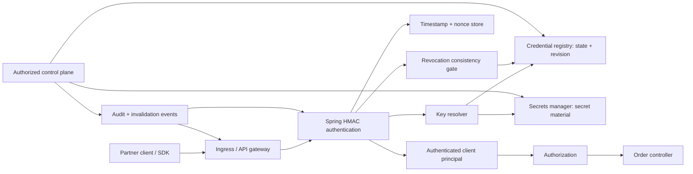
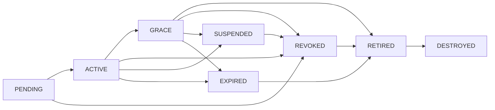
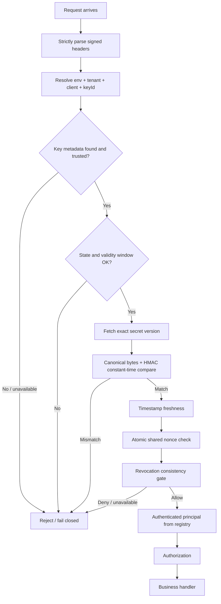

# Dự án thực hành: Thêm key rotation cho xác thực HTTP request bằng HMAC

## 1. Đề bài và kết quả cần bàn giao

Trong module `SECURITY_AUTHENTICATION_HMAC_REQUEST_AUTHENTICATION`, API xác thực một HTTP request bằng **HMAC dùng shared secret**, tính trên **canonical request** theo hợp đồng bao gồm phương thức, URI và các header/body đã chọn. Dự án này nâng cấp một hệ thống đang dùng **một secret cố định cho mỗi client** thành **nhiều key version với trạng thái, thời hạn và khả năng thu hồi**. Chức năng chống replay bằng timestamp/nonce, hành vi tại proxy/gateway và bước phân quyền sau xác thực phải tiếp tục hoạt động.

**Bài toán:** một API quản lý đơn hàng nhận `POST /v1/orders` từ client `merchant-a`. Hiện tại client ký bằng key A, server chỉ có cấu hình `merchant-a -> secretA`. Người vận hành cần phát hành key B, phân phối B tới client, kích hoạt B, cho phép A và B đồng tồn tại trong cửa sổ chuyển đổi ngắn, kết thúc quyền sử dụng A, và có thể **revoke A hoặc B ngay** nếu bị lộ.

Đây là **bài thực hành triển khai**, không chỉ là giải thích thuật ngữ. Người học cần tạo hoặc điều chỉnh các lớp, migration schema, test và runbook trong project Java/Spring của mình. Các tên package, SQL, endpoint và thời lượng bên dưới là **thiết kế mẫu**; không phải chuẩn chung cho mọi hệ thống HMAC hay cấu hình mặc định an toàn trong production.

### Đầu ra mong đợi

1. Mô hình `KeyVersion` và kho lưu credential **không chứa secret thô trong bảng metadata**; có `keyId`, trạng thái, thời gian hiệu lực và `revision`.
2. Quy trình quản trị `issue → distribute → activate/cutover → grace → retire` và thao tác `revoke` có quyền kiểm soát, audit, concurrency safety.
3. HMAC verifier chọn **đúng key được request chỉ định** sau khi kiểm tra key thuộc client/tenant và trạng thái; không thử các secret ngẫu nhiên.
4. Luồng timestamp/nonce chống replay và authorization tiếp tục chạy riêng biệt sau khi chữ ký và key được xác minh.
5. Tests chứng minh: A hoạt động trước cutover; A/B hoạt động đúng cửa sổ; A hết grace và A revoked bị từ chối **ngay cả khi MAC đúng**; B vẫn hoạt động; lỗi backend không bypass bảo mật.
6. Checklist triển khai, rollout, giám sát và rollback không mở lại key đã bị thu hồi.

## 2. Hợp đồng HMAC cố định trước khi thay đổi key

Đừng đồng thời thay đổi thuật toán canonicalization, tên header và key rotation nếu không có kế hoạch migration riêng. Để cô lập bài toán, sử dụng một hợp đồng ví dụ **HMAC-REQUEST-V1**:

```http
POST /v1/orders?ref=X-21 HTTP/1.1
Host: api.example.test
Content-Type: application/json
X-Client-Id: merchant-a
X-Key-Id: key-a-2026-11
X-Timestamp: 1735689600
X-Nonce: nonce-001
X-Signature: hmac-sha256=<64-hex-characters>

{"orderId":"O-9","amount":1000}
```

**Canonical request** gồm các dòng UTF-8 nối bằng byte LF (`0A`), không BOM, không newline cuối:

```text
HMAC-REQUEST-V1
POST
/v1/orders?ref=X-21
x-client-id:merchant-a
x-key-id:key-a-2026-11
x-timestamp:1735689600
x-nonce:nonce-001
body-sha256:<lowercase-hex-sha256-of-exact-body-bytes>
```

Quy tắc ký minh họa:

```text
signature = lowercaseHex(
    HMAC-SHA-256(secretBytesOfSelectedKeyId, UTF8(canonicalRequest))
)
```

**Chú ý khi thực hiện:**

- `X-Key-Id` và `X-Client-Id` nằm trong thông điệp được ký. Server tra key dựa trên cặp client/key **chưa được tin cậy**, sau đó chỉ tạo principal từ bản ghi có quyền sở hữu đã được kiểm chứng **khi HMAC hợp lệ**.
- Key A và B có **secret material khác nhau**, không chỉ đổi tên key ID. Khi client ký B, giá trị `X-Key-Id` phải đổi và canonical bytes cũng đổi.
- Server dùng đúng raw request target theo hợp đồng (path/query và thứ tự query); proxy rewrite phải có quy định rõ. Hash body trên **byte thực nhận theo quy tắc hợp đồng**, không tự parse JSON rồi stringify để tính lại.
- Header quan trọng bị thiếu, trùng, không đúng cấu trúc hoặc quá dài phải bị từ chối trước khi lookup. Không cho phép HTTP library tự chọn một trong hai header `X-Key-Id` khác nhau.
- Timestamp `1735689600` chỉ là dữ liệu **fixture lịch sử** (01/01/2025 UTC). Trong test xác thực hiện tại, dùng fake clock hoặc timestamp mới, không sao chép ví dụ thành request production.
- `X-Signature` không nằm trong canonical text của chính nó. Hợp đồng production phải định nghĩa rõ danh sách signed headers, canonicalization, encoding, digest, xử lý query và proxy, có test vectors độc lập giữa client/server.

Một thay đổi **key lifecycle** không được làm suy yếu các bất biến về chữ ký, replay hay phân quyền. Nếu muốn chuyển sang canonical V2 hoặc HMAC algorithm khác, hãy version hóa hợp đồng và migration riêng, thay vì cho verifier tự thử nhiều dạng cho đến khi khớp.

## 3. Kiến trúc đích và cấu trúc bài lab



Có thể tổ chức source Java trong project đang có theo trách nhiệm:

```text
security/hmac/
  CanonicalRequestBuilder.java
  HmacRequestAuthenticator.java
  HmacKeyResolver.java
  KeyVersion.java
  KeyLifecyclePolicy.java
  ReplayGuard.java
  RevocationGate.java
  HmacAuthenticationFilter.java          # Servlet, nếu dùng
  HmacAuthenticationWebFilter.java       # WebFlux, nếu dùng
security/hmac/admin/
  KeyLifecycleService.java
  KeyManagementController.java
  KeyLifecycleAudit.java
test/
  KeyLifecyclePolicyTest.java
  HmacKeyRotationIntegrationTest.java
  KeyRevocationConcurrencyTest.java
```

Danh sách này là **gợi ý cấu trúc** để người học tự tạo trong project, không yêu cầu phải dùng cả Servlet lẫn WebFlux. Nếu có gateway xác thực HMAC thay ứng dụng, phải quy định trust boundary và chống bypass: backend chỉ tin principal/headers từ gateway qua kết nối xác thực được, không tin header `X-Authenticated-Client` do client bên ngoài tự gửi.

## 4. Thiết kế key state machine và các bất biến

### 4.1. Trạng thái của mỗi key version

| Trạng thái | Verifier có nhận request mới? | Dùng khi nào? |
|---|---|---|
| `PENDING` | Không. | Đã tạo key B, chờ phân phối/test/activation. |
| `ACTIVE` | Có, nếu trong validity window. | Key chính đang sử dụng. |
| `GRACE` | Có **tới mốc grace sớm hơn expiry**, nếu key chưa bị compromise. | Key A cũ trong rotation thông thường. |
| `SUSPENDED` | Không. | Tạm dừng để điều tra; mở lại cần policy/phê duyệt. |
| `REVOKED` | **Không bao giờ** với cùng version. | Ngừng tin cậy key do compromise/sự cố nghiêm trọng. |
| `EXPIRED` | Không. | Key đã hết thời hạn, không gia hạn bằng cách sửa đồng hồ. |
| `RETIRED` | Không. | Đã kết thúc sử dụng sau rotation, có thể giữ metadata. |
| `DESTROYED` | Không. | Key material đã được hủy theo quy trình retention. |



Các edge trên là luồng chính minh họa. Hệ thống có thể hỗ trợ `SUSPENDED → ACTIVE` chỉ khi key **chưa bị compromise**, theo quy trình phê duyệt riêng; `REVOKED` phải là trạng thái terminal về quyền xác thực, dù còn lưu metadata để audit.

**Bất biến phải được kiểm thử:**

1. Không bao giờ chấp nhận `REVOKED/SUSPENDED/PENDING/EXPIRED/RETIRED/DESTROYED` chỉ vì HMAC khớp.
2. `ACTIVE` chỉ hợp lệ trong `[notBefore, expiresAt)`; `GRACE` chỉ trong `[notBefore, min(graceUntil, expiresAt))`.
3. Tất cả key versions có secret độc lập, tách môi trường và tenant; không dùng default secret hoặc dùng secret B để xác minh request khai báo A.
4. Metadata update và invalidation phải dùng revision tăng đơn điệu; event `ACTIVE rev=9` đến sau `REVOKED rev=10` không mở lại key.
5. Authentication không bỏ bước timestamp/nonce và authorization; nonce không phân tách theo key ID nếu như thế cho phép cùng request replay qua A/B.
6. Cùng một key version không được `REVOKED → ACTIVE/GRACE` vì retry job, rollback hoặc restore backup.

### 4.2. Quy ước cửa sổ thời gian

Một policy minh họa:

```text
tenant        = tenant-vn-01
client        = merchant-a
key A         = key-a-2026-11
key B         = key-b-2026-12
T0           = 2026-12-01T00:00:00Z   # issue B as PENDING
T1           = 2026-12-02T00:00:00Z   # B ACTIVE, A GRACE
graceUntil   = 2026-12-02T00:30:00Z   # A stops being acceptable
expiresAt(A) = 2026-12-10T00:00:00Z
```

Tại `T1 - ε`, A ACTIVE còn B PENDING, nên request hợp lệ dùng A được nhận; B bị từ chối. Tại `T1`, B ACTIVE, A GRACE; cả hai có thể được chấp nhận trong thời gian overlap. Tại `graceUntil`, A không còn được nhận **ngay cả khi job đổi status sang RETIRED bị trễ**. Các thời điểm trên dùng server clock; kiểm tra timestamp request là bước độc lập.

## 5. Schema và lưu trữ credential theo phiên bản

### 5.1. SQL tham khảo (PostgreSQL)

```sql
CREATE TABLE hmac_key_versions (
    environment     varchar(24) NOT NULL,
    tenant_id       varchar(100) NOT NULL,
    client_id       varchar(100) NOT NULL,
    family_id       varchar(100) NOT NULL,
    key_id          varchar(100) NOT NULL,
    state           varchar(20) NOT NULL
                    CHECK (state IN (
                        'PENDING', 'ACTIVE', 'GRACE', 'SUSPENDED',
                        'REVOKED', 'EXPIRED', 'RETIRED', 'DESTROYED'
                    )),
    algorithm       varchar(40) NOT NULL,
    contract        varchar(64) NOT NULL,
    secret_ref      text NOT NULL,
    not_before      timestamptz NOT NULL,
    expires_at      timestamptz NOT NULL,
    grace_until     timestamptz NULL,
    revision        bigint NOT NULL DEFAULT 1,
    revoked_at      timestamptz NULL,
    updated_at      timestamptz NOT NULL DEFAULT now(),
    PRIMARY KEY (environment, tenant_id, client_id, key_id),
    CHECK (not_before < expires_at),
    CHECK (revision > 0),
    CHECK (state <> 'GRACE' OR (
        grace_until IS NOT NULL AND
        grace_until > not_before AND
        grace_until <= expires_at
    ))
);

-- Tối đa một ACTIVE trong một family ở mỗi tenant/client/environment.
CREATE UNIQUE INDEX hmac_one_active_per_family
ON hmac_key_versions (environment, tenant_id, client_id, family_id)
WHERE state = 'ACTIVE';

CREATE INDEX hmac_key_lookup_by_family_state
ON hmac_key_versions (environment, tenant_id, client_id, family_id, state);
```

**Mô hình dữ liệu phân tách:**

- Bảng metadata chỉ chứa `secret_ref`, **không chứa shared secret** hoặc derived key bytes; KMS/secrets manager/vault giữ secret material.
- Các khóa tra cứu gồm `environment + tenant_id + client_id + key_id`; không tra chỉ theo `key_id` khi identifier không toàn cục.
- Một client có thể có nhiều family khác nhau cho các API/credential scope khác nhau; kiểm soát scope trong key resolver.
- Index giới hạn **một ACTIVE** nhưng không tự giới hạn bao nhiêu GRACE; policy service có thể thêm giới hạn `maxGraceVersions=1`, cùng transaction/lock family khi rotation. Tùy yêu cầu có thể dùng constraint/index riêng cho GRACE.
- `revoked_at` và revision hỗ trợ audit/propagation. Giữ tombstone khi xóa vật liệu; **không tái dùng keyId** đã tồn tại.

Trong DB production cần thêm bảng audit, idempotency cho API quản trị, kiểm soát truy cập, transaction timeout và khả năng phục hồi; migration SQL ở đây là khung khái niệm để tự điều chỉnh.

### 5.2. Tạo key B bằng CSPRNG và lưu an toàn

```java
import java.security.SecureRandom;
import java.util.Arrays;

final class SecretIssuer {
    private static final SecureRandom RANDOM = new SecureRandom();

    static void createNewVersion(String secretRef, SecretVault vault) {
        byte[] secret = new byte[32]; // 256-bit random HMAC-SHA-256 key
        RANDOM.nextBytes(secret);
        try {
            vault.createVersion(secretRef, secret);
        } finally {
            Arrays.fill(secret, (byte) 0);
        }
    }

    interface SecretVault {
        void createVersion(String ref, byte[] secret);
    }
}
```

`Arrays.fill` chỉ giảm thời gian secret tồn tại trong **mảng cục bộ này**, không đảm bảo xóa mọi bản sao trong JVM, SDK, network hay vault. Định nghĩa channel giao secret có xác thực cho đối tác, quyền người nhận, audit và giới hạn số lần hiển thị; không gửi secret thô qua log, email không bảo vệ, ticket hoặc commit vào Git. Không tái sử dụng key A hoặc derive B bằng `hash(A)` tùy tiện.

## 6. Triển khai control plane: issue, cutover, revoke

Quản trị key là thao tác nhạy cảm; chỉ nhân sự/dịch vụ có quyền riêng được thực hiện, có audit và (khi cần) phê duyệt nhiều bước. Không cung cấp endpoint `revoke/activate` chỉ dựa trên cùng credential HMAC vừa có nguy cơ bị lộ.

### 6.1. API quản trị dự kiến

| Thao tác | Request minh họa | Điều kiện |
|---|---|---|
| Issue B | `POST /internal/clients/{clientId}/keys` | Admin có quyền; tạo `keyId` mới, secret mới, state `PENDING`, audit. |
| Xác nhận delivery | `POST .../keys/{keyId}/delivery-ack` | Được gửi/nhận an toàn; không tự kích hoạt chỉ dựa vào lời khai client. |
| Activate/cutover | `POST .../rotation/activate` | B PENDING, A ACTIVE, verifier đã có B; transaction chuyển A→GRACE, B→ACTIVE. |
| Revoke ngay | `POST .../keys/{keyId}/revoke` | Ưu tiên cao, trạng thái terminal; có incident reason và revocation propagation. |
| Retire A | `POST .../keys/{keyId}/retire` | A không còn được chấp nhận; đảm bảo audit và secret retention policy. |
| Read status | `GET .../keys/{keyId}` | Trả metadata hạn chế; tuyệt đối không trả secret đã phát hành. |

Endpoint là ví dụ, không phải REST contract bắt buộc. Cần authentication/authorization mạnh cho control plane, rate limiting, idempotency key và revision precondition cho lệnh update để ngăn điều khiển sai do retry hoặc chạy song song.

### 6.2. Cutover phải là transaction, không phải hai lệnh tùy ý

Trong cùng một transaction:

1. Lock **family/credential aggregate** hoặc dùng CAS có khả năng cập nhật hai bản ghi nguyên tử.
2. Kiểm tra A vẫn `ACTIVE`, B đúng `PENDING`, cùng tenant/client/family, B đã phân phối/đủ readiness.
3. Kiểm tra B `notBefore <= serverNow < expiresAt` và A chưa `REVOKED`; xác định `graceUntil` không vượt `expiresAt(A)`.
4. Chuyển A sang `GRACE`, tăng revision; rồi chuyển B sang `ACTIVE`, tăng revision. Với unique index một ACTIVE, **chuyển A trước** trong transaction để không vi phạm constraint.
5. Ghi audit/outbox event trong cùng transaction; commit thành công mới publish invalidation. Nếu transaction rollback, cả hai trạng thái phải giữ nguyên.

Ví dụ SQL có kiểm tra revision (thực thi trong transaction mà đã lock family):

```sql
BEGIN;
-- Trong app cần khóa family/aggregate (hoặc advisory lock có quản trị)
-- để ngăn hai thao tác rotation song song cùng client.

UPDATE hmac_key_versions
SET state = 'GRACE',
    grace_until = :grace_until,
    revision = revision + 1,
    updated_at = now()
WHERE environment = :env AND tenant_id = :tenant
  AND client_id = :client AND family_id = :family_id
  AND key_id = :old_key_id
  AND state = 'ACTIVE' AND revision = :old_expected_revision;
-- ASSERT affected rows = 1; otherwise ROLLBACK.

UPDATE hmac_key_versions
SET state = 'ACTIVE',
    revision = revision + 1,
    updated_at = now()
WHERE environment = :env AND tenant_id = :tenant
  AND client_id = :client AND family_id = :family_id
  AND key_id = :new_key_id
  AND state = 'PENDING' AND revision = :new_expected_revision
  AND not_before <= now() AND now() < expires_at;
-- ASSERT affected rows = 1; otherwise ROLLBACK.

-- INSERT audit/outbox event with both updated key revisions here.
COMMIT;
```

**Không copy mù đoạn SQL sang production**: phần ASSERT, locking, quyền operator, family ownership, kiểm tra expiry/grace và outbox cần code ứng dụng thực thi. Một CAS update riêng từng row mà không có transaction/family lock có thể gây race với lệnh revoke. Nếu `revoke(A)` đã commit trước, `state='ACTIVE'` và revision precondition của cutover phải fail; tuyệt đối không dùng retry “cứ đặt A=GRACE” để làm sống lại A.

### 6.3. Revoke là ưu tiên cao nhất

```sql
UPDATE hmac_key_versions
SET state = 'REVOKED',
    revoked_at = now(),
    grace_until = NULL,
    revision = revision + 1,
    updated_at = now()
WHERE environment = :env AND tenant_id = :tenant
  AND client_id = :client AND key_id = :key_id
  AND revision = :expected_revision
  AND state IN ('PENDING', 'ACTIVE', 'GRACE', 'SUSPENDED');
-- ASSERT affected rows = 1. Ghi audit/outbox trong cùng transaction.
```

Khi CAS fail, **đọc lại record authoritative**; nếu đã `REVOKED` thì có thể trả trạng thái idempotent cho yêu cầu trùng. Nếu key đã bị retire/expired, vẫn cần diễn đạt rõ cách ghi sự kiện compromise và audit, không hồi sinh key để revoke. Khi revoke B đang ACTIVE, **không tự chuyển A GRACE về ACTIVE**: A có thể đã hết hạn, bị nghi compromise hoặc được dự kiến retire. Khôi phục availability bằng key mới được cấp an toàn và chính sách được phê duyệt.

## 7. Java 17: policy kiểm tra key version

Một helper thuần, dễ unit test, giúp tránh tình trạng `state=ACTIVE` nhưng đã vượt `expiresAt` vẫn được xác minh. Dùng server clock; kiểm tra trạng thái từ registry/gate ở nơi khác.

```java
import java.time.Instant;
import java.util.Objects;

public final class KeyLifecyclePolicy {
    public enum State {
        PENDING, ACTIVE, GRACE, SUSPENDED,
        REVOKED, EXPIRED, RETIRED, DESTROYED
    }

    public record KeyVersion(
        String environment,
        String tenantId,
        String clientId,
        String keyId,
        State state,
        Instant notBefore,
        Instant expiresAt,
        Instant graceUntil,
        long revision,
        String secretRef
    ) {
        public KeyVersion {
            Objects.requireNonNull(environment);
            Objects.requireNonNull(tenantId);
            Objects.requireNonNull(clientId);
            Objects.requireNonNull(keyId);
            Objects.requireNonNull(state);
            Objects.requireNonNull(notBefore);
            Objects.requireNonNull(expiresAt);
            Objects.requireNonNull(secretRef);
            if (!notBefore.isBefore(expiresAt) || revision <= 0) {
                throw new IllegalArgumentException("Invalid key metadata");
            }
            if (state == State.GRACE &&
                (graceUntil == null ||
                 !graceUntil.isAfter(notBefore) ||
                 graceUntil.isAfter(expiresAt))) {
                throw new IllegalArgumentException("Invalid grace window");
            }
        }

        public boolean canVerifyAt(Instant serverTime) {
            Objects.requireNonNull(serverTime);
            if (state != State.ACTIVE && state != State.GRACE) {
                return false;
            }
            if (serverTime.isBefore(notBefore) ||
                !serverTime.isBefore(expiresAt)) {
                return false; // [notBefore, expiresAt)
            }
            return state != State.GRACE ||
                   serverTime.isBefore(graceUntil);
        }
    }

    private KeyLifecyclePolicy() { }
}
```

**Giới hạn của helper:** kết quả `canVerifyAt=true` chỉ cho biết metadata hiện **tại bản snapshot** được phép về mặt thời gian/trạng thái. Nó chưa kiểm tra key ownership, tính nhất quán revocation, HMAC hay replay. Nếu cache giữ `ACTIVE rev=7` nhưng source đã `REVOKED rev=8` thì helper vẫn có thể trả `true`; verifier phải có **revocation consistency gate** hoặc chính sách cache đã được phân tích để chặn.

## 8. Tích hợp resolver vào HMAC authentication

### 8.1. Luồng xác thực cần giữ bất biến



Đặc điểm quan trọng: request gửi `X-Key-Id=B` thì chỉ dùng **secretB**. Nếu lookup B thất bại, **không thử secretA** để xem MAC có khớp hay không. HMAC phải so sánh byte MAC có độ dài/format hợp lệ, chẳng hạn `MessageDigest.isEqual`; không log secret, raw/expected signature hoặc canonical body chứa PII.

### 8.2. Pseudocode verifier (tích hợp trong Servlet/WebFlux)

Các lớp `TrustedKeyResolver`, `SignedRequestParser`, `HmacVerifier`, `NonceStore` và `RevocationGate` dưới đây là interface của ứng dụng, **không phải API có sẵn trong Spring Security**. `environment` và `tenantId` phải lấy từ ngữ cảnh ingress/route đã xác lập tin cậy hoặc được ràng buộc trong hợp đồng signed request; không cho một header tenant chưa ký tự chuyển security scope.

```java
AuthenticationResult authenticate(HttpRequest http) {
    SignedRequest r = parser.parseStrictly(http);
    // Reject duplicate/malformed X-Client-Id, X-Key-Id,
    // X-Timestamp, X-Nonce, X-Signature before lookup.

    KeyVersion meta = resolver.findAuthoritativeOrFailClosed(
        r.environment(), r.tenantId(), r.clientId(), r.keyId());

    if (!meta.canVerifyAt(clock.instant()) ||
        !meta.clientId().equals(r.clientId()) ||
        !meta.tenantId().equals(r.tenantId())) {
        throw invalidCredentials();
    }

    byte[] secret = secretStore.fetchRequired(meta.secretRef());
    byte[] canonical = canonicalizer.buildFromRawRequest(r);
    byte[] expected = hmacSha256(secret, canonical);
    byte[] supplied = signatureCodec.decodeExactHmacSha256(r.signature());
    if (!MessageDigest.isEqual(expected, supplied)) {
        throw invalidCredentials();
    }

    freshness.requireValid(r.timestamp(), clock.instant());
    // Shared per-client scope, not per keyId: stop A/B replay.
    nonceStore.insertOnceOrReject(
        r.tenantId(), r.clientId(), r.nonce(), r.timestamp());
    revocationGate.requireCurrentUsable(
        r.tenantId(), r.clientId(), r.keyId(), meta.revision());

    // One authenticated client, authorization is a separate decision.
    return AuthenticationResult.client(meta.clientId());
}
```

Hàm trên chỉ mô tả **quyết định nghiệp vụ**, không phải code copy-paste triển khai đầy đủ. Cần kiểm soát đời sống secret bytes, body buffering (đặc biệt WebFlux), idempotency, key scopes, KMS dependency, lỗi lookup phân loại, thuật toán allowlist, canonical version và race giữa revoke với request đang chạy.

**Nonce lifetime:** nếu chấp nhận timestamp trong khoảng `[now - W, now + W]` và nonce được đánh dấu khi request đến sớm nhất ở `timestamp - W`, request đó có thể còn hợp lệ tới `timestamp + W`. Vì vậy TTL phải bao phủ **tối thiểu 2W cộng biên an toàn** tính từ lần chấp nhận đầu tiên, trừ khi hệ thống dùng chiến lược expiry chính xác theo timestamp. Không nên tự đặt TTL = W khi policy cho phép timestamp ở tương lai.

Một Redis-like atomic nonce store có thể thực hiện `SET nonceKey 1 NX PX ttlMs` và chỉ chấp nhận khi trả kết quả thành công; key phải bao gồm tenant/client scope phù hợp, không bao gồm `keyId` nếu như vậy cho phép phát lại bằng phiên bản khác. Nếu Redis/nonce store mất kết nối, **fail closed**; không cho “trường hợp rotation ngoại lệ bỏ nonce”. Với yêu cầu chống replay đa vùng, phải bảo đảm atomicity xuyên các verifier có khả năng nhận cùng request.

**Revocation barrier:** nếu cần chặn key ngay sau commit revoke, một event invalidation không đủ bảo đảm vì lag/caching và in-flight requests. Xác định rõ điểm tuyến tính hóa của xác thực với revoke, cân nhắc gate có tính nhất quán mạnh, kiểm tra trước tác dụng nghiệp vụ nhạy cảm và kiểm thử race. Kiểm tra `revision` một lần ở cuối không mặc nhiên bảo đảm không có revoke đồng thời.

Trong **Spring Servlet**, tích hợp resolver/verifier qua `OncePerRequestFilter` và `AuthenticationProvider`; trong **Spring WebFlux**, dùng `WebFilter`/`ReactiveAuthenticationManager` với kho key/secret async, tránh blocking event loop. Khi thành công, principal/scope từ registry đi tới Spring Security authorization. Khi lookup/key revoked/signature sai, không tạo authenticated `SecurityContext`. Public endpoints chỉ miễn HMAC khi được khai báo chính sách route trước đó, không do registry timeout.

## 9. JUnit 5: test biên thời gian và state

Các test sau làm việc trên helper `KeyLifecyclePolicy` ở phần 7, không cần database hay vault. Đưa vào test source của project có JUnit Jupiter.

```java
import static org.junit.jupiter.api.Assertions.*;
import org.junit.jupiter.api.Test;
import java.time.Instant;

class KeyLifecyclePolicyTest {
    static final Instant START =
        Instant.parse("2026-12-02T00:00:00Z");
    static final Instant GRACE_END =
        Instant.parse("2026-12-02T00:30:00Z");
    static final Instant EXPIRES =
        Instant.parse("2026-12-10T00:00:00Z");

    KeyLifecyclePolicy.KeyVersion key(KeyLifecyclePolicy.State state) {
        return new KeyLifecyclePolicy.KeyVersion(
            "prod", "tenant-vn-01", "merchant-a", "key-a-2026-11",
            state, START.minusSeconds(3600), EXPIRES, GRACE_END,
            12, "vault://merchant-a/key-a"
        );
    }

    @Test
    void activeUsesHalfOpenValidityWindow() {
        var key = key(KeyLifecyclePolicy.State.ACTIVE);
        assertTrue(key.canVerifyAt(START));
        assertTrue(key.canVerifyAt(EXPIRES.minusNanos(1)));
        assertFalse(key.canVerifyAt(EXPIRES));
    }

    @Test
    void graceStopsAtCutoffEvenIfNotRetiredYet() {
        var oldKey = key(KeyLifecyclePolicy.State.GRACE);
        assertTrue(oldKey.canVerifyAt(GRACE_END.minusNanos(1)));
        assertFalse(oldKey.canVerifyAt(GRACE_END));
        assertFalse(oldKey.canVerifyAt(EXPIRES.minusSeconds(1)));
    }

    @Test
    void revokedMustFailEvenBeforeExpiry() {
        var revoked = key(KeyLifecyclePolicy.State.REVOKED);
        assertFalse(revoked.canVerifyAt(START));
    }

    @Test
    void nonActiveStatesMustFail() {
        for (var s : KeyLifecyclePolicy.State.values()) {
            if (s != KeyLifecyclePolicy.State.ACTIVE &&
                s != KeyLifecyclePolicy.State.GRACE) {
                assertFalse(key(s).canVerifyAt(START), s.name());
            }
        }
    }
}
```

**Giới hạn của unit test:** pass các test này chưa chứng minh API chống replay hay revoke toàn hệ thống. Bổ sung integration tests dùng **secret A/B test độc lập**, in-memory/fake vault, fake clock, fake key resolver và nonce store test; đặc biệt cần tạo **request có HMAC đúng bằng key A** sau khi A revoked để xác nhận verifier chặn vì lifecycle state chứ không vì MAC sai.

## 10. Ma trận integration tests và fault injection

Kịch bản giả định key A là version cũ, key B là version mới, cả hai thuộc `merchant-a` và dùng các secret ngẫu nhiên khác nhau trong test. Đảm bảo parser/canonicalization thực sự ký các key IDs và client ID.

| # | Trạng thái và thao tác | Kết quả kỳ vọng |
|---|---|---|
| 1 | A `ACTIVE`, B `PENDING`; request ký đúng A. | Authentication pass, authorization theo scope. |
| 2 | B `PENDING`; request ký đúng B. | Authentication fail, dù HMAC toán học hợp lệ. |
| 3 | Cutover T1; A `GRACE` và B `ACTIVE`, request A/B riêng, nonce mới. | Cả A/B có thể pass trong grace, mỗi request xử lý một lần. |
| 4 | Tại đúng `graceUntil`, request ký đúng A. | Bị từ chối dù scheduler chưa retire. |
| 5 | Sau `graceUntil`, request B hợp lệ. | B tiếp tục hoạt động. |
| 6 | A `REVOKED` trong khi còn grace, request có **MAC đúng bằng secretA**. | Bị từ chối mọi region; không fallback. |
| 7 | B `REVOKED`, còn A GRACE. | B bị từ chối; không tự mở A thành ACTIVE. |
| 8 | A `ACTIVE rev9` cache, nguồn đã `REVOKED rev10`. | Revocation gate/invalidation chặn A; không tin cache cũ vô thời hạn. |
| 9 | Event `REVOKED rev10` đến trước `ACTIVE rev9`. | Không ghi đè tombstone/revocation bằng state cũ. |
| 10 | Hai operator đồng thời cutover và revoke A. | CAS/transaction/lock bảo đảm không hồi sinh revoked key. |
| 11 | B ký đúng, gửi `X-Key-Id=A` nhưng giữ chữ ký B. | Từ chối; không thử secret khác. |
| 12 | Dùng keyId A thuộc client khác và giả `X-Client-Id=merchant-a`. | Không cross-tenant/client authentication. |
| 13 | A và B cùng ký một request/nonce với từng keyId, gửi nối tiếp. | Request sau bị replay guard từ chối theo scope chung. |
| 14 | Hai request cùng nonce đến đồng thời hai node. | Chỉ một thao tác atomic có thể thành công; nghiệp vụ không chạy đôi. |
| 15 | Registry timeout/KMS trả lỗi khi cần B. | Fail closed, không thử A hoặc bỏ HMAC. |
| 16 | Nonce store unavailable nhưng MAC đúng. | Fail closed, không vô hiệu anti-replay. |
| 17 | Timestamp ngoài skew nhưng MAC đúng. | Freshness check từ chối; khác lỗi lifecycle. |
| 18 | Proxy rewrite URI, query, header hoặc body sau khi client ký. | Phát hiện canonical mismatch và không bỏ qua verification. |
| 19 | MAC đúng nhưng merchant thiếu `orders:write`. | Authentication pass; authorization deny. |
| 20 | Restart verifier với cache snapshot trước revoke. | Recheck authoritative revision/gate, không sống lại key. |
| 21 | Client dùng B nhưng quên gửi `X-Key-Id` hoặc gửi hai header trùng. | Reject malformed; không đoán keyId từ signature. |
| 22 | Đến `expiresAt` nhưng state còn ACTIVE. | Từ chối; metadata label không ghi đè validity time. |

**Thiết kế test runner:** dùng `MockMvc` cho Spring Servlet hoặc `WebTestClient` cho WebFlux; có thể tạo request thực qua gateway/HTTP proxy để kiểm tra raw URI, header normalization và payload bytes. Trong test, dùng fake clock để tới T1/graceUntil/expiresAt mà không phụ thuộc giờ thật; dùng *fresh nonce* cho các ca không kiểm tra replay; dùng lại nonce có chủ ý cho ca replay. Test anti-pattern phải so sánh **MAC hợp lệ** của key revoked, không chỉ chữ ký sai rồi suy ra revoke đã hoạt động.

### 10.1. Bộ kiểm tra acceptance tự động nên đo

Test report cần gắn rõ nguyên nhân: `KEY_PENDING`, `KEY_GRACE_EXPIRED`, `KEY_REVOKED`, `KEY_NOT_FOUND`, `LOOKUP_UNAVAILABLE`, `MAC_MISMATCH`, `TIMESTAMP_STALE`, `REPLAY`, `AUTHORIZATION_DENIED`. Public response có thể gom thành thông báo xác thực chung để tránh lộ trạng thái key; audit nội bộ phải phân loại đủ để chẩn đoán.

Không đưa raw signature, secret, expected MAC hoặc canonical request chứa payload nhạy cảm vào test log production. Chỉ dùng test keys trong fixture và kiểm soát log capture.

## 11. Runbook triển khai trên nhiều node/region

### Giai đoạn A — Chuẩn bị (trước T0)

1. Inventory các client, key families, API endpoints và gateway/verifier đang xác thực HMAC.
2. Đảm bảo tất cả phiên bản server nhận `X-Key-Id`, phân biệt secret version và chặn trạng thái không hợp lệ **trước khi** bật cutover. Client hiện tại chưa có keyId cần migration tương thích có hạn và hợp đồng riêng; không tự ép fallback chọn key mặc định.
3. Định nghĩa nguồn metadata authoritative, secret manager, revision/invalidation event, revocation gate, time skew và nonce store chung.
4. Chuẩn bị dashboard theo `keyVersion`/cohort/region (tránh metric label có cardinality quá cao) và SLO lookup/revocation propagation.
5. Chạy golden vectors cho canonicalization của cả client và server, kể cả proxy thực tế.

### Giai đoạn B — Issue B và warm-up (T0 đến T1)

Tạo key B với CSPRNG, trạng thái `PENDING`. Lưu trong vault và phân phối an toàn cho `merchant-a`. Client chuẩn bị ký B; verifier/gateway cập nhật metadata B và được kiểm thử readiness bằng luồng chuẩn bị **không mở xác thực nghiệp vụ khi B chưa ACTIVE**. Nếu cần test chữ ký B trước activation, dùng test endpoint/sandbox với quyền hạn riêng, không vô hiệu lifecycle guard trên production route.

Theo dõi `PENDING issue count`, xác nhận phân phối và tình trạng các region. Không cutover khi có verifier chưa nhận đúng contract/key metadata.

### Giai đoạn C — Cutover và grace (T1 đến graceUntil)

Control plane cập nhật nguyên tử A→GRACE, B→ACTIVE; phát event có revision sau commit. Client chuyển sang gửi B; giữ A chỉ trong cửa sổ overlap đã phê duyệt. Theo dõi tỷ lệ request còn dùng A, mismatch, key lookup failures, replay failures và authorization errors. Không vì 401 tăng mà tăng grace vô hạn; cần kế hoạch xử lý client cũ cụ thể.

Hệ thống phải đo **propagation lag của trạng thái** tới từng verifier/gateway; với SLA revoke nghiêm ngặt cần gate đảm bảo hơn event. Nếu một region chưa sẵn sàng, có thể tạm dừng rollout/cô lập nó theo quy trình, không cho bypass HMAC.

### Giai đoạn D — Kết thúc và thu dọn

Tại `graceUntil`, A bị từ chối dựa trên policy timestamp dù job cleanup chậm. Sau đó chuyển A sang `RETIRED/EXPIRED`, giữ metadata/tombstone và quản lý destruction của material theo retention, incident/legal requirements. Không xóa toàn bộ audit trước khi đánh giá. Đưa config, dashboard và SDK sample về dùng B, bỏ đường legacy không còn cần.

### Giai đoạn E — Sự cố và rollback

Nếu B chưa hoạt động **trước cutover**, có thể dừng T1, sửa client/secret distribution. Nếu B lỗi **trong grace** và A còn đáng tin, có thể rollback có phê duyệt, giới hạn thời gian và audit; không cho client tự chọn mode hay thay đổi state không kiểm soát.

Nếu A hoặc B đã `REVOKED` do compromise, **không rollback để bật lại key đó**. Cần tạo key C, giao qua kênh tin cậy và khôi phục theo chính sách phê duyệt; có thể chấp nhận gián đoạn ngắn thay vì cho phép request giả mạo. Điều tra request đã chấp nhận trong cửa sổ nghi ngờ, nonce/replay và side effects — revoke không hoàn tác nghiệp vụ đã commit.

## 12. Monitoring, security và tối ưu hệ thống

| Tín hiệu | Phân tích | Cảnh báo |
|---|---|---|
| `hmac_auth_total{key_state,outcome}` | Request được chấp nhận/từ chối theo state và reason. | Tỷ lệ error tăng sau cutover, hoặc key revoked có dấu hiệu được chấp nhận. |
| `hmac_key_lookup_duration_seconds{region}` | Latency, timeout, cache miss. | p95/p99 tăng, circuit open. |
| `hmac_rotation_old_key_requests` | Client vẫn dùng A trong grace. | Lưu lượng A không giảm khi gần hết grace. |
| `hmac_revocation_propagation_lag_seconds` | Thời gian từ commit revoke đến khi mọi verifier chặn. | Vượt ngưỡng rủi ro đã cam kết. |
| `hmac_replay_rejected_total` | Replay qua A/B và các region. | Spike hoặc lỗi nonce store. |
| `hmac_key_state_revision_lag` | Điểm xác minh có revision chậm. | Gateway/node còn giữ snapshot trước revoke. |
| `hmac_authorization_denied_total` | HMAC đúng nhưng không có scope. | Đột biến sai role/scope sau key provisioning. |

**Không đưa raw signature, secret hoặc canonical body vào log**; chỉ log request ID, route template, version/key ID theo chính sách, outcome, revision và latency. Tránh keyId/clientId là metric label cardinality không giới hạn. Kiểm tra mọi gateway, reverse proxy, CDN, application, APM/tracer cùng áp dụng redaction. Secret mới có thể tồn tại trong RAM verifier nhưng không được xuất ra log/dump tùy ý.

SLO minh họa cần thỏa thuận: **activation propagation deadline**, **revocation effectiveness window**, **grace maximum**, availability của credential lookup và nonce store, latency p99 HMAC. Không gán giá trị mặc định vô căn cứ cho mọi hệ thống. Một cache TTL ngắn không tương đương revoke tức thì nếu yêu cầu an ninh cao; revocation gate fail closed có đánh đổi availability cần định nghĩa rõ.

## 13. Checklist bàn giao và tiêu chí chấm dự án

### Checklist triển khai

- [ ] Mỗi client/environment có ít nhất hai **key version độc lập** và `keyId` được ký trong canonical request.
- [ ] Key B sinh bằng CSPRNG, lưu trong vault/secrets manager, giao qua kênh kiểm soát; không ghi secret vào DB metadata/log.
- [ ] State machine chặn `PENDING/SUSPENDED/REVOKED/EXPIRED/RETIRED/DESTROYED`; grace và expiry đúng biên.
- [ ] Cutover transaction bảo đảm A→GRACE và B→ACTIVE nhất quán; lệnh revoke ưu tiên và dùng CAS/revision.
- [ ] Verifier tra đúng client/key scope, không thử fallback key/algorithm/canonical version tùy ý.
- [ ] Timestamp/nonce và chống replay xuyên key versions vẫn hiệu lực, không bỏ qua trong outage.
- [ ] Spring Security authentication tách với authorization, không để public client header giả principal.
- [ ] Gateway, Servlet/WebFlux, cache và các region dùng chính sách key/revocation đáng tin.
- [ ] Test ký đúng bằng key bị revoked vẫn bị từ chối; test race/cutover, replay, registry outage và proxy rewrite.
- [ ] Có dashboard, alert, audit, hướng dẫn rollback và thủ tục cấp key mới sau compromise.

### Rubric (100 điểm, chỉ dùng cho bài thực hành)

| Nhóm tiêu chí | Điểm tối đa | Điều kiện quan trọng |
|---|---:|---|
| Contract HMAC + đúng key selection | 20 | Canonical request chính xác, signed keyId/clientId, không fallback key. |
| Model lifecycle và storage | 20 | State/time/revision/ownership, secret riêng per version, DB không lưu secret thô. |
| Rotation/revocation và concurrency | 20 | Cutover transaction, grace cutoff, revoke không resurrect, propagation policy. |
| Replay và phân quyền | 15 | Nonce atomic chung, timestamp freshness, authorization độc lập. |
| Kiểm thử thực tế và fault injection | 15 | HMAC đúng sau revoke vẫn fail, race, gateway, lookup outage. |
| Vận hành, audit, monitoring | 10 | Runbook, cảnh báo, recovery và log không rò secret/MAC. |

**Điều kiện loại trực tiếp dù tổng điểm cao:** có thể authenticate bằng key `REVOKED`, bypass HMAC khi key lookup lỗi, dùng key khác với `keyId` chỉ định, bỏ anti-replay đối với endpoint yêu cầu, hoặc gắn quyền dựa vào clientId chưa được xác minh.

## 14. Bài tập mở rộng: diễn tập hai loại rotation

**Phần 1 — Rotation thường kỳ:** thực hiện đầy đủ kịch bản A→B ở T1, grace 30 phút (chỉ là tham số lab). Trong test, tiến fake clock qua ba thời điểm T1−1 ms, T1+1 ms và graceUntil+1 ms; thu thập trạng thái A/B, outcome authentication và lượng traffic cũ. Chứng minh old key hết thời hạn theo policy chứ không phụ thuộc scheduler chạy đúng phút.

**Phần 2 — Compromise khẩn:** giả lập A bị lộ ở T1+5 phút khi A đang GRACE. Gửi request có chữ ký đúng bằng A với timestamp/nonce mới và xác nhận toàn bộ verifier từ chối sau khi revoke có hiệu lực. Cố phát event cũ `ACTIVE rev9` tới gateway sau `REVOKED rev10` và test không hồi sinh A. Sau đó tạo key C, xác minh kênh giao mới, tránh sử dụng lại secret A và điều tra side effects trong cửa sổ nghi ngờ.

**Phần 3 — Chạy qua proxy:** bật ingress rewrite path hoặc reorder query trong môi trường lab. Chứng minh canonical bytes không tương thích sẽ làm chữ ký sai; chọn một hợp đồng thống nhất (client ký raw target theo ingress, hoặc một canonicalization được đặc tả trước) thay vì bỏ bảo vệ URI. Đảm bảo key rotation không che lỗi canonicalization bằng cách thử HMAC với nhiều dạng request.

**Câu hỏi tự đánh giá:** nếu TTL cache key là 5 phút nhưng SLO revoke yêu cầu chặn trong vài giây, yếu tố nào trong kiến trúc phải thay đổi? Nếu 10 merchant vô tình dùng cùng một secret vật lý dưới 10 `keyId` khác nhau, danh sách credential phải revoke và phạm vi điều tra thay đổi ra sao? Nếu Redis nonce store bị phân vùng giữa hai region, còn coi replay protection đã đạt yêu cầu không?

**Kết luận:** hoàn thành key rotation không phải chỉ cho phép server đọc hai secret. Một hệ thống HMAC có thể vận hành an toàn khi có **key versions với trạng thái/hiệu lực kiểm chứng được**, **chuyển trạng thái nguyên tử và có audit**, **thu hồi tác dụng tại mọi verifier**, và một pipeline request giữ nguyên canonicalization, HMAC, timestamp/nonce, gateway trust boundary và authorization. Đây là tiêu chí cốt lõi để nghiệm thu dự án thực hành.
