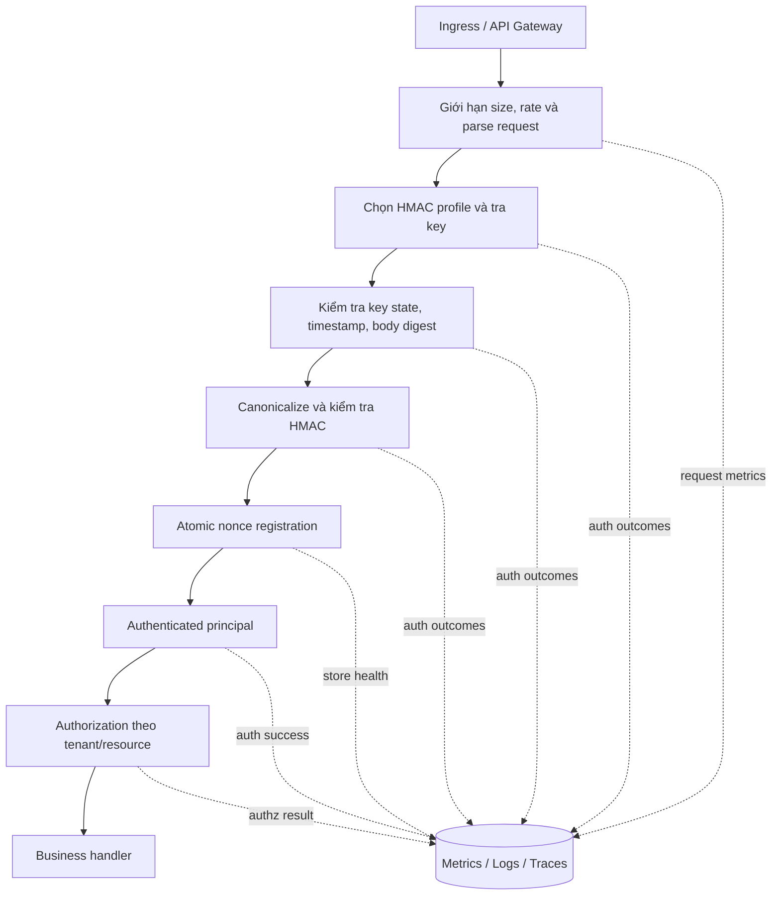

# Thêm monitoring cho dự án HMAC Request Authentication

## 1. Bối cảnh thực hành và mục tiêu

Trong dự án `SECURITY_AUTHENTICATION_HMAC_REQUEST_AUTHENTICATION`, client gửi HTTP request đã ký bằng HMAC với shared secret. Server dựng lại **canonical request** từ method, URI/query, những header được ký và/hoặc body digest theo hợp đồng; tra key tương ứng, xác minh MAC, kiểm tra timestamp/nonce để ngăn replay, sau đó tạo authenticated principal. **Authorization** quyết định principal có được thực hiện thao tác trên tenant/resource hay không.

Sau khi chức năng ký và xác minh chạy đúng, dự án cần **monitoring** để trả lời: tại sao đối tác bị `401`, có phải SDK ký sai canonical URI sau gateway, lỗi có tập trung ở một signature version/key rotation, replay store có quá tải, hay một request có MAC đúng đang bị từ chối phân quyền? Monitoring phải hỗ trợ phát hiện sự cố sớm mà **không biến logs/metrics/traces thành kênh rò rỉ shared secret, raw signature hoặc dữ liệu khách hàng**.

Trong bài thực hành này, ta bổ sung một lớp quan sát cho luồng HMAC của ứng dụng Java Spring Boot, dùng **Micrometer + Prometheus** làm ví dụ cho metrics, structured logs để tra cứu sự cố, OpenTelemetry/Micrometer Tracing nếu hệ thống đã sử dụng tracing, và quy trình xây dashboard/alert có kiểm thử. Những công cụ này là lựa chọn minh họa; điều cốt lõi là **hợp đồng dữ liệu quan sát**, không phụ thuộc một vendor.

### Đầu ra cần hoàn thành

1. Có danh mục **authentication outcomes** nhất quán để phân biệt request hợp lệ, bad MAC, timestamp lệch, nonce replay, key bị revoke, version không được phép, lỗi gateway và lỗi hạ tầng.
2. Có counter, latency histogram, dependency metrics và structured logs **không chứa secret**; không có nhãn Prometheus lấy từ input vô hạn như raw nonce hoặc key ID giả.
3. Có dashboard phân biệt tổng lưu lượng, lỗi của request bị từ chối, khả năng phục vụ client hợp lệ, sức khỏe nonce store và tương thích sau key rotation.
4. Có alert và runbook cho các lỗi đáng xử lý: lỗi xác minh gia tăng, replay bất thường, latency/timeout của replay store, key provider lỗi, tỷ lệ xác thực hợp lệ suy giảm.
5. Có **integration test** chứng minh observability đi theo kết quả xác thực thật, kể cả request bị replay, body bị sửa, proxy rewrite và authorization từ chối.

**Giới hạn của bài:** monitoring không thay thế việc xác minh MAC bằng phép so sánh an toàn, chống replay nguyên tử, quản lý key hay phân quyền. Không dùng dashboard như bằng chứng duy nhất rằng hệ thống an toàn; test bảo mật vẫn phải khẳng định các bất biến của verifier.

## 2. Vẽ ranh giới quan sát trước khi thêm instrument

Một request có thể thất bại ở nhiều vị trí khác nhau. Cần quan sát ở đúng lớp để phân biệt **không xác thực được**, **đã xác thực nhưng không có quyền**, **bị rate limit** và **dependency không khả dụng**.



Ví dụ MAC đúng nhưng principal không được phép gọi `POST /v1/payments`: lớp authentication ghi **`authenticated`**, còn authorization ghi **`denied`**; HTTP trả `403`. Không biến `403` thành `bad_mac` và không tính thiếu quyền thành lỗi kiểm tra HMAC.

**Đặc điểm của HMAC:** server có thể phải tra key theo ID công khai trước khi kiểm tra MAC. Thời điểm này **key ID và client ID do request khai vẫn chưa đáng tin**; chỉ ghi metric theo nhãn hữu hạn hoặc theo danh tính đã được registry xác thực. Có thể ghi correlation ID được ingress tạo và lọc ký tự cho điều tra, nhưng không cho bất kỳ dữ liệu từ header chưa xác thực tự sinh ra một chuỗi tag mới vô hạn.

### 2.1. Danh sách quyết định có thể quan sát

| Lớp | `decision` / `reason` gợi ý | Ý nghĩa | Có tạo principal? |
| --- | --- | --- | --- |
| Parse/contract | `rejected/malformed_request` | Header thiếu/trùng, signature encoding sai, URI/query không hợp lệ. | Không |
| Version policy | `rejected/unsupported_profile`, `rejected/profile_denied` | Profile không hỗ trợ hoặc không được phép với key/client. | Không |
| Key lookup | `rejected/credential_denied` | Key không có, đã revoke, hết hạn hoặc không thuộc phạm vi. | Không |
| Timestamp | `rejected/timestamp_invalid` | Thời gian quá cũ hoặc quá xa tương lai. | Không |
| Body | `rejected/body_digest_mismatch` | Digest khai báo không khớp byte body thực. | Không |
| HMAC | `rejected/bad_mac` | MAC đã decode hợp lệ về hình thức nhưng không đúng. | Không |
| Replay | `rejected/replay` | MAC đúng nhưng nonce đã được sử dụng. | Không |
| Dependency | `error/nonce_store_unavailable`, `error/key_store_unavailable` | Không thể bảo đảm quyết định xác thực; fail-closed. | Không |
| Authentication | `authenticated/none` | Key, profile, digest, MAC, timestamp và replay đều hợp lệ. | Có |
| Authorization | `allowed` / `denied` | Quyền của principal trên operation/tenant/resource. | Principal đã có |

Từ chối vì header quá lớn có thể diễn ra **trước HMAC filter** ở gateway/container. Do đó, metric của gateway và metric authentication filter sẽ không có cùng mẫu số. Dashboard cần hiển thị cả hai tầng để không kết luận nhầm rằng lượng request xấu đã giảm trong khi thực tế chúng bị chặn sớm hơn.

### 2.2. Một request, một kết quả authentication

Thiết kế một điểm kết thúc duy nhất để ghi `hmac_auth_attempts_total` cho **mỗi request đi vào HMAC verifier**, với quyết định cuối cùng trước khi tạo principal: `authenticated`, `rejected` hoặc `error`. Tránh vừa ghi `bad_mac` trong catch block rồi lại ghi `rejected` ở filter finally, khiến số request bị đếm đôi.

Nếu cần quan sát từng bước trung gian, dùng metric khác như `hmac_key_lookup_duration_seconds`, `hmac_canonical_duration_seconds`, `hmac_nonce_reserve_duration_seconds` và `hmac_nonce_reserve_total`; không cộng những counter bước này rồi gọi là số request. Một attempt có thể đi qua nhiều bước nhưng chỉ có **một decision cuối cùng**.

## 3. Thiết kế metric contract và cardinality

| Tên metric Prometheus minh họa | Kiểu | Nhãn giới hạn | Mục đích |
| --- | --- | --- | --- |
| `hmac_auth_attempts_total` | Counter | `decision`, `reason`, `profile` | Kết quả cuối cùng của mỗi authentication attempt. |
| `hmac_auth_verify_duration_seconds` | Histogram/Timer | `decision`, `profile` | Độ trễ toàn bộ verifier, đo cả MAC và replay store trên đường thực tế. |
| `hmac_nonce_reserve_total` | Counter | `result` = `reserved/replay/error` | Theo dõi kết quả ghi nonce nguyên tử sau MAC hợp lệ. |
| `hmac_nonce_reserve_duration_seconds` | Histogram/Timer | `result` | Độ trễ của replay store, gồm cả timeout. |
| `hmac_key_lookup_total` | Counter | `result` = `found/denied/error` | Chẩn đoán key provider/cache, tránh phân biệt key ID qua public response. |
| `hmac_key_lookup_duration_seconds` | Histogram/Timer | `result` | Phát hiện nghẽn secret manager hoặc database. |
| `hmac_authz_decisions_total` | Counter | `decision` = `allowed/denied`, `route_template` | Theo dõi phân quyền sau xác thực, tách khỏi lỗi MAC. |
| `hmac_signature_profile_accepted_total` | Counter | `profile` | Đếm request được xác thực theo version để theo dõi migration. |
| `hmac_request_rejected_total` (nếu cần) | Counter | `stage`, `reason` | Trạng thái bị chặn tại gateway/filter; không cộng đè với attempts mà không định nghĩa. |

Các tên metric là **hợp đồng ví dụ**. Trong Java Micrometer, meter tên `hmac.auth.attempts` thường được exporter Prometheus biểu diễn dạng `hmac_auth_attempts_total`; tên histogram/units phụ thuộc registry và cấu hình hiện tại. Kiểm tra endpoint thực `/actuator/prometheus` trước khi chép các query PromQL của bài.

### Quy tắc chọn label

- **Cho phép:** tập nhỏ, định nghĩa bằng enum/allowlist: `decision`, `reason`, `profile` (ví dụ `hmac-v1`/`hmac-v2`/`other`), `route_template` có số lượng hữu hạn, `component`, `environment` hoặc `region` với danh sách kiểm soát.
- **Không dùng làm nhãn:** raw nonce, timestamp, signature, shared secret, key ID tự khai, client ID chưa xác thực, raw URI có query, user ID, IP từng request, request ID và exception message. Dữ liệu đó có thể tạo hàng triệu time series hoặc lộ thông tin.
- **Client-specific troubleshooting:** dùng logs có kiểm soát truy cập sau khi danh tính đã xác thực; nếu cần metric theo client, chỉ dùng cohort hữu hạn do operator cấu hình và giới hạn số lượng theo chính sách.
- **Reason không lấy nguyên văn exception:** ánh xạ exception vào một enum hữu hạn. Tránh `reason=redis connection timeout to host ...` hoặc `reason=unknown-key-{input}`.
- **Profile chưa xác thực:** ánh xạ tới profile allowlist có giới hạn hoặc `other`; không lấy trực tiếp chuỗi `X-HMAC-Version` làm tag.

Nếu metric có 3 decisions × 10 reasons × 3 profiles = 90 tổ hợp nhãn lý thuyết, đây là con số còn kiểm soát được trước khi xét instance/job/region. Nếu thêm một triệu nonce ngẫu nhiên, cardinality trở thành rủi ro vận hành ngay cả khi traffic hoàn toàn bị từ chối.

## 4. Gắn metrics vào Spring Boot bằng Micrometer

Với Spring Boot Actuator và Micrometer, có thể dùng `MeterRegistry` để tạo counter và timer. Đối với Prometheus, cần cấu hình exporter tương ứng và endpoint scrape **chỉ cho hệ thống giám sát đáng tin cậy**. Không để endpoint chứa thông tin nội bộ truy cập tự do từ Internet, và không sử dụng metric labels chứa secret.

### 4.1. Lớp instrumentation không phụ thuộc implementation verifier

Ví dụ Java 17+ sau sử dụng enum và allowlist để kiểm soát label. Nó **không** tự tạo authentication result; kết quả phải được lấy từ verifier thực sau khi kiểm tra MAC và replay, không dựa vào HTTP status ở phía ngoài.

```java
import io.micrometer.core.instrument.Counter;
import io.micrometer.core.instrument.MeterRegistry;
import io.micrometer.core.instrument.Timer;
import java.time.Duration;
import java.util.Set;

public final class HmacAuthMetrics {
    public enum Decision { AUTHENTICATED, REJECTED, ERROR }

    public enum Reason {
        NONE,
        MALFORMED_REQUEST,
        UNSUPPORTED_PROFILE,
        PROFILE_DENIED,
        CREDENTIAL_DENIED,
        TIMESTAMP_INVALID,
        BODY_DIGEST_MISMATCH,
        BAD_MAC,
        REPLAY,
        NONCE_STORE_UNAVAILABLE,
        KEY_STORE_UNAVAILABLE,
        INTERNAL_ERROR
    }

    private static final Set<String> APPROVED_PROFILES =
            Set.of("hmac-v1", "hmac-v2");

    private final MeterRegistry registry;

    public HmacAuthMetrics(MeterRegistry registry) {
        this.registry = registry;
    }

    public void recordAuthentication(
            String requestedProfile,
            Decision decision,
            Reason reason,
            Duration elapsed) {

        // Profile do caller khai báo chưa đáng tin: chỉ cho tag hữu hạn.
        String profile = requestedProfile != null
                && APPROVED_PROFILES.contains(requestedProfile)
                ? requestedProfile
                : "other";
        String decisionTag = decision.name().toLowerCase(java.util.Locale.ROOT);
        String reasonTag = reason.name().toLowerCase(java.util.Locale.ROOT);

        // Mỗi attempt chỉ gọi đúng một lần tại điểm quyết định cuối.
        Counter.builder("hmac.auth.attempts")
                .description("HMAC authentication decisions")
                .tags("decision", decisionTag, "reason", reasonTag,
                        "profile", profile)
                .register(registry)
                .increment();

        Timer.builder("hmac.auth.verify.duration")
                .description("Elapsed time of HMAC authentication attempt")
                .publishPercentileHistogram()
                .tags("decision", decisionTag, "profile", profile)
                .register(registry)
                .record(elapsed);
    }
}
```

`MeterRegistry` quản lý việc đăng ký đồng nhất các meter theo tên/tags. Không nên đăng ký meter từ chuỗi tự do hoặc gắn ID chưa được chặn vào tag. Trong dự án thực, áp dụng thêm `MeterFilter` và cấu hình giới hạn cardinality ở registry/scrape pipeline như hàng rào thứ hai; kiểm soát ở nguồn instrument vẫn là yếu tố chính.

### 4.2. Đặt instrumentation tại ranh giới xác thực

Giả sử một `HmacAuthenticationService` trả về một kết quả có cấu trúc và không ném secret vào exception. Ta muốn ghi nhận đúng một kết quả cuối; khi lỗi hạ tầng, không được coi kết quả là authentication thành công:

```java
// Pseudocode tích hợp: result/exception types thuộc dự án cụ thể.
long started = System.nanoTime();
HmacAuthMetrics.Decision decision = HmacAuthMetrics.Decision.ERROR;
HmacAuthMetrics.Reason reason = HmacAuthMetrics.Reason.INTERNAL_ERROR;

try {
    AuthResult result = hmacAuthenticationService.authenticate(request);
    if (result.isAuthenticated()) {
        decision = HmacAuthMetrics.Decision.AUTHENTICATED;
        reason = HmacAuthMetrics.Reason.NONE;
    } else {
        decision = HmacAuthMetrics.Decision.REJECTED;
        reason = mapToFiniteReason(result.failureReason());
    }
    return result;
} catch (NonceStoreUnavailableException ex) {
    // Xử lý lỗi fail-closed ở error handler; không tạo principal.
    reason = HmacAuthMetrics.Reason.NONCE_STORE_UNAVAILABLE;
    throw ex;
} catch (CredentialStoreUnavailableException ex) {
    reason = HmacAuthMetrics.Reason.KEY_STORE_UNAVAILABLE;
    throw ex;
} finally {
    long elapsedNanos = System.nanoTime() - started;
    metrics.recordAuthentication(
        requestSignatureProfileFromStrictParserOrOther(request),
        decision,
        reason,
        Duration.ofNanos(elapsedNanos));
}
```

Đây là **pseudocode** minh họa vị trí instrumentation, chưa phải đoạn code có thể copy nguyên vào Spring Security. Phải tránh tính cả thời gian downstream business, không vô tình gọi `authenticate` hai lần khi filter được dispatch lại, và ánh xạ mọi nhánh exception thành một decision duy nhất. Nếu filter trả kết quả trước replay guard thì không được ghi `authenticated` quá sớm. Nên giữ decision/result dạng enum trong ứng dụng để metrics, logs và error mapping sử dụng cùng một taxonomy.

Đối với Spring Security Servlet, đặt instrumentation xung quanh authentication filter/provider thực tế, kiểm soát filter ordering và xử lý request body có giới hạn. Với WebFlux, dùng `WebFilter`/`ReactiveAuthenticationManager` tương ứng; đo thời gian tại **thời điểm publisher kết thúc** thay vì chỉ lúc tạo `Mono`, vì publisher xử lý bất đồng bộ. Chú ý giải phóng `DataBuffer` và không kéo toàn bộ body vào memory chỉ để gắn metric.

### 4.3. Theo dõi nonce store và key provider riêng

Một metric tổng `hmac_auth_verify_duration_seconds` có thể tăng do canonicalization tốn CPU, key lookup hoặc Redis chậm. Bổ sung timer cho từng dependency giúp xác định nguyên nhân:

```java
// Pseudocode: đặt quanh thao tác reserve thực tế, sau khi HMAC hợp lệ.
long start = System.nanoTime();
String resultTag = "error";
try {
    boolean reserved = nonceStore.reserveAtomically(principalId, signedNonce, ttl);
    resultTag = reserved ? "reserved" : "replay";
    return reserved;
} finally {
    Counter.builder("hmac.nonce.reserve")
        .tag("result", resultTag).register(registry).increment();
    Timer.builder("hmac.nonce.reserve.duration")
        .publishPercentileHistogram()
        .tag("result", resultTag).register(registry)
        .record(System.nanoTime() - start, java.util.concurrent.TimeUnit.NANOSECONDS);
}
```

Trường hợp lỗi hạ tầng chưa biết thao tác ghi đã được thực hiện hay chưa phải **fail-closed** theo contract. Metric `error` biểu thị kết quả quan sát được của caller, không chứng minh Redis chắc chắn chưa ghi. Một request bị từ chối do `bad_mac` **không được gọi nonce store**; dashboard có thể kiểm tra dấu hiệu thao tác reserve bất thường so với số request có MAC hợp lệ.

## 5. Structured logging: điều tra được mà không làm lộ secret

Metrics giúp biết *đang có bao nhiêu lỗi*; log giúp tái dựng *một request đi qua hệ thống như thế nào*. Mỗi authentication decision nên có **một sự kiện log có cấu trúc** với các trường đã được cho phép.

Ví dụ log giả lập, đã loại bỏ dữ liệu nhạy cảm:

```json
{
  "event": "hmac_auth_decision",
  "trace_id": "7d5bbf01e7c9418a9c7f67a8cb087f32",
  "request_id": "req-6d5e2f",
  "route_template": "/v1/orders/{orderId}",
  "signature_profile": "hmac-v2",
  "decision": "rejected",
  "reason": "bad_mac",
  "gateway_route": "orders-public",
  "duration_ms": 8,
  "environment": "staging"
}
```

`request_id` và `trace_id` có thể là duy nhất **trong log và trace**, nhưng tuyệt đối không dùng làm tag của counter/histogram. Nếu correlation ID đến từ client hoặc proxy, phải xác thực/giới hạn chiều dài và ký tự, hoặc sinh lại từ ingress đáng tin để ngăn log injection. `route_template` do router xác định, không dùng raw path/query có ID/token.

Những dữ liệu **không ghi trong logs/traces/metrics**: shared secret, nội dung key store, header `X-HMAC-Signature`, raw nonce, nguyên canonical request chứa path/query nhạy cảm, Authorization, body thanh toán, session/token, dữ liệu PII. Không bật mặc định HTTP header/body capture của instrumentation/collector cho endpoint có chữ ký; kiểm tra cả logs lỗi từ exception và HTTP access logs của reverse proxy. Nếu cần debug byte-level canonicalization, dùng fixture với secret và dữ liệu giả trong staging, hoặc một cơ chế audit đặc biệt có phê duyệt và retention ngắn.

### Log event phụ thuộc vào độ tin cậy của danh tính

Trước khi HMAC hợp lệ, không tin `X-Client-Id` và key ID do request gửi. Log thất bại nên dùng correlation ID, route class, reason và profile đã được kiểm soát; tránh đưa key ID thô thành trường index không giới hạn. Sau khi HMAC hợp lệ, có thể ghi principal/cohort đã được registry xác định nếu chính sách dữ liệu cho phép, đồng thời áp quyền truy cập và retention. Không in secret khi key lookup thành công, và không log chi tiết “key tồn tại” ra phản hồi HTTP công khai.

## 6. Distributed tracing qua proxy, verifier và replay store

Với hệ thống có gateway, tracing giúp xác định request bị thay đổi/đi qua hop nào, có chậm ở key provider hay nonce store. Cần tạo span/child span cho các bước *đo được* mà không nhân bản signature vào attributes:

```text
trace: inbound POST /v1/orders
  gateway.ingress (route_template=/v1/orders)
  hmac.authenticate (profile=hmac-v2, decision=rejected)
    hmac.key_lookup (result=found)
    hmac.canonicalize (result=completed)
    hmac.verify_mac (result=bad_mac)

trace: inbound POST /v1/orders
  hmac.authenticate (profile=hmac-v2, decision=authenticated)
    hmac.key_lookup (result=found)
    hmac.verify_mac (result=matched)
    hmac.nonce_reserve (result=reserved)
  authorization.check (decision=denied)
```

**Không** dùng span attributes như `nonce`, `signature`, `secret`, `raw_query`, `full_key_id_from_request`, `body_hash` nếu dữ liệu có thể tiết lộ nội dung hoặc sinh vô số giá trị. Có thể dùng low-cardinality fields như `profile`, `result`, `route_template`. Trace sampling thích hợp giảm overhead và tránh xuất toàn bộ luồng dữ liệu, nhưng sampling có thể làm mất một số sự kiện an ninh; audit sự kiện quan trọng cần thiết kế riêng.

Khi so sánh canonicalization qua proxy, đừng xuất byte canonical của request production vào span. Dùng **golden vector** không nhạy cảm để kiểm tra signer và verifier, hoặc log mã phân loại lỗi và vị trí hop ở mức metadata. Nếu đang nghi ngờ `X-Forwarded-Host` hoặc URI rewrite, kiểm tra cấu hình trusted proxy và các contract test end-to-end trước khi nới quy tắc ký.

## 7. Dashboard monitoring đề xuất

Thiết kế dashboard phục vụ hai nhóm: vận hành API/SRE và điều tra lỗi xác thực. Những panel dưới đây là các chỉ số cần có, không mặc định cho rằng mọi ứng dụng đã có sẵn cùng tên metric.

| Panel | Nội dung | Giá trị khi xử lý sự cố |
| --- | --- | --- |
| 1. Ingress vs authentication | Gateway RPS, HMAC auth attempt RPS, request chặn sớm | Nhận ra lượng request bị filter/gateway loại trước bước ký. |
| 2. Authentication outcome | Authenticated/rejected/error theo thời gian và profile | Phân biệt lỗi client với lỗi hạ tầng. |
| 3. Rejection reasons | `bad_mac`, `timestamp_invalid`, `replay`, `credential_denied`, `profile_denied` | Tìm nhóm nguyên nhân chính khi tăng `401`. |
| 4. HMAC latency | p50/p95/p99 authentication end-to-end; body/canonical/MAC nếu có | Thấy ảnh hưởng lên latency request hợp lệ. |
| 5. Dependency health | Nonce reserve latency/error; key lookup latency/error | Chỉ rõ Redis, DB hoặc secret manager chậm/lỗi. |
| 6. Replay correctness | Nonce `reserved/replay/error`, failover event, TTL/eviction | Phát hiện race hoặc nguy cơ mất replay state. |
| 7. Migration/rotation | Accepted traffic theo signature profile/cohort, key state theo nguồn quản trị | Kiểm chứng client chuyển profile/key trước khi ngừng hỗ trợ version cũ. |
| 8. Authorization | Allowed/denied theo route template (sau auth) | Không gộp `403` với lỗi MAC. |
| 9. Resource & SLO | CPU/GC, queue, pool, RPS hợp lệ, latency của synthetic client | Xác định overload và khả năng phục vụ traffic đúng. |

### 7.1. Ví dụ PromQL với bộ metric trên

**RPS theo kết quả xác thực** (Counter từ `hmac.auth.attempts`):

```promql
sum by (decision) (
  rate(hmac_auth_attempts_total[5m])
)
```

**Số request bị từ chối vì MAC sai trong 5 phút**:

```promql
sum(
  increase(hmac_auth_attempts_total{
    decision="rejected", reason="bad_mac"
  }[5m])
)
```

**Tỷ lệ bad MAC trên toàn bộ auth attempts trong một cửa sổ có lưu lượng**:

```promql
sum(increase(hmac_auth_attempts_total{reason="bad_mac"}[5m]))
/
clamp_min(sum(increase(hmac_auth_attempts_total[5m])), 1)
```

Tỷ lệ này phản ánh **mọi attempts**, kể cả attacker; tăng bad MAC có thể là tấn công, key rotation lỗi hoặc SDK ký sai. Nó **không phải availability SLO của client hợp lệ**. Cần panel riêng cho synthetic client có MAC đúng hoặc cohort đã xác thực; không đưa tỷ lệ 401 do abuse vào SLO availability như thể đó là lỗi phục vụ.

**p99 thời gian verifier**, khi Timer xuất histogram `_bucket`:

```promql
histogram_quantile(
  0.99,
  sum by (le) (
    rate(hmac_auth_verify_duration_seconds_bucket[5m])
  )
)
```

**Số lỗi nonce store trong 5 phút**, tương ứng `result=error`:

```promql
sum(increase(hmac_nonce_reserve_total{result="error"}[5m]))
```

Khi muốn có p99 riêng cho request đã được xác thực, thêm filter `decision="authenticated"`. Cần kiểm tra exporter thực tế và cấu hình histogram; nếu chưa bật histogram, không thể dùng `histogram_quantile` trên metric `_bucket` chưa tồn tại. Đối với tỷ lệ trên số mẫu rất nhỏ, sử dụng ngưỡng số lượng tối thiểu và thời gian quan sát đủ dài trước khi alert.

## 8. Alert và runbook liên kết hành động

Một alert tốt phải nói rõ **đang có tín hiệu gì, ai cần xem và có hành động an toàn nào**. Các ngưỡng dưới đây là ví dụ để luyện thiết kế; phải thay bằng baseline/SLO và capacity của môi trường thật.

| Alert đề xuất | Điều kiện minh họa | Mức xử lý / hành động |
| --- | --- | --- |
| `HmacBadMacSpike` | Số `bad_mac` trong 5 phút vượt baseline đáng kể và vượt ngưỡng số lượng tối thiểu | Kiểm tra phiên bản SDK, key rotation, gateway rewrite, khả năng abuse; không log secret để debug. |
| `HmacNonceStoreUnavailable` | Có `nonce reserve error` kéo dài hoặc timeout tăng | Ưu tiên cao: kiểm tra Redis/DB, fail-closed, mức ảnh hưởng tới traffic hợp lệ. |
| `HmacKeyProviderErrors` | Key lookup error tăng liên tục | Kiểm tra secret manager/DB, cache, rotation và chính sách retry có giới hạn. |
| `HmacReplaySpike` | `replay` tăng bất thường theo baseline | Kiểm tra client retry nguyên request, nonce generator, nhiều replica, khả năng tấn công phát lại. |
| `HmacValidTrafficLatency` | Synthetic signer hoặc cohort hợp lệ có p99 vượt SLO đã chốt | Kiểm tra body hashing, canonicalization, key/nonce store và pool. |
| `HmacLegacyProfileTraffic` | Client còn gửi profile cũ sát mốc cutoff | Liên hệ owner để nâng signer; xác nhận policy thực sự chặn profile cũ sau mốc. |
| `HmacAuthDecisionTelemetryMissing` | Metric auth attempts đột ngột mất khi gateway còn traffic tương ứng | Kiểm tra scrape, filter bypass, deployment, telemetry pipeline. |

### 8.1. Ví dụ rule cảnh báo Prometheus

```yaml
groups:
  - name: hmac-auth-example
    rules:
      - alert: HmacNonceStoreUnavailable
        expr: sum(increase(hmac_nonce_reserve_total{result="error"}[5m])) > 0
        for: 2m
        labels:
          severity: critical
        annotations:
          summary: "HMAC replay store có lỗi khi đăng ký nonce"
          description: "Kiểm tra store, fail-closed và traffic hợp lệ"
      - alert: HmacBadMacSpike
        expr: sum(increase(hmac_auth_attempts_total{reason="bad_mac"}[5m])) > 300
        for: 3m
        labels:
          severity: warning
        annotations:
          summary: "Số request HMAC có bad MAC tăng"
          description: "Kiểm tra SDK/contract/gateway và lưu lượng bất thường"
```

Các biểu thức là **rule ví dụ**; giá trị `300` và cửa sổ thời gian cần được hiệu chỉnh từ lưu lượng thật. `for` là thời gian biểu thức phải liên tục đúng theo cách Prometheus đánh giá, không phải chu kỳ gửi thông báo. Cảnh báo theo nguyên nhân nên có owner/on-call, route đến dashboard và hướng dẫn xử lý trong runbook; cấu hình nhóm/giảm noise để không tạo bão cảnh báo.

### 8.2. Runbook: bad MAC tăng ngay sau deployment

1. Xác định thời điểm, signature profile, bản triển khai verifier/gateway/SDK và route bị ảnh hưởng. Đối chiếu `bad_mac` với `profile_denied`, `timestamp_invalid` và `body_digest_mismatch`.
2. Kiểm tra health của key provider, nonce store; xem liệu có dùng nhầm key ID/secret sau rotation hay không. Không xuất plaintext secret vào log.
3. Tái hiện bằng **golden vector** không nhạy cảm: so sánh từng byte canonical request, method/path/query/header, body digest và encoding signature. Lưu ý biến đổi ở TLS termination/reverse proxy.
4. Chạy contract test qua ingress public với timestamp/nonce mới; kiểm tra request hợp lệ có tạo principal và request lỗi bị từ chối, cùng replay guard hoạt động.
5. Nếu cần rollback, chỉ rollback code/config/profile trong phạm vi chính sách đã phê duyệt. Không thêm fallback `if v2 MAC fails -> try v1`, không bỏ ký header/body hoặc tắt nonce store.
6. Xác nhận tỷ lệ thành công của client hợp lệ và latency quay lại SLO; lưu bằng chứng và thêm case lỗi vào regression suite.

### 8.3. Runbook: replay hoặc nonce store lỗi

Khi `replay` tăng, tìm dấu hiệu client retry cùng signed request và nonce, nhiều process dùng nonce generator trùng nhau, hoặc attack/replay cùng request trên nhiều node. Đừng kết luận replay protection hoạt động chỉ vì số `401` tăng; cần test với **MAC đúng** và một nonce gửi song song để khẳng định chỉ một lần được authenticated.

Khi store trả timeout/error, chính sách phải **fail-closed**: request chưa được xác minh đầy đủ không đi vào nghiệp vụ. Theo dõi Redis `SET NX`/SQL conditional insert, connection pool, memory/eviction, replica lag và failover. Redis có thể mất một write đã ACK khi failover với replication bất đồng bộ; chỉ nhìn metric error của caller không chứng minh replay state không bị mất. Đánh giá threat model, durability và hành vi đa vùng khi thiết kế cảnh báo.

## 9. Đảm bảo thông tin quan sát không che khuất rủi ro bảo mật

### 9.1. Chống nhầm HMAC authentication với authorization

Trong Spring Security, HMAC verifier có thể authenticated thành công, nhưng controller hoặc authorization filter vẫn trả `403` cho tenant khác. Hãy ghi `hmac_auth_attempts_total{decision="authenticated",reason="none"}` và `hmac_authz_decisions_total{decision="denied",...}` ở hai tầng riêng. Không dựa duy nhất vào HTTP response status để suy luận kết quả MAC; `401`, `403` và `429` là các tình huống khác nhau.

### 9.2. Key rotation và profile migration

Trong quá trình rotation, nhiều key ID active có thể cùng thuộc một principal. Theo dõi **số client đã chuyển** thông qua registry/management plane và lượng traffic v1/v2 được xác thực, tránh in raw key ID làm tag. Để kiểm chứng cutoff, gửi request **MAC v1 đúng** từ client v2-only và xác nhận verifier từ chối theo policy, trong khi metrics phản ánh `profile_denied`. Monitoring thấy không còn traffic v1 **không chứng minh** server đã chặn v1.

### 9.3. Proxy/gateway và dữ liệu được ký

Với signed URI/header/body, proxy có thể rewrite path, chuẩn hóa query, thay `Host`/`Forwarded` hoặc biến đổi body. Xem telemetry ở cả gateway và verifier nhưng không log nội dung thô nhạy cảm. Một lỗi `bad_mac` có thể đến từ khác biệt canonicalization, không phải key bị lộ. Fix phải dựa trên contract version, golden vectors và test qua gateway, không chấp nhận nhiều biến thể “thử đến khi khớp”.

### 9.4. Giới hạn chi phí giám sát

Không tạo một log stack trace lớn cho mỗi MAC sai trong lúc bị quét; dùng sampling/rate limit log hợp lý và giữ aggregate counter chính xác. Trace sampling giảm chi phí nhưng không nên xóa hoàn toàn bằng chứng của sự cố nghiêm trọng. Giám sát CPU/heap, event-loop lag (WebFlux), thread pool (Servlet), queue, storage và collector drop: telemetry bị quá tải có thể làm request hợp lệ chậm hơn. Luôn bảo đảm instrumentation failure **không thay đổi quyết định xác thực**.

## 10. Kịch bản kiểm thử monitoring trong dự án

Để kiểm chứng instrumentation, thực thi test ở ranh giới HTTP thực của ứng dụng với clock điều khiển được, key test, fixed golden vector và nonce store test/Redis phù hợp. Không chạy load abuse trên production hay dịch vụ bên thứ ba.

| Case | Request và tình huống | Authentication / authorization kỳ vọng | Telemetry kỳ vọng |
| --- | --- | --- | --- |
| T01 | MAC đúng, timestamp hợp lệ, nonce mới, key active | Authenticated và có thể được authorization cho phép | +1 `authenticated/none`, timer ghi một lần, nonce `reserved`. |
| T02 | Sửa một byte body nhưng giữ digest/signature | Rejected | +1 `body_digest_mismatch`, không tăng nonce reserve. |
| T03 | Key tồn tại, MAC sai nhưng header đúng định dạng | Rejected | +1 `bad_mac`; log không chứa raw signature/secret. |
| T04 | Signature thiếu, quá ngắn hoặc Base64url lỗi | Rejected | +1 `malformed_request`, không nổ cardinality. |
| T05 | Timestamp ngoài cửa sổ | Rejected | +1 `timestamp_invalid`, không ghi nonce. |
| T06 | Gửi lại request có MAC hợp lệ và nonce đã dùng | Rejected replay | +1 `replay` và nonce reserve `replay`. |
| T07 | Gửi cùng valid signed request tới nhiều replica đồng thời | Tối đa một authenticated | Một nonce `reserved`, còn lại `replay`; metric đếm đúng mỗi attempt. |
| T08 | Key bị revoke hoặc profile không thuộc allowlist | Rejected dù MAC có thể đúng | `credential_denied` hoặc `profile_denied` theo policy; không lộ key status qua public error. |
| T09 | Nonce store timeout sau MAC đúng | Error fail-closed | `nonce_store_unavailable`, nonce reserve `error`, không tạo principal. |
| T10 | Key provider timeout | Error fail-closed | `key_store_unavailable` và key lookup `error`. |
| T11 | MAC đúng, principal thiếu quyền tenant B | Authenticated rồi authorization denied | HMAC `authenticated` và authz `denied`, response `403` theo contract. |
| T12 | Request qua gateway bị rewrite path/query so với contract | Rejected theo HMAC | `bad_mac` hoặc lỗi phù hợp, trace route class; không dump canonical request production. |
| T13 | Version/profile lạ do client gửi | Rejected | `unsupported_profile`, tag profile quy về `other`; không sinh time series mới theo giá trị lạ. |
| T14 | Nhiều request có nonce/key ID ngẫu nhiên và MAC sai với tải cho phép | Rejected/rate-limited | Cardinality bounded, log throttling; không phát sinh entry nonce từ MAC sai. |
| T15 | Rotate key từ cũ sang mới trong cửa sổ cho phép | Các key đúng policy được nhận, key retire bị chặn | Dashboard profile/credential lifecycle phản ánh cutoff, không cần tag per raw key ID. |
| T16 | Telemetry backend tạm gián đoạn | Auth hoạt động theo chính sách an toàn vốn có | Không thay đổi xác minh HMAC, có chỉ số collector/export drop để điều tra. |

### 10.1. Test Micrometer bằng `SimpleMeterRegistry`

Đây là test tập trung vào **kết quả ghi metrics**, không phải test đúng sai của HMAC. Trong dự án thật, kết hợp thêm integration test gửi request qua verifier thực để bảo đảm mã instrumentation nhận đúng decision:

```java
import static org.junit.jupiter.api.Assertions.assertEquals;

import io.micrometer.core.instrument.simple.SimpleMeterRegistry;
import java.time.Duration;
import org.junit.jupiter.api.Test;

class HmacAuthMetricsTest {
    @Test
    void recordsOnlyFiniteTagsForUnknownProfile() {
        try (SimpleMeterRegistry registry = new SimpleMeterRegistry()) {
            HmacAuthMetrics metrics = new HmacAuthMetrics(registry);

            metrics.recordAuthentication("attacker-arbitrary-version-123",
                    HmacAuthMetrics.Decision.REJECTED,
                    HmacAuthMetrics.Reason.UNSUPPORTED_PROFILE,
                    Duration.ofMillis(4));

            assertEquals(1.0, registry.get("hmac.auth.attempts")
                    .tag("decision", "rejected")
                    .tag("reason", "unsupported_profile")
                    .tag("profile", "other")
                    .counter().count());
        }
    }
}
```

Test trên chỉ chứng minh label profile lạ bị gom thành `other` trong helper. Một kiểm thử end-to-end cần đo **số lần gọi record** bằng registry sau khi gửi một request và xác nhận tổng attempt chỉ tăng **1**, không phải hai lần do filter/exception handler cùng ghi. Đồng thời phải kiểm tra log được xuất không chứa secret hay signature; test có thể dùng test appender/lần bắt output log có lọc fixture giả.

### 10.2. Kiểm chứng dashboard và alert

1. Tạo ít nhất một request hợp lệ và một request có MAC sai, xác nhận metric xuất hiện ở endpoint scrape trong staging, với tên thực tế khớp dashboard.
2. Gây một lỗi nonce store test (không ảnh hưởng production); kiểm tra error counter tăng, request vẫn fail-closed và alert mô phỏng có thể chuyển sang firing theo cấu hình.
3. Tạo synthetic signer với secret test và nonce mới định kỳ để đo availability/latency của đường xác thực **hợp lệ**. Không dùng một signed request cố định liên tục vì sau lần đầu nó trở thành replay.
4. Kiểm tra tag budget bằng cách gửi nhiều version/key ID/nonce giả khác nhau; số lượng time series của instrumentation mới vẫn hữu hạn.
5. Kiểm tra log/trace scrub: query, MAC, raw nonce, secret và payload nhạy cảm không bị thu thập qua middleware, exception hoặc tracing automatic instrumentation.

## 11. Bài tập áp dụng: phát hiện lỗi sau khi nâng cấp gateway

**Bối cảnh:** API `POST /v1/orders` dùng HMAC-SHA-256, ký method, canonical URI, signed headers, digest byte JSON body, timestamp và nonce. Hệ thống có ba replica Spring Boot, Redis replay store và gateway vừa thay đổi quy tắc chuẩn hóa path. Một số client nhận `401`, trong khi các client khác vẫn hoạt động bình thường.

Hãy thực hiện:

1. Gắn instrument `hmac.auth.attempts` và `hmac.auth.verify.duration` xung quanh verifier; bảo đảm mỗi HTTP attempt có một final auth decision.
2. Gắn nonce reserve counter/timer cho Redis, key lookup counter/timer và authorization decision counter riêng; các metric chỉ dùng enum/label hữu hạn.
3. Thêm structured log một sự kiện cho từng request với request/trace ID an toàn, route template, version, decision, reason và duration; kiểm tra không lộ secret, signature, raw nonce, body hay raw query.
4. Dựng dashboard hiển thị RPS, reason distribution, p99 cho traffic hợp lệ, lỗi nonce/key store và profile migration. So sánh trước/sau deploy gateway.
5. Chạy golden vector có URI chứa `%2F` và query thay đổi thứ tự qua gateway; ghi lại đường đi, đối chiếu canonical bytes **trong fixture test** và sửa đúng chỗ lệch contract.
6. Gửi lại signed request hợp lệ, rồi gửi 32 request cùng nonce song song qua ba replica để kiểm tra replay guard và số lượng metric; xác nhận không có hai request authenticated.
7. Cố ý cho principal A truy cập tenant B với MAC đúng; xác nhận metric authentication là `authenticated` còn authorization là `denied`.
8. Mô phỏng Redis timeout để kiểm tra alert và fail-closed; kết thúc bài bằng báo cáo SLO, nguyên nhân, remediation và bằng chứng telemetry.

**Câu hỏi tự đánh giá:** vì sao một đợt tăng `bad_mac` có thể là lỗi gateway mà chưa chắc là key bị lộ? Vì sao `trace_id` phù hợp với log nhưng không phù hợp làm Prometheus label? Vì sao `401`, `403` và `503` cần phân biệt? Vì sao request có MAC đúng nhưng replay phải bị tính vào `rejected` thay vì `authenticated`? Có thể dùng tỷ lệ 401 của mọi nguồn Internet làm availability SLO cho client hợp lệ không?

## 12. Checklist hoàn thành monitoring

- [ ] Đã xác định một contract telemetry rõ giữa ingress, HMAC verifier, nonce store, key provider và authorization.
- [ ] Mỗi authentication attempt có đúng **một** decision cuối và một lần ghi counter; time measurement không tính nhầm business handler.
- [ ] Reason/profile/route labels lấy từ enum hoặc allowlist; không dùng nonce, signature, secret, raw key ID hay request ID làm metric label.
- [ ] Có metric riêng cho key lookup, MAC/auth duration, nonce reserve, authorization và lỗi dependency.
- [ ] Structured logs/traces mang correlation ID hợp lệ nhưng không ghi raw canonical request, body nhạy cảm hay HMAC material.
- [ ] Dashboard phân biệt traffic bị từ chối, traffic hợp lệ, gateway drops, latency và các nhóm lỗi.
- [ ] Có alert/runbook cho bad MAC tăng, replay spike, store unavailable và migration/key rotation.
- [ ] Nonce chỉ được ghi sau MAC đúng; lỗi store fail-closed và telemetry failure không đổi kết quả xác thực.
- [ ] Golden vectors và integration tests bao phủ proxy rewrite, body digest, timestamp, nonce replay và version policy.
- [ ] Authorization theo tenant/resource có metric và test riêng; authenticated không đồng nghĩa allowed.
- [ ] Có test cardinality bounded, scrub logs, endpoint scrape và dashboard/alert trong staging.
- [ ] Có kết quả thực hành, baseline SLO, owner xử lý và hướng dẫn dùng telemetry để điều tra lỗi.

**Kết luận:** thêm monitoring vào dự án xác thực HMAC nghĩa là đo được **kết quả xác thực, nguyên nhân từ chối, độ trễ và sức khỏe các dependency** mà vẫn bảo vệ secret và dữ liệu request. Một hệ thống quan sát tốt giúp truy nguyên lỗi canonicalization qua proxy, kiểm chứng quá trình key rotation và phát hiện replay/nonce store bất thường; các quyết định bảo mật vẫn phải dựa trên MAC, timestamp/nonce, policy key/version và authorization đúng hợp đồng.
