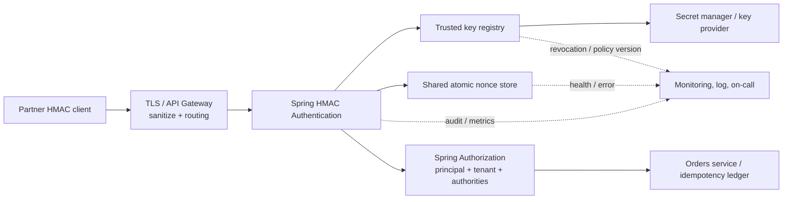
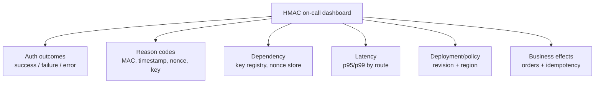
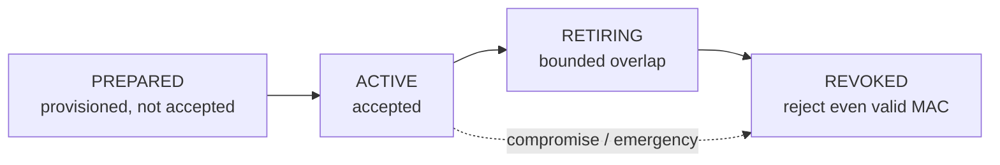

# Viết runbook vận hành cho hệ thống xác thực HTTP request bằng HMAC

## 1. Đề bài dự án và kết quả cần đạt

Trong module `SECURITY_AUTHENTICATION_HMAC_REQUEST_AUTHENTICATION`, một client tích hợp ký HTTP request bằng **HMAC** với shared secret. Backend hoặc gateway xác minh chữ ký từ **canonical request** theo hợp đồng: HTTP method, URI/query, các header được ký và body hoặc body digest. Hệ thống cần chống replay qua timestamp/nonce, quản lý key rotation, kiểm thử proxy/gateway và phân biệt rõ **authentication** với **authorization**.

Viết được verifier Java chạy đúng trong môi trường phát triển **chưa đủ để vận hành**. Khi sáng thứ Hai `401` tăng gấp mười lần, nonce store timeout, một region còn dùng secret đã bị revoke hoặc gateway vừa đổi cách rewrite URI, người trực phải biết **kiểm tra gì, làm gì trước, điều gì tuyệt đối không làm, ai phê duyệt và khi nào có thể mở lại dịch vụ**.

Bài **Viết runbook vận hành**, thuộc chương **Dự án thực hành**, yêu cầu xây một **runbook có thể diễn tập** cho hệ thống xác thực HMAC. Đây không phải chỉ là bản mô tả kiến trúc: người học phải tạo các quy trình có đầu vào, bước thực hiện, điểm quyết định, kết quả xác minh và đường escalation.

**Sản phẩm mong đợi:** một tài liệu runbook dành cho on-call/SRE/Security/API owner, kèm bảng điều kiện vận hành, hướng dẫn ứng cứu, bằng chứng diễn tập và ma trận kiểm thử. Nội dung bên dưới cung cấp một hệ thống giả lập, mẫu tài liệu, tình huống thực hành và tiêu chí nghiệm thu để người học xây ra runbook hoàn chỉnh của mình.

Sau dự án, bạn có thể:

- Nêu **scope, owner, trust boundary, dependencies, SLO và mức tác động** của dịch vụ HMAC.
- Viết checklist kiểm tra hằng ngày, checklist trước/sau triển khai và quy trình khôi phục sau lỗi.
- Soạn các nhánh runbook cho **signature mismatch, replay spike, nonce store outage, clock skew, key rotation/compromise, gateway rewrite, authorization denial**.
- Phân biệt `401`/`403`/`503` để không chẩn đoán sai tầng lỗi.
- Đưa ra lệnh/đường dẫn thao tác **không chứa secret**, yêu cầu phê duyệt và điểm dừng an toàn.
- Thiết kế dashboard, alert, audit evidence và diễn tập failure injection trong môi trường được cấp phép.
- Chứng minh hệ thống **fail closed** thay vì “sửa lỗi” bằng cách bỏ kiểm tra MAC hoặc nonce.

## 2. Phạm vi bài thực hành: một API HMAC giả lập

Giả sử hệ thống `orders-integration` có hai endpoint:

| Endpoint | Hành vi | Authority yêu cầu |
| --- | --- | --- |
| `POST /integrations/orders` | Tạo đơn hàng, có side effect | `ORDER_CREATE` |
| `GET /integrations/orders/{id}` | Đọc trạng thái đơn thuộc tenant | `ORDER_READ` và kiểm tra ownership |

Hai client dùng credential độc lập:

| Client đã đăng ký | Tenant | Quyền | Key versions ví dụ |
| --- | --- | --- | --- |
| `partner-reporting` | `tenant-a` | `ORDER_READ` | `reporting-2026a` RETIRING, `reporting-2026b` ACTIVE |
| `partner-fulfillment` | `tenant-b` | `ORDER_READ`, `ORDER_CREATE` | `fulfillment-2026a` RETIRING, `fulfillment-2026b` ACTIVE |

**Giả định của bài học:**

- Giao tiếp đi qua TLS và API gateway do tổ chức kiểm soát.
- **Backend Spring Security xác minh HMAC** trên request-target mà nó nhận. Trong bài này gateway **không rewrite những path/query đã ký** trên các route HMAC; nếu hạ tầng thực tế cần rewrite thì phải sửa trust boundary hoặc xác minh trước rewrite theo một ADR/version riêng, **không tự tin header `X-Original-URI` do Internet gửi**.
- Spring MVC có thể dùng `OncePerRequestFilter`/`AuthenticationProvider`; phiên bản WebFlux dùng `AuthenticationWebFilter`/`ReactiveAuthenticationManager`.
- Credential registry ánh xạ **key ID → secret reference, algorithm, client, tenant, status và thời gian hiệu lực**.
- Secret thật ở secret manager; nonce store dùng atomic claim với consistency phù hợp các ingress; authorization policy nằm ở server.
- Bài tập **không** dùng khóa production, không phát request thay đổi dữ liệu vào hệ thống thật và không tự thay cấu hình vận hành của tổ chức.

### 2.1. Sơ đồ các phụ thuộc



**Bài học vận hành chính:** runbook phải bao phủ từ client signer tới business side effect. Một dashboard `MAC_MISMATCH` không cho biết giao dịch đã bị lặp hay chưa; một `403` chưa chứng minh signer sai.

## 3. Chốt hợp đồng ký để runbook có chuẩn đối chiếu

Để diễn tập nhất quán, dùng một profile **HMAC-REQ-V1 minh họa** cho `POST /integrations/orders`:

| Trường | Hợp đồng trong bài | Kiểm tra an toàn |
| --- | --- | --- |
| `X-Hmac-Version` | `hmac-req-v1`, đúng một | Parser phải khớp domain prefix `HMAC-REQ-V1` |
| `X-Key-Id` | Một ID ASCII của key version | Registry chọn đúng một key |
| `X-Timestamp` | UTC ISO-8601, độ chính xác giây | Server clock ±5 phút **giả định** |
| `X-Nonce` | Ngẫu nhiên, uniqueness theo client | Nằm trong MAC và atomic nonce claim |
| `Content-Type` | `application/json` | Được ký |
| `X-Content-SHA256` | SHA-256 của **raw body bytes**, hex lowercase | So digest với bytes thực |
| `Idempotency-Key` | Opaque operation ID cho POST | Được ký, dùng để deduplicate nghiệp vụ |
| `X-Signature` | Base64 chuẩn của 32-byte HMAC-SHA-256 | Output, không tự đưa vào MAC input |

Canonical text minh họa dùng UTF-8, **LF 0x0A** giữa các dòng và không có LF cuối:

```text
HMAC-REQ-V1
POST
/integrations/orders
content-type:application/json
idempotency-key:operation-17
x-content-sha256:<64-hex-of-exact-body>
x-key-id:fulfillment-2026b
x-nonce:<signed-nonce>
x-timestamp:2026-11-28T03:15:00Z
```

Phần trong dấu góc là **placeholder**, không phải vector đã tính. Protocol thực tế còn cần định nghĩa path/query encoding, header duplicates/OWS, body size, ký GET body rỗng như thế nào, malformed signature và phiên bản tương thích. **Runbook phải dẫn tới spec và golden vectors đã được review**, không tự suy canonicalization từ request sau khi gateway đổi.

Đối với GET, nhóm phải viết một fixture riêng có method/path/query và quy tắc header/body tương ứng; không áp dụng tùy tiện canonical POST cho mọi method.

### 3.1. Những điều runbook tuyệt đối không được cho phép

1. Bỏ kiểm tra chữ ký, timestamp, nonce hoặc key status để “cứu SLA”.
2. Khi MAC với key đã khai không khớp, thử secret khác hoặc canonical versions cho tới khi có MAC đúng.
3. Tin `X-Client-Id`, `X-Tenant-Id`, `X-Verified-Client` do người gọi tự gửi như principal đã xác thực.
4. Tăng freshness window vô hạn hoặc xóa nonce store để giải quyết `401`.
5. In shared secret, raw `X-Signature`, raw request body/query nhạy cảm hoặc expected MAC vào ticket/metrics.
6. Dùng key đã `REVOKED` để tiếp tục chấp nhận request chỉ vì secret còn trong cache.
7. Coi chữ ký HMAC hợp lệ là quyền tự động gọi mọi endpoint/tenant.

Những hành vi bị cấm cần xuất hiện trong mọi nhánh xử lý sự cố vì áp lực khôi phục dịch vụ thường khiến người trực chọn một “fix nhanh” nguy hiểm.

## 4. Sản phẩm bàn giao của dự án

Người học cần thiết kế một bộ hồ sơ, có thể gom trong **một runbook Markdown chính** và các liên kết đi kèm:

| Thành phần | Nội dung tối thiểu | Cách kiểm chứng |
| --- | --- | --- |
| Runbook chính | Owner, scope, dependency, triệu chứng, triage, containment, recovery, escalation | Người khác có thể diễn tập |
| Hợp đồng HMAC | Spec version, signed bytes, key/nonce/time rules, error semantics | Golden vector và negative tests |
| Dashboard/alert catalog | Metric, PromQL hoặc truy vấn tương đương, threshold, source/owner | Alert có dữ liệu kiểm thử |
| Key rotation procedure | Planned/emergency, overlap/cutoff, propagation, rollback limits | Old valid MAC bị từ chối sau cutoff |
| Replay incident procedure | Atomic nonce, TTL, multi-instance, idempotency | Không double side effect |
| Gateway troubleshooting | Request-target, signed headers/body, trusted ingress | E2E qua proxy |
| Incident evidence template | Timeline, verified impact, audit refs, approvals | Không lộ credential |
| Exercise report | Test case, expected/actual, time-to-diagnose, action items | Có người review kết quả |

Đề xuất tên artifact cho **dự án thực hành** là `runbook-hmac-auth.md`, `hmac-alert-catalog.md` và `exercise-report.md`; đây là **ví dụ tên file người học có thể tự tạo trong dự án của mình**, không phải chỉ thị sửa các file khác của module.

## 5. Quy tắc viết runbook để có thể chạy khi đang bị sự cố

Một runbook vận hành khác tài liệu kiến thức ở chỗ nó phải giúp **người chưa viết service** hành động đúng trong hoàn cảnh căng thẳng.

Mỗi procedure nên có:

- **Trigger:** cảnh báo hoặc dấu hiệu nào khiến phải mở procedure?
- **Phạm vi và mức độ tác động:** route, region, clients và business side effects nào có nguy cơ?
- **Tiền điều kiện:** quyền vào dashboard, audit, config, incident channel và môi trường thao tác.
- **Dấu hiệu để phân biệt:** bằng chứng nào khiến chọn nhánh `401`, `403` hay dependency outage?
- **Các bước chỉ đọc trước:** metrics, tracing metadata, policy version, health, logs đã redacted.
- **Điểm quyết định:** nếu A thì làm gì, nếu B thì làm gì, khi nào phải dừng?
- **Biện pháp containment:** giới hạn traffic nhạy cảm, bảo vệ không có bypass.
- **Khôi phục:** điều kiện kỹ thuật và nghiệp vụ được phép mở lại.
- **Xác minh:** positive và negative probes; không chỉ nhìn dashboard trở về bình thường.
- **Rollback/escalation:** ai phê duyệt, quyết định nào không thể đảo ngược?
- **Bằng chứng cần lưu:** mốc UTC, request correlation, deployment/policy version và side-effect audit.

**Đặt thao tác nguy hiểm phía sau điều kiện kiểm tra và phê duyệt.** Một người đọc runbook không nên thấy ngay đầu trang một lệnh xóa cache hoặc bật lại credential cũ mà không có ngữ cảnh.

## 6. Trang đầu runbook: owner, môi trường và quyền hành động

Mẫu header người học cần hoàn thiện:

```markdown
# RUNBOOK: HMAC HTTP Request Authentication

Runbook ID: OPS-HMAC-001
Status: Draft / Approved / Retired
Last reviewed (UTC): <date>
Service: orders-integration
Environment: <staging/production>
Auth contract: <HMAC-REQ-V1 + spec revision>
Canonical verify boundary: backend, no signed-path rewrite

Service owner: <role/on-call group>
Security owner: <role/security escalation>
Gateway owner: <role/edge on-call>
Credential owner: <role/key management>
Business owner: <role/orders/finance>

Dashboards: <approved internal reference>
Logs/audit: <restricted internal reference>
Runbook for key rotation: <section/link>
Runbook for replay incident: <section/link>
Escalation: <approved paging policy>
Change/incident records: <system reference>

Allowed without approval:
- Read monitoring, metrics, redacted logs, config versions
- Execute test-only non-mutating probes in staging

Requires change/incident approval:
- Revoke key; change allowlist, cutoff or gateway routing
- Pause sensitive routes; restart/restore nonce-store topology
- Change clock policy or rollback a security-affecting release

Never permitted as an emergency shortcut:
- Skip HMAC / replay check / authorization
- Accept revoked key or any MAC when secret provider is down
- Expose secret/signature/PII in chat, logs or tickets
```

Các trường trong dấu góc phải được điền bằng hệ thống/role thật **trước khi phê duyệt**. Không điền số điện thoại/email cá nhân không được phép công bố vào tài liệu công khai. Với khẩn cấp, escalation route nên trỏ tới công cụ on-call được duy trì, thay vì một cá nhân có thể đã đổi vị trí.

## 7. Ma trận trách nhiệm vận hành

| Vai trò | Quyền/trách nhiệm | Không tự làm |
| --- | --- | --- |
| On-call SRE | Triage, health, rollback kỹ thuật được phê duyệt, điều phối khôi phục | Vô hiệu hóa auth vì SLO |
| Security incident lead | Phân loại compromise, containment, revoke approval | Tự sửa side effects nghiệp vụ không đối soát |
| API/Spring owner | Xác định lỗi canonicalizer/filter/provider, phát hành fix | Phân phối raw secret cho mọi người |
| Gateway owner | Kiểm tra rewrite, TLS termination, forwarding, rate-limit | Tin forwarded identity từ Internet |
| Credential owner | Provision/rotate/revoke theo chính sách, audit vault | Đưa secret vào ticket/CI log |
| Client/partner owner | Sửa signer, đồng bộ clock/retry, kiểm tra key version | Thử legacy fallback vô điều kiện |
| Business owner | Đối soát order/transaction và idempotency | Xóa ledger để che duplicate |

Quy trình thực tế cần thể hiện **ai là incident commander** nếu nhiều nhóm cùng tham gia. “SRE xử lý” không đủ khi tác động có thể liên quan hàng nghìn đơn hàng, gian lận và nghĩa vụ thông báo.

## 8. Mục tiêu vận hành và SLO minh họa

Trước khi chọn alert thresholds, xác định điều đang đo:

| Chỉ tiêu | Cách định nghĩa | Ngưỡng giả định để diễn tập |
| --- | --- | --- |
| Authentication availability | Tỷ lệ attempts hợp lệ được xử lý theo hợp đồng khi dependencies khỏe | `≥ 99.9%` theo kỳ SLO |
| Verification latency | Từ parse credential tới hoàn thành HMAC + freshness claim | p95 `< 100 ms` trong staging lab |
| Dependency health | Key registry/nonce store phục vụ request | Không có sustained errors |
| Replay safety | Số repeat nonce **được chấp nhận** trái policy | **0** |
| Revocation safety | Số key `REVOKED` vẫn được chấp nhận | **0** |
| Authorization safety | Số truy cập ngoài quyền/tenant được cho phép | **0** |
| Audit coverage | Tỷ lệ failures có reason enum và correlation phù hợp | Theo chuẩn quan sát của tổ chức |

Các con số 99.9% và 100 ms **chỉ là ví dụ**; không phải khuyến nghị áp dụng máy móc. Phải phân biệt request **hợp lệ** với request attacker gửi MAC sai: số `401` do tấn công không tự động nghĩa authentication availability giảm. SLO đo được cần có nguồn dữ liệu để phân biệt các tập traffic và biết hạn chế của chúng.

Không đặt mục tiêu “mọi request đều `200`”: một `401` từ chối replay hoặc `403` từ chối cross-tenant chính là hành vi an toàn.

## 9. Dashboard tối thiểu cho người trực



Metric tên ví dụ:

| Metric | Nhãn nên dùng | Điều tra gì |
| --- | --- | --- |
| `hmac_auth_attempts_total` | `service,environment,route,outcome` | Tổng attempts và tỷ lệ kết quả |
| `hmac_auth_failures_total` | `service,reason,route` | `mac_mismatch`, `nonce_replay`, `timestamp_invalid`, `key_unusable` |
| `hmac_nonce_claims_total` | `service,result` | `claimed/replayed/error` |
| `hmac_auth_dependency_errors_total` | `service,dependency` | Key/secret provider và nonce store có lỗi không? |
| `hmac_auth_verification_seconds_bucket` | `service,route,le` | p95/p99 authentication latency |
| `http_server_requests_seconds_count` | `service,route,status` nếu instrumentation hỗ trợ | Status của server ngoài HMAC layer |
| `orders_created_total` | `service,route` | Side effects nghiệp vụ |

**Không dùng high-cardinality hoặc credential làm metric labels.** Raw `X-Key-Id`, nonce, signature, request ID, trace ID, client ID tùy ý, full URI/query đều không nên là Prometheus labels. Dùng `route template`, reason enum, contract version và environment hữu hạn. Để tìm client cụ thể, truy vấn **audit có phân quyền** và chỉ tin verified client reference sau MAC hợp lệ.

### 9.1. Tỷ lệ authentication failures có số mẫu tối thiểu

```promql
(
  (
    sum by (service, environment) (
      rate(hmac_auth_attempts_total{
        environment="prod", outcome="failure"
      }[5m])
    )
    /
    clamp_min(
      sum by (service, environment) (
        rate(hmac_auth_attempts_total{environment="prod"}[5m])
      ), 0.001
    )
  ) > 0.05
)
and on(service, environment)
(
  sum by (service, environment) (
    increase(hmac_auth_attempts_total{environment="prod"}[5m])
  ) > 100
)
```

Ví dụ này tìm các service có failure ratio trên `5%` và hơn `100` attempts trong 5 phút. Tổ chức cần điều chỉnh theo baseline, quy mô traffic và nhóm client; nếu traffic thấp, một request lỗi có thể làm tỷ lệ nhảy lên `100%` mà không phải sự cố diện rộng.

### 9.2. Nonce store errors và replay spike

```promql
sum by (service, environment) (
  rate(hmac_auth_dependency_errors_total{
    environment="prod",
    dependency="nonce_store"
  }[5m])
)
```

```promql
sum by (service, environment) (
  rate(hmac_auth_failures_total{
    environment="prod",
    reason="nonce_replay"
  }[5m])
)
```

Replay failure tăng có thể là do **SDK retry nguyên request** và nonce guard đang làm đúng. Ngược lại, số replay failures bằng 0 **không chứng minh** mọi replay bị chặn; nếu guard bị vô hiệu hóa sẽ không phát failure. Cần test chủ động, giám sát `auth.success`, nonce claim và side effects.

### 9.3. Không có dữ liệu là trạng thái cần báo động

Thiết lập alert cho exporter/scrape target down, series/region biến mất và audit pipeline không nhận dữ liệu. Đừng dùng “dashboard toàn số 0” làm bằng chứng an toàn nếu monitor không còn dữ liệu.

## 10. Checklist kiểm tra định kỳ của ca trực

Trình tự đầu ca (chỉ đọc, trừ khi có phê duyệt riêng):

1. **Xác nhận telemetry** còn hoạt động ở mọi region/instance; kiểm tra scrape/audit lag.
2. **Đọc auth outcomes** theo route, phiên bản protocol hợp lệ và deployment revision; đối chiếu baseline của cùng giờ/ngày.
3. **So failure reasons**: `mac_mismatch`, `timestamp_invalid`, `nonce_replay`, `key_unusable`, dependency error.
4. **Kiểm tra nonce store**: atomic operation health, latency, eviction, failover events và storage saturation.
5. **Kiểm tra key registry/secret provider**: availability, policy version, revoked-key acceptance probes, sắp hết hạn credential.
6. **Xác nhận clock synchronization** trên các node; sai lệch clock có thể tạo false `401` hoặc thay đổi freshness.
7. **Đối chiếu gateway changes**: route rewrite, forwarding, HTTP protocol changes, signed header preservation.
8. **Kiểm tra business signals**: order error rate, idempotency conflicts, duplicate order effects.
9. **Ghi handoff**: mốc UTC, các anomalies, incident/change IDs, thao tác đang chờ review.

Nếu phát hiện một key đã revoked vẫn được chấp nhận hoặc replay thành công, **không kết luận dịch vụ khỏe** dù latency và `2xx` bình thường. Đó là lỗi kiểm soát bảo mật cần escalation theo mức rủi ro.

## 11. Bảng phân luồng xử lý nhanh

| Triệu chứng | Bước phân biệt đầu tiên | Nhánh runbook |
| --- | --- | --- |
| `401` tăng sau SDK release | Reason `mac_mismatch` hay `timestamp_invalid`/`nonce_replay`? | `12`, `13` hoặc `15` |
| `401` tăng sau gateway deploy | Có rewrite signed URI/header/body? | `16` |
| `401` với key cũ tại cutoff | Key cũ thực sự RETIRING hay REVOKED? | `17` |
| `403` tăng nhưng auth success không đổi | Client có authority và đúng tenant không? | `18` |
| `503`/`5xx` khi nonce store lỗi | Tất cả requests fail closed? | `14` |
| Replay `401` tăng nhanh | Có auth success trùng nonce hoặc duplicate side effect không? | `13` |
| Một region chấp nhận revoked key | Cache/policy version và ingress path? | `17` + incident escalation |
| Signature mismatch chỉ với proxy | Boundary canonicalization có thay đổi? | `16` |
| Có dấu hiệu shared secret lộ | Key nào, quyền nào, phạm vi nào? | `17` emergency |

**Thứ tự ưu tiên:** xác nhận tình trạng bảo mật và side effects trước khi cố giảm biểu đồ lỗi. Một `401`/`403` đúng policy có thể bảo vệ hệ thống khỏi lạm dụng.

## 12. Procedure A — Signature mismatch hoặc `401` tăng đột biến

**Trigger:** `mac_mismatch` tăng sau cập nhật SDK, gateway, server version hoặc key rotation; người dùng báo request hợp lệ bị `401`.

### 12.1. Triage chỉ đọc

1. Kiểm tra error ratio so baseline theo **route template**, region và deployment revision, không gán client chỉ từ `X-Key-Id` tự khai.
2. Xác nhận `401` đến từ **HMAC credential validation** chứ không phải HTTP parser, timestamp hết hạn hoặc replay.
3. Trên **môi trường test**, dựng request có key test ACTIVE, timestamp/nonce mới và expected golden vector, kiểm tra signer/verifier tạo cùng canonical bytes.
4. Kiểm tra `X-Hmac-Version`, `X-Key-Id` và signature encoding; đảm bảo key version đang active và không có duplicate header.
5. Kiểm tra raw URI/query, percent-encoding, query order, signed Content-Type/body SHA-256 trước/sau gateway.
6. So policy/secret provider revision; không sao chép raw secret vào ticket.
7. Xem SDK retry có serialize body lần hai hoặc gửi request khác bytes đã ký không.

### 12.2. Quyết định và containment

| Nếu | Hành động |
| --- | --- |
| Chỉ một client triển khai signer sai | Tạm dừng client rollout, yêu cầu sửa signer và đối chiếu test vector |
| Gateway đổi signed representation | Dừng rollout/revert thay đổi gateway đã được duyệt hoặc sửa trust boundary |
| Registry key version chưa propagate | Xác minh activation/cutoff và đồng bộ policy an toàn |
| Unknown key brute force traffic | Rate-limit theo edge policy; không công khai key tồn tại |
| MAC sai do chính request đã bị sửa | Tiếp tục reject, điều tra nguồn và signed fields |

**Không thử mọi key cũ**, không xóa URI/body khỏi MAC, không tăng timestamp window để che `mac_mismatch`. Nếu trước cutoff và key legacy vẫn được phép, việc cho một client rollback signer **có phê duyệt** khác hẳn backend tự fallback sau mỗi MAC sai.

### 12.3. Điều kiện phục hồi

Chỉ đóng incident khi test positive bằng key/suite mục tiêu thành công, tampered request tiếp tục `401`, một request đúng quyền tới đúng controller, audit reason phản ánh đúng lỗi và không còn side effects bất thường.

## 13. Procedure B — Replay spike và nghi lặp side effect

**Trigger:** `nonce_replay` tăng; có hai authenticated attempts dùng cùng nonce reference; hoặc nghiệp vụ tạo hai đơn cho một ý định.

### 13.1. Đặt bốn câu hỏi khác nhau

| Câu hỏi | Ý nghĩa |
| --- | --- |
| Có attempt lặp không? | Client/attacker/gateway gửi một message nhiều lần |
| Có replay bị chặn không? | `NONCE_REPLAY` xuất hiện và controller không chạy |
| Có replay được chấp nhận không? | Hai attempts cùng nonce qua auth + claim trái invariant |
| Có business effect bị nhân đôi không? | Hai commits/outbox events hoặc downstream actions xảy ra |

Nhiều `401` do replay có thể chứng minh cơ chế **đang chặn đúng**. Ngược lại, hai order trùng không tự chứng minh lỗi nonce store: một client có thể ký hai request mới với nonce mới nhưng cùng ý định nghiệp vụ; khi đó cần idempotency.

### 13.2. Triage và containment

1. Bảo toàn audit và timeline theo **server receipt time UTC**.
2. So kết quả `claimAtomically` theo verified client và nonce reference, không ghi raw nonce vào metrics.
3. Kiểm tra có race **check-then-set** hoặc local cache từng pod; xác định multi-region replication/failover.
4. So TTL marker với timestamp acceptance window. Với rule `abs(now - signedTs) <= skew`, marker cần tồn tại cho tới khi signed timestamp **không còn hợp lệ**; TTL cố định tính từ lần claim đầu thường phải bao phủ gần `2 × skew + margin` nếu request đầu đến sớm.
5. Rà SDK/gateway retry policy: request nguyên chữ ký cũ có thể được gửi lại sau timeout.
6. Kiểm tra key rotation có vô tình tách replay scope theo `keyId` thay vì verified client không.
7. Đối soát business idempotency ledger, DB commits, outbox và downstream jobs.

Nếu chứng minh replay **đã được chấp nhận** hoặc side effects nhạy cảm bị nhân đôi, kích hoạt incident security/business và cân nhắc hạn chế route có chọn lọc. **Không xóa toàn bộ nonce records.** Không tắt nonce check để giảm `401`.

### 13.3. Phục hồi và bằng chứng

Thử tuần tự và đồng thời với cùng signed request qua ít nhất hai instances; **tối đa một atomic nonce claim được chấp nhận**, và tối đa một side effect theo hợp đồng. Retry bằng nonce mới nhưng cùng `Idempotency-Key` phải được authentication xử lý đúng và không nhân đôi nghiệp vụ. Nếu hệ thống multi-region không có global consistency, phải sửa routing/claim architecture hoặc hạn chế ingress cho tới khi bảo đảm an toàn.

## 14. Procedure C — Nonce store, key registry hoặc secret provider không khả dụng

**Trigger:** `hmac_auth_dependency_errors_total` tăng, timeout key/nonce store, hoặc nhiều `503` trên endpoint cần HMAC.

### 14.1. Kiểm tra ngay

1. Xác nhận có outage thực sự hay metrics bị mất; so các vùng và lỗi network/DNS/TLS/permission.
2. Kiểm tra **security decision**: request không thể xác minh freshness/secret có **bị chặn trước side effect** không?
3. Kiểm tra thư viện client của dependency có retry không giới hạn, thread exhaustion, event-loop blocking hay không.
4. Xác định key cache có thể đã stale sau revocation không; cache chỉ được dùng theo policy consistency được duyệt.
5. Nếu nonce `SET NX PX` timeout, có thể store đã commit nhưng response mất; **không coi là nonce mới và accept request**.
6. Xác định khả năng phục hồi qua replica/failover theo consistency đã kiểm thử, không tự chuyển sang một nonce store độc lập.

### 14.2. Hành động an toàn

- **Fail closed**: trả lỗi server phù hợp, thường `503`, không tạo authenticated principal hoặc gọi business handler.
- Hạn chế route nhạy cảm hoặc giảm lưu lượng theo phương án được phê duyệt nếu dependency không thể phục vụ.
- Khôi phục kết nối, quyền, quota/capacity, cluster topology theo runbook của dependency.
- Khi retry từ client, dùng timestamp/nonce/MAC **mới**, backoff và idempotency key đúng hợp đồng.
- Không bật secret cũ đã revoked; không dùng `catch(Exception) { return true; }` hay `onErrorReturn(true)` trong reactive chain.

### 14.3. Tiêu chí mở lại

Probes positive (MAC + key + nonce mới) thành công, negative replay/MAC tamper vẫn bị chặn, region failover không chấp nhận duplicate nonce, dependency latency ổn và business effects đúng. Nếu nonce state bị mất do restore/failover, cần kế hoạch bảo đảm **không tái chấp nhận message trong freshness window** trước khi mở lại.

## 15. Procedure D — Clock skew hoặc timestamp format sai

**Trigger:** `timestamp_invalid` tăng sau client release, server deploy, NTP incident hoặc thay đổi region/timezone.

### 15.1. Kiểm tra

- Timestamp request đã được ký đúng UTC/format/precision của contract chưa?
- Server receipt time và clock đồng bộ NTP thế nào ở từng node?
- Client gửi **epoch seconds** hay **milliseconds**? Có parse local time thành UTC sai không?
- Allowed skew ở verifier là bao nhiêu; có khác giữa regions không?
- Timestamp có nằm trong MAC? Thay timestamp giữ MAC cũ phải bị từ chối.
- Nonce TTL có đủ bao phủ toàn timestamp acceptance window không?

**Không dùng timestamp do client gửi như sự thật về thời điểm request đã tới server.** Chỉ server receipt time có thể dùng để lập incident timeline.

### 15.2. Xử lý

Sửa clock source, client timestamp format, cấu hình parsing hoặc gateway delay sau khi xác minh nguyên nhân. Nếu cần thay allowed skew, phải có đánh giá rủi ro và phê duyệt; window rộng làm **tăng thời gian message bị lộ có thể bị replay** nếu nonce control có lỗi. Không vô hiệu hóa freshness chỉ vì một đối tác dùng sai timezone.

**Xác minh:** test mốc `now ± allowedSkew` với boundary inclusive/exclusive theo spec, request ngoài window vẫn `401` và nonce TTL không hết trước khi request không còn hợp lệ.

## 16. Procedure E — Gateway/proxy làm lệch canonical request

**Trigger:** `mac_mismatch` tăng sau sửa route, HTTP library, TLS termination, reverse proxy hoặc phiên bản gateway.

Ví dụ:

```text
SDK ký:     POST /integrations/orders?source=partner
Gateway:   rewrite /integrations → /internal
Backend:   POST /internal/orders?source=partner

Nếu verifier lấy path nội bộ sau rewrite, canonical bytes không khớp.
```

### 16.1. Triage

1. Xác nhận **điểm verify thực tế** theo ADR/spec; trong hệ thống thực hành, backend verify và route HMAC không được rewrite signed request-target.
2. So gateway config revision trước/sau sự cố, HTTP/1.1 ↔ HTTP/2/3, header normalization, duplicate headers, request-target và exact body bytes.
3. Kiểm tra `Content-Type`, `Content-Encoding`, `X-Key-Id`, `X-Timestamp`, `X-Nonce` và `X-Content-SHA256` có đổi sau signer không.
4. Kiểm tra `Connection: X-Signature` hoặc hop-by-hop stripping có làm mất authentication header không; malformed input phải bị reject.
5. Không tin forwarded/original-URI headers do client Internet tự khai; cần trust boundary bảo vệ nếu sử dụng.
6. Dùng golden test request qua **gateway test môi trường có kiểm soát**; không dump secret hoặc canonical request chứa dữ liệu nhạy cảm lên production logs.

### 16.2. Hướng khắc phục hợp lệ

Rollback route rewrite gây lỗi khi được phép; bảo đảm signed representation được giữ nguyên, hoặc phát hành contract version/kiến trúc verify tại gateway trước rewrite với authenticated internal assertion. **Không bỏ URI/query, signed header hoặc body khỏi MAC** để “đỡ mismatch”.

**Xác minh:** positive request qua từng ingress được chấp nhận, tampered method/path/body bị từ chối, direct backend bypass không có, `X-Verified-Client` bên ngoài không tạo principal.

## 17. Procedure F — Planned/emergency key rotation và revoked-key acceptance

### 17.1. Trạng thái key phải được ghi rõ



Runbook planned rotation cần có **key ID mới và secret mới thật sự khác**. Client dùng key B phải ký lại với secret B, không chỉ đổi header ID. Server chỉ chọn một key version theo key ID và policy; không thử các secrets khác khi MAC sai.

### 17.2. Runbook planned rotation

| Mốc | Hành động | Bằng chứng đạt |
| --- | --- | --- |
| Chuẩn bị | Inventory key/client/route, approval, UTC cutoff, owner, fallback policy | Change record được duyệt |
| Provision B | Sinh secret đủ entropy qua secret manager, trạng thái PREPARED | Audit provisioning, không lộ material |
| Activate B | B ACTIVE ở mọi điểm verify, A RETIRING có cutoff | Positive MAC B thành công |
| Chuyển client | SDK đổi primary signer A → B, đúng contract/key ID | Verified traffic B tăng |
| Observe | Theo dõi `401`, `mac_mismatch`, nonce, latency, business SLO | Không regression |
| Cutoff A | Revoke A theo **server clock**, invalidate cache/region | Valid MAC A bị `401` ở mọi ingress |
| Cleanup | Xử lý old key material theo retention, close change | Không còn đường accept A |

Các mốc lịch và overlap phải được duyệt theo hoàn cảnh; không có quy tắc “luôn phải giữ key cũ thêm bảy ngày” cho mọi hệ thống.

### 17.3. Runbook emergency rotation

Khi nghi shared secret đã bị lộ:

1. Kích hoạt **security incident**, xác định key version, quyền của client, tenant/route và window.
2. Bảo toàn forensic evidence, chặn credential có nguy cơ bằng policy phía server theo mức nghiêm trọng; không mặc định giữ overlap.
3. Khóa đường bypass qua gateway/backend/regions, xác minh revocation propagation và cache freshness.
4. Sinh/cấp secret mới qua **kênh không bị xâm nhập**, không copy raw key vào ticket/CI log.
5. Khôi phục signer/client và business traffic có kiểm soát; kiểm tra anti-replay/idempotency.
6. Điều tra request mới ký hợp lệ có thể do attacker tạo; **nonce store không chặn attacker đã biết secret tự sinh nonce mới**.
7. Chỉ đóng sự cố khi old valid MAC bị reject và đã đối soát business impact.

Nếu một instance vẫn chấp nhận key A REVOKED sau cutoff, coi là lỗi an ninh cần containment và escalation. “Không có ai dùng key A hôm nay” không chứng minh A bị chặn; phải **chủ động thử MAC A hợp lệ** trong môi trường/test ingress được phê duyệt.

### 17.4. Rollback với key cũ có được không?

Trong **planned** migration, trước cutoff và khi secret A không bị compromised, có thể cho client tạm dùng A trong cửa sổ chính sách được phê duyệt. Sau cutoff hoặc trong **emergency compromise**, tự bật lại A là **không hợp lệ** nếu chưa qua đánh giá security. Có thể rollback code triển khai B nhưng vẫn giữ policy **cấm A** nếu kiến trúc hỗ trợ.

## 18. Procedure G — `403` tăng nhưng HMAC vẫn đúng

Một request có MAC hợp lệ chỉ chứng minh authentication theo key/client; nó không có nghĩa client được phép mọi nghiệp vụ.

| Tình huống | Authentication | Authorization | HTTP mong đợi |
| --- | --- | --- | --- |
| MAC sai, revoked key, replay | Thất bại | Không chạy | `401` |
| MAC đúng của `partner-reporting`, gọi `POST /orders` | Thành công | Thiếu `ORDER_CREATE` | `403` |
| MAC đúng của `partner-fulfillment`, truy cập tenant A | Thành công | Sai tenant/ownership | `403` hoặc `404` theo policy |
| MAC đúng, quyền và tenant đúng | Thành công | Cho phép | `2xx`/response nghiệp vụ |

**Triage:** xem verified principal/tenant/authorities từ Spring Security, policy revision, route matcher, ownership lookup, token principal mapping và side effects. Không tăng quyền hoặc làm MAC lax chỉ để giảm `403`.

**Xác minh:** `@WithMockUser` không phải positive control thích hợp cho endpoint yêu cầu HMAC thật. Dùng `MockMvc`/`WebTestClient` chạy security filter/chain thực, với key test và nonce hợp lệ; assert authentication thành công nhưng authorization từ chối theo policy.

## 19. Audit, dữ liệu điều tra và bảo vệ bí mật

Một bản ghi thất bại có thể dùng schema như sau:

```json
{
  "event": "hmac.auth.failure",
  "timeUtc": "2026-11-28T03:15:18Z",
  "requestId": "req-demo-017",
  "route": "orders.create",
  "region": "region-b",
  "contract": "HMAC-REQ-V1",
  "stage": "freshness",
  "outcome": "failure",
  "reason": "NONCE_REPLAY",
  "verifiedClientRef": null,
  "status": 401,
  "policyVersion": "policy-demo-2"
}
```

Đây là **dữ liệu giả**, không phải log production. `verifiedClientRef` có thể được ghi sau khi MAC và key status đã được xác minh, nếu audit schema phân biệt “MAC verified” với “authentication đã hoàn tất”; với request chưa có MAC hợp lệ phải là unknown/null, không lấy client ID do caller tự khai.

Một audit thành công cần gắn request correlation, verified client reference, key version **được phép lưu**, contract version, endpoint template và outcome. Tránh giữ signed headers/body hoặc raw nonce nếu không cần. Nếu bắt buộc phải nối nhiều requests có cùng nonce trong điều tra, dùng một **nonce reference opaque** được tính bằng audit-specific key và encoding không mơ hồ, với quyền truy cập/retention được đánh giá.

**Không ghi:**

- Shared secret, key material hoặc toàn bộ `System.getenv()`.
- Full `X-Signature`, expected MAC, private key/credential response từ vault.
- Raw HTTP body, query chứa PII, user tokens hoặc dữ liệu thanh toán.
- Key ID/nonce/request ID vô hạn vào metric labels.
- Trace baggage hoặc ticket mô tả đủ dữ liệu để tái tạo một request có thể replay.

Nếu cần bằng chứng nhạy cảm cho forensic, dùng kho điều tra được cấp quyền, mã hóa và chain-of-custody theo chính sách. Không gửi raw secrets qua chat của incident.

## 20. Mẫu incident card: một trang để copy vào runbook

```markdown
## INCIDENT: <short description>

Severity: <according to approved matrix>
Opened UTC: <server-time>
Incident commander: <on-call role>
Security lead: <role>
Affected service/route/region: <scope>
Change/deploy revision: <version>
Verified customer/business impact: <known/unknown>

Symptoms:
- <alert + observed graph>
- <HTTP outcome and internal reason enum>
- <side effects if any>

Initial evidence (read-only):
- <dashboard/query reference>
- <redacted audit event references>
- <key policy / gateway revision, no secrets>
- <nonce-store health and clock status>

Hypotheses:
1. <supported by evidence>
2. <not yet confirmed>

Safety constraints:
- Keep MAC, timestamp/nonce, key status and authz enabled
- Never accept unknown/revoked secret; no blind fallback
- Do not erase nonce history or expose raw credentials

Containment:
- <approved action, approver, UTC time>
- <blast-radius limit>

Recovery validation:
- <positive HMAC control>
- <negative replay/tampered/revoked-key control>
- <business effects / idempotency check>
- <regions/gateway coverage>

Communications:
- <confirmed facts>
- <unconfirmed risks>
- <escalation/partner update path>

Closeout:
- Root cause: <evidence>
- Tests/alerts added: <references>
- Action owners + dates: <references>
```

Lưu trữ card trong hệ thống incident quản lý quyền, không paste credential vào template. Mọi giả định “không có tác động” phải có bằng chứng từ nghiệp vụ/audit; khi chưa đối soát xong hãy ghi **chưa xác minh**.

## 21. Change checklist trước/sau deploy HMAC verifier, gateway hoặc SDK

| Pha | Kiểm tra | Tiêu chí qua |
| --- | --- | --- |
| Trước change | Có ticket, approver, scope, canary, rollback plan | Owner rõ ràng |
| Spec | Canonical contract/key binding không đổi ngoài ý định | Golden vectors PASS |
| Security | Unknown key, MAC tamper, replay, revoked key, authz tests | Negative tests PASS |
| Dependency | Vault/registry/nonce store health, timeout behavior | Fail closed đã kiểm chứng |
| Gateway | URI/query, signed headers/body, H1/H2/H3 nếu hỗ trợ | E2E contract PASS |
| Clock | Format và skew giữa regions | Freshness boundary PASS |
| Key rotation | Key activation/revocation window | Không nhận key sau cutoff |
| Canary | Verified successes, `401/403/503`, latency, business SLO | Không regression chưa giải thích |
| Sau deploy | Audit/policy version trên mọi pods/regions | Không stale instance |
| Rollback | Không bật lại key revoked hoặc algorithm bị cấm | Security policy vẫn còn hiệu lực |

**Rollback kỹ thuật không đồng nghĩa rollback policy bảo mật.** Khi deploy bản cũ, phải bảo đảm key revocation và canonical contract của request đang chấp nhận vẫn đúng chính sách.

## 22. Diễn tập dự án: tạo bằng chứng trước khi runbook được duyệt

Chỉ dùng **local/staging lab được cấp phép**, fake tenants/keys, limit traffic/bytes và endpoint có dữ liệu test. Tuyệt đối không thực hiện brute force hoặc các thay đổi destructive trên production để “thử runbook”.

### Lab 1 — Positive HMAC và lỗi MAC

Chuẩn bị key B ACTIVE trong test registry và fixed `Clock`. Gửi POST có canonical method/URI/signed header/body đầy đủ và nonce mới. Kiểm tra HTTP success, verified client/tenant, authority và một order. Sửa **một byte body hoặc key ID** nhưng giữ MAC cũ: phải nhận `401`, không có order thứ hai.

**Bằng chứng cần lưu:** expected/actual HTTP status, internal reason code, request correlation đã redacted và side-effect count.

### Lab 2 — Replay tuần tự và đồng thời

Gửi lại **nguyên signed request** sau khi first attempt thành công. Verify replay `401`; không có side effect lần hai. Chạy hai attempts đồng thời trên hai instances dùng chung nonce store: tối đa một atomic nonce claim thành công. Thử thêm TTL boundary với timestamp gần hai đầu cửa sổ.

**Bằng chứng:** audit `NONCE_REPLAY`, nonce store result counters, số order/ledger records và trace của hai instances. Không giữ raw nonce production trong báo cáo.

### Lab 3 — Nonce store unavailable

Trong staging, mô phỏng timeout/connection failure ở test nonce store. Request có MAC đúng phải **fail closed**, trả lỗi server phù hợp và không gọi handler. Khôi phục store, kiểm tra positive mới thành công và replay cũ tiếp tục bị chặn.

**Bằng chứng:** `hmac_auth_dependency_errors_total` tăng, không có `auth.success` cho request chưa claim và không có order mới.

### Lab 4 — Rotation và revocation

Key A RETIRING trước cutoff, B ACTIVE. Ký request hợp lệ với A và B bằng hai secrets khác nhau; xác minh đúng policy. Dùng `Clock.fixed` chuyển qua cutoff; request MAC A **đúng** vẫn phải nhận `401`, B còn hợp lệ. Giả lập một cache stale ở region B và xác nhận cơ chế invalidation/fail closed.

**Bằng chứng:** tests cho before/at/after cutoff, verified key reference cho B, lỗi `KEY_RETIRED`/`KEY_UNUSABLE` cho A.

### Lab 5 — Gateway rewrite và HTTP header handling

Gửi request HMAC signed thật qua gateway test. Thử rewrite path hoặc header signed ngoài contract; request phải reject hoặc gateway verify đúng điểm đã thiết kế. Thử duplicate `X-Key-Id`, bị loại `X-Signature`, HTTP/1.1 và HTTP/2 nếu hạ tầng hỗ trợ.

**Bằng chứng:** correlation giữa ingress/egress test, expected canonical bytes hash không nhạy cảm và status; không bỏ signed field để làm test xanh.

### Lab 6 — Authentication khác authorization

Client reporting ký đúng GET, có `ORDER_READ`, chỉ được đọc order thuộc tenant A. Cùng client ký đúng POST nhưng không có `ORDER_CREATE` → `403`. Client fulfillment ký đúng POST → được tạo order trong tenant B; truy cập tài nguyên tenant A → `403`/`404` theo policy.

**Bằng chứng:** verified principal từ registry, authorities, ownership check và absence/presence của side effects.

### Lab 7 — Drill ngẫu nhiên với người trực mới

Người viết runbook chuẩn bị một trong các scenario nhưng **không tiết lộ trước loại lỗi**; người khác dùng runbook để:

1. Phân loại `401` vs `403` vs `503`.
2. Chỉ ra ba tín hiệu để thu hẹp nguyên nhân.
3. Đề xuất containment không giảm mức bảo vệ.
4. Xác định owner/phê duyệt và điều kiện rollback.
5. Đưa ra positive/negative tests trước khi đóng incident.

Không đánh giá diễn tập dựa trên việc thao tác nhanh bằng mọi giá. **Phát hiện khi nào phải dừng và gọi Security** là một kết quả đúng.

## 23. Bộ kiểm thử hỗ trợ runbook: Java, MockMvc, WebTestClient

Một runbook đáng tin phải chỉ tới test suites có khả năng thực hiện các khẳng định. Các interface sau là **giả định của project**, không phải API có sẵn trong Spring:

```java
@SpringBootTest
@AutoConfigureMockMvc(addFilters = true)
class HmacOperationsSmokeTest {
    @Autowired MockMvc mockMvc;

    @Test
    void oldValidMacRejectedAfterRevocation() throws Exception {
        // Fixture: Clock.fixed tại thời điểm sau cutoff,
        // registry vẫn có key A nhưng trạng thái REVOKED,
        // testSigner tạo MAC A đúng bằng test secret.
        SignedRequest signed = testSigner.signedPost(
                "fulfillment-2026a",
                "/integrations/orders",
                "operation-17",
                "nonce-revoked-test-001");

        mockMvc.perform(post("/integrations/orders")
                .headers(signed.headers())
                .content(signed.body()))
            .andExpect(status().isUnauthorized());

        // Assert orderRepository: không có side effect.
        // Assert audit reason nội bộ: KEY_RETIRED/KEY_UNUSABLE.
    }
}
```

Một test `401` dùng signature placeholder sai **không chứng minh** key revoked đã được policy chặn; phải có MAC **toán học đúng** của key A và positive control của B. `SignedRequest`/`testSigner` là test helpers do ứng dụng tự viết.

Trong WebFlux:

```java
@SpringBootTest(webEnvironment = SpringBootTest.WebEnvironment.RANDOM_PORT)
@AutoConfigureWebTestClient
class HmacWebFluxOperationsSmokeTest {
    @Autowired WebTestClient webTestClient;

    @Test
    void malformedDuplicateKeyIdIsRejected() {
        webTestClient.post()
            .uri("/integrations/orders")
            .header("X-Key-Id", "fulfillment-2026b", "reporting-2026b")
            .header("X-Hmac-Version", "hmac-req-v1")
            .header("X-Timestamp", "2026-11-28T03:15:00Z")
            .header("X-Nonce", "nonce-test-0001")
            .header("X-Signature", "malformed-test-signature")
            .contentType(MediaType.APPLICATION_JSON)
            .bodyValue("{\"orderId\":\"O-17\"}")
            .exchange()
            .expectStatus().value(code ->
                assertTrue(code == 400 || code == 401));
    }
}
```

Đây là **parser-negative example**; thực tế cần assert lỗi do **duplicate key ID** bằng test hook/audit code và dùng positive control có đầy đủ `X-Content-SHA256`/`Idempotency-Key`. Nếu không, `400/401` có thể do thiếu header hoặc signature placeholder. Một HTTP client có thể gộp nhiều header values; để test duplicate wire-level phải kiểm tra server thật/gateway parser trong môi trường kiểm soát. Trong test WebFlux, verify/nonce claim phải được compose trong reactive chain; không `block()`/`subscribe()` thủ công làm handler chạy trước xác thực.

### 23.1. Kiểm thử độc lập với HTTP status

| Case | Positive control | Negative outcome + side effect |
| --- | --- | --- |
| MAC và body digest | Request MAC đúng `2xx` | Body tamper `401`, không tạo order |
| Freshness | Timestamp hợp lệ `2xx` | Expired/future `401` |
| Nonce | Nonce mới `2xx` | Replay `401`, không side effect |
| Key lifecycle | Active B `2xx` | Revoked A với MAC đúng `401` |
| Authz | Fulfillment POST `2xx` | Reporting POST `403` |
| Tenant | Đúng tenant `2xx` | Cross-tenant `403/404` |
| Dependency error | Store khỏe `2xx` | Outage lỗi server, fail closed |
| Gateway | Signed route đúng `2xx` | Mutated signed path reject |

**Không dùng `@WithMockUser` để biến HMAC-only endpoint thành positive control**; điều đó kiểm thử authorization với user giả lập nhưng không chứng minh authentication HMAC.

## 24. Tiêu chí nghiệm thu bài thực hành (100 điểm)

| Hạng mục | Điểm | Điều kiện tối thiểu |
| --- | ---: | --- |
| Scope, kiến trúc, owner, trust boundary | 10 | Người trực biết verifier ở đâu và phụ thuộc gì |
| HMAC contract, key/version, freshness, authN/authZ | 15 | Có nguyên tắc bất biến, không fallback |
| Daily health & dashboard/alerts | 10 | Metrics có nguồn, threshold có baseline/số mẫu |
| Runbook signature mismatch/gateway/timestamp | 15 | Triage có điều kiện và negative tests |
| Runbook replay và dependency outage | 15 | Atomic nonce/TTL/consistency và fail closed |
| Planned/emergency key rotation | 15 | Bounded overlap, revoke, active old-key rejection |
| Audit, privacy và escalation | 10 | Không lộ secret; owner/approval rõ |
| Diễn tập và bằng chứng đóng sự cố | 10 | Positive/negative controls, business impact |
| **Tổng** | **100** | |

**Điều kiện loại trừ dù tổng điểm cao:** runbook hướng dẫn tắt MAC/nonce/authorization để hồi phục, cho request đi tiếp khi key/nonce store không xác minh được, tiếp tục chấp nhận revoked key không có risk approval, hoặc đưa secret production vào tài liệu. Đây là các lỗi làm mất chức năng bảo vệ cốt lõi.

## 25. Checklist cuối cùng trước khi phê duyệt runbook

| Câu hỏi | Hoàn thành? |
| --- | --- |
| Có owner, môi trường, route, phiên bản contract và ngày review? |  |
| Có sơ đồ gateway/backend/registry/secret manager/nonce store/business? |  |
| Có dashboard, audit query, escalation route **đang hoạt động**? |  |
| Có phân biệt `401` credentials, `403` authorization, `503` dependency outage? |  |
| Có bước điều tra chỉ đọc trước thao tác thay đổi trạng thái? |  |
| Có cảnh báo và action khi nonce store consistency/TTL lỗi? |  |
| Có quy trình planned và emergency rotation, cutoff theo server clock? |  |
| Có điều kiện tuyệt đối không nhận key revoked và không fallback? |  |
| Có hướng dẫn xử lý gateway rewrite/signed headers/body? |  |
| Có bảo vệ secret, signature, body/query nhạy cảm trong logs/tickets? |  |
| Có kiểm tra business idempotency và side effects sau replay? |  |
| Có positive/negative test cho từng nhánh triage và recovery? |  |
| Có diễn tập người trực mới và ghi lại điều runbook chưa rõ? |  |
| Có owner cho các action items và thời điểm review lại? |  |

Những ô chưa đạt cần có người chịu trách nhiệm và trạng thái **Draft**; không mô tả runbook là “production-ready” chỉ vì đã hoàn thành viết Markdown.

## 26. Các câu hỏi tự kiểm tra

**1. Khi `401` tăng, runbook có nên khuyến nghị thử mọi secret cũ để tìm key khớp?** Không. Server phải chọn đúng một key ID/version theo registry; fallback có thể tạo key confusion và phá cutoff.

**2. Nhiều `NONCE_REPLAY` có đồng nghĩa hệ thống đã tạo giao dịch trùng?** Không. Phải đối chiếu auth successes, atomic nonce claims và business effects. Nhiều replay bị reject có thể là bằng chứng kiểm soát hoạt động.

**3. Nonce store timeout có nên cho request đi tiếp trong 30 giây?** Không. Phải fail closed; nếu không thể kiểm chứng freshness, không được chạy handler.

**4. Vì sao `403` không nên khắc phục bằng cách đổi HMAC secret?** `403` phản ánh authorization denial khi danh tính đã được xác thực; vấn đề có thể ở quyền hoặc tenant ownership.

**5. Tại sao phải có valid old-key MAC test sau cutoff?** Để chứng minh policy thật sự chặn key bị thu hồi, không chỉ vì client đã ngừng gửi request dùng key đó.

**6. Khi gateway rewrite signed URI, có thể bỏ URI khỏi canonical request không?** Không. Phải thống nhất representation và trust boundary hoặc verify trước rewrite theo thiết kế có review.

**7. Tại sao không xóa toàn bộ nonce records sau incident?** Việc xóa có thể cho replay những request vẫn còn trong timestamp window.

**8. Client retry POST sau timeout cần làm gì?** Theo contract, có thể phải tạo nonce/timestamp/MAC mới và giữ business idempotency key; không tự phát lại signed message cũ rồi yêu cầu server bỏ anti-replay.

**9. Runbook đã có PromQL nhưng không có alert cho scrape mất dữ liệu thì sao?** Khi monitor mất dữ liệu, số lỗi gần 0 có thể chỉ là không thấy traffic; cần kiểm tra absence/target health.

**10. Một runbook được xem là tốt khi nào?** Khi người khác có thể dựa vào đó phân loại đúng sự cố, thao tác an toàn, biết điểm dừng/escalation và đưa ra bằng chứng rằng security invariants lẫn business effects đã được giữ nguyên.

## 27. Ghi nhớ

**Viết runbook vận hành là biến thiết kế HMAC thành những quyết định có thể thực hiện và kiểm chứng trong ngày bình thường lẫn lúc sự cố.** Một tài liệu tốt bắt đầu từ trust boundary, owner và hợp đồng canonical request; chuyển thành health checks, alert, triage, containment, recovery và tests. Không thể lấy một hướng dẫn “restart service rồi theo dõi” thay cho quy trình bảo vệ credential, freshness và business side effects.

Với hệ thống HTTP HMAC, những bất biến phải hiện diện ở mọi runbook: **method/URI/signed headers/body được bảo vệ, key ID chọn đúng secret version còn hiệu lực, timestamp/nonce chống replay bằng atomic store, gateway không phá hợp đồng ký, hạ tầng lỗi phải fail closed, và authentication không thay thế authorization**.

Khi diễn tập, hãy chứng minh cả **request hợp lệ đi qua** lẫn **request bị sửa, replay, dùng key revoked hoặc truy cập sai quyền bị từ chối**. Chỉ đóng sự cố sau khi đã kiểm tra business effects, tất cả ingress/region và bằng chứng audit phù hợp. Runbook hoàn thành không phải vì có đủ mục lục, mà vì **người trực có thể dựa vào nó để khôi phục dịch vụ mà không làm giảm bảo mật**.
