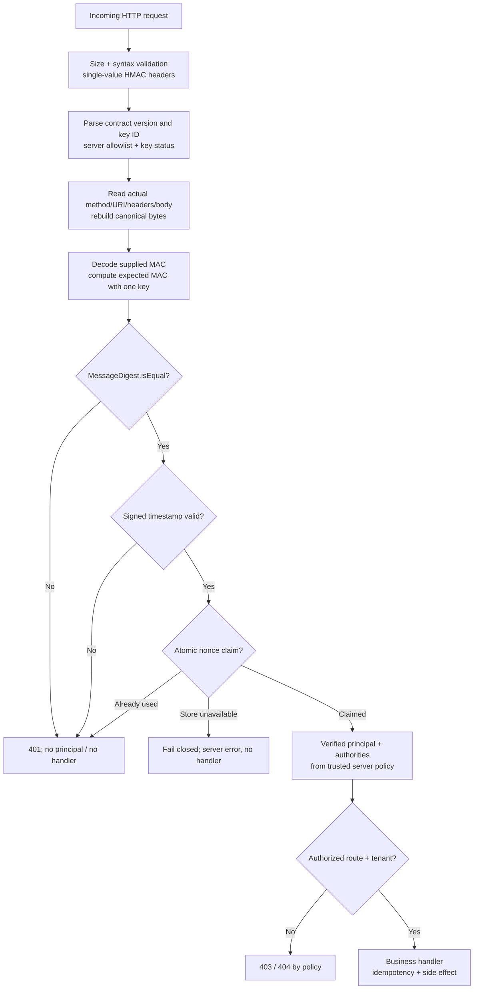
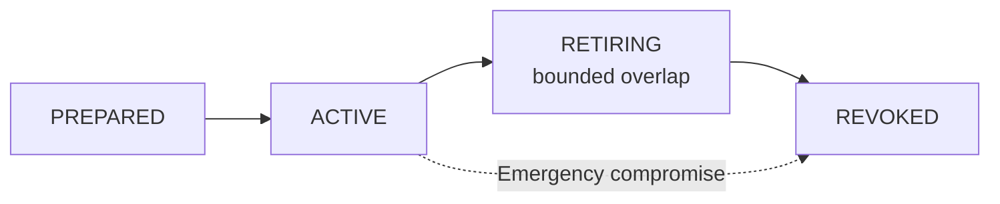
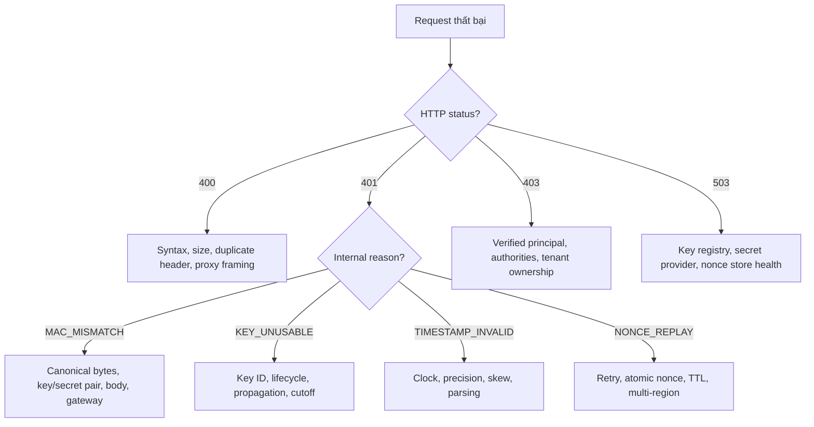

# Luồng ký và xác minh HTTP request bằng HMAC: tổng kết từ client đến backend

## 1. Bức tranh tổng thể

Trong module `SECURITY_AUTHENTICATION_HMAC_REQUEST_AUTHENTICATION`, chúng ta xây dựng cơ chế **authentication cho HTTP request** bằng HMAC với **shared secret**. Client và server đã thỏa thuận một **canonical request** bao gồm method, URI/query, header hoặc body theo hợp đồng ký. Client dùng secret để tạo **MAC**; server tìm đúng key version, dựng lại **chính những bytes đó**, tính MAC và xác minh chữ ký. Sau đó, server còn phải kiểm tra timestamp/nonce để **chống replay**, quản lý key rotation, tương tác đúng với proxy/gateway và tách biệt **authentication** khỏi **authorization**.

Bài **Luồng ký và xác minh**, thuộc chương **Tổng kết HMAC authentication**, gom các thành phần trên thành **một quy trình đầu-cuối có thể triển khai, vận hành và kiểm thử**. Điểm nhấn không chỉ là gọi `Mac.getInstance("HmacSHA256")`, mà là mọi lớp từ HTTP parser, canonicalizer, credential registry, nonce store đến security filter phải cùng thực hiện **một hợp đồng bảo mật**.

**Kết quả học tập:**

- Diễn giải thứ tự client **chuẩn bị HTTP bytes → canonicalize → ký → gửi** và server **parse → chọn key → canonicalize → xác minh → freshness → phân quyền**.
- Phân biệt **key ID**, **shared secret**, **signature**, **canonical bytes**, **timestamp**, **nonce**, **principal** và **authority**.
- Chỉ ra dữ liệu nào **được MAC bảo vệ** và những thứ HMAC **không tự bảo vệ**.
- Tạo signer và verifier Java minh họa dùng HMAC-SHA-256, hash body, Base64 và `MessageDigest.isEqual`.
- Thiết kế anti-replay bằng timestamp + **atomic nonce claim** có TTL/consistency đúng.
- Nhận diện lỗi do gateway rewrite, key rotation, body serializer, header ambiguity và retry.
- Xây test positive/negative, contract vectors và bước xử lý sự cố có thể kiểm chứng.

> **Thông điệp cốt lõi:** HMAC xác thực **một thông điệp chính xác dưới một key còn hiệu lực**. Nó không tự bảo đảm thông điệp còn mới, có quyền thực hiện hành động, bí mật khi truyền, hoặc không bị proxy biến đổi.

## 2. Từ HMAC toán học đến một request HTTP

Với khóa bí mật `K` và thông điệp bytes `M`:

```text
tag = HMAC-SHA-256(K, M)
```

`M` ở đây là **canonical request bytes** do hợp đồng ứng dụng xác định, không phải một Java `HttpServletRequest` object hay chuỗi JSON được serialize tùy ý. HMAC-SHA-256 trả **32 bytes**; có thể biểu diễn bằng Base64 để đưa vào HTTP header. **Base64 chỉ mã hóa bytes, không bổ sung bảo mật**.

Để xác minh:

```text
expected = HMAC-SHA-256(key_from_registry, canonical_bytes_from_request)
received = Base64Decode(X-Signature)

accept_MAC = constant_time_equal(expected, received)
```

Khi có `accept_MAC=true` và key còn hiệu lực, server có bằng chứng request được tạo bởi **một bên biết shared secret tương ứng**. Vì secret là **đối xứng**, nhiều bên biết cùng secret đều có thể tính MAC; không được nhầm với **chữ ký số phi đối xứng có tính không thể chối bỏ**. HMAC bảo vệ tính toàn vẹn của những trường **được ký**, nhưng không mã hóa request và không thay thế TLS/HTTPS.

| Thành phần | Chức năng | Có bí mật không? |
| --- | --- | --- |
| `keyId` | Chọn đúng key version trong registry | Thường không, nhưng phải validate |
| `sharedSecret` | Vật liệu tính HMAC | **Có; không đưa vào source/log/ticket** |
| `canonicalBytes` | Biểu diễn chính xác dữ liệu được ký | Có thể chứa metadata/body nhạy cảm; không log tùy tiện |
| `signature`/MAC | Bằng chứng về message và secret | Không nên log raw MAC hoặc coi nó như identity |
| `timestamp` | Giới hạn cửa sổ chấp nhận | Không bí mật; phải được ký |
| `nonce` | Nhận diện một attempt, chống phát lại | Không phải password; phải được ký, kiểm tra uniqueness |
| `verifiedClientId` | Danh tính xác thực từ key registry | **Chỉ tin sau MAC + freshness thành công** |
| `authorities` | Quyền gọi route/tài nguyên | Server xác định, không lấy từ header tự khai |

## 3. Một luồng ký và xác minh hoàn chỉnh

```mermaid
sequenceDiagram
    autonumber
    participant C as HMAC client / SDK
    participant G as API gateway
    participant F as Spring HMAC verifier
    participant K as Key registry + secret provider
    participant N as Atomic nonce store
    participant A as Authorization / handler
    C->>C: Build exact method, URI, headers, body bytes
    C->>C: New signed timestamp and nonce; SHA-256(body)
    C->>C: Canonical bytes; MAC = HMAC(secret, bytes)
    C->>G: HTTPS request + key ID, signature, timestamp, nonce
    G->>F: Forward signed representation according to contract
    F->>F: Strict parse and reject ambiguity
    F->>K: Resolve declared key ID and lifecycle policy
    K-->>F: One allowed key version / usable MAC key
    F->>F: Rebuild canonical bytes from actual HTTP request
    F->>F: Decode, calculate and compare MAC
    F->>F: Check signed timestamp freshness
    F->>N: Claim verified-client nonce atomically
    N-->>F: Claimed / already used / dependency error
    F->>A: Authenticated principal + server-side authorities
    A->>A: Check permission, tenant, idempotency, business rules
    A-->>C: Authorized HTTP response
```

Nhánh trên mô tả **request thành công**. Ở bất kỳ bước kiểm tra nào, nếu không đủ bằng chứng an toàn, request phải **dừng trước handler có side effect**. `X-Key-Id` được đọc trước MAC chỉ để *chọn khóa ứng viên*; nó chưa chứng minh client nào đang gọi.

### 3.1. Ai quyết định bước nào?

| Bước | Nguồn tin cậy | Kết quả |
| --- | --- | --- |
| Chọn signing profile | Client credential config được cấp quyền | Key ID, key version, canonical contract, secret đúng cặp |
| Dựng canonical request phía client | Protocol spec và **HTTP request sẽ thực sự gửi** | UTF-8 bytes có thứ tự xác định |
| Nhận/chuyển request | TLS/gateway trust boundary | Không thay signed fields ngoài hợp đồng |
| Tra key | **Registry phía server** | Secret/key material, client/tenant mapping, state, algorithm |
| Verify MAC | Server canonicalizer + JCA provider | So sánh MAC của một key version |
| Kiểm tra freshness | Server clock và nonce store nguyên tử | Chống request quá hạn/nonce đã dùng |
| Tạo `Authentication` | Spring Security sau toàn bộ kiểm tra | Verified principal từ registry |
| Phân quyền | Server authorization policy + resource ownership | Cho phép/từ chối route/tenant |

## 4. Đặc tả canonical contract cho ví dụ xuyên suốt

Để tránh “hai bên cùng nói đã ký request nhưng vẫn khác MAC”, bài dùng một hợp đồng **HMAC-REQ-V1 giả định**, chỉ cho request tạo đơn:

```http
POST /integrations/orders?source=partner HTTP/1.1
Host: api.example.test
Content-Type: application/json
Idempotency-Key: order-op-17
X-Hmac-Version: hmac-req-v1
X-Key-Id: fulfillment-2026b
X-Timestamp: 2026-11-28T03:15:00Z
X-Nonce: a1b2c3d4-example-nonce
X-Body-SHA256: <64 lowercase hex>
X-Signature: <Base64 of 32-byte HMAC>

{"orderId":"O-17","amount":125000}
```

**Các giá trị trong dấu góc là placeholder**, không phải một request hợp lệ có thể gửi nguyên văn. Nonce minh họa cũng không đại diện cho mức entropy production. Trong request thực, client phải dùng nonce sinh từ CSPRNG và signature tính từ **body bytes thực tế**.

### 4.1. Chính xác những gì được ký

Với ví dụ này, canonical text có cấu trúc:

```text
HMAC-REQ-V1
POST
/integrations/orders?source=partner
content-type:application/json
idempotency-key:order-op-17
x-body-sha256:<64 lowercase hex of raw body bytes>
x-key-id:fulfillment-2026b
x-nonce:<signed nonce>
x-timestamp:2026-11-28T03:15:00Z
```

**Quy định byte-level giả định:**

- Mỗi dòng cách nhau đúng **LF `0x0A`**; **không có LF cuối**; toàn chuỗi encode UTF-8.
- `HMAC-REQ-V1` là **domain/version prefix**; HTTP header `X-Hmac-Version` phải tồn tại đúng một lần, giá trị chính xác `hmac-req-v1`. Header này được **ràng buộc gián tiếp** bằng prefix và validation.
- Method `POST` phải khớp request thực; không chuyển thành `GET` để tính lại.
- Dòng URI là **raw path + raw query** được bảo toàn tại điểm verify, không tự giải mã `%2F`, sort query hoặc normalize dấu `/`. Ví dụ contract này yêu cầu gateway **không rewrite signed request-target** trước khi backend verify.
- Các signed headers có tên canonical lowercase, xuất hiện theo **thứ tự cố định như trên** và phải là **single-valued**; parser reject duplicate, CR/LF injection và OWS không hợp lệ.
- `Content-Type` trong ví dụ phải đúng `application/json`, không chấp nhận charset parameters một cách ngầm định.
- `X-Body-SHA256` chứa **hex lowercase** SHA-256 của **raw HTTP body bytes**; server **tự tính lại digest** từ body thực nhận trước khi ký canonical.
- `Idempotency-Key` là một signed header cho request có side effect; attacker không được sửa operation ID mà giữ nguyên MAC.
- `X-Key-Id`, `X-Nonce` và `X-Timestamp` nằm trong dữ liệu ký để chống header swapping.
- `X-Signature` là kết quả MAC, **không** đưa vào canonical input.
- `Host`, `Connection`, `Content-Length` và transport framing không được ký trong **hợp đồng ví dụ**; đây không phải lời khuyên bỏ chúng ở mọi thiết kế.

**Điều rất quan trọng:** nếu một API thực dùng canonical contract khác, phải theo **đúng contract đã công bố**. Không copy ví dụ này vào một giao thức đang chạy rồi tuyên bố tương thích. Với GET, PUT, multi-part, content-encoding hoặc streaming body, cần đặc tả và golden vectors riêng.

### 4.2. Một khác biệt byte có nghĩa gì?

```text
Client ký path:  /integrations/orders?b=2&a=1
Server dùng:    /integrations/orders?a=1&b=2

Client ký body: {"orderId":"O-17","amount":125000}
Server serialize: {"amount":125000,"orderId":"O-17"}
```

Các cặp trên có thể có cùng ý nghĩa nghiệp vụ, nhưng **bytes khác**. Nếu contract bảo vệ raw query/raw body, MAC phải khác. Đây là **đặc tính bảo mật mong muốn**, không phải lỗi có thể sửa bằng cách bỏ query/body khỏi chữ ký.

## 5. Client ký request theo thứ tự nào?

Một quy trình signer nên có **10 bước**:

1. **Chọn profile đang ACTIVE** từ cấu hình/secret provider đã cấp quyền: key ID, secret version, algorithm và canonical contract; không chọn ngẫu nhiên theo lỗi response.
2. **Đóng băng ý định request**: HTTP method, raw path/query, signed header values và business idempotency key.
3. **Serialize payload một lần** thành `byte[]` sẽ gửi. Không ký một JSON object rồi để HTTP client serialize lần hai theo thứ tự/charset khác.
4. **Tính SHA-256 từ exact body bytes**, encode digest hex lowercase.
5. **Lấy timestamp UTC** từ clock client theo precision hợp đồng; không dựa vào server time tự suy đoán.
6. **Sinh nonce mới** bằng CSPRNG cho attempt hiện tại. Không dùng `System.currentTimeMillis()`/counter cố định hoặc request ID dễ trùng làm entropy thay nonce.
7. **Dựng canonical bytes** từ những giá trị thực sẽ gửi, theo đúng version và thứ tự.
8. **Tính HMAC** với shared secret của **đúng key ID**; encode MAC theo chuẩn đã thống nhất, ví dụ Base64 chuẩn 32-byte output.
9. **Gắn header auth và gửi request** qua HTTPS; không sửa method, path/query, signed headers hoặc body bytes sau ký.
10. **Xử lý response/retry**: nếu cần một HTTP attempt mới, tạo timestamp/nonce/MAC mới theo hợp đồng; giữ business idempotency key cho cùng ý định nếu API hỗ trợ.

**Tại sao phải có idempotency key?** Nonce chống chấp nhận lại cùng thông điệp đã ký, trong khi business idempotency key giúp ngăn xử lý cùng một ý định nghiệp vụ hai lần khi client **ký mới** sau timeout. Đây là hai cơ chế riêng.

### 5.1. Lỗi client hay gặp

| Lỗi signer | Hệ quả | Cách phát hiện |
| --- | --- | --- |
| Ký Java `String` rồi gửi bytes bằng charset khác | Digest/MAC mismatch | Contract vector trên exact bytes |
| Hash JSON trước, sau đó serializer đổi field order/whitespace | Body digest khác | Byte-level assertion |
| Ký URI trước gateway, backend dùng URI sau rewrite | MAC mismatch | E2E qua gateway |
| Ký key A nhưng header nêu key B | MAC/key binding fail | Wrong-key negative test |
| Nonce lấy từ timestamp hoặc giữ nguyên trên retries | Replay/entropy weakness | Load/retry tests |
| Sửa `Idempotency-Key` ở HTTP interceptor sau ký | MAC mismatch hoặc business integrity gap | Signed-header tampering test |
| Dùng Base64URL thay cho Base64 chuẩn | Decoder từ chối | Known vectors/encoding test |
| Hard-code shared secret trong SDK public | Credential có thể trích xuất | Secret scan/threat model |
| Khi `401` tự đổi xuống v1 để thử lại | Downgrade/key confusion | No-fallback tests và audit |

## 6. Server xác minh theo thứ tự nào?

Quy trình điển hình tại **authentication boundary**:



Các bước validate định dạng/size hoặc kiểm tra timestamp **không tin cậy** có thể được thực hiện sớm để tránh lãng phí CPU; nhưng **không được coi bất kỳ header nào đã chứng minh client** trước MAC hợp lệ. Đặc biệt không claim nonce của một `clientId` tự khai **trước MAC**: attacker có thể gửi nonce giả để “đốt” request hợp lệ của client.

### 6.1. Checklist phía verifier

1. Kiểm tra request method/path hợp lệ, giới hạn body/headers và canonical contract version được **server cho phép**.
2. Bắt buộc đúng một `X-Key-Id`, `X-Timestamp`, `X-Nonce`, `X-Signature` và các signed headers; reject duplicate, empty, invalid Unicode/control characters.
3. Chọn **một** key version theo key ID từ registry, kiểm tra algorithm, trạng thái `ACTIVE/RETIRING`, `notBefore`/`acceptedUntil` và policy client/tenant.
4. Tính body digest từ **bytes thật**; không tin `X-Body-SHA256` như một phép kiểm tra độc lập chưa xác minh.
5. Dựng canonical bytes đúng hợp đồng và **tự tính expected HMAC**. MAC sai → reject; **không thử secret/contract khác**.
6. Parse timestamp đã được MAC bảo vệ, kiểm tra server clock/skew, rồi atomic nonce claim.
7. Chỉ khi MAC, key state, timestamp và nonce đạt mới tạo `Authentication` và authorities từ policy server.
8. Chuyển sang authorization và ownership; không dùng HMAC để tự cấp `ORDER_CREATE` hay bỏ kiểm tra tenant.
9. Khi dependency lỗi, **fail closed**; không tạo principal và không gọi handler.
10. Ghi audit/metrics theo reason code hữu hạn, không ghi secret/raw signature/body nhạy cảm.

### 6.2. Key ID là hint, không phải credential

```text
X-Key-Id: fulfillment-2026b
```

Giá trị đó được caller gửi nên có thể bị **bịa**. Registry phải biết ID này thuộc verified client nào, algorithm/key version/state ra sao. Chỉ khi phép so MAC đúng và freshness hợp lệ mới khẳng định request được xác thực với **danh tính theo registry**, không phải client do header tự nhận.

**Sai nghiêm trọng:** `SecurityContextHolder.getContext().setAuthentication(...)` chỉ vì `X-Key-Id` tồn tại. Đó là authentication bypass.

## 7. Một bộ Java helper chung cho signer và verifier

Ví dụ sau dùng **Java 17**, `HmacSHA256` và đúng hợp đồng **HMAC-REQ-V1 minh họa** đã nêu. Các input phải được parser hoặc SDK validate trước; helper tập trung vào cách dựng canonical bytes và MAC.

```java
import java.nio.charset.StandardCharsets;
import java.security.GeneralSecurityException;
import java.security.MessageDigest;
import java.util.Base64;
import java.util.HexFormat;
import javax.crypto.Mac;
import javax.crypto.SecretKey;

public final class HmacRequestV1 {
    private HmacRequestV1() {}

    public static String bodySha256(byte[] exactBodyBytes)
            throws GeneralSecurityException {
        byte[] digest = MessageDigest.getInstance("SHA-256")
                .digest(exactBodyBytes);
        return HexFormat.of().formatHex(digest);
    }

    public static byte[] canonicalPost(
            String rawTarget,
            String idempotencyKey,
            String bodyDigestHex,
            String keyId,
            String nonce,
            String timestamp) {
        // Ví dụ cho POST JSON; input đã qua parser strict.
        String canonical = String.join("\n",
                "HMAC-REQ-V1",
                "POST",
                rawTarget,
                "content-type:application/json",
                "idempotency-key:" + idempotencyKey,
                "x-body-sha256:" + bodyDigestHex,
                "x-key-id:" + keyId,
                "x-nonce:" + nonce,
                "x-timestamp:" + timestamp);
        return canonical.getBytes(StandardCharsets.UTF_8);
    }

    public static byte[] hmacSha256(
            SecretKey secret, byte[] canonicalBytes)
            throws GeneralSecurityException {
        // Mac có trạng thái: tạo riêng cho mỗi attempt/verification.
        Mac mac = Mac.getInstance("HmacSHA256");
        mac.init(secret);
        return mac.doFinal(canonicalBytes);
    }

    public static String signBase64(
            SecretKey secret, byte[] canonicalBytes)
            throws GeneralSecurityException {
        return Base64.getEncoder().encodeToString(
                hmacSha256(secret, canonicalBytes));
    }

    public static boolean matchesBase64(
            SecretKey secret,
            byte[] canonicalBytes,
            String receivedSignature)
            throws GeneralSecurityException {
        if (receivedSignature == null
                || receivedSignature.length() > 256) return false;

        final byte[] received;
        try {
            received = Base64.getDecoder().decode(receivedSignature);
        } catch (IllegalArgumentException ex) {
            return false;
        }
        if (received.length != 32) return false;

        byte[] expected = hmacSha256(secret, canonicalBytes);
        return MessageDigest.isEqual(expected, received);
    }
}
```

**Những điều ví dụ này làm đúng:** canonical order cố định, UTF-8 + LF, digest body từ raw bytes, `Mac` cục bộ cho lần tính, signature Base64 và so MAC bytes bằng `MessageDigest.isEqual`. Nó **không tự** làm HTTP parsing, version policy, key lifecycle, timestamp/nonce, dependency handling, streaming body hoặc Spring authorization; không copy nguyên helper rồi coi là một authenticator hoàn chỉnh.

### 7.1. Cần tách bộ kiểm thử hai bên dù có helper chung

Nếu client và server cùng gọi một hàm canonicalize **bị lỗi như nhau**, unit test so signer với verifier có thể vẫn “xanh”. Phải có **golden vector độc lập**: expected canonical bytes (hex), key test, expected MAC bytes và request mutation cases. Khi thay đổi thư viện HTTP/gateway, chạy test trên **HTTP request thực**, không chỉ string từ helper.

## 8. Java client signer: sinh timestamp, nonce, ký và cố định bytes

Một signer Java minh họa:

```java
import java.security.GeneralSecurityException;
import java.security.SecureRandom;
import java.time.Clock;
import java.time.temporal.ChronoUnit;
import java.util.Base64;
import javax.crypto.SecretKey;

public final class HmacPostSigner {
    public record Credential(String keyId, SecretKey secret) {}

    public record SignedFields(
            String keyId,
            String timestamp,
            String nonce,
            String bodyDigestHex,
            String signatureBase64) {}

    private final Clock clock;
    private final SecureRandom random;

    public HmacPostSigner(Clock clock, SecureRandom random) {
        this.clock = clock;
        this.random = random;
    }

    public SignedFields sign(
            Credential credential,
            String rawTarget,
            String idempotencyKey,
            byte[] exactBodyBytes) throws GeneralSecurityException {

        String timestamp = clock.instant()
                .truncatedTo(ChronoUnit.SECONDS).toString();

        byte[] nonceBytes = new byte[18];  // 144 random bits
        random.nextBytes(nonceBytes);
        String nonce = Base64.getUrlEncoder()
                .withoutPadding().encodeToString(nonceBytes);

        String digest = HmacRequestV1.bodySha256(exactBodyBytes);
        byte[] canonical = HmacRequestV1.canonicalPost(
                rawTarget,
                idempotencyKey,
                digest,
                credential.keyId(),
                nonce,
                timestamp);
        String signature = HmacRequestV1.signBase64(
                credential.secret(), canonical);

        return new SignedFields(
                credential.keyId(), timestamp,
                nonce, digest, signature);
    }
}
```

**Cách sử dụng:** SDK phải thêm đúng `X-Hmac-Version: hmac-req-v1`, `Content-Type: application/json` và `Idempotency-Key`, sau đó gắn các `SignedFields` vào `X-Key-Id`, `X-Timestamp`, `X-Nonce`, `X-Body-SHA256`, `X-Signature` và gửi **chính xác `exactBodyBytes`** cùng `rawTarget` đã ký.

`Credential` phải đến từ hệ thống provisioning/secret management; không hard-code secret production vào Java, không phát hành một shared secret chung trong public mobile/browser client. `SecretKey` có thể là key từ provider giữ bí mật không export. Ví dụ chưa validate URL, key ID, idempotency syntax hay nulls; production phải bổ sung trước khi ký.

Nonce **144 bit ngẫu nhiên** là lựa chọn minh họa có entropy cao; server phải validate format Base64URL unpadded và chính sách uniqueness, không coi độ dài chuỗi là bằng chứng đủ an toàn nếu client RNG bị lỗi.

## 9. Java verifier: đúng một key và đúng một hợp đồng

Trong ví dụ sau, các abstraction `HmacKeyRegistry`, `HmacKeyProvider`, `NonceStore`, `VerifiedPrincipal` và `SignedPostEvidence` do ứng dụng định nghĩa. Chúng **không phải API có sẵn** trong Spring Security; đoạn mã trình bày những kiểm tra quan trọng để người học triển khai bằng framework phù hợp.

```java
import java.security.GeneralSecurityException;
import java.time.Clock;
import java.time.Duration;
import java.time.Instant;
import javax.crypto.SecretKey;
import org.springframework.security.authentication.BadCredentialsException;

public final class StrictPostHmacVerifier {
    private static final Duration ALLOWED_SKEW =
            Duration.ofMinutes(5); // giả định hợp đồng

    private final HmacKeyRegistry registry;
    private final HmacKeyProvider keys;
    private final NonceStore nonces;
    private final Clock clock;

    public StrictPostHmacVerifier(
            HmacKeyRegistry registry,
            HmacKeyProvider keys,
            NonceStore nonces,
            Clock clock) {
        this.registry = registry;
        this.keys = keys;
        this.nonces = nonces;
        this.clock = clock;
    }

    public VerifiedPrincipal verify(SignedPostEvidence request) {
        // HTTP boundary đã reject duplicate/missing/malformed headers.
        // contractVersion phải đúng 1 giá trị hmac-req-v1.
        if (!"hmac-req-v1".equals(request.contractVersion())) {
            throw new BadCredentialsException("Invalid HMAC credentials");
        }

        Instant now = clock.instant();
        var key = registry.findById(request.keyId())
                .orElseThrow(() -> new BadCredentialsException(
                        "Invalid HMAC credentials"));

        if (!key.isAllowedAt(now)
                || !"HmacSHA256".equals(key.algorithm())
                || !key.acceptsContract("HMAC-REQ-V1")) {
            throw new BadCredentialsException("Invalid HMAC credentials");
        }

        final String digest;
        try {
            digest = HmacRequestV1.bodySha256(request.exactBody());
        } catch (GeneralSecurityException ex) {
            throw new HmacInfrastructureException(
                    "SHA-256 provider unavailable", ex);
        }
        // Header digest và body thực tế phải khớp đúng encoding.
        if (!digest.equals(request.bodyDigestHex())) {
            throw new BadCredentialsException("Invalid HMAC credentials");
        }

        byte[] canonical = HmacRequestV1.canonicalPost(
                request.rawTarget(), request.idempotencyKey(),
                digest, request.keyId(), request.nonce(),
                request.timestampText());
        try {
            SecretKey secret = keys.load(key.secretRef());
            if (!HmacRequestV1.matchesBase64(
                    secret, canonical, request.signatureBase64())) {
                throw new BadCredentialsException(
                        "Invalid HMAC credentials");
            }
        } catch (GeneralSecurityException ex) {
            throw new HmacInfrastructureException(
                    "HMAC key/crypto provider unavailable", ex);
        }

        // Validate exact timestamp representation ở HTTP parser.
        Instant ts = request.signedTimestamp();
        if (ts.isBefore(now.minus(ALLOWED_SKEW))
                || ts.isAfter(now.plus(ALLOWED_SKEW))) {
            throw new BadCredentialsException("Invalid HMAC credentials");
        }

        Instant expiresAt = ts.plus(ALLOWED_SKEW)
                .plusSeconds(30); // margin giả định
        boolean claimed = nonces.claimAtomically(
                key.verifiedClientId(), request.nonce(), expiresAt);
        if (!claimed) {
            throw new BadCredentialsException("Invalid HMAC credentials");
        }
        // Dependency exception từ nonces phải lan ra fail-closed 5xx.

        return new VerifiedPrincipal(
                key.verifiedClientId(), key.tenantId());
    }
}
```

**Các điều kiện để hiện thực hóa đoạn code an toàn:**

- `SignedPostEvidence` phải được dựng từ **HTTP request thực** sau parser strict: method đúng POST, rawTarget đáng tin, signed headers single-valued, body bytes có giới hạn và digest dạng hex lowercase đúng 64 ký tự.
- `request.timestampText()` và `request.signedTimestamp()` phải được kiểm tra **khớp tuyệt đối về biểu diễn**. Ví dụ parse `Instant.parse` rồi yêu cầu `instant.truncatedTo(SECONDS).toString().equals(timestampText)`; không cho một timestamp tùy ý parse ra cùng Instant nhưng mang canonical form khác ngoài hợp đồng.
- `nonce` phải qua kiểm tra format/entropy contract; không nhận newline, control characters hoặc key quá dài làm hỏng replay namespace.
- `HmacKeyRegistry` chỉ trả metadata theo key ID đã validate; `key.isAllowedAt(now)` chặn `PREPARED/REVOKED`, acceptedUntil/cutoff và sai suite/client policy.
- `HmacKeyProvider` không trả `null` và không fallback sang default secret; lỗi provider/key registry phải được map thành **lỗi hạ tầng**, không phải tự cho qua. Nếu underlying API hỗ trợ HSM/non-exportable key, adapter phải dùng provider tương ứng.
- `NonceStore.claimAtomically` phải là **atomic insert-if-absent** trên namespace được định nghĩa; lỗi store/timeout phải ném **exception**, không trả `true`. Một implementation trả `null`/unknown phải bị fail-closed.
- `VerifiedPrincipal` chỉ xuất hiện sau MAC + freshness + claim thành công. Authorities/tenant permission còn phải được policy server kiểm tra riêng.
- Khi phát triển API có GET hoặc nhiều versions, cần **canonicalizer/key binding tường minh** cho từng version, không sửa helper bằng cách “thử format khác đến lúc pass”.

### 9.1. Điểm tinh vi: chỉ so MAC với secret được khai

Không viết:

```java
// SAI: thử mọi secret hoặc thuật toán theo cách fallback.
for (SecretKey candidate : allClientKeys) {
    if (verifyMac(candidate, request)) {
        return authenticatedClient;
    }
}
```

Đúng là: `request.keyId()` chỉ chọn **một** key entry qua registry, rồi kiểm tra status/version/algorithm và MAC. Nếu key A sai mà secret B ký đúng thì phải reject, không chuyển identity hay key version theo guesswork. Trong giai đoạn key rotation, có thể **hai key IDs hợp lệ trong thời hạn overlap**, nhưng **không** có nghĩa thử cả hai cho cùng request.

## 10. Anti-replay: timestamp và nonce phải đi cùng nhau

HMAC chỉ xác minh tính toàn vẹn và quyền sử dụng secret. Một request có chữ ký đúng **vẫn có thể bị phát lại** nguyên vẹn trong cửa sổ thời gian nếu server không nhớ nó đã được xử lý.

### 10.1. Timestamp giới hạn thời gian, không chứng minh uniqueness

Một hợp đồng ví dụ:

```text
accepted if:
  serverNow - 5 minutes <= signedTimestamp
  signedTimestamp <= serverNow + 5 minutes
```

`5 phút` chỉ là tham số giả định. Server dùng **clock đáng tin**, kiểm soát skew qua NTP và có test biên. Không tăng window vô hạn chỉ để giảm `401`. Timestamp phải nằm trong canonical input; nếu attacker sửa nó mà MAC không đổi thì hợp đồng ký đang thiếu trường quan trọng.

### 10.2. Nonce: một giá trị có hiệu lực một lần trong phạm vi hợp đồng

Khi same verified client gửi lại cùng nonce, server phải từ chối nếu contract yêu cầu uniqueness theo client.

```text
replayScope = (verifiedClientId, signedNonce)
atomic_claim(replayScope, expiresAt)

claim first time  -> success
claim again       -> replay / 401
store unavailable -> fail closed / server error
```

Một cache cục bộ từng pod hoặc thao tác `GET` rồi `SET` riêng lẻ không bảo đảm nguyên tử. Ví dụ Redis `SET key value NX PX ttl` có thể là primitive cần thiết trong một topology nhất quán, nhưng **cluster replication/failover/multi-region** phải được đánh giá; “dùng Redis” không tự chứng minh global uniqueness.

**TTL phải bao phủ toàn bộ thời gian signed timestamp còn được chấp nhận.** Với cửa sổ đối xứng ±5 phút, một request có thể tới sớm và được replay muộn; nếu marker được tạo từ lần claim đầu, TTL bảo thủ gần **10 phút + margin**, không phải chỉ 5 phút. Hoặc tính expiry theo `signedTimestamp + allowedSkew + safetyMargin`. Khi store timeout và không biết marker đã được ghi chưa, không được mặc định cho phép.

### 10.3. Key rotation không làm reset replay history

Khi cùng client có `key-2026a` và `key-2026b`, namespace theo `keyId + nonce` có thể vô tình cho nonce được claim hai lần xuyên key versions. Nếu contract yêu cầu uniqueness theo **verified client**, replay key phải theo client/nonce (và domain phù hợp), không chia theo key ID.

Nếu muốn lưu nonce reference dạng opaque, có thể HMAC riêng trên encoding không mơ hồ của verifiedClientId + nonce, dùng **replay-namespace key khác** shared secret ký HTTP. Không dùng raw nonce làm metric label và không lưu raw secret trong nonce store.

## 11. Retry và idempotency: hai cơ chế độc lập

```text
First attempt:
  POST /integrations/orders
  X-Nonce=N1, X-Timestamp=T1, X-Signature=MAC1
  Idempotency-Key=order-op-17
  -> HMAC valid, nonce claimed, order committed
  -> response lost

Incorrect replay retry:
  same nonce N1, timestamp T1, signature MAC1
  -> 401 NONCE_REPLAY

New signed retry:
  X-Nonce=N2, X-Timestamp=T2, X-Signature=MAC2
  Idempotency-Key=order-op-17  (signed again)
  -> HMAC valid, idempotency layer returns previous result
```

Nonce là thuộc tính **security của HTTP attempt**. Idempotency key là thuộc tính **business intent**. Nếu endpoint không có bảo đảm idempotency/lookup đáng tin, client **không được tự động gửi lại POST** sau timeout như thể không có side effect; cần kiểm tra trạng thái giao dịch hoặc cơ chế đối soát.

Server cần bảo đảm `Idempotency-Key`/operation ID được ràng buộc với danh tính và payload theo contract, dùng atomic business constraint hoặc ledger. Trong ví dụ của bài, header này được **ký trong canonical request**, để bên thứ ba không thể đổi nó mà vẫn giữ MAC.

## 12. Key lifecycle và xoay secret trong luồng verify



| Key state | Server verify? | Ý nghĩa |
| --- | --- | --- |
| `PREPARED` | Không | Đã provision nhưng chưa activation |
| `ACTIVE` | Có, trong effective window | Key đang dùng |
| `RETIRING` | Có giới hạn, trước cutoff nếu policy cho phép | Overlap để chuyển client |
| `REVOKED` | **Không**, dù MAC toán học đúng | Credential không còn được tin |

Một key ID nên ánh xạ tới **đúng một secret version**, một algorithm suite và một client/tenant mapping. Key mới phải chứa secret thực sự khác, được sinh từ nguồn ngẫu nhiên phù hợp và cấp qua secret manager/kênh bảo vệ; không hard-code vào JAR/Docker/CI hay app public.

**Cutoff dùng server clock**, không dùng `X-Timestamp` do client khai để kéo dài thời gian chấp nhận. Nếu key registry/cache hoặc gateway chưa cập nhật trạng thái revoke, một node có thể vẫn nhận key cũ: cần invalidate/version policy và **chủ động test valid old MAC bị từ chối** trên mọi ingress.

Rotation định kỳ có thể cho overlap hữu hạn. Khi nghi secret lộ, cần incident response và có thể revoke ngay; không mặc định kéo dài overlap để giữ traffic xanh. Không fallback sang key revoked khi provider mới gặp sự cố.

## 13. Gateway/proxy: cùng request ở hai điểm có thể khác bytes

```text
Client signs:
  POST /public-api/orders?b=2&a=1

Gateway forwards:
  POST /internal/orders?b=2&a=1

Backend verifier signs received /internal/orders...
  -> MAC mismatch for an honest client
```

Có hai nhóm thiết kế khả thi, phải chọn một:

1. **Verify tại gateway trước rewrite**, khi nó còn giữ external request-target; chuyển verified identity qua **kênh nội bộ được bảo vệ**, ví dụ authenticated service-to-service channel và internal assertion có scope/expiry. Gateway phải scrub header identity tự khai từ Internet; backend vẫn kiểm tra authorization.
2. **Verify tại backend**, nhưng bảo đảm gateway không sửa signed representation hoặc dùng **trusted forwarded representation** được thiết kế/kiểm chứng rõ. Không tin `X-Original-URI`/`X-Forwarded-*` do caller Internet tự gắn.

Ví dụ Java xuyên bài dùng **phương án backend verify và không rewrite** những thành phần đã ký. Với một hạ tầng khác, phải sửa **hợp đồng ký** và test đồng thời client/gateway/backend, không dùng một bản canonical string chung cho nhiều trust boundaries.

### 13.1. Header, HTTP/2/3 và body

- HTTP header names **case-insensitive**; canonicalizer có thể lowercase field names, nhưng vẫn phải reject duplicate credential headers và các trường hợp request smuggling/ambiguity.
- `Connection` và hop-by-hop headers có thể bị proxy loại, kể cả khi attacker cố đặt tên `X-Signature` trong danh sách `Connection`. Đừng ký framing fields `Transfer-Encoding` hoặc connection-specific fields qua nhiều hops.
- HTTP/2 pseudo-headers `:method`, `:path`, `:authority` và HTTP/3 framing khác HTTP/1.1. Khi chuyển giao thức, phải giữ semantics của **signed method/target/body** theo contract.
- Gateway có thể giải nén/chuyển charset/chỉnh `Content-Type` hoặc stringify JSON lại; nếu body digest tính từ raw bytes khác, MAC phải fail.
- Nếu proxy gửi một internal identity assertion đã xác thực, nó là **giao thức riêng**, không lấy raw `X-Verified-Client` từ Internet và coi là nguồn sự thật.

## 14. Spring Security: authentication trước, authorization sau

Một Spring MVC pipeline phù hợp:

```text
OncePerRequestFilter / custom AuthenticationFilter
   -> parse signed HTTP evidence
   -> AuthenticationManager / AuthenticationProvider
   -> HMAC verification + timestamp/atomic nonce
   -> create authenticated Authentication
   -> SecurityContextHolder
   -> AuthorizationFilter / @PreAuthorize / business ownership
   -> controller
```

Với **Spring MVC**, `OncePerRequestFilter` chỉ giúp tránh filter chạy lại không cần thiết trong một số dispatcher contexts; **không tự** bảo đảm chống replay giữa HTTP requests. Replay protection nằm ở **shared nonce store**. Cần clear security context khi authentication thất bại và không cho controller chạy trước bước verify.

Với **Spring WebFlux**, dùng `AuthenticationWebFilter`/`ReactiveAuthenticationManager` và `ReactiveSecurityContextHolder`. Các bước key lookup, body hashing, MAC verify và atomic nonce claim cần được **compose vào reactive chain**, không `block()` trên event-loop hoặc `subscribe()` thủ công rồi cho downstream chạy trước auth kết thúc. Nếu đọc `Flux<DataBuffer>` để hash body, phải bảo đảm replay/release buffers đúng để handler vẫn nhận đúng bytes.

| Kết quả | Authentication | Authorization | HTTP thường dùng |
| --- | --- | --- | --- |
| Wrong/unknown key ID, revoked key, MAC sai | Thất bại | Không chạy | `401 Unauthorized` |
| Timestamp sai/nonce replay | Thất bại | Không chạy | `401` |
| Invalid/duplicate HTTP authentication headers | Reject ở parser/credential boundary | Không chạy | `400` hoặc `401` theo contract |
| Key/nonce provider unavailable | Không hoàn tất | Không chạy | Server error, thường `503` |
| HMAC đúng, thiếu `ORDER_CREATE` | Thành công | Từ chối | `403 Forbidden` |
| HMAC đúng, client khác tenant | Thành công | Từ chối/che tồn tại | `403`/`404` theo policy |
| HMAC + permissions + ownership hợp lệ | Thành công | Cho phép | Response nghiệp vụ |

`401` phải kèm challenge `WWW-Authenticate` phù hợp với authentication scheme được công bố. Nếu API định nghĩa scheme `HMAC` riêng, cần đặc tả challenge; đừng trả `Bearer` cho endpoint chỉ hỗ trợ HMAC. Lỗi public nên tránh cho biết key tồn tại hay không; reason chi tiết chỉ dành cho audit có quyền.

### 14.1. Đừng nhầm principal với key ID

Sai:

```java
// SAI: header chưa chứng minh danh tính.
String clientId = request.getHeader("X-Key-Id");
Authentication auth = markAuthenticated(clientId);
```

Đúng về mặt kiến trúc: chỉ sau khi MAC được so với secret **đúng key còn hiệu lực**, timestamp/nonce đạt và registry cung cấp verified client/tenant, mới tạo `Authentication`. Authorities được cấp từ **server policy**, không từ một header `X-Roles` do caller tự khai.

## 15. Cây quyết định chẩn đoán HMAC failure



**Một lỗi `401` không cho biết tự động là MAC sai.** Nếu timestamp không hợp lệ, secret có thể hoàn toàn đúng; nếu key đã revoked, MAC cũ đúng vẫn phải reject. Khi debugging cần log **reason enums** và correlation có kiểm soát, không trả expected MAC hoặc shared secret cho client.

### 15.1. Nếu tỷ lệ `MAC_MISMATCH` tăng

Kiểm tra theo thứ tự: signer key version có trùng header ID không → canonical contract/version → raw path/query và percent-encoding → signed header values/duplicates → body digest từ **exact transmitted bytes** → gateway rewrite → Base64 variant. Dùng test vector **không chứa secret thật** để so từng lớp. Không “sửa” bằng cách bỏ URI/body khỏi MAC hoặc cho fallback.

### 15.2. Nếu `NONCE_REPLAY` tăng

Phân biệt SDK retry nguyên signed request, gateway retry POST sau timeout, attacker phát lại message, nonce collision/entropy lỗi và store consistency. Nhiều `401 NONCE_REPLAY` có thể cho thấy guard đang hoạt động; phải kiểm tra **auth success trùng nonce** và business duplicate effects mới biết impact.

### 15.3. Nếu `503` tăng

Xác nhận key registry/secret manager/nonce store availability, clock, network/TLS, service account và resource pressure. Phải **fail closed** khi không biết nonce đã claim hay chưa; không đổi sang “skip HMAC for 30 seconds”. Xem retry/backoff và idempotency cho client; không xóa nonce history chỉ để giảm lỗi.

## 16. Kiểm thử end-to-end: ma trận tối thiểu

| # | Tình huống | HTTP mong đợi | Điều phải assert thêm |
| --- | --- | --- | --- |
| 1 | MAC đúng, key ACTIVE, timestamp hợp lệ, nonce mới | `2xx` theo API | Principal/tenant/authority đúng |
| 2 | Đổi method sau ký | `401` | Controller không có side effect |
| 3 | Đổi raw URI/query sau ký | `401` | Không canonicalize lỏng |
| 4 | Đổi body byte hoặc digest sau ký | `401` | Không tạo order |
| 5 | Đổi signed header `Idempotency-Key` | `401` | Không đổi operation ID ngoài MAC |
| 6 | Đổi `X-Key-Id` sau ký | `401` | Không thử secret khác |
| 7 | Key ID không tồn tại | `401` | Không lộ enumeration |
| 8 | Key PREPARED hoặc REVOKED dù MAC hợp lệ | `401` | Policy chặn trước side effect |
| 9 | Duplicate/empty/malformed HMAC header | Reject | Không chọn tùy ý first/last |
| 10 | Signature sai encoding/length | `401` | Không so string không chuẩn |
| 11 | Timestamp quá hạn hoặc quá xa tương lai | `401` | Server clock và signed field |
| 12 | Gửi lại nguyên request có nonce đã claim | `401` lần sau | Đúng một side effect |
| 13 | Concurrent replay hai instances | Tối đa một claim thành công | Atomic store thật |
| 14 | Replay trong key rotation A/B | Theo uniqueness scope client | Không reset history do đổi key |
| 15 | Nonce store/secret provider timeout | Lỗi server, thường `503` | Fail closed, không controller |
| 16 | Client có MAC đúng nhưng thiếu `ORDER_CREATE` | `403` | Authorities từ server |
| 17 | Client đúng MAC nhưng sai tenant | `403`/`404` | Không rò dữ liệu tenant |
| 18 | Gateway rewrite signed path/body | Reject hoặc verify theo contract khác được duyệt | Không bỏ signed fields |
| 19 | HTTP/1.1 ↔ HTTP/2/3 nếu hỗ trợ | Semantics phù hợp hợp đồng | Không ký hop-by-hop framing |
| 20 | Key cũ sau cutoff ở từng region | `401` với valid old MAC | Cache/policy propagation đúng |
| 21 | Retry ký mới, cùng business idempotency key | HMAC hợp lệ | Không nhân đôi nghiệp vụ |
| 22 | Gateway forged `X-Verified-Client` | Reject/bỏ header | Không identity bypass |

**Tối quan trọng:** negative test chỉ thấy `401` là chưa đủ nếu request gốc cũng thất bại. Mỗi test phải có **positive control** với key test đúng, timestamp/nonce mới, raw body bytes đồng nhất và quyền phù hợp. Kiểm thử **không gọi code production thực** chỉ từ bài đọc; người học cần triển khai/kiểm thử trong project riêng.

### 16.1. Golden vector nên chứa gì?

```yaml
caseId: hmac-req-v1-post-valid
contractVersion: HMAC-REQ-V1
method: POST
rawTarget: /integrations/orders?source=partner
contentType: application/json
idempotencyKey: order-op-17
keyId: fulfillment-test-v1
timestamp: "2026-11-28T03:15:00Z"
nonce: "test-only-nonce-with-explicit-format"
bodyUtf8: '{"orderId":"O-17","amount":125000}'
bodyDigestHex: "<computed-64-hex>"
canonicalBytesHex: "<independently-reviewed-hex>"
expectedMacBase64: "<independently-computed-test-mac>"
expectedStatus: AUTHENTICATED
```

Đây là **template**, không phải vector đã tính. Người học phải điền bytes/digest/MAC thực với **secret giả chỉ dùng cho test**, bằng một phép tính độc lập, rồi dùng làm chuẩn giữa Java, JavaScript/Python và backend. Không đưa secret production hoặc raw request của khách hàng vào fixtures.

## 17. JUnit và Spring tests: hai mức kiểm chứng

### 17.1. Unit test cho canonicalizer và HMAC bytes

```java
import static org.junit.jupiter.api.Assertions.assertArrayEquals;
import static org.junit.jupiter.api.Assertions.assertFalse;
import java.nio.charset.StandardCharsets;
import java.util.Arrays;
import org.junit.jupiter.api.Test;

class HmacRequestV1Test {
    @Test
    void canonicalBytesStableAndSensitiveToKeyId() throws Exception {
        byte[] body = "{\"orderId\":\"O-17\",\"amount\":125000}"
                .getBytes(StandardCharsets.UTF_8);
        String digest = HmacRequestV1.bodySha256(body);

        byte[] a = HmacRequestV1.canonicalPost(
                "/integrations/orders?source=partner",
                "order-op-17", digest, "key-a",
                "abcdefghijklmnopqrstuvwx", "2026-11-28T03:15:00Z");
        byte[] same = HmacRequestV1.canonicalPost(
                "/integrations/orders?source=partner",
                "order-op-17", digest, "key-a",
                "abcdefghijklmnopqrstuvwx", "2026-11-28T03:15:00Z");
        byte[] swappedKey = HmacRequestV1.canonicalPost(
                "/integrations/orders?source=partner",
                "order-op-17", digest, "key-b",
                "abcdefghijklmnopqrstuvwx", "2026-11-28T03:15:00Z");

        assertArrayEquals(a, same);
        assertFalse(Arrays.equals(a, swappedKey));
    }
}
```

Test này kiểm tra **tính xác định và nhạy với một signed field**, không thay thế independent golden vectors hay integration test HTTP.

### 17.2. MVC: đi qua security filter thật

```java
@SpringBootTest
@AutoConfigureMockMvc(addFilters = true)
class HmacMvcFlowTest {
    @Autowired MockMvc mockMvc;

    @Test
    void replayOfValidSignedPostIsRejected() throws Exception {
        // Fixtures: test-only active key, Clock.fixed,
        // fresh shared nonce store, real HMAC security filter.
        SignedPost signed = testSigner.validPost(
                "/integrations/orders",
                "order-op-17",
                "nonce-test-with-valid-format");

        mockMvc.perform(post("/integrations/orders")
                .headers(signed.headers())
                .content(signed.body()))
            .andExpect(status().isCreated());

        mockMvc.perform(post("/integrations/orders")
                .headers(signed.headers())
                .content(signed.body()))
            .andExpect(status().isUnauthorized());

        // Assert: đúng 1 order/business event, audit NONCE_REPLAY.
    }
}
```

`SignedPost`, `testSigner` và các test fixtures là **abstractions ứng dụng cần tự xây**, không phải class mặc định của Spring. Test phải sinh **MAC hợp lệ** cho request đầu, nếu không cả hai requests đều `401` và không chứng minh replay defense. Dùng test key khác production, fixed clock và nonce store cô lập giữa tests; nếu API trả `200` thay vì `201`, điều chỉnh assertion theo contract nghiệp vụ.

### 17.3. WebFlux: verify hoàn tất trước khi handler chạy

`WebTestClient` cần kiểm tra v1 positive path, body digest, wrong key, nonce replay, key revoked, dependency timeout và cross-tenant. Sử dụng `SecurityWebFilterChain`/`ReactiveAuthenticationManager` thật; khi nonce store reactive trả error, request phải dừng, không `onErrorReturn(true)` rồi tạo principal. Để kiểm tra header duplicates tại wire level, hãy xác nhận HTTP client/gateway không tự gộp/chuẩn hóa input làm mất case cần test.

## 18. Security logging và observability cho luồng ký/xác minh

Một audit event có thể trông như sau:

```json
{
  "event": "hmac.auth.failure",
  "serverTimeUtc": "2026-11-28T03:15:18Z",
  "requestId": "req-demo-017",
  "route": "orders.create",
  "stage": "freshness",
  "reason": "NONCE_REPLAY",
  "verifiedClientRef": null,
  "policyVersion": "policy-2026b",
  "status": 401
}
```

Trong một hệ thống thật, nếu đã verify MAC và key status trước khi nonce replay, audit có thể ghi **MAC-verified client reference** với **trust level** phù hợp, nhưng không nhầm nó với việc **authentication đã hoàn tất**. `verifiedClientRef: null` là lựa chọn thận trọng nếu schema không hỗ trợ các mức tin cậy đó.

Các metric hợp lý: `hmac_auth_attempts_total`, `hmac_auth_failures_total` với reason hữu hạn, `hmac_nonce_claims_total`, `hmac_auth_dependency_errors_total` và `hmac_auth_verification_seconds`. Sử dụng label `service`, `route template`, `outcome`, `reason`, `contract version` và `environment` hữu hạn.

**Không log hoặc gắn metric labels** với shared secret, raw signature, raw nonce, raw URI/query chứa dữ liệu nhạy cảm, full body hoặc client ID có cardinality cao. Khi cần truy client cụ thể, dùng audit có phân quyền theo verified reference và retention thích hợp.

### 18.1. Phân biệt ba loại lỗi ở dashboard

| Signal | Cách hiểu đúng |
| --- | --- |
| `mac_mismatch` | Header/body/canonical/key có thể không khớp; **không** tự thử key cũ |
| `nonce_replay` | Message lặp bị chặn; chưa chứng minh side effect bị nhân đôi |
| `dependency_error` | Không đủ dữ liệu để xác thực; **fail closed** chứ không coi client sai MAC |
| `authz_denied` | Danh tính đã xác thực nhưng không đủ quyền; không xoay secret tùy tiện |

Đừng kết luận hệ thống khỏe chỉ vì không có `nonce_replay`: alert/scrape có thể mất dữ liệu, hoặc nonce check vô tình bị tắt. Cần negative probes và alert cho target down/no data.

## 19. Mô hình đe dọa: HMAC giải quyết gì, không giải quyết gì?

| Rủi ro | HMAC giúp gì? | Kiểm soát bổ sung bắt buộc |
| --- | --- | --- |
| Body/method/URI bị sửa sau ký | MAC phải khác nếu trường đó nằm trong canonical | Chọn signed fields đủ và validate parser |
| Caller không biết secret nhưng giả key ID | Không tính được MAC đúng với key | Registry binding, không tạo principal sớm |
| Replay nguyên signed message | **HMAC đơn thuần không chặn** | Timestamp + atomic nonce + TTL |
| Shared secret bị lộ | Attacker có thể tạo **MAC mới hợp lệ** | Secret manager, rotation/revocation, incident response |
| Gateway rewrite signed URI | MAC mismatch hoặc sai trust boundary | Verify đúng điểm, protected forwarding |
| Client đã auth nhưng gọi route ngoài quyền | HMAC không tự cấp permission | Authorization/tenant ownership |
| Lộ nội dung request trên đường truyền | HMAC không mã hóa nội dung | HTTPS/TLS |
| DoS bằng malformed/oversized requests | HMAC không tự giới hạn tài nguyên | Size limits, rate limits, bounded parsing |
| Khóa cũ bị revoke nhưng một pod còn cache | HMAC vẫn tính đúng với key cũ | Server key lifecycle policy, propagation/cutoff |
| Nonce store mất kết nối | Không thể xác nhận uniqueness | Fail closed, HA/consistency, recovery plan |

**HMAC là một lớp bảo vệ** cho tích hợp giữa các bên quản lý được shared secret. Với ứng dụng JavaScript chạy công khai trong browser hay mobile app có secret nhúng vào package, không thể giả định secret mãi bí mật; cần mô hình danh tính phù hợp public clients, không hard-code một secret dùng chung cho mọi installation.

## 20. Checklist triển khai từ 0 đến production

| Pha | Việc phải hoàn thành | Bằng chứng chấp nhận |
| --- | --- | --- |
| Contract | Chốt method/raw URI/signed headers/body bytes, LF/encoding, version | Golden vectors độc lập |
| Credential | Key ID/version/algorithm/client/tenant map, status, secret storage | Không hard-code; rotation tests |
| Signer | Serialize body một lần, timestamp/nonce mới, HMAC-SHA-256/Base64 | Client golden + tamper tests |
| Verifier | Parse strict, một key/contract, digest, MAC compare | Wrong key/malformed/negative tests |
| Freshness | Signed time, atomic nonce scope/TTL, multi-instance | Replay/concurrency/failover tests |
| Spring | Authentication context sau verify, authority từ server | MockMvc/WebTestClient positive + `403` |
| Gateway | Preserve signed representation/trusted boundary | E2E proxy H1/H2 và rewrite tests |
| Operations | Registry/nonce store fail closed, logging/metrics, runbook | Dependency fault injection |
| Migration | Canary clients, bounded overlap, cutoff/revocation | Old valid MAC `401` sau cutoff |
| Business | Idempotency/tenant ownership, no duplicate side effects | Orders/ledger invariants |
| Privacy | No secret/raw MAC/body leakage in logs/CI | Redaction/artifact scans |

Không coi “unit test signer và verifier so ra cùng HMAC” là tiêu chí production. Những mối nguy quan trọng nhất thường ở **HTTP boundary, hạ tầng nonce store, policy key, gateway và authorization**.

## 21. Bài thực hành tổng hợp: một HTTP request qua tất cả lớp

**Bối cảnh giả lập:**

- `partner-reporting`, `tenant-a`, chỉ có `ORDER_READ`.
- `partner-fulfillment`, `tenant-b`, có `ORDER_READ` và `ORDER_CREATE`.
- `POST /integrations/orders` cần `ORDER_CREATE`, dùng idempotency.
- `GET /integrations/orders/{id}` cần `ORDER_READ` và kiểm tra ownership.
- Gateway không rewrite signed target; key registry có `fulfillment-2026a` RETIRING và `fulfillment-2026b` ACTIVE.

**Các bước:**

1. Chốt contract V1 cho POST: method, raw query, signed Content-Type, Idempotency-Key, body digest, key ID, nonce và timestamp.
2. Tạo **hai secrets giả độc lập** bằng nguồn ngẫu nhiên cho key A/B trong test registry; không commit secrets thật.
3. Triển khai client signer dùng một body `byte[]`, `Clock`, `SecureRandom` và `HmacRequestV1`.
4. Tạo fixture có expected canonical bytes và MAC tính độc lập, kiểm tra byte-level compatibility.
5. Tạo server verifier chọn đúng key ID, key lifecycle, secret provider và `MessageDigest.isEqual`.
6. Thêm timestamp freshness và atomic nonce store; giả lập concurrent requests cùng nonce trên hai instances.
7. Tích hợp Spring MVC hoặc WebFlux security chain; chỉ tạo principal khi toàn bộ kiểm tra thành công.
8. Chạy positive POST của fulfillment, negative POST của reporting `403` và cross-tenant GET `403/404`.
9. Gửi lại cùng signed POST, assert replay `401` và **không thêm order**; retry ký mới giữ idempotency key không tạo thêm business effect.
10. Thử sửa từng signed field (method, query, header, body, key ID, timestamp), kiểm tra không có side effect.
11. Mô phỏng nonce store timeout/registry outage: phải fail closed và trả lỗi server phù hợp.
12. Chạy E2E qua gateway, đổi HTTP protocol/framing khi có hỗ trợ, test forwarded-header spoofing.
13. Chuyển `Clock.fixed` qua key cutoff, assert MAC A **đúng** bị reject, key B tiếp tục thành công.
14. Viết runbook xử lý `MAC_MISMATCH`, `NONCE_REPLAY`, `401/403/503` và credential compromise.

**Câu hỏi nghiệm thu:** cùng một request đã ký, từ lúc client chuẩn bị body đến khi Spring controller được gọi, ta có thể chỉ ra **dữ liệu nào đã được chứng thực, key nào được phép dùng, nonce nào đã claim và principal có quyền gì** hay không? Nếu không, thiết kế còn một khoảng trống.

## 22. Mười câu hỏi tự kiểm tra

**1. Ký một chuỗi “POST + URL + JSON” tùy ý có được không?** Không. Client/server phải theo **cùng canonical contract byte-level**, gồm thứ tự, encoding, signed fields và request representation.

**2. Tại sao phải lấy SHA-256 từ raw body bytes?** Vì JSON có thể được serialize theo nhiều cách; chữ ký phải ràng buộc đúng bytes server thực nhận.

**3. Key ID có phải client identity không?** Không. Đó là lookup hint; principal chỉ được xác lập sau khi key được policy cho phép và MAC/freshness đạt.

**4. Thay `X-Key-Id` sau ký nhưng không đổi MAC có được chấp nhận không?** Không. Key ID được ký và verifier chỉ dùng secret ứng với đúng ID.

**5. Vì sao phải dùng `MessageDigest.isEqual`?** Để so MAC bytes bằng primitive phù hợp hơn so sánh chuỗi thông thường; đồng thời cần strict decode và kiểm tra độ dài MAC.

**6. HMAC đúng có ngăn replay không?** Không. Cần signed timestamp, nonce và atomic claim trong cửa sổ được bảo vệ.

**7. Khi retry POST sau timeout có nên gửi lại nguyên signed request?** Không nếu nonce chỉ dùng một lần; cần ký attempt mới và có cơ chế business idempotency/đối soát.

**8. Nonce store timeout, có được bỏ nonce check tạm thời không?** Không. Phải fail closed, không cho handler xử lý khi không biết uniqueness.

**9. HMAC đúng nhưng client reporting gọi POST tạo đơn phải trả gì?** `403` theo authorization, không phải tự cấp `ORDER_CREATE` vì MAC hợp lệ.

**10. Vì sao test qua gateway quan trọng dù unit test MAC đều xanh?** Gateway có thể rewrite URI/query, headers, body hoặc đổi HTTP protocol khiến canonical bytes khác và có thể mở trust bypass nếu identity forwarding không an toàn.

## 23. Ghi nhớ

**Luồng ký và xác minh HMAC an toàn là một chuỗi kiểm soát liên kết, không phải một phép tính mật mã đứng riêng.** Client phải chuẩn bị **đúng bytes sẽ gửi**, dựng canonical request theo spec, dùng secret của key version còn hiệu lực, ký timestamp/nonce và gửi MAC kèm request. Server phải parse strict, chọn **một** key và **một** contract được policy cho phép, dựng lại canonical bytes từ HTTP request thực, so MAC đầy đủ, kiểm tra freshness và claim nonce nguyên tử **trước khi tạo principal**.

Sau authentication, Spring Security vẫn phải áp dụng **authorization/tenant ownership**, và business layer cần **idempotency** để xử lý các retry hợp lệ. Gateway/proxy phải bảo toàn những thành phần đã ký hoặc xác minh tại một trust boundary đã được thiết kế; key rotation phải có cutoff và không fallback qua secret cũ. Khi credential/nonce store không sẵn sàng, hệ thống phải **fail closed**.

Chứng minh luồng này bằng **golden vectors, test tampering, replay concurrency, key revocation, MVC/WebFlux integration, gateway E2E và audit/metrics**. Chỉ khi các bước kết nối với nhau bằng cùng một hợp đồng và bằng chứng kiểm thử, một chữ ký HMAC đúng mới trở thành **một cơ chế xác thực HTTP request đáng tin cậy trong vận hành thực tế**.
