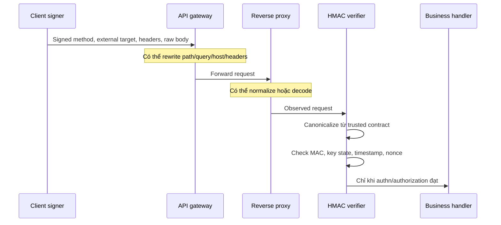
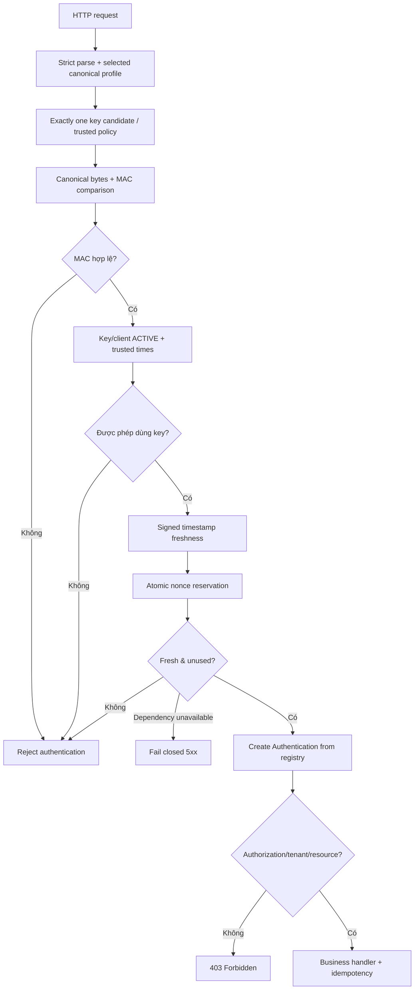

# Checklist canonicalization: tổng kết và kiểm chứng hợp đồng ký HTTP HMAC

## 1. Mục đích: một byte khác là một hợp đồng ký khác

Module `SECURITY_AUTHENTICATION_HMAC_REQUEST_AUTHENTICATION` hướng dẫn xác thực HTTP request bằng HMAC với **shared secret** và **canonical request** gồm phương thức, URI, header và/hoặc body theo hợp đồng ký. Hệ thống còn phải kiểm timestamp/nonce chống replay, quản lý vòng đời và rotation của key, kiểm thử gateway/proxy và phân biệt **authentication** với **authorization**. Bài **“Checklist canonicalization”** thuộc chương **Tổng kết HMAC authentication**: đây là bảng kiểm cuối trước khi đưa giao thức ký HMAC vào vận hành hoặc thay đổi phiên bản.

Canonicalization ánh xạ **một HTTP request theo cách hai bên đã thỏa thuận** thành chuỗi byte xác định để đưa vào HMAC. Nếu client ký `M1` và server tính HMAC trên `M2`, chỉ cần khác một byte, kết quả so chữ ký sẽ khác:

\[
\mathrm{Signature}=\mathrm{HMAC}_{K}(\mathrm{CanonicalBytes}(\mathrm{Request}))
\]

Nguy hiểm hơn lỗi **false reject** là khi verifier **bỏ qua field cần bảo vệ**, tự thử nhiều canonicalization profiles hoặc tin input chưa xác thực, khiến attacker sửa một thuộc tính có ý nghĩa nghiệp vụ mà signature vẫn được chấp nhận.

Ví dụ:

```text
Request A: POST /orders/42/approve, amount=100
Request B: POST /orders/42/approve, amount=900

Nếu body ảnh hưởng kết quả nghiệp vụ nhưng KHÔNG thuộc message ký,
hai requests có thể dùng chung MAC dù amount khác.
```

Một checklist đúng không chỉ hỏi “HMAC-SHA256 có chạy được không?” mà phải xác nhận **đúng những bytes nào được ký, được lấy ở đâu, được kiểm khi nào, và thành phần nào có thể biến đổi chúng**.

### 1.1. Mục tiêu học tập

Sau bài này, người học có thể:

1. Phát biểu **hợp đồng canonicalization có version** để client, gateway, backend triển khai độc lập nhưng ra cùng bytes.
2. Rà method, raw target/path/query, signed headers, body digest, encoding, delimiter, key ID, timestamp/nonce.
3. Xác định input cần **reject** thay vì tự sửa/đoán: duplicate header, malformed percent-encoding, unsupported algorithm, ambiguous path.
4. Kiểm proxy rewrite, HTTP/1.1–HTTP/2, container normalization, trust boundary của forwarded metadata.
5. Tạo golden vectors và negative tests; giải thích vì sao test “client và server cùng code” chưa phải oracle độc lập.
6. Phân tách **canonicalization**, MAC, key policy, freshness/replay, authentication, authorization và business idempotency.
7. Sử dụng checklist release và runbook xử lý 401 mà không hạ chuẩn ký.

### 1.2. Quy tắc sử dụng checklist

Mỗi mục kiểm nên có bốn thành phần:

| Trường | Câu hỏi bắt buộc |
| --- | --- |
| **Contract** | Profile/version cụ thể định nghĩa những bytes và hành vi nào? |
| **Enforcement** | Client, verifier, gateway/parser triển khai quy tắc đó ở đâu? |
| **Evidence** | Golden vector, negative test, test qua proxy hoặc CI assertion nào chứng minh? |
| **Failure semantics** | Không đạt thì reject/fail closed ra sao, ai được cảnh báo? |

Không đánh dấu PASS vì “chạy được ở localhost” nếu chưa kiểm proxy và các trường hợp không hợp lệ. Tham số trong bài là **profile minh họa**, không phải tiêu chuẩn HMAC HTTP chung áp dụng sẵn cho mọi API.

## 2. Bảng kiểm nhanh: 24 điều kiện không được bỏ qua

Đọc bảng này trước khi đi vào từng mục kỹ thuật. `P0` là điều kiện an toàn nền tảng; `P1` là điều kiện tương thích/vận hành. Cả hai phải được kiểm trong phạm vi sản phẩm.

| ID | Ưu tiên | Nội dung cần xác nhận | Bằng chứng tối thiểu |
| --- | --- | --- | --- |
| CAN-01 | P0 | Giao thức ký có **version/domain separator** rõ | Golden bytes chứa prefix version |
| CAN-02 | P0 | Method có canonical rule duy nhất | `POST→PUT` làm MAC không còn hợp lệ |
| CAN-03 | P0 | Request target lấy từ **điểm nhìn tin cậy** | Gateway/backend dùng expected target |
| CAN-04 | P0 | Path/percent-encoding không bị decode/re-encode tùy ý | `%2F`, `%252F`, dot-segment tests |
| CAN-05 | P0 | Query giữ repeated names, empty values và order theo spec | `a=1&a=2`, `a=` fixtures |
| CAN-06 | P0 | Danh sách signed headers và thứ tự xác định | Golden header block |
| CAN-07 | P0 | Duplicate security headers bị reject theo policy | Multiple/comma-combined tests |
| CAN-08 | P0 | Whitespace/value normalization chính xác, không nhận CRLF injection | OWS/obs-fold tests |
| CAN-09 | P0 | Raw body hay normalized body được chọn rõ | Một byte đổi làm digest/MAC khác |
| CAN-10 | P0 | Body digest có thuật toán/encoding cố định | SHA-256 hex vector |
| CAN-11 | P0 | Encoding canonical message ở byte-level | UTF-8/LF/no trailing LF test |
| CAN-12 | P0 | Key ID được bind vào signed request/policy | Đổi key ID, giữ MAC → reject |
| CAN-13 | P0 | Timestamp/nonce **đều được ký** | Sửa một trường, giữ MAC → reject |
| CAN-14 | P0 | Algorithm/protocol version không bị caller downgrade | Unknown alg/version → reject |
| CAN-15 | P0 | Verifier chọn đúng một key ứng viên | Không thử historical secrets |
| CAN-16 | P0 | Key/client revocation có hiệu lực dù MAC khớp | Revoked → no Authentication |
| CAN-17 | P0 | Signature bytes đúng format/length, không encoding mơ hồ | Malformed/truncated tests |
| CAN-18 | P0 | Freshness + atomic nonce reservation sau MAC hợp lệ | Cross-instance replay rejected |
| CAN-19 | P0 | Identity/authority không đến từ unsigned/untrusted headers | Forged tenant/role → deny |
| CAN-20 | P0 | Gateway không đổi signed fields sau verify mà backend xử lý theo nghĩa khác | Trusted assertion/route tests |
| CAN-21 | P1 | HTTP/1.1–HTTP/2 và framework parser theo cùng profile | Real proxy integration |
| CAN-22 | P1 | Golden vectors có oracle **độc lập** với code under test | Versioned fixture |
| CAN-23 | P1 | Log/metrics không tiết lộ secret/MAC/nonce/body | Sentinel/redaction tests |
| CAN-24 | P1 | Cutover/rollback có compatibility matrix/security gates | 401/403/5xx, no downgrade |

**Nguyên tắc:** Không tạm bỏ P0 khi chưa có biện pháp cô lập và phê duyệt phù hợp. `400/401` tăng sau sửa canonicalization có thể là lỗi tương thích; **không sửa bằng cách loại method/path/body khỏi chữ ký**.

## 3. Phải định nghĩa profile trước khi triển khai

Một API HMAC không có “canonical request mặc định”. Với cùng HTTP request, các hệ thống có thể ký raw URI, normalized URI, body digest hoặc các headers khác nhau. Canonicalization là **wire protocol**, không phải chi tiết nội bộ được thay ngẫu nhiên giữa các release.

### 3.1. Profile tham chiếu

Giả sử hợp đồng `HMAC-REQ-V1` cho lab:

```http
POST /api/orders?channel=web&tag=a&tag=b HTTP/1.1
Host: api.example.test
Content-Type: application/json
X-Hmac-Key-Id: client-a-key-01
X-Hmac-Timestamp: 2026-11-28T08:00:00Z
X-Hmac-Nonce: 00112233445566778899aabbccddeeff
X-Hmac-Version: v1
X-Hmac-Signature: <64 lowercase hex chars>

{"orderId":"DEMO-001","amount":100}
```

**Profile này quy định:**

- Method duy nhất `POST`.
- Raw request target được ký đúng như điểm verifier đáng tin nhận: `/api/orders?channel=web&tag=a&tag=b`. Không sort, decode hay re-encode query.
- `Content-Type` bắt buộc đúng một giá trị, exact `application/json`.
- `X-Hmac-Key-Id` format giới hạn, chỉ để chọn key ứng viên và **được ký**.
- `X-Hmac-Timestamp` ISO-8601 UTC đến giây, chữ `Z`; `X-Hmac-Nonce` gồm 16 bytes CSPRNG encode 32 lowercase hex.
- `X-Hmac-Version` bắt buộc bằng `v1`, thuộc signed fields; version khác bị reject.
- Body hash từ **raw bytes** bằng SHA-256, digest lowercase hex; không JSON-normalize.
- Canonical text có **9 dòng**, nối LF `0x0A`, không có LF cuối; UTF-8. Signature HMAC-SHA256 32 bytes encode 64 lowercase hex.
- `Host` và `Content-Length` **không nằm trong profile lab**. Với production, phải threat-model authority/host binding hoặc authenticated routing; không tự suy bỏ host luôn an toàn.
- `X-Hmac-Signature` không được tự đưa vào message ký, tránh tự tham chiếu.

### 3.2. Format canonical byte-level

```text
HMAC-REQ-V1
POST
/api/orders?channel=web&tag=a&tag=b
content-type:application/json
x-hmac-key-id:client-a-key-01
x-hmac-timestamp:2026-11-28T08:00:00Z
x-hmac-nonce:00112233445566778899aabbccddeeff
x-hmac-version:v1
<sha256-raw-body-hex>
```

Trong fixture, phải **thay placeholder cuối bằng digest thực** để có vector hoàn chỉnh. Không copy `<sha256-raw-body-hex>` làm dữ liệu ký. Không thêm dòng rỗng/trailing newline; thứ tự phải giữ nguyên.

### 3.3. Versioning là ranh giới, không phải khẩu hiệu

Có hệ thống chọn normalize query có thứ tự, ký `host`, `date`, body digest Base64 hoặc signature Base64URL. Những lựa chọn đó có thể hợp lệ **nếu contract định nghĩa đầy đủ và kiểm được**, nhưng không được trộn bằng “client linh hoạt, server tự đoán”.

```text
profile-id: HMAC-REQ-V1
content-type: application/json (exact value)
signed-methods: [POST]
request-target: raw path + raw query, no normalization
signed-header-order:
  content-type
  x-hmac-key-id
  x-hmac-timestamp
  x-hmac-nonce
  x-hmac-version
body-digest: SHA-256(raw bytes), lowercase hexadecimal
canonical-delimiter: LF, no trailing LF
canonical-text-charset: UTF-8
mac: HmacSHA256, 32 bytes, lowercase hexadecimal
nonce: 16 CSPRNG bytes / 32 lowercase hex characters
timestamp: ISO-8601 UTC seconds, signed
duplicate-security-headers: reject
unsupported-protocol-and-algorithms: reject
```

`HMAC-REQ-V1` là **domain/version separator** giúp không vô tình tái sử dụng cùng message format cho giao thức khác. Nếu thêm `HMAC-REQ-V2`, cần profile mới, không âm thầm đổi V1 đang được client sử dụng.

## 4. Method, raw target và path: ký đúng hành động server xử lý

### 4.1. Method

**Checklist:**

- [ ] Method lấy từ HTTP parser/router đáng tin, không từ header `X-HTTP-Method-Override` do caller tự khai trừ khi giao thức hỗ trợ và ký điều đó.
- [ ] Contract quy định casing, allowed methods và `HEAD`/`GET`/`POST`/`PUT`/`PATCH`/`DELETE` semantics.
- [ ] Đổi method nhưng giữ signature phải bị từ chối.
- [ ] Gateway không tự đổi method giữa điểm verify và điểm business thực thi.

Nếu client ký `GET` nhưng framework lại diễn giải request thành `POST` do method override, **hành động được thực thi** không còn là hành động đã ký.

### 4.2. Raw path hay normalized path?

Các đường sau có thể cùng dẫn tới một resource hoặc khác nhau tùy router/framework:

```text
/api/orders/123
/api/orders/123/
/api//orders/123
/api/orders/%31%32%33
/api/orders/123/../124
/api/orders/%2Fadmin
/api/orders/%252Fadmin
```

Nếu verifier **percent-decode một lần** nhưng router decode hai lần, hai bên có thể hiểu hai resource khác nhau. **Không** lấy `URLDecoder.decode(path)` rồi tin đây chắc chắn là target server sẽ xử lý: `URLDecoder` được thiết kế cho form-urlencoded data, không phải hàm canonicalize HTTP path tổng quát.

Các câu hỏi buộc trả lời:

1. Client ký raw origin-form target (`/path?query`), absolute URI hay canonical normalized target?
2. Router chấp nhận encoded slash `%2F`, encoded dot-segments hoặc semicolon path params thế nào?
3. Container/gateway có collapse `//`, `/./`, `/../` hoặc percent-decode không?
4. Nếu gateway rewrite `/public` sang `/internal`, bên nào verify và theo target nào?
5. Handler/authorization layer sử dụng **cùng resource semantics** với target đã xác thực không?

**Lab** chọn raw target và một route cố định; production có thể chọn normalized target với đặc tả chặt. Cả hai đều cần **parser differential tests**.

### 4.3. Từ chối ambiguity, không thử nhiều kiểu chuẩn hóa

```java
// Anti-pattern: chấp nhận nếu BẤT KỲ dạng path nào khớp MAC.
for (String candidatePath : List.of(
        rawPath,
        decodeOnce(rawPath),
        normalizeSlashes(rawPath))) {
    if (hmacMatches(candidatePath, signature)) {
        return authenticated;
    }
}
```

Đúng hơn là **chọn một canonicalization profile theo signed version và server policy**, sau đó reject malformed/ambiguous input. Không thử path đã decode, đã normalize hoặc đã cắt slash để “cứu” 401.

### 4.4. Host/authority và virtual hosting

Nếu route/tenant phụ thuộc `Host`, scheme, port hoặc virtual host, việc **không ký authority** có thể cho phép một signature được dùng tại host khác trong vài thiết kế. Phải:

- Bind host/authority vào signature theo quy tắc case/default port/IDN/trusted forwarding đã định; **hoặc**
- Ràng buộc key với authority/ingress/route ở policy phía server và **test không cross-host replay**.

Không đưa `Host` vào signed fields mơ hồ trong khi proxy đổi `Host` trước khi verify; cũng không tin `X-Forwarded-Host` do internet caller cung cấp.

## 5. Query string: query map không phải raw query

### 5.1. Fixtures bắt buộc

```text
?a=1&b=2
?b=2&a=1
?a=1&a=2
?a=2&a=1
?a=
?a
?a=&a
?q=hello+world
?q=hello%20world
?q=%2F
?q=%2f
?unicode=%C3%A9
?unicode=e%CC%81
```

Những chuỗi có thể tương đương sau một số phép decode/normalization nhưng **khác raw bytes**. Profile `HMAC-REQ-V1` chọn raw query không sort: `?a=1&b=2` khác `?b=2&a=1`. Nếu hệ thống chọn normalized query, phải quy định rõ:

- Sort theo **encoded bytes** hay decoded Unicode strings?
- Repeated names giữ original order hay sort theo value?
- `?a` và `?a=` được phân biệt không?
- `+` và `%20` có được coi giống nhau không?
- `%2f`/`%2F` có normalize case không?
- Empty query `?` có khác query absent không?
- Percent-encoding malformed (`%`, `%G0`, truncated multibyte) được xử lý thế nào?
- Unicode NFC/NFD có bị normalize không, ở bước nào, có ảnh hưởng resource semantics không?

### 5.2. Không làm mất duplicate query values

Sai:

```java
// Ví dụ sai về mặt semantics khi contract yêu cầu raw query.
String account = request.getParameter("account");
// Nhiều servlet/container chọn first value, handler khác có thể chọn last.
```

Ví dụ `?account=alice&account=bob`: nếu verifier chỉ ký `alice` nhưng controller dùng `bob`, chữ ký bảo vệ **khác giá trị nghiệp vụ được dùng**. Với raw target profile, giữ raw query tại điểm verify đáng tin; với normalized profile, parse thành **ordered list of pairs** giữ duplicates và xử lý nhất quán. Tránh `Map<String,String>` nếu nó làm mất dữ liệu.

### 5.3. Không đưa raw query vào log khi xử lý 401

Query có thể chứa PII/token hoặc mã tài nguyên. Log route template, profile ID, stage, reason code và correlation ID đã được tin cậy; tránh raw target/query hoặc hash không khóa của giá trị low-entropy (có thể bị đoán theo dictionary).

## 6. Headers: tên, giá trị, duplicates và tập field được ký

### 6.1. Canonical header names và thứ tự

HTTP field names là case-insensitive; ở HTTP/2 thường lowercase. Profile minh họa canonicalize header name về lowercase và dùng **thứ tự cố định**:

```text
content-type
x-hmac-key-id
x-hmac-timestamp
x-hmac-nonce
x-hmac-version
```

Không lấy thứ tự từ `HashMap.entrySet()` hoặc thứ tự packet vì proxy có thể đổi. Không trộn profile “sort alphabetic” với profile “predefined order” khi chưa version hóa.

### 6.2. Header values và OWS

Header value có thể có optional whitespace (OWS) ở đầu/cuối, và HTTP parser đôi khi tự xử lý OWS. Profile `HMAC-REQ-V1` dùng **định dạng giá trị nghiêm ngặt tại đầu ra parser**: `Content-Type` exact `application/json`; security fields có pattern giới hạn, không cho comma-combined values.

```text
Content-Type: application/json           -> allowed
Content-Type: application/json;charset=utf-8 -> reject in lab
X-Hmac-Version: v1                      -> allowed
X-Hmac-Version: v1, v2                  -> reject
X-Hmac-Nonce: <32 lowercase hex>        -> allowed
```

Không hứa so raw wire value khi framework đã normalize whitespace trước khi code đọc header. Quy tắc phải dựa trên **parser semantics mà ingress thực sự thực hiện** và reject representation không thể phân biệt an toàn. Kiểm control characters, CRLF/obs-fold, non-ASCII trong security headers theo contract.

### 6.3. Duplicate security headers

```http
X-Hmac-Key-Id: client-a-key-01
X-Hmac-Key-Id: client-b-key-09
```

Gateway có thể chọn first, backend chọn last hoặc gộp hai values bằng comma. Đây là **parser differential** có thể làm verifier và controller hiểu hai identities khác nhau. Checklist:

- [ ] Các security headers có **đúng một occurrence**; khi parser đã gộp, reject comma/non-contract representation.
- [ ] Header names khác casing vẫn là **cùng một tên**, không phải hai trường hợp hợp lệ.
- [ ] `getHeader(name)` trả một chuỗi không chứng minh request không có duplicate; test `getHeaders(name)` và gateway behavior.
- [ ] Không nhận obs-fold, CRLF, newline injection hoặc multi-value serialization ngoài hợp đồng.
- [ ] `X-Verified-Client` hay forwarded identity assertion từ internet bị strip/overwrite trước khi gateway đặt giá trị tin cậy.

### 6.4. Header nào buộc phải ký?

Ký những trường mà thay đổi chúng sẽ làm thay đổi ý nghĩa:

- Key/protocol/algorithm selection: `X-Hmac-Key-Id`, version/algorithm nếu được khai báo.
- Replay/freshness: `X-Hmac-Timestamp`, `X-Hmac-Nonce`.
- Payload interpretation: `Content-Type`, `Content-Encoding` nếu có support.
- Tenant, idempotency và business routing context: signed fields **hoặc** binding với server-side trusted context theo threat model.

Một header `X-Tenant-Id` được HMAC ký chỉ chứng minh **client sở hữu key đã khai giá trị đó**, không chứng minh client có quyền với tenant đó. Authorization vẫn phải kiểm owner/scope từ registry và resource state.

## 7. Body: bytes, digest, streaming và giới hạn

### 7.1. Raw bytes khác object sau parse

Hai JSON có thể tương đương về object nhưng khác bytes:

```json
{"orderId":"DEMO-001","amount":100}
```

```json
{
  "amount": 100,
  "orderId": "DEMO-001"
}
```

Nếu profile ký `SHA-256(rawBodyBytes)`, khác digest là **đúng**. Sai nếu client hash raw JSON còn server deserialize/serialize lại: key order, whitespace, escapes, số và unicode normalization có thể thay đổi.

### 7.2. Body digest checklist

- [ ] Chọn representation: **raw bytes tại điểm verify** hoặc structured canonical representation có specification riêng; không trộn.
- [ ] Chốt SHA-256 hay algorithm khác, output hex lowercase/Base64 theo spec.
- [ ] Empty body có digest của **zero bytes**, không phải literal `null`, `{}` hay newline.
- [ ] Chốt `Content-Type` và cách xử lý compression/decompression, charset, HTTP chunked framing.
- [ ] Không normalize line endings trong raw body nếu contract không cho.
- [ ] Áp size/time limits **trước** khi buffer/hash; không cho attacker bắt API giữ body vô hạn.
- [ ] Downstream nhận đúng **bytes đã verify**, tránh verify-then-transform.
- [ ] Nội dung raw body, canonical bytes và expected signature không được đưa vào production logs.

### 7.3. Servlet và WebFlux

Trong Spring MVC, `HttpServletRequest.getInputStream()` thường single-use: filter đọc body để hash, `@RequestBody` sẽ rỗng nếu không dùng bounded request wrapper replay bytes. Cần test body size, empty body, IO failure, multipart/async nếu hỗ trợ.

Trong Spring WebFlux, `Flux<DataBuffer>` có ownership/ref-count; double subscription hoặc buffer không release gây lệch signature, mất body downstream hoặc memory leak. Dùng bounded buffer và request decorator với lifecycle rõ; không `block()` trên Netty event loop.

### 7.4. “Đã ký body hash” cần đi cùng semantic validation

Một MAC hợp lệ trên raw body **không tự xác nhận schema và quyền**. Ví dụ payload gửi `"amount": -500` với signature hợp lệ vẫn cần business validation; `tenantId` trong JSON có thể bị giả khai bởi **client có key thật**, nên phải kiểm authorization cho tenant/resource đó. HMAC bảo vệ bytes khỏi **người không có secret**, không biến mọi nội dung client ký thành sự thật.

## 8. Encoding, Unicode, delimiters: “cùng text” chưa chắc cùng bytes

### 8.1. UTF-8 và LF chính xác

**Checklist:**

- [ ] Chọn một charset rõ (ví dụ **UTF-8**) cho canonical text; không phụ thuộc default OS locale/JVM.
- [ ] Chọn một delimiter rõ (**LF** `0x0A`), không dùng `System.lineSeparator()`.
- [ ] Chốt có trailing newline hay không; profile V1 **không có**.
- [ ] Chốt ký tự `:`, khoảng trắng, header name separator; không nối mơ hồ.
- [ ] Chốt hex lowercase hay uppercase, Base64 chuẩn hay Base64URL, padding/không padding.
- [ ] Chốt Unicode normalization nếu các field cho phép Unicode; không tự áp NFC/NFD sau khi có MAC.
- [ ] Reject invalid UTF-8 nếu field được định nghĩa theo text; không silently replace invalid bytes bằng U+FFFD.

Ví dụ những ký tự có thể hiển thị giống nhau nhưng byte UTF-8 khác:

```text
é (U+00E9)        -> C3 A9
e + ◌́ (U+0065 U+0301) -> 65 CC 81
```

Nếu profile ký raw URI/query/body bytes, **không tự normalize Unicode** trước HMAC. Nếu profile có Unicode normalization, phải ràng buộc vào version và đảm bảo business router/validation cũng dùng cùng semantics.

### 8.2. Byte boundary khác encoding boundary

Cẩn thận với cách ghép nhiều trường có delimiter mơ hồ:

```text
field1=ab ; field2=c  -> abc
field1=a  ; field2=bc -> abc
```

Nếu một profile nối fields chỉ bằng concatenation, có thể xảy ra ambiguity. Các giải pháp:

- Dùng delimiter và **reject/escape delimiter** trong value đúng spec, hoặc dùng length-prefix.
- Dùng line-oriented canonical form với số dòng và order cố định; kiểm field values không chứa newline/control chars.
- Version/domain separator chống cross-protocol ambiguity.
- Test field injection chứa `\n`, `\r` và colon/comma để đảm bảo không thể tạo cùng canonical bytes từ hai request khác nhau có semantics khác.

### 8.3. ASCII wire fields nên kiểm chặt

Key ID, nonce, timestamp, version và signature trong profile mẫu chỉ dùng ASCII và regex giới hạn. Nhờ vậy không có Unicode equivalence bất ngờ trong **security selector fields**. Với business header có Unicode, phải bổ sung encoding, normalization, maximum length và parser agreement riêng.

## 9. Key ID, algorithm và protocol version phải được bind

### 9.1. Key ID là selector, không phải principal

Luồng đúng:

```text
untrusted keyId
    ↓ bounded format validation
trusted key registry lookup (exactly one key version)
    ↓ key material + owner + allowed algorithms/protocols
canonical bytes include signed keyId and version
    ↓ HMAC comparison
verified clientRef from key registry
    ↓ timestamp / atomic nonce / state policy
Authentication from trusted metadata
    ↓
Authorization for tenant/resource/authority
```

Attacker có thể đổi `X-Hmac-Key-Id`. Verifier phải dùng nó để **chọn một candidate** rồi kiểm signature; không cấp danh tính dựa vào header ấy trước MAC success.

### 9.2. Không thử lần lượt các keys hoặc algorithms

Anti-pattern:

```java
// KHÔNG LÀM.
for (String algorithm : List.of("HmacSHA512", "HmacSHA256")) {
    for (SecretKey key : allOldKeys) {
        if (tryVerify(algorithm, key, message, signature)) {
            return authenticated;
        }
    }
}
```

Rủi ro: vô tình chấp nhận key đã REVOKED hoặc algorithm đã cấm, gây timing differences/tải và khiến audit không biết key nào thực sự chứng thực request.

Thay bằng:
1. Parser chỉ cho **một** `keyId`, **một** signed `version`, một algorithm được policy cho phép (có thể ngầm định bởi key/profile).
2. Key registry tìm **đúng một** key version/owner.
3. Key state, client state, effective times, allowed routes/algorithms/protocols được kiểm.
4. Tạo canonical bytes theo đúng profile đó.
5. Tính **một** HMAC và so signature đúng độ dài/encoding.
6. Kiểm freshness/replay và chỉ sau đó tạo Authentication.

### 9.3. Version downgrade và compatibility

Nếu profile `HMAC-REQ-V2` ký thêm `X-Tenant-Id`, một request ký V2 nhưng sửa `X-Hmac-Version` thành V1 không được có đường fallback “vì V1 không ký tenant”. Version must be **cryptographically bound** trong canonical text và policy cho phép theo key/client/route/time.

Không để cả legacy và candidate cùng “cứu” một request bằng cách thử signatures/normalizations khác nhau. Muốn migration, dùng:
- Compatibility matrix client/key/protocol/algorithm có time-bound acceptance.
- Legacy route/credential scoping chặt và cutoff.
- Golden fixtures độc lập cho từng version.
- Negative test: unsupported, unknown, malformed và downgraded version.

### 9.4. Rotation và revocation là gate sau/bên cạnh MAC

| Client | Key | MAC | Kết quả xác thực |
| --- | --- | --- | --- |
| ACTIVE | ACTIVE | Khớp | Có thể thành công nếu freshness/nonce đạt |
| ACTIVE | RETIRING còn `acceptUntil` | Khớp | Có thể thành công trong overlap |
| ACTIVE | STAGED | Khớp | Reject |
| ACTIVE | REVOKED | Khớp | Reject |
| REVOKED | ACTIVE | Khớp | Reject **cấp client** |
| ACTIVE | ACTIVE | Không khớp | Reject |
| ACTIVE | ACTIVE | Khớp nhưng nonce đã dùng | Reject replay |

Key đã hết `acceptUntil` phải bị reject theo **server time** dù request signedAt cũ còn fresh. TTL của key metadata cache không phải “thu hồi ngay lập tức”; cần revision/freshness/policy barrier theo security guarantee đã công bố.

## 10. Timestamp, nonce và replay: nằm trong chữ ký nhưng cũng phải có state

### 10.1. Ký timestamp/nonce là điều kiện cần

Nếu timestamp hoặc nonce **không nằm trong canonical bytes**, attacker có thể sửa chúng trên request cũ nhưng giữ MAC. Bản ký phải chứa cả hai với format chặt; thay bất kỳ giá trị nào phải khiến MAC cũ fail.

Tuy nhiên **MAC trên nonce** không chứng minh nonce chưa được sử dụng. Verifier cần atomic check-and-reserve trên shared store.

### 10.2. Ví dụ freshness policy

Với lab:

```text
maxPast   = 5 minutes
maxFuture = 1 minute

Accept only when:
  now - maxPast <= signedAt <= now + maxFuture
```

`now` lấy từ **trusted server Clock**, không từ client, và được kiểm bằng `Instant`. Test biên `now-maxPast` và `now+maxFuture`, vượt biên và malformed timestamp. Clock skew do hệ thống cần sửa bằng clock synchronization, không tắt freshness để giải quyết 401.

### 10.3. Nonce scope và TTL

Dự án cần định nghĩa namespace theo **verified clientRef**, không theo raw `X-Client-Id` chưa xác thực. Với client-wide uniqueness:

```text
nonce key scope = (verifiedClientRef, nonce)
atomic reserve = SET key "1" NX PX ttlMillis
ttl >= maxPast + maxFuture + safetyMargin
```

Nếu nonce được reserve ngay khi timestamp sát biên tương lai, cần giữ record đủ lâu đến khi **cùng signed request** không còn fresh. TTL ngắn hơn tạo cửa sổ replay. Phải dùng một shared consistency domain trên mọi instances có thể verify; `get` rồi `set` tách hai thao tác gây race.

**Quan trọng:** Reserve nonce **sau MAC và freshness hợp lệ**. Nếu reserve trước MAC, attacker không có key vẫn có thể làm bẩn namespace nonce của client qua input chưa xác thực. Không xóa nonce record khi downstream trả 403/500 chỉ để cho request cũ retry.

### 10.4. Replay khác retry/idempotency

Gửi lại **nguyên signed HTTP request** phải bị replay guard chặn. Nếu client không nhận response và cần retry một **logical business operation**, nó tạo timestamp/nonce/MAC mới và giữ `Idempotency-Key` đã được ràng buộc vào signature/policy; business layer bảo đảm không nhân đôi side effect.

**HMAC hợp lệ không có nghĩa exactly-once business execution.** Redis atomic nonce reservation không thay thế database unique constraint/idempotency và transaction logic.

## 11. Signature encoding, crypto và so sánh bytes

### 11.1. Độ dài và encoding

HMAC-SHA256 ra **32 bytes**. Nếu contract dùng lowercase hex thì signature gồm **64 ký tự ASCII lowercase hex**; không “tự đoán” Base64, chấp nhận truncated signature hoặc whitespace quanh giá trị. HMAC-SHA512 ra **64 bytes** nhưng chỉ chấp nhận khi protocol/key policy quy định riêng.

### 11.2. Test primitive độc lập

Vector HMAC-SHA256 trong RFC 4231, trường hợp 1:

```text
Key bytes: 0x0b lặp 20 lần
Message:   ASCII "Hi There"
Expected:  b0344c61d8db38535ca8afceaf0bf12b881dc200c9833da726e9376c2e32cff7
```

Vector này chỉ chứng minh **primitive HMAC**, không chứng minh HTTP canonicalization. Tiếp theo phải test body digest, canonical bytes và MAC HTTP golden vectors riêng.

### 11.3. Không tự viết phép so MAC dừng sớm

Trong Java, dùng `MessageDigest.isEqual(expectedBytes, suppliedBytes)` sau khi strict decode và kiểm exact length. Không dùng so chuỗi theo kiểu “sai ở ký tự đầu thì dừng”; không log expected MAC, raw signature hay shared secret.

Một phép so MAC phù hợp **không tự làm toàn verifier constant-time**: key lookup, parser validation, state/tenant policy vẫn có timing differences. Tránh trả thông tin chi tiết giúp key enumeration.

## 12. Gateway/proxy/HTTP/1.1–HTTP/2 là một phần của hợp đồng

### 12.1. Mọi hop có thể làm mất tính đồng nhất



Ví dụ:

```text
Client signs: /public/orders?tag=a&tag=b
Gateway maps: /internal/orders?tag=a&tag=b
Backend sees: /internal/orders?tag=a&tag=b
```

Nếu backend dùng internal path còn client ký external path, MAC mismatch là **đúng về mặt toán học** nhưng sai kiến trúc triển khai nếu không có contract mapping. Không “fix” bằng cách bỏ path khỏi chữ ký.

### 12.2. Hai kiến trúc rõ trách nhiệm

**Gateway verifies:** Gateway xác thực HMAC trên target trước rewrite, kiểm replay một lần, truyền **verified identity assertion** qua kênh gateway→backend đã xác thực (ví dụ mTLS/network policy), strip/overwrite header caller tự khai. Backend còn phải kiểm authorization ở đúng tenant/resource. Không cho direct-backend bypass.

**Backend verifies:** Backend dùng trusted representation của target client đã ký, có mapping đã được gateway xác thực; không tin `X-Original-URI`/`Forwarded` từ internet. Body và signed header semantics phải không đổi ở giữa.

**Không double-reserve nonce**: Nếu gateway đã consume nonce ở cùng namespace, backend consume lại sẽ khiến request hợp lệ bị xem là replay. Dùng một điểm authoritative replay check hoặc hai hop-specific authentication contracts được security review.

### 12.3. HTTP versions và header semantics

| Tình huống | Bằng chứng cần có |
| --- | --- |
| HTTP/1.1 vs HTTP/2 lowercase header names | Cùng canonical header names |
| HTTP/2 `:path` mapping | Signed target khớp route mà backend dùng |
| HTTP/2 `:authority` / HTTP/1.1 `Host` | Host/authority policy nhất quán |
| Duplicate security headers | Reject tại boundary, không first/last ambiguity |
| Proxy tự thêm charset vào Content-Type | Canonical value theo version contract |
| Query reorder hoặc percent re-encode | Raw/normalized semantics được kiểm |
| Chunked transfer hoặc compression | Hash đúng application body representation |
| Proxy retry signed POST | Replay guard và business idempotency hoạt động |
| Gateway path aliases | Mọi protected path vẫn qua authn chain |
| Direct backend access | Không tin forwarded identity giả |

Không yêu cầu HTTP/1.1 và HTTP/2 có **wire framing** giống nhau; yêu cầu chúng sinh cùng canonical bytes **theo profile đã định** sau khi ánh xạ semantics. Test phải đi qua **proxy thật**, không chỉ MockMvc.

## 13. Phân biệt từng lớp: canonicalization không phải toàn bộ xác thực



Thứ tự giữa key policy, MAC và timestamp validation có thể tối ưu theo threat model, **nhưng trước khi tạo Authentication phải hoàn tất tất cả điều kiện**, và nonce không được ghi theo client chưa được xác thực.

| Trường hợp | Giai đoạn | Phản hồi thường dùng |
| --- | --- | --- |
| Missing/malformed signed header | Parse/authentication | 401 hoặc 400 theo public contract |
| MAC invalid | Authentication | 401 |
| Unsupported version/algorithm | Protocol policy | 401/contract error |
| Key/client REVOKED | Credential acceptance | 401 |
| Timestamp too old/future | Freshness | 401 |
| Nonce replay | Replay guard | 401 |
| Key registry/nonce store outage | Dependency, fail closed | 503/5xx |
| Authn valid nhưng không có `ORDER_CREATE` | Authorization | 403 |
| Authn và authz valid | Business | 2xx/4xx nghiệp vụ |

Không kết luận “canonicalization bug” chỉ vì HTTP 401 tăng. Đọc stage/reason code nội bộ, policy revision, route và gateway hop; **không trả expected signature hoặc key state chi tiết ra public response**.

## 14. Java 17+: canonical builder có output cố định

Ví dụ dưới đây thực hiện **profile HMAC-REQ-V1 của bài** (một route/một query/một content type) để minh họa chặt chẽ byte-level. Các component mở rộng nhiều routes hoặc versions phải tách thành **profile registry** và được test tương thích; không sửa `V1` tại runtime.

### 14.1. DTO bất biến và validate input

```java
import java.time.Instant;
import java.time.format.DateTimeParseException;
import java.util.Objects;
import java.util.regex.Pattern;

record HmacWireFields(
    String method,
    String rawTarget,
    String contentType,
    String keyId,
    String timestamp,
    String nonce,
    String version,
    byte[] rawBody
) {
    HmacWireFields {
        Objects.requireNonNull(rawBody, "rawBody");
        rawBody = rawBody.clone(); // Không giữ reference caller mutable.
    }

    @Override
    public byte[] rawBody() {
        return rawBody.clone();
    }
}

final class HmacWireValidator {
    private static final Pattern TIME = Pattern.compile(
        "\\d{4}-\\d{2}-\\d{2}T\\d{2}:\\d{2}:\\d{2}Z"
    );

    void requireV1(HmacWireFields f) {
        if (!"POST".equals(f.method()) ||
            !"/api/orders?channel=web&tag=a&tag=b".equals(
                f.rawTarget()) ||
            !"application/json".equals(f.contentType()) ||
            f.keyId() == null ||
            !f.keyId().matches("[a-z0-9][a-z0-9._-]{0,63}") ||
            f.timestamp() == null ||
            !TIME.matcher(f.timestamp()).matches() ||
            f.nonce() == null ||
            !f.nonce().matches("[0-9a-f]{32}") ||
            !"v1".equals(f.version()) ||
            f.rawBody().length > 1_048_576) {
            throw new InvalidCanonicalInput("WIRE_FORMAT_INVALID");
        }

        try {
            Instant.parse(f.timestamp()); // Kiểm ISO date/time thực.
        } catch (DateTimeParseException exception) {
            throw new InvalidCanonicalInput("TIMESTAMP_MALFORMED");
        }
    }
}

// Domain exception do project định nghĩa, không thuộc JCA/Spring.
final class InvalidCanonicalInput extends RuntimeException {
    InvalidCanonicalInput(String reasonCode) {
        super(reasonCode);
    }
}
```

**Lưu ý:** Ví dụ cố ý so `rawTarget` bằng một giá trị exact cho fixture, **không dùng startsWith** vì có thể nhận `/api/orders-malicious`. Cần bảo đảm request router và key policy biết đúng route, và metadata client/tenant từ registry chỉ được tin sau MAC verification. Format parse không đồng nghĩa timestamp vẫn fresh; cần kiểm `Clock` và nonce riêng.

Việc có `byte[]` trong một `record` đòi hỏi defensive clone: code đã clone ở constructor và accessor, nhưng trong production vẫn cần hạn chế thời gian giữ raw body bytes và không in DTO mặc định qua `toString()`, vì record-generated `toString` có thể phơi metadata nhạy cảm.

### 14.2. Canonicalizer: 9 dòng, LF, no trailing newline

```java
import java.nio.charset.StandardCharsets;
import java.security.MessageDigest;
import java.security.NoSuchAlgorithmException;
import java.util.HexFormat;

final class V1Canonicalizer {
    private final HmacWireValidator validator =
        new HmacWireValidator();

    byte[] build(HmacWireFields f) {
        validator.requireV1(f);

        final byte[] bodyDigest;
        try {
            bodyDigest = MessageDigest
                .getInstance("SHA-256")
                .digest(f.rawBody());
        } catch (NoSuchAlgorithmException exception) {
            throw new IllegalStateException(
                "SHA-256 unavailable", exception
            );
        }

        String digestHex = HexFormat.of().formatHex(bodyDigest);
        String canonicalText = String.join("\n",
            "HMAC-REQ-V1",
            f.method(),
            f.rawTarget(),
            "content-type:" + f.contentType(),
            "x-hmac-key-id:" + f.keyId(),
            "x-hmac-timestamp:" + f.timestamp(),
            "x-hmac-nonce:" + f.nonce(),
            "x-hmac-version:" + f.version(),
            digestHex
        );
        return canonicalText.getBytes(StandardCharsets.UTF_8);
    }
}
```

Chọn `String.join("\n", ...)` thay vì `StringBuilder.append(System.lineSeparator())` để output **cố định trên Windows/Linux**. Mọi field có thể chứa CR/LF phải bị reject **trước** bước join; nếu không, một input có thể phá số dòng/ranh giới fields.

Trong triển khai HTTP thật, `rawTarget` được lấy từ một source đã được xác nhận với gateway/router: code trên **không** tự bảo đảm Servlet API trả raw bytes chưa bị proxy normalize.

### 14.3. JCA HMAC-SHA256: một selected secret, không fallback

```java
import java.security.MessageDigest;
import java.util.HexFormat;
import javax.crypto.Mac;
import javax.crypto.spec.SecretKeySpec;

final class V1HmacVerifier {
    byte[] calculateMac(
        byte[] selectedSecret,
        byte[] canonicalBytes
    ) {
        try {
            Mac mac = Mac.getInstance("HmacSHA256");
            mac.init(new SecretKeySpec(
                selectedSecret, "HmacSHA256"
            ));
            return mac.doFinal(canonicalBytes);
        } catch (Exception exception) {
            throw new IllegalStateException(
                "HMAC unavailable or invalid key", exception
            );
        }
    }

    boolean matches(
        byte[] selectedSecret,
        byte[] canonicalBytes,
        String signatureHex
    ) {
        if (signatureHex == null ||
            !signatureHex.matches("[0-9a-f]{64}")) {
            return false;
        }
        byte[] supplied = HexFormat.of().parseHex(signatureHex);
        byte[] expected = calculateMac(
            selectedSecret, canonicalBytes
        );
        return MessageDigest.isEqual(expected, supplied);
    }
}
```

**Cảnh báo:** `selectedSecret` phải đến từ **exact key ID → trusted key metadata → secret provider**, không từ raw caller-supplied secret. Không dùng một `Mac` mutable singleton chung giữa threads; mỗi invocation ở trên khởi tạo `Mac` riêng. Không log `selectedSecret`, `canonicalBytes` chứa thông tin nhạy cảm hay `signatureHex` trong production.

`MessageDigest.isEqual` giúp so bytes mà không tự viết vòng lặp short-circuit; nó không che được timing variation của repository/key policy. Cần hạn chế key enumeration qua public errors.

### 14.4. Parser HTTP phải kiểm duplicates trước canonicalizer

Ví dụ cho Spring MVC/Servlet, **chỉ minh họa đọc header**:

```java
import jakarta.servlet.http.HttpServletRequest;
import java.util.Collections;
import java.util.List;

final class StrictHmacHeaderReader {
    String exactlyOne(
        HttpServletRequest request,
        String name
    ) {
        List<String> values =
            Collections.list(request.getHeaders(name));
        if (values.size() != 1) {
            throw new InvalidCanonicalInput(
                "HEADER_MISSING_OR_DUPLICATE"
            );
        }
        String value = values.get(0);
        if (value == null ||
            value.isEmpty() ||
            value.indexOf(',') >= 0 ||
            value.indexOf('\r') >= 0 ||
            value.indexOf('\n') >= 0) {
            throw new InvalidCanonicalInput(
                "HEADER_AMBIGUOUS"
            );
        }
        return value;
    }
}
```

Đối với profile V1, `Content-Type` và security headers có patterns ở `HmacWireValidator`, nên comma không hợp lệ. Tuy nhiên, việc HTTP parser **đã merge duplicates** trước khi app nhận rất có thể làm `values.size()==1`; test phải đi qua gateway thực và, khi cần, reject ambiguity ở edge trước khi merge. Code này không tự thay thế ingress request-smuggling defenses.

## 15. Golden vectors, oracle độc lập và mutation tests

### 15.1. Vì sao chỉ chạy một client demo chưa đủ?

Nếu Java signer và Java verifier **cùng gọi V1Canonicalizer bị bug**, cả hai vẫn ký/verify thành công. Test đó chỉ chứng minh **hai bản cùng đồng thuận với bug**, không chứng minh hợp đồng đúng.

Cần:
1. Known-answer vector cho **primitive HMAC-SHA256** (ví dụ RFC 4231).
2. Golden **canonical bytes** được viết ra từ spec và duyệt độc lập.
3. Golden **body SHA-256** đúng raw bytes, gồm body rỗng và JSON nhiều ký tự Unicode.
4. Golden **HTTP HMAC** từ một oracle độc lập (có thể implement bằng ngôn ngữ khác hoặc công cụ được review).
5. Negative tests sửa từng signed field mà **không** ký lại.
6. Real gateway integration để xác nhận representation tại verifier đúng hợp đồng.

### 15.2. Golden fixture với empty body

SHA-256 của chuỗi **0 byte** có digest chuẩn:

```text
e3b0c44298fc1c149afbf4c8996fb92427ae41e4649b934ca495991b7852b855
```

Do đó, với body zero bytes, expected canonical text đầy đủ là:

```text
HMAC-REQ-V1
POST
/api/orders?channel=web&tag=a&tag=b
content-type:application/json
x-hmac-key-id:client-a-key-01
x-hmac-timestamp:2026-11-28T08:00:00Z
x-hmac-nonce:00112233445566778899aabbccddeeff
x-hmac-version:v1
e3b0c44298fc1c149afbf4c8996fb92427ae41e4649b934ca495991b7852b855
```

Đây là fixture **canonical bytes** hoàn chỉnh (không newline cuối). Chưa đi kèm MAC hex của HTTP fixture vì key bytes và oracle của fixture chưa được quy định. Một bộ golden suite đầy đủ phải **cố định test-only key bytes**, tính và duyệt MAC expected độc lập; không bịa expected MAC.

### 15.3. Unit test Java: so bytes, không tự suy kết quả

```java
import static org.junit.jupiter.api.Assertions.assertArrayEquals;
import java.nio.charset.StandardCharsets;
import org.junit.jupiter.api.Test;

final class V1CanonicalizerTest {
    @Test
    void emptyBodyMatchesApprovedCanonicalBytes() {
        HmacWireFields fields = new HmacWireFields(
            "POST",
            "/api/orders?channel=web&tag=a&tag=b",
            "application/json",
            "client-a-key-01",
            "2026-11-28T08:00:00Z",
            "00112233445566778899aabbccddeeff",
            "v1",
            new byte[0]
        );

        String expected = String.join("\n",
            "HMAC-REQ-V1",
            "POST",
            "/api/orders?channel=web&tag=a&tag=b",
            "content-type:application/json",
            "x-hmac-key-id:client-a-key-01",
            "x-hmac-timestamp:2026-11-28T08:00:00Z",
            "x-hmac-nonce:00112233445566778899aabbccddeeff",
            "x-hmac-version:v1",
            "e3b0c44298fc1c149afbf4c8996fb92427ae41e4649b934ca495991b7852b855"
        );

        assertArrayEquals(
            expected.getBytes(StandardCharsets.UTF_8),
            new V1Canonicalizer().build(fields)
        );
    }
}
```

Test expected là **bản literal có thể review** từ spec, không được gọi `V1Canonicalizer` để tạo expected. Với fixtures khác, lưu source + expected bytes/version và review diff khi thay đổi.

### 15.4. Negative tests phải thay đúng một trường mỗi lần

Ví dụ đã có known valid signed request:

```text
Baseline: MAC đúng, key ACTIVE, timestamp fresh, nonce chưa dùng
Mutation A: POST → PUT, giữ MAC cũ
Mutation B: đổi %2F thành /, giữ MAC cũ
Mutation C: reorder raw query, giữ MAC cũ
Mutation D: đổi amount trong body, giữ MAC cũ
Mutation E: đổi Content-Type, giữ MAC cũ
Mutation F: đổi keyId, giữ MAC cũ
Mutation G: đổi timestamp, giữ MAC cũ
Mutation H: đổi nonce, giữ MAC cũ
Mutation I: đổi v1 → v2, giữ MAC cũ
```

Nếu những mutation làm request parse invalid **trước MAC**, vẫn là reject an toàn; nhưng để chứng minh đúng **signed-field binding**, cần thêm fixtures với mutation vẫn hợp lệ theo schema và **reason internal** cho crypto-stage hoặc so canonical bytes trước/ sau.

### 15.5. Không nhầm test 401 với test canonicalization

Một request có MAC sai, timestamp quá hạn và key revoked sẽ trả 401 dù parser/canonicalizer sai. Muốn test một field binding:

1. Giữ key/client ở state được phép.
2. Dùng timestamp **fresh**, nonce mới.
3. Xác nhận baseline thực sự đi qua MAC và authentication thành công.
4. Đổi **một** signed field, giữ MAC.
5. Đảm bảo reject do MAC/parse đúng stage.
6. Kiểm controller không chạy, no business side effects.

Một test `@WithMockUser` chỉ tạo principal giả không chứng minh HMAC signature pipeline chạy.

## 16. Spring MVC, WebFlux và security chain: kiểm sự khác biệt framework

### 16.1. Servlet/Spring MVC

- [ ] `SecurityFilterChain` bảo vệ **mọi protected route/method**, kể cả request thiếu HMAC header.
- [ ] Custom filter chạy **đúng một lần**, không vừa container-register vừa `addFilterBefore(...)` làm nonce reserve hai lần.
- [ ] Filter lấy method và trusted raw target theo contract/gateway mapping đã test.
- [ ] Header reader không tin `getHeader` là đủ để phát hiện duplicates.
- [ ] Body reader có size limit, cung cấp đúng verified raw bytes cho `@RequestBody`.
- [ ] `Authentication` chỉ được tạo **sau** MAC, key/client acceptance, freshness và nonce.
- [ ] `SecurityContext` tạo theo request, cleanup đúng vòng đời; không cache principal theo key ID.
- [ ] Exception từ authn ở ranh giới filter được map đúng; không wrap downstream exceptions rồi báo `SIGNATURE_INVALID`.
- [ ] Authorization có route/authority/tenant/resource checks riêng.

### 16.2. WebFlux/Reactor

- [ ] `SecurityWebFilterChain` bảo vệ route cả khi header thiếu/malformed.
- [ ] Xây và verify từ **cùng raw body bytes** downstream handler sẽ thấy.
- [ ] Quản lý `DataBuffer` ref-count, memory limits, cancellation và body replay bằng decorator.
- [ ] Không `block()` trong Netty event loop; key registry/nonce store dùng non-blocking adapter hoặc scheduler được quản lý.
- [ ] Không tự `subscribe()` để chạy shadow canonicalization/nonce reservation ngoài request lifecycle.
- [ ] Principal được đưa vào `ReactiveSecurityContextHolder` chỉ sau authn complete, không dùng `ThreadLocal` từ Servlet.
- [ ] Một HMAC request chỉ **reserve nonce ở authoritative store một lần**.
- [ ] Timeout/error/cancel không biến thành `Mono.just(authenticated)` hoặc `onErrorResume(permitAll)`.

### 16.3. Mức độ kiểm thử theo tầng

| Tầng | Cần chứng minh | Công cụ phù hợp |
| --- | --- | --- |
| Pure unit | Canonical bytes, SHA-256, HMAC, format rules | JUnit 5, known-answer fixtures |
| Spring filter | Missing/duplicate headers, principal, authn vs authz | `MockMvc` / `WebTestClient` với security chain thật |
| Redis/nonce | Atomic reserve, TTL, replay | Redis test instance / Testcontainers |
| Multi-process | Hai verifiers không accept cùng nonce | Hai app processes, shared nonce store |
| Gateway | Raw target/header/body sau proxy, HTTP versions | Real gateway/proxy harness |
| Business | Không nhân đôi side effect, scope đúng | DB unique constraints/transaction tests |
| Operations | Revocation, stale cache, rollback, alarms | Staging drills / fault injection có kiểm soát |

Không dùng mock Redis luôn trả `true` để chứng minh chống replay; không dùng hai instances cùng một in-memory map để chứng minh phân tán.

## 17. Ma trận regression: 50 ca phải nghĩ tới

Các ca bên dưới là **mẫu kiểm thử** để lập test IDs theo profile thực tế. Mỗi ca cần baseline key/client ACTIVE, test-only secret, trusted time/nonce và expected stage/reason. Nếu một input bị strict parser reject trước khi tới MAC, test cần ghi lý do đó — không suy rằng canonical bytes đã được chứng minh chỉ từ HTTP 401.

### 17.1. Method, raw target, path, query

| ID | Input/mutation | Expected |
| --- | --- | --- |
| CT-01 | Golden `POST` và raw target hợp lệ | Canonical bytes đúng fixture |
| CT-02 | `POST` → `PUT`, giữ signature | Reject; không đổi method ở downstream |
| CT-03 | `/api/orders` → `/api/orders/` | Reject theo route/profile |
| CT-04 | Extra slash `//` trong path | Reject hoặc canonicalize đúng profile đã định |
| CT-05 | Dot-segments `/./` hoặc `/../` | Không verifier/router differential |
| CT-06 | Encoded slash `%2F` / double-encoded `%252F` | Reject ambiguity hoặc test theo spec |
| CT-07 | Encoded ASCII `%31` so literal `1` | Raw/normalized semantics đúng profile |
| CT-08 | Raw query thay order | MAC khác với raw-query V1 |
| CT-09 | `tag=a&tag=b` vs `tag=b&tag=a` | Không mất repeated values |
| CT-10 | `a=` so `a` hoặc empty query | Theo spec, không tự làm tương đương |
| CT-11 | `+` so `%20` | Không tự form-decode raw target |
| CT-12 | Percent hex `%2f` so `%2F` | Theo đúng normalization rule |
| CT-13 | Query có malformed `%`/`%G0` | Reject/route theo parser contract an toàn |
| CT-14 | NFC/NFD trong query/path | Đúng byte-level Unicode policy |

### 17.2. Headers, payload và encoding

| ID | Input/mutation | Expected |
| --- | --- | --- |
| CT-15 | Header name casing khác qua HTTP/2 | Canonical lowercase như spec |
| CT-16 | Đảo thứ tự các raw headers | Canonical signed order bất biến |
| CT-17 | Hai `X-Hmac-Key-Id` cùng tên | Reject duplicates |
| CT-18 | Một `X-Hmac-Key-Id: a,b` | Reject non-contract value |
| CT-19 | `X-Hmac-Timestamp` thiếu/trùng | Reject |
| CT-20 | `Content-Type` thêm charset | Reject theo V1 exact-value profile |
| CT-21 | Header value OWS bất thường | Theo ingress/parser policy đã duyệt |
| CT-22 | Header có CRLF/obs-fold/control | Reject, không field injection |
| CT-23 | Chuyển body từ compact JSON sang pretty JSON | Body digest và MAC khác |
| CT-24 | Đổi 1 byte JSON string, giữ signature | Reject |
| CT-25 | Đổi thứ tự JSON fields, giữ signature | Reject nếu raw-body signing |
| CT-26 | Body rỗng | SHA-256 zero bytes đúng golden |
| CT-27 | Body có UTF-8 multi-byte/NFC/NFD | Raw digest đúng bytes |
| CT-28 | LF thành CRLF trong body | Raw digest khác |
| CT-29 | Body lớn hơn giới hạn | 413/appropriate error, không unbounded buffer |
| CT-30 | gzip/chunked/transfer framing qua gateway | Signed application-body bytes theo contract |

### 17.3. Signature, key, version, anti-replay

| ID | Input/mutation | Expected |
| --- | --- | --- |
| CT-31 | RFC 4231 known HMAC primitive vector | JCA expected MAC đúng |
| CT-32 | HTTP golden canonical fixture V1 | Bytes đúng, no trailing LF |
| CT-33 | Signature hex 63 hoặc 65 characters | Reject format |
| CT-34 | Signature uppercase hex, Base64, whitespace | Reject nếu không thuộc profile |
| CT-35 | Đổi key ID, giữ signature | Reject; không try all secrets |
| CT-36 | Algorithm header unsupported/không match policy | Reject; không fallback |
| CT-37 | Đổi signed version V1→V2, giữ signature | Reject; no downgrade |
| CT-38 | Key STAGED/REVOKED, MAC đúng | Reject authentication |
| CT-39 | Client REVOKED, key ACTIVE, MAC đúng | Reject authentication |
| CT-40 | Timestamp ngoài past/future window nhưng MAC đúng | Reject freshness |
| CT-41 | Đổi timestamp hoặc nonce, giữ MAC | Reject signed binding |
| CT-42 | Gửi lại cùng signed request/nonce | Lần sau `NONCE_REPLAY` |
| CT-43 | Cùng nonce với key K1 rồi K2 của cùng client | Reject theo client-scoped nonce policy |
| CT-44 | Nhiều instances reserve cùng nonce song song | Tối đa một reservation mới thành công |
| CT-45 | Nonce store outage/timeout | Fail closed, không local fallback |

### 17.4. Gateway, authorization và operations

| ID | Input/mutation | Expected |
| --- | --- | --- |
| CT-46 | Public path rewrite sang internal path | Verify đúng trusted target hoặc reject |
| CT-47 | Caller tự gửi `X-Verified-Client: admin` | Không tạo principal giả |
| CT-48 | HMAC+nonce hợp lệ nhưng thiếu authority/tenant scope | 403/404 theo policy, không business side effect |
| CT-49 | Revoke key rồi rollback backend code | Key cũ không được tái chấp nhận |
| CT-50 | Sentinel secret/signature/nonce trong HTTP error/log | Không rò giá trị nhạy cảm |

**Test bổ sung:** Gateway bypass route aliases, loss response/POST retry, business idempotency, cache event out-of-order, load-after-invalidate, policy freshness theo region, HTTP version switching và distributed cancellation. Không giới hạn dự án vào đúng 50 tests nếu threat model còn trường hợp cần cover.

### 17.5. Cấu trúc một test case có thể audit

```text
TestID: CT-37
Profile: HMAC-REQ-V1
Preconditions:
  - key K1 ACTIVE; client A ACTIVE
  - server Clock fixed, timestamp fresh
  - nonce mới; Redis test namespace isolated
  - request baseline có MAC hợp lệ
Mutation:
  - đổi x-hmac-version: v1 => v2 nhưng GIỮ MAC cũ
Expected:
  - Authentication KHÔNG được tạo
  - Controller KHÔNG được gọi
  - HTTP error theo contract
  - Internal reason = UNSUPPORTED_VERSION / MAC_INVALID
    theo thứ tự kiểm đã định
  - Không có business side effect
Evidence:
  - golden request bytes + test report
  - audit reason redacted
```

Không gắn raw signature/nonce/secret production vào `Evidence`. Với test-only fixtures, có thể lưu raw bytes expected trong repo học/test theo chính sách của nhóm.

## 18. Chẩn đoán 401: làm thế nào mà không lộ thông tin ký?

### 18.1. Triệu chứng và lớp nghi vấn

| Dấu hiệu | Vấn đề có thể | Kiểm tra |
| --- | --- | --- |
| Mọi client V2 lỗi 401, V1 vẫn chạy | Version/canonical contract mismatch | Signed version, profile registry, golden tests |
| Chỉ request qua gateway lỗi | Target rewrite/header/body transform | Trusted raw target ở từng hop |
| Chỉ request có query lặp lỗi | Parser làm mất duplicate | `a=1&a=2` raw-query fixture |
| Chỉ HTTP/2 lỗi | `:path`/header names/casing | Real HTTP/2 test |
| Chỉ JSON body có Unicode lỗi | UTF-8 normalization/serialization | Raw-body byte fixture |
| Chỉ POST body lớn lỗi | Buffered-body limit/lifecycle | Size/streaming tests |
| Lỗi khi rotate key | Key ID binding, stale registry/cache | Key state/revision/owner |
| Lỗi thỉnh thoảng, signature đúng | Timestamp skew/nonce reuse | Clock/atomic nonce event |
| 403 tăng nhưng MAC pass | Authority/tenant/resource policy | Authorization decision |
| Registry/Redis lỗi | Dependency outage | Fail-closed 5xx, không gộp signature invalid |

### 18.2. Một runbook không ghi raw canonical request

```text
Incident: HMAC authentication failures tăng tại gateway region B.

1. Xác nhận route template, request method, profile/version, region.
2. Tách reason codes:
   PARSE_INVALID / UNSUPPORTED_VERSION / KEY_NOT_ACCEPTED /
   MAC_MISMATCH / TIMESTAMP_OUT_OF_WINDOW / NONCE_REPLAY /
   KEY_REGISTRY_UNAVAILABLE / AUTHZ_DENIED.
3. So policy revision và key/client lifecycle tại các verifier.
4. Kiểm trusted ingress raw-target handling theo test fixture.
5. So 9 dòng golden canonical bytes trong staging bằng data giả.
6. Kiểm proxy rewrite, HTTP/2 :path, Content-Type, duplicate headers,
   body streaming và encoding.
7. Kiểm trusted clock, freshness window, shared nonce store.
8. Không log secret, raw MAC, nonce hoặc production request body.
9. Fix source of mismatch và thêm regression test.
10. Chạy canary/rollback theo security policy, không disable HMAC.
```

Nếu cần chẩn đoán fingerprint trong production, không mặc định `SHA256(canonicalRequest)` là an toàn: một số fields có low entropy và có thể bị dictionary attack. Có thể dùng **HMAC fingerprint với một telemetry-only key riêng**, domain-separated, retention/rotation/quyền truy cập nghiêm ngặt, trên tập dữ liệu đã được cho phép. Fingerprint chỉ giúp so sánh, **không thay thế test bytes trong staging**.

### 18.3. Metrics hữu ích, không gây cardinality explosion

| Metric tham khảo | Ý nghĩa | Nhãn |
| --- | --- | --- |
| `hmac_authentication_total` | Authentication decisions | outcome, reason_code, route_id |
| `hmac_canonicalization_rejections_total` | Input/protocol parse failures | profile, reason_code |
| `hmac_signature_invalid_total` | MAC mismatch | route_id, profile |
| `hmac_nonce_replay_total` | Replay bị từ chối | region, route_id |
| `hmac_key_policy_revision_applied` | Revision key policy được áp | component, region |
| `hmac_key_lookup_errors_total` | Registry/secret provider lỗi | reason, region |
| `hmac_authorization_denied_total` | Authn pass nhưng thiếu quyền | route_id |
| `hmac_gateway_contract_mismatch_total` | Synthetic mismatch giữa hops | profile, gateway |

Tên metrics chỉ là **gợi ý**, không phải có sẵn của Spring/Micrometer. Labels nên là allowlisted enums/route templates, **không** dùng raw key ID, client ID, nonce, signature, full URL/query, body hoặc arbitrary request ID.

## 19. CI và release gates: khi nào được thay canonical contract?

### 19.1. Phân nhóm việc cần chạy trước deployment

| Gate | Bộ kiểm tối thiểu | Hành động nếu fail |
| --- | --- | --- |
| G0 — Protocol spec | Fields, encoding, delimiter, ambiguity, version, signed fields review | Không bắt đầu triển khai |
| G1 — Golden vectors | HMAC primitive, HTTP canonical bytes, body hash, independent MAC | Không merge |
| G2 — Negative security | Tamper method/URI/query/header/body/keyId/version/time/nonce | Không merge |
| G3 — Authn/authz | Spring filter/matcher, principal mapping, tenant/authority, 401/403 | Không merge |
| G4 — Distributed replay | Atomic nonce, concurrency, outage/fail-closed, TTL | Không cutover |
| G5 — Proxy compatibility | Gateway HTTP/1.1/HTTP/2, rewrite, duplicate headers, body transformations | Không tăng canary |
| G6 — Key lifecycle | Rotate/revoke, stale cache, fail-closed, client-level disable | Không release |
| G7 — Observability | Privacy/redaction, reason codes, metrics cardinality | Không release |
| G8 — Canary | Correctness parity, unexpected accepts, false rejects, side effects | Roll back/hold theo policy |

**Gate cứng:** Bất kỳ candidate verifier nào accept request nguy hiểm mà policy/active verifier reject, hoặc tạo principal sai client/tenant, đều phải được xem là **security regression**, không cân bằng bằng P95 latency tốt hoặc tỷ lệ 200 cao.

### 19.2. Không dùng status 200 làm oracle duy nhất

Khi chuyển V1→V2, một request V1 không có signature V2 **không thể được gọi là V2 crypto failure** nếu candidate V2 không có credential tương ứng. Đánh dấu `NOT_APPLICABLE` và kiểm bằng v2-signed synthetic requests hoặc controlled dual-sign pilot đã security review. Nếu dùng shadow verifier, nó phải **read-only**, không ghi nonce thật hoặc tạo `Authentication`.

### 19.3. Rollback không hồi sinh credential đã revoke

Rollback code và rollback **security policy** là hai thao tác khác nhau. Nếu key/client đã REVOKED hoặc thuật toán bị cấm do rủi ro, không tự bật lại chỉ để giảm 401. Chuẩn bị verifier có thể đọc policy mới ở cả bản candidate và bản rollback; nếu không còn đường phục vụ an toàn, fail closed/giảm chức năng có kiểm soát.

## 20. Phiếu review để team ký xác nhận

Có thể dùng khung sau trong code review, security review hoặc release checklist. Đây là **mẫu điền bằng chứng**, không thay thế threat modeling của dự án.

```text
CANONICALIZATION REVIEW
Service: SECURITY_AUTHENTICATION_HMAC_REQUEST_AUTHENTICATION
Owner/team: __________________________
Protocol profile ID/version: __________
Signing algorithm + key scope: _______
Covered routes/methods: ______________
Trusted ingress/verify point: ________
Gateway rewrites and assertions: _____
Accepted HTTP versions: _____________

Signed fields:
  [ ] Method                         Evidence: ________
  [ ] Trusted path/query target       Evidence: ________
  [ ] Required signed headers         Evidence: ________
  [ ] Body representation + digest    Evidence: ________
  [ ] Key ID + version/algorithm      Evidence: ________
  [ ] Timestamp + nonce               Evidence: ________

Canonical format:
  [ ] UTF-8 / bytes convention        Evidence: ________
  [ ] LF/order/no trailing newline    Evidence: ________
  [ ] Duplicate/ambiguous reject      Evidence: ________
  [ ] Unicode/percent/query rules     Evidence: ________
  [ ] Empty body/empty query          Evidence: ________

Security boundaries:
  [ ] Key/client state and rotation   Evidence: ________
  [ ] Freshness + shared atomic nonce Evidence: ________
  [ ] Authentication != authorization Evidence: ________
  [ ] Gateway -> backend trust        Evidence: ________
  [ ] Dependency failure closed       Evidence: ________

Verification:
  [ ] Independent golden vectors      Evidence: ________
  [ ] Negative mutation matrix        Evidence: ________
  [ ] MVC/WebFlux security-chain test Evidence: ________
  [ ] Real proxy/HTTP version tests   Evidence: ________
  [ ] Multi-instance replay test      Evidence: ________
  [ ] Redaction / observability       Evidence: ________
  [ ] Canary + rollback drill         Evidence: ________

Open risks / exceptions and expiry:
  _________________________________________________
Approvals (security, service owner, gateway owner):
  _________________________________________________
```

Khi một field được đánh dấu `NOT_APPLICABLE`, phải nêu lý do kiến trúc (ví dụ “route không có body”) và **negative test chứng minh** việc bỏ ký không mở side effect trái mong muốn. Không bỏ một mục chỉ vì client SDK hiện chưa hỗ trợ.

## 21. Những anti-pattern thường được ngụy trang thành “tương thích”

### 21.1. Tự động thử nhiều canonicalizers

“Thử raw path trước; nếu không khớp, decode một lần; không được nữa thì sort query” làm verifier chấp nhận **nhiều request representations ngoài contract**. Attacker có thể khai thác parser differential; debug khó xác định profile thực sự được dùng. Thay bằng versioned profile và strict rejection.

### 21.2. Chỉ ký URL, không ký method/body

Một signature cho `/orders/42` không đủ nếu cùng path có thể `GET`, `DELETE` hoặc `POST` với payload khác. Ký những fields ảnh hưởng quyết định nghiệp vụ, hoặc chứng minh bằng policy routing rằng field không ký không thể bị thay đổi có lợi.

### 21.3. Ký object sau parse thay vì raw body

Nếu client và server parse/serialize JSON khác nhau, dễ false reject; nếu những field bị parser bỏ qua, có thể mất dữ liệu được ký. Chọn raw bytes hoặc một chuẩn structured canonicalization đầy đủ, được version và có independent test vectors.

### 21.4. Cho phép header duplicate nhưng mỗi hop chọn một giá trị

Verifier chọn key ID đầu; backend dùng tenant ID cuối. Đây là nguồn **request ambiguity** dù cả hai tưởng mình tuân HTTP. Reject mơ hồ ở trust boundary và test cả edge/backend.

### 21.5. Lấy key ID từ request làm principal

Key ID chưa được xác thực; client/authority phải đến từ registry **sau MAC + policy checks**. Một header role/tenant được ký bằng key của client không cho client tự cấp quyền.

### 21.6. Nonce/timestamp không ký hoặc chỉ lưu trong memory node

Timestamp/nonce không thuộc MAC có thể bị sửa; anti-replay in-memory riêng từng instance có thể accept replay qua load balancer. Ký cả hai, dùng atomic shared nonce state với TTL và fail closed.

### 21.7. Coi HTTP/2 là “giống HTTP/1.1 từng byte”

HTTP/2 pseudo-headers và wire framing khác; security contract phải canonicalize ở tầng semantics đã định và test `:path`/`:authority`/header name casing. Không lấy text representation tình cờ của một proxy làm chuẩn.

### 21.8. Bỏ HMAC hoặc mở legacy khi bị 401 tăng

Canonicalization mismatch phải giải quyết bằng contract/golden tests, không bằng việc tắt signed fields, thử old secret hoặc cho exception route `permitAll`. Rollback không được tái accept key/client đã bị revoke.

### 21.9. Log raw canonical request để “tiện debug”

Canonical request có thể chứa URI/query/body digest và security headers; kết hợp signature hoặc nonce có thể thành dữ liệu nhạy cảm. Dùng synthetic fixtures, redacted reason codes và quyền truy cập audit.

## 22. Checklist cuối cùng trước khi đánh dấu hoàn thành

1. **Protocol version cố định:** Mỗi profile có domain separator, signed version và allowlist, không tự fallback.
2. **Method chính xác:** Thao tác thực thi tương ứng method được ký; method override có policy.
3. **Trusted request target:** Path/query lấy từ đúng hop, không tin client-supplied forwarded headers.
4. **Parser differential được xử lý:** Encoded slash, dot-segments, double-decode, path aliases đều có test.
5. **Query semantics rõ:** Order, duplicates, empty values, percent-encoding, `+`/`%20` và Unicode đều được định nghĩa.
6. **Header order cố định:** Tên case-insensitive, canonical lowercase nếu profile chọn, không dùng map iteration.
7. **Header values có format chặt:** OWS, commas, CRLF, obs-fold và duplicates có reject rules.
8. **Signed-field set đầy đủ:** Key ID, version/algorithm, timestamp/nonce, content type và business-critical fields được bind.
9. **Body digest nhất quán:** Raw bytes hoặc structured canonicalization có chuẩn riêng, empty body và encoding có fixture.
10. **Byte encoding rõ:** UTF-8, delimiter LF, không trailing LF, length/escaping tránh ambiguity.
11. **Signature đúng format:** HMAC algorithm/key đúng policy, exact length và safe byte comparison.
12. **Key lookup chính xác:** Một key version/owner từ registry, không thử nhiều secrets để cứu request.
13. **Key/client lifecycle:** STAGED/REVOKED/expired/revoked client bị chặn dù MAC đúng; cache freshness có guarantee.
14. **Freshness/replay đầy đủ:** Signed timestamp/nonce, Clock tin cậy, shared atomic nonce reservation và TTL đủ.
15. **Không trộn authn/authz:** Principal từ trusted mapping; authorities/tenant/resource kiểm phía server.
16. **Gateway trust boundary:** Edge/back-end assertion được bảo vệ, direct routes không bypass; không double-reserve nonce.
17. **Framework body lifecycle:** MVC wrapper/WebFlux DataBuffer đảm bảo body được xử lý chính là body được ký.
18. **Golden vectors độc lập:** Primitive, canonical byte-level, body digest và HTTP HMAC expected được review riêng.
19. **Negative tests và distributed tests:** Tampering, malformed values, multiple instances, network/revocation failures đều đã chạy.
20. **Observability an toàn:** Internal reason codes, low-cardinality metrics, redaction; không log secrets, MAC, nonce hoặc full production body.
21. **Canary/rollback có gates:** Không promote unexpected accept/identity mismatch; rollback không downgrade hoặc un-revoke.
22. **Có bằng chứng review:** Mỗi mục có contract reference, test ID, kết quả, owner và quyết định release.

**Kết luận:** Canonicalization là **một phần của giao thức xác thực**, không chỉ là hàm nối vài chuỗi trước khi gọi `Mac.doFinal()`. Một triển khai HMAC đáng tin phải chứng minh client, gateway và verifier **đồng ý chính xác trên bytes và ý nghĩa của request được ký**, từ method, URI/query, headers, body, key ID, version đến timestamp/nonce. Nếu một input có nhiều cách diễn giải, ưu tiên **reject theo contract** thay vì thử thêm cách ký khác. Chỉ khi có golden vectors độc lập, test âm, kiểm anti-replay phân tán, phân quyền riêng và bằng chứng thực tế qua proxy, checklist canonicalization mới đủ cơ sở để đánh dấu PASS.
