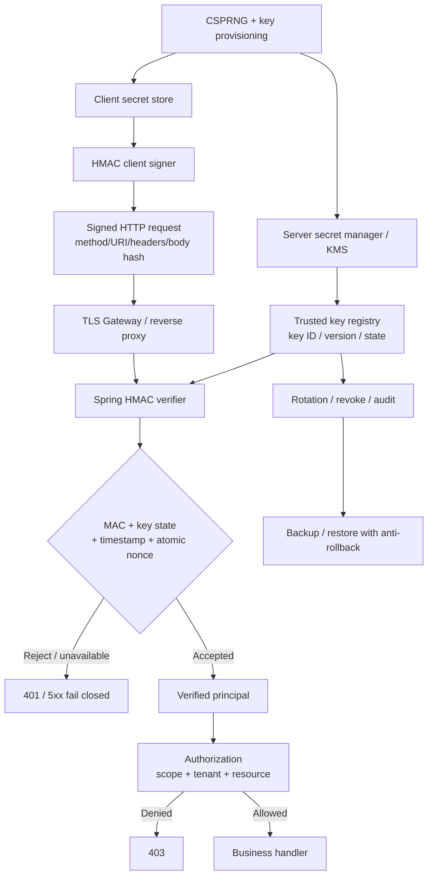
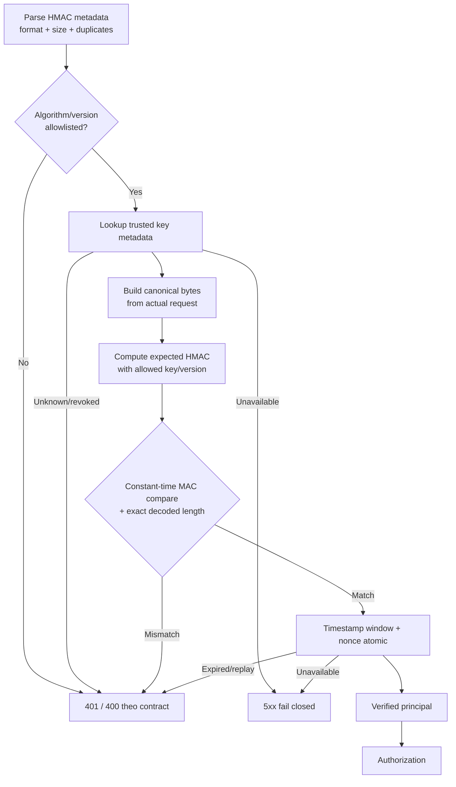

# Checklist key security: tổng kết bảo vệ khóa trong HMAC request authentication

## 1. Mục tiêu và cách sử dụng checklist

Trong module `SECURITY_AUTHENTICATION_HMAC_REQUEST_AUTHENTICATION`, hai bên chia sẻ secret để tạo và xác minh **HMAC của HTTP request**. Phần được ký là **canonical request** theo hợp đồng: method, URI/path/query, những header được chọn và/hoặc hash của body. Timestamp/nonce giúp chống replay; key rotation, gateway/proxy và Spring Security quyết định tính nhất quán khi triển khai; **authentication** phải được phân biệt với **authorization**.

Một triển khai có thể dùng HMAC-SHA256 đúng về mặt toán học nhưng vẫn không an toàn: secret nằm trong log, hai đối tác dùng chung khóa, client chọn algorithm tùy ý, server nhận key revoked từ cache, nonce store lỗi mà request vẫn được chấp nhận, hoặc chữ ký đúng bị hiểu nhầm thành quyền admin. Vì vậy, bài tổng kết này tổ chức các yêu cầu thành một **checklist key security có bằng chứng kiểm chứng**, xuyên suốt vòng đời credential.

**Mục đích thực hành:** dùng checklist để rà soát thiết kế trước production, đánh giá thay đổi key/algorithm/canonical contract, chuẩn bị kiểm thử bảo mật và diễn tập incident response.

### 1.1. Cách đánh dấu kết quả

Mỗi kiểm soát có ba trạng thái:

- **PASS:** có bằng chứng thực tế từ code/config, test, audit và runtime phù hợp.
- **FAIL:** phát hiện sai lệch; ghi owner, mức độ rủi ro, hành động khắc phục, deadline.
- **N/A:** không áp dụng **có lý do được phê duyệt**; không dùng N/A để né một kiểm soát bắt buộc.

Một checkbox chỉ được tích `[x]` khi **có bằng chứng**, không phải khi tài liệu đơn thuần khẳng định “đã an toàn”.

### 1.2. Mức ưu tiên

| Mức | Khi nào dùng | Phản ứng |
| --- | --- | --- |
| **P0 — Không được mở traffic** | Có thể bỏ qua HMAC, replay guard, dùng key revoked, lộ secret hoặc cấp quyền sai | Chặn rollout/traffic liên quan, kích hoạt khắc phục hoặc IR |
| **P1 — Phải sửa trước release** | Rủi ro cao: key chung nhiều tenant, rotation không có cutoff, ký thiếu field quan trọng, log nhạy cảm | Tạo remediation, kiểm thử lại |
| **P2 — Cải thiện vận hành** | Thiếu dashboard/drill/golden vector một số trường hợp hoặc retention chưa đạt | Có owner và kế hoạch có hạn |
| **N/A** | Không có thành phần đó trong kiến trúc và có bằng chứng | Ghi lý do, scope và người phê duyệt |

Đây là thang **gợi ý cho bài học**, không thay risk classification hoặc quy trình approval chính thức của tổ chức.

## 2. Bức tranh toàn hệ thống: một khóa đi qua những đâu?

Một secret HMAC tồn tại ở ít nhất **client signer** và **server verifier**. Key metadata, log, gateway và backup làm phát sinh các ranh giới khác.



**Bất biến cốt lõi:** một request được xử lý nghiệp vụ chỉ khi toàn bộ HMAC verification và anti-replay đã thành công, key policy hiện hành cho phép và principal có quyền theo authorization policy.

### 2.1. Checklist ranh giới

- [ ] **KS-01:** sơ đồ có **mọi nơi lưu/dùng khóa**: client, signer, key registry, secret manager, KMS/HSM, cache, CI, backup, gateway.
- [ ] **KS-02:** phân biệt **raw shared secret**, **secret reference**, **key ID**, **key version**, **verified client identity**, **authorities** và **nonce state**.
- [ ] **KS-03:** mỗi trust boundary có owner, IAM, encryption và đường xử lý khi dependency hỏng.
- [ ] **KS-04:** không có endpoint business bị bỏ qua verifier vì matcher `permitAll`/routing/fallback.

**Bằng chứng:** architecture diagram, threat model, route inventory, security chain configuration, một HTTP E2E test đi qua ingress và service.

## 3. Checklist sinh khóa: chất lượng bí mật quyết định an toàn

HMAC không mạnh hơn chất lượng shared secret và thuật toán/key management được dùng.

### 3.1. Yêu cầu sinh secret

- [ ] **KS-05 — CSPRNG:** secret được sinh từ cryptographically secure random source (`SecureRandom` phù hợp provider trong Java), không từ timestamp, UUID biến thể yếu, `Random`, password hoặc chuỗi dễ đoán.
- [ ] **KS-06 — Entropy:** độ dài/entropy đạt security policy. Trong lab HMAC-SHA256, **32 byte random (256 bit)** là lựa chọn thực hành thông dụng; không kết luận một chuỗi dài 32 ký tự ASCII là 256 bit entropy.
- [ ] **KS-07 — Khóa riêng:** mỗi client/tenant/credential version có secret riêng theo threat model; không chia sẻ một global secret cho tất cả đối tác.
- [ ] **KS-08 — Purpose isolation:** không tái sử dụng shared secret để mã hóa backup, ký JWT, tạo password hash, CSRF token hay ký giao thức khác nếu chưa có key separation và đánh giá riêng.
- [ ] **KS-09 — Environment isolation:** dev/test/staging/prod dùng khóa tách biệt; **public golden-vector secrets tuyệt đối không được production chấp nhận**.
- [ ] **KS-10 — Inventory:** key có owner, environment, intended audience, algorithm/purpose, created-at, version và lifecycle state.

### 3.2. Ví dụ Java sinh secret cho môi trường kiểm thử

```java
import java.security.SecureRandom;
import java.util.Base64;

SecureRandom random = new SecureRandom();

byte[] secret = new byte[32];
random.nextBytes(secret);

// Chỉ dùng bản mã hóa Base64 này trong fixture lab có kiểm soát.
// Không print/log một secret production.
String testOnlySecretBase64 =
        Base64.getEncoder().encodeToString(secret);
```

**Không** lưu `testOnlySecretBase64` vào source code production hoặc log. Base64 là **encoding, không phải encryption**: bất kỳ ai đọc được chuỗi đều lấy lại được key bytes.

### 3.3. Mẫu lỗi đáng báo động

```java
// SAI: ngẫu nhiên không thích hợp cho khóa bí mật.
byte[] secret = Long.toString(System.currentTimeMillis())
        .getBytes(StandardCharsets.UTF_8);

// SAI: tất cả client dùng cùng một global signing key.
byte[] secret = config.getSharedHmacSecretForAllClients();
```

Một key chung mở rộng phạm vi ảnh hưởng của một lần lộ secret và làm khó thu hồi riêng từng đối tác.

## 4. Checklist cấp phát và phân phối khóa

Khi tạo key mới, cả client và server phải biết **đúng value/version**, nhưng secret không được truyền qua một kênh chưa xác thực.

- [ ] **KS-11 — Secure enrollment:** cấp phát qua kênh provisioning đã xác thực và có quyền (ví dụ portal quản trị bảo vệ, API mTLS/chứng thực mạnh hoặc secret manager).
- [ ] **KS-12 — Không đưa key vào URL:** không truyền shared secret qua query string, route path, referer, analytics, email/chat hoặc ticket.
- [ ] **KS-13 — Không log secret khi provision:** không ghi response body chứa secret hoặc secret bytes vào HTTP access log, debug, tracing, exception hay audit.
- [ ] **KS-14 — Client confirmation:** client xác minh service identity, key ID/version, algorithm, contract version và intended audience trước khi bật signer.
- [ ] **KS-15 — Provisioning audit:** có event metadata về cấp phát/thu hồi, owner, approval, mốc hiệu lực; không chứa raw secret.
- [ ] **KS-16 — Revocable:** mỗi credential có thể disable/revoke riêng mà không buộc tất cả client rotate.
- [ ] **KS-17 — Kênh khôi phục:** khi client mất secret hoặc suspect exposure, dùng **re-provision/rotation** thay vì gửi lại secret qua email hoặc log.

**Bằng chứng:** demo enrollment bằng credential test, xác minh TLS/identity, kiểm tra hệ thống log/proxy, quy trình mất khóa và audit events.

### 4.1. Phân phối một lần không đồng nghĩa “an toàn mãi mãi”

Một secret đã được đưa qua kênh tin cậy vẫn có thể lộ qua môi trường runtime, file cấu hình, CI artifact, crash dump hoặc logs. Checklist vì thế phải bao phủ **lưu giữ, sử dụng, rotate, revoke và điều tra** chứ không dừng tại onboarding.

## 5. Checklist lưu giữ secret tại client và server

| Ranh giới | Nên làm | Tránh |
| --- | --- | --- |
| **Client signer** | Secret manager/credential store, identity và scope rõ | Hard-code trong SDK hoặc git |
| **Server verifier** | Read/verify qua secret manager/KMS phù hợp, role giới hạn | Log key, key trong exception |
| **KMS/HSM** | Dùng primitive HMAC do provider hỗ trợ hoặc key material lifecycle được cho phép | Giả định mọi KMS key “không export” có thể lấy bytes dùng `Mac` |
| **Runtime cache** | TTL, memory access, revocation invalidation, least privilege | Cache vô hạn hoặc global mutable key |
| **Backup** | Mã hóa, integrity, restore drill, tách key backup khỏi HMAC secret | Plaintext backup không kiểm soát |
| **CI/test** | Secret test riêng, masking và quét artifact | Dùng prod key để tạo golden vectors |
| **Logging/APM** | Structured allowlist, secret redaction và privacy | Dump canonical request/headers/expected MAC |

### 5.1. Checklist chi tiết

- [ ] **KS-18:** raw secret không xuất hiện trong source, Docker image, environment dump được log, command-line arguments, unit snapshots hoặc frontend bundle.
- [ ] **KS-19:** ứng dụng dùng workload identity/IAM phù hợp; quyền đọc secret tách biệt với quyền đọc key metadata, audit và backup.
- [ ] **KS-20:** secret references **version-pinned** khi contract/rotation cần; không ngầm lấy `latest` rồi ký bằng một key khác.
- [ ] **KS-21:** secret in-memory không bị chuyển qua `toString()`, SLF4J arguments, MDC, trace baggage hay exception serialization.
- [ ] **KS-22:** mọi cache secret/key metadata có giới hạn, eviction và cách đảm bảo **revoke có hiệu lực** trên mọi replica.
- [ ] **KS-23:** cấu hình KMS/HSM phù hợp với primitive HMAC và hiệu năng: nếu dùng remote MAC/verify service, provider phải thực sự hỗ trợ operation, quota và access policy cần thiết.
- [ ] **KS-24:** khi secret manager/KMS unreachable, verifier **không chấp nhận request bằng cách bỏ qua kiểm tra hoặc thử một key khác**.

**Ghi chú:** Java `SecretKeySpec` và các provider JCA có thể tạo bản sao secret trong heap/native memory. Việc `Arrays.fill(secret, (byte) 0)` chỉ xóa một mảng caller nắm giữ, **không chứng minh** mọi bản sao đã bị xóa. Quản lý exposure cần nhiều lớp, không dựa vào zeroization trong JVM như cam kết tuyệt đối.

## 6. Checklist metadata và key registry

Key metadata mô tả **key nào được phép dùng**, nhưng không phải key material.

### 6.1. Schema tham chiếu

```yaml
# Định dạng minh họa từ trusted registry, KHÔNG chứa secret bytes.
credential_id: "cred-lab-partner-a"
client_id: "partner-a"
tenant_id: "tenant-a"
key_id: "partner-a-key-v4"
key_version: 4
secret_ref: "vault://lab/hmac/partner-a/v4"
algorithm_id: "HMAC-SHA256"
signing_contract_version: "HMAC-REQ-V2"
lifecycle_status: "ACTIVE"
valid_from: "2026-11-28T00:00:00Z"
valid_until: null
revoked_at: null
record_revision: 1287
security_policy_epoch: 244
authority_policy_ref: "orders-reader-v3"
```

`secret_ref` là metadata nhạy cảm, không được log bừa bãi. Nếu kho metadata chứa encrypted/wrapped key blobs thì đó vẫn là **key material đã mã hóa**, cần bảo vệ theo chính sách key recovery phù hợp.

### 6.2. Checklist

- [ ] **KS-25:** mỗi key ID map rõ tới một credential/secret version theo namespace; không để verifier thử một danh sách secret tùy ý.
- [ ] **KS-26:** metadata chứa client/tenant binding, algorithm allowlist, contract version, created/expiry/revoked state và policy revision.
- [ ] **KS-27:** key ID trong HTTP request là **lookup hint chưa xác thực**; lookup success không đồng nghĩa client identity đã được chứng thực.
- [ ] **KS-28:** state transition có audit và validation (`PENDING → ACTIVE → PREVIOUS_ALLOWED → REVOKED/EXPIRED` theo policy).
- [ ] **KS-29:** key đã `REVOKED` không được tự trở lại `ACTIVE` với cùng identity/version do restore hoặc rollback.
- [ ] **KS-30:** authorities và tenant permissions lấy từ **trusted server-side policy**, không từ `X-Role`/`X-Tenant-Id` do client tự khai.
- [ ] **KS-31:** key metadata cache có policy epoch/invalidation đủ để cấm key đã revoke, kể cả trong multi-region.

### 6.3. Bản ghi không nhất quán phải bị chặn

Ví dụ active pointer trỏ key v5 nhưng secret manager chỉ còn v4, hoặc `clientId=partner-a` lại map tới secret ref của `partner-b`. Không sửa bằng fallback “thử v4 rồi v3 tới khi chữ ký khớp”. Phải coi đó là inconsistency cần khắc phục an toàn.

## 7. Checklist HMAC algorithm và key usage

HMAC-SHA256 là lựa chọn phổ biến, nhưng tên primitive không đủ mô tả một giao thức ký HTTP.

- [ ] **KS-32:** thuật toán nằm trong **global và per-credential allowlist**; không gọi `Mac.getInstance(rawAlgorithmHeader)`.
- [ ] **KS-33:** client/server thống nhất tên wire (ví dụ `HMAC-SHA256`), implementation JCA (`HmacSHA256`), MAC length/encoding.
- [ ] **KS-34:** version/algorithm/key ID được bind vào canonical bytes hoặc hợp đồng có cơ chế ràng buộc tương đương đã đánh giá.
- [ ] **KS-35:** API HMAC-only không nhận `alg=none`, arbitrary MD5/SHA1, truncation không được đặc tả hoặc fallback qua scheme cũ.
- [ ] **KS-36:** key có **purpose/audience separation**: không dùng cùng secret để ký request cho hai giao thức/dịch vụ độc lập nếu không có domain separation/chính sách phù hợp.
- [ ] **KS-37:** không chuyển giữa HMAC-SHA256 và SHA512 **chỉ vì HTTP 401**; migration có policy xác thực, cutoff và golden vectors.
- [ ] **KS-38:** mỗi operation ký/xác minh dùng `Mac` state đúng; không chia sẻ singleton mutable `Mac` không đồng bộ giữa threads.

### 7.1. Ví dụ enum allowlist

```java
enum HmacAlgorithm {
    HMAC_SHA256("HMAC-SHA256", "HmacSHA256", 32),
    HMAC_SHA512("HMAC-SHA512", "HmacSHA512", 64);

    final String wireId;
    final String jcaName;
    final int macBytes;

    HmacAlgorithm(String wireId, String jcaName, int macBytes) {
        this.wireId = wireId;
        this.jcaName = jcaName;
        this.macBytes = macBytes;
    }

    static HmacAlgorithm parse(String wireId) {
        for (HmacAlgorithm alg : values()) {
            if (alg.wireId.equals(wireId)) {
                return alg;
            }
        }
        throw new IllegalArgumentException(
            "Unsupported HMAC algorithm");
    }
}
```

Dù parse được enum, verifier còn phải kiểm tra **thuật toán đó được phép đối với key đang dùng**. Tên algorithm từ client không tự là chứng thực đã có quyền sử dụng.

## 8. Checklist canonical request và key binding

Một shared secret mạnh không cứu được contract ký **thiếu trường quan trọng**. Nếu method/path/body không được đưa vào MAC, attacker có thể dùng lại signature cho tác vụ khác trong điều kiện cho phép.

### 8.1. Ví dụ canonical request có domain separation

```text
HMAC-REQ-V2
alg:HMAC-SHA256
kid:partner-a-key-v4
method:POST
target:/api/orders?region=vn
content-type:application/json
body-sha256:<BASE64_REAL_SHA256_EXACT_BODY_BYTES>
timestamp:<EPOCH_SECONDS>
nonce:<FRESH_NONCE>
```

Các giá trị `<...>` chỉ là placeholder, **không phải chữ literal để ký**. Protocol này là ví dụ riêng cho bài học, không phải một chuẩn HTTP HMAC tự động được các framework hỗ trợ.

### 8.2. Checklist

- [ ] **KS-39:** protocol/canonicalization version được xác định rõ, có domain separation và test vectors.
- [ ] **KS-40:** HTTP method thực tế được ký; không có `X-HTTP-Method-Override` làm đổi action sau verification ngoài contract.
- [ ] **KS-41:** URI raw path/query hoặc canonical target được mô tả **byte-for-byte**, kể cả percent encoding, query order, empty query và duplicate parameters.
- [ ] **KS-42:** các signed headers được xác định bởi allowlist; xử lý case của tên, whitespace của value, duplicates, encoding và missing value rõ ràng.
- [ ] **KS-43:** nếu ký body, hash trên **exact request bytes** được server nhận tại trust boundary, không serialize lại JSON sau khi parse.
- [ ] **KS-44:** key ID, algorithm, timestamp/nonce và version được ràng buộc phù hợp vào MAC; không chấp nhận nhiều cách diễn giải cùng signature.
- [ ] **KS-45:** Base64/hex, padding, MAC byte length và charset được quy định; signature sai format/length bị từ chối.
- [ ] **KS-46:** client signer và server verifier dùng **golden vectors độc lập**, không chia chung bug canonicalization.
- [ ] **KS-47:** body/URI/header bị sửa sau khi ký phải fail; case negative có **positive control** và nonce mới.
- [ ] **KS-48:** nếu API cần host/audience binding, contract ký/credential scope bảo vệ đúng boundary; không tái sử dụng key xuyên service tùy tiện.

**Bằng chứng:** contract document, Java/Python/Go golden vectors, end-to-end test qua gateway, kiểm thử Unicode, JSON whitespace, binary body, GET/POST, HTTP/1.1 và HTTP/2 khi có hỗ trợ.

## 9. Checklist timestamp, nonce và chống replay

HMAC chứng minh MAC trên message, **không tự chứng minh message chưa từng được gửi**. Freshness cần timestamp và anti-replay state đáng tin cậy.

- [ ] **KS-49:** timestamp có unit (Unix epoch seconds/millis), UTC và accepted skew/window rõ ràng; server từ chối timestamp quá cũ/quá tương lai.
- [ ] **KS-50:** timestamp được **MAC-bind**, không phải header tự khai tách khỏi chữ ký.
- [ ] **KS-51:** mỗi request dùng nonce có entropy/uniqueness phù hợp (`SecureRandom` cho client Java), nonce cũng MAC-bind.
- [ ] **KS-52:** nonce store dùng **atomic reserve-once** trên tất cả replica; không dùng `exists()` rồi `set()` rời rạc.
- [ ] **KS-53:** nonce namespace gồm credential scope/contract cần thiết, TTL phủ **toàn bộ thời gian timestamp còn có thể được chấp nhận**.
- [ ] **KS-54:** replay được reject kể cả HMAC bytes đúng; một server/node khác không được nhận cùng nonce.
- [ ] **KS-55:** nonce store timeout, failover không rõ kết quả hoặc bị xóa state → **fail closed**, không bỏ anti-replay.
- [ ] **KS-56:** client retry có idempotency policy cho request ghi; nonce mới không bảo đảm giao dịch không bị lặp.

### 9.1. Redis minh họa

```text
SET replay:<credential-scope>:<nonce-tag> 1 NX EX <ttl-seconds>
```

Đây là minh họa primitive, không phải key pattern production được khuyên copy nguyên xi. Không lưu/log raw nonce khi không cần; cân nhắc bảo vệ định danh và giới hạn kích thước input. `NX` giúp atomic reservation trong một Redis authority, nhưng cần xem xét durability, replication/failover và TTL nếu hệ thống phải ngăn replay sau crash.

**Phân biệt kết quả:** `new` = có thể đi tiếp sau khi verify; `duplicate` = reject replay; `unavailable/unknown outcome` = fail closed. Không chuyển unavailable thành duplicate, vì điều đó che incident hạ tầng.

## 10. Checklist xác minh chữ ký và constant-time comparison

### 10.1. Luồng quyết định bảo mật



### 10.2. Checklist

- [ ] **KS-57:** request header/body có size limits, parse strict, reject ambiguous duplicates và encoded smuggling theo gateway contract.
- [ ] **KS-58:** verifier không lấy raw secret, expected MAC hay canonical request từ HTTP header do client tự khai.
- [ ] **KS-59:** secret key lookup chọn **một bản ghi có thẩm quyền** theo key ID/version/policy; revoked/expired key bị reject dù MAC đúng.
- [ ] **KS-60:** decoded signature đúng độ dài thuật toán; compare bytes bằng primitive phù hợp giảm phụ thuộc thời gian vào dữ liệu.
- [ ] **KS-61:** không dùng `String.equals` hoặc tự so byte rồi break sớm như MAC comparison chính.
- [ ] **KS-62:** mismatch và unknown key không tiết lộ key existence hoặc expected signature qua response/log công khai.
- [ ] **KS-63:** không phát authenticated principal chỉ vì lookup được key hoặc vì HMAC match nhưng nonce/key policy chưa hoàn tất.
- [ ] **KS-64:** lỗi secret manager/provider/config/nonce store được phân biệt với invalid credential: **không catch mọi exception thành 401** và không fail open.

### 10.3. Ví dụ Java JCA tối thiểu

```java
import java.security.MessageDigest;
import java.util.Base64;
import javax.crypto.Mac;
import javax.crypto.spec.SecretKeySpec;

byte[] suppliedSignature =
        Base64.getDecoder().decode(encodedSignature);

if (suppliedSignature.length != 32) {
    throw new BadCredentialsException("Invalid HMAC credential");
}

Mac mac = Mac.getInstance("HmacSHA256");
mac.init(new SecretKeySpec(secretBytes, "HmacSHA256"));
byte[] expected = mac.doFinal(canonicalBytes);

if (!MessageDigest.isEqual(expected, suppliedSignature)) {
    throw new BadCredentialsException("Invalid HMAC credential");
}
```

Đoạn code chỉ minh họa **MAC step**, không có registry, input limit, algorithm policy, replay, authorization hay exception translation. `MessageDigest.isEqual` là phương thức giảm rủi ro timing so với so sánh kết thúc sớm, **không đảm bảo** mọi code path, lookup và response đều hoàn toàn constant-time.

## 11. Checklist key rotation, expiration và revoke

Key rotation thay **secret/version**, không tự thay contract ký hoặc quyền truy cập.

### 11.1. Lifecycle minh họa

```text
PENDING → ACTIVE → PREVIOUS_ALLOWED → REVOKED / EXPIRED
```

Mô hình và tên trạng thái có thể khác trong hệ thống thật, nhưng transition phải được kiểm soát, audit và có mốc hiệu lực.

| Tình huống | Điều nên xảy ra |
| --- | --- |
| Key v4 active | Server verify nếu algorithm/contract/policy hợp lệ |
| Key v3 previous allowed trong overlap | Chỉ verify trước cutoff đã định |
| Key v3 revoked | Reject dù HMAC đúng |
| Client còn dùng key cũ sau cutoff | Authentication reject; không fallback |
| Key registry/secret manager lỗi | Fail closed `5xx` phù hợp, không thử key khác |
| Permission bị rút nhưng key vẫn active | HMAC có thể accepted; authorization deny `403` |

### 11.2. Checklist

- [ ] **KS-65:** có key owner, cryptoperiod/rotation policy và cảnh báo sắp hết hạn.
- [ ] **KS-66:** key mới được provision từ CSPRNG, có key ID/version riêng; không tái dùng old secret và chỉ đổi tên.
- [ ] **KS-67:** rotation có thứ tự rõ: issue → client adoption → overlap kiểm soát → cutoff → revoke/retire.
- [ ] **KS-68:** overlap **giới hạn theo credential và thời gian**, không bật fallback toàn cục vô thời hạn.
- [ ] **KS-69:** revoked/expired state được phân phối đến mọi verifier/cache/region với SLA có kiểm chứng.
- [ ] **KS-70:** key đang revoked **không được hồi sinh bởi database restore hoặc deploy rollback**.
- [ ] **KS-71:** mọi lần rotate/revoke có approval, audit metadata, monitoring và runbook khi client chưa kịp chuyển.
- [ ] **KS-72:** một request key cũ bị từ chối không được tự retry bằng legacy scheme hoặc algorithm không còn được cho phép.

### 11.3. Kịch bản kiểm thử cutoff

1. Tạo `key-v1` và `key-v2` là secret test khác nhau.
2. Trong overlap, v1/v2 được accept **chỉ khi policy cho phép**; dùng nonce riêng cho mỗi request.
3. Sau cutoff, dùng v1 ký đúng canonical request: phải reject.
4. Dùng v2 ký cùng target với nonce mới: phải accepted.
5. Ngắt cache invalidation một replica trong test: replica không được tiếp tục nhận revoked key, hoặc bị loại khỏi traffic protected.
6. Restore snapshot metadata cũ: không cho phép v1 ACTIVE trở lại.

## 12. Checklist backup, DR và chống rollback trạng thái khóa

Backup metadata hữu ích nhưng có thể trở thành nguồn **rollback revocation** nếu chọn bản cũ.

- [ ] **KS-73:** phân biệt metadata backup (ID/state/policy/secret reference) với secret material recovery riêng.
- [ ] **KS-74:** backup được mã hóa, có integrity/authenticity verification và IAM tách backup writer/restore approver.
- [ ] **KS-75:** snapshot/PITR nhất quán giữa key records, active pointers, policy revisions và event journal positions.
- [ ] **KS-76:** có trusted lifecycle/revocation authority hoặc policy epoch floor **không cùng rollback** với snapshot; chỉ checksum SHA-256 là **chưa đủ chống rollback**.
- [ ] **KS-77:** restore vào staging, đối chiếu all committed revoke/permission changes trước publish.
- [ ] **KS-78:** sau restore kiểm tra secret references/version, KMS access, cache invalidation và synthetic signed tests.
- [ ] **KS-79:** nếu nonce store mất state, có chiến lược continuity/quarantine; không mở request protected với replay window chưa được bảo đảm.
- [ ] **KS-80:** RPO/RTO và kết quả recovery drill được **đo thật**, không coi “backup job success” là đủ.

Ví dụ: snapshot lúc 09:00 chứa key v3 ACTIVE, nhưng key bị revoke lúc 09:30. Restore snapshot vào 10:00 và mở traffic ngay có thể **làm sống lại key bị cấm**. Chỉ được publish sau khi kiểm chứng authoritative revoke state và reconciled metadata.

Nếu ledger và snapshot đều mất và không thể xác minh các revoke mới hơn, không có căn cứ an toàn để tự đoán bản backup “mới nhất”. Tùy severity, cần fail closed và re-provision credentials hoặc recovery theo chính sách tổ chức.

## 13. Checklist gateway/proxy và signed request target

Một request có thể đi qua TLS terminator, API gateway, reverse proxy, service mesh và Spring service. Mỗi hop có thể thay metadata.

```text
Client signed target: /public/v2/orders?region=vn
Gateway upstream:    /internal/orders?region=vn
```

Nếu contract ký **public target**, verifier sau proxy phải biết đúng public representation thông qua trust boundary đáng tin, hoặc verify ngay tại edge trước rewrite. Không thử cả hai path cho đến khi MAC khớp.

- [ ] **KS-81:** xác định **nơi HMAC được verify**: edge hay service; không có đường bypass chỉ dựa header client tự khai.
- [ ] **KS-82:** gateway strip/overwrite forwarded identity/original URI headers từ nguồn chưa tin cậy.
- [ ] **KS-83:** client/server thống nhất public/internal target, percent encoding, query order, signed headers và body bytes.
- [ ] **KS-84:** kiểm thử HTTP/1.1 và HTTP/2 translation, header duplication, `Host`/`:authority` nếu contract bind authority.
- [ ] **KS-85:** server không tin `X-Verified-Client`, `X-Role`, `X-Original-URI` từ Internet như bằng chứng HMAC.
- [ ] **KS-86:** gateway không thay signed `Content-Type`, body, target một cách âm thầm; nếu cần transform, có kiến trúc verification/trust contract phù hợp.
- [ ] **KS-87:** local bypass/direct backend route hoặc chain khác vẫn từ chối request chưa xác thực.
- [ ] **KS-88:** lỗi canonical mismatch được xử lý bằng contract/gateway fix, **không bật lại scheme legacy**.

`Forwarded` theo RFC 7239 cung cấp thông tin `for`, `by`, `host`, `proto`, **không chuẩn hóa original path/query**. Header riêng như `X-Original-URI` phải có contract/trust policy và được gateway sanitize đúng.

## 14. Checklist authentication và authorization — hai lớp không được gộp

Một client ký đúng `GET /tenants/B/orders/42` không chứng minh client có quyền đọc order của tenant B, ngay cả khi path/tenant ID nằm trong canonical request.

| Bước | Câu hỏi | Nguồn quyết định |
| --- | --- | --- |
| Authentication | HMAC, key policy, timestamp/nonce có hợp lệ? | Verifier + trusted key registry + replay store |
| Identity | Credential verified thuộc client/tenant nào? | Server-side key metadata |
| Coarse authorization | Principal có `orders:read`/`orders:create`? | Trusted authority policy |
| Resource authorization | Có quyền trên **order/tenant cụ thể** không? | Ownership/delegation/resource policy |
| Business | Request và trạng thái nghiệp vụ có hợp lệ? | Controller/service, transaction rules |

- [ ] **KS-89:** không cấp `ROLE_ADMIN` hoặc scopes chỉ vì signature đúng.
- [ ] **KS-90:** không lấy `X-Role`, `X-Tenant-Id`, `X-Requested-Scope` đã ký làm **granted authorities**.
- [ ] **KS-91:** resource ownership/tenant delegation được kiểm tra **sau verified identity** và trước business side effects.
- [ ] **KS-92:** HMAC đúng nhưng thiếu quyền trả `403` (hoặc `404` theo resource-hiding policy có chủ đích), không biến thành `401`.
- [ ] **KS-93:** data queries/update được scope bởi **authorized tenant/resource**, tránh IDOR/BOLA và TOCTOU.
- [ ] **KS-94:** policy store outage không được `onErrorReturn(true)`/default ALLOW; phải fail closed.
- [ ] **KS-95:** authority cache và key cache có invalidation/epoch riêng; rotate secret không tự thay grants.

### 14.1. Mẫu outcome để test

```text
A. Valid MAC + fresh nonce + active key + correct tenant
   + orders:read       -> authenticated, authorized

B. Valid MAC + fresh nonce + active key + other tenant
   + no delegation     -> authenticated, authorization denied

C. Invalid MAC + claimed admin key ID
                       -> unauthenticated (no principal)

D. Valid MAC + replayed nonce
                       -> unauthenticated (replay denied)

E. Valid MAC + policy store outage
                       -> no business execution, fail closed
```

Để chứng minh case B, test phải ký **chính path tenant khác** bằng credential hợp lệ và nonce mới. Nếu ký path A rồi sửa thành B, request fail ở signature trước khi kiểm tra quyền, không phải bằng chứng authorization hoạt động.

## 15. Checklist Spring Security MVC/WebFlux

### 15.1. Servlet / Spring MVC

- [ ] **KS-96:** HMAC `OncePerRequestFilter` chạy trên protected routes đúng `SecurityFilterChain`, không đăng ký trùng như container filter.
- [ ] **KS-97:** không có matcher `permitAll` quá rộng hoặc Basic/API-key fallback bảo vệ nhầm route.
- [ ] **KS-98:** authentication filter không tạo `Authentication` được đánh dấu authenticated trước HMAC/freshness/key state.
- [ ] **KS-99:** filter gọi `AuthenticationEntryPoint` khi authn fail, **return**, không tiếp tục `chain.doFilter(...)`.
- [ ] **KS-100:** chỉ catch authn exception quanh verifier, không bắt nhầm exception từ authorization/controller downstream thành `401`.
- [ ] **KS-101:** `SecurityContextHolder` được cleanup đúng vòng đời dispatch/async.
- [ ] **KS-102:** nếu verifier đọc body, request wrapper phát lại **exact bytes đã được ký** cho controller.
- [ ] **KS-103:** method/resource security có kiểm thử qua proxy thực, không bị bypass do self-invocation.

### 15.2. Reactive / Spring WebFlux

- [ ] **KS-104:** `ServerAuthenticationConverter` chỉ tạo **candidate chưa verified**, không cấp principal/authority từ raw key ID.
- [ ] **KS-105:** `ReactiveAuthenticationManager` verify MAC, key state, timestamp/nonce atomic trước khi emit authenticated token.
- [ ] **KS-106:** key/nonce/policy stores dùng reactive driver hoặc offload blocking đúng cách, không `block()` trên Netty event loop.
- [ ] **KS-107:** signed `Flux<DataBuffer>` có body size limit, release pooled buffers và replay exact bytes.
- [ ] **KS-108:** reactor retry/cancel không phát accepted audit giả hoặc chạy side effect trước authz.
- [ ] **KS-109:** identity dùng Reactor security context đúng cách, không gán raw secret/signature vào tracing baggage/MDC.
- [ ] **KS-110:** `SecurityWebFilterChain` có matcher/order rõ, không bypass HMAC qua global WebFilter hoặc scheme khác.

Ví dụ minh họa thứ tự logic:

```text
HTTP HMAC filter / AuthenticationWebFilter
    -> parse + verify credential
    -> MAC over canonical bytes
    -> freshness + nonce atomic
    -> verified Authentication
    -> AuthorizationManager / method policy
    -> resource ownership
    -> controller / handler
```

Chỉ cần một nhánh gọi controller trước nonce check hoặc authorization đã có thể phá bảo đảm toàn hệ.

## 16. Checklist mã lỗi và fail-closed

| Nguyên nhân | Lớp | Phản hồi thường gặp | Không được |
| --- | --- | --- | --- |
| Missing/invalid HMAC credential | Authentication | `401` | Tiết lộ secret/key tồn tại |
| Malformed/duplicate auth metadata | Parse/authentication | `400`/`401` theo contract | Bỏ qua duplicate rồi tự chọn |
| Expired timestamp/replay nonce | Authentication/freshness | `401` theo contract | Chấp nhận vì MAC đúng |
| Valid HMAC, missing authority | Authorization | `403` | Gộp thành invalid signature |
| Resource ownership denied | Resource authorization | `403`/`404` có chủ đích | Trả dữ liệu cross-tenant |
| Key/nonce store unavailable | Authentication dependency | `503`/`5xx` | Bỏ qua key lookup/nonce reserve |
| Policy engine unavailable | Authorization dependency | `5xx`, deny execution | Mặc định ALLOW |
| Business input invalid | Business validation | `400`/`422` tùy API | Đổ lỗi HMAC |

- [ ] **KS-111:** response public không chứa expected HMAC, key state chi tiết, secret ref hoặc raw canonical bytes.
- [ ] **KS-112:** lỗi store outage phân biệt được trong audit/metrics với credential sai; không gán nhầm mọi `Exception` thành `401`.
- [ ] **KS-113:** không có retry/fallback sang key cũ, thuật toán cũ hay authentication scheme cũ chỉ vì `401`.
- [ ] **KS-114:** mọi dependency không đưa ra quyết định an toàn phải **fail closed**, không tiếp tục handler.
- [ ] **KS-115:** 429/5xx/timeouts có bounded retry và idempotency policy cho request ghi, không replay mù quáng.

## 17. Checklist log, metric và telemetry không lộ secret

### 17.1. Security events nên có

```json
{
  "event": "hmac.authentication.accepted",
  "request_id": "req-lab-102",
  "route_template": "/api/orders/{id}",
  "algorithm_class": "hmac_sha256",
  "verified_key_tag": "test-tag-42",
  "credential_lifecycle_class": "active",
  "result": "accepted"
}
```

`verified_key_tag` chỉ được tạo từ **trusted stored key ID sau xác thực** và qua cơ chế pseudonymization nếu policy cần; không lấy raw `X-Key-Id` làm verified identity.

### 17.2. Checklist

- [ ] **KS-116:** logs không chứa shared secret, supplied/expected MAC, credential header đầy đủ, raw body hoặc canonical request nguyên văn.
- [ ] **KS-117:** audit phân biệt `authentication.accepted`, `authentication.rejected`, `authentication.unavailable`, `authorization.denied`.
- [ ] **KS-118:** `claimed_key_id` từ request chưa verified **không bị gán thành authenticated client**; failure logs không quy kết nhầm đối tác.
- [ ] **KS-119:** metric labels chỉ dùng **bounded enum/route template**, không raw key ID, signature, nonce, URL, tenant/order ID.
- [ ] **KS-120:** request ID/trace ID có nguồn tin cậy hoặc được ingress validate; log injection từ header/path bị chặn/escape.
- [ ] **KS-121:** log/trace/audit có retention, access control, clock/ingestion timestamps và test không rò secret trên mọi sink.
- [ ] **KS-122:** alerts theo accepted/rejected/replay/store timeout/key cutoff có owner và cách điều tra; không chỉ đếm HTTP `401`.

Metrics giúp phát hiện sự cố, nhưng metric `401` tăng không đồng nghĩa có tấn công; một signer client lỗi có thể tạo rất nhiều `401`. Ngược lại, credential bị lộ vẫn có thể tạo request HMAC **accepted**, cần correlation với hành vi nghiệp vụ, không chỉ failure rate.

## 18. Checklist test, golden vector và fault injection

Không thể khẳng định key security an toàn bằng unit test tính MAC đúng. Cần chứng minh **lỗi đầu vào, race, restore, proxy và quyền truy cập**.

| Mã test | Thiết lập | Kết quả bắt buộc |
| --- | --- | --- |
| **T01** | Secret CSPRNG test + vector độc lập | Java signer/verifier khớp canonical bytes/MAC |
| **T02** | Thay method sau ký | Reject, không side effect |
| **T03** | Thay path/query/percent encoding sau ký | Reject theo contract |
| **T04** | Thay signed header/body bytes sau ký | Reject |
| **T05** | Missing/duplicate/malformed signature metadata | Reject, không parser crash không kiểm soát |
| **T06** | Wrong algorithm/`none`/unknown version | Reject, không fallback |
| **T07** | Timestamp out-of-window | Reject |
| **T08** | Replay signed request | Lần lặp bị reject |
| **T09** | Hai replica nhận cùng nonce đồng thời | Tối đa một accepted |
| **T10** | Redis nonce store outage/unknown reserve | Fail closed |
| **T11** | Credential key revoked, MAC tính đúng bằng secret cũ | Reject sau cutoff |
| **T12** | Rotation overlap current + previous | Chỉ allowed versions/algorithms theo policy |
| **T13** | Restore backup trước revoke | Không hồi sinh key đã thu hồi |
| **T14** | HMAC valid, thiếu authority | `403`, controller không side effect |
| **T15** | HMAC valid, truy cập tenant khác | Denied resource |
| **T16** | Gateway public path rewrite đúng contract | Valid request accepted |
| **T17** | Spoof forwarded/original URI/identity headers | Không bypass |
| **T18** | Logger/trace/metrics có test-only sentinel | Không xuất hiện secret/signature/body token |
| **T19** | Concurrent `Mac` signing/verifying | Không cross-request state/key leakage |
| **T20** | Key/authorization store lỗi | `5xx` fail closed, không accepted |
| **T21** | Legacy scheme disabled | Không nhận Basic/API key fallback |
| **T22** | Rollback release/policy cache | Không chấp nhận key/scheme đã cấm |

### 18.1. Kiểm thử HMAC hợp lệ nhưng thiếu quyền

Ví dụ input test:

```text
Client: tenant-a, authority=orders:read
Target: GET /api/tenants/tenant-b/orders/42
Signature: valid for EXACT tenant-b target
Nonce: fresh, never used
Expected: authentication accepted, authorization denied
```

Nếu dùng lại chữ ký của target tenant A rồi đổi URL sang tenant B, case đó chỉ xác minh integrity, không phải authorization.

### 18.2. Kiểm thử tránh false positives

- Negative mutation dùng nonce **mới** nếu muốn chứng minh signature mismatch, không để replay che lỗi.
- Positive control ký đúng target mới phải đi qua verifier thành công.
- Test không được “pass” chỉ vì HTTP `404`, `403` hoặc gateway không route tới service.
- Dùng test-only key; **không chạy DDoS/fuzz trên production**.
- Test nhận biết log loss/sampling: không thấy event không có nghĩa chắc chắn không có request.

## 19. Checklist incident response khi key bị lộ

Một secret HMAC bị lộ có thể cho phép attacker ký request hợp lệ trong phạm vi quyền của credential và khi freshness/replay conditions cho phép. **HMAC không cung cấp non-repudiation** vì cả client và server đều biết shared secret; một MAC hợp lệ không đủ để chứng minh chính xác con người nào đã gửi.

### 19.1. Quy trình ứng phó

1. **Triage:** phân loại suspected/confirmed exposure; xác định credential/version/environment có nguy cơ mà không sao chép secret vào ticket.
2. **Containment:** giới hạn quyền truy cập artifact/log/secret manager, tạm khóa credential nếu cần theo mức độ.
3. **Key rotation/revoke:** provision secret/key ID mới theo kênh tin cậy; revoke key có nguy cơ, rút ngắn overlap nếu threat model yêu cầu.
4. **Cache/region enforcement:** xác minh mọi instance ngừng nhận revoked key, kể cả sau failover/restore.
5. **Evidence:** thu security events, key lifecycle audit, deployment/config changes, access/traces có phân quyền; không dùng raw HMAC secret làm “bằng chứng mẫu”.
6. **Impact:** tìm accepted requests đáng ngờ, đánh giá scope/tenant/authorization và business effects; không quy kết attacker chỉ dựa vào IP hoặc claimed key ID.
7. **Recovery:** kiểm tra 401/403/5xx, nonce/clock, test active/revoked signed canaries và secret non-leakage.
8. **Postmortem:** khắc phục đường lộ secret, cải thiện alert/log retention, tái đánh giá cryptoperiod và ownership.

### 19.2. Checklist

- [ ] **KS-123:** có runbook xác định owner, key ID/version, severity, cutoff, communication và revocation target.
- [ ] **KS-124:** key compromise dẫn tới **rotate/revoke credential**, không chỉ xóa một log chứa secret.
- [ ] **KS-125:** khi bảo toàn chứng cứ, không nhân bản raw secret vào chat/ticket/wiki không kiểm soát.
- [ ] **KS-126:** rà accepted events sau thời điểm exposure, đánh giá quyền được cấp và side effects thực tế.
- [ ] **KS-127:** kiểm tra backup, snapshots, replicas, logging sinks và CI artifacts có thể còn chứa secret sau cleanup.
- [ ] **KS-128:** sau remediation, test chứng minh revoked key không được nhận ở tất cả route/region và sau rollback.

## 20. Ma trận trách nhiệm: ai chứng minh từng kiểm soát?

Một checklist không có owner/bằng chứng dễ biến thành tài liệu chỉ để tích ô.

| Nhóm kiểm soát | Owner tham khảo | Bằng chứng tối thiểu |
| --- | --- | --- |
| Key generation/provisioning | Security + client integration | CSPRNG/provisioning review, sample key policy |
| Secret storage/IAM | Platform/SRE | Secret manager policy, runtime identity, audit |
| Metadata/key lifecycle | Identity/security backend | Registry schema, revision, rotation/revoke logs |
| Canonical contract | API/backend + SDK owner | Published contract, cross-language vectors |
| Crypto/verifier | Backend/security engineer | Unit & integration tests, provider policy |
| Anti-replay | Backend/SRE | Atomic reserve tests, failover/TTL drill |
| Gateway trust | Platform/API gateway owner | Route/header rewrite configs, E2E tests |
| Authorization | API/product security | Tenant/resource isolation tests |
| Telemetry/logging | SRE/security operations | Log redaction tests, dashboards, retention |
| Backup/restore | Platform/DR owner | Restore drill, revocation floor verification |
| Incident response | Security/operations | Runbook, tabletop results, tracked actions |

Trong một công ty nhỏ, cùng một nhóm có thể sở hữu nhiều mục; vẫn cần **trách nhiệm và bằng chứng phân định**.

### 20.1. Mẫu bảng ghi nhận thực tế

```text
Control ID:      KS-69 (revocation applied across replicas)
Status:          FAIL
Environment:     staging
Evidence:        revoked test-key-v3 accepted on one stale pod
Impact:          unsafe key reuse after cutoff
Owner:           auth-platform
Action:          policy epoch fencing + cache invalidation
Release gate:    BLOCK
Validation:      multi-node revoked-key negative test + rollback drill
```

Không viết “PASS” khi chỉ thấy config có `revocationEnabled=true`; phải chứng minh runtime không chấp nhận old key.

## 21. Quy trình review trước production hoặc trước một thay đổi lớn

### 21.1. Giai đoạn design review

1. Xác định threat model: attacker có thể kiểm soát header, path/query, body, forwarded metadata, client-side key hay không.
2. Xác định **tập dữ liệu được ký** và trust boundary khi gateway rewrite.
3. Kiểm tra client/tenant scope, secret entropy, audience và key/policy registry.
4. Định nghĩa nonce namespace, atomic store, timestamp window và failure mode.
5. Định nghĩa authorization riêng, route-level và resource-level.
6. Chốt rotation/cutoff/revocation/backup recovery policy.

### 21.2. Giai đoạn implementation review

1. Review signer Java/JCA và canonicalization; không dùng raw algorithm trực tiếp.
2. Review verifier: đúng secret version, MAC length, constant-time comparison, key state.
3. Review Spring MVC/WebFlux security chains: matcher precedence, filter registration, body replay.
4. Review gateway: trusted forwarding/original URI, no identity spoof, no fallback.
5. Review secret manager/IAM/logging và caches.
6. Review semantics `401`/`403`/`5xx` và fail-closed paths.

### 21.3. Giai đoạn test/release gate

1. Cross-language golden vectors và primitive HMAC known-answer.
2. Negative mutation tests với fresh nonce và positive control.
3. Multi-node replay/concurrency/chaos test.
4. Revoked/expired key, rotation overlap và policy restore.
5. HMAC valid nhưng authz denied/cross-tenant.
6. End-to-end qua public gateway.
7. Secret leakage sentinel scan ở log/trace/metrics/CI.
8. Runbook và ownership ký duyệt theo mức P0/P1.

**Không** mở release nếu còn lỗi P0 chưa có biện pháp loại bỏ rủi ro được phê duyệt.

## 22. Bài thực hành tổng kết: audit một hệ thống HMAC có chủ đích cài lỗi

Giả sử hệ thống `orders-api` có các đặc tính:

- Client ký bằng HMAC-SHA256, canonical method/public URI/Content-Type/raw JSON body hash, timestamp/nonce.
- Server chạy Spring Boot trên hai replica sau gateway, tra key version ở secret manager, Redis lưu nonce.
- Một credential `client-A` chỉ được đọc đơn hàng tenant A.
- Hệ thống đang rotate từ `key-v3` sang `key-v4`.
- Bản metadata backup tạo **trước** thời điểm revoke key-v3.
- Gateway đôi khi rewrite percent-encoded path.
- Một pod dùng key cache không nhận cập nhật revoke ngay.
- Khi Redis lỗi, một nhánh code đang bỏ qua nonce check.
- Debug log có thể ghi raw signature/secret khi exception xảy ra.
- HMAC filter có nhánh tạo `ROLE_ADMIN` sau MAC match.

### 22.1. Nhiệm vụ

1. Đối chiếu `KS-01…KS-128` và ghi các mục **PASS/FAIL/N/A** kèm bằng chứng.
2. Gắn P0/P1/P2 cho lỗi; giải thích vì sao **fail-open nonce, revoked key accepted và ROLE_ADMIN mặc định** là P0.
3. Viết golden vector độc lập với method, path, header, body, timestamp và nonce cụ thể bằng **secret test**.
4. Viết negative test đổi public target sau signing; có nonce mới và positive control.
5. Viết integration test HMAC đúng nhưng `client-A` đọc order tenant B → authorization denied.
6. Dùng multi-node concurrency test gửi cùng signed request/nonce vào hai replica; tối đa một được accepted.
7. Giả lập Redis timeout; mọi protected request phụ thuộc nonce phải fail closed và không gọi handler.
8. Giả lập key-v3 đã revoke, một replica cache stale, snapshot metadata cũ; không node nào được accept key-v3.
9. Kiểm tra secret leakage qua logback appender, response, gateway logs, trace và metrics bằng sentinel **test-only**.
10. Viết runbook rotate/revoke + khôi phục backup với trusted epoch/revocation journal.
11. Kiểm chứng key mới chỉ phục hồi authentication; authorities/tenant ownership không tự thay đổi.
12. Nộp risk register, test outputs, owners, remediation deadlines và rollback plan không mở lại scheme yếu.

### 22.2. Ví dụ risk register

| Finding | Severity | Test evidence | Remediation |
| --- | --- | --- | --- |
| Redis outage → accept HMAC mà bỏ nonce | **P0** | Fault-injection test accepted request | Fail closed `5xx` |
| Revoked v3 accepted trên pod stale | **P0** | Multi-node revoked-key test | Cache fencing + authoritative revoke |
| HMAC match → `ROLE_ADMIN` | **P0** | Valid HMAC + cross-tenant mutation | Trusted policy authz |
| Raw secret xuất hiện trong log | **P0** | Test-only sentinel scan | Stop leak, rotate affected key |
| Missing gateway encoded-path vector | P1/P2 theo exposure | E2E route coverage gap | Contract vectors + ingress policy |
| Không đo restore RTO | P2 thường gặp | DR drill missing | Lập lịch drill và báo cáo |

Đây là **case giả định có chủ đích cài lỗi**, không phải phát hiện ở production thật. Không thử với key production hoặc gửi request vào hệ thống ngoài phạm vi được phép.

## 23. Câu hỏi tự đánh giá

1. Một secret 32 ký tự ASCII từ password của người dùng có mặc nhiên 256 bit entropy không? Vì sao?
2. Key ID trong HTTP header có thể dùng làm authenticated principal ngay khi lookup ra record không?
3. Tại sao mỗi client/tenant nên có secret riêng thay vì dùng một global HMAC key?
4. Vì sao signer và verifier cùng tính MAC đúng chưa chứng minh canonicalization đúng?
5. Tại sao algorithm ID và signing protocol version cần được ràng buộc với MAC/policy?
6. HMAC signature đúng có đủ để chấp nhận một request replay nonce cũ không?
7. Khi nonce store trả timeout hoặc unknown reserve result, nên trả gì và vì sao?
8. Key v3 có MAC đúng nhưng đã revoke, server phải xử lý thế nào?
9. Một backup có integrity checksum đúng nhưng được tạo trước khi key bị revoke có an toàn để publish không?
10. Tại sao HMAC đã xác thực một client không chứng minh client đó được đọc mọi order của tenant khác?
11. `Forwarded` có quy định original path/query chuẩn hay không? Proxy nên bảo vệ signed target như thế nào?
12. Trước khi kết luận `401` tăng là tấn công, cần thêm loại bằng chứng nào?
13. HMAC secret bị lộ vào CI log: xóa dòng log có đủ không, cần thêm hành động nào?
14. Tại sao code retry `401` bằng Basic/API key cũ có thể tạo downgrade vulnerability?
15. Một `Mac` singleton shared đa luồng có nguy cơ gì?
16. Làm sao chứng minh revoked key không được accept sau deploy rollback và multi-region cache failover?

**Đáp án định hướng:** Secret cần CSPRNG/entropy thực; key ID chỉ là hint; MAC không tự chống replay hoặc cấp quyền; revocation cần authority chống rollback; gateway trust boundary phải rõ; lỗi dependency phải fail closed; secret exposure phải rotate/revoke và điều tra; bằng chứng kiểm thử phải bao phủ chính security stage được đánh giá.

## 24. Checklist nghiệm thu cuối cùng và kết luận

### 24.1. Mười điều kiện bắt buộc trước khi chấp nhận hệ thống

- [ ] **K1:** shared secrets được sinh bằng CSPRNG, tách per credential/purpose/environment và không bị lộ qua provisioning/runtime/log.
- [ ] **K2:** key ID/version/secret reference có registry tin cậy, lifecycle và audit; không có secret global/cross-tenant confusion.
- [ ] **K3:** algorithm/contract được allowlist và domain/MAC-bound; canonical method/URI/header/body được test độc lập.
- [ ] **K4:** verifier so sánh MAC đúng key/version, reject revoked/expired và malformed signature.
- [ ] **K5:** timestamp/nonce chống replay toàn hệ phân tán bằng atomic state; dependency outage fail closed.
- [ ] **K6:** key rotation có overlap giới hạn/cutoff; revoke được enforce qua cache, replica, region, restore.
- [ ] **K7:** gateway giữ đúng signed request semantics hoặc cung cấp verified edge trust assertion; không chấp nhận spoofed identity/URI.
- [ ] **K8:** authenticated principal và authorization được tách; không cấp quyền từ raw header hoặc HMAC match.
- [ ] **K9:** logs/trace/metrics bảo vệ secret và có audit reason code/owners để điều tra.
- [ ] **K10:** regression + fault-injection + DR + incident drills chứng minh các bất biến, không chỉ happy path.

### 24.2. Khi nào một checklist thực sự có giá trị?

Một checklist có ích khi từng mục chỉ rõ **điều kiện đúng, người chịu trách nhiệm, bằng chứng có thể lặp lại và hành động khi không đạt**. Nó không thay threat model, không tự chứng minh compliance và không thay kiểm thử bảo mật thực tế. Nhưng nó biến câu “HMAC đã được cài” thành các câu hỏi cụ thể hơn:

- Secret có entropy cao và đúng purpose không?
- Request được ký có bao gồm các trường cần bảo vệ không?
- Key bị revoke hoặc request replay còn có thể được chấp nhận không?
- Gateway có đổi signed fields hoặc tạo trust confusion không?
- HMAC hợp lệ nhưng thiếu authority có bị từ chối trước side effect không?
- Restore hoặc rollback có làm sống lại một lỗ hổng cũ không?

**Kết luận:** Bảo vệ khóa HMAC là bài toán **lifecycle và hệ thống**, không phải chỉ là `Mac.getInstance("HmacSHA256")`. Một shared secret mạnh cần được cấp phát, lưu giữ, giới hạn scope, định danh phiên bản, rotate/revoke và phục hồi an toàn. Một canonical request đúng cần đồng nhất từ client, gateway đến verifier, cùng freshness/nonce atomic và chính sách authorization độc lập. Khi checklist đi kèm bằng chứng thực thi và kế hoạch ứng phó, người học có thể đánh giá một triển khai HMAC HTTP request theo **mức an toàn thực tế**, thay vì chỉ dựa vào việc chữ ký khớp trong một unit test.
