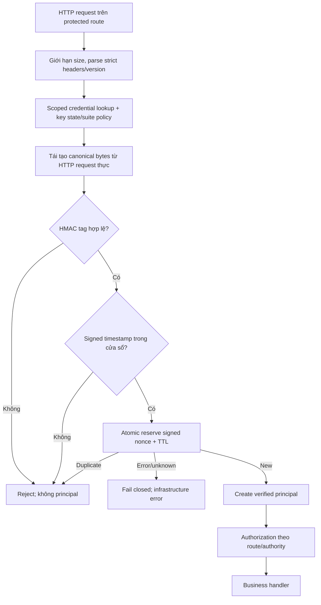
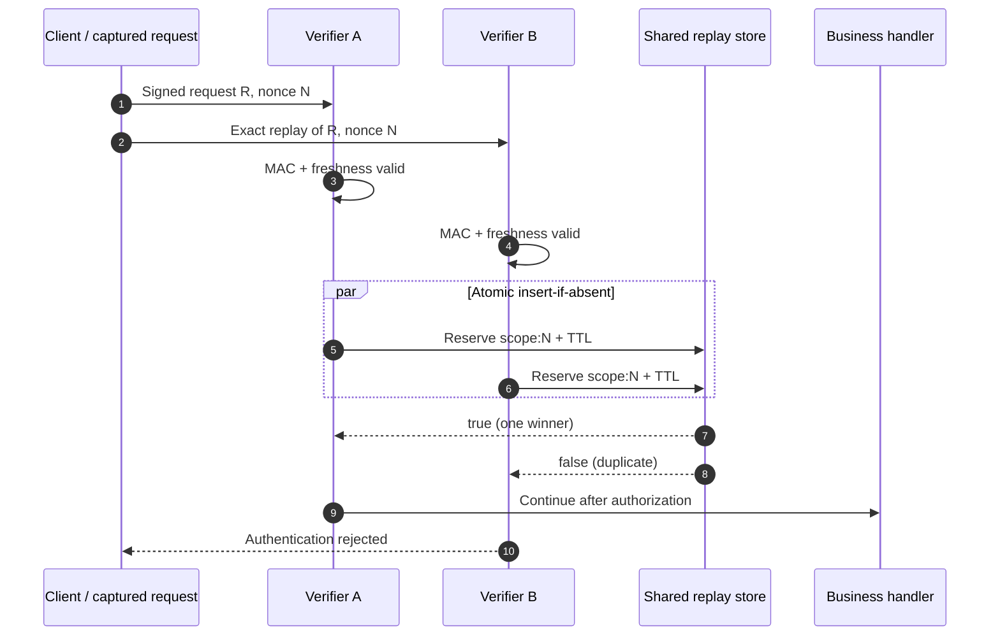

# Checklist replay protection cho hệ thống xác thực HTTP request bằng HMAC

## 1. Mục đích của checklist cuối mô-đun

Trong chương **Tổng kết HMAC authentication**, bài **Checklist replay protection** dùng để trả lời một câu hỏi quan trọng trước khi đưa API ra production: **một HTTP request đã có chữ ký HMAC hợp lệ có thể được gửi lại, được xử lý thêm lần nữa hoặc bị chuyển sang một đường xác minh khác để vượt qua giới hạn chống replay hay không?**

Bài thuộc mô-đun `SECURITY_AUTHENTICATION_HMAC_REQUEST_AUTHENTICATION`. Hệ thống trong phạm vi này xác thực request bằng **HMAC với shared secret**, xác định **canonical request** có method, URI, signed headers và/hoặc body theo hợp đồng; kiểm MAC, chống replay bằng timestamp và nonce, quản lý key rotation, tương tác với proxy/gateway và tách biệt **authentication** với **authorization**.

**Điểm cốt lõi:** HMAC kiểm tra tính toàn vẹn và chứng minh bên gửi biết shared secret theo giả định khóa bí mật; bản thân HMAC **không có bộ nhớ về request đã được chấp nhận**. Một bản request được ký đúng có thể được phát lại y nguyên và tạo ra cùng HMAC tag. Muốn chặn phát lại phải có **freshness window**, một định danh sử dụng một lần (**nonce**), cùng trạng thái đã dùng được lưu **nguyên tử và nhất quán** tại các điểm xác minh.

Checklist này không chỉ hỏi “đã có Redis chưa?” mà yêu cầu chứng minh:

- Timestamp và nonce là **thành phần được ký**, không thể thay đổi sau khi ký mà vẫn giữ MAC hợp lệ.
- Verifier dùng đồng hồ và cửa sổ thời gian có giới hạn, quy tắc biên được công bố.
- Nonce có độ độc nhất phù hợp, gắn với đúng credential/client scope và không bị nhận lại trong thời gian request còn có thể hợp lệ.
- Mọi verifier node/region có chung một **quyết định chống replay đủ nhất quán**, không dùng check-then-set hoặc cache local không đồng bộ.
- Store timeout, mất trạng thái, eviction, failover và clock uncertainty không bị biến thành **fail-open**.
- Key rotation, algorithm agility, proxy rewrite, retry và thay đổi route không làm mở lại đường replay.
- Bằng chứng kiểm thử bao gồm **response, authentication decision và side effect nghiệp vụ**, không dừng ở HTTP 401.
- Có monitoring, runbook, owner và các **go/no-go gates** để kết luận replay protection có đủ điều kiện vận hành hay chưa.

**Phạm vi sử dụng:** HMAC server-to-server, gateway verifier, Spring Security MVC/WebFlux, hệ thống một node đến nhiều region. Thông số và suite trong bài chỉ là **hợp đồng minh họa**, không phải chính sách bắt buộc của mọi API. Khi áp dụng thực tế phải thay bằng threat model và SLA của hệ thống.

## 2. Phân biệt replay, retry, duplicate và idempotency

Bốn khái niệm dễ bị trộn lẫn:

| Hiện tượng | Bản chất | Replay protection xử lý | Cần thêm gì? |
| --- | --- | --- | --- |
| **Exact replay** | Cùng signed method/URI/headers/body/timestamp/nonce/signature được gửi thêm lần nữa. | Nonce đã dùng phải bị từ chối khi request vẫn trong cửa sổ thời gian. | Audit, giảm tác hại nếu lần đầu đã thành công. |
| **Concurrent replay** | Hai bản request đã ký giống nhau đến hai verifier gần đồng thời. | Một thao tác reserve nonce **nguyên tử** phải khiến nhiều nhất một request vượt guard. | Store có consistency/atomicity phù hợp. |
| **Transport retry** | Gateway/client gửi lại vì timeout, dù lần trước có thể đã thực thi. | Nếu gửi lại **cùng nonce** thì guard sẽ từ chối bản thứ hai. | Chính sách retry, cách truy vấn kết quả, business idempotency. |
| **Business duplicate** | Cùng ý định tạo đơn được gửi bằng **hai request ký mới, nonce khác nhau**. | Không bị cấm bởi nonce guard nếu mỗi request hợp lệ. | `Idempotency-Key`, unique constraint, transaction/reconciliation. |
| **Expired request** | Signed timestamp nằm ngoài freshness window. | Từ chối dù nonce store không còn giữ key. | Đồng hồ tin cậy và timestamp validation. |
| **Tampered request** | Sửa signed body/URI/nonce nhưng giữ signature cũ. | Bị từ chối bởi **MAC check**, không phải bằng chứng nonce guard đã hoạt động. | Canonical request đầy đủ và golden tests. |

**Không có bảo đảm exactly-once end-to-end chỉ nhờ Redis `SET NX`.** Replay guard nhằm hạn chế một nonce được chấp nhận nhiều lần. Nó không tự giải quyết giao dịch đã commit nhưng response bị mất, công việc được đẩy vào queue hai lần hoặc hai request mới cùng biểu diễn một thao tác nghiệp vụ. Những trường hợp này cần **idempotency ở tầng nghiệp vụ**.

Một attacker có bản request hợp lệ nhưng **không biết shared secret** vẫn có thể thử exact replay. Một attacker **biết shared secret** có thể tạo request mới với timestamp và nonce mới; anti-replay không thay thế việc revoke/rotate key khi đã bị lộ.

## 3. Định nghĩa threat model và acceptance boundary

### 3.1. Những gì cần được bảo vệ

Ví dụ endpoint `POST /api/partner/orders` có thể tạo side effect:

1. Một đối tác được cấp `clientId`/`keyId`/secret.
2. Client tạo body, timestamp UTC và nonce mới rồi ký canonical bytes.
3. Request đi qua HTTPS gateway tới hai backend Spring Security.
4. Server tra credential theo client/key scope, xác minh HMAC và freshness, reserve nonce trong kho dùng chung.
5. Khi đủ điều kiện, server tạo principal; authorization mới quyết định quyền `orders:write`.
6. Controller tạo đơn và có thể phát event bất đồng bộ.

Tài sản là **secret, quyết định authentication, state nonce đã sử dụng, đơn hàng/transaction và các quyền theo tenant**. Attacker có thể nắm một signed request từ log sai, client compromised, proxy bị lộ, hoặc một hệ thống có quyền nhìn traffic đã giải mã. Bản replay không cần biết secret nếu gửi lại y nguyên.

### 3.2. Bất biến P0

Dùng các mã này làm **release gates**; mọi mục P0 phải có test hoặc bằng chứng vận hành tương ứng.

| ID | Bất biến chống replay bắt buộc | Bằng chứng tối thiểu |
| --- | --- | --- |
| `RP-01` | `X-Timestamp` và `X-Nonce` nằm trong canonical bytes đã được HMAC bảo vệ. | Golden vector + mutation tests. |
| `RP-02` | Không tạo principal nếu MAC/key/suite/timestamp/nonce không hợp lệ. | Full-chain negative tests + no-side-effect assertions. |
| `RP-03` | Timestamp chỉ được chấp nhận trong khoảng hữu hạn có biên rõ và trusted clock. | `Clock.fixed` boundary tests, clock-health policy. |
| `RP-04` | Nonce có uniqueness và grammar/size giới hạn, namespace gắn credential đã xác minh. | Valid/duplicate/invalid-format/key-scope tests. |
| `RP-05` | Việc check + mark nonce đã dùng là **một operation nguyên tử**. | Đồng thời hai verifier, nhiều nhất một reserve thành công. |
| `RP-06` | State replay được chia sẻ đủ nhất quán giữa mọi verify point có thể nhận cùng request. | Multi-node/region topology & consistency tests. |
| `RP-07` | TTL giữ nonce **đến hết mọi thời điểm request còn có thể được chấp nhận**. | TTL proof + worst-case boundary tests. |
| `RP-08` | Không có fail-open khi timeout/unknown outcome/eviction/failover/mất state. | Fault injection và recovery tests. |
| `RP-09` | Không rollback/xóa namespace hoặc hồi sinh key đã revoke làm hợp thức hóa replay. | Rotation/migration/restore negative tests. |
| `RP-10` | Gateway, route aliases, method variants và backend trực tiếp không bỏ qua replay guard. | Real ingress, matcher, trust-boundary tests. |
| `RP-11` | HMAC authentication và authorization tách biệt, không dùng nonce thay quyền hoặc idempotency. | 401 vs 403, permission & duplicate business tests. |
| `RP-12` | Có tín hiệu độc lập ngoài verifier để phát hiện bypass và bằng chứng điều tra an toàn. | Gateway/business audit correlation + canary. |

**Go/no-go:** thiếu bằng chứng cho một P0 tương ứng với một đường protected đang hoạt động phải được xem là **chưa đủ điều kiện khẳng định replay-safe**. Nếu dependency không đáp ứng invariant, chọn containment/fail closed hoặc thiết kế lại trước khi bật đường ghi nghiệp vụ.

## 4. Checklist hợp đồng ký: timestamp và nonce phải được HMAC bảo vệ

### 4.1. Các câu hỏi phải trả lời “Có”

- [ ] Có version/suite ID rõ, ví dụ `HMAC-V1`, và quy tắc canonical bytes được công bố.
- [ ] HTTP method và request-target có ý nghĩa bảo mật được ký; proxy không làm verifier hiểu một request khác request handler xử lý.
- [ ] `X-Client-Id` và `X-Key-Id` được ký, nhưng trước MAC chỉ là **lookup hints chưa tin cậy**.
- [ ] `X-Timestamp` được ký với grammar chính xác (UTC seconds hoặc định dạng khác đã công bố).
- [ ] `X-Nonce` được ký, đúng một header; không thể sửa nonce sau khi ký mà tag vẫn đúng.
- [ ] Header `X-Signature` có Base64/tag-length grammar hữu hạn, không chấp nhận truncated MAC ngoài contract.
- [ ] Body digest đúng **exact entity bytes** mà handler sử dụng, không phải JSON object serialize lại.
- [ ] Header duplicate, CR/LF, ambiguous query, spoofed forwarded metadata bị xử lý theo contract.
- [ ] Có golden vectors từ implementation độc lập, không để signer và verifier cùng che lỗi canonicalization.
- [ ] Không fallback sang suite/algorithm/key/format khác để chấp nhận một request lỗi.

### 4.2. Ví dụ canonical request HMAC-V1

Trong hợp đồng giáo dục dưới đây, HMAC-SHA256 tạo tag đầy đủ 32 byte, truyền Base64 chuẩn có padding. Canonical message có **10 dòng**, phân cách bằng LF `0x0A`, **không có LF cuối**:

```text
HMAC-V1
POST
/api/partner/orders?source=partner
authority:api.example.test
content-type:application/json
x-client-id:partner-a
x-key-id:key-a-01
x-timestamp:2026-11-28T03:00:00Z
x-nonce:8f247364-7d4b-479e-8c36-b640f1ad39a0
body-sha256:<64 lowercase hex of SHA-256 over raw body bytes>
```

`<64 lowercase ...>` là placeholder mô tả, **không** phải golden vector có thể chạy. Trong fixture thật phải thay bằng digest được tính từ byte body thực và lưu expected canonical hex/tag đã đối chiếu độc lập.

Thứ tự thực hiện của một verifier có thể là:



Có thể reject timestamp **rõ ràng sai format** trước MAC để tiết kiệm CPU; nhưng khi kết luận “client có MAC đúng nhưng bị expired”, phải có bằng chứng MAC đã được xác minh. Điều bắt buộc là **không reserve nonce trước khi request có credential/MAC được kiểm**, tránh kẻ không có key chiếm nonce namespace của client hợp lệ.

### 4.3. Không lẫn MAC mutation với replay test

Giữ signature cũ rồi thay `X-Nonce` từ N sang M tạo **tampered request** và phải bị MAC reject. Đó là test integrity, **chưa chứng minh replay protection**. Replay test đúng phải gửi lại **cùng signed request với cùng nonce** hoặc tạo hai request có MAC hợp lệ nhưng cùng nonce trong cùng replay scope; cả hai cách đều cần kiểm state nonce.

## 5. Checklist timestamp: freshness window, time source và clock drift

### 5.1. Hợp đồng timestamp mẫu

Giả định:

- `signedTimestamp` là UTC ISO-8601 giây nguyên, ví dụ `2026-11-28T03:00:00Z`.
- `maxPast = 300 s`: request không được cũ hơn năm phút theo clock verifier.
- `maxFuture = 30 s`: request không được ở tương lai xa hơn 30 giây.
- Cửa sổ của ví dụ **bao gồm biên**:

```text
now - maxPast <= signedTimestamp <= now + maxFuture
```

Không coi 300/30 giây là mặc định của Spring Security hoặc HMAC. Hai giá trị phải được chọn từ threat model, latency, khả năng time sync, mức độ nhạy thao tác và chi phí replay store.

| `now` cố định | Signed timestamp | Kỳ vọng |
| --- | --- | --- |
| `03:00:00Z` | `02:54:59Z` | Reject expired (301 giây trước). |
| `03:00:00Z` | `02:55:00Z` | Accept tại biên quá khứ. |
| `03:00:00Z` | `03:00:00Z` | Accept nếu các bước khác đạt. |
| `03:00:00Z` | `03:00:30Z` | Accept tại biên tương lai. |
| `03:00:00Z` | `03:00:31Z` | Reject future. |
| `03:00:00Z` | `10:00:00+07:00` | Reject wire grammar nếu contract chỉ nhận `Z`. |
| `03:00:00Z` | `03:00:00.000Z` | Reject wire grammar demo vì cho phép giây nguyên. |

### 5.2. Checklist time source

- [ ] Server verifier dùng `Instant` với injectable `Clock` UTC; so **một trusted now** tại mốc quyết định đã định.
- [ ] Có giới hạn offset/uncertainty tối đa cho verifier và replay store theo topology.
- [ ] Mọi host/node có đồng bộ thời gian (NTP/chrony hoặc cơ chế nền tảng tương đương) và monitoring riêng.
- [ ] Một node vừa resume VM/snapshot hoặc mất time sync không tiếp tục nhận traffic yêu cầu freshness khi vượt giới hạn an toàn.
- [ ] Không dùng `Date`/`X-Server-Time` do client tự gửi để thay trusted clock.
- [ ] Dùng monotonic duration để đo elapsed latency; **không** dùng `System.nanoTime()` như UTC timestamp.
- [ ] Client ký timestamp gần thời điểm gửi thực, không ký lúc đưa job vào queue rồi chờ nhiều phút.
- [ ] Không tự mở rộng window khi 401 tăng mà chưa phân biệt clock skew, key rotation, canonical mismatch, queue delay và nonce replay.
- [ ] Đã tính skew **tương đối giữa các verifier**, không chỉ offset của một node so với NTP.
- [ ] Có test clock step/rollback và readiness/fail-closed khi không còn bảo đảm freshness.

Nếu một request bị trễ do queue hoặc retry rồi expired, đó **có thể là hành vi đúng** chứ không nhất thiết đồng hồ sai. Đừng “khắc phục” bằng cách bỏ timestamp khỏi canonical bytes.

## 6. Checklist nonce: format, entropy, uniqueness và scope

### 6.1. Đặc tả nonce

Một lựa chọn lab là UUID v4 dạng lowercase canonical:

```text
8f247364-7d4b-479e-8c36-b640f1ad39a0
```

UUID v4 từ nguồn ngẫu nhiên phù hợp mang 122 bit random theo format thông thường; xác suất đụng độ thấp nếu sinh đúng, nhưng vẫn cần **server-side replay state**. Độ dài nonce hoặc việc “trông có vẻ random” không đủ chứng minh uniqueness nếu SDK reuse một seed, clone một VM với PRNG state hoặc dùng giá trị tĩnh.

**Yêu cầu tối thiểu:**

- [ ] Nonce là giá trị duy nhất cho **mỗi lần ký request** trong scope đã định.
- [ ] Bộ sinh dựa trên CSPRNG/UUID v4 chuẩn hoặc cơ chế uniqueness khác đã review; không dùng `System.currentTimeMillis()` làm nonce đơn độc.
- [ ] Header nonce được MAC bảo vệ, có một giá trị, giới hạn độ dài/grammar và không chứa CRLF.
- [ ] Namespace replay gắn với credential/principal được **server xác minh**, không phụ thuộc `clientId` tự khai.
- [ ] Có chính sách rõ nếu client reuse nonce với **hai request khác nhau**: thường reject request thứ hai.
- [ ] Có test hai client dùng key ID text giống nhau nhưng scope khác; không bị gán principal chéo.
- [ ] Có test SDK concurrent signer, restart/snapshot, retry và nhiều device instance.
- [ ] Nonce không trở thành dữ liệu có cardinality vô hạn trong metric labels/log public.

### 6.2. Scope và namespace

Một mô hình logical key:

```text
replay:<credential-scope>:<nonce>
```

- `credential-scope` được tạo từ record credential phía server sau khi key/MAC hợp lệ.
- Nếu một credential có quyền ký nhiều route, cùng nonce có thể bị cấm trên **toàn bộ** scope credential để tránh lẫn state.
- Nếu chia namespace theo route/key/suite, phải có threat-model justification; không tự chia chỉ để request replay ở route khác “được thông qua”.
- Trong key rotation, V1/V2 hoặc các key ID cũ/mới có thể sống song song. Phải kiểm khả năng phát lại qua credential/contract khác, đặc biệt khi cùng secret còn được dùng ở nhiều suite.
- Nếu nonce đã bị dùng với key cũ, đổi key/namespace không có nghĩa những signed requests cũ không còn hợp lệ. State cũ phải được giữ đủ lâu tới lúc timestamp/policy thực sự hết hiệu lực.

**Điểm phân biệt:** Một nonce **mới** trên một request **mới ký** vẫn có thể thực hiện cùng ý định nghiệp vụ. Đây là trường hợp cần idempotency, không phải lỗi của replay guard.

## 7. Checklist TTL: chứng minh nonce không hết hạn quá sớm

### 7.1. Bẫy `TTL = maxPast`

Hệ thống chấp nhận timestamp tối đa 300 giây trong quá khứ và 30 giây trong tương lai. Một request với signed timestamp ở `now+30s` được nhận lần đầu lúc `T0`. Với cùng clock, timestamp vẫn hợp lệ đến `T0+330s`.

Nếu Redis chỉ lưu nonce 300 giây từ `T0`, một bản request có thể được replay ở khoảng **T0+300 đến T0+330** vì nonce đã hết TTL nhưng timestamp còn hợp lệ. Đây là **lỗ hổng logic**, không phải lỗi ngẫu nhiên của Redis.

### 7.2. Bất đẳng thức thiết kế

Đối với TTL cố định bắt đầu từ thời điểm reserve:

```text
maxPast   = 300 seconds
maxFuture =  30 seconds
maxRelativeVerifierClockSkew = 10 seconds
operationalMargin            = 20 seconds

minimumTTL >= maxPast
              + maxFuture
              + maxRelativeVerifierClockSkew
              + operationalMargin
           >= 360 seconds
```

**Lưu ý:** `10s` và `20s` trong ví dụ chỉ là **giả định đã được đo và chấp nhận của lab**. Nếu fleet không bảo đảm offset tương đối ≤10s hoặc có sai số/time-step ngoài thiết kế, `360s` không chứng minh an toàn. Cần khôi phục time sync, tăng margin có review, hoặc từ chối traffic trên các node không đáng tin.

Đây là **quy tắc capacity planning bảo thủ**. Một thiết kế khác có thể tính thời gian sống còn lại tới `signedTimestamp + maxPast` cộng margin; khi đó phải chứng minh tính đúng với clock từng verifier, TTL của store, race và failover. Không rút ngắn TTL một cách tùy ý vì lo Redis memory.

### 7.3. Test TTL phải thực sự thử Redis expiry

- [ ] Với request ký ở future boundary, nonce không biến mất **trước** khi request hết hiệu lực.
- [ ] Với hai verifier có offset trong bound, nonce bị từ chối ở node khác suốt freshness window.
- [ ] Redis TTL được đặt **cùng thao tác reserve nguyên tử**; không có khoảng `SET` chưa có expiry.
- [ ] Redis `maxmemory-policy`/eviction và capacity được kiểm; key không bị xóa trước TTL.
- [ ] Khi timeout, failover, restart hoặc restore snapshot, không dùng lối “store còn ping được” để kết luận replay state đầy đủ.
- [ ] Nếu đổi freshness window, pipeline bắt buộc kiểm lại TTL và footprint.
- [ ] Nếu rollback config từ TTL 360 xuống 300, gate phải chặn khi policy vẫn chấp nhận future window 30.
- [ ] Các nonce đã được tạo với TTL cũ khi migration vẫn được đánh giá; chỉ sửa TTL cho nonce mới có thể **không giải quyết** cửa sổ rủi ro tồn tại.

**Không nhầm fake clock với Redis time:** `Clock.fixed` hoặc `Clock.offset` của Java không khiến TTL trong Redis thật tiến. Unit test dùng fake store có thời gian giả; integration test Redis TTL phải điều phối thời gian thật hoặc môi trường kiểm thử điều khiển được clock store.

## 8. Checklist atomicity: check và reserve phải là một hành động

### 8.1. Một anti-pattern rất phổ biến

```java
// Không an toàn với hai request đến đồng thời:
if (!redis.hasKey(replayKey)) {
    redis.opsForValue().set(replayKey, "used");
    // Hai node có thể cùng tới đây.
    accept();
}
```

Giữa `hasKey` và `set` có race. Khi Node A và B cùng nhìn “key chưa có”, cả hai có thể nhận request. Tương tự, một map local trên từng Spring Boot instance không có tác dụng chống replay xuyên node.

### 8.2. Mẫu Redis atomically reserve

```text
SET replay:<credential-scope>:<nonce> 1 NX PX <ttlMillis>
```

- `NX` chỉ tạo khi key chưa tồn tại.
- `PX` đặt TTL milliseconds trong **cùng một lệnh nguyên tử**.
- Success chỉ khi lệnh thực sự xác nhận insert thành công.
- `false/nil` khi key đã tồn tại → duplicate, **authentication rejected**.
- Timeout/connection error/unknown result → **fail closed**, không nhận request bằng cách đoán.
- Key namespace được suy từ credential đã verify; không lưu raw nonce trong logs/traces.
- Thao tác này **không tự bảo đảm durability sau Redis failover**; cần kiểm toàn bộ topology.

### 8.3. Java / Spring Data Redis: một abstraction rõ nghĩa

```java
import java.time.Duration;

interface ReplayStore {
    /**
     * true  : nonce mới đã được reserve;
     * false : nonce đã tồn tại;
     * throws ReplayStoreUnavailable : kết quả không đáng tin.
     */
    boolean reserveOnce(
        String credentialScope,
        String signedNonce,
        Duration ttl);
}
```

```java
import java.time.Duration;
import org.springframework.dao.DataAccessException;
import org.springframework.data.redis.core.StringRedisTemplate;

final class RedisReplayStore implements ReplayStore {
    private final StringRedisTemplate redis;

    RedisReplayStore(StringRedisTemplate redis) {
        this.redis = redis;
    }

    @Override
    public boolean reserveOnce(
            String scope, String nonce, Duration ttl) {

        if (ttl == null || ttl.isZero() || ttl.isNegative()) {
            throw new IllegalArgumentException(
                "Positive TTL required");
        }
        // scope và nonce đã được validate, scope từ credential.
        String key = "hmac:replay:v1:" + scope + ":" + nonce;
        try {
            Boolean created =
                redis.opsForValue().setIfAbsent(
                    key, "1", ttl);

            if (created == null) {
                throw new ReplayStoreUnavailable(
                    "Nonce reservation outcome unknown");
            }
            return created;
        } catch (DataAccessException ex) {
            throw new ReplayStoreUnavailable(
                "Replay store unavailable", ex);
        }
    }
}
```

`ReplayStoreUnavailable` là exception ứng dụng minh họa (cần tự định nghĩa trong dự án). Cần kiểm phiên bản Spring Data Redis thực tế, TTL precision, cluster routing và error mapping. `Boolean.FALSE` là **duplicate**; `null` hoặc exception là **không xác minh được tính mới**, không được rẽ vào nhánh authenticated.

**Chú ý về Redis `SET NX` và distributed guarantees:** atomicity của một lệnh tại primary không tự bảo đảm rằng acknowledged write đã được sao chép bền vững qua failover. Nếu yêu cầu bảo vệ rất nghiêm ngặt trước replica promotion/loss, cần chọn topology, durability, recovery policy hoặc **một store có consistency guarantees đủ mạnh hơn** theo threat model. Không khẳng định Redis replication mặc định bảo đảm exactly-once xuyên failover.

## 9. Checklist thứ tự xác thực: khi nào được ghi nonce?

Một trình tự bảo thủ phù hợp bài:

1. Giới hạn request size, header grammar, route/suite/version.
2. Tra credential có scope từ `clientId/keyId` (vẫn là lookup hints chưa tin cậy).
3. Kiểm key state, allowed suite và quyền truy cập credential.
4. Tái tạo canonical bytes từ **HTTP request thực**, bao gồm signed timestamp và nonce.
5. Decode tag nghiêm ngặt, tính HMAC và so byte bằng primitive phù hợp.
6. Kiểm timestamp trong freshness window với trusted `now`.
7. **Atomic reserve nonce** trong namespace đã xác minh, TTL đúng.
8. Chỉ sau `reserve=true` mới tạo authenticated principal.
9. Authorization kiểm scope/authority route; sau đó controller mới có side effect.

Bảo đảm không có nhánh:

```text
if (nonceStoreUnavailable) {
    log.warn("Redis down; allow once");
    createAuthentication();  # FAIL-OPEN: forbidden
}
```

Trong một số hệ thống cần phân loại chống brute-force/DoS, parse hoặc reject timestamp **rõ ràng không hợp lệ** có thể xảy ra trước MAC, với input limits và generic response. Nhưng **không reserve nonce trước MAC hợp lệ**: attacker không có key có thể chiếm namespace của client thật nếu chỉ cần đoán client/nonce trên header.

### 9.1. Pseudocode điều phối

```java
// Pseudocode: các kiểu do ứng dụng tự định nghĩa.
VerifiedPrincipal verifyAndReserve(SignedHttpRequest req) {
    validateHeadersAndLimits(req);

    Credential key = credentials.lookupScoped(
        req.claimedClientId(), req.keyId());

    key.requireActiveOrVerifyOnlyFor(req.suite());
    verifyHmacAgainstCanonicalRequest(key.secret(), req);

    Instant now = trustedClock.requireTrustedInstant();
    requireTimestampInWindow(req.signedTimestamp(), now);

    boolean reserved;
    try {
        reserved = replayStore.reserveOnce(
            key.replayScope(), req.signedNonce(),
            policy.requiredNonceTtl());
    } catch (ReplayStoreUnavailable ex) {
        throw new AuthenticationInfrastructureFailure(ex);
    }

    if (!reserved) {
        throw new BadCredentialsException(
            "Invalid HMAC request");
    }

    return VerifiedPrincipal.fromVerifiedCredential(key);
}
```

`AuthenticationInfrastructureFailure` là kiểu minh họa; trong Spring MVC cần mapping lỗi và `AuthenticationEntryPoint`/failure handler theo vị trí filter, không mặc định mọi exception từ custom filter được `ExceptionTranslationFilter` bắt. Trong WebFlux phải compose bất đồng bộ đúng, không dùng `block()` trên event loop và không có `onErrorResume(... -> chain.filter(exchange))` làm fail-open.

**Authentication khác authorization:** một request HMAC/MAC/freshness/nonce hợp lệ nhưng thiếu `orders:write` thường trả 403; đó **không** phải replay. Nếu server tạo principal dựa trên `X-Client-Id` trước các kiểm tra trên, replay protection không còn là control đáng tin.

## 10. Checklist đa node/đa region và consistency

Câu hỏi cần trả lời: **mọi điểm có thể chấp nhận cùng signed request có cùng hiểu biết rằng nonce đã sử dụng hay không?**

- [ ] Lập danh sách tất cả verifier nodes, replicas, gateway instances và regions.
- [ ] Xác định điểm có quyền verify: gateway, backend hay cả hai; không để một route bypass replay guard.
- [ ] Các verifier dùng replay namespace, key scope và TTL policy nhất quán.
- [ ] Nếu có nhiều Redis cluster, có cơ chế consistency đáp ứng invariant hoặc **không route một credential qua các miền độc lập** trong cùng freshness window.
- [ ] Có concurrency test hai request y hệt tới hai instance và kiểm **at-most-one** accepted.
- [ ] Có load-balancer/draining/canary tests khi mixed-version deployment.
- [ ] Node chưa có policy/key/nonce-store config đúng không đạt readiness cho protected traffic.
- [ ] Node clock unsynchronized bị cô lập hoặc fail closed; không mở window để “hợp nhất” kết quả.
- [ ] Redis failover, replica lag và durability được kiểm với điều kiện mất acknowledged nonce write.
- [ ] Restore snapshot/cold start không cho phép state nonce cũ bị quên trong thời gian request còn hợp lệ.
- [ ] Nếu active-active multi-region không có shared linearizable state, kiến trúc phải nêu rõ **rủi ro còn lại hoặc giới hạn routing**; không tuyên bố replay-safe xuyên region.
- [ ] Có runbook khi một region không thể bảo đảm chống replay mà region khác còn khỏe.

### 10.1. Concurrency sequence



Kết quả “A thắng, B thua” chỉ là một **cách sắp lịch**; trong thực tế B có thể thắng. Invariant là **tối đa một** request vượt nonce reservation khi store đủ atomic và state không mất. Test cũng phải kiểm **side effects**; một 401 sau khi handler đã chạy không chấp nhận được.

## 11. Checklist key rotation, algorithm agility và replay scope

### 11.1. Key lifecycle

- [ ] Credential có trạng thái `PREPARED`, `ACTIVE`, `VERIFY_ONLY`, `REVOKED/EXPIRED` hoặc state machine tương đương.
- [ ] Tra secret theo đúng client/tenant/key ID, không thử mọi key để tìm tag khớp.
- [ ] Key revoked bị từ chối **dù MAC đúng**, ngay cả khi nonce mới và timestamp còn hạn.
- [ ] Key VERIFY_ONLY chỉ xác minh trong khoảng policy cho phép; thời điểm kết thúc overlap được công bố.
- [ ] Key cache có revoke SLA và invalidation; rollback binary không tự khôi phục revoked key.
- [ ] Nonce namespace/TTL được xét trong thời gian cùng tồn tại key cũ/mới; không xóa state cũ vì key đã rotate nếu signed request cũ còn có thể được chấp nhận.
- [ ] Nếu shared secret bị lộ, **revoke/rotate** và điều tra exposure; attacker có secret có thể tạo nonce mới, nên anti-replay không đủ.

### 11.2. Suite / canonical contract migration

Ví dụ `HMAC-V1` dùng HMAC-SHA256, `HMAC-V2` dùng HMAC-SHA512 với canonical version khác. Dù hai suite cùng hỗ trợ timestamp và nonce:

- Version/suite phải nằm trong dữ liệu ký.
- Server policy theo credential/endpoint/time quyết định suite nào được chấp nhận.
- Một header `X-Client-Capabilities` chưa xác thực không được tự mở lại legacy suite.
- Client không tự downgrade sau 401, 403 hoặc timeout.
- Nonce namespace theo key/suite phải được thiết kế với cross-suite replay threat model; **domain separation** không thay nonce guard.
- Không reset hoặc rút ngắn TTL khi đổi format Redis keys hoặc rollback migration.
- Golden vectors và negative suite/version mutation tests phải chạy ở mọi verify point.

**Rollback an toàn** là quay một phần mềm/traffic/config về trạng thái **vẫn thực thi minimum security policy hiện hành**, không phải cho phép lại key đã lộ hoặc bỏ replay state để hệ thống trả 2xx.

## 12. Checklist gateway, proxy và routing

Replay protection ở backend có thể hoàn chỉnh nhưng bị vượt qua nếu request đi theo một đường không chạy verifier. Ngược lại, gateway có thể verify HMAC trước rewrite rồi backend nhận identity assertion đã được bảo vệ; mô hình nào cũng cần trust boundary rõ.

- [ ] Biết nơi MAC và nonce được kiểm: gateway hay backend, và có **một quyết định có thẩm quyền**.
- [ ] Mọi HTTP method/route alias/host/ingress protected đều đi qua điểm kiểm bắt buộc.
- [ ] Không có direct-backend public access bypass gateway verifier hoặc bypass security policy.
- [ ] Nếu edge verify, assertion sang backend đi qua kênh được xác thực (ví dụ mTLS/service authentication), backend kiểm danh tính/authority của gateway.
- [ ] Gateway strip/overwrite `X-Authenticated-Client` và `Forwarded`/`X-Forwarded-*` không đáng tin; không lấy identity từ client tự khai.
- [ ] Canonical public target và Host/`:authority` được lấy từ nguồn đã được tin cậy, không tùy ý dùng `X-Original-URI` do caller đặt.
- [ ] Proxy rewrite body/`Content-Encoding` không khiến verifier ký một payload nhưng handler xử lý payload khác.
- [ ] Gateway retry cùng signed POST không làm bỏ nonce guard vì “đây chỉ là retry”.
- [ ] Có test qua HTTP/1.1 và HTTP/2 nếu hệ thống hỗ trợ, đặc biệt signed headers/query normalization và ambiguous framing.
- [ ] Không dùng route `permitAll` hoặc `web.ignoring` rộng khiến một protected endpoint nằm ngoài chain xác thực.

### 12.1. Thứ tự kiểm HMAC so với Spring Security

Một `SecurityFilterChain` có thể có nhiều authentication mechanisms. Nếu route đòi **HMAC cụ thể**, `authenticated()` chung có thể bị thỏa mãn bởi session/JWT/Basic principal khác. Phải ràng buộc assurance phù hợp hoặc dùng chain scope riêng, kiểm đường đi thực bằng MockMvc/WebTestClient.

**Spring MVC:** `OncePerRequestFilter` phải ở đúng filter chain, không đăng ký hai lần ngoài container và Spring Security. Filter đọc body phải chuyển lại **same signed bytes** cho handler, đồng thời có giới hạn bộ nhớ.

**Spring WebFlux:** `AuthenticationWebFilter`/`WebFilter` chỉ gọi downstream sau `Mono` verify/nonce reserve thành công. Không dùng `onErrorResume(... -> chain.filter(exchange))` khi Redis lỗi; quản lý bounded `DataBuffer` và Reactor Context, tránh `block()` trên Netty event loop.

## 13. Checklist failure modes: fail closed phải kiểm được

| Điều kiện lỗi | Hành vi mong đợi | Điều tuyệt đối không làm |
| --- | --- | --- |
| Thiếu/invalid signature | Authentication reject; không principal/handler. | Cho qua do chưa cấu hình key. |
| Timestamp expired/future/malformed | Reject theo contract; không side effect. | Bỏ freshness vì clock client sai. |
| Nonce duplicate | Reject replay; không handler. | “Nếu đã dùng thì cứ thử lại”. |
| Redis connection timeout | Infrastructure auth failure, ví dụ `503`; fail closed. | Trả `true` hoặc fallback local unshared map. |
| Redis response unknown sau reserve | Fail closed hoặc recovery protocol đã chứng minh. | Suy đoán nonce mới và cho tiếp. |
| Redis eviction/lost acknowledged write | Xem state không đáng tin, containment. | Chỉ kiểm Redis `PING` rồi nhận traffic. |
| Redis replica failover / restore snapshot | Khẳng định integrity of accepted nonce history trước recovery. | Restore backup cũ và cho replay trong cửa sổ. |
| Key repository unavailable | Fail closed, không dùng secret mặc định. | Mở một shared fallback secret. |
| Key revoked hoặc sai tenant | Reject dù MAC với key đó khớp. | Lookup toàn tenant hoặc hồi sinh key khi rollback. |
| Clock unsynchronized ngoài bound | Cô lập node/fail closed với protected actions. | Mở timestamp window vô hạn. |
| Route/identity bypass | Block ingress, sửa filter/trust boundary. | Dựa vào client-provided authenticated header. |
| Business operation timeout sau nonce reserve | Giữ nonce used, xử lý kết quả/compensation riêng. | Xóa nonce để resend nguyên signed request. |
| Valid MAC nhưng thiếu authority | Thường 403 authorization; không side effect. | Gộp 403 thành “replay” hay cấp quyền theo client header. |

**Vì sao không xóa nonce khi business handler lỗi?** Tại thời điểm kết quả nghiệp vụ bất định, việc cho dùng lại signed request có thể gây side effect hai lần. Ngay cả khi handler thất bại trước commit, chọn giữ nonce và yêu cầu **request mới ký với nonce mới** cùng cơ chế idempotency/kiểm trạng thái nghiệp vụ là hướng an toàn, có thể điều chỉnh theo protocol đã review.

## 14. Checklist HTTP status và phân loại lỗi

Một API dùng custom HMAC headers có thể quy định:

| Lớp | Kết quả minh họa | Ý nghĩa |
| --- | --- | --- |
| Authentication | 401 với challenge/documentation phù hợp | MAC/key/time/nonce không hợp lệ; không tạo principal. |
| Authorization | 403 | HMAC hợp lệ, nhưng không đủ authority để thực hiện operation. |
| Security dependency | 503 | Không thể xác định nonce/key state an toàn; fail closed. |
| Request size | 413 | Body vượt policy trước/đang verify. |
| Rate limit | 429 | Chặn tải lạm dụng, không thay signature/replay validation. |
| Bad request grammar | 400 (nếu contract chọn) | Malformed request, không chứng minh credential hợp lệ. |
| Business conflict | 409 hoặc trả stored result tùy idempotency contract | Một nghiệp vụ có cùng idempotency key, khác với nonce replay. |

HTTP 401 có yêu cầu về `WWW-Authenticate` trong HTTP semantics; nếu dùng header `X-*` tùy biến, phải xác định auth scheme/challenge và public error mapping phù hợp. **Không** trả cho caller một oracle tiết lộ “key ID có tồn tại”, “key vừa revoked” hay nội dung nonce của tenant khác.

Trong telemetry nội bộ, các enum reason như `SIGNATURE_INVALID`, `TIMESTAMP_EXPIRED`, `TIMESTAMP_FUTURE`, `NONCE_REPLAY`, `REPLAY_STORE_UNAVAILABLE`, `KEY_REVOKED` giúp điều tra; nhưng **cùng HTTP 401** có thể đại diện nhiều nguyên nhân. Chỉ dùng reason nội bộ sau khi xác định stage check chính xác.

## 15. Bằng chứng unit tests: Clock, TTL và nonce

### 15.1. Unit test time window

Inject `Clock.fixed` để không phụ thuộc giờ chạy CI.

```java
import java.time.Clock;
import java.time.Duration;
import java.time.Instant;
import java.time.ZoneOffset;

record FreshnessPolicy(
    Duration maxPast,
    Duration maxFuture) {

    boolean accepts(Instant signed, Clock clock) {
        Instant now = clock.instant();
        return !signed.isBefore(now.minus(maxPast))
            && !signed.isAfter(now.plus(maxFuture));
    }
}
```

```java
@Test
void freshnessBoundariesAreInclusive() {
    Clock clock = Clock.fixed(
        Instant.parse("2026-11-28T03:00:00Z"),
        ZoneOffset.UTC);

    FreshnessPolicy p = new FreshnessPolicy(
        Duration.ofSeconds(300),
        Duration.ofSeconds(30));

    assertTrue(p.accepts(
        Instant.parse("2026-11-28T02:55:00Z"), clock));
    assertFalse(p.accepts(
        Instant.parse("2026-11-28T02:54:59Z"), clock));
    assertTrue(p.accepts(
        Instant.parse("2026-11-28T03:00:30Z"), clock));
    assertFalse(p.accepts(
        Instant.parse("2026-11-28T03:00:31Z"), clock));
}
```

Test helper này **chưa chứng minh HMAC**; cần integration test có MAC được tính hợp lệ trên chính timestamp expired/future. Nếu thay timestamp header sau ký và giữ signature, request có thể bị MAC reject trước khi chạm freshness check.

### 15.2. Test unique nonce trong một process

```java
import java.time.Duration;
import java.util.Set;
import java.util.concurrent.ConcurrentHashMap;

final class FakeReplayStore implements ReplayStore {
    private final Set<String> used =
        ConcurrentHashMap.newKeySet();

    @Override
    public boolean reserveOnce(
            String scope, String nonce, Duration ttl) {
        return used.add(scope + ":" + nonce);
    }
}
```

```java
@Test
void sameNonceCannotBeReservedTwice() {
    ReplayStore s = new FakeReplayStore();
    Duration ttl = Duration.ofSeconds(360);

    assertTrue(s.reserveOnce("partner-a:key-01", "nonce-N", ttl));
    assertFalse(s.reserveOnce("partner-a:key-01", "nonce-N", ttl));
    assertTrue(s.reserveOnce("partner-a:key-01", "nonce-M", ttl));
}
```

Đây chỉ là **unit fake**: nó không expire, không hỗ trợ nhiều process, không mô phỏng Redis replication hoặc network partition. Không coi `ConcurrentHashMap` là replay store production.

### 15.3. Race test bằng barriers

Dùng `CountDownLatch`/barrier hoặc test framework để cho hai task cùng reserve nonce. Với fake store có `ConcurrentHashMap.newKeySet`, test local atomicity; với Redis test instance thật, test semantics của adapter; với hai verifier pods, test **end-to-end** routing và HTTP response/side effects.

Một test tốt **không dựa vào thứ tự A/B**. Điều cần assert:

```text
successCount == 1
duplicateCount == 1
businessSideEffectCount <= 1
noFailOpenOnStoreErrors == true
```

Nếu cả hai bị từ chối vì timeout, đó là **không có fail-open**, nhưng không thể gọi test happy-path replay guard đạt đầy đủ. Cần phân biệt môi trường không sẵn sàng với logic duplicate đúng.

## 16. Bằng chứng integration tests: ký đúng, gửi lại y nguyên

### 16.1. Happy path + replay path

Một bộ test Spring MVC `MockMvc` full `SecurityFilterChain` hoặc WebFlux `WebTestClient` full `SecurityWebFilterChain` cần:

1. Gửi signed request A với secret test, key `ACTIVE`, timestamp trong cửa sổ, nonce N mới, authority đúng → 2xx theo contract, **side effect đúng một lần**.
2. Gửi lại **cùng request A**, giữ nguyên body, method, URI, timestamp, nonce và tag → authentication reject, **không có side effect mới**.
3. Gửi signed request B với nonce M mới và timestamp hợp lệ → authentication pass nếu không có business idempotency rule cấm.
4. Gửi A với timestamp hết hạn (không cần nonce còn trong store) → freshness reject, không handler.
5. Ký một request C hợp lệ với nonce N đã dùng nhưng body khác → nonce duplicate reject sau khi MAC pass.
6. Inject Redis error sau MAC/freshness đạt → fail closed, không tạo principal.
7. Test key revoked có MAC đúng trên nonce mới → từ chối theo key state, không reserve nonce nếu key không hợp lệ.
8. Test HMAC đúng nhưng thiếu authority → 403, không tạo nghiệp vụ.

**Tại sao bước 5 quan trọng?** Chỉ gửi lại A giống hệt chứng minh exact replay. Nếu một client reuse nonce cho hai requests **đều ký hợp lệ**, server vẫn phải chặn request thứ hai trong scope đó. Đây là một invariant khác với MAC integrity.

### 16.2. Ví dụ test flow khái niệm

```java
// Pseudocode test: signedRequest(...) là fixture builder
// độc lập với production verifier và có known test key.

SignedFixture first = signedRequest(
    "POST", "/api/partner/orders", bodyA,
    clock.instant(), "nonce-unique-N");

assertEquals(201, sendThroughSecurityChain(first).status());
assertEquals(1, orderRepository.count());

assertEquals(401, sendThroughSecurityChain(first).status());
assertEquals(1, orderRepository.count());

SignedFixture second = signedRequest(
    "POST", "/api/partner/orders", bodyB,
    clock.instant(), "nonce-unique-M");

assertEquals(201, sendThroughSecurityChain(second).status());
assertEquals(2, orderRepository.count());
```

Các kiểu `SignedFixture` và `sendThroughSecurityChain` là helper test do dự án xây; đây **không phải test Java có thể biên dịch độc lập**. Trong bản test thật, dùng UUID v4/nonce đúng grammar và assert verifier-specific decision để tránh 401 do route khác.

### 16.3. Không tự tạo test xanh giả

- Dùng `@WithMockUser` sẽ bỏ qua ý nghĩa HMAC authentication; không dùng để test replay verifier.
- `WebTestClient.bindToController(...)` đơn lẻ có thể không chạy security filters; phải gắn đúng context/server.
- 401 do 404/405/Basic auth không chứng minh nonce guard hoạt động.
- Nếu dùng cùng canonicalizer cho signer test và verifier production, cả hai có thể cùng sai; cần **golden vectors độc lập**.
- Không dùng cùng nonce cho **hai positive tests khác nhau** trừ khi chính test đang kiểm replay.
- Test body phải kiểm bytes handler nhận đúng bytes đã ký; proxy/body wrapper có thể gây lệch.
- Không assert chỉ status; kiểm business repository, queue/event và service spies.

## 17. Bằng chứng fault-injection và Redis integration

Đây là phần thường thiếu trong checklist “đã có nonce” nhưng quyết định an toàn khi production lỗi.

| ID | Fault/điều kiện | Expected invariant |
| --- | --- | --- |
| `F01` | Redis timeout **trước** reserve | Fail closed; không principal/side effect. |
| `F02` | Redis ghi nonce xong nhưng response timeout | Unknown outcome → fail closed; không tự accept. |
| `F03` | Primary failover sau acknowledged write | Không được mất replay protection; nếu không bảo đảm, containment/stronger state. |
| `F04` | Redis memory pressure và eviction | Không accept lại nonce còn trong freshness window. |
| `F05` | Store restore từ snapshot cũ | Không cho protected traffic dựa trên state bị quên. |
| `F06` | Hai verifier dùng Redis cluster khác nhau | Kiến trúc/test phát hiện split replay namespace. |
| `F07` | Clock verifier A nhanh/B chậm trong bound | Nonce TTL vẫn chặn duplicate ở B. |
| `F08` | Node clock step ngược vượt bound | Readiness/fail closed, không nới window vô hạn. |
| `F09` | Refresh/cutover key cache giữa reserve | Key state/scope policy nhất quán; không hồi sinh revoked. |
| `F10` | Rollback suite/nonce namespace | Existing nonce state còn hiệu lực được bảo vệ. |
| `F11` | Gateway retry after upstream timeout | Bản signed request lặp không tạo side effect hai lần. |
| `F12` | Backend handler lỗi sau reserve | Không “undo” nonce tùy ý; retry/idempotency theo contract. |
| `F13` | Load spike với huge body/header, nhiều fake nonces | Không OOM, parser bounded, rate limit; store không bị chiếm trước MAC. |
| `F14` | Partial request/cancel khi body hash | Không xác thực/side effect trên payload chưa hoàn tất. |

### 17.1. Không suy từ Redis `PING`

Một store trả `PONG` chỉ chứng minh một kết nối đang sống. Nó **không** chứng minh:

- acknowledged nonce writes còn tồn tại sau failover;
- TTL chưa bị cắt bởi clock changes hoặc eviction;
- hai regions dùng một consistency domain;
- Redis cluster không chuyển shard gây mất namespace;
- restore đã bảo toàn tất cả nonce còn cần giữ.

Cần có **test và tài liệu về replay-state durability/consistency** phù hợp mức độ bảo vệ mong muốn. Nếu không chứng minh được, hãy nêu rõ giới hạn và chọn containment/fail-closed khi mất bảo đảm.

### 17.2. Fault injection theo tầng

- Unit: stub `ReplayStore` ném error/null/false, assert không principal.
- Integration: Redis test instance, TTL/atomicity/cancel/timeout.
- System: nhiều backend/gateway, failover node/store và routing.
- Recovery: snapshot restore, policy rollback, key rotation/cutover.
- Security: request replay vẫn bị chặn **trước side effect** qua mọi đường.

Với production, chỉ thực hiện fault-injection phá hoại sau khi được phê duyệt, với phạm vi và rollback plan rõ. Các bài lab dùng môi trường cô lập.

## 18. Checklist quan sát và audit: phát hiện replay thật

### 18.1. Telemetry tối thiểu

| Tầng | Metric/audit | Có ích cho |
| --- | --- | --- |
| Gateway | Protected route RPS, response status, retry count, route revision | Biết có đường đi bỏ qua verifier không. |
| HMAC verifier | `accepted/rejected/error`, reason enum theo route/suite | Phân loại MAC/freshness/replay. |
| Replay store | Reserve new/duplicate/error, p95/p99 RTT, eviction/TTL signals | Phát hiện nonce guard lỗi/tải cao. |
| Time sync | Offset/uncertainty/synchronized state theo node | Phân biệt clock drift và replay. |
| Credential lifecycle | Key state/policy changes, cache invalidation | Phân biệt revoked key và nonce failure. |
| Authorization | `allowed/denied`, 403 | Không gộp authz với replay. |
| Business audit | Transaction ID/side effects theo trusted request ID | Phát hiện request chưa xác thực tạo giao dịch. |
| Deployment | Verifier/gateway/config generation per node | Tìm nơi lệch policy/TTL. |

Ví dụ PromQL nếu ứng dụng có counters đúng như các tên **minh họa** sau:

```promql
sum by (route, reason) (
  rate(hmac_authentication_requests_total{
    outcome="rejected"
  }[5m])
)
```

```promql
sum by (route) (
  increase(hmac_replay_store_errors_total[5m])
)
```

```promql
sum by (route, result) (
  rate(hmac_replay_reservations_total[5m])
)
```

Metric thực tế phụ thuộc Micrometer/exporter; `route` phải là **server-side route template/enum**, không phải raw path/query. Không dùng nonce, timestamp, client ID, key ID hoặc signature tùy ý làm label vì cardinality/lộ dữ liệu.

### 18.2. Audit event có kiểm soát

```json
{
  "event": "hmac.replay_decision",
  "request_id": "trusted-req-7d2c",
  "route_id": "orders_create",
  "contract_version": "HMAC-V1",
  "decision": "REJECTED",
  "reason": "NONCE_REPLAY",
  "verification_point": "backend",
  "duration_ms": 4
}
```

- `request_id` do hạ tầng đáng tin sinh hoặc chuẩn hóa, không lấy raw client header làm authority.
- Event không chứa raw nonce, Redis key, secret, HMAC tag, expected MAC, full canonical request hoặc body.
- Nếu cần audit per-client, dùng một kho audit có quyền đọc hạn chế và retention phù hợp; không trộn với metric labels.
- Bản signed request có thể chứa vật liệu replay nếu còn trong cửa sổ; không in nguyên request vào ticket incident.
- Theo dõi business success và accepted HMAC decisions ở **hai điểm độc lập**. Một filter bị bypass hoàn toàn có thể khiến chính metric HMAC biến mất.

### 18.3. Alert có nghĩa

- Tỷ lệ `NONCE_REPLAY` tăng bất thường trên protected route có đủ lưu lượng.
- `REPLAY_STORE_UNAVAILABLE` xuất hiện kéo dài hoặc tăng cùng business success (gợi ý fail-open).
- Redis eviction/failover, mất ack/state, policy TTL thay đổi không qua review.
- Node/region có accepted business operations nhưng thiếu trusted authentication decision theo architecture.
- Synthetic negative canary thiếu chữ ký/cùng nonce được chấp nhận.
- Một node lệch clock hoặc dùng policy generation/namespace khác fleet.

**Không alert chỉ vì có một replay rejection:** HMAC replay guard được thiết kế để từ chối retries/trùng; một số rejection có thể là hành vi bình thường. Cảnh báo phải dựa trên baseline, tác động và nguồn đáng tin.

## 19. Runbook khi replay protection không còn đáng tin

### 19.1. Dấu hiệu kích hoạt

- Cùng signed request được xử lý nhiều lần và gây side effects.
- Redis timeout/error tăng trong khi protected operations vẫn trả success mà không có reserve confirmations.
- Nonce key bị evict/restore/snapshot mất trong khi timestamp tương ứng còn hợp lệ.
- Hai region có trạng thái nonce độc lập nhưng cùng credential có thể gửi request tới cả hai.
- Sau rollback/migration, một điểm verify bỏ qua nonce guard hoặc chấp nhận nonce cũ.
- Clock host hoặc time source sai vượt bound, khiến TTL proof không còn đúng.

### 19.2. Các bước ứng cứu

1. **Triage:** xác nhận endpoint nào bắt HMAC, điểm verify, signed request/transaction ID, thời điểm và hình thái duplicate; không nhầm business duplicate với exact replay.
2. **Containment:** chặn hoặc tạm dừng protected mutation ở những đường **không bảo đảm** replay resistance; nếu có region lành mạnh thì chỉ route qua đó khi consistency/routing proof phù hợp.
3. **Giữ fail closed:** không bật `allowWhenRedisDown` hoặc cache nonce local; không tắt timestamp.
4. **Bảo toàn chứng cứ:** deployment/config IDs, Redis health/eviction/failover history, audit decisions, transaction IDs, key-state metadata. Không copy secret/full signatures sang ticket.
5. **Scope impact:** xác định khoảng thời gian replay state có thể mất, những credential/routes/tenants có nguy cơ, side effects trùng và các client retries liên quan.
6. **Sửa root cause:** atomic operation, consistency, TTL, clock sync, routing, failover/recovery, security-chain bypass.
7. **Regression:** chạy exact/concurrent replay, TTL boundaries, store timeout, gateway tests và business no-side-effect assertions.
8. **Recovery:** staged rollout hoặc canary, xác minh tất cả verify points có policy/state đáng tin rồi mới mở rộng traffic.
9. **Follow-up:** đối soát giao dịch/idempotency, review secret exposure nếu có, ghi owner và regression gate cho lần sau.

Một sự cố replay **không tự chứng minh secret đã lộ**: bản request hợp lệ có thể bị sao chép hoặc gateway retry. Ngược lại, nếu có bằng chứng secret bị lộ, **chỉ sửa nonce store không đủ** — attacker có thể ký request mới với nonce mới.

### 19.3. Khôi phục sau mất replay state

Không luôn có một cách “khôi phục lại mọi nonce đã mất” tức thì. Nếu store bị restore về snapshot cũ và thiếu entries còn trong freshness window, **chưa thể đảm bảo** request đã dùng sẽ bị reject. Phương án có thể gồm:

- Tạm từ chối protected writes cho tới khi mọi signed request có thể tồn tại trong cửa sổ cũ đã hết hiệu lực, đồng thời bảo đảm trusted clock và policy không bị nới.
- Khôi phục history từ nguồn bền vững có đủ coverage/consistency, có kiểm chứng.
- Giới hạn routing vào một authoritative replay domain còn nguyên state, **nếu** toàn bộ phạm vi request đó được chứng minh chưa có acceptance ở domain mất trạng thái.
- Thêm guard nghiệp vụ/idempotency/reconciliation để giảm side effect, nhưng không coi nó tự thay được replay protection nếu contract yêu cầu nonce.

Chọn phương án theo threat model và incident commander/security owner. Một Redis `PING` thành công không phải bằng chứng đủ để khôi phục.

## 20. Case study A: TTL 300 giây tạo replay gap

**Bối cảnh:** `maxPast=300s`, `maxFuture=30s`. Verifier reserve nonce với `PX 300000`. Client ký timestamp ở ranh giới +30s; lần đầu được chấp nhận và tạo đơn. Sau 305 giây, request vẫn trong cửa sổ nhưng nonce đã hết TTL.

**Root cause:** TTL thiếu future window và margin; HMAC không sai. **Tác động:** cùng signed request có thể được nhận thêm lần nữa nếu store đã xóa key.

**Fix:** chọn TTL có chứng minh, ví dụ 360 giây khi skew/margin bound phù hợp; kiểm Redis eviction/clock và state hiện có; viết boundary regression. Nếu nonce keys đã lưu với TTL cũ, cần đánh giá khoảng chuyển tiếp chứ không tuyên bố mọi request lập tức an toàn chỉ sau thay config.

**Bằng chứng hoàn thành:** request replay gần hạn vẫn bị từ chối ở node khác; sau freshness expiry bị reject dù nonce đã expire; không side effects trùng.

## 21. Case study B: Redis failover quên acknowledged nonce

**Bối cảnh:** Một request đã được xác thực và Redis primary xác nhận reserve nonce. Trước khi replica nhận đầy đủ state, primary lỗi và replica không có key được promote. Bản request cũ có thể được phát lại dù TTL chính sách đúng.

**Root cause:** Giả định không đúng rằng **atomic primary write = durable globally consistent replay history**. Đây là một threat về storage semantics, không phải lỗi `SET NX`.

**Fix:** đánh giá kiến trúc Redis/replication/durability và RPO chấp nhận được, xử lý thời kỳ không chắc chắn bằng containment/fail-closed hoặc một state store/consistency model đáp ứng hơn. Test failover với load có signed requests, quan sát accepted nonce history và side effects.

**Bằng chứng hoàn thành:** sau fault-injection không có bản request còn hợp lệ được chấp nhận lần hai, hoặc các điểm verify không nhận protected traffic khi không bảo đảm.

## 22. Case study C: nhiều instance, mỗi node dùng in-memory set

**Bối cảnh:** Dev xây `ConcurrentHashMap.newKeySet()` trên mỗi JVM để lưu nonce. Test local hai lần qua một node bị từ chối đúng, nhưng production dùng load balancer. Cùng signed request tới A rồi B đều pass vì state độc lập.

**Root cause:** Unit test kiểm **local atomicity**, không kiểm **distributed consistency**.

**Fix:** shared replay store có reserve atomic và routing/consistency policy; chạy concurrency tests trên hai instance thực với request giống hệt và assert at-most-one business effect.

**Bằng chứng hoàn thành:** lặp thử nhiều lần với A/B hoán đổi thứ tự, không có dual acceptance; vẫn đúng khi rolling deployment và khi node restart.

## 23. Case study D: gateway retry một POST đã commit

**Bối cảnh:** Request tới backend, nonce được reserve, controller tạo đơn, nhưng gateway mất response và tự retry cùng request có signature/nonce y hệt. Backend trả 401 do replay. Client coi 401 là lỗi và có nguy cơ tạo đơn mới với nonce khác.

**Phân tích:** Replay rejection của lần hai là **đúng**; vấn đề còn lại là client không biết kết quả lần đầu và business idempotency không được thiết kế.

**Fix:** route/query trạng thái theo transaction ID tin cậy, hoặc `Idempotency-Key` được ký và lưu kết quả nghiệp vụ; client retry bằng một request mới ký có nonce mới theo retry contract. Không bỏ nonce check cho requests “được gateway đánh dấu retry” bằng header chưa xác thực.

**Bằng chứng hoàn thành:** một thao tác nghiệp vụ được ghi tối đa một lần theo idempotency policy, bất kể response loss; replay guard vẫn chặn signed request cũ.

## 24. Case study E: rollback verifier mở lại đường bypass

**Bối cảnh:** HMAC-V2 đã yêu cầu nonce shared store. Một sự cố latency dẫn tới rollback binary cũ chỉ kiểm tag và timestamp, không có replay guard; dashboard HTTP 2xx và p99 có vẻ cải thiện.

**Root cause:** Kế hoạch rollback đo availability nhưng **không bảo toàn security invariants**.

**Fix:** tách rollback code/traffic khỏi security policy, đặt minimum verifier capability và readiness gate; nếu binary cũ không thể enforce nonce protection thì không nhận protected traffic, roll forward hoặc containment.

**Bằng chứng hoàn thành:** một request được ký hợp lệ không bao giờ được handler thực thi nhiều lần trên bất kỳ binary/route nào còn nhận traffic.

## 25. Bảng đối chiếu “Có control” với “Đã chứng minh control”

| Phát biểu chưa đủ | Bằng chứng đạt yêu cầu |
| --- | --- |
| “Có `X-Nonce` header” | Nonce nằm trong canonical bytes; đổi nonce mà giữ tag bị reject; test cùng nonce với MAC hợp lệ bị reject lần hai. |
| “Có `X-Timestamp` header” | MAC bảo vệ timestamp; fixed-clock tests ở ±biên và strict parse. |
| “Redis có `SET NX`” | Atomically reserve + TTL trong một command; test two-node concurrency và timeout unknown. |
| “TTL là 5 phút” | Chứng minh cover past+future+relative skew+margin; TTL boundary test. |
| “Redis đang healthy” | Evidence về eviction, failover, durability và accepted nonce history trong recovery. |
| “MockMvc xanh” | Full security chain, signed positive/negative, verifier event và no side effect. |
| “Đã test replay” | Exact replay + same nonce with different valid MAC + concurrent replay + after TTL boundary. |
| “Tất cả server cùng config” | Policy generation/readiness từng node/region, test trên public ingress thực. |
| “Key đã rotate” | Revoked key MAC đúng bị reject, nonce state còn hợp lệ, không downgrade. |
| “Chỉ có 401 khi replay” | 401 từ nonce guard đúng stage, không phải routing/other authentication; không handler. |
| “Đã xử lý retry” | Business idempotency và kết quả giao dịch rõ; không xóa nonce tùy tiện. |
| “Có monitor” | Alerts có baseline, synthetic negative canaries và business/auth decision correlation. |

**Định nghĩa hoàn thành:** mỗi control quan trọng có một test hoặc monitoring evidence truy xuất được, một owner và giới hạn còn lại được nêu rõ. Không đánh dấu `PASS` chỉ dựa vào sự hiện diện của class `RedisNonceStore` hoặc header `X-Nonce`.

## 26. Master checklist để dùng trong release review

### A. Signature & contract — P0

- [ ] **A01** — HMAC suite/version và canonical grammar đã được chốt, có golden vectors độc lập.
- [ ] **A02** — Timestamp, nonce, client/key ID và những trường HTTP quan trọng nằm trong MAC.
- [ ] **A03** — Parser strict một giá trị cho signed headers, signature Base64/tag length đúng contract.
- [ ] **A04** — Không unsigned field nào có thể thay identity, authority hoặc business action ngoài policy.
- [ ] **A05** — Body mà verifier hash chính là body handler dùng; proxy rewrite đã được kiểm.
- [ ] **A06** — MAC verification dùng đúng key trong credential scope, reject revoked/unsupported suite.

### B. Freshness & nonce — P0

- [ ] **B01** — Có `maxPast/maxFuture` hữu hạn với ranh giới và định dạng UTC rõ.
- [ ] **B02** — Trusted clock/time sync có bound và readiness khi node lệch giờ.
- [ ] **B03** — Nonce entropy/uniqueness được sinh từ nguồn phù hợp, validate format/size.
- [ ] **B04** — Nonce được ký và reserve chỉ sau khi MAC/key/freshness hợp lệ.
- [ ] **B05** — Namespace scope đúng credential đã verify, không dựa trên client header giả.
- [ ] **B06** — TTL cover **past + future + relative skew + margin** với bằng chứng/test.
- [ ] **B07** — Nonce duplicate bị reject dù request khác có MAC mới nhưng reuse nonce.

### C. Shared state & failure safety — P0

- [ ] **C01** — Atomic insert-if-absent và TTL trong cùng operation.
- [ ] **C02** — Mọi verifier node/region chia sẻ một consistency domain hoặc có routing guarantee tương đương được chứng minh.
- [ ] **C03** — Timeout, null/unknown outcome và dependency errors **fail closed**.
- [ ] **C04** — Eviction/memory pressure/failover/restore không khiến nonce bị quên khi còn hợp lệ.
- [ ] **C05** — Redis/store durability và RPO được đánh giá theo security requirement.
- [ ] **C06** — Có fault injection và canary sau recovery, không chỉ health-check connection.
- [ ] **C07** — Không rollback state/namespace/key policy tự động khi migration/incident.

### D. Application & gateway — P0

- [ ] **D01** — Spring Security HMAC filter/WebFilter bảo vệ toàn bộ protected routes/methods.
- [ ] **D02** — Không có alternative authentication/`permitAll`/direct-backend path bypass HMAC replay.
- [ ] **D03** — Principal được tạo sau verify + nonce; authorization kiểm riêng, 403 khi thiếu quyền.
- [ ] **D04** — Gateway identity assertion/`Forwarded` chỉ được tin qua authenticated boundary.
- [ ] **D05** — Gateway retry không được đưa cùng signed request vào handler thêm lần.
- [ ] **D06** — Các negative test khẳng định **không side effect** khi bị reject.
- [ ] **D07** — Với nghiệp vụ không idempotent, có cơ chế idempotency/reconciliation riêng.

### E. Verification & operations — P0/P1

- [ ] **E01 [P0]** — Unit tests cho strict timestamp grammar, fixed-clock window và nonce duplicate.
- [ ] **E02 [P0]** — Signed positive + exact replay + same nonce/different MAC test.
- [ ] **E03 [P0]** — Multi-node concurrency và TTL boundary integration tests.
- [ ] **E04 [P0]** — Fault injection Redis timeout, unknown outcome, failover/lost state.
- [ ] **E05 [P0]** — Real gateway/route/Host/HTTP parser/identity spoof tests.
- [ ] **E06 [P0]** — Key revoked, cross-tenant, suite downgrade, auth vs authz tests.
- [ ] **E07 [P0]** — Observability có accepted HMAC vs business side effects, replay errors và synthetic canary.
- [ ] **E08 [P0]** — Incident runbook có containment/fail-closed và owner.
- [ ] **E09 [P1]** — Capacity/load testing đo Redis key footprint, p99 và time drift.
- [ ] **E10 [P1]** — Rotation/migration schedule, audit retention và residual risks có owner.

> **Gate logic:** Những mục P0 trong phạm vi API thực phải **PASS hoặc có một phương án tương đương được security owner phê duyệt kèm bằng chứng**. Không đổi P0 thành P1 để né blocker. Các mục P1 là năng lực vận hành cần hoàn thiện theo mức rủi ro; mức ưu tiên phải dựa trên threat model chứ không phải cảm tính.

## 27. Mẫu báo cáo sign-off replay protection

Một bản nghiệm thu có thể dùng template sau trong hệ thống quản lý thay đổi:

```yaml
review_id: REPLAY-REVIEW-EXAMPLE
service: SECURITY_AUTHENTICATION_HMAC_REQUEST_AUTHENTICATION
environment: staging
reviewed_routes:
  - POST /api/partner/orders
contract_version: HMAC-V1
timestamp_policy:
  format: UTC_ISO8601_SECONDS
  max_past_seconds: 300
  max_future_seconds: 30
nonce_policy:
  format: UUID_V4
  scope: VERIFIED_CREDENTIAL
  reservation: ATOMIC_INSERT_IF_ABSENT
  ttl_seconds: 360
  skew_bound_seconds: 10
  margin_seconds: 20
replay_store:
  topology: SHARED_TEST_REDIS
  fail_closed: true
evidence:
  canonical_golden_vectors: PENDING
  freshness_boundaries: PENDING
  duplicate_nonce: PENDING
  multi_node_race: PENDING
  ttl_boundary: PENDING
  failover_and_restore: PENDING
  gateway_integrity: PENDING
  no_side_effects: PENDING
review:
  security_owner: UNASSIGNED
  platform_owner: UNASSIGNED
  application_owner: UNASSIGNED
  decision: NO_GO
  residual_risk: REQUIRES_REVIEW
```

Đây là **mẫu chưa được thực thi** và đang `NO_GO`. Không biến `PENDING` thành `PASS` nếu thiếu test run, artifact ID, commit hash, topology, reviewer và log/metric evidence được phép lưu. Giá trị `ttl_seconds=360` chỉ phù hợp khi các giới hạn skew/margin của ví dụ thật sự được chứng minh.

Hồ sơ production nên có các cột thêm: **risk ID**, test ID, environment, ngày xác minh, phiên bản artifact, reviewer, issue/link bằng chứng, ngày hết hiệu lực của chấp thuận ngoại lệ và điều kiện phải review lại.

## 28. Những sai lầm cần tránh trước khi ký duyệt

| Sai lầm | Vì sao sai | Cách làm đúng |
| --- | --- | --- |
| “MAC đúng nên không thể replay.” | MAC không lưu lịch sử request. | Signed timestamp + nonce + shared reservation. |
| Ký timestamp nhưng không ký nonce. | Attacker có thể đổi nonce nếu không được MAC bảo vệ. | Ký cả hai trong canonical request. |
| Ký nonce nhưng không giới hạn timestamp. | Request cũ có thể được thử rất lâu. | Cửa sổ freshness hữu hạn + state đủ lâu. |
| Nonce là timestamp milliseconds. | Collision dưới concurrency, không đủ entropy/uniqueness. | UUID v4/CSPRNG hoặc uniqueness scheme có bằng chứng. |
| Redis `EXISTS` rồi `SET`. | Race làm hai node cùng accept. | Atomic insert-if-absent + TTL trong một operation. |
| Redis cache local mỗi instance. | Request tới node khác không thấy nonce cũ. | Shared consistent replay domain. |
| TTL = maxPast trong khi maxFuture > 0. | Nonce có thể expire trước signed timestamp. | Proof cover full window + skew + margin. |
| Redis timeout thì log rồi accept. | Không biết nonce mới hay đã dùng. | Fail closed và khôi phục dependency. |
| Dùng Redis `PING` để xác nhận recovery. | Không chứng minh nonce history còn đủ. | Test failover/restore và state integrity. |
| Dùng `Clock.fixed` để kiểm Redis TTL thật. | Fake Java clock không thay TTL Redis. | Integration test với store time thực/kiểm soát. |
| Test replay bằng cách thay nonce nhưng giữ tag. | Chỉ kiểm MAC tampering, không test nonce guard. | Gửi exact replay hoặc MAC đúng cùng nonce. |
| Mọi 401 đều được gắn nhãn replay. | 401 cũng có thể do key, signature, time. | Stage-specific internal reason. |
| Tắt nonce khi tăng p99. | Đổi security invariant lấy latency. | Capacity/load test, scale store, fail closed. |
| Cho retry same signed POST khi upstream timeout. | Có thể làm side effect trùng nếu bypass state. | Idempotency contract + nonce mới khi cần ký request mới. |
| Reset nonce store sau rollback. | Có thể chấp nhận lại request cũ còn hạn. | Giữ state hoặc containment/recovery có chứng minh. |
| Log raw nonce/signature để debug. | Có nguy cơ lộ replay material/PII. | Reason enums, trusted IDs, dữ liệu test giả. |
| Nhận `X-Authenticated-Client` từ caller. | Bypass verifier qua trust boundary. | Gateway assertion được xác thực và scoped. |
| Test `@WithMockUser` rồi kết luận HMAC đạt. | Không thực hiện signature verification. | Full-chain signed requests và negative cases. |

## 29. Câu hỏi tự đánh giá

1. Vì sao HMAC đúng không tự ngăn exact replay?
2. Replay protection khác business idempotency ở đâu?
3. Nếu attacker chỉ có một signed request, họ có thể làm gì khi nonce store không được chia sẻ?
4. Timestamp và nonce phải nằm trong canonical bytes không? Vì sao?
5. Khi sửa nonce sau khi ký nhưng giữ HMAC tag, test đó kiểm gì?
6. Vì sao không được reserve nonce trước khi xác minh MAC của credential?
7. `maxPast=300s` và `maxFuture=30s`; TTL 300s có đủ không? Trình bày worst-case.
8. Khi hai verifier có offset trái chiều, margin TTL cần xét yếu tố nào?
9. Vì sao `SET NX PX` tốt hơn `EXISTS` rồi `SET` tách rời?
10. Nếu Redis trả timeout sau khi đã ghi nonce, server nên xử lý ra sao?
11. Vì sao Redis replication/failover có thể mất acknowledged nonce dù command là atomic?
12. Khi nào cần một consistency model mạnh hơn hoặc containment thay vì tiếp tục nhận protected traffic?
13. Có thể dùng một `ConcurrentHashMap` cho hai Spring Boot instances không?
14. Nếu timestamp hết hạn nhưng nonce key đã expire, request có nên được xác thực không?
15. Replay key nên scoped theo những giá trị tin cậy nào?
16. Nếu client reuse nonce với body khác và MAC mới hợp lệ, guard nên làm gì?
17. Key revoked nhưng MAC đúng và nonce mới có được accept không?
18. Key rotation có tự làm nonce cũ mất hiệu lực trước khi signed timestamp hết hạn không?
19. Suite V1/V2 có thể tạo đường replay/downgrade nếu verifier fallback thế nào?
20. Vì sao gateway retry POST có thể tạo 401 replay hợp lệ dù nghiệp vụ đã commit?
21. Nếu client ký lại với nonce mới sau response loss, cơ chế nào ngăn đơn hàng trùng?
22. HTTP 401 do replay và 403 do thiếu quyền khác nhau thế nào?
23. Nếu Redis outage nhưng business success vẫn tăng, cần nghi ngờ gì?
24. Vì sao phải đối chiếu authentication decisions và business side effects ở hai tầng?
25. Một unit test `Clock.fixed` có thể thay thế fault injection Redis không?
26. Làm sao test multi-node concurrency mà không phụ thuộc node A hay B thắng?
27. Vì sao 404/405 trước verifier không chứng minh replay protection?
28. HMAC verifier ở gateway và backend chỉ nhận assertion thì backend phải tin những gì và qua kênh nào?
29. Vì sao không nên cho binary rollback khôi phục lại legacy suite/key đã bị cấm?
30. Khi nào một checklist chỉ có các dấu [x] vẫn chưa đủ để sign off production?

## 30. Tổng kết: một trang go/no-go trước production

Một hệ thống **chưa được coi là đã bảo vệ replay đầy đủ** nếu chỉ có HMAC tag và header timestamp/nonce. Hãy chứng minh đủ sáu lớp bảo vệ:

1. **Integrity:** timestamp, nonce, request identity và các trường ảnh hưởng nghiệp vụ được ký theo canonical bytes nhất quán.
2. **Freshness:** signed timestamp được đánh giá bằng trusted clock trong một cửa sổ hữu hạn có kiểm thử biên.
3. **Uniqueness:** nonce đủ duy nhất trong credential scope và không bị nhận lại trong thời gian request còn hợp lệ.
4. **Atomic durable-enough state:** thao tác reserve nguyên tử, shared giữa mọi điểm verify và có bảo đảm consistency/durability phù hợp threat model.
5. **Fail-closed recovery:** dependency outage, timeout, failover, eviction, clock uncertainty và rollback không biến request chưa được xác minh thành accepted.
6. **System evidence:** tests positive/negative/concurrency/TTL/gateway/rotation, side-effect assertions, audit an toàn và runbook được review.

**Điều kiện GO:** toàn bộ invariants P0 trong phạm vi triển khai có bằng chứng PASS và owner ký duyệt; rủi ro còn lại được nêu rõ và phê duyệt phù hợp. **Điều kiện NO-GO:** bất kỳ đường protected nào có thể chấp nhận lại cùng signed request còn hợp lệ do nonce guard thiếu, không nguyên tử, store mất state hoặc fail-open — dù latency và tỷ lệ 2xx vẫn đẹp.

**Ghi nhớ:** **Replay protection** không phải một dòng `SET NX` hay việc thêm `X-Nonce` vào HTTP request. Đó là **một hợp đồng an toàn xuyên client, HMAC canonicalization, trusted clock, nonce store, gateway, Spring Security, credential lifecycle và nghiệp vụ**. Chỉ tạo principal sau MAC/key/time/nonce hợp lệ; giữ nonce state đủ lâu và đủ nhất quán; luôn fail closed khi không thể xác minh tính mới; dùng business idempotency cho retry; chứng minh bằng kiểm thử và audit trước khi vận hành.
