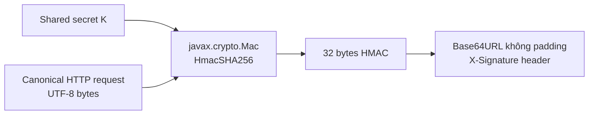
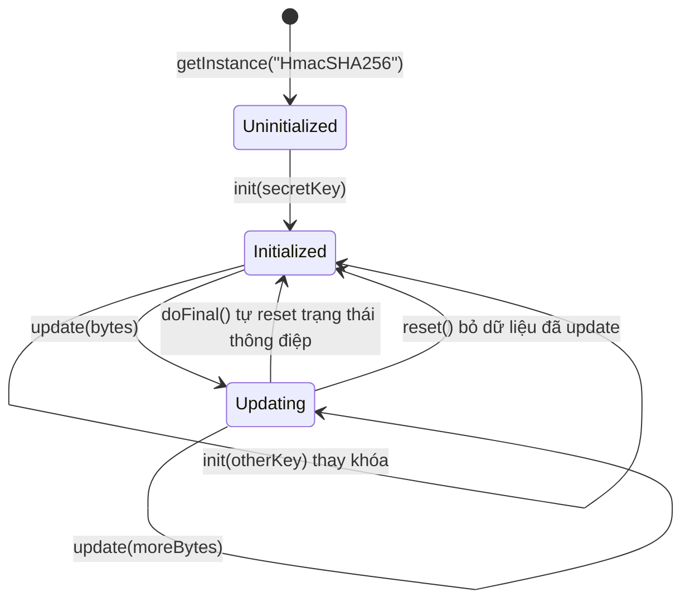

# `javax.crypto.Mac`: dùng JCA để ký và xác minh HMAC cho HTTP request

## Mục tiêu học tập

Sau bài học, bạn có thể:

- Giải thích `javax.crypto.Mac` làm gì trong hệ thống Java Cryptography Architecture (JCA) và vì sao nó phù hợp với **HMAC request authentication**.
- Sử dụng đúng vòng đời `Mac.getInstance() → init() → update() → doFinal()` và phân biệt `reset()` với khởi tạo lại khóa.
- Sinh, quản lý và cung cấp khóa qua `SecretKey` hoặc `SecretKeySpec`; hiểu ảnh hưởng của provider và lỗi khởi tạo.
- Viết mã Java tính **HMAC-SHA256**, mã hóa chữ ký và kiểm tra chữ ký bằng cách so sánh an toàn.
- Gắn phép tính HMAC với canonical request gồm method, URI, header/body, timestamp, nonce và phiên bản khóa.
- Nhận diện những phần mà `Mac` **không tự giải quyết**: chuẩn hóa HTTP qua proxy, chống replay, key rotation và phân quyền.

**Phạm vi:** Bài thuộc chương **JCA Mac API** của module `SECURITY_AUTHENTICATION_HMAC_REQUEST_AUTHENTICATION`. Đối tượng chính là class `javax.crypto.Mac` và cách sử dụng đúng API này trong giao tiếp HTTP client–server dùng **shared secret**. Các mẫu hợp đồng ký trong bài mang tính minh họa, không phải một chuẩn wire protocol áp dụng chung.

## 1. `Mac` là gì và đứng ở đâu trong JCA?

**MAC (Message Authentication Code)** là một giá trị kiểm tra tính toàn vẹn và xác thực thông điệp **có khóa**. Với HMAC-SHA256, đầu vào của phép tính là khóa bí mật `K` và chuỗi byte `M`; đầu ra là 32 byte:

```text
tag = HMAC-SHA256(K, M)
```

Trong Java, `javax.crypto.Mac` cung cấp giao diện mức cao để tạo MAC bằng thuật toán/provider được chỉ định:

```java
Mac mac = Mac.getInstance("HmacSHA256");
mac.init(secretKey);
mac.update(messageBytes);
byte[] tag = mac.doFinal();
```

Đây là **mã xác thực**, không phải mã hóa dữ liệu: người quan sát có thể đọc body HTTP nếu đường truyền không được bảo vệ. Vì vậy hệ thống vẫn phải dùng HTTPS/TLS cho truyền tải.

| API Java | Câu hỏi nó giải quyết | Điểm khác với `Mac` |
|---|---|---|
| `java.security.MessageDigest` | Tính hash không dùng khóa, ví dụ SHA-256 của body | Ai cũng tính lại được hash; hash đơn thuần không chứng minh bên gửi biết secret |
| **`javax.crypto.Mac`** | Tính MAC có khóa, ví dụ HMAC-SHA256 | Cả bên ký và bên kiểm tra có thể dùng **cùng secret** |
| `java.security.Signature` | Tạo/xác minh chữ ký bất đối xứng (ví dụ RSA/ECDSA/EdDSA) | Bên ký giữ private key, bên xác minh dùng public key |
| `javax.crypto.Cipher` | Mã hóa/giải mã dữ liệu bằng thuật toán phù hợp | HMAC không che giấu nội dung và không thay thế mã hóa |

Cần phân biệt thuật ngữ: `Mac` là **đối tượng Java**, còn “HMAC” là họ cơ chế MAC xây dựng từ hàm băm. `HmacSHA256` là tên thuật toán JCA được dùng trong những ví dụ bên dưới.

### Cơ chế hoạt động ở mức trừu tượng



**Điều được xác thực:** các byte trong `M` và khả năng sử dụng `K`. Nếu method, path, query hoặc một header ảnh hưởng đến bảo mật **không nằm trong `M`**, bản thân `Mac` không biết để bảo vệ chúng.

## 2. Các lớp và kiểu dữ liệu cần biết

```java
import javax.crypto.Mac;
import javax.crypto.SecretKey;
import javax.crypto.spec.SecretKeySpec;
import java.security.MessageDigest;
import java.security.SecureRandom;
import java.nio.charset.StandardCharsets;
import java.util.Base64;
```

- `Mac`: thực thể có **trạng thái** dùng để nhận dữ liệu và hoàn thành phép tính MAC; được tạo qua `getInstance`.
- `SecretKey`: interface đại diện cho một khóa bí mật; provider có thể cung cấp cách hiện thực riêng, kể cả khóa không thể xuất raw bytes.
- `SecretKeySpec`: bọc **raw key bytes** thành đối tượng khóa gắn với tên thuật toán. Nó không tự sinh khóa và không tự xác thực xem bytes có đủ entropy hay không.
- `SecureRandom`: nguồn ngẫu nhiên mật mã để sinh secret và nonce; không dùng `Random` hoặc timestamp làm secret.
- `MessageDigest`: có thể dùng để băm raw body bytes rồi đưa **digest** vào hợp đồng canonical request, và dùng `MessageDigest.isEqual` để so sánh tag.
- `Base64`: mã hóa các byte MAC ra một chuỗi dễ truyền bằng HTTP. Encoding không làm tag an toàn hơn; nó chỉ quy định biểu diễn trên đường truyền.

Hai phía phải dùng **cùng bytes của khóa**. Nếu một bên coi key là chuỗi hex/Base64 rồi dùng thẳng ký tự của chuỗi đó làm key, còn bên kia giải mã ra bytes gốc, chữ ký sẽ không khớp.

## 3. Vòng đời và trạng thái của `Mac`

`Mac` là **đối tượng có trạng thái**. Hãy hình dung ba giai đoạn:



### 3.1. `getInstance("HmacSHA256")`

```java
Mac mac = Mac.getInstance("HmacSHA256");
```

Lệnh này chọn một implementation từ **security providers** có sẵn trong runtime. Nó có thể ném `NoSuchAlgorithmException` nếu không tìm được provider hỗ trợ thuật toán. Có overload cho phép yêu cầu provider cụ thể khi tích hợp HSM/KMS hoặc môi trường có chính sách mật mã đặc biệt.

**Không tự viết HMAC bằng cách nối key và SHA-256.** `SHA256(key || message)` không phải HMAC-SHA256 và không thể thay thế `Mac.getInstance("HmacSHA256")`.

### 3.2. `init(key)`

```java
byte[] secretBytes = /* secret cấp bởi hệ thống quản lý khóa */;
SecretKeySpec key = new SecretKeySpec(secretBytes, "HmacSHA256");
mac.init(key);
```

`init` đưa đối tượng vào trạng thái sẵn sàng ký bằng khóa đã chọn, xóa trạng thái xử lý thông điệp cũ. Nó có thể ném `InvalidKeyException` nếu provider từ chối khóa. Phải kiểm tra secret hợp lệ, đúng môi trường và đúng client **trước khi** gọi `init` ở verifier. `Mac` không biết `clientId` hay tenant.

Không đưa secret vào log hoặc in ra terminal khi debug. Với khóa trong HSM/provider chuyên dụng, có thể cần một loại `SecretKey` đặc thù thay vì tự lấy raw bytes và tạo `SecretKeySpec`.

### 3.3. `update(bytes)`

```java
mac.update(part1);
mac.update(part2);
```

`update` đưa byte vào trạng thái tính toán MAC. Nhiều lệnh `update` theo thứ tự tương đương ký **phép nối chính xác** các phần dữ liệu:

```text
update(A); update(B); doFinal()
             tương đương
doFinal(bytes(A || B))
```

Không có tự động thêm ký tự phân cách hoặc newline giữa hai lần `update`. Nếu hợp đồng ký cần `\n`, phải thêm **chính các byte đó**. Nếu dùng một chuỗi Java làm dữ liệu, chuyển thành UTF-8 rõ ràng bằng `StandardCharsets.UTF_8` để tránh sai khác charset giữa các phía.

### 3.4. `doFinal()` và `reset()`

```java
byte[] tag = mac.doFinal();
```

`doFinal` kết thúc phép tính, trả về tag và **reset trạng thái thông điệp** để đối tượng có thể xử lý thông điệp khác với **khóa đã init**. Trong một flow khác, `doFinal(byte[] lastBytes)` sẽ **cập nhật thêm** `lastBytes` rồi hoàn tất; nó không mặc nhiên bỏ dữ liệu trước đó.

`reset()` xóa **dữ liệu đang cập nhật**, nhưng giữ khóa đã cấu hình. Nếu muốn đổi khóa, gọi lại `init(newKey)`. Tránh tái sử dụng đối tượng mà không biết nó đang ở trạng thái nào.

| Phương thức | Tác dụng | Lưu ý vận hành |
|---|---|---|
| `Mac.getInstance(String)` | Chọn thuật toán/provider | Có thể lỗi nếu thuật toán không tồn tại |
| `init(Key)` | Nạp key và khởi tạo trạng thái | Key phải phù hợp thuật toán/provider |
| `update(byte[])` | Thêm bytes vào thông điệp | Thứ tự và giá trị từng byte quyết định chữ ký |
| `update(byte[], offset, len)` | Thêm một đoạn trong mảng | Tránh copy không cần thiết, kiểm tra offset/len |
| `update(ByteBuffer)` | Thêm bytes từ vị trí `position` tới `limit` | Position của buffer tiến theo phần đã đọc |
| `doFinal()` | Hoàn tất, trả về `byte[]` MAC | Sau đó đối tượng trở lại trạng thái sau `init` |
| `doFinal(byte[])` | Thêm bytes cuối rồi hoàn tất | Không thay cho `init` |
| `doFinal(output, outOffset)` | Ghi MAC vào vùng output do caller cấp | Cần đủ chỗ; có thể ném `ShortBufferException` |
| `reset()` | Bỏ thông điệp đang cập nhật | Không thay đổi key đã init |
| `getMacLength()` | Lấy độ dài đầu ra MAC tính bằng byte | HMAC-SHA256 thông thường là 32 bytes |
| `getAlgorithm()` / `getProvider()` | Xem thuật toán và provider đang dùng | Hữu ích khi xử lý khác biệt runtime/provider |

**Chú ý concurrency:** đừng coi một `Mac` instance duy nhất là an toàn cho nhiều thread cập nhật song song. Cách rõ ràng và ít lỗi là tạo/khởi tạo một `Mac` riêng cho mỗi thao tác ký hoặc mỗi request; không dùng static singleton `Mac` chia sẻ mọi request. Nếu tối ưu bằng pooling hoặc `ThreadLocal`, phải bảo đảm không lẫn state hay key của client khác.

## 4. Ví dụ Java chạy được: vector chuẩn HMAC-SHA256

Trước khi đưa HTTP vào bài toán, hãy xác minh việc sử dụng `Mac` bằng **một test vector có kết quả cố định**. Ví dụ HMAC-SHA256 trong RFC 4231 (test case 1) dùng khóa gồm 20 byte `0x0b` và thông điệp ASCII `Hi There`.

```java
import java.nio.charset.StandardCharsets;
import java.security.GeneralSecurityException;
import java.util.Arrays;
import javax.crypto.Mac;
import javax.crypto.spec.SecretKeySpec;

public class HmacMacApiDemo {
    public static void main(String[] args) throws GeneralSecurityException {
        // Khóa của TEST VECTOR, chỉ để kiểm tra phép tính.
        byte[] testKey = new byte[20];
        Arrays.fill(testKey, (byte) 0x0b);

        Mac mac = Mac.getInstance("HmacSHA256");
        mac.init(new SecretKeySpec(testKey, "HmacSHA256"));

        // Tương đương MAC trên bytes ASCII "Hi There".
        mac.update("Hi ".getBytes(StandardCharsets.US_ASCII));
        byte[] result = mac.doFinal(
                "There".getBytes(StandardCharsets.US_ASCII));

        StringBuilder hex = new StringBuilder();
        for (byte value : result) {
            hex.append(String.format("%02x", value & 0xff));
        }

        System.out.println(hex);
        // b0344c61d8db38535ca8afceaf0bf12b881dc200c9833da726e9376c2e32cff7
    }
}
```

Kết quả mong đợi:

```text
b0344c61d8db38535ca8afceaf0bf12b881dc200c9833da726e9376c2e32cff7
```

Giá trị này là **vector kiểm tra công khai**, nên khóa dùng ở đây **không được** tái sử dụng cho production. Trong hệ thống thật, secret phải do CSPRNG sinh và được quản lý theo vòng đời; tuyệt đối không hard-code khóa của ví dụ vào dịch vụ.

**Điều bài thử này xác nhận:** phép tính HMAC-SHA256 dùng API đúng và phân đoạn `update + doFinal(input)` cho cùng kết quả với một thông điệp liên tục. Bài thử không chứng minh hợp đồng HTTP canonicalization của hệ thống đúng; đó là phần cần kiểm thử riêng.

## 5. Sinh khóa và tạo `SecretKeySpec` an toàn

```java
import java.security.SecureRandom;
import javax.crypto.spec.SecretKeySpec;

byte[] secretBytes = new byte[32]; // Ví dụ 256 bit entropy từ CSPRNG
new SecureRandom().nextBytes(secretBytes);

SecretKeySpec key = new SecretKeySpec(secretBytes, "HmacSHA256");
```

Đoạn này minh họa sinh key **khi cấp phát khóa**, không phải mỗi khi một HTTP request đến. Nếu client và server tự sinh key độc lập, họ sẽ có hai secret khác nhau và không thể xác minh HMAC của nhau.

Trong vận hành, thường cần một quy trình provisioning:

1. Sinh key một lần ở thành phần được phép cấp phát; lưu trong secret manager/KMS hoặc nơi quản lý key được bảo vệ.
2. Gắn key với `(clientId, keyId, environment)` và trạng thái vòng đời (`ACTIVE`, `VERIFY_ONLY`, `DISABLED`).
3. Cấp cho client đúng key qua kênh bảo mật; verifier chỉ truy cập key của client tương ứng bằng identity đã được cấp quyền.
4. Không chia sẻ một global key cho mọi client; khi key của một đối tác bị lộ, sự cố phải được cô lập.
5. Hỗ trợ rotation: verifier có thể tạm chấp nhận key cũ và key mới trong thời gian chuyển đổi, nhưng key đã thu hồi phải bị vô hiệu hóa cả tại cache verifier.

**Phân biệt khóa với định danh khóa:** `X-Key-Id: k2` có thể xuất hiện trong request và log theo chính sách, còn bytes secret không được gửi kèm request. `SecretKeySpec` bọc bytes đã có; nó không cung cấp key rotation, lưu trữ an toàn hay kiểm tra quyền truy cập.

## 6. Dùng `Mac` cho chữ ký HTTP: byte trước, mã hóa sau

Trong xác thực HTTP request, `Mac` **không nhận một đối tượng `HttpRequest`** và cũng không tự biết nên ký những trường nào. Client và server trước tiên phải thống nhất một chuỗi byte canonical, rồi mới đưa byte đó cho `Mac`.

Quy trình:

```mermaid
sequenceDiagram
    participant C as HTTP client
    participant M as javax.crypto.Mac
    participant V as HTTP verifier
    participant K as Kho khóa
    C->>C: Chốt method, URI, signed headers, raw body
    C->>C: Tạo timestamp + nonce, dựng canonical bytes
    C->>M: init(secret của keyId), update(canonical bytes)
    M-->>C: doFinal() trả về HMAC bytes
    C->>V: HTTPS request + clientId/keyId + Base64URL signature
    V->>K: Tra đúng secret theo clientId/keyId/env
    K-->>V: Key và trạng thái phiên bản
    V->>V: Dựng lại canonical bytes từ request nhận được
    V->>V: HMAC và so tag an toàn
    V->>V: Kiểm tra replay; tạo principal nếu hợp lệ
```

### Hợp đồng ký minh họa

Giả sử hợp đồng `hmac-v1` quy định:

- Method được viết hoa.
- Path và query dùng biểu diễn `request-target` thống nhất, ví dụ `/v1/orders?currency=VND`; không tự sắp xếp query nếu hợp đồng không cho phép.
- Các header bắt buộc: `host`, `content-type`, `x-client-id`, `x-key-id`, `x-timestamp`, `x-nonce`; mỗi header được chuẩn hóa **theo quy tắc cố định** và chỉ xuất hiện một lần.
- Body được ký gián tiếp bằng `Base64URL-NoPadding(SHA-256(rawBodyBytes))`.
- Ghép từng dòng theo thứ tự cố định bằng LF (`\n`), không có LF sau dòng cuối, toàn bộ chuỗi đưa vào `Mac` được mã hóa UTF-8.
- Thuật toán `HmacSHA256`, kết quả 32 byte được encode Base64URL không padding và gửi trong `X-Signature`. Không đưa chính `X-Signature` vào canonical string.

Ví dụ chuỗi để ký, với `timestamp` và `nonce` chỉ mang tính minh họa:

```text
POST
/v1/orders?currency=VND
host:api.example.test
content-type:application/json
x-client-id:partner-17
x-key-id:k2
x-timestamp:<unix-seconds>
x-nonce:<unique-random-nonce>
body-sha256:<base64url-sha256-of-exact-body-bytes>
```

Các mục `<...>` là placeholder; phải thay bằng giá trị thật trước khi ký. Không chuyển body JSON sang object rồi serialize lại ở phía verifier: whitespace, thứ tự trường, escaping hoặc newline thay đổi có thể làm **raw bytes khác nhau** dù JSON có cùng ý nghĩa.

### Ví dụ mã dùng chung cho client và verifier

Class sau nhận vào **canonical bytes đã dựng đúng hợp đồng**. Nó xử lý phép HMAC và biểu diễn chữ ký; các bước HTTP header parsing, xác minh timestamp/nonce, tra khóa và phân quyền sẽ ở những thành phần riêng.

```java
import java.security.GeneralSecurityException;
import java.security.MessageDigest;
import java.util.Base64;
import javax.crypto.Mac;
import javax.crypto.spec.SecretKeySpec;

public final class RequestHmacSha256 {
    private static final String ALGORITHM = "HmacSHA256";
    private static final Base64.Encoder ENCODER =
            Base64.getUrlEncoder().withoutPadding();

    private RequestHmacSha256() {}

    private static byte[] mac(byte[] secret, byte[] canonicalBytes)
            throws GeneralSecurityException {
        Mac instance = Mac.getInstance(ALGORITHM);
        instance.init(new SecretKeySpec(secret, ALGORITHM));
        return instance.doFinal(canonicalBytes);
    }

    public static String sign(byte[] secret, byte[] canonicalBytes)
            throws GeneralSecurityException {
        return ENCODER.encodeToString(mac(secret, canonicalBytes));
    }

    public static boolean verify(
            byte[] secret, byte[] canonicalBytes, String receivedSignature)
            throws GeneralSecurityException {

        // Đầu ra của HMAC-SHA256 có đúng 32 bytes;
        // Base64URL không padding của 32 bytes có 43 ký tự.
        if (receivedSignature == null ||
                !receivedSignature.matches("[A-Za-z0-9_-]{43}")) {
            return false;
        }

        final byte[] received;
        try {
            received = Base64.getUrlDecoder().decode(receivedSignature);
        } catch (IllegalArgumentException badEncoding) {
            return false;
        }

        if (received.length != 32) {
            return false;
        }

        // Tránh chấp nhận nhiều cách biểu diễn cùng một giá trị bytes.
        if (!ENCODER.encodeToString(received).equals(receivedSignature)) {
            return false;
        }

        byte[] expected = mac(secret, canonicalBytes);
        return MessageDigest.isEqual(expected, received);
    }
}
```

**Vì sao dùng `MessageDigest.isEqual`?** Đây là phép so byte được thiết kế để tránh phụ thuộc vào giá trị byte khi so sánh như `String.equals` hoặc `Arrays.equals` trong nhiều tình huống. Với chữ ký hợp lệ về format và độ dài cố định 32 byte, nó là lựa chọn phù hợp để so tag; lưu ý thời gian tổng thể của endpoint vẫn có thể thay đổi theo các nhánh lỗi khác, nên không xem nó là biện pháp chống side channel duy nhất.

Trong hệ thống thật, đầu vào `secret` phải đến từ bản ghi khóa đã tra đúng `clientId/keyId`. Phải kiểm tra thuật toán, loại key, độ dài/scope và trạng thái khóa theo chính sách trước khi dùng. Không để client tự yêu cầu provider hoặc thuật toán yếu qua một header chưa được xác thực.

### Ví dụ băm body thành trường canonical

```java
import java.security.MessageDigest;
import java.security.GeneralSecurityException;
import java.util.Base64;

public static String bodyHash(byte[] rawBodyBytes)
        throws GeneralSecurityException {

    byte[] digest = MessageDigest.getInstance("SHA-256")
            .digest(rawBodyBytes);

    return Base64.getUrlEncoder()
            .withoutPadding()
            .encodeToString(digest);
}
```

Hàm trên chỉ là **method minh họa** để đặt trong một class Java phù hợp. Nó nhận raw bytes của body đúng như hợp đồng. `Mac` sẽ ký **chuỗi canonical có chứa body hash**, không cần ký lại body theo một quy ước khác. Body rỗng vẫn có SHA-256 của chuỗi byte rỗng; không bỏ dòng body hash.

## 7. Ký dữ liệu dạng stream và sử dụng `ByteBuffer`

`Mac` hỗ trợ `update` nhiều lần, nên không bắt buộc tạo một mảng rất lớn chỉ chứa tất cả các byte của thông điệp nếu canonicalization cho phép streaming.

```java
Mac mac = Mac.getInstance("HmacSHA256");
mac.init(key);

mac.update("POST\n".getBytes(StandardCharsets.UTF_8));
mac.update("/v1/orders\n".getBytes(StandardCharsets.UTF_8));
// ... tiếp tục đúng thứ tự những dòng canonical khác

byte[] tag = mac.doFinal(finalCanonicalLineBytes);
```

Tuy nhiên, ví dụ HTTP ở phần trước quy định dòng `body-sha256` cuối. Để streaming body lớn, có thể dùng `MessageDigest.update(chunk)` tính SHA-256 của raw body theo các chunk, sau đó đưa **digest đã encode** vào dòng canonical cuối. Phải bảo đảm bytes được băm cũng là bytes backend nhận theo hợp đồng, và có giới hạn kích thước để tránh tiêu thụ tài nguyên vô hạn.

Với `ByteBuffer`:

```java
mac.update(buffer);  // Đọc bytes từ position tới limit
byte[] result = mac.doFinal();
```

Lưu ý `update(buffer)` tiêu thụ phần bytes còn lại và cập nhật vị trí của buffer. Khi dùng buffer chung cho network processing, cần quản lý `position/limit` cẩn thận để không ký thiếu hoặc lặp byte.

### Cẩn thận với việc tái sử dụng đối tượng

```java
Mac mac = Mac.getInstance("HmacSHA256");
mac.init(keyA);

mac.update(firstMessage);
byte[] firstTag = mac.doFinal(); // Tự reset trạng thái về sau init(keyA).

mac.update(secondMessage);
byte[] secondTag = mac.doFinal(); // Vẫn sử dụng keyA.

mac.init(keyB);                 // Bắt buộc init lại nếu cần ký bằng keyB.
byte[] thirdTag = mac.doFinal(thirdMessage);
```

API cho phép tái sử dụng tuần tự như trên, nhưng trong **server nhiều tenant** nên ưu tiên một instance mới theo mỗi yêu cầu để giảm nguy cơ dùng nhầm key hoặc state. Không dùng chung một `Mac` giữa các request đồng thời.

## 8. Nơi `javax.crypto.Mac` kết thúc: xác thực HTTP còn nhiều bước

Tính đúng một giá trị HMAC chưa phải là xác thực request hoàn chỉnh. Verifier phải kết hợp kết quả `Mac` với quy tắc HTTP, kho khóa và chống replay.

```text
[HTTP ingress nhận request]
    |
    v
[Kiểm tra size, header trùng, URI, định dạng signature]
    |
    v
[Đọc clientId + keyId; tra khóa đúng client/env/trạng thái]
    |
    v
[Kiểm tra timestamp trong cửa sổ cho phép]
    |
    v
[Rebuild canonical bytes từ request thực nhận]
    |
    v
[javax.crypto.Mac + so tag an toàn]
    |
    v
[Atomic insert-if-absent(clientId, nonce) trên shared nonce store]
    |
    v
[Tạo principal đã xác thực]
    |
    v
[Authorization theo tenant, action và resource]
    |
    v
[Business handler + idempotency]
```

### 8.1. Timestamp và nonce

- `x-timestamp` (ví dụ Unix seconds) và `x-nonce` phải là dữ liệu **được ký** trong canonical request; kiểm tra cửa sổ thời gian (ví dụ ±300 giây), định dạng và đồng hồ.
- Sau khi HMAC đúng, kiểm tra nonce trong kho **dùng chung** cho tất cả replica với thao tác insert-if-absent **nguyên tử**. Không làm `GET` rồi `SET` rời rạc hoặc chỉ dùng cache trong từng pod.
- TTL nonce phải bao phủ toàn bộ khoảng thời gian cùng timestamp có thể được chấp nhận, kể cả việc request đến sớm trong cửa sổ và lệch đồng hồ. Khi kho nonce lỗi, API nhạy cảm nên **fail closed**.
- Nonce/timestamp hạn chế phát lại **chữ ký cũ**, không chặn người đã lấy được secret tạo ra **chữ ký mới** với timestamp/nonce mới.

### 8.2. Secret rotation và thu hồi

Một client có thể dùng `keyId=k1` rồi chuyển sang `k2`. Verifier có thể tạm chấp nhận cả hai trong giai đoạn migration; mỗi lần kiểm tra phải lấy **đúng khóa theo client + key ID + môi trường**, không thử toàn bộ khóa. Key bị thu hồi phải bị từ chối cả trong cache. `Mac` chỉ tính tag cho key được truyền vào: trạng thái key là trách nhiệm của hệ thống quản lý khóa.

### 8.3. Gateway/proxy và canonical bytes

Gateway có thể thay `Host`, prefix path, query encoding, header hoặc body trước khi request tới verifier. Nếu client ký chuỗi khác với verifier dựng lại, chữ ký sẽ sai. Nguy hiểm hơn, nếu verifier ký một cách diễn giải nhưng backend thực thi một cách diễn giải khác, có thể hình thành lỗi bỏ qua chính sách.

Cần định nghĩa rõ vị trí kiểm tra chữ ký, xử lý header trùng, percent-encoding, body bytes và nguồn nào được tin khi dùng `Forwarded`/`X-Forwarded-*`. Test tích hợp nên chạy **client thực → ingress → verifier → backend** với các tình huống rewrite.

### 8.4. Authentication khác authorization

HMAC hợp lệ chứng minh request được ký bởi một bên có khả năng dùng shared secret của client và các trường được ký không bị sửa. Nó **không** chứng minh client có quyền tạo đơn cho tenant khác. Sau khi tạo principal đã xác thực, backend vẫn phải kiểm tra scope, tenant, resource và quyền theo từng endpoint.

## 9. Những lỗi phổ biến khi dùng `Mac`

| Lỗi | Hậu quả | Cách khắc phục |
|---|---|---|
| Dùng `SHA-256(key + body)` thay HMAC | Mật mã không đúng đặc tả | Dùng `Mac.getInstance("HmacSHA256")` |
| Dùng ký tự của secret Base64/hex làm key | Hai bên ký khác key bytes | Giải mã secret một lần theo định dạng provisioning |
| Quên `init` hoặc dùng sai key ID | `IllegalStateException` hoặc chữ ký sai | Tra key và khởi tạo rõ trước mỗi thao tác |
| Dùng chung một `Mac` cho nhiều thread | State bị trộn, tag sai, khó tái hiện | Tạo instance riêng theo request |
| Tưởng `doFinal(byte[])` loại bỏ mọi byte đã `update` | Ký sai thông điệp | Hiểu API: nó **cập nhật thêm rồi hoàn tất** |
| Tự động thêm newline/đổi charset | HMAC không khớp | Ký đúng bytes UTF-8 của canonical contract |
| Dùng `String.equals` để so chữ ký | Không đáp ứng mục tiêu so tag an toàn | Decode bytes; kiểm tra format/độ dài; dùng `MessageDigest.isEqual` |
| Ký body JSON đã serialize khác với body gửi | Server tính digest khác | Chốt raw body bytes trước khi ký; giữ đúng bytes qua proxy |
| Chỉ kiểm tra HMAC, bỏ timestamp/nonce | Replay request hợp lệ | Signed timestamp + nonce store nguyên tử |
| Gắn “admin” từ header client gửi | Giả mạo danh tính hoặc vượt quyền | Tạo principal sau verify, chỉ chuyển qua ngữ cảnh tin cậy |
| Key mới/kho secret bị lỗi thì thử mọi key | Cross-tenant key confusion và tăng tải | Lookup có scope chính xác; fail closed khi không có key hợp lệ |
| Đưa secret vào source code hoặc log | Lộ key dẫn tới giả mạo request | Secret manager, quyền tối thiểu, rotation, audit |

## 10. Kiểm thử từ cấp API tới HTTP end-to-end

### 10.1. Kiểm thử cấp `Mac`

| Test | Input | Kỳ vọng |
|---|---|---|
| RFC 4231 vector | Key 20 bytes `0x0b`; `Hi There` | Đúng tag hex chuẩn đã nêu |
| Update chia nhiều đoạn | `update("Hi "); doFinal("There")` | Bằng `doFinal("Hi There")` khi khởi tạo cùng key |
| Thay một byte | Cùng key; đổi một byte thông điệp | Tag khác |
| Đổi key | Cùng canonical bytes; key A khác key B | Tag khác |
| Reset | `update(partA); reset(); doFinal(partB)` | Bằng HMAC chỉ của `partB` với cùng key |
| DoFinal rồi reuse | `doFinal(messageA); doFinal(messageB)` | Mỗi tag đúng cho thông điệp riêng, không nối hai message |
| Chữ ký Base64URL sai | Chuỗi sai alphabet, sai độ dài hoặc noncanonical | Verifier từ chối |
| Chữ ký đổi một ký tự | HMAC bytes không còn trùng | `verify` trả về `false` |

### 10.2. Kiểm thử tích hợp client–server

| Tình huống | Kỳ vọng |
|---|---|
| Request ký đúng method/URI/header/body | Authentication thành công với đúng principal |
| Sửa URI/query, header có ký hoặc body sau ký | Authentication thất bại |
| Header HMAC bị thiếu/lặp hoặc có newline bất hợp lệ | Reject trước khi giải mã/truy vấn key |
| Timestamp quá hạn hoặc ở tương lai quá giới hạn | Request bị từ chối |
| Hai replica nhận cùng `(clientId, nonce)` đồng thời | Tối đa một request được chấp nhận |
| Kho nonce không khả dụng | Fail closed theo chính sách API |
| Gateway rewrite Host/path/body | Kết quả đúng theo canonical contract hoặc reject rõ ràng |
| Key `k1` bị thu hồi sau khi client đã chuyển `k2` | `k1` bị từ chối, `k2` hợp lệ |
| HMAC đúng cho client A nhưng truy cập tenant B | Authentication có thể pass, authorization phải deny |
| Client timeout rồi retry với nonce mới | Handler dùng idempotency để tránh thao tác lặp |

Ngoài unit test cho `Mac`, các tình huống qua proxy/gateway và nonce store nhiều replica là **kiểm thử tích hợp bắt buộc** nếu hệ thống hoạt động trong kiến trúc như vậy.

## 11. Bài tập thực hành

Thiết kế một tiện ích Java dùng `javax.crypto.Mac` để ký `POST /v1/payments?tenant=acme` từ `payment-client` đến `payment-api`.

Yêu cầu:

1. Sinh một secret HMAC-SHA256 32 byte bằng `SecureRandom` ở bước provisioning; đặt `clientId` và `keyId` tương ứng, mô tả nơi lưu khóa.
2. Xây dựng một **canonical request hợp đồng phiên bản 1** gồm method, raw path/query, host, client ID, key ID, timestamp, nonce, body hash từ raw bytes. Ghi rõ UTF-8, dòng LF và biểu diễn chữ ký.
3. Viết hàm `sign(secret, canonicalBytes)` với `Mac.getInstance`, `init` và `doFinal`; encode Base64URL không padding.
4. Viết `verify` với bước kiểm tra định dạng chữ ký, decode, tính lại tag và `MessageDigest.isEqual`.
5. Bổ sung phần server tra khóa đúng client/env, kiểm tra timestamp, nonce store nguyên tử, thiết lập principal và phân quyền theo tenant.
6. Thực hiện test thay một byte body, thay HTTP method, gửi lại nonce cũ, đổi key ID và kiểm tra khi gateway thay đổi path.
7. Mô tả rotation từ `k1` sang `k2`, cách thu hồi `k1`, và cách retry với idempotency key cho thanh toán.

**Tiêu chí đạt:** Mã dùng đúng vòng đời `Mac`, hai phía tính HMAC trên **cùng canonical bytes**, không lộ secret, từ chối replay và không cho một principal có chữ ký hợp lệ tự động truy cập tài nguyên của tenant khác.

---

## Ghi nhớ

`javax.crypto.Mac` là công cụ JCA cốt lõi để tính và kiểm tra **HMAC-SHA256** trong hệ thống xác thực HTTP request. Khi đã hiểu rõ `getInstance → init → update/doFinal → reset`, bạn có thể tập trung thiết kế **canonical request**, quản lý **shared secret/key rotation**, chống replay bằng **timestamp/nonce**, kiểm thử qua **proxy/gateway** và tách bạch **xác thực** với **phân quyền**. Các biện pháp này phải kết hợp với nhau: một tag HMAC đúng chỉ giải quyết phần mật mã của toàn bộ luồng bảo vệ API.
