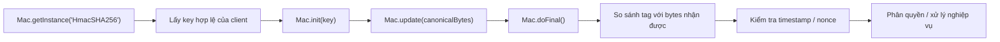
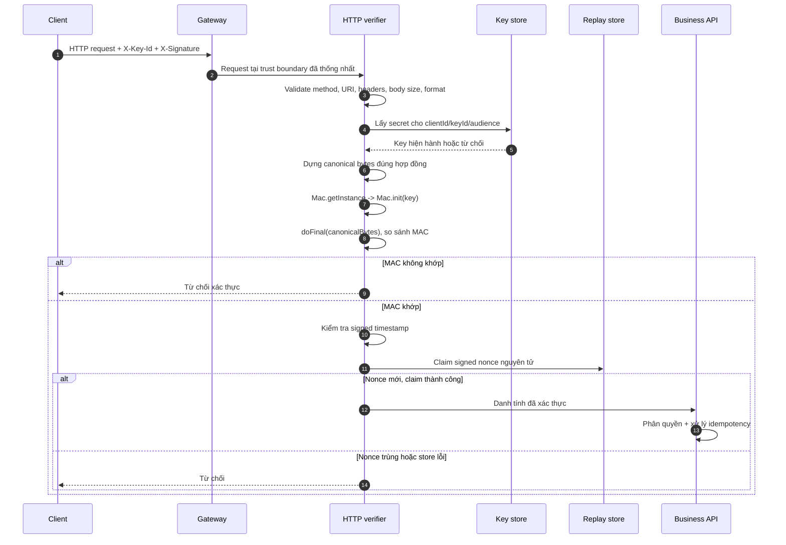

# Mac.init

> **Chương:** JCA Mac API  
> **Bài học:** `Mac.init` – khởi tạo đối tượng `javax.crypto.Mac` bằng khóa bí mật trước khi tạo hoặc xác minh HMAC.  
> **Bối cảnh:** Xác thực HTTP request bằng HMAC với shared secret và canonical request gồm method, URI, các header hoặc body theo hợp đồng ký. Người học thực hành HMAC-SHA256, timestamp/nonce chống replay, key rotation, kiểm thử proxy/gateway và tách biệt xác thực với phân quyền.

## 1. Vai trò của Mac.init trong xác thực request

Trong Java, `javax.crypto.Mac` là API thuộc Java Cryptography Architecture (JCA/JCE) dùng để tạo **Message Authentication Code**. Đối với HMAC-SHA256, mã xác thực là kết quả của hàm HMAC áp dụng lên một dãy bytes bằng một shared secret.

Hai hệ thống cùng biết secret có thể thực hiện:

1. **Client:** tạo dãy bytes canonical của HTTP request, tính HMAC và gửi tag đã mã hóa trong header.
2. **Server:** dựng lại *chính xác* dãy bytes canonical từ request nhận được, lấy secret được cấp cho client, tính HMAC kỳ vọng và so sánh tag.
3. **Sau xác thực:** kiểm tra timestamp, nonce chống replay và **phân quyền nghiệp vụ** trước khi xử lý.

Lệnh `Mac.init(key)` nằm ở bước chuẩn bị phép tính HMAC: nó nạp một `Key` phù hợp vào đối tượng `Mac`. Nếu không khởi tạo đúng, đối tượng không thể tạo tag đúng và toàn bộ luồng xác minh request mất ý nghĩa.



**Phân biệt:** `Mac.getInstance("HmacSHA256")` chọn thuật toán/triển khai; `Mac.init(key)` cung cấp khóa. Chỉ gọi `getInstance` **chưa** tạo ra một đối tượng sẵn sàng để ký.

## 2. Hai overload của Mac.init

API `javax.crypto.Mac` cung cấp hai hình thức khởi tạo chính:

```java
void init(java.security.Key key)
        throws java.security.InvalidKeyException;

void init(
        java.security.Key key,
        java.security.spec.AlgorithmParameterSpec params)
        throws java.security.InvalidKeyException,
               java.security.InvalidAlgorithmParameterException;
```

| Lời gọi | Khi nào dùng | Ghi chú |
| --- | --- | --- |
| `mac.init(key)` | HMAC thông dụng như `HmacSHA256` | Cách dùng chính cho bài toán ký HTTP request |
| `mac.init(key, params)` | Một thuật toán MAC/provider yêu cầu tham số riêng | Chỉ dùng khi có đặc tả thuật toán/provider cụ thể; không tự thêm tham số để “tăng bảo mật” |

### 2.1 Mac.init(Key key)

Ví dụ:

```java
import javax.crypto.Mac;
import javax.crypto.spec.SecretKeySpec;

byte[] secretBytes = new byte[32]; // Chỉ minh họa tại chỗ
new java.security.SecureRandom().nextBytes(secretBytes);
SecretKeySpec key = new SecretKeySpec(secretBytes, "HmacSHA256");

Mac mac = Mac.getInstance("HmacSHA256");
mac.init(key);
```

Sau lệnh `init` thành công, `mac` sẵn sàng nhận bytes qua `update` hoặc `doFinal`. Nếu key không hợp lệ với provider/thuật toán, API có thể ném `InvalidKeyException`; hệ thống không được tiếp tục ký/xác minh như thể khởi tạo thành công.

**Lưu ý:** đoạn mã trên chỉ minh họa thứ tự API với key ngẫu nhiên. Trong hệ thống thực, `secretBytes` phải được lấy từ kho key bí mật của client; **không** sinh key mới mỗi request và không hardcode secret sản xuất.

### 2.2 Mac.init(Key key, AlgorithmParameterSpec params)

Một số thuật toán MAC cần tham số ngoài key. Overload này cho phép provider nhận `AlgorithmParameterSpec` phù hợp. Provider có thể từ chối một bộ tham số không được hỗ trợ bằng `InvalidAlgorithmParameterException`.

Với **HMAC-SHA256 thông thường, không cần truyền tham số thuật toán**; hãy dùng `mac.init(key)`. Không đoán rằng `params = null` có ý nghĩa bảo mật hoặc tương thích giống nhau với mọi provider. Nếu ứng dụng chọn một thuật toán MAC khác, phải đọc hợp đồng của thuật toán và provider đó.

### 2.3 Đọc tên hàm, tham số và ngoại lệ

- `Mac` là **đối tượng có trạng thái**: trước `init` chưa có key; sau `init` key được dùng cho các lần tính MAC.
- `Key` là interface `java.security.Key`; với HMAC, thường truyền một `SecretKey` như `SecretKeySpec` hoặc key do `KeyGenerator`/HSM cấp.
- `InvalidKeyException` báo key không phù hợp hoặc không được chấp nhận. Nó không có nghĩa request đầu vào chắc chắn do kẻ tấn công tạo: có thể là lỗi cấu hình, phân phối key hay provider.
- `InvalidAlgorithmParameterException` liên quan overload có `params`, không xuất hiện trong chữ ký của `init(key)`.

## 3. Tạo và chọn Key đúng cách

### 3.1 SecretKeySpec chỉ bao gói bytes

`SecretKeySpec` biến một mảng bytes thành đối tượng `SecretKey` mang tên thuật toán. Nó **không** chứng minh secret đã được sinh ngẫu nhiên, đủ entropy hoặc được lưu an toàn.

```java
byte[] secret = new byte[32];
new java.security.SecureRandom().nextBytes(secret);

javax.crypto.SecretKey key =
        new javax.crypto.spec.SecretKeySpec(secret, "HmacSHA256");

javax.crypto.Mac mac =
        javax.crypto.Mac.getInstance("HmacSHA256");
mac.init(key);
```

Đây là cách tạo **key thử nghiệm** cho HMAC-SHA256: 32 bytes được sinh ngẫu nhiên tương đương 256 bit dữ liệu ngẫu nhiên. HMAC-SHA256 không yêu cầu mọi key đều phải **đúng** 32 bytes; điều quan trọng là key có entropy phù hợp, được quản lý đúng, và các bên dùng cùng bytes. Không dùng `"my-secret"`, tên ứng dụng hoặc mật khẩu người dùng dễ đoán làm shared secret.

Không làm điều sau trong mã production:

```java
// Sai về quản lý khóa: secret nằm công khai trong mã nguồn
byte[] secret = "hard-coded-demo-key".getBytes(
        java.nio.charset.StandardCharsets.UTF_8);
```

Secret thực tế nên được sinh bằng nguồn ngẫu nhiên mật mã và lưu trong secret manager/KMS/HSM hoặc hệ thống quản lý bí mật tương đương. Chỉ đưa secret đến thành phần ký/xác minh được cấp quyền; hạn chế hiển thị trong log, exception, dump và cấu hình công khai.

### 3.2 Một cách khác: KeyGenerator

Java hỗ trợ tạo `SecretKey` cho HMAC mà không phải tự tạo mảng bytes:

```java
import java.security.SecureRandom;
import javax.crypto.KeyGenerator;
import javax.crypto.Mac;
import javax.crypto.SecretKey;

KeyGenerator generator = KeyGenerator.getInstance("HmacSHA256");
generator.init(256, new SecureRandom());
SecretKey key = generator.generateKey();

Mac mac = Mac.getInstance("HmacSHA256");
mac.init(key);
```

Trong ví dụ này, `256` là kích thước key mong muốn tính bằng **bit**, không phải kích thước tag. Khả năng chấp nhận kích thước cụ thể phụ thuộc provider; hệ thống cần kiểm tra môi trường triển khai. Với key do KMS/HSM quản lý, có thể chỉ nhận một handle `SecretKey` không cho xuất bytes qua `getEncoded()`; đừng ép phải đọc bytes nếu provider hỗ trợ dùng handle trực tiếp.

### 3.3 Mapping client, key ID và rotation

Đối với HTTP request, thường không lưu một secret dùng chung cho tất cả các client. Server tra key theo một định danh đã kiểm tra, ví dụ cặp `clientId + keyId` và môi trường:

```text
(clientId="billing-service", keyId="2026-11", audience="payment-prod")
    -> active secret của billing-service trong production
```

Tuy `X-Client-Id` và `X-Key-Id` là thông tin client gửi và có thể chưa đáng tin trước khi xác minh, chúng chỉ được dùng để **định vị một tập key được phép theo chính sách**. Sau khi chọn key, server phải xác minh rằng HMAC ràng buộc các trường nhận diện này và audience với request; không mặc định header tự khai tạo quyền truy cập.

Khi rotation, có thể tạm chấp nhận key mới và key trước đó theo thời gian hiệu lực rõ ràng. Key ID phải chỉ ra đúng phiên bản; không thử vô hạn mọi secret cho đến khi một MAC khớp. Key hết hạn hoặc bị thu hồi phải bị từ chối. Replay store và phạm vi nonce phải tiếp tục chặn request cũ trong khoảng chuyển đổi key.

## 4. Vòng đời của đối tượng Mac

Trình tự thông thường:

```java
Mac mac = Mac.getInstance("HmacSHA256"); // Có thuật toán, chưa có key
mac.init(secretKey);                     // Khởi tạo trạng thái với key
mac.update(messageBytes);                // Nạp bytes vào phép tính
byte[] tag = mac.doFinal();              // Tính MAC và reset trạng thái
```

Có thể dùng `mac.doFinal(messageBytes)` thay cho một lần `update` rồi `doFinal()`. Hai cách tương đương khi xử lý **cùng một dãy bytes**, cùng key và cùng thuật toán.

| Thao tác | Ý nghĩa | Điểm cần lưu ý |
| --- | --- | --- |
| `getInstance("HmacSHA256")` | Lấy implementation phù hợp | Chưa có key |
| `init(key)` | Khởi tạo hoặc khởi tạo lại bằng key | Phải thành công trước khi xử lý dữ liệu |
| `update(bytes)` | Nạp dần thông điệp | Có thể gọi nhiều lần; thứ tự bytes rất quan trọng |
| `doFinal()` | Kết thúc tính MAC, trả bytes tag | Sau khi hoàn thành, đối tượng được reset về trạng thái sau `init`, có thể tiếp tục dùng cùng key theo tuần tự |
| `doFinal(bytes)` | Nạp bytes và tính MAC trong một lời gọi | Thuận tiện với canonical request nhỏ |
| `reset()` | Xóa trạng thái xử lý thông điệp đang dở | Vẫn giữ key đã khởi tạo, không xóa secret |
| `getMacLength()` | Độ dài tag tính bằng bytes | HMAC-SHA256 đầy đủ thường là 32 bytes |

### 4.1 Trước khi init: chưa thể tính HMAC

Một `Mac` vừa lấy qua `getInstance` có thể ném `IllegalStateException` nếu gọi `update`/`doFinal` trước khi init. Thiết kế nên đảm bảo đường chạy tới `doFinal` chỉ tồn tại khi `init` thành công.

```java
Mac mac = Mac.getInstance("HmacSHA256");
// mac.doFinal(new byte[] {1, 2}); // Sai: chưa init key

mac.init(secretKey);
byte[] tag = mac.doFinal(new byte[] {1, 2});
```

### 4.2 Sau doFinal: trạng thái thông điệp được reset

`doFinal()` của API `Mac` tự reset phép tính về trạng thái ngay sau lần `init` gần nhất. Ví dụ, trong cùng một thread:

```java
mac.init(secretKey);
byte[] first = mac.doFinal("abc".getBytes(
        java.nio.charset.StandardCharsets.UTF_8));
byte[] second = mac.doFinal("abc".getBytes(
        java.nio.charset.StandardCharsets.UTF_8));
// first và second giống nhau nếu cùng algorithm, key và bytes
```

Tuy nhiên, **không dùng chung một đối tượng `Mac` đang được cập nhật giữa nhiều request/thread**. `Mac` là đối tượng có trạng thái mutable; concurrent `update` hoặc `init` trên cùng instance có thể trộn dữ liệu hoặc khóa giữa các request. Cách đơn giản, dễ kiểm chứng nhất cho HTTP server là tạo `Mac` instance mới **mỗi phép tính**, hoặc dùng cơ chế quản lý instance riêng cho từng thread và được thiết kế cẩn thận.

### 4.3 Dùng lại instance với key khác

Nếu thực sự tái sử dụng một instance để ký bằng key khác, phải gọi `init(newKey)` trước khi cập nhật dữ liệu mới. Tuy nhiên, trong code xác thực request đa client, khuyến nghị tạo instance riêng mỗi request để giảm rủi ro dùng nhầm key và trộn trạng thái khi concurrency.

**Không đồng nhất reset và init:** `reset()` xóa trạng thái thông điệp đang được băm; nó **không** lấy key mới, không thu hồi key cũ và không bảo đảm xóa key khỏi bộ nhớ.

## 5. Thực hành Java 17: khởi tạo, tạo tag, xác minh và đổi key

Ví dụ sau có thể lưu vào file `MacInitDemo.java` rồi biên dịch bằng Java 17. Code tạo hai secret ngẫu nhiên chỉ để demo. Mỗi phép ký gọi `Mac.getInstance` và `init` riêng, đồng thời xử lý MAC ở dạng bytes trước khi mã hóa Base64URL.

```java
import java.nio.charset.StandardCharsets;
import java.security.GeneralSecurityException;
import java.security.MessageDigest;
import java.security.SecureRandom;
import java.util.Base64;

import javax.crypto.Mac;
import javax.crypto.SecretKey;
import javax.crypto.spec.SecretKeySpec;

public final class MacInitDemo {
    private static final String ALGORITHM = "HmacSHA256";

    private MacInitDemo() {}

    private static SecretKey newDemoKey() {
        byte[] bytes = new byte[32];
        new SecureRandom().nextBytes(bytes);
        return new SecretKeySpec(bytes, ALGORITHM);
    }

    private static byte[] macBytes(SecretKey key, byte[] message)
            throws GeneralSecurityException {
        Mac mac = Mac.getInstance(ALGORITHM);
        mac.init(key); // Điểm trọng tâm: key phải hợp lệ
        mac.update(message);
        return mac.doFinal();
    }

    private static String signBase64Url(SecretKey key, byte[] message)
            throws GeneralSecurityException {
        byte[] tag = macBytes(key, message);
        return Base64.getUrlEncoder()
                .withoutPadding()
                .encodeToString(tag);
    }

    private static boolean verify(
            SecretKey key, byte[] message, String encodedTag)
            throws GeneralSecurityException {
        if (encodedTag == null) return false;

        byte[] received;
        try {
            received = Base64.getUrlDecoder().decode(encodedTag);
        } catch (IllegalArgumentException invalidBase64) {
            return false;
        }

        // Chỉ nhận tag HMAC-SHA256 đầy đủ, 32 bytes.
        if (received.length != 32) return false;

        String normalized = Base64.getUrlEncoder()
                .withoutPadding()
                .encodeToString(received);
        if (!normalized.equals(encodedTag)) return false;

        byte[] expected = macBytes(key, message);
        return MessageDigest.isEqual(expected, received);
    }

    public static void main(String[] args)
            throws GeneralSecurityException {

        SecretKey clientKey = newDemoKey();
        SecretKey wrongKey = newDemoKey();

        // Đây chỉ là message bytes minh họa, không phải canonical
        // request HTTP đầy đủ của một giao thức thực tế.
        byte[] canonicalBytes = String.join("\n",
                "hmac-v1",
                "orders-api-prod",
                "POST",
                "/v1/orders",
                "application/json",
                "client-123",
                "key-2026-11",
                "nonce-001",
                "body-sha256-placeholder")
                .getBytes(StandardCharsets.UTF_8);

        String tag = signBase64Url(clientKey, canonicalBytes);

        System.out.println("Tag Base64URL length: " + tag.length());
        System.out.println("Valid key, same message: "
                + verify(clientKey, canonicalBytes, tag));

        byte[] modified = canonicalBytes.clone();
        modified[0] ^= 1; // Thay đổi một byte trong thông điệp

        System.out.println("Modified message: "
                + verify(clientKey, modified, tag));
        System.out.println("Wrong key: "
                + verify(wrongKey, canonicalBytes, tag));
    }
}
```

Chạy:

```bash
javac MacInitDemo.java
java MacInitDemo
```

Kết quả kỳ vọng:

```text
Tag Base64URL length: 43
Valid key, same message: true
Modified message: false
Wrong key: false
```

Những điều cần quan sát:

- `mac.init(clientKey)` khởi tạo phép tính HMAC bằng secret của client hợp lệ.
- Cùng message nhưng key khác tạo tag khác, nên `verify(wrongKey, ...)` phải trả `false`.
- Dù key đúng, thay một byte trong thông điệp làm kết quả MAC kỳ vọng không khớp.
- Tag HMAC-SHA256 đầy đủ có 32 bytes; khi mã hóa Base64URL không padding có 43 ký tự.
- `MessageDigest.isEqual` được dùng để so sánh **bytes** của MAC nhằm hạn chế khác biệt thời gian so sánh theo nội dung. Kiểm tra syntax/Base64 trước bước này là hợp lý; không trả chi tiết MAC kỳ vọng ra cho client.

**Phạm vi mẫu:** Chuỗi `canonicalBytes` chỉ là dữ liệu minh họa để tập trung vào `Mac.init`. Chưa tính SHA-256 body thực, chưa bảo đảm nonce đủ ngẫu nhiên, chưa xác minh timestamp, chưa có key store/replay store hoặc HTTP parser. Không đưa mẫu này trực tiếp vào production dưới dạng middleware xác thực.

## 6. Mac.init trong bộ xác minh HTTP request thực tế

Bộ xác minh hoàn chỉnh có thể sắp xếp xử lý như sau:



**Khác biệt quan trọng:** `Mac.init(key)` không xác nhận key *thuộc về client nào*. Nó chỉ khởi tạo phép toán với key mà lập trình viên cung cấp. Bảo đảm “key đang active và thuộc đúng client/audience” nằm ở **key resolver và chính sách xác thực**, trước khi gọi `init`.

### 6.1 Chọn và quản lý secret có phiên bản

Server có thể có nhiều key để rotation, nhưng chỉ chọn key theo mapping đã đăng ký:

```text
(clientId, keyId, audience) -> SecretKey đang có hiệu lực
```

Sau khi nạp vào `Mac.init`, phải tính HMAC trên canonical request có các trường định danh tương ứng. Nếu HMAC hợp lệ mà `clientId` không được ràng buộc vào chữ ký, attacker có thể thử đánh tráo danh tính ở các lớp tiếp theo.

Lỗi khởi tạo key hoặc mất KMS không được dẫn đến “cho qua xác thực”. Ứng dụng nên phân loại kết quả nội bộ rõ: unknown key/revoked key, invalid HMAC, invalid format, backend key store unavailable, replay store unavailable; client chỉ nhận mã phản hồi thích hợp và không thấy key hay MAC nội bộ.

### 6.2 Canonical request là hợp đồng bytes, không phải một chuỗi tùy ý

Ví dụ API yêu cầu ký:

```text
hmac-v1
orders-api-prod
POST
/v1/orders?source=partner
application/json
client-123
key-2026-11
<unix-timestamp>
<random-nonce>
<sha256-hex-of-raw-body>
```

Trong hợp đồng minh họa, các dòng nối bằng LF `\n` không có newline cuối, với charset UTF-8. Đầu vào HMAC chính xác là bytes của chuỗi này; `Mac.init` **không tự canonicalize** method, URI, header hay JSON.

- Method/target/query phải phản ánh đúng request ở điểm xác minh; quy tắc percent-encoding, dấu slash, tham số trùng, thứ tự query và chữ hoa/chữ thường cần được thống nhất.
- Nếu header ảnh hưởng đến định tuyến, tenant hoặc cách đọc body, hãy ký những header đó hoặc khóa chúng bằng nguồn tin cậy. Header xác thực trùng hoặc có CR/LF phải được từ chối.
- Hash body phải dùng bytes đúng hợp đồng. Serialize lại JSON trước khi hash có thể làm tag khác dù dữ liệu nghiệp vụ tương đương.
- `Host`, `X-Forwarded-*` hay `X-Original-URI` không mặc nhiên đáng tin vì có thể do client tự khai. Gateway phải xóa và tái tạo đúng giá trị trước khi verifier sử dụng.

Client và server ký cùng nội dung logic nhưng **khác bytes** sẽ nhận MAC khác nhau dù `Mac.init` được gọi đúng.

### 6.3 Proxy/gateway và vị trí khởi tạo Mac

Nếu gateway rewrite path `/public/orders` thành `/v1/orders` hoặc chuyển HTTP/2 sang HTTP/1.1, verifier có thể quan sát target khác client. Hãy xác định vị trí kiểm tra HMAC trước/sau rewrite và đưa cách xử lý vào hợp đồng. Test qua đường đi thật, gồm header case, duplicate header, body compression, URL encoding và canonicalization.

`Mac.init` không có tham số HTTP hay gateway: xử lý trust boundary thuộc về **lớp xây canonical request** và lớp mạng, không thể giải quyết bằng cách đổi key hay gọi `init` nhiều lần.

### 6.4 Replay và phân quyền không do Mac.init xử lý

Ngay cả khi `Mac.init` thành công và tag HMAC khớp, request cũ vẫn có thể được phát lại với chữ ký cũ. Timestamp và nonce được ký phải được kiểm tra thêm:

- Timestamp nằm trong cửa sổ chấp nhận, ví dụ ±300 giây.
- Nonce có đủ ngẫu nhiên và được **claim nguyên tử** trong kho chung với TTL đủ bao phủ thời hạn request có thể hợp lệ.
- Khi replay store timeout, lỗi hoặc trả trạng thái không xác định, **fail closed**: dừng trước nghiệp vụ.

Một client có HMAC hợp lệ vẫn phải qua phân quyền theo action, resource và tenant. Với nghiệp vụ như chuyển tiền, cần bổ sung idempotency theo transaction ID hoặc idempotency key để retry với nonce mới không tạo hai giao dịch.

## 7. Xử lý lỗi khi gọi Mac.init

| Tình huống | Biểu hiện | Cách xử lý đúng |
| --- | --- | --- |
| Chưa chọn thuật toán có hỗ trợ | `NoSuchAlgorithmException` ở `Mac.getInstance` | Xem là lỗi cấu hình/triển khai; kiểm tra provider và thuật toán |
| Key không tương thích hoặc không được provider chấp nhận | `InvalidKeyException` ở `Mac.init` | Từ chối thao tác; điều tra key, mapping và provider |
| Thuật toán MAC yêu cầu params không hợp lệ | `InvalidAlgorithmParameterException` ở overload có params | Sửa tham số theo thuật toán; HMAC-SHA256 thường dùng `init(key)` |
| Secret/Key store không sẵn sàng | Không thể lấy key trước khi `init` | Fail closed, không dùng secret mặc định |
| Client gửi key ID không biết hoặc đã thu hồi | Không có key được phép | Từ chối xác thực, không dò tuần tự mọi secret |
| Gọi `doFinal` trước `init` | Có thể gây `IllegalStateException` | Đảm bảo thứ tự và xử lý lỗi lập trình |
| Chạy đồng thời nhiều request trên một `Mac` | Có nguy cơ trộn update/key giữa các request | Cấp instance riêng cho mỗi phép tính |
| Tag được nhập sai encoding hoặc sai độ dài | Không thể so sánh MAC đúng cách | Parse Base64URL chặt chẽ, kiểm tra tag 32 bytes rồi so sánh bytes |
| Client và server dùng key khác phiên bản | HMAC không khớp | Dùng key ID, chính sách rotation và audit đúng |
| MAC sai sau khi qua proxy | Canonical bytes khác nhau | So sánh quy tắc canonicalization ở hai đầu, không bỏ qua kiểm tra |

**Đừng log** shared secret, đối tượng key đã serialize, MAC kỳ vọng hoặc body chứa thông tin nhạy cảm để debug. Ghi log định danh client/key ID được phép, correlation ID, loại lỗi, provider/algorithm không nhạy cảm và thời gian xử lý; kiểm soát quyền đọc log.

## 8. Bài thực hành và kiểm thử

### 8.1 Kiểm thử đơn vị cho Mac.init và vòng đời

| Ca kiểm thử | Thao tác | Kết quả mong đợi |
| --- | --- | --- |
| Key hợp lệ | Tạo key rồi `mac.init(key)`; ký `"abc"` | Tag HMAC-SHA256 dài 32 bytes |
| Cùng key, cùng bytes | Hai instance `Mac` độc lập | Hai tag hoàn toàn giống nhau |
| Key khác | Đổi một secret bằng key ngẫu nhiên khác | Tag khác; xác minh bằng key sai thất bại |
| Bytes khác | Thay một byte trong message | MAC không khớp |
| Chunking | `update("ab")`, `update("c")`, `doFinal()` | Giống `doFinal("abc")` |
| DoFinal reset | Ký `"abc"` hai lần tuần tự trên cùng instance đã init | Hai tag giống nhau |
| Đổi key | Gọi `init(newKey)` trước khi ký lại | Tag được tính theo key mới |
| Chưa init | Gọi `doFinal` trên đối tượng vừa `getInstance` | Không thể dùng hợp lệ; mong đợi `IllegalStateException` theo API |
| Tag sai định dạng | Base64URL chứa ký tự không hợp lệ | Từ chối |
| Unsupported algorithm | Gọi `Mac.getInstance` với tên không được provider hỗ trợ | Xử lý `NoSuchAlgorithmException`, không chạy nghiệp vụ |

### 8.2 Kiểm thử xác thực HTTP tích hợp

Những ca sau không chứng minh chỉ riêng `Mac.init` đúng, nhưng kiểm tra xem việc dùng API có được kết nối an toàn với luồng HTTP hay không.

| Trường hợp | Kỳ vọng |
| --- | --- |
| Client được cấp key đang active, request hợp đồng đầy đủ | MAC hợp lệ; tiếp tục timestamp/nonce và phân quyền |
| Đổi method hoặc URI đã ký, giữ tag cũ | MAC sai |
| Đổi header nghiệp vụ đã ký, giữ tag cũ | MAC sai |
| Đổi một byte body, giữ tag cũ | MAC sai |
| Replay y nguyên request | MAC vẫn có thể đúng, nonce phải chặn |
| KMS không trả secret | Từ chối; không tự tạo key thay thế |
| Key rotation trong cửa sổ chuyển tiếp | Chỉ key còn hiệu lực được dùng; key cũ hết hạn bị từ chối |
| Gateway rewrite URI/encoding | Cùng canonical bytes ở trust boundary hoặc từ chối rõ ràng |
| Hai request đồng thời tới các node | Mỗi phép tính có `Mac` riêng; nonce claim chỉ chấp nhận một request |
| Request đã xác thực nhưng thiếu quyền | Lớp phân quyền từ chối |

### 8.3 Bài tập mở rộng

**Bài 1 — Kiểm chứng update theo khối:** Dùng một `SecretKeySpec` và hai đối tượng `Mac`. Instance thứ nhất gọi `update("hello")`, `update("world")` rồi `doFinal()`. Instance thứ hai gọi `doFinal("helloworld")`. Hai tag có giống nhau không? Nếu thêm dấu cách giữa hai từ thì sao?

**Bài 2 — Thay key:** Tạo key A, key B bằng `SecureRandom`. Khởi tạo `Mac` với A và ký một thông điệp; gọi `init(B)` trên instance đó rồi ký lại cùng thông điệp. So sánh với kết quả của instance mới được khởi tạo bằng B. Giải thích vai trò `init` và khác biệt với `reset`.

**Bài 3 — Hợp đồng HTTP:** Xây canonical string chứa method, raw target, content type, client ID, key ID, timestamp, nonce và SHA-256 của raw body. Dùng `Mac.init` với secret được tra theo client/key ID để kiểm tra tag. Thử sửa query, body, header và thay key ID; tách rõ lỗi MAC với lỗi timestamp/nonce.

**Bài 4 — Review một đoạn code có lỗi:**

```java
static Mac SHARED_MAC; // Giả sử được khởi tạo lúc startup

// Nhiều request/thread cùng thực hiện:
SHARED_MAC.init(keyForCurrentClient);
SHARED_MAC.update(canonicalBytes);
byte[] signature = SHARED_MAC.doFinal();
```

Hãy giải thích vì sao nhiều request dùng chung instance có thể làm lẫn trạng thái và key. Đề xuất thay bằng một `Mac` riêng cho từng request hoặc thiết kế quản lý instance an toàn cho từng thread, đồng thời đưa ra kiểm thử concurrency minh họa.

## 9. Câu hỏi tự kiểm tra

1. Tại sao gọi `Mac.getInstance("HmacSHA256")` rồi `doFinal` ngay có thể lỗi?
2. `Mac.init(key)` và `Mac.init(key, params)` khác nhau ở đâu? Khi dùng HmacSHA256 thường chọn overload nào?
3. `SecretKeySpec` có tự kiểm tra entropy hay sinh secret ngẫu nhiên không?
4. Khóa HMAC-SHA256 có bắt buộc đúng 32 bytes không? Vì sao khuyến nghị dùng một secret 32 bytes sinh bằng CSPRNG?
5. Điều gì xảy ra với trạng thái đối tượng sau `doFinal()`? `reset()` có xóa key không?
6. Vì sao một instance `Mac` mutable dùng chung nhiều thread là nguy hiểm?
7. Trong HTTP HMAC, `Mac.init` có giúp canonicalize JSON, URI hoặc header không?
8. Nếu tag HMAC hợp lệ nhưng timestamp hết hạn hoặc nonce đã dùng, server có được chạy nghiệp vụ không?
9. Key rotation liên quan gì đến `Mac.init`, key resolver và key ID?
10. Sau khi HMAC hợp lệ, vì sao server vẫn phải kiểm tra phân quyền?

**Điểm cần nhớ:** `Mac.init` là bước **gắn key vào phép tính MAC có trạng thái**. Nó phải được gọi với đúng key, đúng thuật toán và đúng phạm vi client trước khi `update`/`doFinal`. HMAC chỉ kiểm tra bytes thực sự đã ký; an toàn của HTTP request còn phụ thuộc canonicalization nhất quán, secret management, chống replay, gateway và phân quyền.
