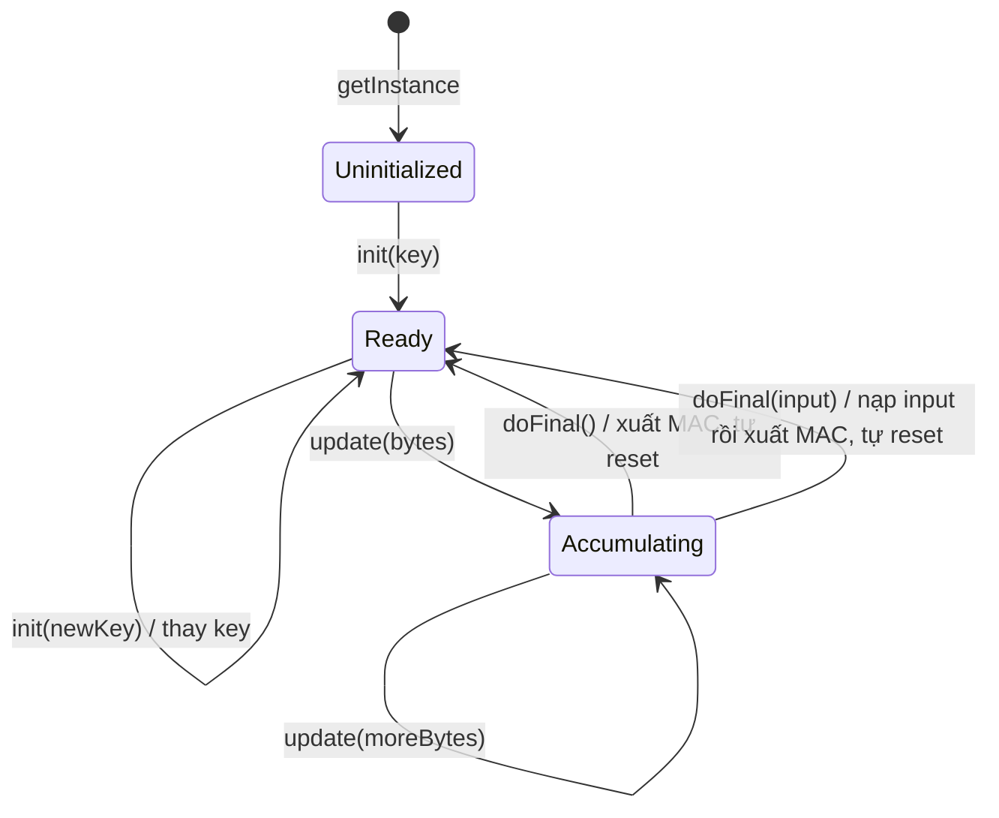
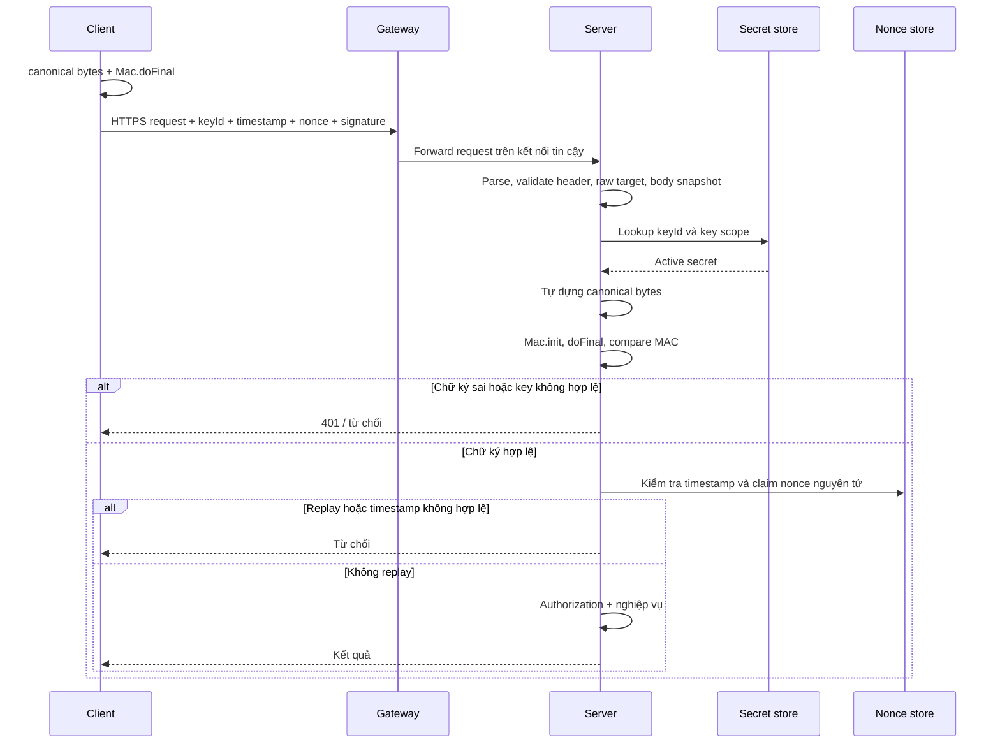

# `Mac.doFinal` trong Java JCA: kết thúc phép tính HMAC đúng cách

## 1. Vai trò của `Mac.doFinal`

Trong **Java Cryptography Architecture (JCA)**, lớp `javax.crypto.Mac` cung cấp giao diện tính **Message Authentication Code (MAC)**. Với `HmacSHA256`, ứng dụng cung cấp **shared secret** và **message bytes**; kết quả là một MAC dài 32 byte. Phương thức `Mac.doFinal` là bước **kết thúc việc tính MAC** cho message đang được đưa vào đối tượng `Mac`.

Bài này thuộc chương **JCA Mac API** của module `SECURITY_AUTHENTICATION_HMAC_REQUEST_AUTHENTICATION`. Module hướng đến xác thực HTTP request bằng HMAC: client và server cùng biết shared secret; hai phía tạo một **canonical request** từ method, URI, header và/hoặc body theo hợp đồng ký; server tính lại HMAC để xác minh, kiểm tra timestamp/nonce chống replay, hỗ trợ key rotation và kiểm thử khi request đi qua proxy/gateway. Đối với chủ đề **`Mac.doFinal`**, điểm mấu chốt là hiểu chính xác những byte nào đã được đưa vào phép tính, lúc nào phép tính hoàn tất và trạng thái `Mac` ra sao sau đó.

```text
secretKeyBytes + canonicalRequestBytes
        |
        v
Mac.getInstance("HmacSHA256")
        |
        v
mac.init(secretKey)
        |
        v
mac.update(...)          [tùy chọn: đưa message vào theo từng phần]
        |
        v
mac.doFinal(...)         [kết thúc và xuất MAC]
        |
        v
32 byte HMAC-SHA256  -->  hex hoặc Base64 để gửi qua HTTP
```

**Phân biệt ngay từ đầu:** `doFinal` **không** mã hóa request, **không** tự kiểm tra timestamp/nonce, **không** xác định quyền truy cập và **không** quyết định dữ liệu HTTP nào cần ký. Nó chỉ tính MAC trên message bytes đã được cung cấp. Việc xác thực request phụ thuộc thêm vào hợp đồng canonical, cách chọn khóa, đối chiếu kết quả và chính sách server.

## 2. Vòng đời một đối tượng `Mac`

Các bước điển hình:

1. **Chọn thuật toán:** `Mac.getInstance("HmacSHA256")` nhận một implementation từ JCA provider. Tên algorithm là lựa chọn đã được cả client/server thống nhất; không để request tự yêu cầu thuật toán yếu hơn.
2. **Khởi tạo key:** `mac.init(new SecretKeySpec(secretBytes, "HmacSHA256"))`. `secretBytes` phải là byte khóa thật, lấy từ secret manager/key store hoặc nguồn cấu hình được bảo vệ.
3. **Nạp message:** gọi `update(...)` một hoặc nhiều lần, hoặc dùng overload `doFinal(byte[] input)` để nạp phần dữ liệu cuối và hoàn tất ngay.
4. **Kết thúc:** `doFinal()` hoặc overload tương ứng tạo MAC và **tự reset đối tượng** về trạng thái sau lần `init` gần nhất.
5. **Tái sử dụng hoặc giải phóng:** sau `doFinal`, cùng đối tượng vẫn giữ cấu hình **thuật toán và key đã init**; lần message tiếp theo bắt đầu từ trạng thái trống. Nếu đổi khóa, **phải gọi `init` với khóa mới**.



**Lưu ý về reset:** theo hợp đồng API JCA, sau một lần `doFinal` thành công, `Mac` được reset về trạng thái đã khởi tạo bằng khóa. Do vậy:

```java
Mac mac = Mac.getInstance("HmacSHA256");
mac.init(new SecretKeySpec(secretBytes, "HmacSHA256"));

byte[] first = mac.doFinal(messageBytes);
byte[] second = mac.doFinal(messageBytes); // cùng message, cùng key
// first và second giống nhau.

byte[] emptyMac = mac.doFinal(); // HMAC của thông điệp rỗng!
// emptyMac không phải "chữ ký trước đó".
```

Không được hiểu `doFinal` là phương thức để “đọc lại kết quả gần nhất”. Sau khi hoàn tất, dữ liệu của message cũ đã được loại khỏi trạng thái tính MAC của đối tượng. Tương tự, việc gọi `reset()` giữa các phần dữ liệu sẽ bỏ trạng thái `update` trước đó.

## 3. Ba overload của `Mac.doFinal`

| API | Dữ liệu được ký | Kết quả và ứng dụng |
| --- | --- | --- |
| `byte[] doFinal()` | Toàn bộ các byte đã nạp bằng `update` kể từ lần `init`/`reset`/`doFinal` trước. | Trả MAC mới dạng `byte[]`; phù hợp streaming message nhiều phần. |
| `byte[] doFinal(byte[] input)` | Các byte `update` trước đó **nối với** toàn bộ `input` truyền vào. | Nạp thêm `input`, hoàn tất và trả MAC; tiện khi có sẵn toàn bộ message. |
| `void doFinal(byte[] output, int outOffset)` | Các byte đã nạp qua `update`; **không nhận message input mới**. | Ghi MAC vào `output` bắt đầu tại `outOffset`, cần đủ chỗ từ offset trở đi. |

Cả ba overload đều kết thúc một phép tính MAC và tự reset sau khi thành công. Chữ ký đầu ra vẫn là **byte nhị phân**; muốn đưa lên header HTTP, cần mã hóa thành chuỗi theo hợp đồng (`hex` hoặc `Base64`), không dùng `new String(macBytes, UTF_8)`.

### Cách 1: Toàn bộ message đã có sẵn

```java
Mac mac = Mac.getInstance("HmacSHA256");
mac.init(new SecretKeySpec(secretBytes, "HmacSHA256"));
byte[] signature = mac.doFinal(canonicalRequestBytes);
```

Nếu **chưa từng gọi `update`** kể từ `init` hoặc lần `doFinal` trước, cách này tính MAC của chính `canonicalRequestBytes`. Đây là kiểu dễ hiểu và phù hợp cho nhiều HTTP request nhỏ.

### Cách 2: Streaming với `update` rồi `doFinal()`

```java
mac.update(part1);
mac.update(part2);
byte[] signature = mac.doFinal();
```

Message thực tế là phép nối byte `part1 || part2`, **không có dấu phân cách tự động**. Nếu dữ liệu ban đầu là `A || B` và cần tách `A`/`B`, ứng dụng phải đặt delimiter/length-prefix trong canonical format từ trước. `Mac.update` không “hiểu” cấu trúc HTTP.

`update(byte[] input, int offset, int len)` phù hợp khi đã có một buffer lớn và muốn nạp từng vùng mà không tạo mảng con. `update(ByteBuffer)` cũng được hỗ trợ; nó tiêu thụ byte từ `position` hiện tại đến `limit`, nên cần chú ý vị trí con trỏ khi sử dụng lại `ByteBuffer`.

### Cách 3: Ghi MAC vào output buffer

```java
mac.update(canonicalRequestBytes);
byte[] output = new byte[mac.getMacLength() + 4];
mac.doFinal(output, 4);
// MAC nằm trong output[4 .. 4 + mac.getMacLength() - 1].
```

`getMacLength()` trả độ dài MAC tính bằng byte (với `HmacSHA256` là 32). Nếu đoạn trống từ `outOffset` đến cuối `output` không đủ, `doFinal(output, outOffset)` có thể ném `ShortBufferException`. Offset âm/không hợp lệ cũng phải được kiểm tra; code không nên dựa vào buffer cấp phát “gần đúng”.

### Trường hợp dễ nhầm nhất

```java
mac.update(prefixBytes);
byte[] result = mac.doFinal(messageBytes);
```

Lúc này MAC tính trên **`prefixBytes || messageBytes`**, **không chỉ** trên `messageBytes`. Nếu `prefixBytes` là dữ liệu sót lại vì đối tượng `Mac` bị chia sẻ sai giữa các request hoặc một hàm quên kết thúc, chữ ký sẽ sai. Trong code production, thiết kế vòng đời `Mac` rõ ràng và tránh chia sẻ cùng instance giữa các luồng.

## 4. Ví dụ Java 17+ có thể chạy độc lập

Ví dụ sau xây một canonical request đơn giản nhưng xác định chính xác input bytes. Nó cho thấy `doFinal(byte[])`, `update(...)` + `doFinal()` và `doFinal(output, offset)` cho cùng kết quả khi **cùng key và cùng message**. Sau đó thay body để chứng minh chữ ký cũ không còn hợp lệ.

**Giả định hợp đồng ký minh họa** (đây không phải định dạng chuẩn chung cho mọi API): các dòng nối bằng byte LF (`0A`) qua UTF-8, không có LF cuối; raw target giữ nguyên thứ tự/percent-encoding của query; header ký chỉ nhận đúng một giá trị không chứa CR/LF; body digest là SHA-256 trên **body bytes thực gửi**; audience `https://api.example.test` được ràng buộc với route hợp lệ. Giá trị timestamp/nonce trong fixture được cố định để minh họa MAC, không phải mã kiểm tra replay.

```java
import java.nio.charset.StandardCharsets;
import java.security.MessageDigest;
import java.util.Arrays;
import java.util.HexFormat;
import javax.crypto.Mac;
import javax.crypto.spec.SecretKeySpec;

public final class MacDoFinalDemo {
    private static final String ALGORITHM = "HmacSHA256";
    private static final HexFormat HEX = HexFormat.of();

    private static Mac newMac(byte[] secret) throws Exception {
        Mac mac = Mac.getInstance(ALGORITHM);
        mac.init(new SecretKeySpec(secret, ALGORITHM));
        return mac;
    }

    private static byte[] canonicalBytes(byte[] body) throws Exception {
        String bodyDigest = HEX.formatHex(
                MessageDigest.getInstance("SHA-256").digest(body));
        String canonical = String.join("\n",
                "HMAC-REQUEST-V1",
                "POST",
                "https://api.example.test",
                "/v1/payments?currency=VND",
                "content-type:application/json",
                "x-key-id:merchant-2026-11",
                "x-timestamp:2026-11-28T02:05:00Z",
                "x-nonce:W2k9cS0A1LxH8pQ4nR7tVg",
                bodyDigest);
        return canonical.getBytes(StandardCharsets.UTF_8);
    }

    public static void main(String[] args) throws Exception {
        // Chỉ là test key cố định; production dùng key ngẫu nhiên,
        // đủ mạnh và được quản lý trong secret manager.
        byte[] secret = HEX.parseHex(
                "000102030405060708090a0b0c0d0e0f"
              + "101112131415161718191a1b1c1d1e1f");
        byte[] body = "{\"account\":\"A123\",\"amount\":100000}"
                .getBytes(StandardCharsets.UTF_8);
        byte[] message = canonicalBytes(body);

        Mac mac = newMac(secret);

        // Overload 1: input truyền trực tiếp tới doFinal(byte[]).
        byte[] oneShot = mac.doFinal(message);

        // Sau doFinal, mac đã reset về trạng thái khởi tạo với cùng key.
        // Overload 2: nạp message theo hai phần rồi doFinal().
        int mid = message.length / 2;
        mac.update(message, 0, mid);
        mac.update(message, mid, message.length - mid);
        byte[] streamed = mac.doFinal();
        System.out.println("same MAC: "
                + MessageDigest.isEqual(oneShot, streamed)); // true

        // Overload 3: nạp trước rồi ghi MAC vào output từ offset = 2.
        mac.update(message);
        byte[] output = new byte[mac.getMacLength() + 2];
        mac.doFinal(output, 2);
        byte[] fromBuffer = Arrays.copyOfRange(
                output, 2, 2 + mac.getMacLength());
        System.out.println("same buffer MAC: "
                + MessageDigest.isEqual(oneShot, fromBuffer)); // true

        // Truyền MAC qua header theo quy ước: lowercase hex.
        String signatureHex = HEX.formatHex(oneShot);
        System.out.println("signature = " + signatureHex);

        // Server: tự dựng canonical bytes từ request thực nhận,
        // chọn secret theo key ID từ kho khóa tin cậy rồi tính lại.
        byte[] received = HEX.parseHex(signatureHex);
        byte[] expected = newMac(secret).doFinal(canonicalBytes(body));
        System.out.println("valid = "
                + MessageDigest.isEqual(expected, received)); // true

        // Body đổi, digest đổi => MAC trên canonical request mới khác.
        byte[] modifiedBody = "{\"account\":\"A123\",\"amount\":900000}"
                .getBytes(StandardCharsets.UTF_8);
        byte[] modifiedExpected = newMac(secret)
                .doFinal(canonicalBytes(modifiedBody));
        System.out.println("modified body valid = "
                + MessageDigest.isEqual(modifiedExpected, received)); // false
    }
}
```

Phương thức `newMac` tạo instance mới để **tách trạng thái giữa các phép xác minh độc lập**. Ví dụ tái sử dụng một `Mac` trong cùng luồng để minh họa hành vi reset, nhưng request handler trong ứng dụng đa luồng không nên lưu một `Mac` dùng chung toàn hệ thống. Không cần gọi `reset()` ngay sau một `doFinal` thành công chỉ để bắt đầu message tiếp theo.

Trong ví dụ này, thay `amount` đồng thời làm thay đổi body digest trong canonical message. Nếu server chỉ lấy `signatureHex` và đối chiếu với MAC tính từ **canonical string do client khai báo**, thay vì tự tái tạo từ HTTP request, kiểm tra integrity có thể trở nên vô nghĩa. Hãy giữ snapshot body được xác minh và chuyển chính dữ liệu đó cho nghiệp vụ.

## 5. Kiểm tra `doFinal` bằng vector HMAC-SHA256 chuẩn

Trước khi kiểm tra canonical HTTP, nên xác nhận cách gọi JCA tạo đúng HMAC độc lập với HTTP. Theo **RFC 4231, test case 1**:

- Key: 20 byte, mỗi byte có giá trị `0x0b`.
- Message: ASCII `Hi There` (8 byte).
- HMAC-SHA256 kỳ vọng:

```text
b0344c61d8db38535ca8afceaf0bf12b881dc200c9833da726e9376c2e32cff7
```

Mẫu Java:

```java
byte[] key = new byte[20];
Arrays.fill(key, (byte) 0x0b);
byte[] message = "Hi There".getBytes(StandardCharsets.US_ASCII);

Mac mac = Mac.getInstance("HmacSHA256");
mac.init(new SecretKeySpec(key, "HmacSHA256"));
String actualHex = HexFormat.of().formatHex(mac.doFinal(message));

String expectedHex =
        "b0344c61d8db38535ca8afceaf0bf12"
      + "b881dc200c9833da726e9376c2e32cff7";
System.out.println(expectedHex.equals(actualHex)); // true
```

Nếu vector đúng mà client và server vẫn `Invalid signature`, hãy kiểm tra **message bytes**, encoding, phiên bản hợp đồng ký, thứ tự dòng, raw URI, header và body digest trước khi nghi ngờ `Mac.doFinal`.

## 6. API liên quan, lỗi và trạng thái cần nắm

| API / lỗi | Khi nào gặp? | Cách xử lý phù hợp |
| --- | --- | --- |
| `Mac.getInstance("HmacSHA256")` | Chọn implementation từ provider; có thể ném `NoSuchAlgorithmException` nếu không hỗ trợ. | Chọn thuật toán cố định được kiểm tra khi khởi động; không downgrade âm thầm. |
| `mac.init(key)` | Khởi tạo secret; có thể ném `InvalidKeyException` nếu key không hợp lệ. | Kiểm tra cấu hình và key material từ hệ thống quản lý khóa. |
| `mac.update(...)` | Nạp message byte, theo thứ tự gọi; có thể ném `IllegalStateException` nếu chưa `init`. | Chỉ gọi sau khi khởi tạo; tránh tiếp tục trên state đã bị trộn. |
| `mac.doFinal()` | Kết thúc message đã nạp; nếu không nạp gì, tạo MAC của message rỗng. | Hiểu reset tự động, không coi đó là đọc lại MAC cũ. |
| `mac.doFinal(input)` | Nạp **thêm** `input` vào trạng thái đang có rồi kết thúc. | Dùng trên instance mới/đã reset nếu muốn ký chính `input`. |
| `mac.doFinal(output, offset)` | Ghi vào buffer có sẵn; có thể ném `ShortBufferException` nếu không đủ dung lượng. | Cấp đủ `mac.getMacLength()` byte từ vị trí offset. |
| `mac.reset()` | Bỏ toàn bộ byte đang tích lũy và trở lại trạng thái ngay sau `init`. | Chỉ dùng khi chủ động hủy message đang ký; không dùng để thay key. |
| `mac.getMacLength()` | Lấy số byte MAC khi sử dụng provider/algorithm. | Với `HmacSHA256` dự kiến 32 byte; hex có 64 ký tự, Base64 có encoding khác. |
| `MessageDigest.isEqual(a, b)` | So sánh expected MAC và supplied MAC sau khi đã kiểm tra format. | Ưu tiên so sánh byte bằng hàm phù hợp thay vì `Arrays.equals` cho chữ ký bảo mật. |

**`doFinal` không phải phép xác minh:** thư viện `Mac` chỉ trả kết quả MAC tính được. Server phải tự so sánh với chữ ký client gửi, quyết định accept/reject và tuyệt đối **không cho qua request khi lỗi provider, secret manager hoặc nonce store**. Hạn chế phân biệt chi tiết lỗi ra ngoài để tránh rò rỉ thông tin về key ID và danh tính.

### Lưu ý concurrency và vòng đời key

`Mac` có trạng thái nội bộ khi `update`; **không giả định nó thread-safe**. Hai luồng cùng gọi `update`/`doFinal` trên một instance có thể trộn bytes hoặc xuất MAC không xác định. Phương án đơn giản là **mỗi request dùng một instance `Mac` riêng**, hoặc quản lý pool/thread-local cực kỳ chặt chẽ nếu có benchmark chứng minh cần tối ưu.

Khi thực hiện **key rotation**, server tra `X-Key-Id` từ kho credential và khởi tạo `Mac` bằng key đang có hiệu lực tương ứng. `doFinal`/ `reset` chỉ reset dữ liệu message: nó **không** chọn key mới. Giai đoạn chuyển tiếp có thể chấp nhận key cũ và mới theo policy, nhưng key bị revoke phải bị từ chối. Không log secret hoặc lưu key trực tiếp trong mã nguồn.

## 7. Từ `doFinal` tới xác minh HTTP request

Một triển khai server điển hình:



Lưu ý trong flow trên:

1. **Method, URI, header, body:** phải được bao phủ theo hợp đồng canonical cụ thể. Nếu `Content-Type`, `Host`, `X-Forwarded-Host` hoặc route ảnh hưởng ngữ nghĩa nghiệp vụ, cần ký/kiểm tra ràng buộc phù hợp. `Mac.doFinal` không tự chọn field.
2. **Timestamp và nonce:** phải nằm trong message được ký **và** được server kiểm tra. Chữ ký đúng không tự chặn replay nguyên request.
3. **Replay store:** dùng insert-if-absent nguyên tử trên storage chung khi có nhiều server instance. Nên claim nonce **sau khi MAC hợp lệ** để request giả mạo không dễ chiếm nonce.
4. **Proxy/gateway:** có thể rewrite path, sort query, chuẩn hóa header, decompress body. Client và verifier phải tính từ cùng một biểu diễn đã quy định; dữ liệu nghiệp vụ sử dụng phải khớp với dữ liệu được ký.
5. **Key identity:** key ID là chỉ mục khóa chứ không phải bằng chứng phân quyền. Sau khi xác thực HMAC và chống replay phải kiểm tra **authorization** theo caller, action và resource.
6. **Server identity và transport:** client cần kiểm tra chứng chỉ/hostname qua HTTPS; HMAC trên request chủ yếu xác thực caller với server, không thay thế TLS server authentication.

Nếu request đi qua reverse proxy, đừng sửa lỗi mismatch bằng cách bỏ method, body hoặc path khỏi canonical message. Hãy xác định chính xác **điểm ký**, **điểm verify**, các biến đổi hợp lệ và cùng sử dụng dữ liệu sẽ được handler xử lý.

## 8. Các lỗi triển khai thường gặp

**Lỗi 1 — Tạo `Mac` nhưng quên `init`.**

```java
Mac mac = Mac.getInstance("HmacSHA256");
mac.doFinal(messageBytes); // IllegalStateException: chưa init
```

**Lỗi 2 — Ký hai lần do dùng cả `update` và `doFinal(input)`.**

```java
mac.init(new SecretKeySpec(secretBytes, "HmacSHA256"));
mac.update(messageBytes);
byte[] wrong = mac.doFinal(messageBytes); // Ký message || message
```

Chọn **một trong hai** cách: `doFinal(messageBytes)` hoặc `update(messageBytes)` rồi `doFinal()`.

**Lỗi 3 — Dùng output buffer như input.**

```java
mac.update(messageBytes);
byte[] output = new byte[mac.getMacLength()];
mac.doFinal(output, 0); // output nhận MAC, không phải message
```

Đoạn này **đúng** nếu đã gọi `update(messageBytes)`, nhưng `output` không phải payload được đem ký. `doFinal(output, 0)` có tác dụng ghi kết quả vào buffer.

**Lỗi 4 — Dùng sai encoding.** `String.getBytes()` không chỉ rõ charset có thể phụ thuộc môi trường hoặc cấu hình; `new String(macBytes, UTF_8)` biến bytes MAC thành văn bản không hợp lệ. Dùng `UTF_8` rõ ràng để tạo message bytes, và `HexFormat`/`Base64` để truyền chữ ký. Secret được lưu dạng hex/Base64 phải **decode thành key bytes** trước khi `init`; đừng dùng bytes UTF-8 của chuỗi hex làm key trừ khi đó thực sự là chính sách khóa.

**Lỗi 5 — Tin client gửi sẵn canonical string.** Server không được lấy chính canonical string chưa xác minh do client khai báo để kiểm tra rồi coi HTTP request hiện tại là an toàn. Phải dựng canonical từ method, target, signed headers và body **thực nhận**, đồng thời đảm bảo handler sử dụng cùng dữ liệu.

**Lỗi 6 — Tái dùng instance `Mac` đồng thời.** `update` từ request A có thể chen vào request B; kết quả sai và có thể tạo lỗi khó tái hiện. Dùng instance theo request và không lưu trạng thái tạm trong singleton chung.

## 9. Kiểm thử kiến thức và hành vi `doFinal`

Nên có **golden test vectors** gồm secret bytes, message bytes, expected MAC bytes và canonical request text. Dùng cùng fixture ở client, gateway và server, không chỉ so sánh kết quả thành công của một instance Java với chính nó.

| Kiểm thử | Kết quả mong đợi |
| --- | --- |
| RFC 4231 case 1, `doFinal(message)`. | HMAC-SHA256 khớp 32 byte kỳ vọng. |
| `doFinal(message)` so với `update(message); doFinal()`. | Bằng nhau nếu cùng key và message bytes. |
| `update(part1); update(part2); doFinal()`. | Bằng MAC của `part1 || part2`. |
| `update(part1); doFinal(part2)`. | Bằng MAC của `part1 || part2`, không phải chỉ `part2`. |
| Hai lần `doFinal(message)` liên tiếp trên instance đã `init`. | Cùng MAC do có reset sau lần đầu. |
| Gọi `doFinal()` ngay sau một `doFinal(message)`. | MAC của message **rỗng**, không phải MAC trước đó. |
| `doFinal(output, offset)` với đủ dung lượng. | Ghi đúng `getMacLength()` byte ở offset chỉ định. |
| Output buffer không đủ. | `ShortBufferException` theo hợp đồng API. |
| `doFinal` trước `init`. | `IllegalStateException`. |
| Sửa một byte body hoặc query đã ký. | MAC thay đổi, verify chữ ký cũ thất bại. |
| Client và server dùng khác charset, LF, raw URI hoặc body sau proxy. | Phát hiện mismatch; chuẩn hóa hợp đồng và đường đi dữ liệu. |
| Chữ ký đúng, request bị replay với cùng nonce. | HMAC vẫn hợp lệ nhưng tầng chống replay từ chối. |
| Key ID đã bị revoke hoặc khác audience. | Từ chối theo quản lý khóa/scope dù thuật toán MAC hoạt động đúng. |
| Caller xác thực HMAC đúng nhưng thiếu quyền. | Authorization từ chối. |

### Bài tập thực hành

Hãy lấy ví dụ `MacDoFinalDemo` và thực hiện theo trình tự:

1. In `canonicalBytes.length` và hex của toàn bộ canonical bytes. Xác nhận dấu phân tách `LF` được encode thành byte `0A`.
2. Thay `mac.doFinal(message)` bằng `mac.update(message); mac.doFinal()`; quan sát chữ ký không đổi.
3. Thử `mac.update(message); mac.doFinal(message)` và giải thích tại sao kết quả khác.
4. Thử `doFinal(output, 1)` trên buffer đúng bằng `getMacLength()`; bắt `ShortBufferException`, sau đó cấp đủ `getMacLength() + 1`.
5. Thay raw query `?currency=VND` bằng `?currency=USD`; server tính lại canonical từ request sửa đổi và kiểm tra chữ ký ban đầu.
6. Sử dụng một test fixture cố định chạy qua proxy/gateway để phát hiện việc query, header hoặc body bị sửa trước khi tới verifier.

Mỗi lần thử nên ghi rõ **bytes đầu vào**, phương thức `update`/`doFinal` đã dùng, MAC dạng hex, key ID và kết quả xác minh. Nếu chữ ký sai, kiểm tra canonical bytes trước khi thay đổi thuật toán.

## 10. Checklist khi dùng `Mac.doFinal` trong dịch vụ HTTP

- [ ] Dùng thuật toán `HmacSHA256` đã thống nhất và khóa ngẫu nhiên đủ mạnh (thường tối thiểu 256 bit cho khóa HMAC-SHA256 mới).
- [ ] `Mac` được `init` với key bytes thật; không dùng password yếu hoặc UTF-8 của chuỗi hex làm secret ngoài ý muốn.
- [ ] Biết rõ `doFinal()`, `doFinal(input)`, `doFinal(output, offset)` lấy message từ đâu; không nạp trùng qua `update`.
- [ ] Tin vào reset tự động **sau lần `doFinal` thành công**; không dùng instance `Mac` chung giữa nhiều request đồng thời.
- [ ] Canonical request có version, field được ký, delimiter, encoding và quy tắc raw path/query/header/body rõ ràng.
- [ ] Hash body bytes mà server xử lý; server dựng lại canonical message độc lập, không xác minh trên input chưa đáng tin.
- [ ] Truyền MAC bằng hex/Base64 chuẩn hóa và so sánh MAC dạng byte với hàm phù hợp; không biến byte MAC trực tiếp thành chuỗi UTF-8.
- [ ] Kiểm tra timestamp/nonce, key ID, key scope, rotation, gateway transforms và authorization tách khỏi bước `doFinal`.
- [ ] Có vector RFC 4231, golden fixtures và negative tests cho overload, reset, replay và biến đổi canonical.

**Điểm cần nhớ:** `Mac.doFinal` là ranh giới kết thúc một message trong JCA. Kết quả của nó phụ thuộc hoàn toàn vào **key đã khởi tạo** và **đúng dãy byte đã nạp**, còn đối tượng tự trở lại trạng thái sẵn sàng với cùng key sau khi hoàn tất. Với xác thực HTTP request, hãy thiết kế canonical message và vòng đời `Mac` tường minh, rồi xác minh chữ ký, replay và quyền truy cập ở các bước riêng.
