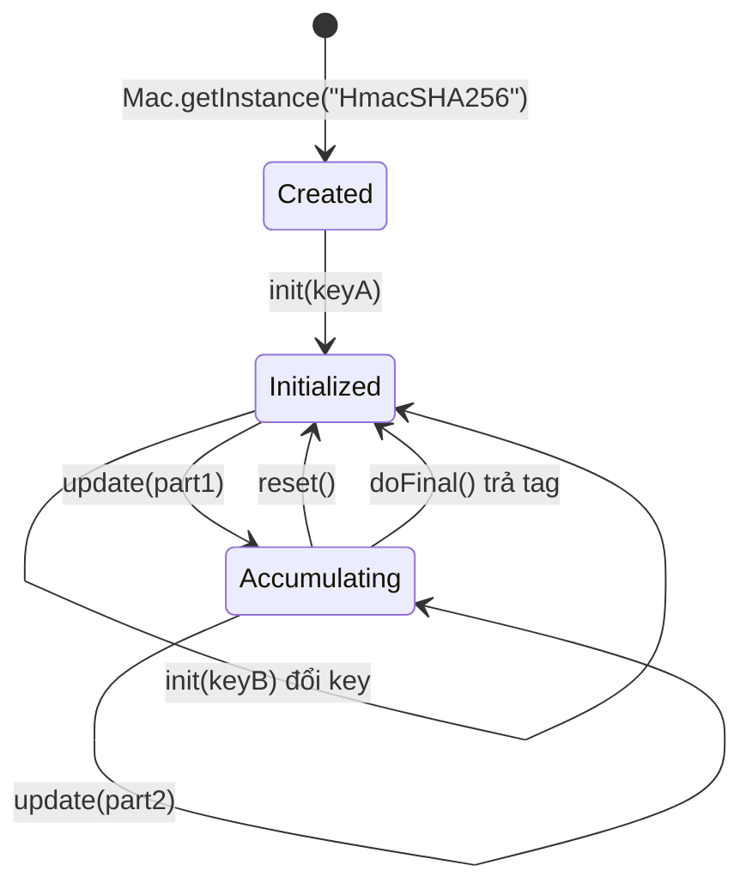
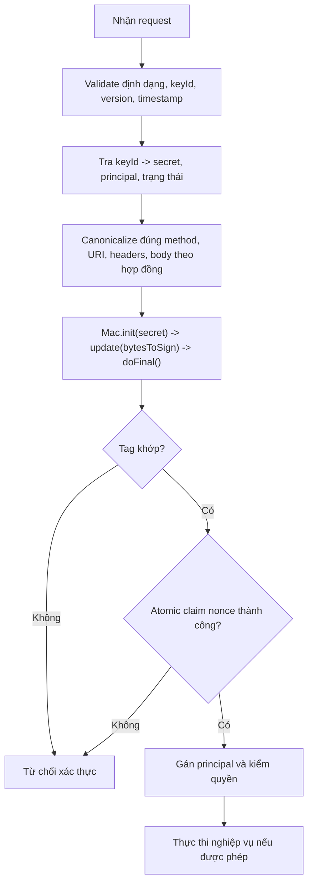

# `Mac.reset()` trong Java: đặt lại trạng thái HMAC mà vẫn giữ khóa

> **Chương:** JCA Mac API  
> **Bài học:** `Mac.reset`  
> **Ngữ cảnh:** Xác thực HTTP request bằng HMAC và shared secret, với canonical request bao gồm method, URI, các header hoặc body theo hợp đồng ký. Đây là bài chuyên sâu về **vòng đời đối tượng `javax.crypto.Mac`**, đặc biệt là vai trò của `reset()` khi xử lý nhiều request, lỗi giữa chừng và thay khóa.

## 1. `Mac.reset()` làm gì?

Trong Java Cryptography Architecture (JCA), lớp `javax.crypto.Mac` đại diện cho một phép tính **Message Authentication Code** có trạng thái. Khi dùng HMAC-SHA256, mỗi lệnh `update(...)` thêm byte vào thông điệp đang tính. Phương thức:

```java
public final void reset()
```

đưa đối tượng `Mac` **trở lại trạng thái ngay sau lần `init(...)` gần nhất**. Nó loại bỏ phần **thông điệp đã đưa vào qua `update(...)`** để có thể bắt đầu tính MAC cho **một thông điệp mới bằng cùng khóa**.

Nói cách khác:

- `init(key)`: thiết lập credential/khóa cho đối tượng `Mac`.
- `update(bytes)`: bổ sung byte cho **thông điệp hiện tại**.
- `reset()`: bỏ thông điệp đang xử lý và quay lại trạng thái ban đầu **với khóa đã khởi tạo**.
- `doFinal()`: kết thúc và trả về tag, đồng thời **tự reset** về trạng thái đã khởi tạo.
- `doFinal(bytes)`: xử lý thêm `bytes` vào những gì đã `update` rồi kết thúc, đồng thời **tự reset**.

Vì vậy, `reset()` **không tương đương** `init(newKey)`, không xóa hoặc thu hồi shared secret, không tạo nonce mới và không thay đổi phiên bản hợp đồng ký.

**Quy tắc cốt lõi:** Muốn bắt đầu **thông điệp mới với cùng khóa**, có thể dùng `reset()` hoặc tiếp tục sau một `doFinal()` thành công. Muốn dùng **khóa khác**, phải gọi `init(...)` với khóa mới.

Theo đặc tả Java SE, tất cả các biến thể `doFinal(...)` đều đưa `Mac` về trạng thái đã khởi tạo để có thể dùng với cùng key.

## 2. Vòng đời và trạng thái của đối tượng `Mac`



Các trạng thái trong sơ đồ là **mô hình để hiểu API**, không phải kiểu enum chính thức của JCA.

| Lệnh | Nội dung đã `update` trước đó | Khóa / thuật toán | Kết quả |
| --- | --- | --- | --- |
| `Mac.getInstance("HmacSHA256")` | Chưa có | Thuật toán được chọn, **chưa có khóa** | Tạo đối tượng, chưa sẵn sàng để ký. |
| `mac.init(keyA)` | Bắt đầu phiên MAC mới | Thiết lập key A | Cho phép `update` / `doFinal`. |
| `mac.update(A)` | Ghi nhận A | Vẫn key A | Tích lũy thông điệp, chưa trả tag. |
| `mac.update(B)` | Ghi nhận `A || B` | Vẫn key A | Tích lũy thêm B. |
| `mac.reset()` | **Bỏ A và B** | **Vẫn key A** | Sẵn sàng ký thông điệp khác. |
| `mac.doFinal(C)` | Xử lý C (và mọi byte đã `update` kể từ lần reset gần nhất) | Vẫn key A | Trả tag rồi tự reset. |
| `mac.doFinal()` | Xử lý phần thông điệp hiện có | Vẫn key A | Trả tag rồi tự reset. |
| `mac.init(keyB)` | Khởi tạo một lần MAC mới | **Chuyển sang key B** | Bắt đầu xác thực bằng credential khác. |

`update` không trả tag; `doFinal` mới hoàn tất phép tính. Nếu chưa gọi `init` thành công, `update` và `doFinal` không thể sử dụng đúng; các phương thức này có thể ném `IllegalStateException`. **Gọi `reset()` trước `init()` không phải một cách khởi tạo Mac.**

### Ví dụ dễ hình dung bằng toán học

Giả sử `K` là một shared secret:

```text
mac.init(K)
mac.update("POST")
mac.update("/v1/orders")
mac.doFinal()
    -> HMAC(K, "POST" || "/v1/orders")
    -> Tự reset, vẫn K

mac.update("GET")
mac.doFinal()
    -> HMAC(K, "GET")                // không chứa "POST/v1/orders"

mac.update("UNFINISHED")
mac.reset()
mac.update("DELETE")
mac.doFinal()
    -> HMAC(K, "DELETE")             // đã bỏ "UNFINISHED"
```

Ví dụ chỉ dùng chuỗi ngắn để giải thích `Mac`. **Trong HTTP request auth, phải ký toàn bộ canonical request/string-to-sign theo hợp đồng, không đơn giản nối method và path như ví dụ này.**

## 3. Khi nào gọi `reset()`, khi nào không cần?

| Tình huống | Cách làm | Giải thích |
| --- | --- | --- |
| Vừa `init(key)` và bắt đầu request đầu tiên | Không cần `reset()` | Đối tượng đã ở trạng thái mới khởi tạo. |
| Đã `doFinal()` thành công, tiếp tục ký thông điệp khác cùng key | Có thể `update` ngay | `doFinal` đã tự reset. |
| Đã `doFinal(input)` thành công | Có thể `update` ngay | Biến thể này cũng tự reset. |
| Đã `update` một phần, sau đó request bị hủy/truncated/không hợp lệ | **Gọi `reset()` trước khi tái sử dụng cùng key** | Tránh trộn byte của request bị hủy vào request mới. |
| Muốn tính lại HMAC cho một signing input khác, bỏ dữ liệu cũ | `reset()`, sau đó `update` dữ liệu mới | Loại byte đã tích lũy. |
| Muốn đổi từ key client A sang key client B | **`init(keyB)`** | `reset` giữ nguyên key A. |
| Có `Mac` mới nhưng chưa `init` | **`init(key)`**, không dựa vào `reset` | `reset` không cung cấp khóa. |
| Muốn thu hồi secret, xóa secret khỏi bộ nhớ, chống replay hoặc reset principal | Dùng cơ chế thích hợp bên ngoài `Mac` | `reset` chỉ quản lý trạng thái MAC, không xóa chính sách và dữ liệu nghiệp vụ. |

### Sai lầm quan trọng: gọi `reset` giữa các phần của **cùng** request

Giả sử hợp đồng ký đòi hỏi:

```text
bytesToSign = canonicalHeadersBytes || bodyDigestBytes
```

Sai:

```java
mac.update(canonicalHeadersBytes);
mac.reset();                    // Sai: xóa phần canonical headers!
mac.update(bodyDigestBytes);
byte[] tag = mac.doFinal();     // Chỉ ký bodyDigestBytes
```

Đúng:

```java
mac.update(canonicalHeadersBytes);
mac.update(bodyDigestBytes);
byte[] tag = mac.doFinal();     // Ký cả hai phần
```

Nếu có phân tách đoạn, encoding, dấu LF, body hash hoặc version, **thứ tự byte** và quy tắc ghép phải được hợp đồng ký định nghĩa rõ. `reset` là ranh giới giữa **hai phép tính MAC khác nhau**, không phải dấu phân cách giữa các phần trong cùng signing input.

## 4. Ví dụ Java 17+: chứng minh `reset()` giữ key và bỏ message

Ví dụ dưới đây có thể chạy độc lập trong Java 17+, sử dụng API chuẩn JCA. Giá trị khóa trong ví dụ là **dữ liệu kiểm thử**, không dùng làm secret production.

```java
import java.nio.charset.StandardCharsets;
import java.security.GeneralSecurityException;
import java.security.MessageDigest;
import java.util.HexFormat;
import javax.crypto.Mac;
import javax.crypto.spec.SecretKeySpec;

public class MacResetDemo {
    private static byte[] utf8(String value) {
        return value.getBytes(StandardCharsets.UTF_8);
    }

    private static Mac createMac(byte[] key) throws GeneralSecurityException {
        Mac mac = Mac.getInstance("HmacSHA256");
        mac.init(new SecretKeySpec(key, "HmacSHA256"));
        return mac;
    }

    public static void main(String[] args) throws Exception {
        byte[] key = utf8("test-key-for-learning-only");
        Mac mac = createMac(key);

        mac.update(utf8("discard-me"));
        mac.reset();                       // Bỏ "discard-me", vẫn key.

        byte[] afterReset = mac.doFinal(utf8("message-B"));
        byte[] fromFresh = createMac(key).doFinal(utf8("message-B"));

        if (!MessageDigest.isEqual(afterReset, fromFresh)) {
            throw new AssertionError("reset() did not discard old input");
        }

        // doFinal() tự reset, nên tính ngay một thông điệp khác.
        byte[] next = mac.doFinal(utf8("message-C"));
        byte[] expectedNext = createMac(key).doFinal(utf8("message-C"));

        if (!MessageDigest.isEqual(next, expectedNext)) {
            throw new AssertionError("doFinal() did not reset state");
        }

        // Nếu KHÔNG reset giữa hai update, byte được nối vào cùng thông điệp.
        mac.update(utf8("message-"));
        byte[] concatenated = mac.doFinal(utf8("B"));
        byte[] expectedConcatenated =
                createMac(key).doFinal(utf8("message-B"));

        if (!MessageDigest.isEqual(concatenated, expectedConcatenated)) {
            throw new AssertionError("update() + doFinal(input) mismatch");
        }

        System.out.println("PASS: reset, doFinal and update semantics");
        System.out.println("HMAC-SHA256(message-B): "
                + HexFormat.of().formatHex(afterReset));
    }
}
```

Ba phép đối chiếu kiểm tra các thuộc tính:

1. `reset()` sau `update("discard-me")` làm tag tiếp theo tương đương với một `Mac` mới khởi tạo cùng key và chỉ xử lý `message-B`.
2. Sau `doFinal`, không cần thêm `reset` để tạo tag của `message-C` bằng cùng key.
3. `update("message-"); doFinal("B")` tương đương tính HMAC trên `message-B`, **không** chỉ trên `B`.

Lệnh `HexFormat.of().formatHex(...)` chỉ biểu diễn tag để quan sát **trong ví dụ kiểm thử**. Trong production, không ghi tag thực hoặc shared secret vào log nếu không có nhu cầu và biện pháp bảo vệ thích hợp.

## 5. `Mac.reset()` trong vòng xử lý HTTP request authentication

Một client ký HTTP request theo hợp đồng có thể sử dụng HMAC-SHA256 như sau:

```text
HTTP request
  -> Lấy method, URI, các signed headers theo hợp đồng
  -> SHA-256(raw body bytes), nếu hợp đồng ký body digest
  -> Dựng canonical request chuẩn hóa
  -> Dựng string-to-sign (version, canonical request, metadata ...)
  -> HMAC-SHA256(secret, bytesToSign)
  -> Gửi keyId, timestamp, nonce và signature
```

Server thực hiện tương tự để tự tính expected tag. Đối tượng `Mac` chỉ chịu trách nhiệm **tính MAC cho `bytesToSign`**. Nó không tự chuẩn hóa URI, không chọn key ID và không phân quyền.

### 5.1. Ví dụ hợp đồng ký minh họa

Giả sử dịch vụ định nghĩa:

```text
stringToSign =
  "HMAC-SHA256/v1\n"
  + METHOD + "\n"
  + CANONICAL_URI + "\n"
  + CANONICAL_SIGNED_HEADERS + "\n"
  + HEX_SHA256_RAW_BODY
```

Các thành phần `METHOD`, `CANONICAL_URI` và `CANONICAL_SIGNED_HEADERS` phải tuân thủ quy tắc cụ thể về Unicode, percent-encoding, query parameters, khoảng trắng, duplicate headers và dấu LF. **Đây là một ví dụ cấu trúc, chưa phải đặc tả canonicalization hoàn chỉnh.**

Client ký từng request:

```java
Mac mac = Mac.getInstance("HmacSHA256");
mac.init(new SecretKeySpec(secretBytes, "HmacSHA256"));

// stringToSign đã được tạo đầy đủ từ hợp đồng ký.
byte[] tag = mac.doFinal(stringToSign.getBytes(StandardCharsets.UTF_8));

// Sau doFinal(), mac tự trở về trạng thái mới với cùng secretBytes.
// Nếu ký request khác bằng CÙNG khóa, có thể gọi doFinal(...) tiếp.
```

Ở phía server, verifier lấy `secretBytes` từ credential registry đáng tin cậy theo `keyId`, xây lại `stringToSign` từ request đã nhận và so sánh tag bằng `MessageDigest.isEqual(expected, supplied)` sau khi kiểm định dạng/độ dài chữ ký. Chỉ khi các bước cần thiết đều đạt mới được gán authenticated principal.

### 5.2. Khi bỏ dở một request đang được xử lý thành nhiều phần

Trong một thiết kế streaming, có thể cập nhật `Mac` từng phần của signing input đã được xác định chính xác:

```java
Mac mac = Mac.getInstance("HmacSHA256");
mac.init(new SecretKeySpec(secretBytes, "HmacSHA256"));

try {
    mac.update(canonicalPrefixBytes);
    // Ví dụ một hàm kiểm soát giới hạn và đọc đoạn signing input kế tiếp:
    mac.update(nextSigningPartBytes);

    byte[] tag = mac.doFinal(); // Tự reset.
    // Sử dụng tag theo contract; không log secret.
} finally {
    mac.reset(); // Hữu ích nếu có lỗi xảy ra sau một hay nhiều update.
}
```

`reset()` trong `finally` là **dự phòng cho phép tính bị bỏ dở**. Sau `doFinal()` thành công, `reset()` ở `finally` là thừa nhưng không thay đổi tag đã trả về. Ví dụ giả định `mac` đã được `init` và chỉ do **một luồng** sử dụng.

**Lưu ý:** `Mac` không tự động giới hạn số byte, kiểm tra request body, xác minh freshness hay rollback nghiệp vụ. Nếu request bị từ chối giữa chừng, phải quản lý riêng các tài nguyên như HTTP stream, byte buffer, security context và transaction.

### 5.3. Không reset giữa HMAC đang tính và bước xác minh tag

Một lỗi thiết kế dễ gặp:

```text
Verifier dùng mac.update(canonicalRequest)
         -> mac.reset() trước doFinal()
         -> mac.doFinal()
```

Kết quả là tag cho **thông điệp rỗng**, không phải canonical request. Đặt `reset()` sau khi đã nhận tag (nếu còn cần), hoặc khi **hủy phép tính**; đừng dùng nó như thao tác “làm sạch” trước khi lấy kết quả.

## 6. Shared secret, key rotation và `reset`

### 6.1. Reset không đổi key

```java
// Dữ liệu kiểm thử cố định để làm rõ hành vi API, không dùng trong production.
byte[] keyA = "demo-key-A".getBytes(StandardCharsets.UTF_8);
byte[] keyB = "demo-key-B".getBytes(StandardCharsets.UTF_8);
byte[] messageOfClientA = "request-A".getBytes(StandardCharsets.UTF_8);
byte[] messageOfClientB = "request-B".getBytes(StandardCharsets.UTF_8);

Mac mac = Mac.getInstance("HmacSHA256");
mac.init(new SecretKeySpec(keyA, "HmacSHA256"));

mac.update(messageOfClientA);
mac.reset();  // Vẫn đang dùng keyA!
byte[] tag = mac.doFinal(messageOfClientB);
```

Đoạn này chỉ minh họa một **lỗi bảo mật**: tag của `messageOfClientB` được tính bằng **key A**, do `reset` không thay đổi credential. Nếu verifier suy danh tính theo key ID của B nhưng dùng Mac đã khởi tạo bằng A, kết quả có thể sai, hoặc một thiết kế lookup kém có thể dẫn đến **credential confusion**.

Cách sửa khi đổi credential:

```java
mac.init(new SecretKeySpec(keyB, "HmacSHA256"));
byte[] tagB = mac.doFinal(messageOfClientB);
```

Trong thực tế, nên tránh tái sử dụng một `Mac` đa tenant theo cách khó kiểm soát. Cách dễ đánh giá nhất là **tạo và khởi tạo một `Mac` riêng cho từng phép ký/xác minh** với secret đã chọn.

### 6.2. Key rotation là thay credential, không phải reset thuật toán

Khi client chuyển từ `merchant-42-k1` sang `merchant-42-k2`:

1. Server cấp **secret mới và key ID mới**, liên kết với đúng principal và môi trường.
2. Trong cửa sổ chuyển tiếp có kiểm soát, verifier có thể chấp nhận cả hai credential nếu còn hiệu lực.
3. Client gửi key ID để server chọn chính xác secret tương ứng; `mac.init(selectedKey)` thiết lập khóa cho lần xác minh.
4. Khi k1 bị thu hồi/hết hạn, verifier **từ chối** request dùng k1 dù tag HMAC vẫn đúng về mặt toán học.
5. `mac.reset()` chỉ xóa dữ liệu của message hiện tại khỏi trạng thái tính toán, **không** cập nhật credential registry, không làm mất hiệu lực key cũ và không đồng bộ cache khóa.

Nếu shared secret bị lộ, kẻ tấn công có thể tính chữ ký mới bằng secret đó với timestamp/nonce hợp lệ. Gọi `reset()` ở server không thể thay thế **revoke/rotate credential**.

## 7. Vì sao không nên chia sẻ cùng một `Mac` giữa các request đồng thời?

`Mac` là đối tượng **có trạng thái thay đổi được**. Các thao tác `update`, `doFinal` và `reset` cùng tác động đến dữ liệu của phép tính hiện tại. Không có bảo đảm tổng quát rằng một thể hiện `Mac` có thể được nhiều luồng gọi đồng thời an toàn.

Ví dụ về lịch xen kẽ nguy hiểm:

```text
Thread A: mac.update(bytesForRequestA)
Thread B: mac.reset()
Thread B: mac.update(bytesForRequestB)
Thread A: mac.doFinal()
```

Thread A có thể nhận tag không tương ứng request A. Ngược lại, nếu hai luồng cùng `update` mà không tách trạng thái, dữ liệu có thể bị trộn giữa hai request. Hành vi chính xác còn tùy triển khai/provider; không thiết kế bảo mật dựa trên thứ tự ngẫu nhiên của concurrent calls.

**Thực hành khuyến nghị:**

- **Mỗi lần tính MAC tạo một `Mac` được `init` đúng secret:** đơn giản và ít rủi ro khi service xác minh request cho nhiều client.
- Nếu tối ưu hiệu năng bằng pooling hoặc `ThreadLocal<Mac>`, phải bảo đảm **một owner tại một thời điểm**, **re-init chính xác khóa** khi chuyển credential, xử lý ngoại lệ và vòng đời secret cẩn thận. Không giữ khóa đã revoke trong cache vô thời hạn.
- Không khai báo `static final Mac SHARED_MAC` rồi để tất cả HTTP request cùng `update/reset/doFinal` trên nó.
- Mỗi request/transaction xác minh phải có **canonical input và thông tin key ID riêng**; `reset()` không tách thông tin nhận dạng và chính sách phân quyền.

## 8. `reset` khác chống replay và authorization

HMAC là **xác thực tính toàn vẹn của signing input bằng shared secret**. Một request có tag hợp lệ vẫn có thể là **bản sao của request cũ**.

| Khái niệm | Quản lý điều gì? | `Mac.reset()` có làm việc đó không? |
| --- | --- | --- |
| **MAC message state** | Byte đã đưa vào `update` cho thông điệp hiện tại. | **Có**: bỏ dữ liệu đang tích lũy. |
| **Khóa HMAC** | Secret dùng cho phép tính. | **Không**: giữ khóa đã `init`. |
| **Credential status** | Key ID, thời hạn, bị revoke, rotation. | **Không**: phải kiểm từ registry. |
| **Timestamp window** | Request còn mới hay đã quá hạn. | **Không**: phải kiểm timestamp được ký. |
| **Nonce / replay cache** | Nonce đã được sử dụng trước đó chưa. | **Không**: phải atomic claim trong kho dùng chung. |
| **Authenticated principal** | Danh tính được gắn với credential đã xác minh. | **Không**: gán từ registry sau khi xác thực. |
| **Authorization** | Principal có quyền với tenant, endpoint và resource hay không. | **Không**: cần quyết định phân quyền riêng. |

**Ví dụ:** hai lần gọi `mac.doFinal(sameBytesToSign)` liên tiếp dưới cùng key sẽ tạo **cùng một HMAC tag**, vì `doFinal` tự reset rồi tiếp tục dùng cùng key. Đây là kết quả mong đợi của thuật toán xác định. Server phải chặn **replay** bằng timestamp và nonce đã ký, không phải bằng `Mac.reset()`.

Một luồng kiểm soát tham khảo ở server:



Nếu dùng `Mac` theo phiên yêu cầu, việc `doFinal()` tự reset không cần làm thành một bước riêng. Nếu lỗi xảy ra sau `update` nhưng trước `doFinal` và muốn tái sử dụng đối tượng đó, cần chủ động `reset` hoặc bỏ đối tượng.

## 9. Phân biệt `Mac.reset()` với những API và thao tác tương tự

| Thao tác | Mục đích | Điều còn giữ sau thao tác |
| --- | --- | --- |
| `mac.reset()` | Bỏ message hiện tại, tiếp tục với key đã init. | Key, thuật toán/provider, tham số khởi tạo có liên quan. |
| `mac.doFinal()` | Kết thúc message hiện tại, trả tag, tự reset. | Key và cấu hình `Mac`. |
| `mac.doFinal(input)` | Xử lý thêm input, trả tag, tự reset. | Key và cấu hình `Mac`. |
| `mac.init(key)` | Khởi tạo/re-init với key mới (hoặc cùng key). | Key mới được chỉ định. |
| `digest.reset()` của `MessageDigest` | Bỏ message hash hiện tại. | Trạng thái thuật toán hash không khóa; không có key HMAC. |
| `new Mac` / `Mac.getInstance(...)` | Nhận đối tượng MAC mới từ JCA provider. | Chưa có key cho đến khi `init`. |
| Thu hồi key trong registry | Chặn client dùng credential đó. | Không liên quan trực tiếp trạng thái của một `Mac` còn sống. |
| Xóa sensitive byte arrays | Giảm tồn lưu khóa trong bộ nhớ khi có thể. | Không thể suy ra điều này từ việc gọi `Mac.reset`. |

Không nên suy diễn rằng `reset` sẽ “zeroize” mọi bản sao khóa trong provider, bộ nhớ Java, snapshot hay hệ thống bí mật khác. API chỉ cam kết **đặt lại trạng thái phép tính MAC** theo đặc tả; bảo vệ và vòng đời khóa thuộc trách nhiệm quản lý credential.

## 10. Kiểm thử các thuộc tính của `Mac.reset()`

Bộ kiểm thử nên dùng secret và message cố định **chỉ cho mục đích test**, đối chiếu với một `Mac` mới được `init` bằng cùng khóa để xác nhận ý nghĩa. Không cần viết test phụ thuộc vào provider cụ thể ngoài hợp đồng JCA.

| # | Tình huống | Kết quả mong đợi |
| --- | --- | --- |
| 1 | `init(K); update(A); reset(); doFinal(B)` | Bằng `HMAC(K, B)`; A không bị lẫn. |
| 2 | `init(K); update(A); doFinal(); update(B); doFinal()` | Tag thứ hai bằng `HMAC(K, B)` vì `doFinal` tự reset. |
| 3 | `init(K); update(A); doFinal(B)` | Tag bằng `HMAC(K, A || B)`, không chỉ HMAC(B). |
| 4 | `init(K); reset(); doFinal(B)` | Bằng `HMAC(K, B)`; reset ngay sau init không đổi đầu ra. |
| 5 | `init(K1); reset(); doFinal(B)`, so với `HMAC(K2, B)` | Reset vẫn dùng **K1**; không tự chuyển K2. |
| 6 | `init(K1); init(K2); doFinal(B)` | Bằng `HMAC(K2, B)`; re-init đổi khóa. |
| 7 | `getInstance` nhưng chưa `init`, gọi `doFinal()` | Có lỗi trạng thái chưa khởi tạo (`IllegalStateException`). |
| 8 | `update(partial); reset(); update(full); doFinal()` | Bằng HMAC trên `full`; bỏ phần partial. |
| 9 | Hai request dùng chung đối tượng `Mac` xen kẽ `update/reset/doFinal` | Thiết kế phải được loại bỏ hoặc đồng bộ và kiểm soát ownership; không giả định thread-safe. |
| 10 | Request dùng key cũ đã bị revoke, nhưng `Mac` tính ra tag hợp lệ | Server **vẫn từ chối** theo credential status; reset không thu hồi khóa. |
| 11 | Gửi lại một request HMAC hợp lệ với nonce trùng | Nonce store chống replay từ chối; không liên quan reset. |
| 12 | Qua proxy, canonical URI/body đổi nhưng secret không đổi | HMAC phải kiểm theo bytes đã thỏa thuận; reset không sửa được mismatch. |
| 13 | Request HMAC hợp lệ của principal A vào tài nguyên chỉ B có quyền | Authorization từ chối; reset không cấp quyền. |
| 14 | Hai payload có cùng nội dung logic nhưng byte khác (JSON order, whitespace) | Nếu ký raw bytes/body digest thì signature khác khi signing input khác. |

### Đọc kết quả sai để tìm đúng nguyên nhân

- **Tag sau `reset` khác HMAC trên message mới:** kiểm tra có byte `update` ngoài ý muốn, init nhầm key hoặc byte encoding khác nhau.
- **Tag luôn giống nhau cho mọi request:** xem signing input có vô tình rỗng do gọi `reset` trước `doFinal`, hoặc code không `update` dữ liệu yêu cầu.
- **Lỗi chỉ xảy ra khi tải cao:** nghi ngờ dùng chung một `Mac` mutable giữa nhiều thread.
- **Lỗi chỉ xảy ra với client khác:** nghi ngờ gọi `reset` thay cho `init(newKey)`, hoặc credential lookup sai.
- **Lỗi chỉ qua gateway/proxy:** kiểm tra canonical request trước/sau rewrite, query/header normalization, body bytes và vị trí xác minh; `reset` không giúp đồng bộ canonicalization.
- **Request cũ vẫn được xử lý lần hai:** xem timestamp/nonce/replay store; `Mac.reset` không ghi nhớ lịch sử request.

## 11. Tự kiểm tra

**Câu 1.** Gọi `mac.reset()` sau `mac.init(keyA)` có làm mất keyA không?

*Đáp án:* Không. `reset` bỏ message đang tính và giữ trạng thái đã khởi tạo với keyA; muốn chuyển sang keyB thì gọi `init(keyB)`.

**Câu 2.** Có cần gọi `reset()` sau mọi `doFinal()` không?

*Đáp án:* Không. JCA `Mac.doFinal` tự reset trạng thái về sau `init`; gọi `reset` sau đó chỉ là thao tác thừa trong luồng thành công.

**Câu 3.** `update(A); doFinal(B)` và `update(A); reset(); doFinal(B)` có giống nhau không?

*Đáp án:* Không. Trường hợp đầu ký `A || B`; trường hợp sau chỉ ký `B`.

**Câu 4.** Nếu request bị từ chối khi đã `update` một phần nhưng chưa `doFinal`, phải làm gì trước khi dùng lại `Mac` cho request khác?

*Đáp án:* `reset` để bỏ dữ liệu request đang dở; hoặc bỏ thể hiện hiện tại rồi tạo và init `Mac` mới. Đồng thời xử lý các tài nguyên, transaction và trạng thái request khác riêng.

**Câu 5.** Có thể dùng một biến `static Mac` duy nhất cho mọi HTTP request nếu gọi `reset()` trước mỗi lần ký không?

*Đáp án:* Không an toàn khi nhiều luồng đồng thời. `Mac` là stateful, các thao tác có thể xen kẽ. Dùng `Mac` riêng cho mỗi phép tính hoặc bảo vệ ownership và việc chuyển credential một cách chặt chẽ.

**Câu 6.** `reset` có làm một request không thể bị replay không?

*Đáp án:* Không. HMAC là xác định: cùng key và signing input tạo cùng tag. Replay cần timestamp và nonce được ký, cửa sổ thời gian và nonce store atomic.

**Câu 7.** Khi client chuyển từ key k1 sang k2, server có thể chỉ gọi `mac.reset()` rồi xác minh request mới không?

*Đáp án:* Không. Phải chọn đúng credential theo key ID, kiểm trạng thái/phiên bản và `init(k2)` hoặc dùng `Mac` mới đã init bằng k2.

**Câu 8.** Khi tag HMAC đúng nhưng request truy cập tài nguyên không được phép, có cần reset Mac để sửa lỗi này không?

*Đáp án:* Không. Đây là vấn đề **authorization**. Server phải từ chối dựa trên principal đã xác thực và quyền truy cập tới tài nguyên.

---

## Tài liệu tham khảo

- [Oracle Java SE 25 – `javax.crypto.Mac` API](https://docs.oracle.com/en/java/javase/25/docs/api/java.base/javax/crypto/Mac.html): các phương thức `init`, `update`, `doFinal` và `reset`; đặc tả `reset` giữ nguyên trạng thái khóa sau lần khởi tạo gần nhất.
- [Oracle JCA Reference Guide](https://docs.oracle.com/en/java/javase/25/security/java-cryptography-architecture-jca-reference-guide.html): các nền tảng về provider, engine classes và thuật toán mật mã Java.

**Ghi nhớ:** `Mac.reset()` **bỏ thông điệp HMAC đang tính, giữ khóa của lần `init` gần nhất**. `doFinal()` đã **tự reset**, còn **đổi khóa bắt buộc `init(newKey)`**. Trong HMAC HTTP request authentication, dùng `Mac` theo ranh giới mỗi phép tính và bảo vệ riêng canonicalization, shared secret, timestamp/nonce, key rotation, proxy/gateway và authorization.
