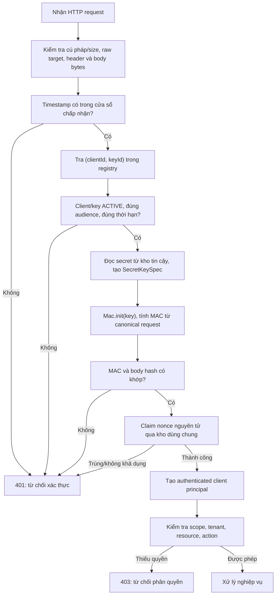

# SecretKeySpec trong JCA Mac API

## Mục tiêu học tập

Trong chương **JCA Mac API**, `SecretKeySpec` là lớp thường gặp khi ứng dụng Java cần chuyển **dãy byte của shared secret** thành một đối tượng khóa để gọi `javax.crypto.Mac`. Đây là bước quan trọng trong module `SECURITY_AUTHENTICATION_HMAC_REQUEST_AUTHENTICATION`: thiết kế xác thực HTTP request bằng HMAC với shared secret và canonical request chứa phương thức, URI, header hoặc body theo hợp đồng ký. Sau bước tạo khóa, client còn phải ký đúng dữ liệu; server phải chọn đúng khóa, kiểm tra chữ ký, chống replay bằng timestamp/nonce, xử lý key rotation và phân quyền.

Bài học tập trung vào **vai trò, API và cách dùng `SecretKeySpec` đúng với HMAC-SHA256**. Qua bài này, bạn sẽ:

- Giải thích `SecretKeySpec` là gì và **không** đảm nhiệm những gì trong quy trình xác thực request.
- Khởi tạo `SecretKeySpec` từ raw key bytes, hiểu ý nghĩa của chuỗi thuật toán `"HmacSHA256"`, hai constructor và các phương thức `getAlgorithm()`, `getFormat()`, `getEncoded()`.
- Dùng `SecretKeySpec` với `Mac.getInstance("HmacSHA256")`, `Mac.init(...)`, `Mac.doFinal(...)` để tạo/xác minh MAC.
- Tránh nhầm lẫn giữa key bytes, chuỗi Base64URL, `clientId`, `keyId` và chữ ký.
- Gắn việc dùng khóa vào quy trình chống replay, quản lý secret/key rotation, kiểm thử qua proxy/gateway và phân biệt authentication với authorization.

## 1. `SecretKeySpec` nằm ở đâu trong JCA/JCE?

Java Cryptography Architecture (JCA), cùng các API mật mã trong JDK, cung cấp hai vai trò tách biệt:

- **`javax.crypto.Mac`:** đối tượng thực hiện thuật toán MAC, ví dụ `HmacSHA256`. Nó nhận một khóa đã khởi tạo và byte của message/canonical request.
- **`javax.crypto.spec.SecretKeySpec`:** đối tượng biểu diễn **khóa bí mật đối xứng từ các byte đã có**. Lớp này triển khai giao diện `javax.crypto.SecretKey` để `Mac.init(Key)` có thể nhận khóa.

Luồng triển khai cơ bản:

```text
[Shared secret từ quy trình cấp phát tin cậy]
                   |
                   v
         raw key bytes (byte[])
                   |
                   v
     new SecretKeySpec(keyBytes, "HmacSHA256")
                   |
                   v
     Mac.getInstance("HmacSHA256")
           mac.init(secretKey)
                   |
                   v
     mac.doFinal(UTF8(canonicalRequest))
                   |
                   v
          HMAC bytes (32 byte)
                   |
                   v
       Base64URL để truyền chữ ký
```

`SecretKeySpec` **không tự sinh khóa ngẫu nhiên**, không lưu khóa an toàn, không gọi HMAC và không xác thực HTTP request. Nó chỉ bọc dữ liệu khóa dưới một tên thuật toán để đưa vào API mật mã.

### 1.1. Phân biệt năm thành phần quan trọng

| Thành phần | Ví dụ | Trách nhiệm |
| --- | --- | --- |
| `clientId` | `orders-service-prod` | Định danh công khai để server tra client registry; tự khai trong request nên chưa đáng tin. |
| `keyId` | `hmac-2026-11` | Chọn đúng phiên bản credential cho client; phục vụ rotation. Không phải secret. |
| **Shared secret bytes** | 32 byte ngẫu nhiên | Bí mật cần được cấp và giữ an toàn ở hai phía, không gửi trực tiếp trong request. |
| **`SecretKeySpec`** | `new SecretKeySpec(raw, "HmacSHA256")` | Đối tượng `SecretKey` trong bộ nhớ, dùng khởi tạo phép HMAC. |
| **Chữ ký HMAC** | MAC được mã hóa Base64URL | Kết quả tính trên canonical request, có thể đưa vào header `X-Signature` để server xác minh. |

Điểm dễ nhầm: server có thể **đọc `X-Key-Id` để tra secret**, nhưng chỉ có thể xác thực danh tính client **sau khi** MAC hợp lệ và các bước kiểm tra bắt buộc thành công. Một header `X-Client-Id` không chứng minh được người gửi nắm giữ khóa.

## 2. API của `SecretKeySpec`

Lớp nằm trong package:

```java
import javax.crypto.spec.SecretKeySpec;
```

Hai constructor thường dùng:

```java
SecretKeySpec(byte[] key, String algorithm)

SecretKeySpec(byte[] key, int offset, int len, String algorithm)
```

Trong trường hợp HMAC-SHA256, thuật toán truyền cho constructor là tên thuật toán Java `"HmacSHA256"`, tương ứng với `Mac.getInstance("HmacSHA256")`.

| API | Ý nghĩa | Lưu ý |
| --- | --- | --- |
| `new SecretKeySpec(bytes, "HmacSHA256")` | Dùng toàn bộ mảng byte làm khóa. | `bytes` phải là **raw secret**, không phải ký tự Base64/hex chưa decode. |
| `new SecretKeySpec(buffer, offset, len, "HmacSHA256")` | Lấy một đoạn byte từ mảng nguồn làm khóa. | `offset` và `len` phải hợp lệ; dùng khi buffer chứa dữ liệu ngoài vùng khóa. |
| `getAlgorithm()` | Trả tên thuật toán đã khai báo. | Ví dụ `"HmacSHA256"`. Không phải phép kiểm chứng chất lượng/entropy khóa. |
| `getFormat()` | Trả định dạng khóa. | Với `SecretKeySpec` là `"RAW"`. |
| `getEncoded()` | Trả byte khóa trong dạng RAW. | **Nhạy cảm**; không in ra log hoặc gửi qua HTTP. |

`SecretKeySpec` sao chép byte nguồn tại thời điểm khởi tạo. Nếu mảng nguồn sau đó bị sửa, byte đã bọc trong `SecretKeySpec` không đổi. `getEncoded()` cũng trả về một mảng byte độc lập; tuy nhiên, mọi bản sao đó đều chứa secret, phải được bảo vệ.

```java
import javax.crypto.spec.SecretKeySpec;
import java.util.Arrays;

byte[] raw = new byte[32]; // Trong thực tế: đọc khóa đã cấp từ secret store.
Arrays.fill(raw, (byte) 0x2A); // Chỉ là byte giả cho ví dụ API, KHÔNG sinh key thật.
SecretKeySpec spec = new SecretKeySpec(raw, "HmacSHA256");

Arrays.fill(raw, (byte) 0);
System.out.println(spec.getAlgorithm()); // HmacSHA256
System.out.println(spec.getFormat());    // RAW

byte[] copied = spec.getEncoded();        // Vẫn có byte khóa đã bọc.
System.out.println(copied.length);       // 32
Arrays.fill(copied, (byte) 0);
```

**Không dùng khóa toàn byte `0x2A` cho môi trường thật**: đoạn trên chỉ minh họa hành vi copy của constructor. Một lưu ý bảo mật: dù xóa `raw` hoặc `copied` bằng `Arrays.fill`, ta **không thể bảo đảm** đã xóa mọi bản sao trong heap/JVM/provider; `SecretKeySpec` giữ một bản sao riêng. Hạn chế thời gian sống, quyền truy cập process, heap dump và số bản sao của secret.

### 2.1. Lớp này không kiểm tra chất lượng khóa

`SecretKeySpec` không xác minh rằng dãy byte có entropy đủ mạnh, có được cấp cho đúng client, còn hiệu lực hoặc có thể dùng trên server hiện tại hay không. Constructor chấp nhận tên thuật toán được cung cấp và sao chép byte, nhưng kiểm tra tính phù hợp với provider/thuật toán khi dùng thực sự thường nằm ở `Mac.init(...)`. Với khóa null/rỗng hoặc offset/length không hợp lệ, thao tác tạo object có thể bị từ chối.

Vì thế, trước khi dùng key, ứng dụng phải có các lớp kiểm soát riêng: định dạng/độ dài key, nguồn cấp phát, trạng thái credential, client/audience được phép, key rotation và chính sách sử dụng.

### 2.2. `SecretKeySpec` khác `KeyGenerator` thế nào?

`KeyGenerator` tạo khóa theo thuật toán, còn `SecretKeySpec` **bọc byte khóa đã có**:

```java
import javax.crypto.KeyGenerator;
import javax.crypto.SecretKey;
import java.security.SecureRandom;

KeyGenerator generator = KeyGenerator.getInstance("HmacSHA256");
generator.init(256, new SecureRandom());
SecretKey generatedKey = generator.generateKey();

// Lúc cần bọc shared secret bytes đã cấp riêng:
// SecretKey sharedKey = new SecretKeySpec(existingRawBytes, "HmacSHA256");
```

Lệnh trên minh họa cách tạo khóa với provider JCA hỗ trợ. Một `SecretKey` do provider quản lý có thể không cho phép xuất raw key bằng `getEncoded()` (trả `null`); điều đó bình thường đối với khóa được quản lý theo chính sách không xuất. Không ép mọi khóa về `SecretKeySpec` nếu HSM/KMS/provider cung cấp khóa dạng handle hoặc cơ chế tính HMAC mà không lộ byte.

Trong tích hợp HMAC có **shared secret ở hai phía**, cần một quy trình cấp phát an toàn để client và server cùng truy cập được credential tương ứng. `SecretKeySpec` chỉ là cách biểu diễn byte mà một ứng dụng Java đã nhận được, không phải giao thức trao đổi khóa.

## 3. Tạo và cấp phát raw key bytes đúng cách

Với HMAC-SHA256, lựa chọn thực tế là **32 byte được sinh bằng CSPRNG** (256 bit ngẫu nhiên). Không dùng `Random`, tên client, timestamp, password dễ đoán hoặc UUID ghép tùy tiện để giả làm secret mạnh.

```java
import java.security.SecureRandom;
import java.util.Base64;

byte[] rawKey = new byte[32];
new SecureRandom().nextBytes(rawKey);

// Chỉ mã hóa để truyền qua một QUY TRÌNH CẤP PHÁT AN TOÀN:
String encodedForProvisioning =
        Base64.getUrlEncoder().withoutPadding().encodeToString(rawKey);

// Bên nhận giải mã TRỞ LẠI đúng raw key bytes:
byte[] restoredKey =
        Base64.getUrlDecoder().decode(encodedForProvisioning);
SecretKeySpec secretKey =
        new SecretKeySpec(restoredKey, "HmacSHA256");
```

Không in `rawKey` hay `encodedForProvisioning` ra console/log. **Base64URL không mã hóa bảo mật**: bất kỳ ai đọc được chuỗi đều có thể khôi phục raw key. Sử dụng secret manager/KMS, quyền truy cập tối thiểu, cơ chế cấp phát bảo mật và kiểm toán phù hợp.

### 3.1. Sai lầm rất phổ biến: dùng UTF-8 của Base64 làm khóa

Giả sử secret 32 byte được cấp dưới dạng chuỗi Base64URL không padding (thường dài 43 ký tự). Hai cách sau **không tương đương**:

```java
String keyText = secretStore.read("orders/hmac-2026-11");

// ĐÚNG: decode representation về 32 byte nguyên gốc.
byte[] correct = Base64.getUrlDecoder().decode(keyText);
SecretKeySpec validKey = new SecretKeySpec(correct, "HmacSHA256");

// SAI nếu keyText là dữ liệu Base64URL được cấp phát:
byte[] wrong = keyText.getBytes(java.nio.charset.StandardCharsets.UTF_8);
SecretKeySpec wrongKey = new SecretKeySpec(wrong, "HmacSHA256");
```

`correct` là byte khóa gốc; `wrong` là byte ASCII/UTF-8 của **ký tự biểu diễn** khóa. Cả hai có thể tạo được `SecretKeySpec`, nhưng sẽ cho chữ ký HMAC khác nhau. Không sửa bằng cách thêm `trim()` mù quáng hay chuyển qua bảng mã khác: định nghĩa một định dạng credential rõ ràng (Base64URL, Base64 chuẩn hoặc hex), kiểm tra cú pháp, rồi decode đúng.

### 3.2. Ai được nắm giữ shared secret?

Secret phía client được giữ ở nơi ứng dụng có thể tính MAC, thường là backend hoặc service do tổ chức vận hành. Secret phía server được giữ trong kho bảo mật/secret manager hoặc provider mật mã có quyền truy cập hạn chế.

- Mỗi **client**, môi trường và nhóm API/audience có phạm vi khác nhau nên có secret riêng theo mô hình quyền.
- Không commit secret vào repository, mã nguồn, test fixture công khai, image Docker hay pipeline log.
- Không nhúng secret lâu dài vào JavaScript frontend hoặc ứng dụng mobile có thể bị người dùng thiết bị trích xuất; đặt thao tác ký ở backend đáng tin cậy hoặc dùng mô hình xác thực khác phù hợp.
- Không truyền raw secret trong các header `X-Signature` hay `X-Key-Id`. Header chữ ký chỉ mang **MAC đã tính**, key ID chỉ mang **định danh phiên bản khóa**.
- Khi nghi rò rỉ, phải **thu hồi và thay bằng secret mới**, vì người biết secret có thể tạo chữ ký mới hợp lệ.

## 4. Kết hợp `SecretKeySpec` với `Mac` để tạo chữ ký request

Hàm HMAC ký **byte của thông điệp**, không tự hiểu HTTP. Client và server phải định nghĩa cùng một *canonical request contract*: method, raw target (URI/path+query), header được ký, body hash, timestamp/nonce, client ID, key ID và audience nếu cần.

Hợp đồng minh họa `v1` có **11 dòng**, được nối bằng LF (`\n`) và **không có LF cuối**:

```text
HMAC-SHA256
v1
billing-api-prod
orders-service-prod
hmac-2026-11
POST
/v1/payments?merchant=merchant-42
application/json
<base64url-sha256-of-exact-body-bytes>
1795800000
Q9E_qfRQbZ-6VZ_UZ2zYgg
```

Thứ tự trường là: **tên thuật toán trong hợp đồng, phiên bản, audience, client ID, key ID, method, raw path+query, Content-Type, body hash, timestamp giây, nonce**.

Quy ước của ví dụ:

1. Method viết hoa; raw path+query giữ nguyên percent-encoding, thứ tự tham số và dấu slash tại điểm ký/xác minh. Không tự sort query hoặc dùng URI đã decode/encode lại.
2. `Content-Type` bỏ khoảng trắng ASCII/tab ở hai đầu, không biến đổi phần còn lại; thiếu thì dùng chuỗi rỗng. Header liên quan đến ký phải được kiểm tra cú pháp và từ chối bản sao trùng lặp mơ hồ.
3. Body hash là **SHA-256 của đúng byte body được gửi/nhận**, mã hóa Base64URL không padding. Không parse rồi serialize lại JSON. Ví dụ chỉ chấp nhận `Content-Encoding` rỗng/`identity` để tránh thay byte do giải nén.
4. Timestamp là Unix epoch **giây**, nonce là giá trị ngẫu nhiên ít nhất 128 bit và cả hai đều nằm trong dữ liệu ký. `X-Signature` và raw secret **không** được đưa vào canonical request.
5. Trường canonical cấm ký tự CR/LF và phải giới hạn độ dài. `audience` là tên API đích đáng tin cậy (ví dụ cấu hình server), không lấy quyền từ giá trị do client tự khai.
6. Thuật toán trong Java là `"HmacSHA256"`; chuỗi `HMAC-SHA256` trong canonical chỉ là nhãn của **hợp đồng minh họa**, không phải tên class hoặc provider JCA.

Nếu header `X-Content-SHA256` được truyền riêng, server phải đối chiếu nó với hash tự tính trên byte body **và** dùng giá trị đó trong canonical request. Nếu proxy thay body, URI hay Content-Type sau khi client ký, byte canonical phía server có thể khác dù shared secret không đổi.

## 5. Ví dụ Java 17+: ký và kiểm tra MAC bằng `SecretKeySpec`

Đoạn code dưới đây **chạy được độc lập** với JDK 17+. Nó mô phỏng client/server được cấp **cùng raw secret** qua một kênh an toàn, sau đó dùng hai `SecretKeySpec` riêng để ký và kiểm tra. Code không phụ thuộc Spring hoặc SDK HTTP, nên chỉ chứng minh phần mật mã; tích hợp thực tế phải bổ sung registry, parser HTTP, replay store và authorization.

```java
import java.nio.charset.StandardCharsets;
import java.security.GeneralSecurityException;
import java.security.MessageDigest;
import java.security.SecureRandom;
import java.time.Instant;
import java.util.Arrays;
import java.util.Base64;
import javax.crypto.Mac;
import javax.crypto.spec.SecretKeySpec;

public final class SecretKeySpecHmacDemo {
    private static final Base64.Encoder B64 =
            Base64.getUrlEncoder().withoutPadding();
    private static final Base64.Decoder B64_DECODER =
            Base64.getUrlDecoder();

    private SecretKeySpecHmacDemo() {}

    static String bodyHash(byte[] body) throws GeneralSecurityException {
        byte[] digest = MessageDigest.getInstance("SHA-256").digest(body);
        return B64.encodeToString(digest);
    }

    static String canonical(
            String audience, String clientId, String keyId,
            String method, String rawTarget, String contentType,
            byte[] body, String timestamp, String nonce)
            throws GeneralSecurityException {
        String normalizedContentType =
                contentType == null ? "" : trimOws(contentType);
        String[] fields = {
                "HMAC-SHA256", "v1", audience, clientId, keyId,
                method, rawTarget, normalizedContentType,
                bodyHash(body), timestamp, nonce
        };
        for (String field : fields) {
            if (field == null || field.indexOf('\r') >= 0
                    || field.indexOf('\n') >= 0) {
                throw new IllegalArgumentException("Invalid canonical field");
            }
        }
        if (!method.matches("[A-Z]+") || !rawTarget.startsWith("/")) {
            throw new IllegalArgumentException("Invalid request target/method");
        }
        return String.join("\n", fields);
    }

    static String trimOws(String input) {
        int start = 0;
        int end = input.length();
        while (start < end && (input.charAt(start) == ' '
                || input.charAt(start) == '\t')) {
            start++;
        }
        while (end > start && (input.charAt(end - 1) == ' '
                || input.charAt(end - 1) == '\t')) {
            end--;
        }
        return input.substring(start, end);
    }

    static byte[] hmac(
            byte[] rawSecret, String canonicalRequest)
            throws GeneralSecurityException {
        // SecretKeySpec chỉ BỌC raw bytes cho JCA Mac.
        SecretKeySpec key = new SecretKeySpec(rawSecret, "HmacSHA256");
        // Mac thực hiện thuật toán HMAC-SHA256.
        Mac mac = Mac.getInstance("HmacSHA256");
        mac.init(key);
        return mac.doFinal(
                canonicalRequest.getBytes(StandardCharsets.UTF_8));
    }

    static String sign(
            byte[] rawSecret, String canonicalRequest)
            throws GeneralSecurityException {
        return B64.encodeToString(hmac(rawSecret, canonicalRequest));
    }

    static boolean verify(
            byte[] rawSecret, String canonicalRequest, String signature)
            throws GeneralSecurityException {
        // 32 byte MAC HMAC-SHA256 -> 43 ký tự Base64URL không padding.
        if (signature == null ||
                !signature.matches("[A-Za-z0-9_-]{43}")) {
            return false;
        }
        byte[] supplied;
        try {
            supplied = B64_DECODER.decode(signature);
        } catch (IllegalArgumentException ex) {
            return false;
        }
        if (supplied.length != 32 ||
                !B64.encodeToString(supplied).equals(signature)) {
            return false;  // Loại biểu diễn không chuẩn.
        }
        byte[] expected = hmac(rawSecret, canonicalRequest);
        // So sánh theo byte MAC để hạn chế sai lệch thời gian.
        return MessageDigest.isEqual(expected, supplied);
    }

    public static void main(String[] args)
            throws GeneralSecurityException {
        SecureRandom random = new SecureRandom();

        // MÔ PHỎNG cấp phát: secret thật phải từ secret manager.
        byte[] provisionedSecret = new byte[32];
        random.nextBytes(provisionedSecret);
        String encoded = B64.encodeToString(provisionedSecret);
        byte[] clientSecret = B64_DECODER.decode(encoded);
        byte[] serverSecret = B64_DECODER.decode(encoded);

        byte[] body = "{\"amount\":120000,\"currency\":\"VND\"}"
                .getBytes(StandardCharsets.UTF_8);
        byte[] nonceBytes = new byte[16]; // 128 bit
        random.nextBytes(nonceBytes);

        String canonicalRequest = canonical(
                "billing-api-prod",
                "orders-service-prod",
                "hmac-2026-11",
                "POST",
                "/v1/payments?merchant=merchant-42",
                "application/json",
                body,
                Long.toString(Instant.now().getEpochSecond()),
                B64.encodeToString(nonceBytes)
        );

        String signature = sign(clientSecret, canonicalRequest);
        System.out.println("Valid request: " +
                verify(serverSecret, canonicalRequest, signature));

        String changedRequest = canonicalRequest.replace(
                "merchant=merchant-42", "merchant=merchant-99");
        System.out.println("Modified request accepted: " +
                verify(serverSecret, changedRequest, signature));

        // Nỗ lực dọn các mảng ở ứng dụng; không bảo đảm xoá bản sao JVM.
        Arrays.fill(provisionedSecret, (byte) 0);
        Arrays.fill(clientSecret, (byte) 0);
        Arrays.fill(serverSecret, (byte) 0);
    }
}
```

Kết quả kỳ vọng:

```text
Valid request: true
Modified request accepted: false
```

**Giải thích đường đi của khóa:** `provisionedSecret` là byte gốc được sinh để mô phỏng một lần cấp phát; `clientSecret` và `serverSecret` chứa cùng giá trị sau khi decode. Trong hệ thống thật, hai phía nhận secret qua kênh quản lý bí mật riêng và không trao trực tiếp trong HTTP API đang được xác thực. `SecretKeySpec` được tạo **trong `hmac(...)`** từ mảng byte cần dùng; `Mac.init(key)` nạp key vào engine mật mã và `doFinal(...)` tính MAC của byte UTF-8 từ canonical request.

**Giới hạn có chủ đích của demo:** `verify(...)` chỉ xác minh MAC của chuỗi canonical đã cung cấp; một HTTP server thật **không được tin canonical string do client gửi nguyên vẹn**. Server phải tự tạo chuỗi đó từ method, raw target, header và body byte thực nhận; kiểm tra body hash, timestamp, nonce, client/key, audience trước khi gắn authenticated principal. Demo không thực thi nonce store hay authorization.

### 5.1. Dùng `Mac.update(...)` khi message được xử lý từng đoạn

JCA `Mac` còn hỗ trợ nạp dữ liệu thành từng phần:

```java
SecretKeySpec key = new SecretKeySpec(rawSecret, "HmacSHA256");
Mac mac = Mac.getInstance("HmacSHA256");
mac.init(key);
mac.update(part1);
mac.update(part2);
byte[] signatureBytes = mac.doFinal();
```

Kết quả chỉ tương đương `mac.doFinal(concat(part1, part2))` nếu các byte và thứ tự phần trùng khớp hoàn toàn. Với hợp đồng canonical request, cách đơn giản nhất vẫn là xây dựng rõ ràng dãy byte canonical rồi gọi `doFinal(...)` một lần. Nếu dùng streaming, cần giữ chính xác mọi dấu phân cách và thứ tự byte theo hợp đồng.

`Mac` có **trạng thái nội bộ và không nên dùng chung một instance giữa các thread**. Tạo instance phù hợp cho mỗi phép ký/xác minh hoặc sử dụng quản lý instance an toàn theo provider. Không để concurrent request gọi `init`/`update`/`doFinal` trên cùng một `Mac`.

## 6. Kiểm tra đúng key trước khi tạo authenticated principal

Trong một API có nhiều client và nhiều phiên bản key, các header thường có:

```http
X-Client-Id: orders-service-prod
X-Key-Id: hmac-2026-11
X-Timestamp: <unix-epoch-seconds>
X-Nonce: <random-base64url>
X-Content-SHA256: <body-hash-base64url>
X-Signature: <hmac-sha256-base64url>
```

`X-Client-Id` và `X-Key-Id` là **chỉ dẫn tra cứu chưa xác thực**. Server có thể tìm credential theo cặp đó, nhưng phải kiểm tra credential thuộc đúng client, còn hiệu lực, có audience phù hợp và được phép dùng thuật toán HmacSHA256 theo **chính sách server**. Không để client tự chọn một thuật toán yếu hơn hoặc `none`.

Luồng phía server:



Phần `Mac` và `SecretKeySpec` chỉ nằm tại bước tính lại MAC. Xử lý timestamp/nonce và quyền là trách nhiệm của ứng dụng, không có sẵn trong `SecretKeySpec`.

### 6.1. Pseudocode xác minh HTTP request

```text
validateUniqueSignedHeadersAndRequestSize(request)
t = parseTimestampSeconds(request.X-Timestamp)
if abs(nowSeconds - t) > 300: reject 401

client = registry.findClient(request.X-Client-Id)
credential = registry.findCredential(client.id, request.X-Key-Id)
if client/key disabled or expired: reject 401
if expectedAudience not permitted for credential/client: reject 401

rawSecret = secretStore.resolve(credential.secretRef)
bodyHash = Base64URL(SHA256(exactReceivedBodyBytes))
if bodyHash != request.X-Content-SHA256: reject 401
canonical = buildCanonicalFromReceivedRequest(
    expectedAudience, client.id, credential.keyId,
    method, rawTarget, contentType, bodyHash, t, nonce
)
expectedMac = JCA_Mac_HmacSHA256(new SecretKeySpec(rawSecret, "HmacSHA256"),
                                 UTF8(canonical))
if !constantTimeEqual(expectedMac, decode(request.X-Signature)): reject 401

if !nonceStore.claimOnce(audience, client.id, credential.keyId,
                         nonce, ttlSeconds=610): reject 401
principal = buildPrincipalFromServerRegistry(client)
if !authorize(principal, action, resource, tenant): reject 403
processRequest()
```

Ví dụ cửa sổ timestamp **±300 giây** chỉ là chính sách minh họa; hệ thống thực tế phải xét sai số đồng hồ, latency và yêu cầu bảo mật. Nếu chấp nhận timestamp tương lai tới 300 giây và quá khứ tới 300 giây, nonce cần được lưu đủ lâu để bao phủ phần thời gian còn có thể replay; ví dụ TTL **610 giây từ lúc claim** cho biên 600 giây. Kho nonce phải dùng **thao tác put-if-absent nguyên tử** và chia sẻ giữa các instance. Không dùng quy trình `GET` rồi `SET` tách rời.

**Nonce chống phát lại không thay thế idempotency.** Một thao tác thanh toán được gửi lại với nonce mới vẫn có chữ ký HMAC hợp lệ; hệ thống cần idempotency key và ràng buộc nghiệp vụ để tránh thực thi trùng.

### 6.2. So sánh chữ ký và lỗi xác thực

HMAC-SHA256 sinh 32 byte. Khi nhận `X-Signature`, kiểm tra cú pháp Base64URL, độ dài chuẩn, decode thành byte rồi so sánh với MAC kỳ vọng bằng `MessageDigest.isEqual(expectedBytes, suppliedBytes)`. Tránh `String.equals` hoặc so sánh từng byte dừng ngay ở byte đầu tiên sai. Các lỗi như client không tồn tại, key bị thu hồi hoặc MAC sai thường trả thông tin bên ngoài cùng mức chi tiết (ví dụ `401`) để hạn chế tiết lộ registry. Logging nội bộ vẫn nên ghi mã nguyên nhân an toàn, correlation ID, client ID/key ID khi phù hợp, tuyệt đối không log secret.

## 7. Key rotation gắn với `SecretKeySpec` như thế nào?

`SecretKeySpec` không có tính năng `rotate()`, trạng thái `ACTIVE` hay TTL. Mỗi lần ứng dụng cần ký/xác minh bằng credential mới, nó lấy **raw key bytes tương ứng với key ID mới**, tạo object `SecretKeySpec` hoặc dùng key từ provider, rồi gọi `Mac.init(...)`.

Ví dụ:

| Client ID | Key ID | Nơi lấy secret | Trạng thái |
| --- | --- | --- | --- |
| `orders-service-prod` | `hmac-2026-09` | `secrets/orders/2026-09` | `RETIRING` |
| `orders-service-prod` | `hmac-2026-11` | `secrets/orders/2026-11` | `ACTIVE` |
| `reporting-service-prod` | `hmac-2026-11` | `secrets/reporting/2026-11` | `ACTIVE` |

Hai key ID giống nhau giữa các client **không có nghĩa là cùng secret** nếu registry định nghĩa key ID theo phạm vi client. Phải lookup bằng `(clientId, keyId)` và kiểm tra quyền của client.

Quy trình rotation thực tế:

1. Sinh **secret mới hoàn toàn độc lập** bằng CSPRNG, tạo key ID mới, cấu hình audience/hiệu lực và cấp an toàn cho client.
2. Server cho phép key cũ và mới **cùng hợp lệ trong một thời gian chuyển tiếp có giới hạn**; mỗi request xác minh với secret đúng key ID được ký.
3. Client chuyển sang ký request mới bằng key mới; server quan sát lượng request key cũ.
4. Sau thời gian chuyển đổi, đánh dấu key cũ `REVOKED`, thu hồi quyền đọc secret và xử lý cache khóa để việc thu hồi có hiệu lực.
5. Khi nghi key bị lộ, ưu tiên thu hồi khẩn cấp theo chính sách ứng phó sự cố; không mặc định giữ key lộ hoạt động vì muốn tránh lỗi migration.

Rotation thường **không đổi `clientId` hoặc quyền** của tích hợp. `keyId` chỉ xác định credential đang dùng; authenticated principal được dựng từ registry sau xác minh. Khi key cũ bị thu hồi, việc tính HMAC với secret cũ có thể vẫn cho MAC toán học đúng, nhưng **chính sách xác thực phải từ chối key**.

## 8. Proxy/gateway và byte canonical: vì sao key đúng vẫn bị từ chối?

HMAC ký dữ liệu ở mức **byte**, không ký “ý nghĩa” trừu tượng của JSON hay URI. Những biến đổi trên đường đi làm client và server có canonical request khác nhau:

| Tình huống | Vì sao MAC có thể sai? | Cách xử lý |
| --- | --- | --- |
| Gateway đổi `/public/pay` thành `/internal/pay` | Raw target không còn giống dữ liệu client ký. | Xác minh trước rewrite, hoặc truyền thông tin gốc qua kênh tin cậy có bảo vệ theo hợp đồng. |
| Proxy đảo query `?a=1&b=2` thành `?b=2&a=1` | Hai chuỗi raw target khác byte. | Không tự sort query nếu hợp đồng ký raw target. |
| Framework decode `%2F` thành `/` hoặc chuẩn hóa `%20` thành `+` | Ký và kiểm tra hai representation khác nhau. | Xác định ranh giới lấy raw path/query, thử test vector có encoding đặc biệt. |
| Middleware parse/serialize JSON, thay khoảng trắng hoặc thứ tự key | Hash của body byte thay đổi. | Tính hash byte body gốc trước khi parse/transform. |
| Gateway giải nén gzip hoặc đổi Content-Type | Byte body hoặc header đã ký đổi. | Quy định rõ byte ký và content-encoding; ví dụ chỉ nhận `identity`. |
| Gateway xác minh rồi forward `X-Client-Id` như principal | Client ngoài có thể tự giả mạo header nếu edge không chặn. | Xóa header nội bộ từ internet; truyền principal đã xác thực qua trust boundary và kênh đáng tin. |

`SecretKeySpec` không liên quan tới việc chuẩn hóa URI/header. Khi điều tra lỗi chữ ký, đừng đổi secret tùy tiện: kiểm tra chuỗi canonical **ở điểm đã thiết kế**, body hash, định dạng MAC, key ID và sự biến đổi của proxy. Nếu log canonical request để debug, phải loại bỏ dữ liệu nhạy cảm và hạn chế thời gian lưu.

## 9. Những lỗi thường gặp khi dùng `SecretKeySpec`

| Lỗi | Hậu quả | Cách tránh |
| --- | --- | --- |
| Dùng `"SHA-256"` cho `SecretKeySpec` nhưng `Mac.getInstance("HmacSHA256")` | Tên thuật toán khóa không phù hợp với MAC provider, có thể bị từ chối ở `init`. | Dùng tên `"HmacSHA256"` nhất quán trong JCA. |
| Dùng byte UTF-8 của chuỗi Base64 làm raw key | Chữ ký khác dù các chuỗi secret hiển thị “giống”. | Decode Base64URL/hex về raw key bytes. |
| Secret yếu, hard-code trong source | Giả mạo client hoặc lộ khóa qua repo/log. | Sinh 32 byte CSPRNG; cấp từ secret manager và rotate. |
| Cho rằng `SecretKeySpec` đã kiểm tra key length/expiry | Key yếu, hết hạn hoặc sai client vẫn được bao gói. | Validation và chính sách tại registry; không dựa vào constructor. |
| Gọi `getEncoded()` rồi log/serialize | Lộ raw secret. | Không xuất key trừ khi thực sự cần; bảo vệ mọi bản sao. |
| Dùng chung một `Mac` cho nhiều thread | State `init/update/doFinal` bị chồng chéo, kết quả sai. | Instance riêng hoặc cơ chế đồng bộ/điều phối an toàn. |
| Tự lấy chuỗi canonical từ HTTP header do client cung cấp | Có thể bỏ qua việc ký đúng method, URI, body thật. | Server tự dựng canonical từ request thực nhận. |
| Không ký `clientId`, `keyId`, audience | Gia tăng nguy cơ nhầm khóa/danh tính và cross-service replay. | Đưa các trường này vào hợp đồng và đối chiếu registry. |
| Chữ ký hợp lệ nhưng không lưu nonce | Request cũ có thể replay trong cửa sổ timestamp. | Timestamp ký kèm + nonce store dùng ghi nguyên tử. |
| Chữ ký hợp lệ được xem là có mọi quyền | Client truy cập sai scope, tenant, resource. | Authorization độc lập sau authentication. |
| Cố dùng `SecretKeySpec` với khóa HSM không xuất | Mất cơ chế bảo vệ key hoặc không thể lấy RAW bytes. | Dùng provider API/`SecretKey` handle hoặc dịch vụ MAC phù hợp. |

### 9.1. Phân biệt authentication và authorization qua ví dụ

Giả sử request `POST /v1/payments` có MAC đúng, được tạo bằng `SecretKeySpec` chứa secret của `orders-service-prod` và nonce mới:

- **Authentication:** sau khi đối chiếu secret, MAC, timestamp, nonce, audience và trạng thái key, server xác thực **client** `orders-service-prod`.
- **Authorization:** server còn phải kiểm tra client có scope `payments:create`, được phép với tenant `merchant-42` và đúng tài nguyên/đối tượng nghiệp vụ hay không.
- Nếu chữ ký sai hoặc key bị thu hồi → **401 Unauthorized** theo chính sách mẫu. Nếu chữ ký hợp lệ nhưng không có quyền cho tenant → **403 Forbidden**. Việc body có trường `userId` không tự chứng minh người dùng cuối đó đã đăng nhập.

## 10. Kiểm thử `SecretKeySpec` và HMAC đúng cách

### 10.1. Kiểm thử đơn vị với test vector đã biết

Có thể dùng **test case 1 của RFC 4231** để kiểm tra phép HMAC-SHA256 độc lập khỏi HTTP. Input của test vector là 20 byte `0x0b` và nội dung ASCII `"Hi There"`. MAC kỳ vọng ở dạng hex:

```text
b0344c61d8db38535ca8afceaf0bf12b881dc200c9833da726e9376c2e32cff7
```

Ví dụ Java 17+:

```java
import java.nio.charset.StandardCharsets;
import java.util.Arrays;
import java.util.HexFormat;
import javax.crypto.Mac;
import javax.crypto.spec.SecretKeySpec;

byte[] testKey = new byte[20]; // CHỈ dùng cho test vector RFC 4231.
Arrays.fill(testKey, (byte) 0x0b);
Mac mac = Mac.getInstance("HmacSHA256");
mac.init(new SecretKeySpec(testKey, "HmacSHA256"));
String actualHex = HexFormat.of().formatHex(
        mac.doFinal("Hi There".getBytes(StandardCharsets.US_ASCII)));
String expectedHex =
        "b0344c61d8db38535ca8afceaf0bf12b881dc200c9833da726e9376c2e32cff7";
System.out.println(actualHex.equals(expectedHex)); // true
```

Khóa 20 byte ở đây chỉ để tái hiện **test vector chuẩn**, không phải hướng dẫn sinh khóa production. Với credential HMAC-SHA256 mới cho tích hợp M2M, có thể chọn 32 byte sinh ngẫu nhiên như phần trước.

### 10.2. Ma trận kiểm thử end-to-end

| Trường hợp | Kết quả kỳ vọng |
| --- | --- |
| Cùng raw secret, canonical request và JCA algorithm ở hai phía | MAC khớp; request hợp lệ nếu mọi kiểm tra khác đạt. |
| Dùng biểu diễn Base64URL dưới dạng UTF-8 thay vì decode | MAC sai. |
| Đổi một byte key, method, raw URI, header đã ký hoặc body | MAC sai. |
| Giữ đúng MAC nhưng đổi `X-Client-Id`/`X-Key-Id` | Từ chối; metadata được ký và key lookup đúng client. |
| Dùng cùng credential nhưng sai audience/môi trường | Từ chối theo audience trong hợp đồng và registry. |
| Xác minh bằng key `REVOKED` | Từ chối trước khi tạo authenticated principal. |
| Gửi lại request đã ký với cùng nonce trong cửa sổ | Lần thứ hai bị chặn bằng nonce store nguyên tử. |
| Hai request đồng thời trên hai node dùng cùng nonce | Tối đa một request qua bước claim nonce. |
| Timestamp quá cũ hoặc quá xa tương lai | Từ chối. |
| Proxy thay raw path, query, body hoặc Content-Type | Kiểm thử phát hiện mismatch hoặc xác minh ở đúng ranh giới đã định. |
| Chữ ký hợp lệ nhưng tenant/scope không được cấp | Từ chối ở authorization, ví dụ 403. |
| `X-Signature` chứa Base64URL sai định dạng | Từ chối trước khi dùng MAC decode; không crash ứng dụng. |

Nên có **test vector canonical request** cho tất cả client SDK, chứa test secret giả, method, raw target, header, chính xác byte body, timestamp, nonce, canonical string, body hash và MAC mong đợi. Điều này giúp phân biệt lỗi chọn key với lỗi ký byte khác nhau và dễ phát hiện sự cố khi request đi qua gateway.

## 11. Bài thực hành

Xây dựng một client và server Java tối giản cho API `POST /v1/payments` sử dụng HMAC-SHA256:

1. Sinh shared secret **32 byte ngẫu nhiên**, cấp qua cấu hình bí mật an toàn cho client/server. Lấy raw bytes và tạo `SecretKeySpec(bytes, "HmacSHA256")`.
2. Dùng `Mac.getInstance`, `init` và `doFinal` tính MAC cho một canonical request có method, raw target, Content-Type, SHA-256 body, audience, client ID, key ID, timestamp và nonce. Gửi chữ ký dưới dạng Base64URL.
3. Phía server tra `(clientId, keyId)` từ registry, lấy raw secret đúng credential, tự tạo canonical request từ byte HTTP thực nhận và đối chiếu MAC.
4. Đặt replay store có thao tác ghi-if-absent nguyên tử và kiểm tra timestamp. Thử gửi lại cùng nonce và cho hai instance nhận đồng thời.
5. Cấp key ID thứ hai với **secret mới**; cho hai key cùng hiệu lực trong thời gian ngắn, sau đó thu hồi key cũ. Xác minh principal client không đổi, credential bị thu hồi không dùng được.
6. Đặt gateway rewrite prefix URI, thử signing/verifying trước và sau rewrite; sửa kiến trúc để hai phía có canonical request thống nhất.
7. Tạo một request ký hợp lệ nhưng thao tác vào tenant không được cấp quyền, rồi kiểm tra authentication thành công nhưng authorization trả 403.

**Câu hỏi tự đánh giá:** `SecretKeySpec` có tự kiểm tra khóa đã hết hạn hay không? Khi nào nên dùng `KeyGenerator` thay vì `SecretKeySpec`? Vì sao `new SecretKeySpec(base64Text.getBytes(UTF_8), ...)` thường sai? Tại sao hai instance Java không nên dùng chung một `Mac` mutable? Nếu HMAC hợp lệ nhưng nonce đã dùng, server có được tạo principal và xử lý nghiệp vụ không? Nếu key đúng nhưng gateway đổi raw path, nguyên nhân nằm ở khóa hay hợp đồng canonical request?

## 12. Tài liệu tham khảo để học sâu

- **Java SE API, `javax.crypto.spec.SecretKeySpec`:** constructors, định dạng `RAW` và cách biểu diễn secret key bytes.
- **Java SE API, `javax.crypto.Mac`:** `getInstance`, `init`, `update`, `doFinal`, các tên thuật toán chuẩn và hành vi provider.
- **RFC 2104 — HMAC: Keyed-Hashing for Message Authentication:** nguyên lý HMAC và việc dùng secret với hàm băm.
- **RFC 4231 — Identifiers and Test Vectors for HMAC-SHA-224, HMAC-SHA-256, HMAC-SHA-384, and HMAC-SHA-512:** test vector đối chiếu phép HMAC-SHA256.
- **RFC 4648 — Base Encodings:** cách biểu diễn Base64URL. Hãy luôn phân biệt encoding này với mã hóa bí mật.

`SecretKeySpec` là bước **biểu diễn shared secret thành khóa mà JCA Mac có thể sử dụng**. Nó phát huy đúng vai trò khi raw bytes được sinh và bảo vệ an toàn, hợp đồng canonical request không mơ hồ, server chọn đúng credential, và toàn bộ quy trình xác thực tiếp tục kiểm tra replay, key rotation, gateway và quyền trên tài nguyên.

