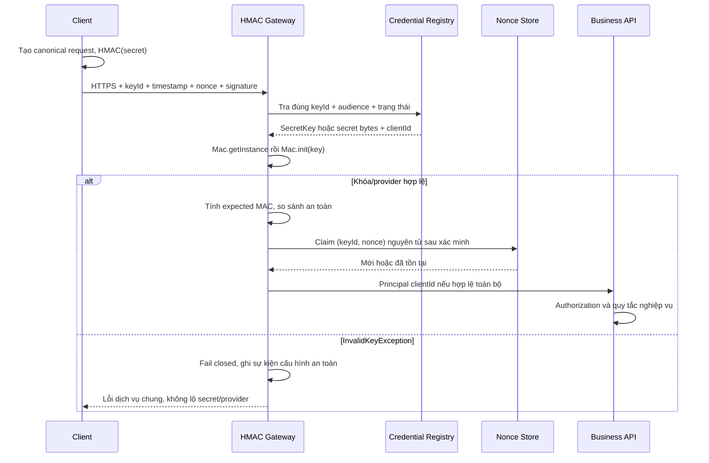

# InvalidKeyException trong JCA Mac API: Nguyên nhân, xử lý và xác minh HMAC request

Trong Java Cryptography Architecture (JCA), `java.security.InvalidKeyException` là ngoại lệ **checked** cho biết một khóa mật mã **không phù hợp với thao tác mật mã đang được khởi tạo**. Khi dùng `javax.crypto.Mac` để ký hoặc xác minh HTTP request bằng HMAC, ngoại lệ này đặc biệt liên quan đến lệnh `mac.init(key)`: bộ cung cấp thuật toán (*provider*) kiểm tra liệu `Key` được truyền vào có thể dùng với thuật toán MAC đã chọn hay không.

Đây là bài học về **InvalidKeyException** trong chương **JCA Mac API** của module `SECURITY_AUTHENTICATION_HMAC_REQUEST_AUTHENTICATION`. Bối cảnh ứng dụng là HMAC request authentication với shared secret, canonical request (phương thức HTTP, URI, các header hoặc body theo hợp đồng ký), timestamp/nonce chống replay, key rotation, thử nghiệm qua proxy/gateway và phân biệt **authentication** với **authorization**.

Lỗi quan trọng cần nhớ ngay: **“Chữ ký HMAC của client không khớp” không đồng nghĩa “JCA ném InvalidKeyException”.** Sai chữ ký thường chỉ là hai mảng byte MAC khác nhau. `InvalidKeyException` xuất hiện khi hệ thống **không thể khởi tạo thuật toán với khóa đang dùng**, thường là dấu hiệu credential/provider/cấu hình cần được kiểm tra.

## 1. Mục tiêu học tập

Sau bài học, người học có thể:

1. Chỉ ra chính xác bước `Mac.init(Key)` có thể ném `InvalidKeyException`, phân biệt với các lỗi `Mac.getInstance`, `SecretKeySpec` và `Mac.doFinal`.
2. Phân tích các nguyên nhân do dạng khóa, thuật toán, provider, khóa rỗng/hỏng hoặc chính sách sử dụng khóa; không gán mọi trường hợp chữ ký sai cho InvalidKeyException.
3. Xây dựng phương thức HMAC-SHA256 trong Java 17, kiểm soát lỗi khởi tạo khóa và so sánh MAC output an toàn.
4. Thiết kế cách ánh xạ lỗi: request không hợp lệ, credential bị thu hồi, lỗi cấu hình key và lỗi hạ tầng mật mã phải được xử lý đúng bản chất.
5. Viết các tình huống kiểm thử cho key rotation, timestamp/nonce, canonical request và gateway mà không làm lộ shared secret.

## 2. Vị trí của InvalidKeyException trong vòng đời JCA Mac

Java cung cấp các API liên quan:

| API | Vai trò | Ngoại lệ cần phân biệt |
| --- | --- | --- |
| `Mac.getInstance("HmacSHA256")` | Tìm triển khai thuật toán MAC theo cấu hình/provider JCA. | `NoSuchAlgorithmException` nếu thuật toán không khả dụng. |
| `new SecretKeySpec(secretBytes, "HmacSHA256")` | Tạo đối tượng `SecretKey` từ byte secret thô; **chưa** xác minh khóa có được provider chấp nhận. | `IllegalArgumentException` khi tham số constructor không hợp lệ, ví dụ mảng key rỗng. |
| `mac.init(secretKey)` | Khởi tạo `Mac` bằng khóa; provider kiểm tra khả năng sử dụng khóa. | **`InvalidKeyException`** nếu khóa không hợp lệ cho `Mac` cụ thể. |
| `mac.init(secretKey, params)` | Khởi tạo khóa cùng tham số thuật toán, chỉ khi thuật toán/provider hỗ trợ. | `InvalidKeyException` hoặc `InvalidAlgorithmParameterException`. |
| `mac.update(messageBytes)` | Nạp dần byte dữ liệu cần ký. | Có thể ném `IllegalStateException` nếu chưa khởi tạo. |
| `mac.doFinal()` / `mac.doFinal(messageBytes)` | Hoàn tất HMAC và trả `byte[]` MAC output. | Có thể ném `IllegalStateException` nếu chưa `init`; không dùng ngoại lệ này để biểu diễn chữ ký sai. |

`InvalidKeyException` thuộc họ `java.security.GeneralSecurityException` thông qua `KeyException`. Vì là checked exception, Java yêu cầu caller bắt hoặc khai báo `throws`. Trong ứng dụng HMAC, việc bắt ngoại lệ cần giữ được ngữ cảnh để phân loại chính xác **lỗi vận hành/credential** và **request không hợp lệ**.

### Đường đi tối thiểu

```java
import java.security.InvalidKeyException;
import java.security.NoSuchAlgorithmException;
import javax.crypto.Mac;
import javax.crypto.spec.SecretKeySpec;

public class MacInitExample {
    public static byte[] calculate(byte[] secret, byte[] message)
            throws InvalidKeyException, NoSuchAlgorithmException {

        Mac mac = Mac.getInstance("HmacSHA256");          // Có thể NoSuchAlgorithmException
        SecretKeySpec key = new SecretKeySpec(
                secret, "HmacSHA256");                     // Có thể IllegalArgumentException
        mac.init(key);                                    // Có thể InvalidKeyException
        return mac.doFinal(message);                      // Raw MAC output 32 byte
    }
}
```

Đoạn ngắn này minh họa vị trí phát sinh lỗi, chưa có validation cho `secret`, `message`, đăng ký client hoặc xử lý HTTP. Nếu `secret` là mảng rỗng, `SecretKeySpec` **có thể ném IllegalArgumentException trước khi đến `mac.init`**. Vì vậy không thể khẳng định rằng “mọi secret rỗng đều tự động tạo InvalidKeyException”.

## 3. Khi nào Mac.init(Key) có thể ném InvalidKeyException?

`mac.init(key)` ủy quyền cho provider triển khai HMAC. Provider có quyền từ chối một `Key` mà nó không hiểu, không hỗ trợ hoặc không được phép sử dụng cho thuật toán đang chọn.

| Nhóm nguyên nhân | Ví dụ | Cách suy luận đúng |
| --- | --- | --- |
| Sai loại khóa / không tương thích thuật toán | Truyền một đối tượng khóa dành cho thuật toán khác; truyền `Key` mà provider không chấp nhận cho `HmacSHA256`. | Có thể bị `InvalidKeyException` tại `init`; hành vi cụ thể phụ thuộc provider. |
| Sai định dạng hoặc không thể truy xuất vật liệu khóa | Dùng khóa HSM/keystore không xuất được bytes với provider chỉ hỗ trợ raw key, hoặc khóa bị provider đánh giá là không hợp lệ. | Chọn provider đúng với loại `SecretKey`; không tự gọi `getEncoded()` rồi suy đoán khóa luôn có bytes. |
| Khóa bị provider/chính sách từ chối | Provider yêu cầu giới hạn độ dài, mục đích sử dụng hoặc loại khóa nhất định. | Kiểm tra quy tắc của provider/thiết bị, trạng thái credential và sự tương thích của khóa. |
| Thiếu secret trong dữ liệu cấu hình | Kho credential trả `null`, secret chưa được nạp hoặc chuỗi Base64 decode thành mảng rỗng. | **Xác minh và phân loại trước `init`**; tùy vị trí lỗi có thể ném ngoại lệ validation hoặc `InvalidKeyException` chủ động. |
| Key đã hủy hiệu lực về mặt nghiệp vụ | Registry đánh dấu `REVOKED` hoặc hết hạn. | Thường phải từ chối **trước** khi gọi `Mac.init`; đây là quyết định chính sách, không đợi provider ném ngoại lệ. |

Các provider và môi trường (JDK thông thường, FIPS, PKCS#11, HSM...) có thể đưa ra **loại lỗi và thông điệp khác nhau**. Không viết kiểm soát luồng dựa vào chuỗi như `"Invalid key length"` hoặc `"Bad key"` từ provider. Hãy dùng loại ngoại lệ, bản ghi credential và thông tin vận hành được kiểm soát.

### Những tình huống KHÔNG phải InvalidKeyException

- **MAC output do client gửi sai**: `expectedMac` và `suppliedMac` khác nhau; phương thức xác minh trả `false`. Không khởi tạo lại `Mac` bằng “chữ ký của client” làm khóa.
- **Sai raw URI, thứ tự query, byte body hoặc newline**: hai phía dựng canonical request khác byte → kết quả HMAC khác → chữ ký không khớp. `Mac.init` vẫn có thể hoàn toàn thành công.
- **Key ID không tồn tại**: credential registry không tìm thấy `keyId`. Từ chối xác thực ở lớp registry, không tạo `SecretKeySpec` với mảng rỗng.
- **Header signature Base64 sai định dạng**: giải mã Base64 có thể ném `IllegalArgumentException`, không phải `InvalidKeyException`.
- **Thuật toán JCA không có**: `Mac.getInstance` ném `NoSuchAlgorithmException`.
- **Thiếu nonce, timestamp quá hạn hoặc nonce đã được dùng**: request thất bại vì chính sách freshness/replay, ngay cả khi khóa và MAC đều hợp lệ.
- **Đã xác thực nhưng thiếu quyền**: quyết định authorization, thường được phân biệt với thất bại authentication.

Một lỗi phổ biến là catch `GeneralSecurityException` rồi trả HTTP 401 cho **mọi** nguyên nhân. Điều đó làm lỗi cấu hình mã hóa của server bị hiểu nhầm là client ký sai, khiến giám sát và xử lý sự cố khó khăn.

## 4. Cấu trúc dữ liệu và luồng HTTP để xác minh HMAC

Giả sử API đặt hàng cấp cho ứng dụng client A:

| Trường | Ví dụ | Ý nghĩa |
| --- | --- | --- |
| `clientId` | `partner-a-orders` | Danh tính logic, chỉ được tin sau xác minh. |
| `keyId` | `partner-a-hmac-202611` | Định danh công khai trỏ tới đúng một phiên bản khóa. |
| `secretRef` | `secret-manager://prod/hmac/partner-a/202611` | Tham chiếu đến shared secret, không phải secret được gửi qua HTTP. |
| `algorithm` | `HmacSHA256` | Thuật toán được cấu hình bởi server, client không tự chọn tùy ý. |
| `audience` | `orders-api-prod` | Phạm vi dịch vụ/môi trường của credential. |
| `status` | `ACTIVE` | Trạng thái quyết định có thể dùng để xác minh hay không. |



**Thứ tự quyết định:** Đọc `X-Key-Id` chưa đáng tin → tìm bản ghi credential → kiểm tra chính sách key/audience → tạo canonical bytes từ request thật → dùng `Mac.init(key)` và `doFinal` → so sánh tag → kiểm tra freshness và claim nonce → gắn `clientId` → xét phân quyền.

Nếu một record credential không tồn tại hoặc đã revoke, server từ chối **trước** phép tính HMAC. Nếu record được đánh dấu ACTIVE nhưng secret trong kho bị lỗi, `InvalidKeyException` là một khả năng ở `init` và cần được coi là sự cố credential/hạ tầng thay vì tự suy thành “client gửi sai MAC”.

## 5. Java 17: tính HMAC-SHA256 với xử lý InvalidKeyException rõ ràng

Đoạn Java dưới đây tạo một lớp **cốt lõi** cho việc tính và xác minh MAC output. Nó không phụ thuộc framework HTTP và sử dụng **test vector RFC 4231** để người học tự kiểm tra. Ở production, bên gọi phải lấy secret từ registry đã xác minh `keyId` và dựng canonical bytes từ request thật.

```java
import java.nio.charset.StandardCharsets;
import java.security.InvalidKeyException;
import java.security.MessageDigest;
import java.security.NoSuchAlgorithmException;
import java.util.Arrays;
import java.util.Base64;
import java.util.HexFormat;
import javax.crypto.Mac;
import javax.crypto.spec.SecretKeySpec;

public final class HmacInvalidKeyExample {
    private static final String ALGORITHM = "HmacSHA256";
    private static final String SIGNATURE_PREFIX = "v1=";
    private static final int FULL_MAC_BYTES = 32;

    private HmacInvalidKeyExample() {}

    /**
     * Tạo raw MAC bytes cho thông điệp đã canonicalize.
     * Caller cần kiểm tra keyId, trạng thái và audience trước khi gọi.
     */
    public static byte[] calculate(byte[] secretBytes, byte[] canonicalBytes)
            throws InvalidKeyException {
        if (secretBytes == null || secretBytes.length == 0) {
            // Lỗi validation ở biên do ứng dụng tự chuyển thành checked exception.
            throw new InvalidKeyException("HMAC key material is missing");
        }
        if (canonicalBytes == null) {
            throw new IllegalArgumentException("Canonical message is missing");
        }

        final Mac mac;
        try {
            mac = Mac.getInstance(ALGORITHM);
        } catch (NoSuchAlgorithmException ex) {
            // HmacSHA256 không khả dụng là lỗi cấu hình JVM/provider.
            throw new IllegalStateException(
                    "Configured HMAC algorithm is unavailable", ex);
        }

        SecretKeySpec key = new SecretKeySpec(secretBytes, ALGORITHM);
        mac.init(key); // Điểm provider có thể ném InvalidKeyException.
        return mac.doFinal(canonicalBytes); // 32 bytes với HmacSHA256.
    }

    /** Định dạng header của hợp đồng V1: Base64 chuẩn có padding. */
    public static String toSignatureHeader(byte[] rawMac) {
        if (rawMac == null || rawMac.length != FULL_MAC_BYTES) {
            throw new IllegalArgumentException("Invalid MAC output length");
        }
        return SIGNATURE_PREFIX
                + Base64.getEncoder().encodeToString(rawMac);
    }

    /**
     * Mismatch / header sai trả false.
     * Key/provider lỗi vẫn ném InvalidKeyException cho lớp dịch vụ xử lý.
     */
    public static boolean verify(
            byte[] activeSecret,
            byte[] serverCanonicalBytes,
            String signatureHeader) throws InvalidKeyException {

        if (serverCanonicalBytes == null
                || signatureHeader == null
                || !signatureHeader.startsWith(SIGNATURE_PREFIX)) {
            return false;
        }

        String encoded = signatureHeader.substring(
                SIGNATURE_PREFIX.length());
        final byte[] supplied;
        try {
            supplied = Base64.getDecoder().decode(encoded);
        } catch (IllegalArgumentException ex) {
            return false;
        }

        // Hợp đồng V1 yêu cầu full 32-byte tag và canonical Base64.
        if (supplied.length != FULL_MAC_BYTES
                || !Base64.getEncoder().encodeToString(supplied)
                         .equals(encoded)) {
            return false;
        }

        byte[] expected = calculate(activeSecret, serverCanonicalBytes);
        return MessageDigest.isEqual(expected, supplied);
    }

    /** Không chứa credential thật; sử dụng RFC 4231 test case 1. */
    public static void main(String[] args) throws Exception {
        byte[] testKey = new byte[20];
        Arrays.fill(testKey, (byte) 0x0b);
        byte[] testMessage = "Hi There"
                .getBytes(StandardCharsets.US_ASCII);

        String expectedHex =
                "b0344c61d8db38535ca8afceaf0bf12b"
              + "881dc200c9833da726e9376c2e32cff7";
        byte[] output = calculate(testKey, testMessage);
        if (!expectedHex.equals(HexFormat.of().formatHex(output))) {
            throw new AssertionError("RFC 4231 test vector mismatch");
        }

        String header = toSignatureHeader(output);
        if (!verify(testKey, testMessage, header)) {
            throw new AssertionError("Valid HMAC was rejected");
        }
        byte[] changedMessage = "Hi there"
                .getBytes(StandardCharsets.US_ASCII);
        if (verify(testKey, changedMessage, header)) {
            throw new AssertionError("Modified message was accepted");
        }

        // Thử validation chủ động. Không phụ thuộc thông báo của provider.
        try {
            calculate(new byte[0], testMessage);
            throw new AssertionError("Empty key was accepted");
        } catch (InvalidKeyException expected) {
            // Trong luồng HTTP: báo lỗi credential/configuration an toàn.
        }
        System.out.println("RFC 4231 and invalid-key checks passed.");
    }
}
```

**Làm rõ ranh giới ngoại lệ trong ví dụ:** nhánh `secretBytes.length == 0` tự ném `InvalidKeyException` do **quy tắc validation của ứng dụng**, còn `mac.init(key)` có thể ném ngoại lệ **do provider**. Đây là hai nguồn khác nhau, dù cùng loại ngoại lệ. Nếu bỏ kiểm tra đầu vào và truyền mảng rỗng vào `SecretKeySpec`, thường sẽ gặp `IllegalArgumentException` tại constructor.

Test vector RFC 4231 cố ý dùng khóa `0x0b` lặp 20 byte. Khóa này là dữ liệu kiểm thử công khai và không được dùng để ký request production. Hệ thống production nên cấp secret riêng cho mỗi client/môi trường bằng nguồn ngẫu nhiên mật mã, chẳng hạn **32 byte ngẫu nhiên**; độ dài tối thiểu thực tế có thể được áp dụng theo chính sách trước khi khởi tạo `Mac`. Không suy luận rằng mọi khóa HMAC dưới 32 byte đều tự động bị JCA từ chối: tiêu chí chấp nhận của provider và chính sách bảo mật ứng dụng là hai việc khác nhau.

### Vì sao ví dụ không bắt InvalidKeyException để trả false?

`verify` trả `false` khi **chữ ký không khớp hoặc header signature không đúng giao thức**. Nếu provider không khởi tạo được với khóa server đã chọn, lỗi phải **nổi lên** để lớp service ghi nhận là lỗi hệ thống hoặc credential. Catch rồi trả `false` làm mất khả năng phân biệt:

```java
// Không nên: mọi lỗi khóa nội bộ bị biến thành "client ký sai".
try {
    return HmacInvalidKeyExample.verify(secret, canonical, signature);
} catch (InvalidKeyException ex) {
    return false;
}
```

Trong production, lớp xử lý HTTP có thể đặt policy trả lỗi chung phù hợp và không tiết lộ chi tiết cho client, nhưng vẫn **tách mã lỗi nội bộ**, đẩy cảnh báo và bảo đảm không có request đi tiếp khi HMAC chưa được xác minh.

## 6. Đọc khóa đúng cách: raw bytes, Base64 và HSM

Shared secret dùng trong JCA là một chuỗi byte. Giá trị thường được chuyển tới hệ thống dưới dạng chuỗi Base64 hoặc tham chiếu trong secret manager. Không được nhầm **chuỗi biểu diễn** với **bytes mật mã gốc**.

### Trường hợp secret lưu bằng Base64

Giả sử provisioning sinh 32 byte secret ngẫu nhiên và hiển thị Base64 cho ứng dụng client. Khi nạp lại:

```java
import java.util.Base64;
import javax.crypto.spec.SecretKeySpec;

// encodedSecret lấy từ secret manager đáng tin cậy, không phải header client.
byte[] keyBytes = Base64.getDecoder().decode(encodedSecret);
if (keyBytes.length != 32) {
    throw new IllegalStateException("Credential does not satisfy key policy");
}
SecretKeySpec key = new SecretKeySpec(keyBytes, "HmacSHA256");
```

Không dùng `encodedSecret.getBytes(UTF_8)` làm key nếu credential được quy định là **Base64 của raw secret**. Hai cách đó tạo hai mảng byte khác nhau và từ đó tạo hai kết quả HMAC khác nhau; đôi khi cả hai đều được `Mac.init` chấp nhận, nên lỗi sẽ bộc lộ thành **signature mismatch**, không phải InvalidKeyException.

Khi kiểm tra dữ liệu nạp từ secret manager, cần:

- Xác minh bản ghi `keyId` thuộc đúng client, audience và environment; còn ACTIVE, chưa hết hạn, chưa bị revoke.
- Giải mã theo **đúng định dạng** provisioning đã công bố: Base64 chuẩn, Base64URL hoặc raw bytes, không đoán bằng thử nhiều cách.
- Kiểm tra secret không rỗng và đáp ứng chính sách entropy/độ dài; chuẩn hóa lỗi nạp secret ở lớp cấu hình trước JCA.
- Dùng secret manager/KMS có phân quyền; không đặt credential vào source code, Git, URL, báo cáo lỗi, trace hay log.
- Không sử dụng secret giả để tiếp tục xử lý khi dữ liệu key thiếu hoặc lỗi; khi mất kho khóa cần từ chối an toàn (*fail closed*).

### Khóa HSM / non-extractable

Một số môi trường lưu key trong hardware security module hoặc keystore và trả về đối tượng `SecretKey` có `getEncoded() == null` vì không cho xuất vật liệu khóa. **Điều này không tự động chứng minh khóa vô hiệu.** Cách dùng đúng có thể là chọn provider nhận diện và thao tác với đối tượng khóa đó; provider khác có thể ném `InvalidKeyException`.

Không cố ép `getEncoded()` thành bytes hoặc copy secret ra khỏi HSM để “sửa nhanh”. Hãy xác định provider dùng cho `Mac`, loại khóa mà provider hỗ trợ, quyền sử dụng khóa, trạng thái và quy tắc FIPS/PKCS#11 nếu có. Với `Mac.getInstance(algorithm)`, cơ chế chọn provider có thể phụ thuộc key lúc khởi tạo; cấu hình chỉ định provider/hardware phải được kiểm thử tương ứng.

## 7. Xử lý ngoại lệ ở lớp HTTP: không đánh đồng 401 và lỗi hệ thống

Lớp xác thực request cần phân biệt **nguyên nhân** và giữ hành vi quan sát được từ client ở mức an toàn:

| Tình huống | Ở tầng nào? | Phản ứng phù hợp |
| --- | --- | --- |
| Thiếu `X-Key-Id`, sai định dạng signature, MAC không trùng | Request/client protocol | Từ chối xác thực, thường HTTP `401`; phản hồi chung, không lộ thông tin về key. |
| `keyId` không tồn tại, credential bị revoke/hết hạn, audience không phù hợp | Registry/chính sách xác thực | Từ chối xác thực, thường `401`; không thử key khác. |
| Timestamp nằm ngoài cửa sổ hoặc nonce đã dùng | Freshness/replay policy | Từ chối request; dùng mã lỗi xác thực thích hợp và bảo vệ chi tiết giám sát. |
| `Mac.getInstance` không hỗ trợ thuật toán đã cấu hình | Cấu hình ứng dụng/provider | Lỗi hệ thống; fail closed, cảnh báo vận hành, thường phản hồi `5xx` chung. |
| `Mac.init` ném `InvalidKeyException` cho credential được coi ACTIVE | Credential/secret/provider của server | Fail closed; ghi sự kiện nội bộ an toàn và xử lý như lỗi server/credential, không mặc định quy tội client. |
| `SecretKeySpec` ném `IllegalArgumentException` do secret rỗng | Validation/configuration secret | Khắc phục provisioning/nạp key; không xây key rỗng thay thế. |
| Bộ lưu nonce dùng chung hỏng | Hạ tầng chống replay | Fail closed với các API yêu cầu chống replay; tránh xác thực một phần. |
| HMAC hợp lệ nhưng client không được phép sửa đơn hàng | Authorization | Thường HTTP `403`, không phải `InvalidKeyException`. |

Chẳng hạn, một middleware có thể chuyển lỗi nội bộ thành exception tầng service riêng:

```java
try {
    boolean valid = HmacInvalidKeyExample.verify(
            credential.secretBytes(), canonicalBytes, signatureHeader);
    if (!valid) {
        throw new AuthenticationRejectedException("Invalid request signature");
    }
} catch (InvalidKeyException ex) {
    // Lỗi key/provider từ credential đang ACTIVE.
    // Ghi metric + mã keyId/requestId đã được làm sạch, tuyệt đối không log secret.
    throw new HmacInfrastructureException(
            "Unable to initialize HMAC verification", ex);
}
```

`AuthenticationRejectedException` và `HmacInfrastructureException` ở đây là **tên kiểu minh họa** của ứng dụng, không phải class dựng sẵn trong JDK. Lớp HTTP controller/filter xử lý hai nhóm khác nhau: request không hợp lệ có thể là `401`; verifier không khởi tạo được do cấu hình hoặc kho khóa là sự cố hạ tầng cần `5xx` phù hợp, có giám sát và không lộ chi tiết nhạy cảm.

**Lưu ý:** Không phản hồi ra ngoài `InvalidKeyException.getMessage()` hoặc chuỗi provider/secret. Một số thông báo có thể chứa thông tin khóa, cấu hình hoặc hạ tầng; chỉ lưu log đã lọc dữ liệu và được kiểm soát quyền.

## 8. Key rotation: vì sao đổi keyId giúp chẩn đoán chính xác?

Credential pair gồm `keyId` (định danh công khai) và shared secret (dữ liệu bí mật). Khi xoay vòng khóa, cấp **keyId mới đi với secret mới**, trong khi `clientId` có thể giữ nguyên:

| keyId | clientId | Trạng thái | Kết quả khi xác minh |
| --- | --- | --- | --- |
| `partner-a-hmac-202611` | `partner-a-orders` | ACTIVE trong khoảng overlap | Dùng **secret cũ** để tính MAC, không thử secret mới. |
| `partner-a-hmac-202702` | `partner-a-orders` | ACTIVE mới | Dùng **secret mới** cho mọi request khai key ID này. |
| `partner-a-hmac-202608` | `partner-a-orders` | REVOKED | Từ chối trước `Mac.init`. |

Khi client chuyển sang key mới nhưng vô tình vẫn ký bằng secret cũ, **Mac.init vẫn có thể thành công** với secret mới server đã tra; lỗi thực tế là **MAC mismatch**, không nhất thiết là InvalidKeyException. Trái lại, nếu registry trả key có trạng thái ACTIVE nhưng secret mới bị nạp hỏng, `Mac.init` có thể từ chối và tạo InvalidKeyException.

Nếu trong thời gian overlap có sự cố, hãy kiểm tra riêng:

1. Header `keyId` thực nhận; mapping `keyId → secret → clientId` và thời gian hiệu lực.
2. Secret ở client tương ứng đúng phiên bản keyId, đã giải mã đúng định dạng và chưa bị thừa khoảng trắng.
3. Registry/cache ở gateway và các node đã cập nhật trạng thái activation/retirement/revocation.
4. Provider có hỗ trợ key/version mới không; nếu `InvalidKeyException` phát sinh, kiểm tra policy và quyền của secret.
5. Canonical bytes, signature version, timestamp/nonce có đồng nhất hay không.

Không “sửa” mismatch bằng cách thử tất cả secret của một client đến khi có tag trùng. Điều đó phá vỡ ranh giới giữa phiên bản khóa, làm khó thu hồi và tăng nguy cơ chấp nhận credential ngoài chính sách. Nếu một secret bị lộ, phải **thu hồi nó**, phát hành secret mới và kiểm toán request liên quan; chỉ thay keyId trong khi giữ secret cũ không giải quyết được vấn đề.

## 9. InvalidKeyException trong bài toán canonical request và proxy/gateway

Trong HTTP, HMAC thường ký một canonical request gồm method, raw URI/query, header lựa chọn, timestamp, nonce và SHA-256 của body raw bytes. Ví dụ hợp đồng `HMAC-SHA256-V1` sử dụng UTF-8, nối bằng LF và không thêm LF cuối:

```text
HMAC-SHA256-V1
orders-api-prod
POST
/v1/orders?currency=VND
content-type:application/json
x-key-id:partner-a-hmac-202611
x-timestamp:2026-11-28T02:00:00Z
x-nonce:KA4W2z1f1AW4YEbYHzpL7w
sha256:<LOWERCASE_HEX_SHA256_OF_RAW_BODY>
```

Đây là **hợp đồng minh họa**, không phải định dạng chuẩn của mọi API. Giá trị trong `<...>` phải được thay bằng digest thật từ raw body. Server tự dựng canonical bytes từ HTTP request nhận được; không tin chuỗi canonical mà client gửi sẵn.

Nếu một reverse proxy chuyển `/public/v1/orders` thành `/v1/orders`, decode `%2F`, thay thứ tự query, chuẩn hóa header hoặc parse/serialize lại body JSON, client và nơi xác minh có thể nhìn thấy **khác bytes**. Trong trường hợp đó:

- `Mac.getInstance("HmacSHA256")` vẫn tìm được thuật toán;
- `Mac.init(validKey)` vẫn thành công;
- `mac.doFinal(serverCanonicalBytes)` vẫn tạo tag bình thường;
- nhưng tag khác tag client gửi → **signature mismatch**, chứ không phát sinh `InvalidKeyException`.

Vì vậy cách debug phải bắt đầu bằng **phân loại điểm thất bại**, không chỉ nhìn dòng “HMAC validation failed”. Xác minh tại gateway trước rewrite thường đơn giản hơn; nếu backend kiểm tra sau rewrite, cần cơ chế truyền các trường raw gốc đáng tin, không chấp nhận header `X-Original-URI` hoặc `X-Forwarded-*` do client bên ngoài tự giả mạo. Gateway phải xóa header principal do client tự đặt trước khi chuyển danh tính đã xác minh cho backend qua kênh nội bộ được bảo vệ.

## 10. Timestamp, nonce và quyền nghiệp vụ không do JCA Mac quyết định

`Mac.init` chỉ kiểm tra việc sử dụng khóa cho thuật toán MAC. Nó **không** kiểm tra timestamp, nonce, key expiration trong registry, client principal, HTTP method, audience hoặc quyền đối với đơn hàng.

Một luồng xác thực đầy đủ nên có:

1. Kiểm tra cấu trúc request, kích thước body/header, phương thức và phiên bản ký.
2. Tra `keyId` và chính sách credential, từ chối các key không hoạt động hoặc sai audience.
3. Dựng canonical request từ **method, URI, header, body thực nhận** theo hợp đồng cố định; bao gồm timestamp và nonce đã ký.
4. Khởi tạo HMAC bằng secret hợp lệ, so sánh tag byte với `MessageDigest.isEqual` sau kiểm tra kích thước/định dạng.
5. Chỉ chấp nhận timestamp trong cửa sổ định trước và **claim nonce nguyên tử** trong kho dùng chung trước khi xử lý nghiệp vụ.
6. Gắn principal `clientId` và áp dụng authorization theo scope, tenant và tài nguyên; cuối cùng mới thực thi nghiệp vụ.

Ví dụ cửa sổ thời gian ±5 phút: timestamp ở tương lai 5 phút có thể được chấp nhận từ rất sớm và có hiệu lực tổng cộng đến khoảng 10 phút. Do đó, nonce phải tồn tại đến khi `timestamp + window` hết hiệu lực, cộng biên an toàn; TTL nonce chỉ 5 phút từ lần nhận sớm nhất có thể không đủ. Nếu kho nonce gặp lỗi, API yêu cầu chống replay nên **fail closed**.

Request retry hợp lệ cần timestamp và nonce mới, nhưng **idempotency** ở nghiệp vụ vẫn cần để tránh tạo hai đơn giống nhau. Cuối cùng, **authentication** chỉ chứng minh request được ký đúng secret gắn với client; **authorization** kiểm tra client có quyền hủy/sửa/tạo đơn hay không. `InvalidKeyException` không biểu diễn bất kỳ kết luận phân quyền nào.

## 11. Bảng chẩn đoán và ma trận kiểm thử

| Tình huống kiểm thử | Kỳ vọng tại JCA Mac | Kỳ vọng ở ứng dụng |
| --- | --- | --- |
| Khóa thử RFC 4231, message `Hi There`, HmacSHA256 | `init` thành công; MAC hex đúng vector. | Xác minh vector qua ví dụ Java 17. |
| Secret là mảng byte rỗng | `SecretKeySpec` có thể ném `IllegalArgumentException` nếu không kiểm tra; code ví dụ chủ động ném `InvalidKeyException`. | Ghi lỗi provisioning/nạp secret, không chấp nhận request. |
| Key object/provider không tương thích | `mac.init` có thể ném `InvalidKeyException`. | Lỗi cấu hình/hạ tầng, fail closed và cảnh báo. |
| `keyId` không tồn tại | Không cần gọi `Mac.init`. | Từ chối authentication, thông báo chung. |
| Credential REVOKED hoặc hết hạn | Không nên gọi `Mac.init`. | Từ chối theo registry policy. |
| Client ký bằng secret A nhưng khai key ID dùng secret B | `Mac.init(secret B)` vẫn có thể thành công. | MAC mismatch; từ chối chữ ký. |
| Header Base64 không hợp lệ | `Mac.init` không liên quan đến giải mã header. | Từ chối header sai, không ném InvalidKeyException như lỗi khóa. |
| Thay một byte body/raw URI/header đã ký | `Mac.init` thành công nếu key hợp lệ. | MAC mismatch; kiểm tra canonicalization. |
| Proxy rewrite URI trước lúc backend xác minh | `Mac.init` bình thường. | End-to-end test phát hiện canonical bytes khác nhau. |
| Hai request cùng `keyId + nonce` đến hai gateway | `Mac.init` thành công cả hai nếu key tốt. | Kho nonce nguyên tử chỉ cho phép một request đi tiếp. |
| Timestamp quá cũ hoặc quá xa tương lai | JCA không kiểm tra thời gian. | Từ chối theo freshness policy. |
| Key mới chưa được propagate đến một số node | Node thiếu key từ registry có thể không gọi `Mac.init`; node có secret hỏng có thể gặp lỗi. | Phân biệt lỗi registry/cache và lỗi provider/key. |
| Chữ ký hợp lệ nhưng client không có quyền `orders:cancel` | MAC đúng; không liên quan InvalidKeyException. | Authorization từ chối, thường `403`. |

### Checklist điều tra sự cố

- Bước nào thất bại: lookup key, decode secret, tạo `SecretKeySpec`, `Mac.getInstance`, `Mac.init`, tính/so sánh MAC, hay nonce/authorization?
- Nếu có `InvalidKeyException`, xác định loại `Key`, thuật toán, provider, trạng thái credential và chính sách khóa; tránh dựa vào nội dung chuỗi lỗi provider để điều hướng.
- Nếu chỉ có MAC mismatch, đối chiếu **test vector không nhạy cảm** gồm raw method/URI/query, selected headers, body digest, canonical UTF-8 bytes, phiên bản thuật toán và Base64 signature.
- Kiểm tra proxy/gateway có làm rewrite, thay header, decode query hoặc body hay không; test xuyên suốt hạ tầng chứ không chỉ unit test ở một lớp.
- Kiểm tra quá trình rotation, cache key, audience, clock skew, nonce store và đường đi principal đã xác thực tới backend.
- Log `requestId`, mã lỗi nội bộ, `keyId` phù hợp, client ID sau xác thực, provider/algorithm dạng metadata khi được phép; **không** ghi raw secret, canonical request có dữ liệu nhạy cảm hoặc MAC production đầy đủ.

## 12. Câu hỏi tự kiểm tra

### Câu 1. Sai signature nhưng key hợp lệ

Client và server dùng cùng key, nhưng server tính HMAC trên URI sau khi gateway rewrite. Có nên catch `InvalidKeyException` và trả “khóa không hợp lệ”?

**Đáp án:** Không. `Mac.init` có thể thành công với key hợp lệ; canonical bytes khác nhau khiến MAC output khác, và kết quả xác minh chữ ký là `false`. Phải kiểm thử hợp đồng canonical URI và vị trí xác minh so với điểm rewrite.

### Câu 2. Secret Base64 bị hiểu sai

Secret thật dài 32 byte, được biểu diễn bằng Base64. Một client dùng `base64String.getBytes(UTF_8)` làm secret, trong khi server decode Base64 đúng quy định. Hai phía có thể cùng khởi tạo `Mac` thành công không?

**Đáp án:** Có. Cả hai mảng byte có thể được provider nhận, nhưng chúng **khác nhau**, nên MAC output khác. Đây là lỗi diễn giải credential; không nhất thiết tạo `InvalidKeyException`.

### Câu 3. Khóa HSM không cho xuất dữ liệu

`secretKey.getEncoded()` trả `null`. Có thể khẳng định key hỏng và thay bằng mảng byte rỗng?

**Đáp án:** Không. Với khóa không cho trích xuất, việc `getEncoded() == null` có thể là hành vi có chủ đích. Phải dùng provider hỗ trợ đối tượng key của HSM. Không thay key bằng dữ liệu rỗng hoặc dùng secret giả để bỏ qua lỗi.

### Câu 4. Secret từ registry bị lỗi

Server xác định `keyId` ACTIVE nhưng `Mac.init` ném `InvalidKeyException`. Có nên luôn trả `401 Invalid signature`?

**Đáp án:** Không nên quy kết mặc định cho client. Đây có thể là lỗi nạp credential/provider hay cấu hình phía server. Server phải fail closed, phát sinh cảnh báo và phản hồi lỗi hạ tầng chung phù hợp, đồng thời tránh tiết lộ secret hoặc thông tin nội bộ cho bên gửi.

### Câu 5. HMAC đúng và quyền không đủ

`Mac.init` thành công, tag trùng, nonce chưa dùng nhưng client thiếu quyền hủy đơn. Request có được thực hiện không?

**Đáp án:** Không. MAC hợp lệ chỉ giúp xác thực request với credential; phân quyền là bước riêng và có thể từ chối bằng `403`.

## 13. Ghi nhớ

**`InvalidKeyException` trong JCA Mac API là tín hiệu rằng một khóa không thể được dùng cho bước khởi tạo MAC cụ thể, đặc biệt tại `Mac.init(Key)`.** Còn **signature mismatch** là kết quả so sánh các MAC output khác nhau sau khi thuật toán đã khởi tạo thành công. Hai tình huống cần được phân loại, quan sát và xử lý khác nhau.

Để xác thực HTTP request bằng HMAC an toàn: kiểm tra credential trước `Mac.init`; sử dụng shared secret đúng dạng byte và đúng provider; dựng canonical request thống nhất từ dữ liệu thực nhận; so sánh MAC bytes an toàn; chặn replay bằng timestamp/nonce; xử lý key rotation rõ phiên bản; kiểm thử proxy/gateway và quyết định phân quyền **sau** khi xác thực thành công. Không che giấu lỗi hệ thống bằng một câu trả lời “chữ ký sai”, cũng không để lỗi khóa dẫn đến bỏ qua kiểm tra HMAC.
