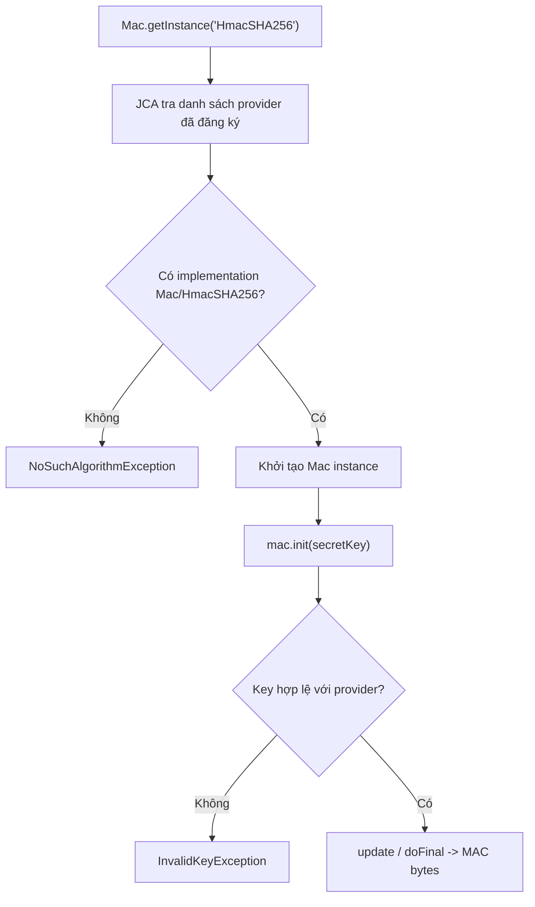
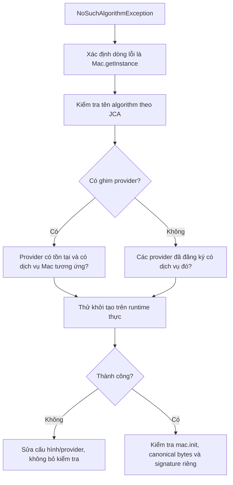
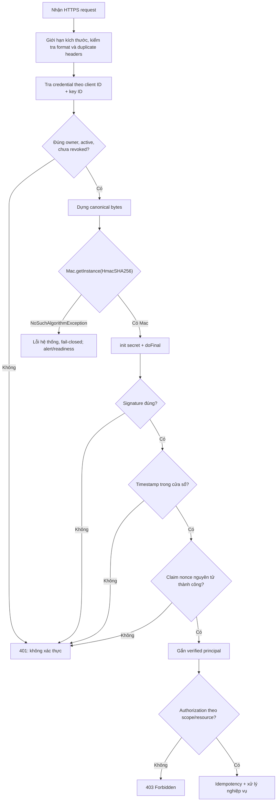

# NoSuchAlgorithmException trong JCA Mac API

## 1. Vấn đề cần hiểu

Trong Java Cryptography Architecture (JCA), lớp `javax.crypto.Mac` tạo **Message Authentication Code (MAC)**, thường dùng để tính HMAC-SHA256 khi xác thực HTTP request. Client và server giữ một shared secret, thống nhất cách dựng canonical request từ method, URI, header và body; client tính HMAC, server tính lại và so sánh.

Khi khởi tạo:

```java
Mac mac = Mac.getInstance("HmacSHA256");
```

JCA phải tìm một **security provider** có implementation của thuật toán `HmacSHA256` cho engine `Mac`. Nếu không có implementation phù hợp, `getInstance` ném **`java.security.NoSuchAlgorithmException`**. Đây là lỗi **khả năng cung cấp thuật toán mật mã** trong runtime Java, khác hẳn với tình huống client gửi chữ ký HMAC không hợp lệ.

Bài học thuộc chương **JCA Mac API** của module `SECURITY_AUTHENTICATION_HMAC_REQUEST_AUTHENTICATION` tập trung vào việc chẩn đoán và xử lý exception này an toàn. Sau bài, người học cần xác định được lỗi do tên thuật toán, provider hay môi trường; phân biệt lỗi với `InvalidKeyException` và signature mismatch; đồng thời biết thiết kế **fail-fast khi khởi động, fail-closed khi phục vụ request**, kể cả qua gateway và nhiều instance.

## 2. JCA và nguồn gốc NoSuchAlgorithmException

JCA tổ chức chức năng mật mã theo hai vai trò:

- **Engine class:** `Mac` quy định API làm việc với MAC, ví dụ `getInstance`, `init`, `update`, `doFinal`.
- **Security provider:** triển khai một hay nhiều thuật toán cho các engine. Ví dụ một provider có thể cung cấp `Mac/HmacSHA256`, provider khác không cung cấp.



Trong nhiều JDK thông dụng, `HmacSHA256` đã được cung cấp sẵn. Tuy nhiên, danh sách provider và thuật toán khả dụng **phụ thuộc runtime, cấu hình bảo mật, provider được chọn và môi trường triển khai**. Không được coi việc chạy được trên máy phát triển là bằng chứng image/container production cũng chạy được.

### Ba overload cần phân biệt

| Lời gọi | Phạm vi tìm implementation | Lỗi cần chú ý |
| --- | --- | --- |
| `Mac.getInstance("HmacSHA256")` | Tìm theo các provider đã đăng ký | `NoSuchAlgorithmException` nếu không tìm được implementation |
| `Mac.getInstance("HmacSHA256", "ProviderName")` | Chỉ provider có tên đã chỉ định | `NoSuchProviderException` nếu provider không tồn tại; `NoSuchAlgorithmException` nếu provider có nhưng thiếu thuật toán |
| `Mac.getInstance("HmacSHA256", providerObject)` | Chỉ object provider được truyền | `NoSuchAlgorithmException` nếu không hỗ trợ thuật toán; `IllegalArgumentException` nếu object provider là null |

Ghim một provider có thể là yêu cầu bắt buộc khi tích hợp HSM hoặc môi trường tuân thủ cụ thể. Nhưng nếu chỉ provider được ghim thiếu `HmacSHA256`, lời gọi sẽ thất bại **kể cả khi provider khác trong JVM hỗ trợ**.

### Đừng nhầm tên thuật toán và engine

```java
// Thường đúng trên JDK có provider HMAC-SHA256:
Mac mac = Mac.getInstance("HmacSHA256");

// Ví dụ tên được tạo ra để minh họa lỗi:
Mac missing = Mac.getInstance("UnknownHmacAlgorithmForDemo");

// SHA-256 là hash, không phải tên Mac tương ứng:
java.security.MessageDigest digest =
        java.security.MessageDigest.getInstance("SHA-256");
```

`"SHA-256"` là thuật toán digest; `"SHA256withRSA"` là tên kiểu chữ ký số thuộc engine `Signature`. Không thể thay các chuỗi này cho `HmacSHA256` rồi mong `Mac.getInstance` tự hiểu. HMAC phải được triển khai bằng primitive có khóa theo chuẩn; **không thay thế bằng `SHA256(secret || message)`**.

## 3. Phân loại đúng lỗi: algorithm, provider, key hay chữ ký?

| Hiện tượng | Điểm phát sinh | Nguyên nhân | Ý nghĩa xử lý |
| --- | --- | --- | --- |
| **`NoSuchAlgorithmException`** | `Mac.getInstance` | Tên thuật toán sai, provider không hỗ trợ, cấu hình provider/runtime thiếu | Lỗi phía ứng dụng/môi trường; không thể xác minh HMAC theo hợp đồng |
| **`NoSuchProviderException`** | `getInstance(algorithm, providerName)` | Provider tên đó chưa đăng ký | Kiểm tra cấu hình provider |
| **`InvalidKeyException`** | `mac.init(key)` | Key không được chấp nhận bởi implementation/provider | Kiểm tra key material, key type và policy |
| **`InvalidAlgorithmParameterException`** | `mac.init(key, params)` | Tham số thuật toán không phù hợp | Kiểm tra yêu cầu của provider/thuật toán |
| Base64url signature sai định dạng | Decode header | Input không hợp lệ | Từ chối xác thực; không phải lỗi JCA algorithm |
| Chữ ký HMAC **không khớp** | So sánh expected tag và supplied tag | Secret khác, canonical request khác hoặc request bị sửa | Từ chối xác thực |
| Timestamp quá hạn / nonce đã dùng | Kiểm tra chống replay | Request cũ hoặc bị gửi lại | Từ chối xác thực |
| Credential đúng nhưng thiếu quyền | Authorization sau xác thực | Principal không có scope/resource phù hợp | Từ chối phân quyền (thường HTTP 403) |

Hai quan sát then chốt:

1. `Mac.getInstance(...)` có thể thất bại **trước khi request được tính MAC**. Không gọi lỗi này là “chữ ký client sai”.
2. `mac.doFinal(...)` tạo tag cho canonical bytes đã cấp; **tag khác chữ ký nhận được** không gây `NoSuchAlgorithmException`. Nó là một kết quả xác minh sai cần xử lý riêng.

Exception có thể bị framework bọc trong `IllegalStateException` hoặc exception khác. Khi chẩn đoán, xem **cause chain** và vị trí phát sinh, đồng thời tránh ghi shared secret, body nhạy cảm hoặc request đầy đủ vào log.

## 4. Chẩn đoán JCA provider trên đúng runtime

Ví dụ Java 17 sau liệt kê provider đã đăng ký, xem thuật toán `Mac` được công bố và thử khởi tạo một thuật toán bắt buộc:

```java
import java.security.NoSuchAlgorithmException;
import java.security.Provider;
import java.security.Security;
import java.util.Set;
import javax.crypto.Mac;

public final class MacDiagnostics {
    private static final String REQUIRED = "HmacSHA256";

    public static void main(String[] args) {
        System.out.println("Java version: "
                + System.getProperty("java.version"));

        for (Provider p : Security.getProviders()) {
            Provider.Service s = p.getService("Mac", REQUIRED);
            System.out.println(p.getName()
                    + " provides " + REQUIRED + ": " + (s != null));
        }

        Set<String> macNames = Security.getAlgorithms("Mac");
        System.out.println("Advertised Mac algorithms: "
                + macNames.stream().sorted().toList());

        try {
            Mac mac = Mac.getInstance(REQUIRED);
            System.out.println("Selected provider: "
                    + mac.getProvider().getName());
        } catch (NoSuchAlgorithmException e) {
            throw new IllegalStateException(
                    "Required JCA MAC algorithm unavailable: " + REQUIRED, e);
        }
    }
}
```

**Cách sử dụng kết quả:** `Security.getProviders()` phản ánh đúng JVM đang chạy; `provider.getService("Mac", ...)` cho biết provider công bố dịch vụ/alias nào; `Mac.getInstance` là phép thử khởi tạo thực tế. `mac.getProvider()` trả về provider được chọn. Danh sách `Security.getAlgorithms("Mac")` hỗ trợ kiểm tra, **không phải danh sách thuật toán có thể cho client tự chọn**.

Khi lỗi chỉ xuất hiện ở production, cần so sánh đúng **JDK version, runtime image, provider registration, cấu hình security, tên thuật toán và overload**. Không chẩn đoán dựa trên máy cục bộ khi server sử dụng container khác. Cũng không đăng toàn bộ thông tin provider hoặc stack trace lên HTTP response; chỉ đưa vào log nội bộ đã giới hạn quyền truy cập.

Sơ đồ chẩn đoán:



## 5. Viết verifier Java 17 xử lý lỗi đúng

Đoạn mã sau xử lý đúng **HmacSHA256 cố định**. Nó chỉ kiểm tra primitive và chữ ký trên byte đã canonicalize. Phần lookup credential, timestamp/nonce, key rotation và phân quyền phải được triển khai ở lớp HTTP.

```java
import java.nio.charset.StandardCharsets;
import java.security.InvalidKeyException;
import java.security.MessageDigest;
import java.security.NoSuchAlgorithmException;
import java.security.SecureRandom;
import java.util.Base64;
import javax.crypto.Mac;
import javax.crypto.spec.SecretKeySpec;

public final class HmacSha256Verifier {
    private static final String ALGORITHM = "HmacSHA256";
    private static final int TAG_LENGTH = 32;

    public HmacSha256Verifier() {
        // Fail-fast: phát hiện cấu hình JCA lỗi khi khởi động.
        try {
            Mac.getInstance(ALGORITHM);
        } catch (NoSuchAlgorithmException e) {
            throw new IllegalStateException(
                    "Mandatory HMAC algorithm unavailable", e);
        }
    }

    // Chỉ gọi sau khi credential, canonicalization và
    // trạng thái key đã được xác định bằng dữ liệu server tin cậy.
    public boolean verify(
            byte[] canonicalBytes, byte[] secret, String encodedTag)
            throws InvalidKeyException {
        if (canonicalBytes == null || secret == null
                || secret.length < 32) {
            throw new IllegalArgumentException(
                    "Invalid canonical bytes or configured secret");
        }
        if (encodedTag == null || encodedTag.length() > 128) {
            return false;
        }

        final byte[] supplied;
        try {
            supplied = Base64.getUrlDecoder().decode(encodedTag);
        } catch (IllegalArgumentException invalidBase64) {
            return false;
        }
        if (supplied.length != TAG_LENGTH) return false;

        final Mac mac;
        try {
            // Mac có trạng thái, không chia sẻ instance giữa threads.
            mac = Mac.getInstance(ALGORITHM);
        } catch (NoSuchAlgorithmException e) {
            // Không biến lỗi cấu hình runtime thành xác thực thành công.
            throw new IllegalStateException(
                    "HMAC runtime unavailable; reject request", e);
        }
        mac.init(new SecretKeySpec(secret, ALGORITHM));
        byte[] expected = mac.doFinal(canonicalBytes);
        return MessageDigest.isEqual(expected, supplied);
    }

    public static void main(String[] args) throws Exception {
        HmacSha256Verifier verifier = new HmacSha256Verifier();

        byte[] testSecret = new byte[32];
        new SecureRandom().nextBytes(testSecret);
        byte[] message = "POST\n/v1/orders\n..."
                .getBytes(StandardCharsets.UTF_8);

        Mac signer = Mac.getInstance(ALGORITHM);
        signer.init(new SecretKeySpec(testSecret, ALGORITHM));
        String signature = Base64.getUrlEncoder().withoutPadding()
                .encodeToString(signer.doFinal(message));

        if (!verifier.verify(message, testSecret, signature)) {
            throw new AssertionError("Valid HMAC must verify");
        }

        byte[] changed = "POST\n/v1/orders-edited\n..."
                .getBytes(StandardCharsets.UTF_8);
        if (verifier.verify(changed, testSecret, signature)) {
            throw new AssertionError("Modified message must fail");
        }
    }
}
```

Giải thích từng trường hợp:

- **Algorithm/provider không khả dụng:** `NoSuchAlgorithmException` được bọc trong `IllegalStateException`. Ở startup, ứng dụng có thể dừng hoặc readiness báo không sẵn sàng; khi phục vụ request, không cấp principal và không xử lý nghiệp vụ.
- **Chữ ký sai:** Base64url không hợp lệ, tag sai độ dài hoặc `MessageDigest.isEqual` trả `false` đều làm xác thực thất bại. Chúng không có nghĩa JCA thiếu thuật toán.
- **Key không hợp lệ:** `InvalidKeyException` từ `mac.init` được giữ riêng để lớp gọi ghi nhận lỗi credential/cấu hình; không in secret ra log.
- **Thread-safety:** `Mac` lưu trạng thái khi `init`, `update` và `doFinal`. Trong ví dụ, mỗi lần xác minh tạo instance riêng. Không dùng một `static Mac` chung cho các request đồng thời.
- **Fail-fast chưa thay thế runtime protection:** cho dù kiểm tra ở startup thành công, provider vẫn có thể thay đổi hoặc lỗi trong lúc chạy; nhánh phục vụ request phải xử lý thất bại theo cách an toàn.

Trong trường hợp xử lý body lớn, có thể dùng `mac.update(bytes)` nhiều lần rồi `doFinal()` nếu input đã là đúng chuỗi byte được hợp đồng ký xác định. Đừng stream các trường theo thứ tự tùy ý hoặc hash JSON được serialize lại khác phía client.

## 6. HTTP request HMAC: lỗi JCA nằm ở bước nào?

Giả sử đối tác gửi:

```http
POST /v1/orders?dryRun=false HTTP/1.1
Host: api.example.test
Content-Type: application/json
X-Client-Id: merchant-42
X-Key-Id: key-2026-11
X-Timestamp: <unix-epoch-seconds>
X-Nonce: <unique-random-nonce>
X-Signature: <base64url-hmac>

{"orderId":"ord-91","amount":250000}
```

Các giá trị trong dấu nhọn là placeholder minh họa. Server phải lấy credential tương ứng với `(X-Client-Id, X-Key-Id)` từ kho tin cậy; kiểm tra owner, trạng thái `ACTIVE`, môi trường, thời hạn và thuật toán `HmacSHA256` đã đăng ký. Cặp header do client gửi chỉ là **dữ liệu tra cứu ban đầu**, chưa phải danh tính được xác thực.

Ví dụ canonical request theo **hợp đồng riêng của bài**, nối dòng LF, không LF cuối, mã hóa UTF-8:

```text
POST
/v1/orders
dryRun=false
content-type:application/json
x-client-id:merchant-42
x-key-id:key-2026-11
x-timestamp:<unix-epoch-seconds>
x-nonce:<unique-random-nonce>
<lowercase-hex-sha256-of-body-bytes>
```

Dòng hash cuối phải được thay bằng SHA-256 hex của **đúng body bytes** đã thỏa thuận, thường sau HTTP transfer decoding nhưng trước middleware thay đổi nội dung. Path và raw query phải lấy ở ranh giới xác minh được công bố; nếu gateway rewrite `/public/v1/orders` thành `/v1/orders`, cả client và verifier phải thống nhất dạng nào được ký.

Hợp đồng thật cần định nghĩa rõ xử lý header trùng, header thiếu, whitespace, case, encoding, percent-encoding, query trùng tên, slash cuối, body rỗng, content coding và `Host`/authority nếu chúng có ảnh hưởng đến định tuyến hoặc quyền. **NoSuchAlgorithmException không thể sửa bằng canonicalization**, và ngược lại lỗi canonicalization không thể sửa bằng cách thêm provider.

### Không cho client chọn thuật toán tùy ý

```java
// KHÔNG AN TOÀN nếu tên algorithm lấy trực tiếp từ header ngoài:
String algorithm = request.getHeader("X-Algorithm");
Mac mac = Mac.getInstance(algorithm);
```

Nhánh này cho caller tác động vào thuật toán verifier và tạo nguy cơ *algorithm confusion/downgrade*. Thuật toán phải được **policy và credential store phía server cố định**; header thuật toán, nếu có, chỉ được chấp nhận khi khớp policy và nên nằm trong dữ liệu ký. Không được catch `NoSuchAlgorithmException` rồi thử `HmacSHA1` hoặc một thuật toán yếu hơn để làm “fallback”.

### Pipeline xác thực và phân quyền



**Chống replay:** timestamp và nonce phải được ký. Server chỉ claim nonce **sau khi xác minh HMAC hợp lệ**, qua kho chia sẻ giữa các instance với thao tác nguyên tử và TTL đủ bao phủ toàn bộ thời gian request còn được chấp nhận. Nếu kho nonce hoặc trạng thái thu hồi không khả dụng, endpoint nhạy cảm phải **fail-closed**. HMAC không tự chống replay, và timestamp/nonce không ngăn kẻ đã lấy được shared secret ký request mới: khi key bị lộ phải **thu hồi và cấp key mới**.

**Authentication khác authorization:** có HMAC hợp lệ chỉ xác nhận request dùng credential của một client; quyền đối với đơn hàng/tài nguyên/operation phải kiểm tra riêng. Client đã xác thực nhưng thiếu scope nhận `403`. Caller có chữ ký sai nhận `401`. Server không có thuật toán HMAC bắt buộc là **lỗi hạ tầng** và cần thông báo lỗi dịch vụ thích hợp, chẳng hạn `503 Service Unavailable` khi verifier không sẵn sàng, thay vì báo mọi client ký sai.

## 7. Xử lý lỗi production: fail-fast và fail-closed

### 7.1. Fail-fast tại startup

Một service phụ thuộc HMAC-SHA256 nên khởi tạo thử `Mac.getInstance("HmacSHA256")` trong startup hoặc readiness initialization. Nếu thiếu primitive, service không nên báo ready để nhận traffic đòi xác thực HMAC. Khi dùng provider chuyên biệt, kiểm tra **đúng overload với provider được cấu hình**.

### 7.2. Fail-closed lúc xử lý request

```java
// SAI: một lỗi hệ thống trở thành bypass xác thực.
try {
    Mac.getInstance("HmacSHA256");
    // ... verify ...
} catch (java.security.NoSuchAlgorithmException ex) {
    allowRequest(); // Tuyệt đối không làm.
}
```

Thay bằng từ chối xử lý nghiệp vụ, ghi metric `AUTH_CRYPTO_UNAVAILABLE` và đưa lỗi đến hệ thống giám sát. Không log secret, canonical request chứa thông tin nhạy cảm hoặc full signature kèm body; HTTP response không xuất stack trace và thông tin provider.

### 7.3. Không trộn lỗi input với lỗi cấu hình

```java
// KHÔNG NÊN: mọi lỗi đều bị quy thành "bad signature".
try {
    return verifyHmacRequest(request);
} catch (Exception ex) {
    return false;
}
```

Điều kiện bảo mật là **không thực thi request khi không thể xác minh**; mặt vận hành cần **phân loại nguyên nhân** để sửa đúng: invalid signature, key revoked, timestamp/nonce không hợp lệ, `InvalidKeyException` hoặc `NoSuchAlgorithmException`. Có thể dùng phản hồi HTTP chung cho credential sai để tránh tiết lộ thông tin, nhưng log nội bộ và metrics phải phân biệt lỗi server.

### 7.4. Không tự đổi provider hoặc thuật toán theo request

Provider registration là cấu hình JVM cấp ứng dụng. Không sửa danh sách provider toàn cục chỉ vì một caller gửi tên thuật toán lạ. Hãy quản lý provider ở startup/deployment và test trong cùng runtime production. Việc thay algorithm là **thay đổi hợp đồng bảo mật và version giao thức**, cần chính sách được phê duyệt, không phải một câu lệnh fallback trong catch.

## 8. Gateway, key rotation và nhiều instance

### Gateway/proxy có thể khiến lỗi giống nhau ở bề ngoài

```text
Client ký HMAC-SHA256
        |
        | HTTPS + X-Signature
        v
API Gateway (JVM / provider A)
        | verify trước rewrite?
        v
Backend Service (JVM / provider B)
        | verify lại hay nhận verified principal?
        v
Authorization + business
```

Những trường hợp cần tách riêng:

- **Gateway có HmacSHA256, service không có:** nếu service thực hiện HMAC verifier thì `Mac.getInstance` thất bại do provider của **service**, không phải do chữ ký client.
- **Cả hai có thuật toán nhưng rewrite khác nhau:** HMAC không khớp do method/URI/query/header/body không cùng canonical bytes; không phát sinh `NoSuchAlgorithmException`.
- **Hai tầng cùng claim một nonce:** request hợp lệ có thể bị xem là replay ở tầng sau. Chỉ định một tầng sở hữu replay check; nếu gateway xác thực trước, chuyển verified principal qua kênh nội bộ có xác thực nguồn.
- **Header principal giả:** service không tin `X-Verified-Client` hoặc `X-Forwarded-*` do client ngoài đặt. Gateway phải xóa/ghi đè metadata đó, bảo vệ kênh gateway–service (ví dụ mTLS) hoặc sử dụng internal assertion được kiểm chứng.
- **Provider khác giữa instance:** nếu cùng deployment có các JDK/provider khác nhau, request có thể lúc thành công lúc lỗi. Readiness/diagnostics phải chạy trên **từng image/instance** trước khi nhận traffic.

### Key rotation không sửa provider thiếu thuật toán

Khi thay secret từ `key-2026-11` sang `key-2027-01`, thuật toán có thể vẫn là `HmacSHA256`. Thay key **không làm JVM xuất hiện implementation bị thiếu**. Cần phân biệt:

- **Rotation định kỳ:** khóa mới được cấp qua kênh an toàn, có key ID riêng; khóa cũ có thể được chấp nhận trong thời gian chuyển đổi **được quy định và còn an toàn**.
- **Thu hồi khẩn cấp:** nếu secret bị lộ, key cũ phải bị đánh dấu `REVOKED` và từ chối ở mọi verifier; không giữ grace period cho credential nghi lộ.
- **Đổi thuật toán:** là thay đổi protocol/policy, cần đánh giá provider support và triển khai tương thích theo phiên bản; không tự xử lý như thay secret.
- **Cache:** các instance phải cập nhật trạng thái key revoked; nếu không kiểm tra được trạng thái thu hồi, endpoint nhạy cảm nên từ chối.

## 9. Bài thực hành và ma trận kiểm thử

Chuẩn bị Java 17, secret test 32 byte ngẫu nhiên và môi trường giả lập client → gateway → service. Tránh dùng credential production. Dùng `MacDiagnostics` để quan sát provider và `HmacSha256Verifier` để so sánh chữ ký trên canonical bytes.

| Ca thử | Cách thực hiện | Kỳ vọng |
| --- | --- | --- |
| T1. Algorithm đúng | `Mac.getInstance("HmacSHA256")` | Thành công nếu runtime hỗ trợ; ghi nhận provider |
| T2. Algorithm không tồn tại | `Mac.getInstance("UnknownHmacAlgorithmForDemo")` | `NoSuchAlgorithmException` |
| T3. Provider không tồn tại | Gọi overload với tên provider chưa đăng ký | `NoSuchProviderException` |
| T4. Provider có nhưng không hỗ trợ | Ghim provider không cung cấp `Mac/HmacSHA256` | `NoSuchAlgorithmException` |
| T5. Key không được chấp nhận | Khởi tạo với key/provider không tương thích | `InvalidKeyException`, không nhầm với lỗi algorithm |
| T6. HMAC hợp lệ | Ký và xác minh cùng canonical bytes + secret | Verify trả `true` |
| T7. Body/path bị đổi | Giữ tag cũ, sửa byte thuộc trường ký | Verify trả `false`, không có exception thuật toán |
| T8. Signature sai Base64url | Đưa header không hợp lệ hoặc tag không đủ 32 byte | Xác thực từ chối, server vẫn ready |
| T9. Timestamp hết hạn | Tạo request có HMAC đúng nhưng timestamp cũ | Từ chối do freshness |
| T10. Replay đa instance | Gửi cùng nonce đến hai replica đồng thời | Tối đa một nonce claim thành công |
| T11. Key đã thu hồi | HMAC đúng bằng secret mang key ID `REVOKED` | Từ chối dù thuật toán khả dụng |
| T12. Gateway rewrite | Client ký path bên ngoài, backend dùng path sau rewrite | Phân biệt mismatch canonicalization với thiếu provider |
| T13. Thiếu quyền | Client ký đúng request nhưng không có scope | Xác thực pass, authorization trả `403` |
| T14. Thiếu primitive trên instance | Giả lập cấu hình provider không có HMAC bắt buộc | Startup/readiness fail hoặc request bị chặn và báo lỗi dịch vụ |
| T15. Rotation và cache | Đổi key ID, thu hồi key cũ; gửi request tới mọi replica | Key mới hợp lệ theo quyền; key cũ bị từ chối ở mọi nơi |

### Tình huống A — Dùng sai engine

Một lập trình viên gọi `Mac.getInstance("SHA-256")` và nhận `NoSuchAlgorithmException`, trong khi `MessageDigest.getInstance("SHA-256")` thành công.

**Đáp án:** `Mac` và `MessageDigest` là hai engine khác nhau. SHA-256 là hash; HMAC dựa trên SHA-256 có tên JCA thông dụng `HmacSHA256`. Cần dùng đúng primitive, không thay bằng SHA-256 thông thường.

### Tình huống B — Chỉ lỗi khi ghim provider

`Mac.getInstance("HmacSHA256")` hoạt động, nhưng `Mac.getInstance("HmacSHA256", "CustomProvider")` thất bại.

**Đáp án:** Câu lệnh thứ nhất có thể chọn provider khác. Nếu provider được ghim **không đăng ký**, sẽ là `NoSuchProviderException`; nếu có đăng ký nhưng **không cung cấp thuật toán**, sẽ là `NoSuchAlgorithmException`. Kiểm tra runtime và chính sách ghim provider, không dùng fallback âm thầm.

### Tình huống C — API trả 401 cho tất cả request sau deploy

Mọi client đều bị trả `401 Invalid signature` sau khi thay base image. Log cho thấy `NoSuchAlgorithmException` ở `Mac.getInstance`.

**Đáp án:** Đây là lỗi **không thể khởi tạo thuật toán của server**, không chứng minh mọi client ký sai. Cần kiểm tra JDK/provider trên image mới, ngắt traffic đến instance không healthy và trả lỗi dịch vụ phù hợp trong khi khắc phục; không cho request qua mà bỏ HMAC.

### Tình huống D — Signature sai qua gateway

Cả gateway và backend đều tạo được `HmacSHA256`, nhưng client ký `/public/v1/orders` còn backend xác minh trên `/v1/orders` sau rewrite.

**Đáp án:** Lỗi nằm ở **hợp đồng canonical request** hoặc vị trí xác minh. Cần thống nhất raw path/query/header/body giữa hai phía hoặc xác minh trước rewrite. Cài thêm provider sẽ không giải quyết.

### Tình huống E — Fallback sang HmacSHA1

Khi `Mac.getInstance("HmacSHA256")` thất bại, service tự chuyển sang `HmacSHA1`.

**Đáp án:** Vi phạm hợp đồng ký và có nguy cơ downgrade. Thuật toán phải do policy phía server kiểm soát, gắn với credential/protocol version. HMAC-SHA256 bắt buộc không có thì **fail-fast/fail-closed** và khắc phục môi trường.

## 10. Checklist ghi nhớ

- [ ] `NoSuchAlgorithmException` của `Mac.getInstance` là lỗi **JCA algorithm/provider**, không phải kết quả chữ ký HMAC sai.
- [ ] Phân biệt tên engine `Mac`, thuật toán `HmacSHA256` và provider đã đăng ký trên JVM thực tế.
- [ ] Đọc cause chain và xác định điểm lỗi; phân biệt `NoSuchProviderException`, `InvalidKeyException`, malformed signature và mismatch.
- [ ] Kiểm tra algorithm tại startup và readiness; nếu runtime không khởi tạo được HMAC bắt buộc thì không nhận traffic yêu cầu xác thực.
- [ ] Không bỏ qua xác thực khi catch exception, không downgrade sang algorithm khác và không chọn algorithm trực tiếp từ header client.
- [ ] Sử dụng secret đủ ngẫu nhiên, lưu trong secret manager; ràng buộc client ID/key ID, thuật toán, key state và phạm vi với credential tin cậy.
- [ ] Canonical request bao gồm mọi method, URI/query, selected headers và body có ảnh hưởng bảo mật theo hợp đồng ký.
- [ ] Dùng TLS, timestamp/nonce đã ký, lưu nonce nguyên tử và kiểm tra key rotation/revocation.
- [ ] Truyền verified principal qua boundary nội bộ an toàn; authorization riêng cho principal/resource/action.
- [ ] Kiểm thử provider trên gateway/backend/replica, proxy rewrite, replay, key revoked, malformed signature và lỗi hạ tầng.

**Điểm cốt lõi:** `NoSuchAlgorithmException` khi gọi `Mac.getInstance(...)` có nghĩa JVM **không tìm được triển khai MAC phù hợp với thuật toán được yêu cầu**. Cần sửa tên thuật toán, provider hoặc runtime và giữ chính sách **fail-fast/fail-closed**. Không được biến sự cố hạ tầng mật mã thành một đường bypass xác thực HTTP request.

