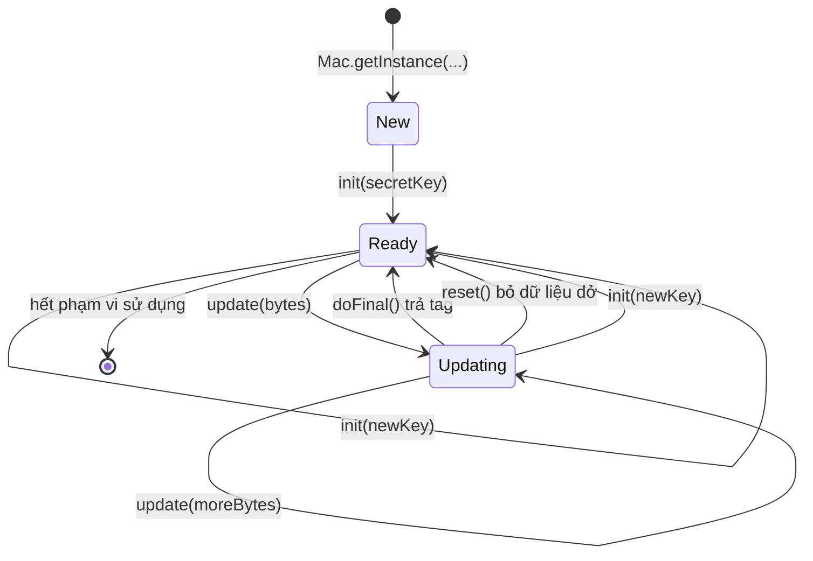
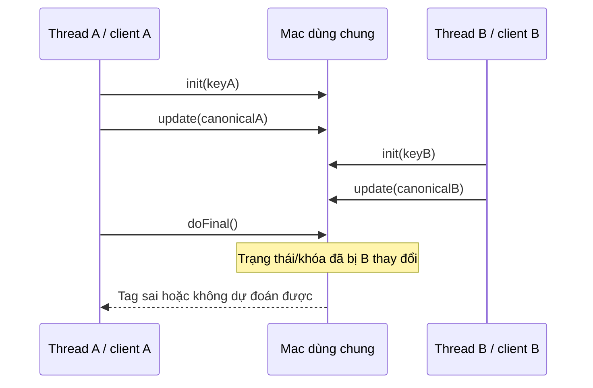
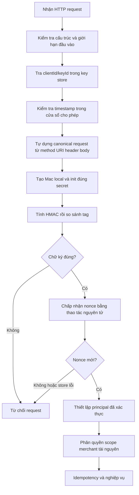

# Quản lý Mac instance

## 1. Vì sao cần quản lý vòng đời `Mac`?

Trong Java, `javax.crypto.Mac` là API thuộc **Java Cryptography Architecture (JCA)**, dùng để tính mã xác thực thông điệp (*Message Authentication Code*). Với HMAC request authentication, bên gửi tính MAC từ một **shared secret** và các byte của **canonical request**; bên nhận tính lại MAC để kiểm tra chữ ký.

Vấn đề không chỉ là biết gọi `Mac.getInstance("HmacSHA256")`. Một đối tượng `Mac` có **trạng thái có thể thay đổi**: nó giữ thuật toán và provider, nhận khóa khi `init(...)`, tiếp nhận từng byte qua `update(...)` và tạo tag khi `doFinal(...)`. Nếu chia sẻ sai một instance giữa các request hoặc tái sử dụng instance với khóa không đúng, chữ ký có thể sai, dữ liệu giữa các request bị trộn hoặc xảy ra lỗi khó tái hiện khi hệ thống chạy đồng thời.

Bài học này thuộc chương **JCA Mac API**, mô-đun **`SECURITY_AUTHENTICATION_HMAC_REQUEST_AUTHENTICATION`**. Phạm vi ứng dụng là xác thực HTTP request bằng HMAC và shared secret, với canonical request bao gồm method, URI, header và/hoặc body theo hợp đồng ký; đồng thời quan tâm tới timestamp/nonce chống replay, key rotation, proxy/gateway và việc tách xác thực khỏi phân quyền.

**Mục tiêu sau bài học:** giải thích được trạng thái của `Mac`, tạo và tái sử dụng instance đúng cách, tránh lỗi đa luồng, thiết kế dịch vụ ký/xác minh phù hợp Java backend, và kiểm thử được các lựa chọn quản lý vòng đời.

## 2. Đối tượng `Mac` có những trạng thái nào?

Các thao tác thường dùng:

| API | Vai trò | Điều phải nhớ |
| --- | --- | --- |
| `Mac.getInstance("HmacSHA256")` | Tạo đối tượng sử dụng thuật toán HMAC-SHA-256 từ provider JCA | **Chưa có khóa**; chưa sẵn sàng tính MAC |
| `mac.init(key)` | Khởi tạo instance bằng khóa bí mật | Thiết lập trạng thái ban đầu để tính MAC |
| `mac.update(byte[])` | Đưa một phần dữ liệu vào trạng thái tính MAC | Có thể gọi nhiều lần, **theo đúng thứ tự byte** |
| `mac.update(byte[], offset, length)` | Đưa một đoạn của mảng byte vào MAC | Phạm vi mảng phải chính xác, tránh ký thiếu/thừa |
| `mac.update(ByteBuffer)` | Đưa dữ liệu từ vùng còn lại của buffer vào MAC | Có tác động đến `position` của buffer; cần quản lý trạng thái buffer |
| `mac.doFinal()` | Hoàn tất MAC trên dữ liệu đã cập nhật | Trả tag và **reset về trạng thái sau lần `init` gần nhất** |
| `mac.doFinal(byte[])` | Cập nhật bằng toàn bộ mảng rồi hoàn tất | Tiện cho thông điệp có sẵn dưới dạng byte[] |
| `mac.reset()` | Bỏ dữ liệu đã `update` nhưng chưa hoàn tất | **Giữ khóa được khởi tạo gần nhất**, không xóa secret |
| `mac.getMacLength()` | Xem độ dài tag đầy đủ theo provider/thuật toán | Với HMAC-SHA-256 thông thường là **32 byte** |
| `mac.getProvider()` | Xem provider đã được chọn | Có ích để chẩn đoán và đảm bảo môi trường tương thích |

Luồng trạng thái điển hình:



Sơ đồ thể hiện **trạng thái logic của API**, không phải cơ chế tự động quản lý vòng đời tài nguyên của JVM. Sau khi `getInstance` mà chưa `init`, việc gọi `update` hoặc `doFinal` là sử dụng sai trạng thái và có thể dẫn đến `IllegalStateException`. Sau khi `init`, instance có thể xử lý một hoặc nhiều thông điệp **nối tiếp**, miễn là mỗi thông điệp hoàn tất hoặc được reset và khóa đang dùng đúng với thông điệp đó.

### 2.1. `doFinal()` có reset instance hay không?

**Có.** Theo hợp đồng của `javax.crypto.Mac`, sau khi `doFinal()` tính xong MAC, instance được reset về trạng thái mà nó có ngay sau lần `init(...)` gần nhất. Vì vậy, trong **một luồng và cùng khóa**, ta có thể ký tuần tự hai thông điệp:

```java
Mac mac = Mac.getInstance("HmacSHA256");
mac.init(new SecretKeySpec(secret, "HmacSHA256"));

byte[] tagA = mac.doFinal(messageA); // Hoàn tất và reset
byte[] tagB = mac.doFinal(messageB); // Ký messageB từ trạng thái sạch
```

Kết quả `tagB` là MAC của **messageB**, không phải MAC của phép nối `messageA + messageB`. Nhưng điều này **không cho phép** hai request đồng thời dùng chung `mac`; `Mac` là đối tượng có trạng thái, không được mặc định coi là thread-safe.

### 2.2. `reset()` làm gì?

`reset()` xóa **dữ liệu đang tích lũy trong phép tính**, rồi trả instance về trạng thái sau lần `init` gần nhất. Nó hữu ích khi đang xử lý một thông điệp nhưng cần bỏ ngang trước `doFinal`:

```java
mac.init(key);
mac.update(prefixBytes);

// Phát hiện request không hợp lệ, bỏ phần dữ liệu đang ký dở:
mac.reset();

// Có thể dùng lại cùng khóa cho thông điệp khác, theo thứ tự:
byte[] cleanTag = mac.doFinal(anotherMessage);
```

**`reset()` không xóa khóa, không chuyển instance về trạng thái “chưa init”, và không bảo đảm xóa mọi bản sao secret ở memory/provider.** Nếu chuyển sang client khác hoặc key rotation, phải chọn đúng khóa rồi gọi `init(newKey)`; trong dịch vụ phục vụ nhiều client, cách đơn giản hơn thường là tạo **instance mới cho mỗi phép tính**.

## 3. Vì sao không chia sẻ một `Mac` giữa nhiều request?

Một bean Spring thường được tạo ở phạm vi **singleton** và được nhiều request HTTP sử dụng đồng thời. Điều này phù hợp cho các service stateless, nhưng không phù hợp để giữ một `Mac` dùng chung nếu không có cơ chế cô lập truy cập.

**Thiết kế có lỗi:**

```java
// Không sử dụng mẫu này trong ứng dụng nhiều luồng.
public final class UnsafeSigner {
    private final Mac mac;

    public UnsafeSigner(byte[] secret) throws Exception {
        mac = Mac.getInstance("HmacSHA256");
        mac.init(new SecretKeySpec(secret, "HmacSHA256"));
    }

    public byte[] sign(byte[] message) {
        return mac.doFinal(message); // Nhiều thread có thể chen vào nhau
    }
}
```

Giả sử request A và B đều gọi vào `sign` cùng lúc. Việc một thread đang thực hiện `update/doFinal` trong khi thread kia thay đổi trạng thái có thể làm kết quả không xác định. Nếu ứng dụng còn thay khóa bằng `init(...)` trên instance chung, nguy cơ tăng lên: request A có thể bị ký bằng khóa của B hoặc trả về MAC sai.



**Nguyên tắc:** đối tượng cấu hình thuật toán, key resolver hoặc signing service có thể là singleton, còn **instance `Mac` đang xử lý thông điệp nên thuộc phạm vi một phép tính hoặc được dùng độc quyền bởi đúng một luồng tại một thời điểm**.

## 4. Mẫu khuyến nghị: tạo instance mới cho mỗi lần ký hoặc xác minh

Đối với HTTP API thông thường, mẫu dễ hiểu và an toàn là **stateless signer**: mỗi lần gọi lấy đúng secret, tạo một `Mac` mới, `init`, tính MAC rồi để đối tượng ra khỏi phạm vi sử dụng.

```java
import java.security.GeneralSecurityException;
import java.util.Objects;
import javax.crypto.Mac;
import javax.crypto.spec.SecretKeySpec;

public final class HmacSha256Signer {
    private static final String ALGORITHM = "HmacSHA256";

    private HmacSha256Signer() {}

    public static byte[] sign(byte[] secret, byte[] canonicalBytes)
            throws GeneralSecurityException {
        Objects.requireNonNull(secret, "secret");
        Objects.requireNonNull(canonicalBytes, "canonicalBytes");

        if (secret.length == 0) {
            throw new IllegalArgumentException("Secret must not be empty");
        }

        // Biến local: mỗi lần gọi sở hữu riêng trạng thái Mac.
        Mac mac = Mac.getInstance(ALGORITHM);
        mac.init(new SecretKeySpec(secret, ALGORITHM));
        return mac.doFinal(canonicalBytes);
    }
}
```

Trong ví dụ này, `canonicalBytes` **đã được xây dựng** bởi bước canonicalization của giao thức; không nên để signer tự đoán phải ghép các trường HTTP như thế nào. Hợp đồng ký phải xác định chính xác thứ tự method, URI, các header được bảo vệ, hash body, timestamp và nonce, cũng như cách encode từng byte.

**Ưu điểm của instance local:**

- Không có trạng thái MAC chung bị hai thread thay đổi cùng lúc.
- Dễ gắn một secret/`keyId` cụ thể với đúng một request.
- Exception giữa chừng không làm hỏng trạng thái MAC được tái sử dụng ở request sau.
- Đơn giản khi triển khai service singleton: service không cần khóa `synchronized` quanh một `Mac` dùng chung.
- Tương thích tự nhiên với mô hình request đồng thời và virtual threads; không gắn secret vào thread lâu dài.

Việc tạo `Mac` mới có chi phí nhất định tùy provider/JVM, nhưng **không nên tối ưu bằng pooling/ThreadLocal trước khi đo**. Với nhiều API, lợi ích về tính đúng đắn, bảo trì và ranh giới khóa quan trọng hơn tối ưu nhỏ chưa được đo lường.

### 4.1. Mẫu xác minh HMAC từ header Base64

Một verifier cần tránh cả lỗi đa luồng lẫn lỗi “chấp nhận chữ ký có độ dài tùy ý”. Ví dụ hợp đồng sử dụng **HMAC-SHA-256 đầy đủ 32 byte**, mã hóa Base64 chuẩn có padding:

```java
import java.security.GeneralSecurityException;
import java.security.MessageDigest;
import java.util.Base64;

public final class HmacSha256Verifier {
    private HmacSha256Verifier() {}

    public static boolean verify(byte[] secret, byte[] canonicalBytes,
                                 String signatureBase64)
            throws GeneralSecurityException {
        // Tag 32 byte => Base64 chuẩn có padding dài đúng 44 ký tự.
        if (signatureBase64 == null || signatureBase64.length() != 44) {
            return false;
        }

        final byte[] supplied;
        try {
            supplied = Base64.getDecoder().decode(signatureBase64);
        } catch (IllegalArgumentException invalidBase64) {
            return false;
        }
        if (supplied.length != 32) {
            return false;
        }

        // Giới hạn encoding theo hợp đồng; so sánh chuỗi tại đây
        // chỉ kiểm tra cú pháp công khai, không so sánh MAC bí mật.
        if (!Base64.getEncoder().encodeToString(supplied)
                .equals(signatureBase64)) {
            return false;
        }

        byte[] expected = HmacSha256Signer.sign(secret, canonicalBytes);
        return MessageDigest.isEqual(expected, supplied);
    }
}
```

Các điểm quan trọng:

1. `HmacSha256Signer.sign` tạo **Mac mới mỗi lần xác minh**, nên nhiều request không tranh chấp trạng thái.
2. `MessageDigest.isEqual` so sánh **byte MAC**, thay vì `String.equals` trên hai chữ ký bí mật hoặc vòng lặp tự viết dừng ở byte sai đầu tiên.
3. Server quyết định thuật toán, độ dài tag và encoding theo **hợp đồng tin cậy**; không lấy độ dài từ signature client gửi để cắt expected tag tương ứng.
4. Nếu hợp đồng dùng **tag truncate 16 byte**, verifier phải thay đổi chính sách cố định và chỉ so sánh đúng **16 byte đầu** của HMAC đầy đủ. Không tự động chấp nhận cả 16 lẫn 32 byte nếu phiên bản giao thức không cho phép.
5. Hàm này chỉ xác minh **HMAC**. Timestamp, nonce, hiệu lực key, phân quyền và xử lý nghiệp vụ phải được kiểm tra ở các bước riêng.

Khi lộ hoặc lỗi secret, nên xử lý bằng quy trình key management. Không ghi giá trị secret, tag thô hoặc canonical request có thông tin nhạy cảm vào log.

## 5. Dùng `update(...)` và `doFinal()` cho canonical request

`Mac` cho phép tính MAC bằng từng phần, miễn là **dãy byte tổng hợp và thứ tự hoàn toàn giống thông điệp cần ký**. Hai cách sau cho kết quả như nhau với cùng khóa:

```java
byte[] fullMessage = "POST\n/v1/payments\nbody-hash"
        .getBytes(StandardCharsets.UTF_8);

Mac first = Mac.getInstance("HmacSHA256");
first.init(new SecretKeySpec(secret, "HmacSHA256"));
byte[] tagOneShot = first.doFinal(fullMessage);

Mac second = Mac.getInstance("HmacSHA256");
second.init(new SecretKeySpec(secret, "HmacSHA256"));
second.update("POST\n".getBytes(StandardCharsets.UTF_8));
second.update("/v1/payments\n".getBytes(StandardCharsets.UTF_8));
second.update("body-hash".getBytes(StandardCharsets.UTF_8));
byte[] tagIncremental = second.doFinal();

// tagOneShot và tagIncremental phải giống nhau.
```

Đây là ví dụ về **JCA Mac API**, không phải hợp đồng canonical request đủ để bảo vệ thanh toán thật: giao thức production còn phải xác định query, header, timestamp, nonce và hash body; giữ cùng dữ liệu ở hai phía khi đi qua gateway.

### 5.1. Những lỗi thường gặp với `update`

- **Thiếu hoặc thừa dấu phân cách:** ký `"POST" + "/v1/payments"` khác ký `"POST\n/v1/payments"`.
- **Sai charset:** dùng charset mặc định hệ điều hành ở một phía, UTF-8 ở phía còn lại.
- **Sai thứ tự:** đảo vị trí header hoặc query parameter mà không có quy tắc canonical thống nhất.
- **Đổi body sau khi ký:** client tính hash của một JSON, sau đó HTTP library serialize JSON lần nữa theo kiểu khác.
- **Dùng lại instance khi chưa `doFinal/reset`:** dữ liệu request cũ còn trong trạng thái đang xử lý.
- **Đưa cùng trường hai lần:** gọi `update(methodBytes)` rồi lại gọi `doFinal(canonicalBytes)` mà `canonicalBytes` đã chứa method.
- **Dùng `ByteBuffer` sai vùng:** `update(ByteBuffer)` tiêu thụ phần byte từ `position` đến `limit`; nếu buffer đang ở cuối, không còn byte để ký.

Với HTTP request authentication, cách đáng tin cậy là xây dựng **một canonical byte array rõ ràng**, kiểm thử bằng test vector rồi ký nó. Chỉ nên stream từng phần khi cần thiết và xác định được chính xác thứ tự, separator, encoding và ranh giới byte.

### 5.2. Body lớn và xử lý streaming

Nếu hợp đồng ký **hash SHA-256 của body**, sender phải tính hash từ **chính byte body được truyền đi** trước khi tạo canonical request chứa body hash. Với body lớn, có thể tính SHA-256 bằng streaming; nhưng **không được giả định** rằng việc gọi `Mac.update(chunk)` trực tiếp lên body sẽ tạo cùng chữ ký với hợp đồng ký **hex SHA-256(body)**.

Hai thiết kế khác nhau:

```text
Hợp đồng A:
  HMAC(secret, method + path + ... + hex(SHA256(bodyBytes)))

Hợp đồng B:
  HMAC(secret, method + path + ... + rawBodyBytes)
```

Cả hai có thể hợp lệ nếu được thiết kế cẩn thận, nhưng **không tương thích chữ ký**. Sender và verifier phải thống nhất chính xác nội dung mà `Mac` nhận, cách chống biến đổi body bởi reverse proxy, và việc nén/giải nén ở lớp nào.

## 6. Tái sử dụng một `Mac` có lúc nào hợp lý?

Trong một tác vụ **tuần tự**, cùng thuật toán và cùng secret, `Mac` có thể được tái sử dụng:

```java
Mac mac = Mac.getInstance("HmacSHA256");
mac.init(new SecretKeySpec(secret, "HmacSHA256"));

for (byte[] message : messages) {
    byte[] tag = mac.doFinal(message); // Reset sau mỗi lần
    persistTag(tag);
}
```

Mẫu này chỉ an toàn khi **không có truy cập đồng thời** và không có request khác can thiệp vào trạng thái. Nếu chuyển khóa, phải gọi `mac.init(new SecretKeySpec(nextSecret, "HmacSHA256"))` ở thời điểm đúng, trước khi ký thông điệp tiếp theo.

| Chiến lược | Phù hợp khi nào? | Rủi ro/đánh đổi |
| --- | --- | --- |
| **Tạo mới cho mỗi phép tính** | Mặc định cho server xử lý HTTP đồng thời, nhiều client/key | Có chi phí tạo và khởi tạo provider nhưng dễ kiểm soát |
| **Tái sử dụng tuần tự, cùng key** | Batch processing trong một scope đơn luồng rõ ràng | Dễ bỏ sót reset/reinit khi có nhánh lỗi |
| **`ThreadLocal<Mac>`** | Chỉ cân nhắc khi có đo lường và kiểm soát vòng đời thread/key | Thread pool giữ state lâu, nhầm key giữa client, rotation khó, memory retention |
| **Pool `Mac`** | Chỉ khi có bằng chứng bottleneck và chính sách checkout độc quyền | Quản lý đồng thời, key isolation, reset/reinit, lỗi làm bẩn pool |
| **`synchronized` quanh một Mac chung** | Có thể đảm bảo loại trừ lẫn nhau về kỹ thuật | Serialize mọi request, khó mở rộng, dễ khóa nhầm phạm vi |
| **`Mac.clone()` nếu provider hỗ trợ** | Một số trường hợp muốn clone state đã chuẩn bị | **Không được đảm bảo** với mọi provider; không được dùng như cơ chế thread safety mặc định |

### 6.1. Vì sao `ThreadLocal<Mac>` có thể nguy hiểm?

Trong backend multi-tenant, một thread từ thread pool xử lý request của **client A**, sau đó tái sử dụng cùng thread để xử lý **client B**. Nếu `ThreadLocal` giữ một `Mac` đã `init(keyA)` và code quên `init(keyB)`, request B sẽ được tính bằng khóa A.

Ngay cả khi code luôn `init` lại, ThreadLocal có thể giữ instance và key material lâu hơn mong đợi. Việc xoay khóa hoặc thu hồi khẩn cấp còn phải kiểm tra rằng không có cache nào tiếp tục dùng secret cũ. Với thread pool lâu sống, ThreadLocal nên được giải phóng bằng `remove()` khi phù hợp; thiết kế vẫn phải xử lý được key changes và exception. Tránh sử dụng ThreadLocal chỉ để tiết kiệm một lệnh `getInstance` khi chưa có benchmark đủ thuyết phục.

### 6.2. Vì sao `clone()` không phải lời giải mặc định?

JCA cung cấp `Mac.clone()` khi implementation bên dưới hỗ trợ clone. Một số provider có thể ném `CloneNotSupportedException`. Nếu clone tại thời điểm MAC đang xử lý một thông điệp, bản clone có thể chứa trạng thái trung gian; không nên sử dụng nó như một instance mới “trống” mà không hiểu chính xác điểm clone. Thiết kế service phải hoạt động đúng **kể cả provider không hỗ trợ clone**.

## 7. Key rotation và ranh giới khóa trên mỗi instance

Một server thường xác minh chữ ký cho nhiều client, mỗi client có thể có nhiều `keyId` qua các giai đoạn rotation. Cách an toàn là xác định cặp **`clientId` + `keyId`** trước khi tạo MAC:

```text
Request nhận từ Internet
      |
      v
Đọc clientId/keyId (chưa tin là đã xác thực)
      |
      v
Tra cấu hình key hợp lệ cho client đó
      |
      v
Tạo Mac mới -> init(secret của keyId đó)
      |
      v
Tính HMAC trên canonical request đã được xác định
      |
      v
So sánh tag -> xác thực client nếu hợp lệ
      |
      v
Kiểm tra timestamp/nonce và phân quyền
```

`clientId` và `keyId` ban đầu chỉ là **gợi ý tra khóa**, chưa phải bằng chứng danh tính. Chúng nên được ràng buộc vào canonical request hoặc ngữ cảnh tin cậy của hợp đồng ký để tránh thay đổi danh tính/phiên bản key bên ngoài dữ liệu được bảo vệ.

Trong rotation:

1. Cấp secret mới và gắn `keyId` riêng; trong giai đoạn chuyển đổi, server có thể cho phép key cũ và mới theo chính sách.
2. Sender dùng **cùng cặp key ID và secret** trong một lần ký; tránh race khiến header chứa ID mới nhưng `Mac.init` dùng secret cũ.
3. Verifier dùng secret của **đúng client/keyId đang hiệu lực**, không dùng một `Mac` còn state từ request khác.
4. Thu hồi key cũ đúng hạn, kể cả khi đối tượng `Mac` từng được init bằng key cũ vẫn còn tồn tại trong một pool/cache.
5. Nếu secret bị lộ, chống replay không chặn đối thủ tạo request mới; cần thu hồi key, đổi secret và rà soát quyền.

**Chú ý:** `mac.reset()` chỉ reset dữ liệu đang tính, **không tự chuyển sang khóa mới**. Muốn sử dụng secret khác phải `init(...)` lại; tạo mới instance thường đơn giản hơn và giúp giảm rủi ro lẫn khóa.

## 8. Chọn thuật toán và provider JCA

Khi gọi:

```java
Mac mac = Mac.getInstance("HmacSHA256");
System.out.println(mac.getAlgorithm());  // HmacSHA256
System.out.println(mac.getMacLength());  // Thông thường 32 byte
System.out.println(mac.getProvider().getName());
```

JCA tìm provider hỗ trợ thuật toán dựa trên cấu hình bảo mật của môi trường. Việc lựa chọn provider có thể ảnh hưởng đến hiệu năng, đặc tính hệ thống, hỗ trợ HSM hoặc yêu cầu tuân thủ.

Các nguyên tắc cần áp dụng:

- **Không nhận tên thuật toán MAC tùy ý từ client** rồi đưa vào `Mac.getInstance(userInput)`. Server nên có allowlist gắn với **phiên bản hợp đồng ký**.
- Nếu hệ thống yêu cầu provider cụ thể, dùng quá tải `Mac.getInstance(algorithm, provider)` theo chính sách triển khai; kiểm thử tương thích ở môi trường thật. Đừng tự ý fallback sang provider yếu hoặc không phù hợp khi provider mong muốn báo lỗi.
- `Mac.getMacLength()` là kích thước **MAC đầy đủ** của thuật toán/provider; nếu hợp đồng quy định **truncated tag**, việc cắt tag nằm ở tầng giao thức và verifier vẫn phải kiểm tra số byte cố định.
- `Mac` có thể ném `NoSuchAlgorithmException` khi không có thuật toán, hoặc `InvalidKeyException` khi khóa không phù hợp. Đây là lỗi cấu hình/khóa cần xử lý an toàn, không nên trả nội dung secret hoặc stack trace nhạy cảm ra client.
- Khả năng clone và chi phí khởi tạo có thể khác nhau giữa provider; không thiết kế vòng đời dựa trên giả định rằng tất cả provider hoạt động giống nhau ngoài những gì API cam kết.

Với ứng dụng có yêu cầu mật mã đặc biệt, xác nhận hỗ trợ thuật toán, provider và quản lý khóa trước khi triển khai production.

## 9. Tích hợp `Mac` vào xác thực HTTP request

`Mac` chỉ tính và xác minh **chữ ký trên những byte đã đưa vào**. Một cơ chế HMAC request authentication hoàn chỉnh cần phân chia trách nhiệm rõ:



Các điểm phải bảo vệ:

**Canonical request:** Hợp đồng ký cần xác định method, URI, query, các header có ảnh hưởng nghiệp vụ và body/hash body, thứ tự, encoding và cách phân cách. Sender và server phải tính từ **cùng dãy byte**. Nếu proxy/gateway rewrite path, thay query hoặc serialize lại JSON, cần xác minh ở ranh giới phù hợp hoặc dùng metadata public-original đáng tin cậy.

**Replay:** Dù tag HMAC hợp lệ, bản sao request vẫn có thể được gửi lại. Timestamp và nonce phải được **đưa vào canonical request**, còn server cần lưu nonce theo principal với thao tác **atomic insert-if-absent**. Chỉ chấp nhận/ghi nonce **sau khi chữ ký hợp lệ**, tránh để request giả chiếm nonce.

**Key rotation:** `Mac.init` phải dùng secret thuộc client/`keyId` đang hiệu lực. Chấp nhận nhiều khóa trong giai đoạn chuyển đổi cần chính sách thời hạn và thu hồi rõ ràng.

**Phân quyền:** HMAC chứng minh phía gửi biết secret tương ứng và dữ liệu đã ký không bị thay đổi. Nó **không tự chứng minh quyền** thao tác trên merchant, tài nguyên hoặc scope cụ thể. Phân quyền diễn ra sau xác thực.

**Retry/idempotency:** Khi client retry một thao tác nhạy cảm, cần timestamp/nonce/chữ ký **mới** và giữ idempotency key nghiệp vụ phù hợp. Nonce chống phát lại không tự bảo đảm giao dịch không bị xử lý trùng.

## 10. Quản lý lỗi và bí mật trong vòng đời MAC

Lỗi trong một request không nên ảnh hưởng trạng thái xử lý của request sau. Với **instance local**, khi xuất hiện lỗi trong quá trình tạo canonical bytes hoặc tính HMAC, đối tượng cũ sẽ ra khỏi phạm vi; phép tính tiếp theo bắt đầu với một instance mới.

Một số nguyên tắc vận hành:

1. **Bảo vệ khóa:** lấy secret từ secret manager/KMS hoặc nguồn phù hợp, không hard-code trong Java source, không truyền secret trong HTTP header, không ghi log.
2. **Không tin input:** giới hạn kích thước request, header chữ ký và Base64 trước giải mã; xác thực phương thức, URI và các trường canonical theo hợp đồng.
3. **Không để lộ nguyên nhân nhạy cảm:** trả response lỗi thống nhất theo API; server log mã lỗi và request ID, tránh lộ secret, MAC hay dữ liệu cá nhân trong canonical request.
4. **Lỗi provider/khóa phải fail closed:** nếu JCA không thể tạo hoặc init MAC đúng thuật toán/key, không cho request qua chỉ vì muốn duy trì khả dụng.
5. **Không giả định `Arrays.fill(secret, 0)` xóa sạch mọi bản sao:** `SecretKeySpec` và provider có thể sao chép key material. Xóa mảng ứng dụng sau khi không cần vẫn có thể giảm thời gian tồn tại của dữ liệu, nhưng phải tuân thủ vòng đời key và bảo đảm không xóa mảng còn được tác vụ khác dùng.
6. **Đừng giữ `Mac` trong cache vô hạn:** instance có thể tiếp tục giữ trạng thái gắn với secret cũ. Theo dõi vòng đời cache/pool nếu thực sự triển khai chúng.
7. **Đảm bảo kiểm thử gateway và nhiều instance:** tất cả node phải dựng canonical bytes và chọn khóa như nhau; MAC local giải quyết tranh chấp trạng thái trong JVM, không tự giải quyết đồng bộ replay store giữa các node.

## 11. Các lỗi thường gặp và cách sửa

| Triệu chứng | Nguyên nhân liên quan `Mac` hoặc kiến trúc | Hướng sửa |
| --- | --- | --- |
| Chữ ký lúc đúng lúc sai khi tải lớn | Dùng chung `Mac` giữa các thread | Dùng instance local theo phép tính |
| Chữ ký của tenant B sai sau request tenant A | Tái dùng MAC/ThreadLocal còn `keyA` | Lấy đúng key theo client/keyId; tạo mới hoặc `init` bắt buộc |
| MAC của request mới khác kết quả độc lập | Quên `doFinal/reset` sau lần `update` trước | Hoàn tất/reset từng thông điệp; ưu tiên instance mới |
| Sau `reset()` vẫn ký bằng khóa cũ | Hiểu nhầm reset là xóa khóa | Dùng `init(newKey)` hoặc tạo mới |
| Lỗi `IllegalStateException` | Gọi update/doFinal trước init | Bắt buộc getInstance → init → update/doFinal |
| `NoSuchAlgorithmException` | Thuật toán không có trong provider | Cấu hình đúng thuật toán/provider cho môi trường |
| `InvalidKeyException` | Key sai định dạng, không được provider chấp nhận | Kiểm tra dữ liệu key và hợp đồng provider |
| MAC không khớp dù ký cùng JSON object | Byte body/canonical khác giữa sender và verifier | Test vector chứa byte canonical, hash body, thứ tự URI/header |
| API gateway làm chữ ký sai | Path/header/body thay đổi giữa hai phía | Xác minh trước rewrite hoặc giữ biểu diễn đáng tin cậy |
| Request cũ có chữ ký đúng được xử lý lần hai | Thiếu timestamp/nonce hoặc kho replay không nguyên tử | Thêm kiểm tra thời gian và nonce dùng chung |
| Client ký đúng nhưng vẫn nhận 403 | Không có quyền với tài nguyên | Kiểm tra authorization độc lập với authentication |
| Signature tag ngắn bất thường vẫn được nhận | Verifier cho client quyết định độ dài so sánh | Cố định thuật toán, số byte tag, encoding theo hợp đồng |

## 12. Kiểm thử vòng đời `Mac`

Để bảo đảm logic đúng, bộ test nên tách **hàm tính HMAC** khỏi **quy trình xác thực HTTP** và dùng test vector độc lập.

### 12.1. Vector HMAC-SHA-256 đã biết

Ví dụ kiểm thử mật mã (dữ liệu thử, **không dùng làm secret production**):

```text
Key: 20 bytes, mỗi byte = 0x0b
Message (ASCII/UTF-8): "Hi There"
HMAC-SHA-256 expected (hex):
b0344c61d8db38535ca8afceaf0bf12b881dc200c9833da726e9376c2e32cff7
```

Khi tự viết unit test, đưa key và message này vào `HmacSha256Signer.sign` rồi so sánh output hex với vector kỳ vọng. Đây là phép kiểm tra thuật toán và key bytes, **chưa kiểm tra canonicalization HTTP**.

### 12.2. Bộ tình huống kiểm thử

| Kiểm thử | Cách thực hiện | Kỳ vọng |
| --- | --- | --- |
| Fresh instance | Ký cùng message + secret bằng hai `Mac` mới | Tag giống nhau |
| One-shot vs incremental | So sánh `doFinal(allBytes)` với nhiều `update` rồi `doFinal()` | Tag giống nhau khi thứ tự byte giống |
| Reset sau `doFinal` | Dùng cùng `Mac` ký hai message tuần tự | Không lẫn byte của message trước |
| Reset khi bỏ ngang | `update(partial)` → `reset()` → `doFinal(newMsg)` | Tag giống instance mới ký `newMsg` |
| Reinit key | `init(keyA)` → ký → `init(keyB)` → ký | Kết quả tương ứng đúng từng key |
| Chưa init | `getInstance` rồi gọi `doFinal` | Bị từ chối do state không hợp lệ |
| Nhiều request song song | Nhiều thread cùng gọi stateless signer | Mỗi tag đúng theo message/key; không race |
| Tenant isolation | Xen kẽ client A/B với key khác nhau | Không bị trộn trạng thái hay secret |
| Không dùng key đã thu hồi | Key resolver đánh dấu key cũ không hợp lệ | Request bị từ chối trước xác minh/tiếp nhận |
| Tag sai 1 bit | Sửa một byte của chữ ký | Verifier từ chối |
| Tag sai độ dài/encoding | Gửi Base64 ngắn, dài, lỗi cú pháp | Verifier từ chối |
| Chỉnh method/URI/body | Giữ tag cũ, đổi trường đã ký | HMAC không khớp |
| Replay | Gửi lại request hợp lệ với nonce đã dùng | Chặn ở tầng chống replay |
| Proxy rewrite | So sánh canonical bytes trước/sau gateway | Phát hiện lệch contract và sửa điểm xác minh |

**Không dùng shared `Mac` lỗi làm mẫu mong đợi trong bài kiểm thử concurrency**: lỗi race có thể không xuất hiện ở mỗi lần chạy. Kiểm thử phải kiểm chứng logic đúng với instance local; code review/kiểm tra thiết kế dùng để bảo đảm không chia sẻ `Mac` mutable trong singleton.

### 12.3. Đo hiệu năng trước khi tối ưu

Nếu profiling thực sự cho thấy `Mac.getInstance/init` là điểm nghẽn, hãy đo với provider, JVM, secret source, số luồng và kích thước canonical request **giống production**. Mọi tối ưu như thread-local, object pool hoặc clone cần được kiểm chứng bằng cả **test isolation, key rotation, exception path và bảo mật bộ nhớ**. Tránh đánh đổi correctness lấy tốc độ chưa đo lường.

## 13. Bài tập tình huống

Một API Java Spring Boot xác minh HMAC của đối tác A và B. Server phục vụ nhiều request đồng thời, dùng các key theo `keyId`, và nhận request qua reverse proxy. Nhóm phát triển đề xuất:

```java
// Thiết kế có vấn đề: Mac là field dùng chung trong bean singleton.
@Service
class HmacAuthService {
    private final Mac mac = Mac.getInstance("HmacSHA256");

    boolean verify(Request req) {
        mac.init(resolveKey(req.clientId(), req.keyId()));
        byte[] expected = mac.doFinal(canonicalize(req));
        return MessageDigest.isEqual(expected, req.signatureBytes());
    }
}
```

Đoạn mã trên là **pseudocode Java/Spring để phân tích lỗi**, không phải class có thể compile nguyên trạng (ví dụ thiếu exception handling và type). Hãy trả lời:

1. Khi A và B gửi request đồng thời, điều gì có thể xảy ra dù mỗi lần gọi đều có `mac.init(...)`?
2. Nếu thay field `mac` bằng `ThreadLocal<Mac>`, các rủi ro nào vẫn còn trong hệ thống multi-tenant và lúc key rotation?
3. Nếu người lập trình gọi `mac.reset()` giữa hai request, có bảo đảm chuyển từ key A sang key B không?
4. Nếu server tạo mới `Mac` cho mỗi request nhưng canonicalization khác phía sender do proxy rewrite path, HMAC có khớp không?
5. Nếu tag hợp lệ nhưng nonce bị dùng rồi, tầng nào phải chặn request? Nếu client không có quyền với merchant, tầng nào quyết định?
6. Nếu thấy chi phí tạo `Mac` tăng, nhóm nên làm gì trước khi thêm pool?

**Gợi ý:** (1) `Mac` có trạng thái mutable và nhiều thread có thể thay đổi chéo trong lúc xử lý; (2) còn nguy cơ giữ secret cũ, lẫn khóa và retention trong thread pool; (3) không, `reset` vẫn giữ key, phải `init` bằng key khác hoặc tạo mới; (4) không, cần thống nhất canonical bytes tại điểm xác minh; (5) anti-replay dựa trên timestamp/nonce và authorization riêng; (6) profiling, benchmark và kiểm thử correctness theo provider thực tế.

## 14. Tóm tắt các quy tắc thiết kế

`Mac` trong JCA là **một stateful cryptographic engine**. Vòng đời chuẩn là **`getInstance → init → update/doFinal`**. `doFinal` và `reset` trả lại trạng thái tính toán theo **khóa đã init gần nhất**; chúng không chuyển khóa, không loại bỏ yêu cầu quản lý shared secret và không biến `Mac` thành đối tượng thread-safe.

Đối với HMAC HTTP request authentication, mô hình đơn giản và đáng tin cậy là **service stateless + một `Mac` local cho mỗi phép tính**, kết hợp hợp đồng canonical request chính xác, khóa được tra theo client/`keyId`, so sánh tag an toàn, timestamp/nonce chống replay, key rotation, kiểm thử proxy/gateway và phân quyền độc lập. Chỉ tối ưu tái sử dụng `Mac` khi có số liệu hiệu năng và đã chứng minh được sự cô lập giữa các request, client và phiên bản secret.

