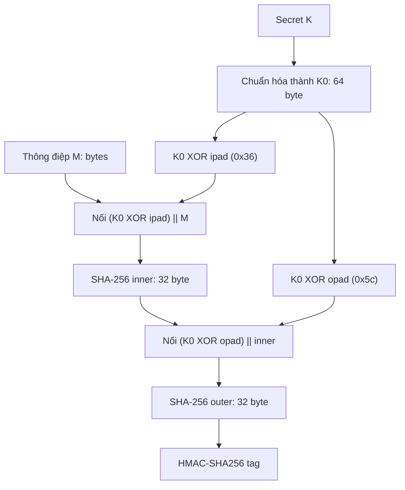
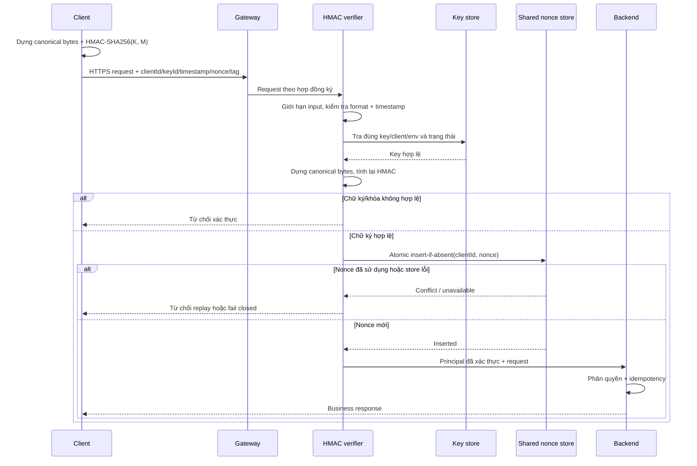

# HMAC-SHA256: nguyên lý, cách tính và ứng dụng xác thực HTTP request

## Mục tiêu học tập

Sau bài này, bạn có thể:

- Giải thích sự khác nhau giữa **SHA-256 (hash không khóa)** và **HMAC-SHA256 (mã xác thực thông điệp có khóa)**.
- Trình bày cấu trúc HMAC với `ipad`, `opad`, chuẩn hóa khóa và hai lượt SHA-256; hiểu tại sao không tự thay HMAC bằng `SHA256(secret || message)`.
- Xác định chính xác đầu vào/đầu ra ở mức **byte** và cách biểu diễn tag bằng hex hoặc Base64URL.
- Tính và xác minh HMAC-SHA256 bằng Java/JCA `javax.crypto.Mac`; kiểm thử với test vector công khai.
- Áp dụng HMAC-SHA256 vào hợp đồng `canonical request` chứa method, URI, header/body, timestamp và nonce.
- Phân biệt **bảo vệ tính toàn vẹn**, **chống replay**, **quản lý khóa/rotation** và **phân quyền** trong một hệ thống API.

**Ngữ cảnh:** Đây là bài thuộc chương **Hash algorithm** của module `SECURITY_AUTHENTICATION_HMAC_REQUEST_AUTHENTICATION`. Module hướng tới thiết kế xác thực HTTP request bằng khóa dùng chung và canonical request, sau đó kiểm tra chữ ký, chống replay và triển khai an toàn qua proxy/gateway. `SPECIAL_NOTE` của bài không có nội dung bổ sung.

## 1. SHA-256 khác HMAC-SHA256 ở điểm nào?

**SHA-256** là hàm băm mật mã thuộc họ SHA-2. Nó nhận thông điệp có độ dài tùy ý và tạo một bản tóm tắt **256 bit (32 byte)**:

```text
digest = SHA256(messageBytes)
```

Vì SHA-256 **không dùng khóa**, bất cứ ai có thông điệp đều có thể tính lại digest. Digest hữu ích để kiểm tra xem các byte có thay đổi, nhưng **không tự xác thực ai tạo ra thông điệp**. Nếu kẻ tấn công có thể thay cả body lẫn digest truyền kèm, việc so hai digest không ngăn được sửa đổi ác ý.

**HMAC-SHA256** kết hợp SHA-256 với **khóa bí mật `K`**:

```text
tag = HMAC-SHA256(secretKeyBytes, messageBytes)
```

Bên gửi và bên xác minh cùng có quyền sử dụng `K`. Kẻ không biết `K` khó tạo một tag hợp lệ cho thông điệp mới, với điều kiện khóa đủ mạnh, thuật toán được dùng đúng và tag được kiểm tra chính xác.

| Thuộc tính | SHA-256 | HMAC-SHA256 |
|---|---|---|
| Đầu vào | Thông điệp | Khóa bí mật + thông điệp |
| Đầu ra | Digest 32 byte | MAC/tag 32 byte |
| Ai có thể tính? | Bất kỳ ai có dữ liệu | Bên có quyền sử dụng khóa |
| Chống sửa đổi có chủ đích khi attacker tự thay digest/tag | **Không** | Có, trong mô hình attacker không biết khóa |
| Bảo mật nội dung | Không | Không |
| Tự chống gửi lại request cũ | Không | Không |
| Tự quyết định quyền truy cập API | Không | Không |

**Ví dụ:** API nhận `POST /v1/orders`. Nếu client chỉ gửi body và header `X-Body-SHA256`, attacker có thể sửa `amount` rồi băm body mới. Nhưng nếu API yêu cầu `X-Signature = HMAC-SHA256(K, canonicalRequest)`, chỉ bên có khóa mới tạo được chữ ký hợp lệ cho request đã thay đổi.

HMAC không phải chữ ký số bất đối xứng: **client và verifier đều biết cùng khóa**. Nó xác thực *khả năng sử dụng khóa* chứ không tạo được bằng chứng chống chối bỏ giữa hai bên cùng giữ secret.

## 2. Cấu trúc mật mã của HMAC-SHA256

Công thức chuẩn của HMAC với hàm băm `H` là:

```text
HMAC(K, M) = H( (K0 XOR opad) || H( (K0 XOR ipad) || M ) )
```

Trong đó:

- `M` là chính xác chuỗi **byte** thông điệp cần xác thực, không phải một đối tượng Java hoặc JSON trừu tượng.
- `K` là bytes của shared secret.
- `K0` là khóa sau chuẩn hóa theo kích thước khối của hàm băm.
- `ipad` là byte `0x36` lặp lại trên toàn bộ kích thước khối.
- `opad` là byte `0x5c` lặp lại trên toàn bộ kích thước khối.
- `XOR` là phép XOR từng byte; `||` là phép nối byte theo thứ tự.
- `H` trong bài là **SHA-256**.

Với SHA-256, **kích thước khối là 64 byte (512 bit)** và **digest dài 32 byte (256 bit)**. Hai con số này có ý nghĩa khác nhau: 64 byte là kích thước xử lý khối của SHA-256, còn 32 byte là độ dài tag HMAC-SHA256.

### 2.1. Chuẩn hóa khóa để có `K0`

Trước khi áp dụng `ipad/opad`, HMAC chuẩn hóa key:

1. Nếu khóa `K` **dài hơn 64 byte**, thay khóa bằng `SHA256(K)`, tức 32 byte.
2. Nếu sau bước trên khóa **ngắn hơn 64 byte**, thêm các byte `0x00` ở cuối cho đủ 64 byte.
3. Nếu khóa **đúng 64 byte**, giữ nguyên 64 byte đó.

Khóa chuẩn hóa `K0` luôn dài **64 byte**. Đây là quy tắc của phép tính HMAC, **không** phải chỉ dẫn nên sinh một secret dài 64 byte. Một secret được sinh ngẫu nhiên bằng CSPRNG dài **32 byte** là lựa chọn thực tế tốt cho HMAC-SHA256, sau đó thuật toán sẽ tự đệm nội bộ.

### 2.2. Hai lần băm có vai trò gì?



Ở lượt **inner**, SHA-256 tính digest cho `(K0 XOR ipad) || M`. Ở lượt **outer**, SHA-256 băm tiếp `(K0 XOR opad) || innerDigest` để tạo tag cuối cùng. Hai lớp này là một phần thiết kế được phân tích mật mã của HMAC.

Đừng tự thiết kế MAC bằng công thức đơn giản như `SHA256(K || M)`. Những cách xây dựng tự phát có thể mắc lỗi, chẳng hạn tấn công **length extension** đối với các hàm băm kiểu Merkle–Damgård khi dùng secret-prefix MAC. HMAC được thiết kế để tránh kiểu sử dụng sai này; Java đã có implementation chuẩn, vì vậy ứng dụng nên gọi `Mac.getInstance("HmacSHA256")` thay vì tự viết `ipad` và `opad`.

## 3. Đầu vào và đầu ra: phải thống nhất từng byte

Hai hệ thống chỉ tương thích khi cùng dùng **đúng key bytes** và **đúng message bytes**.

### 3.1. Khóa không phải là chuỗi biểu diễn khóa

Ví dụ, secret được cấp ở định dạng Base64URL. Phía client giải mã Base64URL thành raw bytes rồi ký; nếu server lại dùng trực tiếp các ký tự Base64URL làm bytes của khóa, cả hai sẽ tạo HMAC khác nhau.

```text
secretInBase64Url --decode--> rawKeyBytes --> Mac.init(rawKeyBytes)
```

Nên quy định rõ ở bước provisioning: secret ở dạng **raw bytes**, hex, Base64 hay Base64URL; có padding hay không; ai giải mã và tại thời điểm nào. Không gửi secret trong HTTP request. `clientId` và `keyId` chỉ là định danh tra cứu phiên bản khóa, không thay thế secret.

### 3.2. Thông điệp là bytes, không phải “ý nghĩa” dữ liệu

Hai JSON sau có thể biểu diễn cùng dữ liệu nghiệp vụ nhưng **khác bytes**:

```json
{"orderId":"A1","amount":1000}
```

```json
{ "amount": 1000, "orderId": "A1" }
```

Nếu ký `rawBodyBytes` hoặc ký digest được tính từ `rawBodyBytes` thì hai JSON có HMAC khác nhau. Tương tự, UTF-8, dấu xuống dòng LF/CRLF, dấu cách, thứ tự query parameter, encoding `%2F` và viết hoa/viết thường đều có thể ảnh hưởng chữ ký.

**Hệ quả:** client cần chốt bytes sẽ gửi trước khi ký; verifier phải dựng lại thông điệp từ phần request thực nhận **theo cùng hợp đồng canonicalization**.

### 3.3. Ba biểu diễn thường gặp của tag

Kết quả HMAC-SHA256 luôn là **32 byte nhị phân** trước khi mã hóa:

| Biểu diễn | Độ dài với HMAC-SHA256 đầy đủ | Ví dụ sử dụng |
|---|---:|---|
| Raw MAC | 32 byte | So sánh byte trực tiếp trong Java |
| Hex chữ thường | 64 ký tự ASCII | Test vector, công cụ debug |
| Base64URL không padding | 43 ký tự ASCII | Header HTTP `X-Signature` |

Hex và Base64URL chỉ là **cách biểu diễn tag**, không thay đổi tính bảo mật của HMAC. Cần quy định một encoding duy nhất và kiểm tra đầu vào đúng chuẩn. Có thể có API cắt ngắn tag theo giao thức được thiết kế riêng, nhưng **không nên tự ý truncate**: độ dài tag ngắn hơn làm tăng xác suất đoán đúng và phải được đánh giá/giới hạn số lần thử.

## 4. Test vector HMAC-SHA256 có kết quả đã biết

Trước khi tích hợp request HTTP, hãy xác nhận implementation với **RFC 4231**. Hai vector sau dùng ASCII và kết quả MAC ở dạng hex chữ thường.

| Trường hợp | Key bytes | Message bytes | HMAC-SHA256 (hex) |
|---|---|---|---|
| Test case 1 | 20 byte `0x0b` | `Hi There` | `b0344c61d8db38535ca8afceaf0bf12b881dc200c9833da726e9376c2e32cff7` |
| Test case 2 | ASCII `Jefe` | `what do ya want for nothing?` | `5bdcc146bf60754e6a042426089575c75a003f089d2739839dec58b964ec3843` |

Đây là **khóa kiểm thử công khai**; tuyệt đối không dùng làm secret production.

### Ví dụ Java tự chứa

Ví dụ dưới đây dùng Java/JCA standard library. Nó tính HMAC, so kết quả với hai vector RFC 4231, minh họa cách encode/verify và không cần thư viện ngoài.

```java
import java.nio.charset.StandardCharsets;
import java.security.GeneralSecurityException;
import java.security.MessageDigest;
import java.util.Arrays;
import java.util.Base64;
import javax.crypto.Mac;
import javax.crypto.spec.SecretKeySpec;

public final class HmacSha256Demo {
    private static final String ALGORITHM = "HmacSHA256";
    private static final Base64.Encoder BASE64URL =
            Base64.getUrlEncoder().withoutPadding();

    private HmacSha256Demo() {}

    public static byte[] hmac(byte[] secret, byte[] message)
            throws GeneralSecurityException {
        Mac mac = Mac.getInstance(ALGORITHM);
        mac.init(new SecretKeySpec(secret, ALGORITHM));
        return mac.doFinal(message);
    }

    public static String signBase64Url(byte[] secret, byte[] message)
            throws GeneralSecurityException {
        return BASE64URL.encodeToString(hmac(secret, message));
    }

    public static boolean verifyBase64Url(
            byte[] secret, byte[] message, String supplied)
            throws GeneralSecurityException {

        // 32 byte HMAC-SHA256 => 43 ký tự Base64URL không padding.
        if (supplied == null ||
                !supplied.matches("[A-Za-z0-9_-]{43}")) {
            return false;
        }

        byte[] actual;
        try {
            actual = Base64.getUrlDecoder().decode(supplied);
        } catch (IllegalArgumentException invalidEncoding) {
            return false;
        }
        if (actual.length != 32) {
            return false;
        }

        // Từ chối encoding không canonical của cùng một dãy byte.
        if (!BASE64URL.encodeToString(actual).equals(supplied)) {
            return false;
        }

        byte[] expected = hmac(secret, message);
        return MessageDigest.isEqual(expected, actual);
    }

    private static String hex(byte[] bytes) {
        StringBuilder result = new StringBuilder(bytes.length * 2);
        for (byte value : bytes) {
            result.append(String.format("%02x", value & 0xff));
        }
        return result.toString();
    }

    private static void assertVector(
            String label, byte[] key, byte[] data, String expectedHex)
            throws GeneralSecurityException {

        String actualHex = hex(hmac(key, data));
        if (!expectedHex.equals(actualHex)) {
            throw new AssertionError(label + " mismatch: " + actualHex);
        }
        System.out.println(label + ": PASS");
    }

    public static void main(String[] args)
            throws GeneralSecurityException {

        byte[] testKey1 = new byte[20];
        Arrays.fill(testKey1, (byte) 0x0b);
        byte[] testMessage1 = "Hi There"
                .getBytes(StandardCharsets.US_ASCII);

        assertVector(
            "RFC 4231 test 1",
            testKey1,
            testMessage1,
            "b0344c61d8db38535ca8afceaf0bf12b881dc200c9833da726e9376c2e32cff7");

        byte[] testKey2 = "Jefe".getBytes(StandardCharsets.US_ASCII);
        byte[] testMessage2 = "what do ya want for nothing?"
                .getBytes(StandardCharsets.US_ASCII);

        assertVector(
            "RFC 4231 test 2",
            testKey2,
            testMessage2,
            "5bdcc146bf60754e6a042426089575c75a003f089d2739839dec58b964ec3843");

        String signature = signBase64Url(testKey2, testMessage2);
        if (!verifyBase64Url(testKey2, testMessage2, signature)) {
            throw new AssertionError("HMAC verification failed");
        }

        byte[] changedMessage =
                "what do ya want for nothing!".getBytes(StandardCharsets.US_ASCII);
        if (verifyBase64Url(testKey2, changedMessage, signature)) {
            throw new AssertionError("Modified message was accepted");
        }
        System.out.println("Signature and tamper checks: PASS");
    }
}
```

**Phạm vi của ví dụ:** class chỉ tính và kiểm tra MAC cho một `byte[] message` đã được chuẩn bị. HTTP verifier thực tế còn phải xác định đúng key theo client, giới hạn input, kiểm tra timestamp/nonce, xử lý proxy/gateway, phân quyền và bảo vệ secret. Không lấy `testKey1` hoặc `testKey2` dùng ngoài unit test.

### Vì sao so sánh bytes thay vì chuỗi chữ ký?

Khi đã kiểm tra format và giải mã một chữ ký **đúng 32 byte**, có thể so `expected` với `actual` bằng `MessageDigest.isEqual` để tránh lộ thông tin từng byte qua kiểu so sánh thoát sớm thông thường. So sánh tag chỉ là **một phần** chống side channel; sự khác biệt về tra cứu khóa, thời gian xử lý và thông báo lỗi vẫn cần được xem xét ở tầng HTTP.

## 5. Chọn và quản lý khóa cho HMAC-SHA256

Khóa HMAC là bí mật trung tâm của mô hình xác thực đối xứng. Độ an toàn thực tế phụ thuộc vào **entropy** và cách quản lý khóa, không chỉ dựa vào tên SHA-256.

### Sinh khóa

Một lựa chọn thực tế là **32 byte ngẫu nhiên từ CSPRNG**:

```java
import java.security.SecureRandom;

byte[] secret = new byte[32];
new SecureRandom().nextBytes(secret); // Chỉ chạy ở giai đoạn cấp phát khóa.
```

Các byte này cần được lưu và cấp cho những thành phần được phép sử dụng. Không sinh secret mới mỗi request; nếu client và verifier dùng secret khác nhau, chữ ký sẽ không khớp. Không dùng tên dịch vụ, mật khẩu người dùng yếu, UUID dự đoán được hoặc timestamp làm khóa. Nếu secret xuất phát từ mật khẩu, bài toán cần một quy trình dẫn xuất khóa có đánh giá riêng; tốt nhất cho giao tiếp dịch vụ là khóa ngẫu nhiên do hệ thống cấp phát.

### Cô lập khóa và rotation

| Khía cạnh | Thiết kế khuyến nghị | Sai lầm thường gặp |
|---|---|---|
| Phạm vi | Khóa riêng theo client/tenant, môi trường và mục đích | Một khóa chung cho mọi đối tác |
| Lưu trữ | Secret manager/KMS, hạn chế quyền, audit | Hard-code, commit Git, in secret vào log |
| Truy xuất | Verifier chọn đúng `(clientId, keyId, environment)` | Thử toàn bộ khóa hoặc chấp nhận khóa tenant khác |
| Rotation | Cấp key mới, chuyển client, verifier tạm hỗ trợ key cũ/mới có hạn | Thay đột ngột khiến mọi request lỗi |
| Thu hồi | Vô hiệu hóa key, làm mới cache và điều tra truy cập | Cache verifier tiếp tục nhận key đã revoke |
| Vận chuyển | Kênh TLS/mTLS thích hợp và cơ chế cấp phát an toàn | Đưa raw secret vào request hoặc URL |

`clientId` và `keyId` được client gửi để **tra khóa ứng viên**, nhưng là dữ liệu **chưa đáng tin** cho đến khi chữ ký được xác minh. `keyId` nên nằm trong canonical request có ký. Key rotation không phải chức năng của `Mac`; nó nằm ở hệ thống quản lý khóa và quy trình vận hành.

**Khi secret bị lộ:** attacker có thể tính HMAC mới cho request mới với timestamp và nonce mới. Cửa sổ thời gian hoặc nonce store **không ngăn được giả mạo khi khóa đã bị chiếm**. Cần thu hồi, luân chuyển key và kiểm tra logs/metrics theo chính sách bảo mật.

## 6. Dùng HMAC-SHA256 để ký canonical HTTP request

`javax.crypto.Mac` chỉ biết **byte[] key** và **byte[] message**; nó không biết HTTP method, path hay header. Để đưa HMAC vào xác thực request, client và server phải định nghĩa một **hợp đồng ký có phiên bản** cho toàn bộ bytes cần bảo vệ.

### 6.1. Ví dụ một hợp đồng `hmac-v1`

Giả sử ứng dụng quy định:

1. Dòng 1: method viết hoa, ví dụ `POST`.
2. Dòng 2: path và query theo biểu diễn thống nhất, ví dụ `/v1/orders?currency=VND`; không ngầm sort query.
3. Những dòng tiếp theo lần lượt là `host`, `content-type`, `x-client-id`, `x-key-id`, `x-timestamp`, `x-nonce` với tên header viết thường; giá trị chuẩn hóa đúng quy định.
4. Dòng cuối là `body-sha256:` cộng **Base64URL không padding của SHA-256 trên raw body bytes**.
5. Dùng LF (`\n`) giữa các dòng, không thêm LF cuối và dùng UTF-8 để biến canonical string thành bytes.
6. Tính `HMAC-SHA256(secret, canonicalBytes)` rồi encode tag bằng Base64URL không padding trong header `X-Signature`.
7. Mọi header bắt buộc phải có đúng một giá trị, định dạng đúng và không có CR/LF tiêm vào. Thuật toán, danh sách trường đã ký và cách canonicalization phải được cố định theo version, không để client tùy ý hạ xuống thuật toán yếu.

Hợp đồng trên là **minh họa**, không phải chuẩn HMAC có thể tự động tương thích với API bên ngoài. Đối với sản phẩm thực tế, cần quy định thêm các quy tắc về percent-encoding, duplicate query parameter, slash, header nhiều giá trị, content encoding, empty body và nguồn giá trị `host` qua reverse proxy.

### 6.2. Request và chuỗi byte cần ký

```http
POST /v1/orders?currency=VND HTTP/1.1
Host: api.example.test
Content-Type: application/json
X-Client-Id: partner-17
X-Key-Id: k2
X-Timestamp: <unix-seconds-hien-tai>
X-Nonce: <nonce-moi-kho-doan>
X-Signature: <base64url-hmac-tag>

{"orderId":"A1","amount":1000}
```

Các mục trong dấu `<...>` là **placeholder**; khi chạy thật phải thay bằng metadata hợp lệ. Chuỗi canonical tương ứng là:

```text
POST
/v1/orders?currency=VND
host:api.example.test
content-type:application/json
x-client-id:partner-17
x-key-id:k2
x-timestamp:<unix-seconds-hien-tai>
x-nonce:<nonce-moi-kho-doan>
body-sha256:<base64url-sha256-cua-exact-body-bytes>
```

Body bytes trong ví dụ là bytes UTF-8 của `{"orderId":"A1","amount":1000}` **không có newline cuối**. Nếu thêm một dấu cách vào JSON, SHA-256 body đổi; dòng `body-sha256` đổi; tag HMAC cuối cùng cũng đổi.

Ví dụ Java để băm body, sử dụng SHA-256 **không khóa** như một thành phần của hợp đồng ký:

```java
import java.security.MessageDigest;
import java.security.GeneralSecurityException;
import java.util.Base64;

public static String bodySha256(byte[] rawBody)
        throws GeneralSecurityException {
    byte[] digest = MessageDigest
            .getInstance("SHA-256")
            .digest(rawBody);
    return Base64.getUrlEncoder()
            .withoutPadding()
            .encodeToString(digest);
}
```

**Giải thích quan trọng:** SHA-256 của body chỉ là **digest để đưa vào canonical request**; sự bảo vệ chống sửa body đến từ việc **HMAC ký dòng body hash**, cùng với các trường còn lại. Một header body-hash tự do không có HMAC sẽ không xác thực được client.

### 6.3. Vì sao không ký body tùy ý rồi bỏ qua method/URI?

Nếu chỉ tính `HMAC(K, body)`, cùng body có thể được sử dụng với method hoặc URI khác nhưng **tag vẫn đúng**. Hợp đồng ký nên bao phủ các trường ảnh hưởng đến hành động hoặc ngữ cảnh bảo mật, gồm method, request-target, định danh client/key và các header nghiệp vụ quan trọng. Nếu backend chọn tenant từ header hoặc query không được ký, phải đối chiếu chúng với một context đáng tin và chính sách quyền.

## 7. Luồng xác minh chữ ký trên server

Tại server, việc tính lại HMAC-SHA256 phải là **một bước** của pipeline xác thực, không phải toàn bộ pipeline.



Một trình tự có thể triển khai:

1. Gateway bảo vệ TLS, giới hạn kích thước header/body và tốc độ request; xác định nơi sẽ dùng dữ liệu HTTP gốc để ký.
2. Verifier kiểm tra format của `clientId`, `keyId`, `timestamp`, `nonce`, `signature`; từ chối header trùng/nhập nhằng. Timestamp phải nằm trong cửa sổ định trước, ví dụ ±300 giây.
3. Dựa vào `(clientId, keyId, environment)`, verifier tra **đúng khóa** còn được phép xác minh; không thử khóa của client khác.
4. Dựng lại canonical bytes từ **request thực nhận**, tính lại HMAC-SHA256 bằng key tương ứng và so tag bytes an toàn.
5. **Chỉ sau khi chữ ký đúng**, ghi `(clientId, nonce)` vào một kho dùng chung bằng thao tác **insert-if-absent nguyên tử**, gắn TTL bao phủ toàn bộ thời gian timestamp có thể được chấp nhận.
6. Nếu nonce mới, tạo principal nội bộ từ chủ sở hữu khóa; backend kiểm tra quyền theo tenant, resource và hành động trước khi chạy nghiệp vụ.

**Timestamp không đủ để chống replay:** attacker có thể phát lại nguyên request có HMAC đúng trong cửa sổ thời gian. Nonce lưu tập trung chặn việc dùng lại; nhiều replica chỉ dùng cache RAM riêng có thể cùng chấp nhận một request trùng.

**Nonce không thay thế idempotency:** khi client bị timeout và ký request mới với nonce mới, backend vẫn có thể nhận thao tác nghiệp vụ trùng. Với thanh toán/tạo đơn cần dùng idempotency key được bảo vệ theo hợp đồng ký và xử lý idempotent ở tầng nghiệp vụ.

## 8. Ảnh hưởng của proxy/gateway đến HMAC-SHA256

HMAC bảo vệ **bytes được ký**. Khi reverse proxy hoặc API gateway thay đổi những bytes tương ứng, phép tính ở client và verifier sẽ không khớp:

- Proxy đổi `Host` từ domain công khai sang hostname nội bộ.
- Gateway bỏ prefix `/api`, decode `%2F`, thay query encoding hoặc thứ tự tham số.
- HTTP parser ghép header trùng hoặc chọn giá trị đầu tiên ở gateway nhưng backend chọn giá trị cuối.
- Proxy nén/giải nén body, đổi charset hoặc thư viện ứng dụng serialize lại JSON.
- Client gửi `Forwarded` hoặc `X-Forwarded-*` giả mạo, trong khi verifier dùng những header đó để dựng host/path.

Cần chốt **vị trí xác minh** (trước rewrite hoặc sau rewrite với dữ liệu gốc được bảo vệ) và **hợp đồng canonical** rõ ràng. Không tự lấy một `X-Original-URI` hoặc `X-Forwarded-Host` từ request public để thay cho request-target/host đáng tin; chỉ những thành phần do proxy được ủy quyền tạo hoặc ghi đè mới có thể làm nguồn tin.

Sau khi HMAC thành công, gateway phải chuyển **principal đã xác thực** cho backend qua kênh được bảo vệ và xóa/ghi đè header identity do client gửi. Backend vẫn phải **phân quyền**: chữ ký hợp lệ với key của tenant A không cho phép truy cập tài nguyên tenant B.

## 9. Phân tích lựa chọn thuật toán và các giới hạn

### 9.1. Vì sao thường chọn SHA-256 cho HMAC?

HMAC-SHA256 được hỗ trợ rộng rãi trong Java/JCA, có digest 256 bit, hoạt động tốt với khóa ngẫu nhiên và phù hợp nhiều giao thức xác thực hiện đại. Đối với thiết kế mới, đây thường là lựa chọn dễ phối hợp giữa các nền tảng hơn những thuật toán cũ. Tuy nhiên, “dùng SHA-256” không đảm bảo an toàn nếu secret yếu hoặc dữ liệu ký không bao phủ hành động thực thi.

| Phương án | Nhận xét |
|---|---|
| `HmacSHA256` | Lựa chọn mặc định thực tế tốt cho nhiều API |
| `HmacSHA512` | Digest/tag 64 byte, quy tắc xử lý khóa theo block size SHA-512 khác; cần hợp đồng rõ |
| `HmacSHA1` | Thuật toán lịch sử; tránh chọn mới khi HMAC-SHA256 sẵn có |
| `HmacMD5` | Không phù hợp để chọn mới cho hệ thống an ninh hiện đại |
| `SHA256(K || M)` | Không phải HMAC; không tự tạo secret-prefix MAC |
| `SHA256(M)` | Digest công khai; không xác thực người gửi |

Không cho request tự quyết định “algorithm=none” hay chọn thuật toán tùy ý. Chốt thuật toán/phiên bản theo cấu hình server và đưa các định danh quan trọng vào hợp đồng đã ký.

### 9.2. Khóa dài, tag dài và mức độ an toàn

- **Độ dài output:** HMAC-SHA256 trả về 32 byte tag khi không cắt ngắn.
- **Độ mạnh của khóa:** khóa có đủ entropy mới khó đoán; 32 byte sinh từ CSPRNG là một cách cấp phát phù hợp.
- **Độ dài khóa lớn hơn 64 byte:** HMAC-SHA256 tự băm khóa dài trước khi pad, không có nghĩa “càng dài vô hạn càng an toàn”.
- **Cắt ngắn tag:** chỉ làm nếu một giao thức cụ thể quy định và đã đánh giá nguy cơ giả mạo/online guesses; giữ toàn bộ 32 byte là lựa chọn đơn giản, dễ triển khai đúng.
- **Tái sử dụng khóa:** dùng một key cho nhiều giao thức hoặc mục đích làm tăng vùng ảnh hưởng và rủi ro thông điệp bị diễn giải sai ngữ cảnh. Cô lập key theo client/môi trường/mục đích hoặc quy định domain separation khi cần.

HMAC-SHA256 **không phải** công cụ phù hợp để lưu mật khẩu người dùng (cần một password hashing/KDF chuyên dụng với salt và chi phí phù hợp), cũng không thay thế TLS hay chữ ký bất đối xứng khi cần xác minh công khai.

## 10. Các lỗi thường gặp và cách phát hiện

| Triệu chứng | Nguyên nhân có thể | Cách kiểm tra |
|---|---|---|
| Client và server dùng HMAC-SHA256 nhưng tag khác nhau | Khác key bytes, UTF-8, newline hoặc canonical order | So byte-level test vector và canonical bytes trên môi trường kiểm thử an toàn |
| Body JSON “giống nhau” vẫn sai chữ ký | Raw bytes khác nhau (whitespace, thứ tự field, charset) | Chốt body trước khi ký; hash raw bytes đúng hợp đồng |
| Thay path/query vẫn vượt qua xác thực | Method/URI không được đưa vào HMAC | Kiểm tra signed fields và test sửa từng trường |
| Một client dùng được key của tenant khác | Key lookup không scope theo client và environment | Test key-cross-tenant; giới hạn mapping `clientId/keyId` |
| Request cũ vẫn tạo đơn lần hai | Thiếu nonce store hoặc dùng cache riêng mỗi replica | Test replay tuần tự và đồng thời |
| Dùng key đã thu hồi vẫn được chấp nhận | Cache key không nhận trạng thái revoke | Test rotation và invalidation |
| HMAC đúng nhưng attacker truy cập tài nguyên tenant khác | Backend thiếu authorization | Test chữ ký hợp lệ với resource sai chủ sở hữu |
| Chữ ký sai sau khi thêm gateway | Host/path/query/body bị rewrite | Integration test qua đúng chuỗi proxy |
| Mã xác minh nhận nhiều dạng encoding khác nhau | Base64URL decoder quá dễ dãi hoặc bỏ qua canonicalization | Kiểm tra độ dài, alphabet và encode lại so với input |
| Nhiều chữ ký sai đột biến | Clock skew, thay key, thay proxy, bị tấn công hoặc client bug | Phân tích metric theo keyId/route mà không log raw secret |

### Kế hoạch kiểm thử tối thiểu

1. **Mật mã:** chạy hai vector RFC 4231, kiểm tra cùng key/message cho cùng tag; thay một byte hoặc thay key tạo tag khác.
2. **Hợp đồng canonical:** fixture method/URI/header/body có byte xác định, xác thực cả Java client và verifier tạo cùng canonical bytes.
3. **Tấn công sửa dữ liệu:** thay method, path, query, tenant header, timestamp, nonce và một byte body sau ký; trường được ký phải dẫn đến HMAC mismatch.
4. **Replay:** gửi lại nguyên request sau khi đã thành công; chạy hai request cùng nonce đồng thời qua hai replica; chỉ một request được đi tiếp.
5. **Rotation:** ký bằng key cũ/mới khi cho phép, kiểm tra key cũ bị từ chối sau khi revoke, thử dùng key A cho client B.
6. **Gateway:** gửi case percent-encoding, query trùng, Host public/internal, header trùng và body bị transform qua ingress thực tế.
7. **Phân quyền:** key của client A có HMAC hợp lệ nhưng request nhắm tới tenant B vẫn phải bị chặn tại authorization.

## 11. Bài tập: xây dựng HMAC-SHA256 request signing cho Java

Một client `inventory-client` cần gọi `POST /v1/reservations?tenant=alpha`. API chạy sau reverse proxy và hai replica verifier. Hệ thống cấp `clientId=inventory-client`, key `k1` và dự kiến chuyển sang `k2`.

**Yêu cầu triển khai:**

1. Dùng `SecureRandom` cấp secret 32 byte cho mỗi phiên bản key; đề xuất nơi lưu, phân phối và cơ chế thu hồi.
2. Định nghĩa canonical request có method, request-target, host, client ID, key ID, timestamp, nonce và digest SHA-256 của **raw body**. Quy định UTF-8, LF, cách xử lý header lặp, query trùng và biểu diễn tag.
3. Viết hàm Java tính HMAC-SHA256 bằng `Mac.getInstance("HmacSHA256")`; encode Base64URL không padding.
4. Viết verifier tra đúng `clientId/keyId`, kiểm tra format, timestamp, dựng canonical bytes, so tag với `MessageDigest.isEqual`.
5. Dùng nonce store chia sẻ và thao tác insert-if-absent nguyên tử; chứng minh hai request cùng nonce tới hai replica không thể cùng vượt qua.
6. Chạy case sửa một byte body, thay request-target qua proxy, key bị thu hồi, retry với chữ ký mới và phân quyền sai tenant.
7. Ghi lại những giới hạn còn lại của HMAC-SHA256: bảo mật nội dung, replay, rotation, idempotency và authorization phải do những thành phần nào xử lý.

**Tiêu chí đạt:** Kết quả RFC 4231 chính xác; cùng canonical bytes và cùng key luôn cho cùng 32 byte tag; các sửa đổi có liên quan bị từ chối; verifier không chấp nhận key chéo tenant hay nonce dùng lại; backend kiểm tra quyền sau xác thực.

---

## Ghi nhớ

**HMAC-SHA256** là cơ chế MAC có khóa xây dựng từ SHA-256 bằng hai lượt băm với `ipad/opad`. Trong module `SECURITY_AUTHENTICATION_HMAC_REQUEST_AUTHENTICATION`, điều quan trọng không chỉ là tính đúng `Mac` mà là xác minh HMAC trên **đúng canonical request bytes**, bảo vệ **shared secret**, chặn replay bằng **timestamp/nonce**, quản lý **key rotation**, giữ đồng nhất qua **proxy/gateway** và yêu cầu **authorization** tách biệt ở backend.
