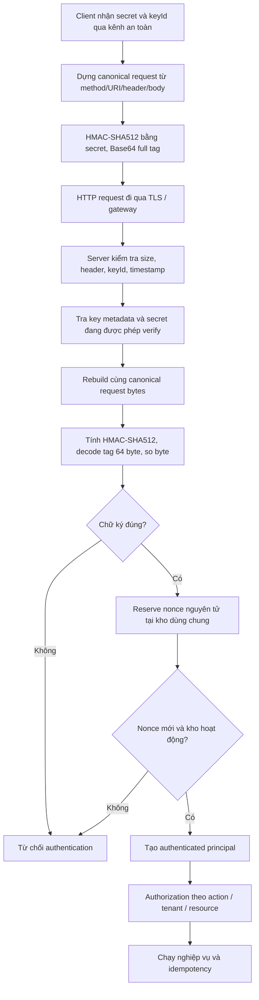

# HMAC-SHA512 trong xác thực HTTP request

## 1. HMAC-SHA512 là gì và dùng khi nào?

Trong module `SECURITY_AUTHENTICATION_HMAC_REQUEST_AUTHENTICATION`, client và server cùng nắm giữ **shared secret** để xác thực HTTP request. Client xây dựng **canonical request** theo hợp đồng ký, có thể bao gồm HTTP method, raw URI/query, các header được chọn và hash của raw body; sau đó tạo **MAC (Message Authentication Code)**. Server dựng lại chính xác dữ liệu đã ký, tính MAC bằng secret tương ứng và đối chiếu chữ ký trước khi cho request đi tiếp.

**HMAC-SHA512** là HMAC sử dụng hàm băm mật mã **SHA-512** bên trong. Cần phân biệt ba khái niệm thường dễ bị lẫn:

- **SHA-512** là hàm băm không dùng secret, biến dữ liệu đầu vào thành digest **64 byte (512 bit)**.
- **HMAC-SHA512** là cơ chế xác thực thông điệp *có secret*, tạo tag dài **64 byte** khi không rút ngắn.
- **SHA-512/256** và **HMAC-SHA512/256** là các lựa chọn thuật toán riêng; chúng **không đồng nghĩa** với việc lấy 32 byte đầu của SHA-512 hoặc HMAC-SHA512.

Với một API mới, **HMAC-SHA256** thường đã đủ và dễ tích hợp. **HMAC-SHA512** là lựa chọn phù hợp khi hệ thống/đối tác có hợp đồng hoặc chính sách mật mã yêu cầu SHA-512, hoặc cả hai bên đã chuẩn hóa SHA-512. Việc chọn thuật toán có tag dài hơn không thể sửa lỗi canonical request, secret yếu, thiếu nonce hay lỗ hổng phân quyền.

**Mục tiêu bài học:**

1. Hiểu cấu trúc HMAC-SHA512, kích thước khối của SHA-512, key và tag.
2. Thiết kế byte đầu vào, encoding và hợp đồng ký request cho HMAC-SHA512.
3. Tính và xác minh chữ ký bằng Java 17+ (`HmacSHA512` trong JCA).
4. Kiểm thử với test vector chuẩn, dữ liệu Unicode, HTTP gateway/proxy, timestamp/nonce và key rotation.
5. Phân biệt xác thực bằng HMAC với chống replay và authorization.

## 2. Cách HMAC-SHA512 hoạt động ở mức byte

### 2.1 Cấu trúc HMAC

Công thức khái niệm:

\[
\operatorname{HMAC}_{SHA512}(K,m) =
SHA512\left((K' \oplus opad)\;||\;SHA512((K'\oplus ipad)\;||\;m)\right)
\]

Trong đó:

- `K` là secret **ở dạng byte**, `m` là thông điệp đã mã hóa thành byte (với HTTP request: canonical request bytes).
- `K'` là khóa được xử lý về kích thước khối của SHA-512: nếu `K` dài hơn block size, SHA-512 được dùng để băm khóa trước; sau đó padding bằng byte `0x00` đến đủ kích thước.
- SHA-512 có **block size 128 byte (1024 bit)**, output **64 byte (512 bit)**.
- `ipad` là byte `0x36` lặp theo block; `opad` là `0x5c` lặp theo block; `||` là nối byte, `⊕` là XOR.

Không cần và không nên tự viết vòng XOR/hàm băm ở production. Java cung cấp thuật toán `HmacSHA512` qua `javax.crypto.Mac`; các ngôn ngữ phổ biến khác cũng có thư viện HMAC. Cách triển khai chuẩn giúp giảm lỗi byte, padding hoặc thứ tự kết hợp hash.

### 2.2 Digest SHA-512 và HMAC-SHA512 khác nhau

Ví dụ hai hệ thống cùng nhận JSON:

```json
{"amount":150000,"currency":"VND"}
```

Nếu server chỉ kiểm tra `SHA512(body)` gửi trong header, kẻ có quyền sửa body cũng có thể tự tính lại digest. Đó là checksum mật mã, **không phải bằng chứng về client**.

Với `HMAC_SHA512(sharedSecret, canonicalBytes)`, người không biết secret không thể dễ dàng tạo tag hợp lệ cho nội dung đã sửa. Tuy nhiên client *có secret* vẫn có thể tự ký một request mới đến tài nguyên mà mình không được phép sử dụng. **Authorization** phải kiểm tra quyền sau khi authentication hoàn tất.

### 2.3 Kích thước và biểu diễn chữ ký

| Thuộc tính | HMAC-SHA512 trong hợp đồng minh họa |
| --- | --- |
| Hàm hash nội bộ | SHA-512 |
| Kích thước khối hash | 128 byte |
| Tag đầy đủ | **64 byte (512 bit)** |
| Hex của tag đầy đủ | **128 ký tự** nếu dùng hex chữ thường |
| Base64 chuẩn có padding | **88 ký tự**, thường kết thúc bằng `==` |
| Tên thuật toán Java JCA | `HmacSHA512` |
| Tên trong tài liệu giao thức | Ví dụ `HMAC-SHA512`; cần quy ước chính xác với `HmacSHA512` |
| Secret khuyến nghị cho ví dụ | **32 hoặc 64 byte ngẫu nhiên mật mã**, cấp phát riêng cho ứng dụng/môi trường |

Tag dài 512 bit **không có nghĩa toàn hệ thống tự động đạt “512 bit an toàn”**. Mức an toàn phụ thuộc entropy thực của secret, số lượng request có thể thử, đặc tính HMAC, chính sách quản lý khóa và các tầng xác thực/phân quyền. Secret 32 byte ngẫu nhiên mang 256 bit entropy, dù kết quả HMAC-SHA512 dài 64 byte.

Base64 là **encoding**, không mã hóa bảo mật. Base64 chuẩn (`+`, `/`, `=`) khác Base64URL (`-`, `_`; padding có thể bị bỏ). Hai bên phải chọn **một cách biểu diễn duy nhất**, không đoán codec theo chuỗi client gửi. Nếu yêu cầu full tag, từ chối tag bị rút ngắn hoặc thừa byte.

## 3. Khi nào chọn HMAC-SHA512 thay vì HMAC-SHA256?

| Tiêu chí | HMAC-SHA256 | HMAC-SHA512 |
| --- | --- | --- |
| Tag đầy đủ | 32 byte | 64 byte |
| Base64 chuẩn có padding | 44 ký tự | 88 ký tự |
| Block size của hash | 64 byte | 128 byte |
| Hỗ trợ thư viện | Rất phổ biến | Phổ biến trong các runtime hiện đại, cần xác minh provider/SDK thực tế |
| Mức phù hợp cho API mới | **Điểm khởi đầu thông dụng** | Khi yêu cầu tích hợp hoặc chính sách nghiêng về SHA-512 |
| Hiệu năng | Phụ thuộc nền tảng và khối lượng dữ liệu | Cũng phụ thuộc CPU/provider/HSM; không mặc định luôn chậm hơn |
| Hạn chế chung | Không mã hóa, không tự chống replay, không cấp quyền | Các hạn chế giống hệt |

HMAC-SHA512 không phải là “SHA-512 rồi nối secret vào cuối”; các cấu trúc tự chế như `SHA512(secret || message)` hoặc `SHA512(message || secret)` không thể coi là HMAC chuẩn. Việc tự chế cơ chế MAC còn có thể mắc lỗi về cấu trúc, tương thích và phân tích bảo mật.

Nếu cần đồng bộ với đối tác sử dụng SHA-512, hãy xác minh **họ thực sự dùng HMAC-SHA512**, không phải SHA-512 digest, RSA-SHA512, HMAC-SHA512/256, SHA-512 với một khóa được ghép chuỗi hoặc biến thể khác. Tên tên gần nhau không đảm bảo kết quả byte giống nhau.

**Quy tắc chọn:** khi dùng HMAC-SHA512, chuẩn hóa đầy đủ **tên algorithm, key length/format, canonical string, digest cho body, tag length và encoding**. Chỉ chọn thuật toán mạnh là chưa đủ để định nghĩa hợp đồng giao tiếp.

## 4. Quản lý shared secret cho HMAC-SHA512

### 4.1 Sinh và lưu khóa

HMAC cho phép độ dài khóa khác nhau về mặt kỹ thuật. Với dịch vụ HTTP mới, có thể cấp phát **64 byte ngẫu nhiên mật mã** (512 bit entropy danh nghĩa) cho HMAC-SHA512, hoặc **32 byte ngẫu nhiên** nếu chính sách an ninh cho phép và mục tiêu bảo mật đã được đánh giá. Việc dùng 64 byte không có nghĩa mọi hệ thống cần khóa 512 bit mới sử dụng được HMAC-SHA512.

Ví dụ sinh secret 64 byte bằng Java:

```java
import java.security.SecureRandom;
import java.util.Base64;

byte[] secret = new byte[64];
new SecureRandom().nextBytes(secret);

// Chỉ biểu diễn key để cấp phát/lưu trong secret manager.
// Tuyệt đối không in ra log, không đưa vào source hoặc response.
String encodedForProvisioning = Base64.getEncoder().encodeToString(secret);
```

Khóa phải được cấp qua kênh an toàn, lưu trong secret manager/KMS/HSM hoặc cơ chế bảo mật phù hợp. Không lấy API key dễ đoán, chuỗi `merchant-42-secret`, mật khẩu người dùng hoặc UUID do một nguồn thiếu ngẫu nhiên làm secret cho production.

**Lưu ý độ dài khóa:** SHA-512 có block size 128 byte. HMAC xử lý khóa dài hơn 128 byte bằng cách hash khóa trước theo thiết kế chuẩn; đưa vào khóa rất dài **không tự động tăng mức bảo mật**. Điều quan trọng là entropy, tính độc lập giữa các khóa và khả năng bảo vệ vòng đời secret.

### 4.2 Phân tách khóa theo ứng dụng và phạm vi

Một secret nên gắn với **application/client**, môi trường và dịch vụ phù hợp. Tránh dùng chung secret cho production/staging hoặc giữa hai dịch vụ có thể chấp nhận cùng một canonical request.

Ví dụ metadata do server quản lý:

| `keyId` | `algorithm` | `applicationId` | `audience` | `status` |
| --- | --- | --- | --- | --- |
| `partner-17:v3` | `HmacSHA512` | `partner-17` | `transfer-api/prod` | `ACTIVE` |
| `partner-17:v2` | `HmacSHA512` | `partner-17` | `transfer-api/prod` | `VERIFY_ONLY` trong thời hạn |
| `partner-99:v1` | `HmacSHA256` | `partner-99` | `transfer-api/prod` | `ACTIVE` |

Client gửi `X-HMAC-Key-Id` để server **tìm cấu hình và secret**, nhưng key ID chưa được xác minh **không phải principal**. Chỉ khi chữ ký, trạng thái key, thời gian và nonce đều hợp lệ, hệ thống mới tạo principal nội bộ tương ứng với ứng dụng. Quyền truy cập tài nguyên được kiểm tra tiếp trong authorization.

### 4.3 Cố định thuật toán để chống downgrade

Không triển khai cách sau:

```text
Nếu X-HMAC-Algorithm == "SHA1" thì dùng HMAC-SHA1
Nếu thất bại với SHA-512 thì thử tiếp SHA-256/SHA-1 cho tới khi khớp
```

Client không được quyết định cho server dùng thuật toán yếu hơn cấu hình đã phê duyệt. Tốt hơn, server ánh xạ **`keyId → algorithm + secret + trạng thái + principal`**, chỉ tính **đúng một HMAC được phép cho key đó**, và từ chối khi tag không khớp. Nếu hợp đồng có header `X-HMAC-Algorithm`, server phải kiểm tra header ấy **khớp** với metadata và nằm trong các trường được ký, không tin header làm chính sách.

## 5. Xây dựng canonical request cho HMAC-SHA512

### 5.1 Hợp đồng cụ thể phải được viết trước khi lập trình

Giả sử client ký request:

```http
POST /v1/transfers?notify=true HTTP/1.1
Host: api.example.test
Content-Type: application/json
X-HMAC-Key-Id: partner-17:v3
X-HMAC-Timestamp: 1795838400
X-HMAC-Nonce: 9fc41749ac56ccfd4589b032779f6aee
X-HMAC-Signature: <base64-64-byte-tag>

{"to":"account-B","amount":250000}
```

Đây là **request minh họa**, không phải chữ ký hợp lệ có thể copy dùng ngay. Timestamp thể hiện Unix epoch seconds giả định; khi chạy hệ thống, server phải kiểm tra theo thời gian hiện tại.

Hợp đồng ký `HMAC-REQUEST/V1` trong ví dụ quy định:

| Trường | Quy tắc chính xác |
| --- | --- |
| Phiên bản | Dòng đầu cố định `HMAC-REQUEST/V1`, tách biệt với các giao thức khác. |
| Algorithm | Dòng thứ hai `HMAC-SHA512`; server xác định thuật toán theo metadata key. |
| Method | Method thực tế được server nhận, viết hoa `POST`. |
| Request target | Raw path cộng raw query (nếu có), đúng thứ tự và percent-encoding: `/v1/transfers?notify=true`. |
| `Content-Type` | Header duy nhất, sau khi trim khoảng trắng theo hợp đồng, phải bằng `application/json`. |
| `X-HMAC-Key-Id` | Key ID duy nhất, được đưa vào chuỗi ký. |
| `X-HMAC-Timestamp` | Unix epoch **seconds**, biểu diễn số thập phân theo định dạng thống nhất. |
| `X-HMAC-Nonce` | Hex chữ thường của 16 byte ngẫu nhiên: **32 ký tự hex**; nonce mới cho mỗi request. |
| Body digest | **SHA-512(rawBodyBytes)**, biểu diễn bằng 128 ký tự hex chữ thường. |
| Encoding canonical | UTF-8, các dòng phân tách bằng **LF** (`\n`), **không có LF ở cuối**. |
| Tag trên HTTP | `HMAC-SHA512(secretBytes, UTF8(canonical))`, mã hóa Base64 chuẩn có padding. |

Canonical string có **9 dòng**, theo thứ tự sau:

```text
HMAC-REQUEST/V1
HMAC-SHA512
POST
/v1/transfers?notify=true
content-type:application/json
x-hmac-key-id:partner-17:v3
x-hmac-timestamp:1795838400
x-hmac-nonce:9fc41749ac56ccfd4589b032779f6aee
body-sha512:<128-ky-tu-hex-sha512-cua-raw-body>
```

Trong chuỗi ký thực tế, thay **toàn bộ phần `<...>`** của dòng body bằng digest hex thật. Dù JSON tương đương về ý nghĩa, khác whitespace hay thứ tự field thì **raw body bytes khác** và digest khác. Nếu body rỗng, tính SHA-512 của mảng byte độ dài 0; không để chuỗi digest rỗng.

Ví dụ này chọn **SHA-512 để hash body** và **HMAC-SHA512 để ký canonical**. Đây là **hai quy tắc riêng** của hợp đồng. Một giao thức hoàn toàn có thể quy định digest body SHA-256 nhưng HMAC-SHA512; client và server phải dùng cùng phiên bản hợp đồng, tuyệt đối không tự suy luận tên digest body chỉ dựa trên tên HMAC.

### 5.2 Không để canonicalization tùy thuộc framework

Phương thức, URI, query, header và byte body phải được chọn ở một điểm xác minh thống nhất:

- **Raw URI/query:** `/a/%2F?x=1&x=2` không thể mặc nhiên coi là cùng byte với `/a//?x=2&x=1`. Không khôi phục raw query bằng cách parse map rồi sắp xếp lại nếu hợp đồng yêu cầu giữ nguyên.
- **Header:** từ chối header ký bị nhân đôi hoặc gộp nhập nhằng, kể cả khi HTTP header name không phân biệt hoa/thường. Phải quy định cách trim giá trị, không áp dụng normalize tùy tiện.
- **Body:** đọc body *trước parse JSON*, giới hạn kích thước/buffer và cho tầng controller đọc lại byte khi cần. Nếu gateway giải nén hoặc serializer làm đổi body, chữ ký có thể sai.
- **Host/audience:** ví dụ trên không ký `Host`. Vì vậy metadata server phải ràng buộc key với audience/service; nếu hợp đồng cần chống chuyển request giữa host, có thể ký authority đã canonical hóa một cách nhất quán.

## 6. Quy trình ký và xác minh phía server



Có thể kiểm tra timestamp trước phép tính HMAC để loại request sai/cũ sớm, nhưng **chỉ được tin giá trị timestamp là thuộc request đã xác thực sau khi MAC khớp** vì timestamp phải nằm trong canonical bytes. Không gắn principal khi mới tra thấy key ID. Nonce nên được reserve **sau khi HMAC hợp lệ và trước nghiệp vụ**, tránh lãng phí kho nonce cho request giả mạo và tránh xử lý request trùng.

### 6.1 Chống replay bằng timestamp + nonce

Server quy định cửa sổ chấp nhận, ví dụ **±300 giây**:

```text
serverNowEpochSeconds - requestEpochSeconds ∈ [-300, +300]
```

Điều này chưa ngăn request được phát lại nhiều lần trong cửa sổ. Cần lưu nonce bằng thao tác **atomic put-if-absent**:

```redis
SET hmac:nonce:partner-17:v3:9fc41749ac56ccfd4589b032779f6aee 1 NX EX 630
```

Giả sử cửa sổ đối xứng ±300 giây, timestamp ở biên tương lai có thể còn hợp lệ cho tới **600 giây** kể từ thời điểm đầu tiên server có thể chấp nhận. TTL **630 giây** trong ví dụ có phần dự phòng, nhưng giá trị thực tế phải tính theo mức clock skew giữa các replica, độ trễ và giả định hoạt động của kho nonce. Redis/cache phải dùng chung giữa các replica trong cùng miền chống replay. Đừng dùng cặp thao tác `GET` rồi `SET` vì có race condition.

Nếu đồng hồ server mất đồng bộ đáng kể hoặc nonce store lỗi, phải **fail-closed**; không được chỉ dựa vào HMAC-SHA512 để chấp nhận request. HMAC vẫn đúng với một request đã từng dùng.

### 6.2 Authentication khác authorization

Bên giữ secret `partner-17:v3` có thể tự tạo chữ ký HMAC-SHA512 hợp lệ cho URI của tenant khác, nếu không có cơ chế phân quyền. Server chỉ tạo principal **`partner-17`** sau HMAC/timestamp/nonce, rồi phải kiểm tra principal có quyền thao tác transfer của `tenant-X` không.

Ví dụ:

- HMAC đúng, nonce mới, principal có quyền `transfers:create` trên `tenant-17` → có thể cho phép nếu nghiệp vụ hợp lệ.
- HMAC đúng nhưng principal yêu cầu `tenant-99` không được cấp quyền → `403 Forbidden` hoặc `404` theo chính sách ẩn tài nguyên.
- HMAC sai/key không hợp lệ → chưa xác thực, thường `401 Unauthorized` hoặc mã lỗi định dạng phù hợp.

Đối với thao tác tiền tệ hoặc tác dụng phụ, dùng thêm **idempotency key**. Hai request mới có HMAC hợp lệ nhưng nonce khác nhau vẫn có thể trùng ý định chuyển tiền.

## 7. Java 17+: tính HMAC-SHA512 và xác minh chữ ký

### 7.1 Công cụ Java JCA tự chứa

Ví dụ sau thực hiện phần **cryptographic signature** và canonicalization minh họa. Bộ tiếp nhận HTTP chịu trách nhiệm bảo đảm chỉ có một giá trị cho mỗi signed header, lấy raw request target/body ở đúng điểm của gateway, giới hạn request size và tra secret từ kho an toàn.

```java
import java.nio.charset.StandardCharsets;
import java.security.GeneralSecurityException;
import java.security.MessageDigest;
import java.util.Base64;
import java.util.HexFormat;
import java.util.Objects;
import javax.crypto.Mac;
import javax.crypto.spec.SecretKeySpec;

public final class HmacSha512Codec {
    private HmacSha512Codec() {}

    // rawTarget giữ nguyên raw path + raw query ở điểm xác minh.
    // contentType đã được HTTP adapter validate và canonical hóa.
    public static byte[] canonicalBytes(
            String method, String rawTarget, String contentType,
            String keyId, String timestamp, String nonce, byte[] rawBody) {

        Objects.requireNonNull(rawBody, "rawBody");
        if (!"application/json".equals(contentType)) {
            throw new IllegalArgumentException("Unsupported Content-Type");
        }
        if (method == null || !method.matches("[A-Z]+")
                || rawTarget == null || !rawTarget.startsWith("/")
                || rawTarget.indexOf('\n') >= 0 || rawTarget.indexOf('\r') >= 0
                || keyId == null || !keyId.matches("[A-Za-z0-9._:-]{1,100}")
                || timestamp == null || !timestamp.matches("(0|[1-9][0-9]{0,11})")
                || nonce == null || !nonce.matches("[0-9a-f]{32}")) {
            throw new IllegalArgumentException("Invalid signed request fields");
        }

        final byte[] digest;
        try {
            digest = MessageDigest.getInstance("SHA-512").digest(rawBody);
        } catch (GeneralSecurityException e) {
            throw new IllegalStateException("SHA-512 unavailable", e);
        }

        String canonical = String.join("\n",
                "HMAC-REQUEST/V1",
                "HMAC-SHA512",
                method,
                rawTarget,
                "content-type:" + contentType,
                "x-hmac-key-id:" + keyId,
                "x-hmac-timestamp:" + timestamp,
                "x-hmac-nonce:" + nonce,
                "body-sha512:" + HexFormat.of().formatHex(digest));
        return canonical.getBytes(StandardCharsets.UTF_8);
    }

    public static byte[] mac(byte[] secretBytes, byte[] canonicalBytes) {
        Objects.requireNonNull(secretBytes, "secretBytes");
        Objects.requireNonNull(canonicalBytes, "canonicalBytes");
        try {
            Mac mac = Mac.getInstance("HmacSHA512");
            mac.init(new SecretKeySpec(secretBytes, "HmacSHA512"));
            return mac.doFinal(canonicalBytes); // 64 byte
        } catch (GeneralSecurityException e) {
            throw new IllegalStateException("HMAC-SHA512 unavailable", e);
        }
    }

    // Client hoặc test fixture dùng để ký.
    public static String signBase64(byte[] secret, byte[] canonical) {
        return Base64.getEncoder().encodeToString(mac(secret, canonical));
    }

    // Server xác minh: full 64-byte tag và Base64 chuẩn có padding.
    public static boolean verifyBase64(
            byte[] secret, byte[] canonical, String encodedSignature) {
        if (encodedSignature == null || encodedSignature.length() != 88) {
            return false;
        }
        final byte[] received;
        try {
            received = Base64.getDecoder().decode(encodedSignature);
        } catch (IllegalArgumentException e) {
            return false;
        }
        if (received.length != 64) return false;

        // Không chấp nhận biểu diễn Base64 thay thế/không padding.
        if (!Base64.getEncoder().encodeToString(received)
                .equals(encodedSignature)) {
            return false;
        }

        byte[] expected = mac(secret, canonical);
        return MessageDigest.isEqual(expected, received);
    }
}
```

**Lưu ý cho code trên:**

- `canonicalBytes(...)` từ chối một số đầu vào không theo hợp đồng, nhưng không thay thế bộ parser/validator HTTP đầy đủ. Adapter phải kiểm tra header trùng, raw URI, kích thước body, encoding và thứ tự xử lý qua gateway.
- `mac(...)` nhận byte secret trực tiếp; trên production, secret phải được cấp phát đủ entropy và truy xuất từ secret store, không hardcode. Có thể dùng `SecretKey` từ provider/HSM nếu hạ tầng yêu cầu key không xuất ra byte.
- `verifyBase64(...)` kiểm tra **đúng 64 byte**, yêu cầu dạng Base64 canonical có padding và so MAC bằng `MessageDigest.isEqual`. Phép so byte này phù hợp hơn so chuỗi Base64 hay vòng lặp kết thúc khi gặp byte khác đầu tiên.
- Việc trả `false` ở lớp signature **chưa đủ bảo đảm** request được phép chạy nghiệp vụ: còn timestamp, nonce, trạng thái key, authorization và idempotency.

### 7.2 Ghép vào luồng xác thực HMAC

Pseudocode sau mô tả ranh giới giữa các thành phần; không cần biến một filter HTTP thành nơi chứa cả logic phân quyền và nghiệp vụ.

```java
// Pseudocode: header parsing/body buffering đã được adapter xử lý.
Instant now = clock.instant(); // snapshot thời gian cho request này
SignedRequest request = adapter.readAndValidateRawRequest(httpRequest);

// 1. Server quyết định thuật toán và key; không tin header algorithm.
VerificationKey key = keyStore.findActiveForVerification(
        request.keyId(), now);
if (key == null || !"HmacSHA512".equals(key.algorithm())) {
    rejectAuthentication();
    return;
}

// 2. Timestamp đã được ký, kiểm tra theo clock server đồng bộ.
long requestSeconds = parseCanonicalEpochSeconds(request.timestamp());
long delta = now.getEpochSecond() - requestSeconds;
if (delta < -300 || delta > 300) {
    rejectAuthentication();
    return;
}

// 3. Tái tạo byte đã ký và so full tag HMAC-SHA512.
byte[] canonical = HmacSha512Codec.canonicalBytes(
        request.method(), request.rawTarget(), request.contentType(),
        request.keyId(), request.timestamp(), request.nonce(), request.rawBody());
if (!HmacSha512Codec.verifyBase64(
        key.secretBytes(), canonical, request.signatureBase64())) {
    rejectAuthentication();
    return;
}

// 4. Nonce store dùng chung; reserve nguyên tử + TTL theo cửa sổ replay.
// Lỗi hạ tầng: fail-closed; không để exception này biến thành allow.
if (!nonceStore.reserve(key.keyId(), request.nonce(), 630)) {
    rejectReplay();
    return;
}

// 5. Principal thuộc metadata key do server quản lý.
AuthenticatedPrincipal principal =
        principalDirectory.fromVerifiedKey(key);
if (!authorization.canInvoke(
        principal, request.method(), request.resource())) {
    rejectForbidden();
    return;
}

executeBusinessTransactionWithIdempotency(principal, request);
```

Các tên `SignedRequest`, `VerificationKey`, `nonceStore` và `authorization` ở đây là **interface/đối tượng minh họa** để nối với framework, không phải API có sẵn trong JDK. Khi nonce store không khả dụng, nên báo lỗi phụ thuộc tạm thời (ví dụ `503`), giữ nguyên nguyên tắc **không chấp nhận mặc định**.

## 8. Test vector tham chiếu RFC 4231

Để chứng minh `Mac.getInstance("HmacSHA512")` chạy đúng thuật toán trước khi thêm HTTP canonicalization, dùng **RFC 4231, Test Case 1**:

- **Key:** `0x0b` lặp 20 byte (chỉ dùng cho test vector).
- **Message:** chuỗi ASCII `Hi There`.
- **Expected HMAC-SHA512:** 64 byte, viết dưới dạng 128 ký tự hex dưới đây.

```text
87aa7cdea5ef619d4ff0b4241a1d6cb0
2379f4e2ce4ec2787ad0b30545e17cde
daa833b7d6b8a702038b274eaea3f4e4
be9d914eeb61f1702e696c203a126854
```

Java 17+:

```java
import java.nio.charset.StandardCharsets;
import java.security.MessageDigest;
import java.util.Arrays;
import java.util.HexFormat;

byte[] fixtureKey = new byte[20];
Arrays.fill(fixtureKey, (byte) 0x0b);
byte[] data = "Hi There".getBytes(StandardCharsets.US_ASCII);

byte[] actual = HmacSha512Codec.mac(fixtureKey, data);
String expectedHex =
        "87aa7cdea5ef619d4ff0b4241a1d6cb0"
      + "2379f4e2ce4ec2787ad0b30545e17cde"
      + "daa833b7d6b8a702038b274eaea3f4e4"
      + "be9d914eeb61f1702e696c203a126854";

byte[] expected = HexFormat.of().parseHex(expectedHex);
if (!MessageDigest.isEqual(expected, actual)) {
    throw new AssertionError("HMAC-SHA512 RFC 4231 mismatch");
}
```

**Quan trọng:** key 20 byte lặp `0x0b` được cố định trong test vector để kiểm thử đúng thuật toán, **không phải gợi ý cách tạo secret production**. Vector RFC chỉ kiểm tra phép tính HMAC trên một message; còn hệ thống HTTP phải có thêm test vector gồm **method, raw URI/query, signed headers, raw body bytes, canonical string và Base64 tag**. Hai client cùng hiểu sai hợp đồng vẫn có thể “tự pass” unit test của riêng mình; vì vậy nên đối chiếu vector bằng ít nhất hai implementation độc lập.

## 9. Proxy, gateway và lỗi tương thích HMAC-SHA512

Một số tình huống chữ ký HMAC-SHA512 không khớp dù client và server cùng có secret:

| Hiện tượng | Nguyên nhân có thể | Điều cần xác minh |
| --- | --- | --- |
| Tag nhận được dài 44 ký tự | Client đang gửi full tag HMAC-SHA256 (32 byte) hoặc truncate SHA-512 theo giao thức khác. | Kiểm tra metadata `HmacSHA512`, tag full 64 byte và Base64 88 ký tự. |
| Tag đúng độ dài nhưng khác giá trị | Khác key bytes, canonical bytes, phiên bản hợp đồng, cách xử lý body. | So sánh test vector an toàn và canonical digest; không log secret. |
| Chỉ lỗi qua proxy | Rewrite raw target, decode `%2F`, sắp xếp query, gộp header hoặc thay body. | Chọn rõ điểm xác minh; kiểm thử qua cấu hình gateway thực tế. |
| Chỉ lỗi với JSON tiếng Việt/Unicode | Client ký UTF-16 hoặc server serialize lại JSON; khác UTF-8/raw bytes. | Khóa quy tắc byte encoding và raw body digest. |
| Chỉ lỗi khi body gzip | Proxy giải nén, sửa `Content-Encoding` hoặc app hash byte khác phía client. | Quy định ký bytes trước/sau content transform và kiểm tra nhất quán. |
| Request hợp lệ lúc được lúc không | Clock skew giữa các server, key propagation chậm, nonce store không dùng chung. | Kiểm tra sức khỏe clock, trạng thái key và atomic nonce store. |
| Request trùng bị xử lý hai lần | Chỉ kiểm tra HMAC/timestamp, nonce hết TTL hoặc reserve không nguyên tử. | TTL phù hợp, `SET NX EX` nguyên tử, idempotency nghiệp vụ. |

Nếu gateway là nơi **xác minh HMAC**, hãy bảo vệ kết nối gateway → backend và xóa/ghi đè header danh tính nội bộ do Internet gửi. Backend chỉ tin principal đã xác thực qua kênh nội bộ tin cậy, nhưng vẫn kiểm tra **authorization** theo resource/tenant.

Nếu backend tự xác minh, gateway phải **bảo toàn raw request target/body** hoặc chuyển metadata gốc đã bảo vệ. Không tin `X-Original-URI`, `X-Forwarded-Host` hoặc header “verified principal” từ client chưa xác thực.

HMAC-SHA512 không giải quyết sự khác biệt canonicalization. Khi debug, cần đối chiếu **byte đầu vào** và chính sách, thay vì tăng tag length hoặc tự bật fallback sang thuật toán khác.

## 10. Key rotation và migration liên quan đến HMAC-SHA512

Xoay khóa và đổi thuật toán là hai việc khác nhau:

- **Key rotation:** thay secret và `keyId`, có thể giữ nguyên thuật toán `HmacSHA512` và canonical contract.
- **Algorithm migration:** đổi SHA-256 ↔ SHA-512 hoặc thay phiên bản canonical request; thường cần version hợp đồng và test vector mới để tránh nhập nhằng.

Quy trình ví dụ xoay key HMAC-SHA512:

1. Tạo `partner-17:v4` với secret ngẫu nhiên mạnh trong secret manager; metadata đánh dấu `HmacSHA512`, audience và principal rõ ràng.
2. Phát hành secret mới cho client qua kênh an toàn; server tạm thời **verify với v3 và v4** theo từng `keyId`, đúng thời hạn chuyển tiếp.
3. Client bắt đầu ký bằng `v4`. Theo dõi tỷ lệ sử dụng `v3` và lỗi signature/canonicalization.
4. Kết thúc chuyển tiếp: đặt `v3` thành `REVOKED`, xóa quyền verify theo chính sách, cập nhật cache và mọi replica.
5. Nếu secret lộ, **thu hồi ngay** và điều tra các request đã qua xác thực; không mong timestamp/nonce giải quyết được hành vi kẻ biết secret tự ký request mới.

Không bao giờ triển khai `if HMAC-SHA512 mismatch then try HMAC-SHA256` trên cùng một `keyId`. Khi migration thực sự cần song song SHA-256 và SHA-512, server tra **key ID/version rõ ràng** rồi chỉ dùng một thuật toán ứng với record đó. Khi key bị thu hồi, timestamp cũ còn trong cửa sổ cũng không được phép tái kích hoạt key.

## 11. Ma trận kiểm thử và kiểm soát vận hành

| Case | Điều kiện | Kỳ vọng |
| --- | --- | --- |
| S01 | RFC 4231 Case 1, message `Hi There`, key 20 byte `0x0b`. | Đúng 64 byte tag/128 hex như vector. |
| S02 | Key production ngẫu nhiên 64 byte, canonical request đúng. | Client và server sinh cùng 64 byte HMAC-SHA512. |
| S03 | Base64 chuẩn 88 ký tự, full tag hợp lệ. | Signature verification pass. |
| S04 | Gửi tag 32 byte HMAC-SHA256 cho key HMAC-SHA512. | Từ chối do sai thuật toán/độ dài; không fallback. |
| S05 | Gửi 32 byte đầu của HMAC-SHA512. | Từ chối nếu hợp đồng yêu cầu full 64-byte tag. |
| S06 | Gửi Base64URL khác byte representation hoặc bỏ padding. | Từ chối theo hợp đồng Base64 chuẩn có padding. |
| S07 | Sửa 1 byte body hoặc chỉ đổi whitespace JSON sau ký. | Raw body digest khác → MAC không khớp. |
| S08 | Thay method, raw path, query, key ID hoặc signed header. | MAC không khớp nếu giá trị được bao phủ đúng contract. |
| S09 | Body trống và body UTF-8 tiếng Việt. | Cả hai phía thống nhất digest SHA-512 trên byte thực tế và canonical UTF-8. |
| S10 | Timestamp quá cũ/quá xa tương lai. | Từ chối trước nghiệp vụ, không tạo principal. |
| S11 | Gửi lại cùng request/nonce trên hai replica đồng thời. | Chỉ một thao tác reserve nonce thành công, không thực hiện nghiệp vụ hai lần. |
| S12 | Nonce store lỗi hoặc clock của node không đáng tin cậy. | Fail-closed; có metric và cảnh báo vận hành. |
| S13 | Key `v3` trong cửa sổ rotation, sau đó bị revoke. | Chỉ chấp nhận khi metadata key được phép verify; revoked bị từ chối. |
| S14 | Client tự gửi `X-HMAC-Algorithm: HmacSHA256` cho key SHA-512. | Không chọn thuật toán client yêu cầu; chặn trái hợp đồng. |
| S15 | Gateway rewrite `%2F`, query lặp, header trùng, gzip. | Xác minh byte/URI theo hợp đồng; phát hiện thay đổi giữa các điểm. |
| S16 | HMAC và nonce đều đúng, nhưng principal gọi tài nguyên tenant khác. | Authentication thành công; authorization từ chối (thường `403`). |
| S17 | Hai request mới, nonce khác nhau nhưng cùng idempotency key và nghiệp vụ. | Cơ chế idempotency ngăn thực hiện tác dụng phụ trùng. |

**Quan sát vận hành:** theo dõi `invalid_signature`, `invalid_tag_format`, `unknown_or_revoked_key`, `algorithm_policy_violation`, `timestamp_out_of_window`, `nonce_replay` và `nonce_store_error`. Có thể ghi request ID, key ID ở mức cho phép, phiên bản hợp đồng, độ trễ và mã lỗi nội bộ. Không log secret, Base64 tag đầy đủ hoặc raw body nhạy cảm; response ngoài không nên tiết lộ trạng thái key để người ngoài dò cấu hình.

Về hiệu năng, phép HMAC-SHA512 có thể được tối ưu bởi CPU/provider, nhưng tải thực của API còn phụ thuộc việc buffer/hash body, gọi secret manager/cache, lưu nonce và các kiểm tra phân quyền. Benchmark theo **request end-to-end**, bao gồm body nhỏ/lớn và gateway, thay vì chỉ đo `Mac.doFinal`.

## 12. Bài tập tình huống và câu hỏi tự kiểm tra

**Tình huống:** Một client Java gửi `X-HMAC-Key-Id: partner-17:v3` được khai báo HMAC-SHA512. Server nhận chữ ký 88 ký tự Base64 nhưng cứ báo sai. Nhóm vận hành đề xuất “thử tiếp HMAC-SHA256 cho dễ tương thích”. Sau khi điều tra, phát hiện gateway đã **đổi thứ tự hai tham số query** trước khi backend tính canonical request; đồng thời server chưa lưu nonce.

**Yêu cầu:** Xác định nguyên nhân, sửa thiết kế và các thử nghiệm tối thiểu.

**Phân tích gợi ý:**

1. 88 ký tự Base64 phù hợp với **full tag 64 byte** nhưng không chứng minh MAC đúng. Cần decode đúng format và so byte với tag server tự tính.
2. Nguyên nhân khả dĩ chính là **canonical request khác nhau** vì gateway sắp xếp lại raw query. Chọn xác minh trước rewrite tại gateway hoặc bảo toàn request target theo hợp đồng tới backend; tránh parse/rebuild query không thống nhất.
3. Không fallback SHA-256: thuật toán phải do metadata `partner-17:v3` quyết định là `HmacSHA512`. Fallback không sửa lỗi raw URI và làm yếu chính sách giao thức.
4. Bổ sung timestamp và nonce **được đưa vào chữ ký**; kiểm tra clock, reserve nonce nguyên tử với TTL phù hợp, từ chối replay và fail-closed khi kho nonce lỗi.
5. Sau authentication, chỉ tạo principal `partner-17` từ server-side metadata và kiểm tra quyền với endpoint, tenant/resource, business rule. Với giao dịch tạo mới, áp dụng idempotency.
6. Kiểm thử cùng test vector raw URI trước/sau gateway, body JSON UTF-8, key rotation, nonce trùng giữa replica, tag sai độ dài và truy cập tenant khác.

**Câu hỏi tự kiểm tra:**

1. HMAC-SHA512 khác SHA-512 digest như thế nào khi xác thực HTTP request?
2. SHA-512 dùng block size bao nhiêu byte và HMAC-SHA512 full tag dài bao nhiêu byte?
3. Vì sao chuỗi Base64 88 ký tự chưa đủ chứng minh chữ ký HMAC hợp lệ?
4. Khóa 32 byte ngẫu nhiên có thể dùng với HMAC-SHA512 không? Vì sao không suy ra 512 bit security chỉ từ tag?
5. Vì sao HMAC-SHA512/256 không thể coi là “HMAC-SHA512 rồi cắt còn 32 byte”?
6. Vì sao hash của raw JSON body phải giữ nguyên byte, kể cả khi hai JSON parse ra cùng object?
7. Nếu timestamp đã ký và HMAC hợp lệ, request có tự chống replay không?
8. Nếu key đã xác minh nhưng ứng dụng không có quyền chuyển tiền cho tenant khác, bước nào phải từ chối?
9. Vì sao thuật toán nên được ràng buộc bởi `keyId` và metadata server thay vì header do client chọn?
10. Khi gateway decode phần `%2F` trong URL trước backend, cần kiểm thử và sửa lớp nào?

**Ghi nhớ:** HMAC-SHA512 là MAC dùng shared secret và SHA-512, cho **full tag 64 byte**. Để xác thực HTTP request an toàn, phải có **secret đủ entropy và quản lý vòng đời, canonical request byte nhất quán, algorithm cố định theo key, so MAC đúng encoding/độ dài, timestamp + nonce chống replay và authorization riêng**. Việc dùng SHA-512 không bù được lỗi canonicalization qua proxy, key bị lộ hoặc quyền truy cập quá rộng.

