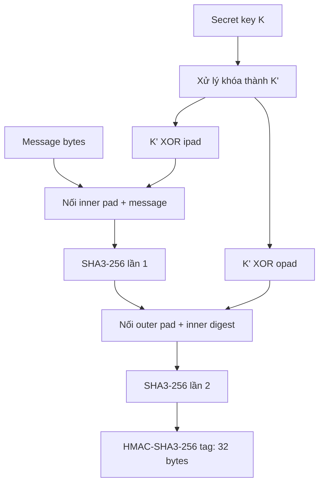
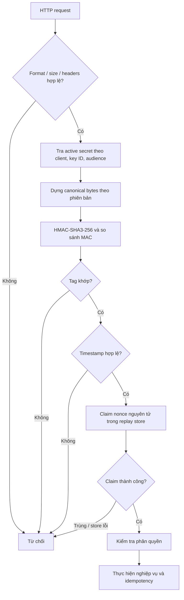

# HMAC-SHA3

> **Chương:** Hash algorithm  
> **Bài học:** HMAC-SHA3 — dùng họ hàm băm SHA-3 bên trong HMAC để xác thực toàn vẹn thông điệp.  
> **Ngữ cảnh áp dụng:** Xác thực HTTP request bằng shared secret và canonical request gồm phương thức, URI, header hoặc body theo hợp đồng ký. Bài học sử dụng Java 17/JCA, đồng thời chỉ rõ quan hệ của HMAC-SHA3 với chống replay, key rotation, proxy/gateway và phân quyền.

## 1. Vấn đề HMAC-SHA3 giải quyết

Giả sử một service gửi lệnh tạo thanh toán đến API:

```http
POST /v1/payments?mode=commit HTTP/1.1
Host: payments.example.test
Content-Type: application/json
X-Client-Id: billing-service
X-Key-Id: billing-2026-11
X-Timestamp: <unix-seconds>
X-Nonce: <random-value>
X-Signature: <base64url-hmac>

{"paymentId":"pay-0007","amount":150000,"currency":"VND"}
```

Kẻ tấn công có thể cố sửa `amount`, đổi `mode=commit` hoặc phát lại nguyên request. Server cần kiểm tra dữ liệu được ký có bị sửa không, và liệu bên ký có biết shared secret gắn với `billing-service` hay không.

Một digest thuần `SHA3-256(body)` **không đủ** cho mục tiêu xác thực: bất kỳ ai sửa body đều tính lại được digest. HMAC bổ sung một **khóa bí mật** vào cách tạo mã xác thực thông điệp (*Message Authentication Code, MAC*).

**HMAC-SHA3** là HMAC dùng một thành viên của họ hàm băm SHA-3 làm hàm băm nền. Ví dụ phổ biến của bài học:

```text
tag = HMAC-SHA3-256(secret_key, message_bytes)
```

Để tag thật sự bảo vệ một HTTP request, `message_bytes` phải là **chuỗi canonical bytes** được cả client và server hiểu giống nhau. HMAC-SHA3 chỉ tính MAC trên bytes đưa vào; nó **không tự chọn** method, URI, header, body hoặc tự xử lý timestamp/nonce.

Sau bài này, người học cần thực hiện được bốn việc:

1. Phân biệt SHA3-256, HMAC-SHA3-256, HMAC-SHA256 và KMAC.
2. Hiểu các biến thể HMAC-SHA3 và lý do không thể thay thuật toán bằng cách chỉ đổi tên header.
3. Dùng Java JCA `Mac.getInstance("HmacSHA3-256")`, `Mac.init(key)` và `doFinal` để ký/xác minh.
4. Xác định đầy đủ lớp kiểm tra phải đặt **xung quanh** HMAC: canonical request, key lookup/rotation, chống replay, proxy/gateway và phân quyền.

## 2. SHA-3 là gì, có quan hệ gì với HMAC?

**SHA-3** là họ hàm băm mật mã được chuẩn hóa với các biến thể `SHA3-224`, `SHA3-256`, `SHA3-384`, `SHA3-512`. Chúng nhận chuỗi bytes đầu vào bất kỳ và trả digest với độ dài cố định tương ứng 224, 256, 384 hoặc 512 bit.

SHA-3 dựa trên cấu trúc **sponge** của Keccak, khác nền tảng Merkle–Damgård thường được nhắc đến khi học SHA-2. Với SHA3-256:

- Digest dài **256 bit = 32 bytes**.
- Trạng thái Keccak có 1600 bit, trong đó *rate* của SHA3-256 là **1088 bit = 136 bytes**, *capacity* là 512 bit.
- Đổi một byte thông điệp thường khiến digest thay đổi mạnh, nhưng ai cũng có thể tính digest vì SHA3-256 **không có khóa**.

HMAC là một phép dựng có khóa dựa trên hàm băm. Khi chọn SHA3-256 làm hàm băm nền, ta có **HMAC-SHA3-256**. Trong Java, tên thuật toán JCA cho MAC thường là `HmacSHA3-256`; tên thuật toán hash dùng cho `MessageDigest` là `SHA3-256`.

| Cơ chế | Khóa bí mật | Kết quả | Mục đích |
| --- | --- | --- | --- |
| `SHA3-256(message)` | Không | Digest 32 bytes | Băm/nhận diện dữ liệu khi digest được tin cậy |
| `HMAC-SHA3-256(key, message)` | Có | MAC 32 bytes | Xác thực toàn vẹn thông điệp theo shared secret |
| `SHA-256(message)` | Không | Digest 32 bytes | Hàm băm thuộc họ SHA-2 |
| `HMAC-SHA256(key, message)` | Có | MAC 32 bytes | HMAC sử dụng SHA-256 của SHA-2 |
| `KMAC128/KMAC256` | Có | MAC độ dài cấu hình được | Cơ chế MAC dựa trên SHA-3/cSHAKE theo một đặc tả khác |

**Cùng kích thước đầu ra không có nghĩa cùng kết quả.** HMAC-SHA3-256 và HMAC-SHA256 đều thường cho tag 32 bytes, nhưng tag khác nhau với cùng key và message; cả hai phía bắt buộc thống nhất chính xác thuật toán.

KMAC là một thuật toán MAC được thiết kế theo cơ chế SHA-3 mở rộng; **KMAC256 không đồng nghĩa HMAC-SHA3-256**. Không sử dụng hai tên thuật toán thay thế cho nhau, cũng không dựa vào `SHAKE256` như thể đó tự động là MAC.

## 3. HMAC-SHA3 được tính như thế nào?

### 3.1 Công thức HMAC

Công thức trừu tượng của HMAC:

```text
HMAC(K, m) =
    H((K' XOR opad) || H((K' XOR ipad) || m))
```

Trong đó:

- `H`: hàm băm đã chọn, ví dụ `SHA3-256`.
- `K`: secret key; `K'` là khóa đã xử lý theo quy tắc HMAC để có độ dài block của `H`.
- `ipad`: byte `0x36` lặp đủ block; `opad`: byte `0x5c` lặp đủ block.
- `XOR`: XOR theo từng byte; `||`: nối bytes; `m`: thông điệp dưới dạng bytes.

Bên ký dùng shared secret để tính tag. Bên nhận dùng **cùng key, cùng thuật toán, cùng bytes** để tính lại tag và so sánh. Nếu một trong ba yếu tố khác nhau, MAC kỳ vọng gần như chắc chắn không khớp.



### 3.2 Block size của HMAC-SHA3-256 khác HMAC-SHA256

Một điểm hay bị nhầm: **block size trong HMAC-SHA3-256 không phải 64 bytes của SHA-256**. Với HMAC dùng SHA-3, kích thước block HMAC tương ứng *rate* của biến thể SHA-3.

| Biến thể | Digest / tag đầy đủ | Block dùng trong HMAC |
| --- | --- | --- |
| HMAC-SHA3-224 | 28 bytes | 144 bytes |
| **HMAC-SHA3-256** | **32 bytes** | **136 bytes** |
| HMAC-SHA3-384 | 48 bytes | 104 bytes |
| HMAC-SHA3-512 | 64 bytes | 72 bytes |
| HMAC-SHA256 (SHA-2) | 32 bytes | 64 bytes |

Trong HMAC, nếu key dài quá block của hàm băm, key được hash trước khi đệm; nếu ngắn hơn, được đệm byte 0 đến độ dài block để tạo `K'`. Người lập trình **không nên tự xử lý pad**; triển khai HMAC của provider JCA làm việc này.

HMAC-SHA3-256 không phải `SHA3-256(key || message)` hay `SHA3-256(message || key)`. Những phép ghép hash tự chế không tương đương HMAC và không nên đưa vào giao thức xác thực.

### 3.3 Các thuộc tính và giới hạn

HMAC-SHA3-256 cung cấp:

- **Toàn vẹn** của đúng những bytes đã đưa vào HMAC.
- **Xác thực theo shared secret**: tag hợp lệ phù hợp với việc bên tạo biết key; trong mô hình có nhiều bên giữ cùng secret, không phân biệt được chính xác bên nào tạo tag.
- Khả năng phát hiện thay đổi dữ liệu được ký khi secret và thuật toán còn an toàn.

HMAC-SHA3-256 **không tự cung cấp** bí mật nội dung, chống replay, phân quyền hoặc chống chối bỏ như chữ ký số bất đối xứng. Bên nhận biết secret cũng có khả năng tạo MAC. TLS vẫn cần để bảo vệ luồng truyền; timestamp và nonce chống replay là lớp xử lý thêm.

## 4. Khi nào dùng HMAC-SHA3-256?

HMAC-SHA3-256 là một lựa chọn kỹ thuật hợp lệ khi hai phía thống nhất dùng họ SHA-3, runtime/provider hỗ trợ và có nhu cầu tương thích với giao thức dựa trên SHA-3. Không nên đổi từ HMAC-SHA256 sang HMAC-SHA3-256 chỉ vì nhận định mơ hồ rằng “SHA-3 luôn mạnh hơn”: cả hai là các lựa chọn mật mã có ứng dụng rộng nếu triển khai và quản lý key đúng.

Các yếu tố quyết định gồm:

| Tiêu chí | Câu hỏi cần trả lời |
| --- | --- |
| Hợp đồng giao thức | Client, server, gateway và SDK đã thống nhất `HmacSHA3-256` chưa? |
| Java provider | Môi trường runtime thực tế có triển khai `HmacSHA3-256` không? |
| Tương thích | Tất cả ngôn ngữ/client có thể tạo cùng tag theo test vector không? |
| Quản lý key | Secret sinh từ CSPRNG, lưu bảo mật, tách client/môi trường và có rotation không? |
| Hiệu năng | Latency/throughput phù hợp trên đúng phần cứng/Java/provider đang chạy không? |
| Triển khai HTTP | Canonicalization, anti-replay, gateway và authorization đã được kiểm thử chưa? |

### Kiểm tra hỗ trợ trong Java

Java 17 thường có tên chuẩn JCA `HmacSHA3-256` với provider hỗ trợ; nhưng **không giả định** mọi bản phân phối Java, JRE cắt gọn, FIPS provider hoặc HSM đều bật thuật toán đó.

```java
import javax.crypto.Mac;
import java.security.NoSuchAlgorithmException;

public final class ProviderCheck {
    public static void main(String[] args) {
        try {
            Mac mac = Mac.getInstance("HmacSHA3-256");
            System.out.println("Algorithm: " + mac.getAlgorithm());
            System.out.println("Provider: " + mac.getProvider().getName());
            System.out.println("Tag length: " + mac.getMacLength() + " bytes");
        } catch (NoSuchAlgorithmException ex) {
            System.out.println("HmacSHA3-256 is not available");
        }
    }
}
```

Khi provider không hỗ trợ, `Mac.getInstance("HmacSHA3-256")` ném `NoSuchAlgorithmException`. Ứng dụng nên xem là lỗi cấu hình/triển khai, **không tự hạ cấp** sang một thuật toán khác không có trong hợp đồng ký.

## 5. Thiết kế canonical request dùng HMAC-SHA3-256

HMAC nhận bytes, trong khi HTTP request gồm nhiều trường và có thể bị biến đổi qua proxy. Cần xác định *ký những gì* và *mã hóa thế nào* trước khi tính MAC.

Ví dụ, hợp đồng `hmac-sha3-v1` cho endpoint tạo thanh toán quy định:

1. **Version** cố định: `hmac-sha3-v1`.
2. **Audience** cố định theo phía server: `payments-api-prod`. Không tin audience do client tự khai mà không kiểm tra.
3. **Method** dưới dạng chữ hoa, ví dụ `POST`.
4. **Raw request-target** gồm path và query theo biểu diễn được thống nhất tại điểm xác minh, ví dụ `/v1/payments?mode=commit`; không tự động sắp xếp query hoặc decode path rồi dựng lại.
5. **Content-Type** được ràng buộc: `application/json`. Nếu mở rộng nhiều giá trị thì phải có quy tắc chuẩn hóa chính xác.
6. **Client ID** và **Key ID** thuộc mapping secret được phép, luôn xuất hiện trong nội dung đã ký.
7. **Timestamp** Unix seconds và **nonce** đủ ngẫu nhiên, cả hai được ký.
8. **Body digest** là SHA3-256 của **raw body bytes** theo hợp đồng. Đây là lựa chọn thiết kế để minh họa; có thể dùng hash body khác nếu hai phía đặc tả rõ, không bắt buộc phải trùng hàm băm HMAC.

Các trường được nối bằng đúng một byte LF (`0x0A`) giữa mỗi dòng, mã hóa UTF-8 và **không có LF cuối**.

```text
hmac-sha3-v1
payments-api-prod
POST
/v1/payments?mode=commit
application/json
billing-service
billing-2026-11
<unix-seconds>
<random-nonce>
<sha3-256-hex-of-raw-body>
```

Tag:

```text
canonicalBytes = UTF8(canonicalRequest)
tagBytes = HMAC-SHA3-256(sharedSecret, canonicalBytes)
signatureHeader = BASE64URL_NO_PADDING(tagBytes)
```

**Hợp đồng này là ví dụ, không phải chuẩn HTTP signature áp dụng toàn cục.** Nếu API dựa vào Host, tenant header, content encoding, tên resource hoặc các trường khác để quyết định xử lý, cần đưa chúng vào phạm vi ký hoặc khóa tin cậy ở gateway. Không đưa chính header chứa signature vào dữ liệu cần ký.

### 5.1 Nguy cơ ký thiếu dữ liệu

Giả sử server chỉ ký body mà không ký query. Kẻ tấn công có thể thay `?mode=validate` thành `?mode=commit` mà MAC body vẫn hợp lệ. Tương tự, thay một header `X-Tenant-Id` không được ký có thể làm backend xử lý theo tenant khác.

HMAC-SHA3 không sửa được lỗi **hợp đồng ký thiếu trường**. Cần rà soát mọi dữ liệu thực sự được backend dùng: method, route, path variables, query, headers, body, ngữ cảnh client và audience.

### 5.2 Raw body và JSON

Hai chuỗi JSON:

```json
{"paymentId":"pay-0007","amount":150000}
```

và:

```json
{ "amount": 150000, "paymentId": "pay-0007" }
```

có thể biểu diễn dữ liệu nghiệp vụ tương đương nhưng **khác bytes**, dẫn đến digest SHA3-256 và MAC khác nhau. Nếu hợp đồng ký raw bytes, server không được parse rồi serialize JSON trước khi tính hash. Payload mà nghiệp vụ sử dụng cũng phải là payload đã được xác minh để tránh kiểm tra một bản và xử lý bản khác.

### 5.3 Proxy/gateway và sự khác nhau về canonicalization

Reverse proxy có thể rewrite `/public/payments` thành `/v1/payments`, giải nén body hoặc chuyển HTTP/2 sang HTTP/1.1. Việc này có thể làm bên gửi và bên nhận tính MAC trên những bytes khác nhau dù không có tấn công.

Cách xử lý: định nghĩa chính xác trust boundary và biểu diễn request mà verifier phải nhìn thấy; kiểm thử qua gateway thực. Cần nhất quán về percent-encoding (`%2F` và `/`), query có key trùng, thứ tự tham số, header trùng, header chữ hoa/thường, whitespace và body encoding. Từ chối cấu trúc nhập nhằng không được hợp đồng hỗ trợ.

Không tin trực tiếp `X-Original-URI`, `X-Forwarded-*` hay `X-Authenticated-Client` do client ngoài gửi. Chỉ dùng thông tin được proxy đáng tin cậy xóa/tái tạo và truyền trên kênh nội bộ kiểm soát được.

## 6. Thực hành Java 17: ký và xác minh HMAC-SHA3-256

Đoạn mã dưới đây dùng duy nhất JDK 17/JCA. Ví dụ chọn một request cụ thể, tạo shared secret ngẫu nhiên **để demo**, tạo canonical request và thử ba tình huống: request gốc, body bị sửa và phát lại nguyên request.

**Lưu ý phạm vi:** đây là ví dụ tính MAC và kiểm tra nội dung đã ký. Không có HTTP framework, key store, giới hạn request size, xác minh timestamp, nonce store hay phân quyền. Những lớp này phải bổ sung khi xây hệ thống thật.

```java
import java.nio.charset.StandardCharsets;
import java.security.GeneralSecurityException;
import java.security.MessageDigest;
import java.security.SecureRandom;
import java.time.Instant;
import java.util.Base64;
import java.util.HexFormat;

import javax.crypto.Mac;
import javax.crypto.spec.SecretKeySpec;

public final class HmacSha3HttpDemo {
    private static final String MAC_ALGORITHM = "HmacSHA3-256";
    private static final String BODY_HASH_ALGORITHM = "SHA3-256";
    private static final String AUDIENCE = "payments-api-prod";

    private HmacSha3HttpDemo() {}

    private static String canonical(
            String method,
            String rawTarget,
            String contentType,
            String clientId,
            String keyId,
            String timestamp,
            String nonce,
            byte[] body) throws GeneralSecurityException {

        // Demo: từ chối xuống dòng trong các field để tránh
        // gây nhập nhằng cấu trúc chuỗi canonical.
        for (String field : new String[] {
                method, rawTarget, contentType,
                clientId, keyId, timestamp, nonce }) {
            if (field == null || field.contains("\r")
                    || field.contains("\n")) {
                throw new IllegalArgumentException("Invalid signed field");
            }
        }
        if (body == null) {
            throw new IllegalArgumentException("Body is null");
        }

        String bodyHex = HexFormat.of().formatHex(
                MessageDigest.getInstance(BODY_HASH_ALGORITHM)
                        .digest(body));

        return String.join("\n",
                "hmac-sha3-v1",
                AUDIENCE,
                method,
                rawTarget,
                contentType,
                clientId,
                keyId,
                timestamp,
                nonce,
                bodyHex);
    }

    private static byte[] hmac(byte[] secret, String canonical)
            throws GeneralSecurityException {
        Mac mac = Mac.getInstance(MAC_ALGORITHM);
        mac.init(new SecretKeySpec(secret, MAC_ALGORITHM));
        return mac.doFinal(canonical.getBytes(StandardCharsets.UTF_8));
    }

    private static String sign(byte[] secret, String canonical)
            throws GeneralSecurityException {
        return Base64.getUrlEncoder()
                .withoutPadding()
                .encodeToString(hmac(secret, canonical));
    }

    private static boolean verify(
            byte[] secret, String canonical, String signature)
            throws GeneralSecurityException {
        if (signature == null) return false;

        byte[] received;
        try {
            received = Base64.getUrlDecoder().decode(signature);
        } catch (IllegalArgumentException malformed) {
            return false;
        }

        // Chỉ nhận tag đầy đủ: HMAC-SHA3-256 = 32 bytes.
        if (received.length != 32) return false;

        // Bắt buộc một định dạng Base64URL không padding.
        String normalized = Base64.getUrlEncoder()
                .withoutPadding().encodeToString(received);
        if (!normalized.equals(signature)) return false;

        byte[] expected = hmac(secret, canonical);
        return MessageDigest.isEqual(expected, received);
    }

    public static void main(String[] args)
            throws GeneralSecurityException {

        byte[] secret = new byte[32];
        SecureRandom random = new SecureRandom();
        random.nextBytes(secret);

        byte[] nonceBytes = new byte[16];
        random.nextBytes(nonceBytes);
        String nonce = Base64.getUrlEncoder()
                .withoutPadding().encodeToString(nonceBytes);
        String timestamp =
                Long.toString(Instant.now().getEpochSecond());

        byte[] body = (
                "{\"paymentId\":\"pay-0007\","
                + "\"amount\":150000,\"currency\":\"VND\"}"
        ).getBytes(StandardCharsets.UTF_8);

        String canonical = canonical(
                "POST", "/v1/payments?mode=commit",
                "application/json",
                "billing-service", "billing-2026-11",
                timestamp, nonce, body);
        String signature = sign(secret, canonical);

        System.out.println("Tag length (Base64URL): "
                + signature.length());
        System.out.println("Original valid: "
                + verify(secret, canonical, signature));

        byte[] tamperedBody = (
                "{\"paymentId\":\"pay-0007\","
                + "\"amount\":950000,\"currency\":\"VND\"}"
        ).getBytes(StandardCharsets.UTF_8);
        String changed = canonical(
                "POST", "/v1/payments?mode=commit",
                "application/json",
                "billing-service", "billing-2026-11",
                timestamp, nonce, tamperedBody);

        System.out.println("Modified body valid: "
                + verify(secret, changed, signature));

        // Đây chỉ là kiểm tra MAC: không phải anti-replay.
        System.out.println("Exact replay: "
                + verify(secret, canonical, signature));
    }
}
```

Lưu thành `HmacSha3HttpDemo.java` rồi chạy trên JDK 17 có provider hỗ trợ:

```bash
javac HmacSha3HttpDemo.java
java HmacSha3HttpDemo
```

Kết quả mong đợi:

```text
Tag length (Base64URL): 43
Original valid: true
Modified body valid: false
Exact replay: true
```

Giải thích:

- HMAC-SHA3-256 trả tag đầy đủ **32 bytes**; Base64URL không padding tạo **43 ký tự**. Mã hóa Base64URL không làm MAC mạnh hơn, chỉ giúp gửi an toàn trong HTTP header.
- Đổi `amount` làm digest SHA3-256 của body khác, kéo theo canonical bytes và MAC kỳ vọng khác. Tag cũ không còn xác minh được.
- Gửi lại **nguyên request** không làm thay đổi canonical bytes; HMAC tiếp tục trả `true`. Đây là minh họa trực tiếp cho việc phải bổ sung timestamp và nonce store.
- Mã tạo `Mac` riêng mỗi lần gọi và so sánh tag bằng `MessageDigest.isEqual` để hạn chế rò rỉ thông tin qua thời gian so sánh; không dùng một instance `Mac` mutable chia sẻ giữa nhiều thread.

### 6.1 Vì sao không dùng MessageDigest thay Mac?

Sai lầm phổ biến:

```java
// KHÔNG tương đương HMAC-SHA3-256:
byte[] digest = java.security.MessageDigest
        .getInstance("SHA3-256")
        .digest(canonicalBytes);
```

`MessageDigest` ở đây tính hash công khai, không gắn secret. Khi dùng HMAC, phải gọi `Mac.getInstance("HmacSHA3-256")` rồi `init` bằng secret key hợp lệ; `MessageDigest.getInstance("SHA3-256")` chỉ thích hợp ở bước tính digest body theo hợp đồng.

### 6.2 Kiểm tra chéo giữa các implementation

Để bảo đảm tương tác giữa Java, Python, Go hoặc gateway SDK, cần bộ **test vector cố định** gồm:

- Chuỗi bytes secret (hex/Base64 biểu diễn rõ).
- Đúng bytes canonical request (hex UTF-8 và quy tắc LF).
- Thuật toán tên đầy đủ `HMAC-SHA3-256`.
- Tag kết quả ở dạng hex và Base64URL không padding.

Tạo vector bằng một implementation rồi **đối chiếu độc lập** với implementation khác; không chỉ kiểm tra “Java ký rồi Java tự xác minh”. Khi chênh lệch, so sánh trước độ dài và bytes canonical, body digest, secret encoding, rồi đến thuật toán.

## 7. Đưa HMAC-SHA3 vào chuỗi xác thực HTTP an toàn



### 7.1 Chống replay: timestamp và nonce

Một request có HMAC hợp lệ vẫn có thể được phát lại. Vì vậy:

- Timestamp phải thuộc dữ liệu ký; server chỉ chấp nhận lệch thời gian giới hạn, ví dụ ±300 giây so với đồng hồ server.
- Nonce phải do CSPRNG tạo (ví dụ 128 bit), nằm trong dữ liệu ký, được **claim đúng một lần** trong replay store chung giữa tất cả instance.
- Claim phải **nguyên tử**, chẳng hạn Redis `SET key value NX EX ttlSeconds`. Không tách thành `GET` rồi `SET`.
- TTL nonce phải bao phủ **toàn bộ thời gian request có thể còn hợp lệ**. Với timestamp được chấp nhận trong ±300 giây, từ lần claim đầu đến hạn chấp nhận cuối có thể gần 600 giây; cần cộng margin cho clock skew, ví dụ 660 giây sau khi đã xác minh các giả định.
- Khi store lỗi, timeout hoặc kết quả không xác định, hệ thống phải **fail closed**: từ chối trước khi thực hiện nghiệp vụ.

Nonce không tự tạo **exactly once** cho nghiệp vụ: client có thể gửi lại yêu cầu tương đương với nonce và signature mới. Hệ thống thanh toán cần thêm transaction ID hoặc idempotency key được ràng buộc vào request và lưu kết quả nghiệp vụ bền vững.

### 7.2 Quản lý secret và key rotation

Shared secret dùng cho HMAC-SHA3-256 cần được sinh từ CSPRNG (ví dụ 32 bytes ngẫu nhiên), phân phối qua kênh an toàn và lưu trong secret manager/KMS/HSM. Không hardcode key trong source, gửi key lên client công khai hoặc ghi secret ra log. `SecretKeySpec` chỉ bao gói bytes; nó không tăng entropy của một secret yếu.

Một mapping điển hình:

```text
(clientId, keyId, audience, algorithmVersion)
    -> active SecretKey
```

Server chỉ lấy các key được phép của client tại thời điểm xác minh. Trong rotation có thể chấp nhận key hiện tại và key trước đó trong thời gian chuyển tiếp; mỗi key có ID, trạng thái và hạn rõ ràng. Không thử vô số key cho đến khi một chữ ký khớp.

Khi chuyển từ `HmacSHA256` sang `HmacSHA3-256`, đây là **thay đổi giao thức ký**, không đơn thuần đổi provider: cần version/algorithm ID đáng tin, kiểm soát key nào được phép cho phiên bản nào, bộ test vector và kế hoạch chuyển đổi. Không tin header `X-Algorithm` do client tùy tiện gửi để chọn thuật toán; nếu có trường lựa chọn, nó phải được gắn với policy key và hợp đồng phiên bản, chặn downgrade.

### 7.3 Xác thực khác phân quyền

HMAC-SHA3-256 chứng minh request được tính MAC bởi một bên có shared secret tương ứng; nó không chứng minh client có quyền truy cập mọi endpoint, tenant hay resource.

Ví dụ `billing-service` có key hợp lệ nhưng gửi lệnh đọc dữ liệu của tenant khác: chữ ký có thể đúng, nhưng bước authorization phải từ chối. Khi nhiều hệ thống chia sẻ cùng một key, MAC cũng không chứng minh duy nhất hệ thống nào là tác giả.

## 8. Sai sót thường gặp

| Sai sót | Hậu quả | Cách sửa |
| --- | --- | --- |
| Dùng `SHA3-256(secret + message)` tự chế | Không phải HMAC chuẩn, khó chứng minh an toàn và liên thông | Dùng `Mac.getInstance("HmacSHA3-256")` |
| Dùng `MessageDigest.getInstance("SHA3-256")` để xác thực request | Không có key; người sửa request tính lại digest được | Dùng HMAC với shared secret |
| Nhầm HMAC-SHA256 và HMAC-SHA3-256 | MAC của hai phía không khớp | Cố định thuật toán và version của hợp đồng |
| Nhầm HMAC-SHA3-256 với KMAC256 | Khác thuật toán, tag không thể hoán đổi | Chỉ sử dụng thuật toán đã đặc tả |
| Hardcode secret hoặc secret entropy thấp | Bị giả mạo request nếu key lộ/đoán được | Sinh CSPRNG; quản lý secret và rotation |
| Chỉ ký body | Method, query, header có thể bị sửa | Ký đủ input ảnh hưởng logic |
| Parse JSON rồi serialize lại trước khi hash body | Bytes khác client ký | Hash raw body bytes theo hợp đồng |
| Cho client tự chọn thuật toán yếu | Downgrade hoặc algorithm confusion | Chính sách theo key/version trên server |
| So sánh tag bằng chuỗi theo cách không kiểm soát | Có thể làm lộ thông tin thời gian và định dạng | Decode, kiểm tra độ dài, so sánh bytes với `MessageDigest.isEqual` |
| Replay store lỗi nhưng vẫn cho qua | Request cũ có thể được xử lý lại | Fail closed, có cảnh báo và runbook |
| Bỏ qua TLS vì “đã có HMAC” | Nội dung/metadata có thể lộ, luồng truyền không được bảo vệ đủ | Luôn dùng TLS chuẩn |
| Xem HMAC hợp lệ là đủ quyền | Vượt quyền của client | Kiểm tra authorization theo resource/action |
| Bỏ qua biến đổi của gateway | Client và server dựng canonical khác nhau | Kiểm thử đường đi thực và ranh giới tin cậy |

## 9. Kiểm thử HMAC-SHA3-256 với HTTP và gateway

Một bộ kiểm thử tối thiểu cần có:

| Ca kiểm thử | Thao tác | Kỳ vọng |
| --- | --- | --- |
| Baseline | Request mới, key đúng, timestamp hợp lệ, nonce mới | HMAC qua, kiểm tra replay/permission tiếp |
| Sai secret | Giữ bytes nhưng thay key | MAC sai |
| Sai thuật toán | Bên ký dùng HMAC-SHA256, bên nhận HMAC-SHA3-256 | MAC sai |
| Đổi method | `POST` thành `PUT`, giữ tag | MAC sai |
| Đổi URI/query | `mode=commit` thành `mode=preview` | MAC sai |
| Đổi header đã ký | Thay client ID, key ID hoặc content type | MAC sai hoặc key lookup từ chối |
| Đổi body | Thay một byte trong JSON | MAC sai |
| JSON khác whitespace | Serialize lại cùng object thành bytes khác | MAC theo raw bytes khác |
| Replay | Gửi lại request nguyên vẹn | MAC có thể đúng, nonce store phải từ chối |
| Hai request song song | Cùng nonce gửi đến hai instance | Chỉ một claim thành công |
| Mất replay store | Timeout/không thể ghi nonce | Từ chối, không chạy nghiệp vụ |
| Rotation | Ký bằng key cũ hết hạn | Bị từ chối theo key policy |
| Proxy rewrite | Thay path, encoding, content encoding hoặc protocol HTTP/2/1.1 | Xác minh trên bytes đã quy định, hoặc từ chối |
| Key ID sai | Key không thuộc client | Bị từ chối, không thử key của client khác |
| Sai quyền | HMAC/nonce đều hợp lệ, client thiếu quyền | Từ chối tại lớp phân quyền |
| Retry nghiệp vụ | Nonce mới, cùng idempotency key | Không sinh hai hiệu ứng nghiệp vụ |

**Lưu ý khi debug:** không log raw shared secret, full tag, body giao dịch hoặc thông tin khách hàng. Có thể ghi request ID, key ID, client ID, thuật toán/phiên bản, mã lỗi nội bộ, vùng gateway và **digest chẩn đoán được xử lý an toàn** để so sánh canonicalization giữa các hop. Đừng để dữ liệu chẩn đoán biến thành đường rò rỉ thông tin.

### Bài thực hành mở rộng

1. **So sánh thuật toán:** Cho cùng secret 32 bytes và cùng chuỗi UTF-8 `POST\n/v1/payments`, tính HMAC-SHA256 và HMAC-SHA3-256. Xác nhận tag đều 32 bytes nhưng nội dung khác.
2. **Độc lập ngôn ngữ:** Dùng Java ký, một implementation khác xác minh theo cùng bytes; thử thêm một byte LF cuối và giải thích vì sao tag thay đổi.
3. **Phân biệt hash với MAC:** Tính `SHA3-256(body)`, sau đó tính `HMAC-SHA3-256(key, canonical)`. Giải thích vì sao attacker có thể tính lại digest body nhưng không tạo MAC mới nếu không có key.
4. **Kiểm thử gateway:** Gửi request qua proxy đổi `/public/payments` thành `/v1/payments`; chọn vị trí verifier và hoàn thiện hợp đồng raw target sao cho client/server nhất quán.
5. **Replay:** Gửi lại nguyên request có timestamp và nonce cũ. HMAC vẫn đúng; bổ sung replay store nguyên tử và quan sát request bị từ chối trước nghiệp vụ.

## 10. Câu hỏi tự kiểm tra

1. HMAC-SHA3-256 khác SHA3-256 ở điểm nào và tại sao điều đó quan trọng cho xác thực HTTP?
2. Nếu HMAC-SHA3-256 và HMAC-SHA256 đều tạo tag 256 bit, có thể dùng chúng hoán đổi trong cùng giao thức không?
3. HMAC-SHA3-256 dùng block size bao nhiêu bytes? Vì sao không lấy 64 bytes của SHA-256?
4. Tại sao `KMAC256` không phải tên khác của `HMAC-SHA3-256`?
5. Nếu JCA provider không hỗ trợ `HmacSHA3-256`, ứng dụng có nên âm thầm rơi về `HmacSHA256` không?
6. Vì sao hai JSON có cùng object nhưng khác khoảng trắng tạo HMAC khác khi hợp đồng ký raw body?
7. Chỉ ký body mà không ký method hoặc URI có thể tạo lỗ hổng nào?
8. HMAC hợp lệ có tự chống được replay không? Điều gì xảy ra nếu nonce store timeout?
9. Khi rotate secret hoặc chuyển thuật toán HMAC, vì sao cần version, key ID và quy tắc chống downgrade?
10. Client có HMAC hợp lệ có thể bị từ chối vì thiếu quyền trên tài nguyên không?

**Điều cần ghi nhớ:** HMAC-SHA3 là **HMAC dùng một hàm băm SHA-3**, với lựa chọn tiêu biểu `HMAC-SHA3-256` cho MAC 32 bytes. Thuật toán xác thực đúng **những bytes được ký** khi dùng cùng shared secret. Để áp dụng cho HTTP, cần hợp đồng canonical request nhất quán qua proxy, quản lý key và version, timestamp/nonce chống replay, xử lý lỗi an toàn, TLS và kiểm tra phân quyền độc lập.
