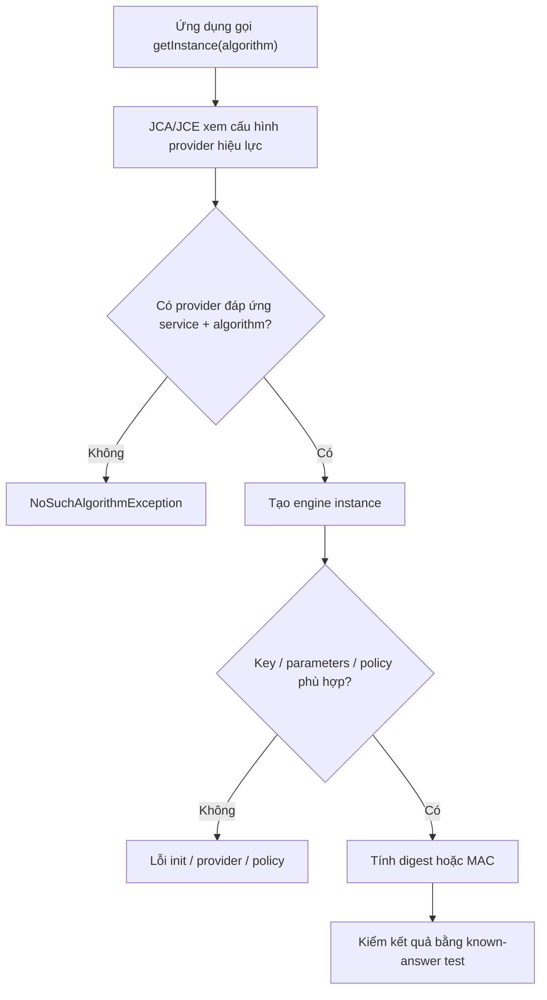
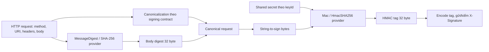

# Provider support: kiểm tra thuật toán hash và HMAC trong Java

> **Chương:** Hash algorithm  
> **Bài học:** Provider support  
> **Bối cảnh:** Thiết kế xác thực HTTP request bằng **HMAC** với shared secret. Hai bên xây dựng canonical request từ method, URI, các header và/hoặc body theo hợp đồng ký. Bài này tập trung vào câu hỏi: **môi trường Java thực tế có provider nào hỗ trợ SHA-256 và HmacSHA256, cách chọn provider ra sao, và làm thế nào phát hiện lỗi cấu hình trước khi nhận lưu lượng?**

## 1. Provider support nghĩa là gì?

Java có kiến trúc mật mã mở rộng được gọi là **Java Cryptography Architecture (JCA)**. Ứng dụng thường thao tác qua các API chuẩn như:

- `java.security.MessageDigest`: tính **hash không khóa**, ví dụ SHA-256 của raw HTTP body.
- `javax.crypto.Mac`: tính **Message Authentication Code có khóa**, ví dụ HMAC-SHA256 cho chuỗi byte cần ký.
- `java.security.Security`: truy vấn các provider đã đăng ký trong môi trường chạy.
- `java.security.Provider`: mô tả một nhà cung cấp triển khai các dịch vụ/thuật toán mật mã.

**Provider** là thành phần cung cấp triển khai thật của thuật toán cho API JCA/JCE. Ứng dụng gọi `MessageDigest.getInstance("SHA-256")` nhưng một provider cụ thể sẽ thực hiện phép băm. Tương tự, `Mac.getInstance("HmacSHA256")` lấy một implementation MAC do provider cung cấp.

Từ **support** không nên chỉ hiểu là “tên thuật toán xuất hiện trong tài liệu”. Cần phân biệt:

1. **API support:** Java có kiểu API `MessageDigest` và `Mac` để yêu cầu phép tính.
2. **Algorithm registration:** provider đã đăng ký dịch vụ `MessageDigest.SHA-256` hoặc `Mac.HmacSHA256`.
3. **Operational support:** provider thực sự cho phép tạo instance, khởi tạo bằng loại key/parameters phù hợp và thực hiện phép tính trong cấu hình runtime hiện tại.
4. **Policy/compliance support:** thuật toán, key, chế độ và provider được phép dùng theo chính sách môi trường, ví dụ cấu hình FIPS nếu tổ chức áp dụng.

Một provider có thể **quảng cáo** thuật toán nhưng từ chối một kiểu key nhất định hoặc không sẵn sàng khi cấu hình bảo mật chưa thỏa mãn. Vì vậy, vừa phải **khám phá**, vừa phải **thử hoạt động thực tế**.

## 2. Phân biệt support của `MessageDigest` với `Mac`

HMAC-SHA256 sử dụng SHA-256 làm hàm băm bên trong, nhưng hai dịch vụ JCA có **tên và mục đích khác nhau**.

| Bài toán | Service type | Tên thuật toán thường dùng | API yêu cầu | Input / output |
| --- | --- | --- | --- | --- |
| Hash raw body | `MessageDigest` | `SHA-256` | `MessageDigest.getInstance("SHA-256")` | Body bytes → digest 32 byte. |
| Tạo HMAC cho signing input | `Mac` | `HmacSHA256` | `Mac.getInstance("HmacSHA256")` | Secret bytes + signing bytes → tag 32 byte. |
| Kiểm chữ ký HMAC | `Mac` | `HmacSHA256` | `Mac.init(key)`, `Mac.doFinal(...)` | Tính tag dự kiến rồi so sánh với tag được gửi. |
| Mã hóa tag cho header | Không phải service hash/MAC | Base64URL / hex | `java.util.Base64` hoặc `HexFormat` | Tag bytes → text trên wire. |

**Không đánh đồng `SHA-256` với `HmacSHA256`.** Một provider hỗ trợ dịch vụ `MessageDigest/SHA-256` chưa chắc đã đăng ký `Mac/HmacSHA256`. Chúng có thể đến từ **hai provider khác nhau**. Đừng suy luận “SHA-256 có sẵn thì HMAC chắc chắn hoạt động” mà bỏ qua bước kiểm tra MAC.

Tên thuật toán tiêu chuẩn của Java có tính quy ước. Dùng chính xác `SHA-256` cho `MessageDigest` và `HmacSHA256` cho `Mac`. Những biến thể chuỗi như `HMAC-SHA256`, `SHA256` hoặc tên alias do nhà cung cấp tự thêm có thể **không được đăng ký đồng nhất**; chỉ dựa vào alias khi đã kiểm thử trên môi trường triển khai.

### Hash khác HMAC về an ninh

```text
bodyDigest  = SHA-256(rawBodyBytes)
tag         = HMAC-SHA256(sharedSecretBytes, bytesToSign)

bytesToSign = canonical request và metadata theo hợp đồng ký,
              có thể chứa bodyDigest và các trường HTTP quan trọng.
```

`bodyDigest` là dấu vân tay byte **không dùng khóa**: bất kỳ ai có body đều có thể tính lại. `tag` dùng secret để xác thực các **byte thực sự được ký**. HMAC không mã hóa HTTP body và không tự chống replay; cần HTTPS/TLS, timestamp/nonce được ký và kiểm tra phân quyền sau xác thực.

## 3. Runtime chọn provider như thế nào?

Ứng dụng Java thường viết:

```java
MessageDigest digest = MessageDigest.getInstance("SHA-256");
Mac mac = Mac.getInstance("HmacSHA256");
```

Khi không chỉ định provider, JCA/JCE tìm implementation phù hợp trong **danh sách provider và quy tắc ưu tiên hiệu lực của runtime**. Các provider đang đăng ký, thứ tự/ưu tiên lựa chọn, JDK/distribution, chính sách an ninh và cấu hình khởi động có thể ảnh hưởng đến kết quả.

Không nên mặc định mọi JVM đều dùng một provider có tên cụ thể như `SUN` hoặc `SunJCE`. Đó là những tên gắn với một số bản phân phối/cấu hình; môi trường khác, nhất là có hardware security module (HSM) hoặc chế độ FIPS, có thể khác.



**Điểm đặc biệt của `Mac`:** một số implementation JCE có thể **trì hoãn việc chọn provider cuối cùng cho tới khi `init(key)`**, để chọn triển khai chấp nhận kiểu key được cung cấp. Vì vậy, nếu muốn ghi log provider thực tế được dùng, nên đọc `mac.getProvider()` **sau khi `mac.init(key)`**. Tự gọi `getProvider()` quá sớm trong một số runtime còn có thể làm thay đổi quá trình lựa chọn provider.

## 4. Các API để khám phá khả năng hỗ trợ

| API | Ý nghĩa | Giới hạn cần biết |
| --- | --- | --- |
| `Security.getProviders()` | Liệt kê các provider đang đăng ký theo thứ tự hiển thị của runtime. | Chưa chứng minh một thuật toán cụ thể có chạy được với key của ứng dụng. |
| `Security.getAlgorithms("MessageDigest")` | Liệt kê tên thuật toán digest được quảng cáo. | Chỉ mang tính khám phá; không thay bước tính thử. |
| `Security.getAlgorithms("Mac")` | Liệt kê các tên MAC được quảng cáo. | Tập tên không cho biết key/parameter nào được chấp nhận. |
| `provider.getService("MessageDigest", "SHA-256")` | Kiểm tra provider có đăng ký service digest tương ứng. | Provider có thể bị giới hạn bởi cấu hình runtime/chính sách. |
| `provider.getService("Mac", "HmacSHA256")` | Kiểm tra đăng ký service MAC phù hợp. | Cần `init(secret)` và tính HMAC thật để xác minh hoạt động. |
| `MessageDigest.getInstance("SHA-256")` | Nhận digest engine theo lựa chọn mặc định. | Có thể ném `NoSuchAlgorithmException`. |
| `Mac.getInstance("HmacSHA256")` | Nhận MAC engine theo lựa chọn mặc định. | Chỉ có đối tượng chưa đủ; còn phải `init(key)`. |
| `getInstance(algorithm, provider)` | Buộc chọn provider bằng tên hoặc đối tượng provider. | Provider phải hiện diện và cung cấp thuật toán; có thể làm mất tính di động. |
| `engine.getProvider()` | Xác định provider gắn với instance. | Với `Mac`, nên đọc sau `init(key)` nếu muốn biết provider thực sự chọn được. |

Ví dụ truy vấn tên thuật toán:

```java
import java.security.Security;
import java.util.Set;

Set<String> digests = Security.getAlgorithms("MessageDigest");
Set<String> macs = Security.getAlgorithms("Mac");

System.out.println("MessageDigest algorithms: " + digests);
System.out.println("Mac algorithms: " + macs);
```

Đoạn này dùng để **chẩn đoán**, không nên là bước duy nhất quyết định “deploy sẵn sàng”. Danh sách có thể dài, chứa nhiều thuật toán không phù hợp với chính sách bảo mật; **không tự động chọn thuật toán đầu tiên** mà runtime hỗ trợ.

## 5. Chương trình Java 17+ kiểm tra provider thật

Chương trình sau chạy độc lập, chỉ sử dụng thư viện Java chuẩn. Nó:

1. Liệt kê provider nào đăng ký `SHA-256` (MessageDigest) và `HmacSHA256` (Mac).
2. Tính SHA-256 trên chuỗi ASCII `abc` và so với giá trị chuẩn.
3. Khởi tạo HmacSHA256 bằng khóa **chỉ dành cho test** và tính test vector đã công bố trong RFC 4231.
4. In provider thực tế của từng engine **sau khi khởi tạo MAC**.
5. Báo lỗi nếu thuật toán không có, khởi tạo không thành công hoặc kết quả không khớp.

```java
import java.nio.charset.StandardCharsets;
import java.security.GeneralSecurityException;
import java.security.MessageDigest;
import java.security.Provider;
import java.security.Security;
import java.util.Arrays;
import java.util.HexFormat;
import javax.crypto.Mac;
import javax.crypto.spec.SecretKeySpec;

public final class JcaProviderSupportProbe {
    private static final HexFormat HEX = HexFormat.of();

    private JcaProviderSupportProbe() {}

    public static void main(String[] args) throws GeneralSecurityException {
        System.out.println("Providers advertising required algorithms:");
        for (Provider p : Security.getProviders()) {
            boolean sha256 = p.getService("MessageDigest", "SHA-256") != null;
            boolean hmacSha256 = p.getService("Mac", "HmacSHA256") != null;
            if (sha256 || hmacSha256) {
                System.out.printf(
                    "  %s (version %s): SHA-256=%s, HmacSHA256=%s%n",
                    p.getName(), p.getVersionStr(), sha256, hmacSha256
                );
            }
        }

        // Known-answer test: SHA-256("abc").
        MessageDigest digest = MessageDigest.getInstance("SHA-256");
        byte[] hash = digest.digest(
                "abc".getBytes(StandardCharsets.US_ASCII));
        String actualHash = HEX.formatHex(hash);
        String expectedHash =
                "ba7816bf8f01cfea414140de5dae2223" +
                "b00361a396177a9cb410ff61f20015ad";
        if (!expectedHash.equals(actualHash)) {
            throw new IllegalStateException("SHA-256 known-answer test failed");
        }

        // RFC 4231, test case 1: key = 20 bytes of 0x0b,
        // message = ASCII "Hi There". Public test vector only.
        byte[] testKey = new byte[20];
        Arrays.fill(testKey, (byte) 0x0b);
        Mac mac = Mac.getInstance("HmacSHA256");
        mac.init(new SecretKeySpec(testKey, "HmacSHA256"));
        String actualTag = HEX.formatHex(mac.doFinal(
                "Hi There".getBytes(StandardCharsets.US_ASCII)));
        String expectedTag =
                "b0344c61d8db38535ca8afceaf0bf12b" +
                "881dc200c9833da726e9376c2e32cff7";
        if (!expectedTag.equals(actualTag)) {
            throw new IllegalStateException(
                    "HmacSHA256 known-answer test failed");
        }

        System.out.println("SHA-256 provider: "
                + digest.getProvider().getName());
        System.out.println("HmacSHA256 provider: "
                + mac.getProvider().getName());
        System.out.println("PASS: algorithms available and test vectors match");
    }
}
```

Cách chạy trên Java 17+ khi đã có file chứa class tương ứng:

```bash
javac JcaProviderSupportProbe.java
java JcaProviderSupportProbe
```

**Đọc kết quả:**

- Có dòng `PASS`: hai engine được chọn đã tính đúng hai known-answer test. Điều này xác nhận thuật toán **cơ bản hoạt động** với bộ test; chưa thay thế kiểm thử integration qua HTTP/gateway.
- `NoSuchAlgorithmException`: cấu hình runtime hiện tại không tìm được implementation phù hợp cho tên và service yêu cầu.
- `InvalidKeyException` hoặc lỗi khởi tạo: provider không chấp nhận key/điều kiện khởi tạo được dùng.
- `IllegalStateException` ở phép đối chiếu: kết quả không khớp test vector; không nên tiếp tục phục vụ request HMAC khi chưa điều tra.
- `ProviderException` hoặc lỗi phụ thuộc môi trường: provider có thể gặp vấn đề trong cấu hình runtime, thiết bị HSM hoặc chính sách bảo mật.

**Không sử dụng `testKey` của ví dụ làm secret thực tế.** Bài kiểm thử chạy với khóa công khai cố định chỉ nhằm chứng minh cách provider tính thuật toán. Khóa production cần entropy cao, phạm vi sử dụng cụ thể và quy trình quản lý riêng.

### Vì sao kiểm tra đăng ký chưa đủ?

Một provider có thể trả về `getService("Mac", "HmacSHA256") != null`, nhưng khi `init` bằng loại khóa của ứng dụng, chính sách hoặc thiết bị từ chối. Ngược lại, provider cũng có thể cần cấu hình/đăng ký đúng cách trước khi được JCA lựa chọn. Hãy kiểm tra trên **chính artifact/JDK/container/cấu hình sẽ chạy production** và thử với loại key thực tế mà hệ thống sử dụng, đồng thời tránh làm lộ secret.

## 6. Buộc chọn provider khi nào?

Có hai cách chọn provider:

```java
// Lựa chọn theo cấu hình runtime: linh hoạt khi triển khai nhiều môi trường.
Mac defaultMac = Mac.getInstance("HmacSHA256");

// Lựa chọn tường minh: providerName đến từ cấu hình đáng tin cậy,
// KHÔNG lấy từ header thuật toán do HTTP client gửi.
String providerName = configuredProviderName;
Provider selected = Security.getProvider(providerName);
if (selected == null) {
    throw new IllegalStateException(
            "Configured provider not installed: " + providerName);
}
Mac pinnedMac = Mac.getInstance("HmacSHA256", selected);
```

Đoạn trên giả định `configuredProviderName` là cấu hình đã được ứng dụng cung cấp và xác thực; nó minh họa ý tưởng, không phải chương trình độc lập. Nếu provider được chỉ định **không tồn tại** hoặc **không hỗ trợ HmacSHA256**, phải báo lỗi cấu hình. **Không tự âm thầm fallback sang provider bất kỳ** khi yêu cầu của hệ thống là sử dụng provider đã được phê duyệt.

| Chiến lược | Ưu điểm | Đổi lại / điều kiện |
| --- | --- | --- |
| **Không chỉ định provider** | Mã nguồn linh hoạt, dễ chạy trên nhiều JDK. | Phải kiểm soát và ghi nhận provider thực tế của môi trường; kiểm thử sau mỗi thay đổi runtime. |
| **Chỉ định provider qua cấu hình tin cậy** | Kiểm soát chính xác implementation theo yêu cầu vận hành/chính sách. | Provider phải được cài, đăng ký và hỗ trợ key/algorithm; thay môi trường cần cấu hình tương ứng. |
| **Dùng provider HSM/KMS đặc thù** | Có thể giới hạn khả năng truy cập khóa thô và tuân thủ chính sách phần cứng. | Key có thể là handle không xuất được; `SecretKeySpec` bằng byte thô không nhất thiết dùng được; cần kiểm thử `init` thực tế. |

Trong ứng dụng nhiều môi trường, **không hard-code tên provider của một JDK cụ thể** nếu không có yêu cầu kỹ thuật. Ngược lại, nếu có yêu cầu kiểm soát provider, **không thả nổi lựa chọn** hoặc tự đổi provider khi lỗi mà không có quyết định vận hành rõ ràng.

### HMAC và digest có thể chọn hai provider khác nhau

Ví dụ, `MessageDigest.getInstance("SHA-256")` có thể thuộc provider X trong khi `Mac.getInstance("HmacSHA256")` thuộc provider Y. Đây không tự động là lỗi: hai dịch vụ có thể được thực thi độc lập. Quan trọng là chúng thực hiện đúng thuật toán, chấp nhận khóa/byte theo hợp đồng, và đáp ứng chính sách.

**Kết quả HMAC-SHA256 phải giống nhau về mặt byte** khi dùng cùng secret, cùng signing input và thuật toán được triển khai đúng, bất kể provider là gì. Nếu client và server cho tag khác nhau, ưu tiên kiểm tra **byte canonical request, key material, encoding, signed headers và body digest** trước khi quy kết cho provider.

## 7. Những lỗi provider thường gặp khi xác thực HTTP request

| Triệu chứng | Nguyên nhân thường gặp | Kiểm tra / hướng giải quyết |
| --- | --- | --- |
| `NoSuchAlgorithmException: HmacSHA256` | Service MAC chưa được đăng ký hoặc bị giới hạn trong runtime. | Xem `Security.getAlgorithms("Mac")`, provider list và cấu hình hiệu lực; thử `Mac.getInstance(...)`. |
| `NoSuchAlgorithmException: SHA-256` | Không tìm được service digest cần thiết. | Kiểm tra runtime, `MessageDigest` provider và thuật toán đúng tên. |
| `NoSuchProviderException` khi chỉ định tên provider | Tên được cấu hình không tồn tại trong danh sách provider. | Kiểm tra tên provider thực tế, cấu hình đăng ký, môi trường container. |
| `InvalidKeyException` tại `mac.init(key)` | Key sai định dạng/loại/độ dài, provider yêu cầu key đặc thù, policy từ chối. | Kiểm tra key được cung cấp bởi registry/secret store và khả năng tương thích provider. |
| `InvalidAlgorithmParameterException` (khi dùng overload có parameters) | Tham số không được hỗ trợ cho thuật toán/provider. | Chỉ truyền tham số được hợp đồng và provider hỗ trợ; HmacSHA256 thông dụng thường không cần parameters. |
| `IllegalStateException` khi `update` hoặc `doFinal` | `Mac` chưa `init` hoặc trạng thái sử dụng sai. | Khởi tạo bằng đúng key trước khi xử lý signing input. |
| Tag khác trên hai JVM | Signing bytes, key decode, canonicalization, body encoding khác; cũng có thể là config/algorithm khác. | So sánh byte theo từng thành phần bằng fixture **không nhạy cảm**; kiểm known-answer test và provider đã chọn. |
| Lỗi chỉ ở môi trường staging/production | JDK image, security properties, HSM, FIPS mode, key type khác nhau. | Chạy probe trên chính image/runtime, kiểm provider đã đăng ký và thử key kiểu thực tế. |
| HMAC đúng trên unit test nhưng request đi qua gateway không khớp | Gateway rewrite URI/query/headers/body; vấn đề thuộc signing contract. | Kiểm thử với đường ingress thực tế, xác định điểm ký/kiểm và byte cần bảo vệ. |
| Sau rotation, request dùng key mới không xác minh được | Registry chọn sai secret, server cache key cũ, provider không chấp nhận loại key mới. | Xác minh `keyId → secretRef`, trạng thái khóa, `mac.init(keyMới)` và provider support. |
| Một số request lỗi khi nhiều luồng | Chia sẻ một `Mac` mutable giữa các request, xen kẽ `update/doFinal/reset`. | Dùng một `Mac` đã init đúng key cho **mỗi phép tính**, hoặc có chiến lược ownership rõ ràng. |

**Đừng “sửa” lỗi `NoSuchAlgorithmException` bằng cách đổi sang SHA-1, MD5 hay ký ít trường hơn.** Đây là một thay đổi giao thức và có thể làm giảm an toàn. Cần sửa môi trường/provider hoặc chủ động thiết kế một **phiên bản hợp đồng ký mới được phê duyệt**.

## 8. Provider support ảnh hưởng hợp đồng ký như thế nào?

Có sự phân biệt giữa **tên thuật toán Java** và **tên thuật toán trong giao thức HTTP**:

- **Tên trong Java:** `"SHA-256"` cho `MessageDigest`, `"HmacSHA256"` cho `Mac`.
- **Nhãn giao thức ví dụ:** `HMAC-SHA256/v1` để client và server xác định một signing contract.
- **Body digest trên wire/canonical request:** thường là SHA-256 dạng hex hoặc Base64 theo quy tắc đã thống nhất.
- **HMAC tag trên wire:** thường là Base64URL/hex, được giải mã thành byte trước khi so sánh.

Ví dụ hợp đồng ký minh họa:

```text
bodyDigest = HEX_LOWER(SHA256(rawBodyBytes))
canonicalRequest =
    UPPERCASE(method) + "\n"
    + canonicalPath + "\n"
    + canonicalQuery + "\n"
    + canonicalSignedHeaders + "\n"
    + signedHeaderNames + "\n"
    + bodyDigest
stringToSign = "HMAC-SHA256/v1\n" + canonicalRequest
tagBytes = HMAC_SHA256(secretBytes, UTF8(stringToSign))
signatureHeader = "v1=" + BASE64URL_NO_PADDING(tagBytes)
```

Đây là **cấu trúc giảng giải**, chưa phải một đặc tả canonicalization hoàn chỉnh cho mọi URI. Trước khi triển khai cần quy định cách encode path/query, duplicate query/header, khoảng trắng, charset, dấu LF và body rỗng.



Lỗi trong phần `canonicalPath` hoặc `canonicalQuery` **không được provider sửa giúp**. Provider chỉ xử lý **các byte đã nhận**. HMAC chỉ xác thực đúng những trường được đưa vào signing input; nếu bỏ qua query quyết định tenant hoặc body quyết định số tiền, signature vẫn có thể đúng cho request bị sửa ở các trường đó.

### Server xác minh: provider là một bước trong nhiều bước

1. **Nhận và giới hạn request:** kiểm cú pháp, kích thước, version, key ID, timestamp/nonce và định dạng signature.
2. **Tra credential đáng tin:** tìm key ID, secret hoặc key handle, principal, trạng thái, thời hạn và phiên bản thuật toán được phép.
3. **Kiểm thời gian:** timestamp đã ký nằm trong freshness window.
4. **Dựng lại canonical request:** hash raw body bằng `MessageDigest`, chuẩn hóa các phần HTTP đúng hợp đồng.
5. **Tính tag dự kiến:** khởi tạo `Mac` bằng đúng secret/khóa của credential, tính HMAC trên signing input và so sánh tag byte theo cách hạn chế rò rỉ thời gian, ví dụ `MessageDigest.isEqual`.
6. **Chống replay:** chỉ sau xác minh HMAC hợp lệ mới ghi `(keyId, nonce)` vào nonce store bằng thao tác atomic; dùng TTL bao phủ cửa sổ còn hợp lệ.
7. **Phân quyền:** gán principal từ credential đã xác minh rồi kiểm quyền trên endpoint, tenant, resource; một signature đúng **không tự cấp quyền**.

**Provider support** chỉ giải quyết bước 4 và 5 ở mức tính hash/MAC. Nó **không quyết định** chính sách credential, key rotation, timestamp, nonce, proxy/gateway hay authorization.

## 9. Mối quan hệ giữa provider, key material và rotation

Một khóa HMAC thường được cấp dưới dạng **32 byte ngẫu nhiên** từ CSPRNG khi dùng HMAC-SHA256. Client được cấp secret qua kênh bảo mật; server liên kết `keyId` với principal và secret reference. Không gửi shared secret trong request.

Khi dùng provider thông thường với khóa byte có thể truy cập, Java có thể tạo:

```java
SecretKeySpec key = new SecretKeySpec(sharedSecretBytes, "HmacSHA256");
Mac mac = Mac.getInstance("HmacSHA256");
mac.init(key);
byte[] expectedTag = mac.doFinal(bytesToSign);
```

Với provider HSM/KMS, `sharedSecretBytes` có thể **không tồn tại trong bộ nhớ ứng dụng**. Thay vào đó, provider sử dụng một đối tượng `SecretKey`/handle riêng, và ứng dụng phải khởi tạo `Mac` theo giao diện provider đó hỗ trợ. Việc `SecretKeySpec` chạy với một provider không bảo đảm nó chạy với mọi provider.

**Rotation phải chọn đúng khóa trước khi tính MAC:**

```text
X-Key-Id: merchant-42-k1  -> credential k1 -> key k1 (có thể VERIFY_ONLY)
X-Key-Id: merchant-42-k2  -> credential k2 -> key k2 (ACTIVE)
```

- Server kiểm trạng thái credential và thời hạn; revoked/expired phải bị từ chối dù HMAC có thể khớp với khóa cũ.
- Mỗi phép xác minh cần `mac.init(selectedKey)` hoặc `Mac` mới được init đúng key. `mac.reset()` **giữ nguyên khóa**, không tự chuyển k1 sang k2.
- Khi nâng cấp provider hoặc đổi loại key (ví dụ byte key sang HSM handle), cần kiểm thử khả năng khởi tạo và tính MAC trước khi chuyển tải.
- Khi nghi khóa bị lộ, phải revoke/rotate và điều tra; đổi provider không làm secret bị lộ trở lại an toàn.

## 10. Môi trường FIPS và các yêu cầu bảo mật

Một số hệ thống chỉ cho phép dùng provider/thiết bị và thuật toán theo chính sách mật mã đã phê duyệt. Khi đó, **provider support** còn bao gồm điều kiện vận hành và tuân thủ:

| Câu hỏi | Tại sao cần kiểm tra? |
| --- | --- |
| Provider/phiên bản/module nào được phép dùng? | Tên thuật toán “HmacSHA256” tự nó không chứng minh đáp ứng một chuẩn tuân thủ cụ thể. |
| Provider có chạy ở **chế độ** yêu cầu không? | Một module có khả năng hoạt động theo chính sách không có nghĩa mọi chế độ cấu hình đều tương đương. |
| HMAC key có được sinh và sử dụng đúng đường đi được phê duyệt không? | Key thô trong ứng dụng và key handle trong HSM có thể chịu các yêu cầu khác nhau. |
| Provider có hỗ trợ cùng service và key type ở test/staging/production không? | Runtime cài đặt khác nhau có thể dẫn tới lỗi `getInstance` hoặc `init`. |
| Thay provider hoặc JDK có làm thay chính sách lựa chọn không? | Cần chạy probe và kiểm thử tích hợp sau thay đổi image/runtime. |

**Không kết luận “FIPS compliant” chỉ vì `Security.getProvider(...)` trả về một provider có tên phù hợp hoặc vì HmacSHA256 chạy thành công.** Cần xem hồ sơ/chứng nhận phạm vi đúng với phiên bản module, cấu hình/chế độ, thuật toán và cách quản lý khóa của hệ thống.

## 11. Kiểm thử provider support trước khi đưa HMAC auth vào sử dụng

Nên kiểm tra từ **unit**, **startup/smoke**, đến **tích hợp HTTP qua gateway**. Dùng dữ liệu thử nghiệm công khai cho kiểm tra thuật toán; dùng credential thử riêng cho kiểm tra vòng đời xác thực.

| # | Kiểm thử | Kết quả mong đợi |
| --- | --- | --- |
| 1 | `MessageDigest.getInstance("SHA-256")` trên runtime đích. | Có engine phù hợp; tính đúng SHA-256("abc"). |
| 2 | `Mac.getInstance("HmacSHA256")` và `init(testKey)`. | Có engine chấp nhận key và tính đúng RFC 4231 test vector. |
| 3 | Liệt kê provider bằng `Security.getProviders()` và `getService(...)`. | Biết provider nào đăng ký digest/MAC; không đồng nhất “đăng ký” với “sử dụng được”. |
| 4 | Ghi provider thật bằng `getProvider()` sau `mac.init`. | Provider đúng với chính sách/cấu hình đã chọn. |
| 5 | Cấu hình một provider không tồn tại. | Hệ thống phát hiện lỗi cấu hình và **không âm thầm fallback** khi pinning là bắt buộc. |
| 6 | Yêu cầu một thuật toán chưa được provider hỗ trợ. | `NoSuchAlgorithmException` được xử lý rõ; không tự dùng thuật toán yếu hơn. |
| 7 | Khởi tạo `Mac` bằng key type không được provider chấp nhận. | Báo lỗi init phù hợp; không đánh dấu request là đã xác thực. |
| 8 | Dùng cùng secret và signing bytes trên hai provider hợp lệ. | Tag HMAC-SHA256 **giống nhau về byte**. |
| 9 | Đổi một byte body, giữ tag cũ. | Body digest và signing input đổi; xác minh thất bại. |
| 10 | Đổi method, canonical URI, signed header hoặc timestamp/nonce. | HMAC thất bại nếu trường nằm trong hợp đồng ký. |
| 11 | Gửi lại nguyên request với nonce đã sử dụng. | Replay store từ chối, dù provider vẫn tính đúng HMAC. |
| 12 | Hai instance đồng thời nhận cùng nonce. | Chỉ một request vượt qua atomic nonce claim. |
| 13 | Rotation từ k1 sang k2, sau đó revoke k1. | K2 hoạt động; k1 bị từ chối dù tag đúng theo key cũ. |
| 14 | Chạy qua gateway có rewrite path/query hoặc thay body representation. | Hai phía thống nhất đúng byte ký; mismatch không được bỏ qua. |
| 15 | Gateway nhận header principal tự khai từ Internet. | Header được loại/ghi đè từ kết quả xác thực và backend không cho phép bypass. |
| 16 | Chữ ký client A hợp lệ nhưng request truy cập tài nguyên client B. | Xác thực có thể thành công; **authorization từ chối**. |
| 17 | Thay JDK distribution, container image hoặc FIPS/HSM configuration. | Chạy lại discovery, known-answer tests, init với key type và integration tests. |
| 18 | Provider xảy ra lỗi khi xác minh request. | Fail closed: không cho request đi tiếp khi không thể tính/xác minh MAC đáng tin cậy. |

### Hướng dẫn chẩn đoán khi hai môi trường cho chữ ký khác nhau

Trước khi đổi provider, dùng một fixture không chứa secret production và so sánh lần lượt:

```text
1. Signing contract version / thuật toán được chấp thuận
2. Key bytes hoặc key handle tương ứng với credential test
3. Method chuẩn hóa
4. Raw path, canonical path và canonical query
5. Danh sách + giá trị signed headers
6. Raw body bytes và SHA-256 body digest
7. UTF-8 bytes của string-to-sign, LF/CRLF, dấu phân cách
8. HmacSHA256 tag bytes trước khi encode
9. Base64URL/hex trên wire
10. Provider và loại key đã khởi tạo trong runtime
```

Nếu known-answer test SHA-256 và HmacSHA256 đều đúng nhưng chữ ký HTTP khác nhau, nguyên nhân thường nằm ở **đầu vào, khóa, hợp đồng ký hoặc quá trình chuyển đổi HTTP**, chứ không phải vì các provider được phép tạo ra HMAC-SHA256 khác nhau.

## 12. Câu hỏi tự kiểm tra

**Câu 1.** Provider hỗ trợ `MessageDigest/SHA-256` có đảm bảo `Mac/HmacSHA256` hoạt động không?

*Đáp án:* Không. Hai service type khác nhau. Phải kiểm tra đăng ký và thử `Mac.getInstance("HmacSHA256")`, `init(key)`, `doFinal(...)` trên runtime đích.

**Câu 2.** Vì sao nên đọc `mac.getProvider()` sau `init(key)`?

*Đáp án:* Một số JCE implementation trì hoãn lựa chọn provider cho tới khi biết key. Đọc quá sớm có thể không phản ánh cách chọn provider sau khi khởi tạo hoặc ảnh hưởng lựa chọn.

**Câu 3.** Vì sao `Security.getAlgorithms("Mac")` chưa đủ để xác nhận production sẵn sàng?

*Đáp án:* API trả danh sách thuật toán được quảng cáo. Nó không chứng minh provider nhận đúng loại key, khởi tạo thành công, tính đúng tag và đáp ứng policy vận hành.

**Câu 4.** Có thể fallback sang `HmacSHA1` khi runtime thiếu `HmacSHA256` không?

*Đáp án:* Không được tự động làm như vậy. Đây là thay đổi thuật toán/hợp đồng ký và có thể làm giảm bảo đảm an toàn. Cần khắc phục cấu hình/provider hoặc thiết kế phiên bản giao thức mới có kiểm soát.

**Câu 5.** Nếu provider đúng và HMAC đúng nhưng request đã dùng nonce cũ vẫn được xử lý, lỗi thuộc đâu?

*Đáp án:* Thuộc **replay prevention**, không thuộc provider support. Cần timestamp và nonce được ký, freshness check, atomic nonce store cùng TTL phù hợp.

**Câu 6.** Khi một client gửi header `X-Algorithm: SHA1`, có nên để server dùng thuật toán do header này chỉ định không?

*Đáp án:* Không. Server phải kiểm thuật toán/phiên bản được chấp nhận theo credential và signing contract; dữ liệu client tự khai không có quyền thay chính sách mật mã.

**Câu 7.** Cùng secret và cùng signing input nhưng hai provider trả HMAC-SHA256 khác nhau, điều đó có bình thường không?

*Đáp án:* Không. Với thuật toán đúng, tag byte phải giống nhau. Kiểm test vector, key bytes, signing input/encoding, loại key và cấu hình provider trước khi kết luận nguyên nhân.

**Câu 8.** Khi rotation sang key k2, gọi `Mac.reset()` có đủ để chuyển sang k2 không?

*Đáp án:* Không. `reset()` giữ key đã init; phải chọn đúng credential và gọi `init(k2)` hoặc tạo `Mac` mới cho phép xác minh đó.

**Câu 9.** Sử dụng một provider được giới thiệu là “FIPS” có tự làm cả hệ thống HMAC auth đạt yêu cầu tuân thủ không?

*Đáp án:* Không. Còn phải xác minh phạm vi module/phiên bản/chế độ hoạt động, quản lý khóa, thuật toán và cách sử dụng thực tế theo chính sách áp dụng.

---

## Tham khảo để tra cứu khi triển khai

- [Oracle Java SE 17 – `Security`](https://docs.oracle.com/en/java/javase/17/docs/api/java.base/java/security/Security.html): xem các phương thức khám phá providers và algorithms.
- [Oracle Java SE 17 – `Provider`](https://docs.oracle.com/en/java/javase/17/docs/api/java.base/java/security/Provider.html): mô hình service/algorithm registration.
- [Oracle Java SE 17 – `MessageDigest`](https://docs.oracle.com/en/java/javase/17/docs/api/java.base/java/security/MessageDigest.html): khởi tạo và tính digest.
- [Oracle Java SE 17 – `javax.crypto.Mac`](https://docs.oracle.com/en/java/javase/17/docs/api/java.base/javax/crypto/Mac.html): khởi tạo, `getProvider`, `update`, `doFinal` và `reset`.
- [Oracle Standard Algorithm Names](https://docs.oracle.com/en/java/javase/17/docs/specs/security/standard-names.html): tên dịch vụ/thuật toán chuẩn.
- [RFC 4231 – HMAC-SHA-224, HMAC-SHA-256, HMAC-SHA-384, HMAC-SHA-512 Test Vectors](https://www.rfc-editor.org/rfc/rfc4231): test vector để xác nhận implementation tính đúng HMAC-SHA256.

**Ghi nhớ:** `Provider support` là năng lực **thực tế của JVM** trong việc cung cấp và vận hành dịch vụ `MessageDigest/SHA-256` cùng `Mac/HmacSHA256` theo đúng key, chính sách và môi trường triển khai. Khám phá đăng ký là bước đầu; **phải thử khởi tạo và tính đúng test vector**, xác minh provider/key tại runtime và kiểm thử chữ ký qua canonical request, timestamp/nonce, key rotation, proxy/gateway cũng như authorization. Provider làm phép toán mật mã; **hợp đồng ký và các ranh giới tin cậy** quyết định toàn bộ hệ thống có xác thực HTTP request an toàn hay không.
