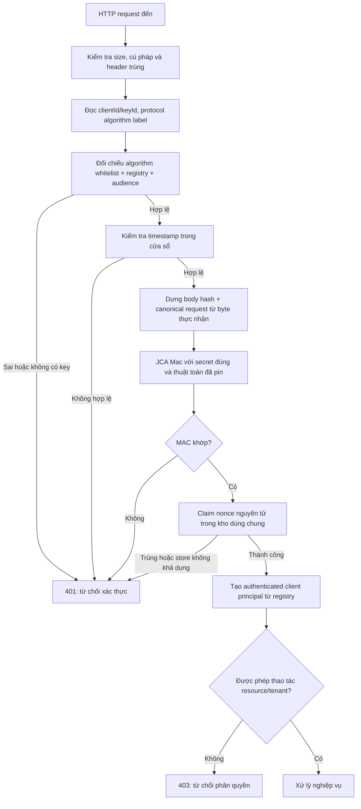

# Algorithm name trong Hash algorithm của HMAC request authentication

## Mục tiêu học tập

Trong chương **Hash algorithm**, thuật ngữ **Algorithm name** chỉ tên dùng để nhận diện thuật toán mật mã trong cấu hình, mã nguồn Java và hợp đồng ký HTTP request. Việc đặt đúng tên có ảnh hưởng trực tiếp đến khả năng tương thích: Java dùng `"SHA-256"` để yêu cầu một hàm băm, nhưng dùng `"HmacSHA256"` để yêu cầu HMAC trên SHA-256. Hợp đồng HTTP lại có thể gọi cùng cơ chế đó là `HMAC-SHA256` hoặc `hmac-sha256-v1`.

Bài học nằm trong module `SECURITY_AUTHENTICATION_HMAC_REQUEST_AUTHENTICATION`. Module này xây dựng xác thực HTTP request bằng shared secret và canonical request bao gồm phương thức, URI, header hoặc body theo hợp đồng ký; người học thực hành xác minh chữ ký, chống replay bằng timestamp/nonce, key rotation, kiểm thử qua proxy/gateway và tách bạch authentication với authorization. **Algorithm name** là một phần nhỏ nhưng thiết yếu: nếu client và server không thống nhất thuật toán, định dạng dữ liệu và tên dùng ở mỗi lớp, chữ ký sẽ không tương thích hoặc hệ thống có thể chấp nhận thuật toán ngoài chính sách.

Sau bài học, bạn có thể:

- Phân biệt **hash algorithm**, **HMAC algorithm**, tên chuẩn trong **Java JCA/JCE**, và tên/phiên bản trong **giao thức HTTP**.
- Chọn đúng `MessageDigest.getInstance("SHA-256")`, `Mac.getInstance("HmacSHA256")` và `new SecretKeySpec(rawKey, "HmacSHA256")`.
- Định nghĩa cách ánh xạ một nhãn thuật toán trên wire sang thuật toán được server cho phép, ràng buộc nó với client, key ID và phiên bản hợp đồng ký.
- Nhận biết lỗi mismatch do thuật toán, charset, định dạng chữ ký, canonical request hoặc proxy, thay vì kết luận mọi lỗi chữ ký đều do sai secret.
- Viết và kiểm thử quy trình ký/xác minh với HMAC-SHA256, đồng thời kiểm tra timestamp, nonce, key rotation và authorization ở tầng ứng dụng.

## 1. Vì sao phải phân biệt các lớp tên thuật toán?

Chữ `SHA-256` thường xuất hiện ở nhiều vị trí trong một hệ thống, nhưng **không phải chỗ nào cũng dùng cùng một tên hoặc cùng một API**.

| Lớp | Ví dụ tên | Chức năng |
| --- | --- | --- |
| **Hash function** | `SHA-256` | Băm byte đầu vào thành 32 byte digest, không dùng khóa. |
| **HMAC construction** | `HMAC-SHA256` | Mã xác thực thông điệp bằng **shared secret** và hàm băm SHA-256. |
| **Java `MessageDigest` algorithm** | `"SHA-256"` | Tên truyền vào `MessageDigest.getInstance(...)` để băm body. |
| **Java `Mac` algorithm** | `"HmacSHA256"` | Tên truyền vào `Mac.getInstance(...)` để tính HMAC có khóa. |
| **Java `SecretKeySpec` algorithm** | `"HmacSHA256"` | Tên mô tả loại secret key tương ứng với `Mac` đang sử dụng. |
| **Nhãn hợp đồng ký (wire/protocol label)** | `hmac-sha256-v1` | Tên do API định nghĩa, gắn với một hợp đồng ký cụ thể; không mặc nhiên là tên JCA. |
| **Key ID** | `hmac-key-2026-11` | Xác định **phiên bản khóa** được cấp cho client; không phải tên thuật toán. |

Cùng thuật toán HMAC-SHA256 có thể được mô tả theo các kiểu chữ khác nhau ở tài liệu và HTTP, nhưng **chuỗi cần truyền vào JCA nên dùng tên chuẩn mà API/provider hỗ trợ**, ví dụ `HmacSHA256`. Không lấy nguyên chuỗi `HMAC-SHA256` từ header rồi giả định `Mac.getInstance(...)` chắc chắn chấp nhận: một số provider có alias, nhưng alias không phải hợp đồng tương thích được bảo đảm giữa mọi môi trường.

### 1.1. Hash không khóa và MAC có khóa là hai phép toán khác nhau

```text
digestBytes = SHA-256(bodyBytes)
macBytes    = HMAC-SHA256(sharedSecretBytes, canonicalRequestBytes)
```

Cả hai đều cho kết quả 32 byte trong trường hợp này, nhưng **không có ý nghĩa bảo mật như nhau**:

- `SHA-256(body)` giúp đối chiếu byte body trong canonical request; bất kỳ ai thấy body cũng tự tính được digest.
- `HMAC-SHA256(key, canonicalRequest)` giúp server kiểm tra bên gửi có biết shared secret và các trường **được ký** có bị sửa hay không.
- Hash body **không phải chữ ký**. Nếu API chỉ đối chiếu `SHA-256(body)` với header mà không xác minh HMAC, một bên tấn công có thể đổi cả body lẫn hash.
- Không thay HMAC bằng cách tự ghép `SHA-256(secret || message)` hay `SHA-256(message || secret)`. Đó không phải HMAC, có thể mang lỗi cấu trúc/length-extension tùy cách thiết kế và không cung cấp cùng bảo đảm của thuật toán chuẩn.

Tương tự, `SHA256withRSA` là tên của **thuật toán chữ ký số** trong API `Signature`, không phải thuật toán `MessageDigest` hoặc `Mac`. Mỗi kiểu primitive có interface và cách quản lý khóa khác nhau.

### 1.2. Tên được chọn ở đâu?

Có ba nơi thường xuất hiện lựa chọn thuật toán:

1. **Quy ước tích hợp:** client và server đồng ý dùng `HMAC-SHA256` với canonical request phiên bản `v1`.
2. **Chính sách phía server:** registry quy định credential nào được phép dùng thuật toán nào tại audience/API nào.
3. **Mã Java:** sau khi đã biết thuật toán hợp lệ từ chính sách, ứng dụng gọi `Mac.getInstance("HmacSHA256")` và `SecretKeySpec(rawSecret, "HmacSHA256")`.

Client **không được tự nâng hoặc hạ cấp thuật toán** chỉ bằng cách gửi một header. Mọi tên thuật toán phía HTTP lúc đầu đều là dữ liệu chưa đáng tin và phải được đối chiếu với một danh sách cho phép do server quản lý.

## 2. Những algorithm name phổ biến trong Java

Với JCA/JCE, chuỗi tên thuật toán được phân theo dịch vụ/provider. Ví dụ sau dùng tên phổ biến trong JDK hiện đại:

| Mục đích | `MessageDigest.getInstance(...)` | `Mac.getInstance(...)` | Gợi ý dùng cho HMAC request |
| --- | --- | --- | --- |
| SHA-256 | `"SHA-256"` | `"HmacSHA256"` | **Khuyến nghị mặc định** cho tích hợp mới nếu hệ thống thống nhất hỗ trợ. |
| SHA-384 | `"SHA-384"` | `"HmacSHA384"` | Hợp lệ khi đã có yêu cầu/hợp đồng dùng thuật toán này. |
| SHA-512 | `"SHA-512"` | `"HmacSHA512"` | Hợp lệ nhưng MAC dài 64 byte; cần đồng bộ định dạng và chi phí. |
| SHA-1 | `"SHA-1"` | `"HmacSHA1"` | Di sản; tránh dùng khi thiết kế mới. Hạn chế collision của SHA-1 không đồng nghĩa tự động có thể giả mạo HMAC-SHA1, nhưng không nên tạo phụ thuộc mới vào nó. |
| MD5 | `"MD5"` | `"HmacMD5"` | Di sản; không chọn cho tích hợp mới. |
| SHA3-256 | `"SHA3-256"` | `"HmacSHA3-256"`, **nếu provider hỗ trợ** | Chỉ dùng sau khi xác nhận khả dụng và client/server tương thích. |

Tên trong bảng là **tên dịch vụ Java**, không phải các chuỗi buộc phải xuất hiện trên HTTP wire. Một HMAC-SHA512 tạo 64 byte MAC; nếu dùng Base64URL không padding, dạng biểu diễn dài 86 ký tự, trong khi HMAC-SHA256 là 32 byte và 43 ký tự. Thay tên thuật toán mà không đổi cấu hình validator sẽ gây lỗi.

**Lưu ý về portability:** sự sẵn có của thuật toán phụ thuộc JDK, provider đã cài và chính sách runtime (ví dụ chế độ tuân thủ trong môi trường cụ thể). Không suy ra khả dụng chỉ từ việc có thể viết tên trong mã nguồn; hãy xác minh các thuật toán cần dùng lúc khởi động hoặc bằng kiểm thử tích hợp.

### 2.1. Ba câu lệnh dễ nhầm nhất

```java
import java.security.MessageDigest;
import javax.crypto.Mac;
import javax.crypto.spec.SecretKeySpec;

// SHA-256: hash không khóa, thường dùng cho body:
MessageDigest digest = MessageDigest.getInstance("SHA-256");

// HMAC-SHA256: MAC cần shared secret:
Mac mac = Mac.getInstance("HmacSHA256");

// Đưa raw secret key bytes vào JCA Mac:
SecretKeySpec keySpec = new SecretKeySpec(rawSecret, "HmacSHA256");
mac.init(keySpec);
```

Các API sử dụng **những loại input khác nhau**. `MessageDigest` không thể thay thế `Mac` nếu mục tiêu là chứng minh bên gửi nắm giữ secret. `SecretKeySpec` cũng không tự băm hay ký, nó chỉ biểu diễn raw key bytes.

### 2.2. Tên thuật toán và tên provider

`Mac.getInstance("HmacSHA256")` yêu cầu JCA tìm implementation phù hợp trong các provider được cài. Provider có thể là implementation mặc định của JDK hoặc provider chuyên biệt tùy môi trường.

```java
import java.security.Provider;
import javax.crypto.Mac;

Mac mac = Mac.getInstance("HmacSHA256");
Provider provider = mac.getProvider();
System.out.println("MAC provider: " + provider.getName());
```

Thông tin provider giúp điều tra khi hai môi trường hỗ trợ tên/alias khác nhau. Không dùng provider name làm phần của canonical request trừ khi một hợp đồng đặc biệt thực sự yêu cầu; một giao thức chuẩn hóa HMAC-SHA256 phải có kết quả MAC **giống nhau về byte** ở mọi implementation đúng thuật toán, dù provider Java khác nhau.

Lỗi thường gặp:

- `NoSuchAlgorithmException`: thuật toán không tồn tại hoặc không được provider hiện có cung cấp.
- `InvalidKeyException`: khóa cung cấp cho `Mac.init(...)` không phù hợp hoặc bị provider từ chối.
- Chữ ký khác nhau dù không có exception: hai phía có thể dùng **byte secret**, body, canonical request hoặc encoding khác nhau.

Đừng tự động fallback sang `HmacSHA1` hay một algorithm mặc định khi `HmacSHA256` không dùng được. Với xác thực bảo mật, **fail closed** và báo lỗi cấu hình/khởi động là lựa chọn phù hợp.

## 3. Cách chọn algorithm name cho một giao thức HMAC HTTP

Một hợp đồng ký có thể xác định thuật toán theo hai cách chính:

- **Thuật toán cố định cho cả phiên bản API:** ví dụ mọi credential thuộc `v1` dùng HMAC-SHA256, nên không cần client chọn lại thuật toán.
- **Có trường chỉ định thuật toán trong header:** ví dụ `X-Signature-Algorithm: hmac-sha256-v1`. Server phải kiểm tra cú pháp, ánh xạ vào danh sách cho phép và đối chiếu chính sách credential trước khi sử dụng.

Đối với khóa HMAC request auth do một tổ chức quản lý, **cố định thuật toán hoặc pin theo credential + version thường đơn giản và an toàn hơn**. Giao thức đa thuật toán chỉ cần khi có kế hoạch chuyển đổi và khả năng kiểm tra downgrade chặt chẽ.

### 3.1. Ví dụ bảng ánh xạ nhãn giao thức sang tên Java

Giả sử server quy định:

| Trường | Giá trị | Tác dụng |
| --- | --- | --- |
| Nhãn trong header | `hmac-sha256-v1` | Giá trị **chính xác** server chấp nhận cho hợp đồng `v1`. |
| Nhãn trong canonical request | `HMAC-SHA256` | Trường đầu của dữ liệu ký, cố định bởi hợp đồng. |
| Phiên bản canonical request | `v1` | Trường thứ hai của dữ liệu ký, dùng để khóa cách nối/chuẩn hóa trường. |
| Java MAC algorithm | `HmacSHA256` | Truyền vào `Mac.getInstance` và `SecretKeySpec`. |
| Java body digest | `SHA-256` | Truyền vào `MessageDigest.getInstance` để hash body. |
| Credential key ID | `hmac-key-2026-11` | Chỉ định secret cụ thể của client, không được dùng làm algorithm name. |
| Audience | `payments-api-prod` | Chỉ đúng API nhận request đã ký. |

Khi request đến, server có thể xem header để xác định nó **tuyên bố** dùng giao thức gì. Tuy nhiên, server chỉ chấp nhận `hmac-sha256-v1` nếu credential, audience và endpoint thực sự cho phép hợp đồng đó. Server không nên xây dựng `Mac.getInstance(request.getHeader("X-Signature-Algorithm"))`.

### 3.2. Ngăn algorithm confusion và downgrade

**Algorithm confusion** xảy ra khi các thành phần diễn giải cùng một tên theo cách khác nhau, chẳng hạn client ký HMAC-SHA256 còn server hiểu chuỗi từ header là tên SHA-256 không khóa, hoặc server dùng fallback quá rộng. **Downgrade** xảy ra khi client hoặc attacker có thể khiến server chấp nhận thuật toán yếu hơn chính sách đã quy định.

Các biện pháp:

1. **Whitelist chính xác** tên hợp đồng và thuật toán theo phiên bản; không dùng `contains("SHA")`, tiền tố mơ hồ hoặc tự chọn algorithm từ header tùy ý.
2. **Pin theo credential:** server biết key ID nào, client ID nào, audience nào được dùng hợp đồng nào. Không chấp nhận `none`, thuật toán không khóa hoặc một thuật toán MAC yếu ngoài chính sách.
3. **Ký nhãn thuật toán/phiên bản**, hoặc dùng các giá trị cố định trong canonical request và kiểm tra header tương ứng đúng chính xác. Khi chuyển đổi nhiều thuật toán, phải bảo đảm nhãn đang được xác minh cũng là thành phần được bảo vệ bằng MAC.
4. **Tách các key theo thuật toán/mục đích** nếu có nhu cầu chạy song song giao thức khác nhau; không tái dùng một shared secret tùy tiện cho những mục đích ký khác nhau.
5. **Từ chối lỗi rõ ràng trong nội bộ**, trả phản hồi xác thực tiết chế ra bên ngoài, thay vì tự chuyển xuống thuật toán cũ.

Ví dụ, thay `X-Signature-Algorithm: hmac-sha256-v1` bằng `none` trong request phải dẫn tới từ chối, không làm server bỏ qua `Mac.init` hoặc so sánh MAC.

## 4. Hợp đồng canonical request dùng HMAC-SHA256

**Không tồn tại một canonical request HMAC dùng chung cho mọi HTTP API.** Client và server phải ghi rõ byte được ký, thứ tự trường, charset, quy tắc URI, header và body. Dưới đây là **hợp đồng minh họa** có ràng buộc algorithm name; khi tích hợp API thật, phải dùng hợp đồng đã được API đó công bố.

Request mẫu:

```http
POST /v1/payments?merchant=merchant-42&dryRun=false HTTP/1.1
Host: payments.example.test
Content-Type: application/json
X-Client-Id: orders-service-prod
X-Key-Id: hmac-key-2026-11
X-Signature-Algorithm: hmac-sha256-v1
X-Timestamp: 1795800000
X-Nonce: BuwLne8MqjqxIunYbVKmsw
X-Content-SHA256: <base64url-sha256-body>
X-Signature: <base64url-hmac>

{"amount":120000,"currency":"VND"}
```

Canonical request gồm **11 dòng** UTF-8, phân tách bằng ký tự LF (`\n`), **không có LF cuối**:

```text
HMAC-SHA256
v1
payments-api-prod
orders-service-prod
hmac-key-2026-11
POST
/v1/payments?merchant=merchant-42&dryRun=false
application/json
<base64url-sha256-body>
1795800000
BuwLne8MqjqxIunYbVKmsw
```

Các giá trị `<...>` chỉ là placeholder để giải thích, không phải chữ ký hoặc hash thật. Timestamp trên là giá trị cố định cho minh họa; trong request thực tế phải dùng epoch seconds hiện tại.

**Ý nghĩa từng trường:**

| Dòng | Nội dung | Vì sao ký? |
| --- | --- | --- |
| 1 | `HMAC-SHA256` | Chốt thuật toán theo hợp đồng; header thuật toán phải tương thích với nhãn này. |
| 2 | `v1` | Chốt phiên bản canonicalization. |
| 3 | `payments-api-prod` | Ràng buộc audience, tránh chuyển nguyên chữ ký sang dịch vụ khác. |
| 4 | `orders-service-prod` | Ràng buộc định danh client được khai trong request. |
| 5 | `hmac-key-2026-11` | Ràng buộc credential cụ thể. |
| 6 | `POST` | Bảo vệ method HTTP. |
| 7 | Raw path + query | Bảo vệ endpoint và tham số cùng **thứ tự thực tế**. |
| 8 | `application/json` | Bảo vệ header Content-Type theo quy tắc chuẩn hóa đã công bố. |
| 9 | Base64URL(SHA-256(body bytes)) | Bảo vệ byte body thực nhận bằng cách đưa digest vào phần có MAC. |
| 10 | Epoch seconds | Cho phép server kiểm tra khoảng thời gian nhận request. |
| 11 | Nonce ngẫu nhiên | Giúp phát hiện request đã được dùng, khi server có nonce store nguyên tử. |

Quy ước thực thi **bắt buộc của hợp đồng mẫu**:

- Method là chữ hoa ASCII; raw target bắt đầu bằng `/` và gồm path + query đúng dạng tại điểm xác minh. Giữ nguyên `%2F` khác `/`, `%20` khác `+`, thứ tự tham số query và key lặp.
- `Content-Type` chỉ bỏ ASCII space/tab hai đầu; thiếu header thì dùng chuỗi rỗng. Từ chối header ký bị lặp hoặc có cú pháp mơ hồ. Không gộp header theo thói quen của framework nếu hợp đồng không nói rõ.
- Byte body được tính SHA-256 **trước khi parse/serialize JSON**, giải nén hoặc thay đổi encoding. Hợp đồng này chỉ nhận `Content-Encoding` vắng mặt hoặc `identity`.
- Header `X-Content-SHA256` phải bằng body hash server tự tính; digest này cũng được đưa vào canonical string. `X-Signature` không nằm trong dữ liệu ký.
- Timestamp là Unix epoch **giây** ở UTC; nonce được sinh ngẫu nhiên tối thiểu 128 bit và có cú pháp/giới hạn độ dài. Cấm CR/LF trong các trường canonical, giới hạn kích thước request.
- `X-Signature-Algorithm` phải chính xác `hmac-sha256-v1` và policy của key phải cho phép nó. Chuỗi này **không phải** tên đưa trực tiếp vào Java `Mac.getInstance(...)`. Thuật toán và phiên bản tương ứng được cố định bằng **hai dòng đầu** của canonical request.
- Audience là giá trị cố định, đáng tin cậy từ cấu hình server/API đích; không tin một giá trị audience tùy ý trong header do client gửi.

Nếu một bên dùng Java `HmacSHA256` còn bên kia dùng thư viện HMAC-SHA256 của ngôn ngữ khác, MAC **vẫn phải bằng nhau** khi raw secret và canonical request bytes bằng nhau. Ngược lại, dù cả hai cùng dùng JCA `HmacSHA256`, khác dấu xuống dòng, query hay JSON body thì chữ ký vẫn khác.

### 4.1. Vì sao vừa có body hash vừa có HMAC?

`SHA-256(bodyBytes)` được dùng để rút gọn phần body có thể lớn thành một digest 32 byte. HMAC sau đó ký chuỗi chứa digest đó và các trường HTTP khác. Cách này giúp quy tắc canonical ổn định mà vẫn phát hiện thay đổi nội dung request.

Điểm tin cậy nằm ở **HMAC trên canonical request**, không phải SHA-256 riêng lẻ. Kẻ tấn công có thể thay body và tính lại body hash, nhưng **không thể tạo MAC hợp lệ** nếu không có shared secret, dưới giả định HMAC an toàn và key chưa lộ.

## 5. Ví dụ Java 17+: tên thuật toán từ body hash đến signature

Đoạn chương trình sau có thể đặt trong `AlgorithmNameDemo.java` và chạy với JDK 17+. Nó minh họa chính xác những chuỗi tên cần dùng:

- `"SHA-256"` → `MessageDigest` để hash body.
- `"HmacSHA256"` → `Mac` và `SecretKeySpec` để ký.
- `"HMAC-SHA256"`, `"v1"` → canonical request theo hợp đồng.
- `"hmac-sha256-v1"` → nhãn giao thức được chấp nhận.

Chương trình mô phỏng cả client và server cùng giữ secret cho mục đích học tập. Một adapter HTTP production vẫn phải tự đọc byte request gốc, validate header độc nhất/giới hạn, tìm secret từ registry, kiểm tra timestamp/nonce và kiểm tra quyền.

```java
import java.nio.charset.StandardCharsets;
import java.security.GeneralSecurityException;
import java.security.MessageDigest;
import java.security.SecureRandom;
import java.time.Instant;
import java.util.Arrays;
import java.util.Base64;
import javax.crypto.Mac;
import javax.crypto.spec.SecretKeySpec;

public final class AlgorithmNameDemo {
    private static final String DIGEST_ALGORITHM = "SHA-256";
    private static final String JCA_MAC_ALGORITHM = "HmacSHA256";
    private static final String CANONICAL_ALGORITHM = "HMAC-SHA256";
    private static final String WIRE_ALGORITHM = "hmac-sha256-v1";
    private static final String AUDIENCE = "payments-api-prod";

    private static final Base64.Encoder B64 =
            Base64.getUrlEncoder().withoutPadding();
    private static final Base64.Decoder B64_DECODER =
            Base64.getUrlDecoder();

    private AlgorithmNameDemo() {}

    record RequestToSign(
            String method, String rawTarget, String contentType,
            byte[] body, String clientId, String keyId,
            String timestamp, String nonce) {}

    record SignedHeaders(
            String algorithm, String contentSha256, String signature) {}

    private static String sha256Base64Url(byte[] body)
            throws GeneralSecurityException {
        byte[] digest = MessageDigest.getInstance(DIGEST_ALGORITHM)
                .digest(body);
        return B64.encodeToString(digest);
    }

    private static String trimOws(String value) {
        if (value == null) return "";
        int first = 0;
        int last = value.length();
        while (first < last
                && (value.charAt(first) == ' ' || value.charAt(first) == '\t')) {
            first++;
        }
        while (last > first
                && (value.charAt(last - 1) == ' ' || value.charAt(last - 1) == '\t')) {
            last--;
        }
        return value.substring(first, last);
    }

    private static String canonical(RequestToSign r, String bodyHash) {
        String[] fields = {
                CANONICAL_ALGORITHM, "v1", AUDIENCE,
                r.clientId(), r.keyId(),
                r.method(), r.rawTarget(), trimOws(r.contentType()),
                bodyHash, r.timestamp(), r.nonce()
        };

        for (String field : fields) {
            if (field == null || field.indexOf('\r') >= 0
                    || field.indexOf('\n') >= 0) {
                throw new IllegalArgumentException("Invalid canonical field");
            }
        }
        if (!r.method().matches("[A-Z]+") || !r.rawTarget().startsWith("/")) {
            throw new IllegalArgumentException("Invalid method/raw target");
        }
        return String.join("\n", fields); // Chính xác 11 dòng, không LF cuối.
    }

    private static byte[] hmac(byte[] rawKey, String canonical)
            throws GeneralSecurityException {
        Mac mac = Mac.getInstance(JCA_MAC_ALGORITHM);
        SecretKeySpec key = new SecretKeySpec(rawKey, JCA_MAC_ALGORITHM);
        mac.init(key);
        return mac.doFinal(canonical.getBytes(StandardCharsets.UTF_8));
    }

    static SignedHeaders sign(RequestToSign request, byte[] rawKey)
            throws GeneralSecurityException {
        String bodyHash = sha256Base64Url(request.body());
        String canonical = canonical(request, bodyHash);
        String signature = B64.encodeToString(hmac(rawKey, canonical));
        return new SignedHeaders(WIRE_ALGORITHM, bodyHash, signature);
    }

    static boolean verify(
            RequestToSign received, SignedHeaders headers, byte[] rawKey)
            throws GeneralSecurityException {
        if (headers == null || !WIRE_ALGORITHM.equals(headers.algorithm())) {
            return false; // Không cho client chọn/fallback thuật toán.
        }
        if (headers.contentSha256() == null
                || headers.signature() == null) {
            return false;
        }
        try {
            String bodyHash = sha256Base64Url(received.body());
            if (!bodyHash.equals(headers.contentSha256())) {
                return false;
            }
            // HMAC-SHA256 = 32 byte = 43 ký tự Base64URL không padding.
            if (!headers.signature().matches("[A-Za-z0-9_-]{43}")) {
                return false;
            }
            byte[] supplied = B64_DECODER.decode(headers.signature());
            if (supplied.length != 32 ||
                    !B64.encodeToString(supplied).equals(headers.signature())) {
                return false;
            }

            String canonical = canonical(received, bodyHash);
            byte[] expected = hmac(rawKey, canonical);
            return MessageDigest.isEqual(expected, supplied);
        } catch (IllegalArgumentException ex) {
            return false;
        }
    }

    public static void main(String[] args)
            throws GeneralSecurityException {
        byte[] secret = new byte[32];
        new SecureRandom().nextBytes(secret);
        // Mô phỏng hai bản sao đã được cấp phát qua kênh an toàn.
        byte[] clientKey = Arrays.copyOf(secret, secret.length);
        byte[] serverKey = Arrays.copyOf(secret, secret.length);

        byte[] nonce = new byte[16];
        new SecureRandom().nextBytes(nonce);
        byte[] body = "{\"amount\":120000,\"currency\":\"VND\"}"
                .getBytes(StandardCharsets.UTF_8);

        RequestToSign request = new RequestToSign(
                "POST",
                "/v1/payments?merchant=merchant-42&dryRun=false",
                "application/json",
                body, "orders-service-prod", "hmac-key-2026-11",
                Long.toString(Instant.now().getEpochSecond()),
                B64.encodeToString(nonce));

        SignedHeaders signed = sign(request, clientKey);
        System.out.println("Valid: " + verify(request, signed, serverKey));

        RequestToSign modifiedRequest = new RequestToSign(
                request.method(),
                "/v1/payments?merchant=merchant-99&dryRun=false",
                request.contentType(), request.body(), request.clientId(),
                request.keyId(), request.timestamp(), request.nonce());
        System.out.println("Modified URI accepted: " +
                verify(modifiedRequest, signed, serverKey));

        SignedHeaders downgraded = new SignedHeaders(
                "none", signed.contentSha256(), signed.signature());
        System.out.println("Downgrade accepted: " +
                verify(request, downgraded, serverKey));

        Arrays.fill(secret, (byte) 0);
        Arrays.fill(clientKey, (byte) 0);
        Arrays.fill(serverKey, (byte) 0);
    }
}
```

Kết quả kỳ vọng:

```text
Valid: true
Modified URI accepted: false
Downgrade accepted: false
```

**Giải thích:** `sign(...)` tính SHA-256 của body, xây dựng canonical string, sau đó tính HMAC bằng `Mac` đã được khởi tạo với raw secret key. `verify(...)` không chấp nhận tên thuật toán ngoài chính sách; tính lại body hash từ body thực nhận, dựng lại canonical và so sánh **byte MAC** bằng `MessageDigest.isEqual`. Đây là mô phỏng phép ký/xác minh đã được truyền cùng một cấu trúc dữ liệu; hệ thống thực phải lấy các trường từ HTTP request thực tế và tìm secret theo `(clientId, keyId)`.

Các biến chứa secret được cố gắng xóa ở cuối demo; Java/JVM/provider có thể giữ bản sao trong bộ nhớ. Không xem `Arrays.fill` là bảo đảm đã xóa toàn bộ key, và không dùng secret thật trong log, source code hoặc test fixture công khai.

### 5.1. Bất biến quan trọng của chương trình

Với **cùng byte secret và cùng byte canonical request**, kết quả HMAC-SHA256 phải như nhau ở mọi provider tuân thủ thuật toán. Với cùng hợp đồng nhưng khác byte URI, body, header, timestamp hoặc nonce được ký, MAC phải khác với xác suất áp đảo.

Nếu đổi `JCA_MAC_ALGORITHM` từ `HmacSHA256` sang `HmacSHA512`, đó **không chỉ là đổi tên**: MAC đổi từ 32 sang 64 byte, định dạng kiểm tra/encoding phải đổi, các client khác phải cùng cập nhật, và hợp đồng wire cũng cần version/policy mới. Không sửa hằng số đơn lẻ trong một phía rồi kỳ vọng tích hợp tiếp tục hoạt động.

## 6. Test vector: tách lỗi algorithm name khỏi lỗi HTTP

Khi xác minh HMAC thất bại, nên kiểm tra **thuật toán cơ bản** trước rồi mới kiểm tra canonical HTTP. Test vector cố định giúp tách hai lớp lỗi.

### 6.1. SHA-256 đơn thuần

Với byte ASCII của chuỗi `abc`:

```text
SHA-256("abc") =
ba7816bf8f01cfea414140de5dae2223b00361a396177a9cb410ff61f20015ad
```

Có thể xác minh bằng `MessageDigest.getInstance("SHA-256")` và định dạng hex. Kết quả là **digest không khóa**, không phải chữ ký HMAC.

### 6.2. HMAC-SHA256 theo RFC 4231

Test case 1 của RFC 4231 dùng khóa 20 byte `0x0b` và thông điệp ASCII `Hi There`. Kết quả HMAC-SHA256 mong đợi:

```text
b0344c61d8db38535ca8afceaf0bf12b881dc200c9833da726e9376c2e32cff7
```

Java 17:

```java
import java.nio.charset.StandardCharsets;
import java.util.Arrays;
import java.util.HexFormat;
import javax.crypto.Mac;
import javax.crypto.spec.SecretKeySpec;

byte[] testKey = new byte[20]; // Chỉ cho test vector, không phải key mới.
Arrays.fill(testKey, (byte) 0x0b);
Mac mac = Mac.getInstance("HmacSHA256");
mac.init(new SecretKeySpec(testKey, "HmacSHA256"));
byte[] result = mac.doFinal("Hi There".getBytes(StandardCharsets.US_ASCII));

String actual = HexFormat.of().formatHex(result);
String expected =
        "b0344c61d8db38535ca8afceaf0bf12b881dc200c9833da726e9376c2e32cff7";
System.out.println(actual.equals(expected)); // true
```

Đây là phép kiểm tra **JCA/HMAC** độc lập. Nó chưa kiểm tra URI, body hash, timestamp, nonce hay key registry. Nếu test vector HMAC đúng nhưng chữ ký HTTP sai, kiểm tra raw secret, canonical bytes và wire format trước khi đổi provider/thuật toán.

### 6.3. Định dạng MAC là một phần khác của hợp đồng

Ví dụ cùng MAC 32 byte có thể được mã hóa thành:

- **Hex**: 64 ký tự hex, thường dùng trong tài liệu/test vector.
- **Base64 chuẩn**: 44 ký tự, thường kết thúc với một ký tự `=` padding.
- **Base64URL không padding**: 43 ký tự, dùng các ký tự `A-Z`, `a-z`, `0-9`, `-`, `_`.

Ba chuỗi văn bản này có thể biểu diễn **cùng byte MAC**, nhưng server phải biết chính xác định dạng được phép theo hợp đồng. Không so sánh chuỗi hex và Base64URL như thể chúng tương đương. Khi kiểm tra MAC, decode định dạng chuẩn đã công bố rồi so sánh **byte**.

## 7. Lựa chọn thuật toán và chính sách key rotation

Thuật toán được pin theo credential giúp server phân biệt **đổi khóa** với **đổi thuật toán**:

| Tình huống | Client ID | Key ID | Algorithm name | Hành động |
| --- | --- | --- | --- | --- |
| Đang hoạt động | `orders-service-prod` | `k-2026-09` | `hmac-sha256-v1` | Xác minh với secret tương ứng khi key còn hiệu lực. |
| Rotation bình thường | `orders-service-prod` | `k-2026-11` | `hmac-sha256-v1` | Cấp secret mới độc lập, giữ nguyên thuật toán. |
| Migration thuật toán có kiểm soát | `orders-service-prod` | `k-next` | `hmac-sha512-v2`, **nếu đã được thiết kế** | Định nghĩa canonical mới, phép MAC mới, test vector mới và policy mới. |
| Key cũ bị thu hồi | `orders-service-prod` | `k-2026-09` | `hmac-sha256-v1` | **Từ chối**, dù HMAC tính bằng secret cũ có thể vẫn khớp. |

`hmac-sha512-v2` trong bảng chỉ là một ví dụ **tên hợp đồng giả định**. Nó **không tự trở thành chuẩn** hay được server chấp nhận trừ khi hệ thống triển khai và công bố đầy đủ hợp đồng v2.

Khi cần chuyển đổi thuật toán:

1. Tạo hợp đồng **version mới**, xác định algorithm wire label, tên JCA, canonical fields, digest body, format signature, timestamp/nonce và test vector.
2. Phát hành credential mới, tốt nhất có secret mới độc lập với key cũ; ràng buộc key với client, audience và algorithm/version được cấp.
3. Chạy song song hai hợp đồng trong khoảng chuyển tiếp **có giới hạn**, và yêu cầu mỗi request chọn key/version được cho phép. Server không đoán thuật toán bằng cách thử hàng loạt MAC khác nhau cho đến khi có cái khớp.
4. Quan sát tỷ lệ sử dụng từng key/algorithm, chuyển client sang bản mới rồi thu hồi key/hợp đồng cũ.
5. Không dùng fallback khi tên thuật toán client yêu cầu không khớp chính sách, ngay cả khi hệ thống đang migration.

**Rotation secret** thường giữ nguyên algorithm name; **migration algorithm** làm thay đổi hợp đồng ký. Đây là hai hoạt động khác nhau, có thể phối hợp nhưng cần được quản lý tách bạch để tránh gián đoạn và downgrade.

## 8. Algorithm name trong luồng xác minh HTTP hoàn chỉnh

Hàm JCA chỉ kiểm tra **phần mật mã**. Server cần thực hiện cả một chuỗi bước trước khi chấp nhận request.



Trước khi MAC hợp lệ, `clientId`, `keyId` và algorithm label chỉ là **dữ liệu tự khai** để server tra cứu, không phải một principal đã xác thực. Sau kiểm tra MAC và nonce, server mới tạo principal với scope/tenant từ registry đáng tin cậy.

### 8.1. Timestamp và nonce là nhiệm vụ của ứng dụng

Giả sử hợp đồng cho timestamp lệch **±300 giây** với đồng hồ server. Ngoài kiểm tra thời gian, server cần:

- Nonce đủ ngẫu nhiên (ví dụ ít nhất 128 bit), kiểm tra cú pháp và giới hạn chiều dài.
- Trường timestamp và nonce **đều nằm trong dữ liệu HMAC đã ký**, không dùng một timestamp/nonce độc lập dễ bị sửa.
- Kho lưu nonce có thao tác **put-if-absent nguyên tử**, dùng chung giữa các node, khóa theo phạm vi như `(audience, clientId, keyId, nonce)`.
- TTL lưu nonce bao phủ khoảng thời gian request còn có thể hợp lệ; với cửa sổ ±300 giây có thể dùng khoảng **610 giây kể từ lúc claim** để có một biên an toàn.
- Nếu nonce store không khả dụng, không bỏ qua kiểm tra để request nhạy cảm tiếp tục đi qua theo mặc định.

HMAC không tự chống replay. Một request cũ với MAC chuẩn và algorithm name đúng vẫn có thể được gửi lại nếu không có nonce store.

### 8.2. Authentication khác authorization

Chữ ký hợp lệ chỉ xác thực request theo credential đã đăng ký. Ví dụ `orders-service-prod` ký HMAC-SHA256 đúng nhưng yêu cầu tạo thanh toán thuộc tenant `merchant-99`, trong khi registry chỉ cấp tenant `merchant-42`: **authentication thành công, authorization phải từ chối 403**. Nếu key bị thu hồi hoặc MAC sai, request bị từ chối ở bước xác thực (ví dụ 401), trước khi xét quyền.

Tên thuật toán không truyền tải vai trò hay phạm vi quyền. `X-Signature-Algorithm: hmac-sha256-v1` không nói gì về việc client có `payments:create` hay được xem dữ liệu của tenant nào.

## 9. Lỗi do proxy/gateway thường bị nhầm thành lỗi thuật toán

Khi đi qua CDN, load balancer, reverse proxy hoặc API gateway, các trường đã ký có thể bị thay đổi mà không hề đổi `HmacSHA256`.

| Sự cố | Tình huống | Điều cần kiểm tra |
| --- | --- | --- |
| Rewrite URI | Client ký `/public/payments`, backend xác minh `/internal/payments`. | Điểm lấy raw target và nơi xác minh (trước/sau rewrite). |
| Chuẩn hóa query | Proxy đổi thứ tự `a=1&b=2` thành `b=2&a=1`. | Hợp đồng ký raw query có giữ thứ tự hay không. |
| Decode percent-encoding | `%2F` bị đổi thành `/`, `%20` thành `+`. | Byte path/query gốc và cách framework cung cấp URI. |
| Biến đổi JSON/body | Middleware tự serialize lại JSON hoặc giải nén payload. | Hash body có được tính trên **byte trước biến đổi** không. |
| Chuẩn hóa header | Gateway bổ sung charset vào Content-Type hoặc gộp header lặp. | Các header đã ký có cùng giá trị/cú pháp trên hai phía không. |
| Khác charset | Một bên ký UTF-8, bên kia dùng charset mặc định của máy. | Dùng `StandardCharsets.UTF_8` và byte cố định. |
| Chọn nhầm credential | Gateway chuyển request tới môi trường khác; keyId tồn tại nhưng audience khác. | Registry, audience và binding thuật toán/key theo môi trường. |
| Header principal bị giả mạo | Client ngoài tự gửi `X-Authenticated-Client`. | Gateway phải xóa header nội bộ, truyền principal qua kênh tin cậy sau khi xác minh. |

Không thay thuật toán hoặc secret chỉ vì MAC mismatch. Hãy đối chiếu từng lớp theo thứ tự: raw key **byte**, digest body, canonical request **byte**, JCA algorithm, encoding chữ ký và các biến đổi trên đường đi. Các giá trị cần debug phải được ẩn/redact khi có secret hoặc dữ liệu nhạy cảm.

## 10. Ma trận kiểm thử tên thuật toán và HMAC request

| Test case | Kết quả mong đợi | Điểm được kiểm chứng |
| --- | --- | --- |
| `MessageDigest("SHA-256")` với `"abc"` | Khớp digest SHA-256 đã biết. | Chọn đúng tên hàm băm và encoding. |
| `Mac("HmacSHA256")` với RFC 4231 case 1 | Khớp test vector HMAC-SHA256. | Provider/SecretKeySpec/Mac đúng thuật toán. |
| Dùng `"SHA-256"` thay cho `"HmacSHA256"` trong `Mac` | Không được coi là implementation hợp lệ; API thường báo không có thuật toán. | Phân biệt digest và MAC algorithm. |
| Hai phía dùng cùng raw key và canonical bytes | MAC trùng nhau. | Hợp đồng đồng nhất qua ngôn ngữ/provider. |
| Đổi header thuật toán thành `none` | Từ chối, không bỏ qua MAC. | Whitelist và chống downgrade. |
| Đổi thuật toán wire nhưng không đổi key policy | Từ chối. | Thuật toán được pin theo key/version. |
| Đổi `clientId` hoặc `keyId` sau ký | Từ chối. | Hai trường thuộc canonical và đúng registry. |
| Thay một byte trong method, URI, Content-Type hoặc body | Từ chối. | Tính toàn vẹn của trường được ký. |
| Thử signature Base64URL có padding/sai độ dài | Từ chối nếu hợp đồng yêu cầu đúng 43 ký tự không padding. | Format chữ ký được kiểm tra. |
| Dùng key cũ sau khi bị thu hồi | Từ chối dù MAC về mặt toán học khớp. | Key rotation/revocation. |
| Replay cùng timestamp/nonce trên hai node | Tối đa một request claim nonce thành công. | Kho nonce nguyên tử. |
| Chữ ký hợp lệ nhưng tenant không được cấp | Trả 403. | Phân biệt authentication/authorization. |
| Gateway rewrite path trước khi xác minh | Test phát hiện mismatch hoặc xác minh đúng trust boundary. | Tính nhất quán end-to-end. |
| Provider Java thiếu thuật toán đã cấu hình | Báo lỗi và fail closed; không tự fallback sang thuật toán yếu. | Chính sách thuật toán khi deploy. |

Khi có nhiều SDK (Java, Go, Node.js), nên phát hành một **bộ test vector liên ngôn ngữ** gồm secret giả, method, raw path/query, Content-Type, **byte body**, timestamp, nonce, canonical request, digest, MAC bytes và dạng biểu diễn chữ ký. Cách này giúp tìm ra nhầm lẫn tên thuật toán hoặc định dạng rất nhanh.

## 11. Bài thực hành

Xây dựng API giả lập `POST /v1/payments` dùng `HMAC-SHA256`:

1. Định nghĩa hợp đồng `v1` với nhãn HTTP `hmac-sha256-v1`, body digest `SHA-256`, JCA MAC `HmacSHA256`, canonical request 11 dòng và chữ ký Base64URL không padding.
2. Sinh secret 32 byte ngẫu nhiên bằng `SecureRandom` và cấp cho hai phía qua kho cấu hình bí mật cho môi trường thực hành. Phân biệt client ID, key ID và secret bytes.
3. Viết một Java signer dùng `MessageDigest` để băm byte body và `Mac` + `SecretKeySpec` để tạo MAC; tạo test vector có cả byte UTF-8, raw URI có percent-encoding và query trùng key.
4. Viết server verifier tự dựng canonical từ HTTP request thực nhận; tra đúng `(clientId, keyId)` và audience; từ chối thuật toán không thuộc whitelist hoặc không khớp key policy.
5. Bổ sung timestamp/nonce đã ký và nonce store nguyên tử. Gửi hai request đồng thời có cùng nonce để xác nhận chỉ một request được chấp nhận.
6. Thêm key ID thứ hai, thực hiện rotation với secret mới; sau đó thu hồi key cũ. Nếu thử chuyển từ `hmac-sha256-v1` sang một hợp đồng giả định `v2`, hãy mô tả chính xác tất cả thành phần cần thay đổi trước khi triển khai.
7. Thử gateway rewrite URI hoặc middleware serialize lại body, kiểm tra điểm lấy canonical string. Kết thúc bằng request ký hợp lệ nhưng thiếu quyền trên tenant để xác nhận server từ chối ở tầng authorization.

**Tự đánh giá:** Vì sao `SHA-256` và `HmacSHA256` không được hoán đổi trong JCA? Thuật toán được chỉ định ở header có đủ để server tin và chạy nó không? Thay đổi cách biểu diễn MAC từ hex sang Base64URL có làm thay thuật toán không? Tại sao `keyId` không phải algorithm name? Nếu cùng dùng `HmacSHA256` mà chữ ký vẫn khác, cần kiểm tra những byte nào? Vì sao chữ ký đúng không đồng nghĩa request được phép thực hiện?

## 12. Nguồn tài liệu kỹ thuật

- **Java Security Standard Algorithm Names**: các tên thuật toán chuẩn dùng trong `MessageDigest`, `Mac`, `Signature` và các service JCA khác.
- **Java SE API — `java.security.MessageDigest`**: API digest không khóa.
- **Java SE API — `javax.crypto.Mac` và `javax.crypto.spec.SecretKeySpec`**: tạo/khởi tạo MAC, biểu diễn khóa và lấy kết quả.
- **RFC 2104 — HMAC: Keyed-Hashing for Message Authentication**: cách HMAC kết hợp khóa và hàm băm.
- **RFC 4231 — Test Vectors for HMAC-SHA**: test vector HMAC-SHA256/HMAC-SHA512 giúp kiểm chứng implementation.
- **RFC 4648 — Base Encodings**: hex/Base64/Base64URL là định dạng biểu diễn, không phải thuật toán mật mã.

**Algorithm name** cần được hiểu theo đúng tầng: **`SHA-256` là hàm băm, `HmacSHA256` là tên Java cho MAC có khóa, còn `hmac-sha256-v1` là nhãn của hợp đồng ký do API định nghĩa**. Một hệ thống HMAC request authentication an toàn chốt rõ ánh xạ này, ký đúng canonical bytes, dùng credential phù hợp, chống replay và kiểm tra quyền riêng sau khi xác thực.

