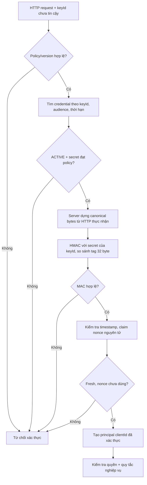

# Crypto policy cho hash algorithm và xác thực HTTP request bằng HMAC

Trong chương **Hash algorithm**, **crypto policy** (chính sách mật mã) là tập hợp quy tắc có thể kiểm tra được về **thuật toán nào được dùng, khóa nào được chấp nhận, dữ liệu nào phải được ký, kết quả MAC được biểu diễn ra sao và điều kiện nào khiến một request bị từ chối**. Đối với hệ thống xác thực HTTP request bằng HMAC, crypto policy là một phần của hợp đồng giữa client, server và hệ thống vận hành; chỉ gọi `Mac.getInstance("HmacSHA256")` là chưa đủ để tạo nên một giao thức xác thực an toàn.

Bài này nằm trong module `SECURITY_AUTHENTICATION_HMAC_REQUEST_AUTHENTICATION`: thiết kế xác thực HTTP request với **shared secret** và **canonical request** bao gồm phương thức HTTP, URI, header hoặc body theo hợp đồng ký; thực hành xác minh chữ ký, chống replay bằng timestamp/nonce, quản lý key rotation, kiểm thử qua proxy/gateway và phân biệt xác thực với phân quyền. Phạm vi của bài tập trung vào **cách thiết lập, thực thi và kiểm chứng crypto policy** trong các hoạt động đó.

## 1. Mục tiêu học tập

Sau khi học, bạn có thể:

1. Phân biệt chính sách mật mã ở cấp **giao thức/ứng dụng**, **credential** và **JDK/JCA/provider**.
2. Đưa ra bộ quy tắc HMAC có phiên bản rõ ràng: thuật toán, kích thước secret, MAC tag, canonical request, key ID, audience và cách mã hóa chữ ký.
3. Kiểm tra việc chọn thuật toán, provider và cấu hình Java 17; hiểu giới hạn của thiết lập `crypto.policy` trong JDK.
4. Thực thi chính sách *fail closed*: không chấp nhận hạ cấp thuật toán, secret yếu, khóa hết hạn, tag bị cắt tùy tiện hoặc request sai hợp đồng.
5. Lập kế hoạch thay đổi chính sách, key rotation, vận hành FIPS/HSM khi cần và kiểm thử đường đi thực tế qua gateway.

## 2. Crypto policy có nhiều tầng

Trong một hệ thống thực, các nhóm quy tắc sau có liên quan nhưng **không thay thế nhau**.

| Tầng | Chủ sở hữu | Ví dụ quyết định | Sai lầm phổ biến |
| --- | --- | --- | --- |
| **Giao thức HTTP HMAC** | Nhóm thiết kế API | Chỉ dùng HMAC-SHA256, signature phiên bản `v1`, canonical request cố định, Base64 chuẩn, tag đầy đủ. | Cho client tự chỉ định thuật toán bất kỳ trong header. |
| **Credential / vòng đời khóa** | Hệ thống provisioning và bảo mật | 256 bit ngẫu nhiên cho secret mới, khóa riêng mỗi client/môi trường, `keyId` duy nhất, thời hạn và thu hồi. | Dùng chung một secret cho mọi đối tác. |
| **Freshness và vận hành** | Gateway / verifier | Timestamp ±5 phút, nonce một lần, kho nonce dùng chung, đồng bộ giờ và phản hồi khi hạ tầng lỗi. | Cho qua khi kho nonce không khả dụng. |
| **JCA/provider của JVM** | Chủ sở hữu Java runtime | Provider nào hỗ trợ `HmacSHA256`, dạng `SecretKey` nào được chấp nhận, chính sách sử dụng HSM/FIPS. | Coi thuật toán có trong JCA là đã đáp ứng mọi chính sách bảo mật. |
| **Phân quyền nghiệp vụ** | Backend / policy engine | Client A có `orders:create` nhưng không có `orders:cancel`. | Đồng nhất HMAC hợp lệ với đủ quyền thực hiện hành động. |

Một yêu cầu có thể vượt qua tầng này nhưng thất bại ở tầng khác. Ví dụ, `Mac.init` thành công chỉ nói provider đã chấp nhận khóa để thực hiện phép MAC; nó **không** bảo đảm khóa còn hạn, request chưa bị replay hoặc client có quyền hủy đơn hàng.

**Hai khái niệm cùng tên dễ nhầm:** `crypto.policy` trong tệp cấu hình bảo mật Java là **thuộc tính runtime/JCE**; còn “crypto policy” của API là **quy định bảo mật của chính sản phẩm/giao thức**. Thay đổi thuộc tính JVM không tự động áp dụng quy tắc audience, canonicalization hoặc nonce cho API.

## 3. Xây dựng một chính sách HMAC-SHA256 cụ thể

Với một API đặt hàng machine-to-machine, nhóm thiết kế có thể thống nhất **HMAC-SHA256-V1** như sau. Đây là **hợp đồng minh họa**, không phải tiêu chuẩn bắt buộc cho mọi hệ thống.

| Hạng mục | Quy tắc V1 minh họa | Lý do |
| --- | --- | --- |
| Thuật toán | `HmacSHA256` trên Java; tên protocol `HMAC-SHA256-V1`. | Có chuẩn, phổ biến, cho tag 256 bit và dễ kiểm thử nhiều ngôn ngữ. |
| Secret mới | Sinh ít nhất **32 byte (256 bit)** bằng CSPRNG, riêng cho từng credential. | Đặt yêu cầu entropy mạnh ngay tại provisioning, tránh secret dễ đoán. |
| Key ID | `X-Key-Id` là mã công khai của một **phiên bản khóa**, không phải secret. | Chọn chính xác secret và danh tính client đã đăng ký. |
| Audience | Chuỗi cấu hình `orders-api-prod` đưa vào canonical request. | Ràng buộc request với dịch vụ và môi trường được phép. |
| MAC output | Sử dụng **đầy đủ 32 byte** của HMAC-SHA256; không cắt ngắn. | Tránh nhập nhằng về độ dài tag và giảm khả năng giả mạo. |
| Signature header | `X-Signature: v1=<Base64 chuẩn có padding>`. | Định dạng wire duy nhất, dễ parse và kiểm tra. |
| Canonical data | Version, audience, method, raw path/query, header đã chọn, timestamp, nonce và SHA-256 của raw body. | Gắn chữ ký với các thành phần có ảnh hưởng đến request. |
| Encoding | UTF-8 cho canonical string, nối dòng LF (`\n`), không có LF cuối; digest body dạng hex chữ thường. | Client/server ký đúng cùng chuỗi byte. |
| Timestamp | Định dạng UTC được thống nhất, lệch tối đa ±300 giây so với server. | Giới hạn tuổi chữ ký được chấp nhận. |
| Nonce | Ngẫu nhiên ít nhất 128 bit, mã hóa Base64URL không padding, dùng một lần cho mỗi `keyId` trong cửa sổ. | Ngăn gửi lại request đã ký. |
| Khóa hợp lệ | Registry có `ACTIVE`, chưa hết hạn, đúng audience/môi trường. | Không chấp nhận credential đã bị thu hồi hoặc nằm sai phạm vi. |
| Thông báo lỗi | Không tiết lộ secret, chi tiết MAC hay trạng thái tồn tại của key ID. | Giảm khả năng dò credential và lộ dữ liệu nhạy cảm. |

Độ dài secret 32 byte là **yêu cầu chính sách cấp phát cho hệ thống này**, không phải quy tắc “mọi JCA provider đều từ chối khóa ngắn hơn”. Một số vector kiểm thử HMAC dùng khóa ngắn hơn và vẫn đúng về mặt thuật toán. Không nhầm **số byte của secret**, **số bit an toàn của secret** và **độ dài MAC output**: secret 32 byte có entropy thấp nếu được chọn từ mật khẩu dễ đoán; Base64 cũng không tăng entropy.

### Lựa chọn họ thuật toán

| Thuật toán | Độ dài MAC output toàn phần | Định hướng chính sách |
| --- | --- | --- |
| `HmacSHA256` | 32 byte | Lựa chọn mặc định hợp lý cho API HMAC mới. |
| `HmacSHA384` | 48 byte | Chỉ dùng khi hợp đồng và các provider/SDK đều hỗ trợ; test vector riêng. |
| `HmacSHA512` | 64 byte | Cũng có thể dùng; không mặc nhiên cần cho mọi API hoặc khiến khóa yếu trở nên mạnh. |
| `HmacSHA1` | 20 byte | Tránh chọn cho thiết kế mới; nếu cần tương thích legacy, giới hạn phạm vi và lập kế hoạch loại bỏ. |
| `HmacMD5` | 16 byte | Không chọn cho giao thức mới do nền tảng hash cũ và yêu cầu tuân thủ hiện đại. |

Sự yếu đi của khả năng **kháng va chạm** của SHA-1/MD5 trong chữ ký số thông thường không có nghĩa mọi cấu trúc HMAC tương ứng đều bị phá cùng cách. Tuy nhiên, **policy cho hệ thống mới** nên ưu tiên thuật toán hiện đại với biên an toàn lớn và đáp ứng tiêu chuẩn vận hành của tổ chức.

Không cho client gửi `X-Algorithm: HmacSHA1` để ép server tự chuyển thuật toán. Nếu cần nhiều bộ thuật toán, server phải có **danh sách cho phép** gắn với **phiên bản giao thức và credential**, đồng thời từ chối mọi phiên bản không được đăng ký; không có cơ chế “thử đến khi xác minh thành công”.

## 4. Chính sách phải xác định đúng byte được ký

Thuật toán tốt vẫn không bảo vệ được các trường **nằm ngoài dữ liệu ký**. Vì thế chính sách thuật toán phải đi kèm một **canonicalization contract** cố định.

Ví dụ client gửi:

```http
POST /v1/orders?currency=VND&channel=partner HTTP/1.1
Host: api.example.test
Content-Type: application/json
X-Key-Id: partner-a-202611
X-Timestamp: 2026-11-28T02:00:00Z
X-Nonce: L9b4CSHGfzq2NWkuUPyTqQ
X-Signature: v1=<BASE64_OF_FULL_HMAC>

{"sku":"BK-42","quantity":2}
```

Theo V1 minh họa, server và client phải tự dựng cùng canonical request:

```text
HMAC-SHA256-V1
orders-api-prod
POST
/v1/orders?currency=VND&channel=partner
content-type:application/json
x-key-id:partner-a-202611
x-timestamp:2026-11-28T02:00:00Z
x-nonce:L9b4CSHGfzq2NWkuUPyTqQ
sha256:<LOWERCASE_HEX_SHA256_OF_RAW_BODY_BYTES>
```

Các chuỗi `<...>` là **placeholder**, không phải giá trị chữ ký/digest có thể sử dụng. Chính sách quy định:

1. Method được viết hoa và phải thuộc tập hành động API cho phép; không tự thay đổi method trong quá trình ký.
2. URI gồm **raw path và raw query thực nhận**, giữ nguyên cách percent-encode và thứ tự tham số theo hợp đồng; không tự parse rồi nối lại mà thay đổi byte.
3. Các header ký có **một** giá trị hợp lệ; ví dụ `Content-Type` của endpoint JSON này phải chính xác `application/json`, không tự chuẩn hóa ngoài hợp đồng.
4. Server **tự tính SHA-256 trên raw body bytes**, kể cả body rỗng; không tin digest do client tự khai và không parse/serialize lại JSON rồi mới hash.
5. Timestamp, nonce, `keyId` và audience đều nằm trong dữ liệu được ký; thay một trong các trường này làm MAC kỳ vọng thay đổi.
6. Dòng cuối **không có LF**; chuỗi canonical được chuyển thành UTF-8 trước khi đưa vào HMAC. `X-Signature` không được tự ký vào chính nó.

Hợp đồng nào cũng cần định nghĩa cách xử lý header trùng, Unicode trong đường dẫn, mã hóa `%2F` / `%2f`, ký tự điều khiển, content encoding và các header được proxy sửa. Quy tắc an toàn cho V1 này là **từ chối giá trị nhập nhằng** thay vì tự đoán ý nghĩa.

`SHA-256(body)` là digest **không có khóa**; `HMAC-SHA256(secret, canonicalBytes)` mới là MAC có khóa. Hai output đều 32 byte nhưng có mục đích khác nhau. Đừng gửi digest body rồi gọi đó là chữ ký HMAC.

## 5. Java 17: crypto.policy của JDK, JCA provider và thuật toán MAC

Java sử dụng JCA/JCE để tìm và thực thi `Mac`. Trong triển khai JDK hiện đại như Java 17, chính sách “unlimited strength” thường là cấu hình mặc định; tuy vậy phải **kiểm tra đúng runtime/JDK image thực tế**, vì vendor, provider, cấu hình triển khai, module bảo mật hoặc yêu cầu tuân thủ có thể khác nhau.

Java có thuộc tính bảo mật `crypto.policy` trong cấu hình `java.security` (thường là `unlimited` hoặc `limited` ở các runtime hỗ trợ). Thuộc tính này gắn với **quy định hạn chế sức mạnh mật mã của JCE**, ví dụ giới hạn một số cỡ khóa của thuật toán mã hóa. Nó **không** thay thế danh sách thuật toán cho phép của API và cũng không nói chắc HMAC-SHA256 được chấp nhận với mọi loại `SecretKey`.

Phân biệt ba phép kiểm tra:

| Câu hỏi cần trả lời | Cách kiểm tra | Điều không được suy ra |
| --- | --- | --- |
| Runtime đang báo `crypto.policy` nào? | `Security.getProperty("crypto.policy")` hoặc xem cấu hình bảo mật của Java đang chạy. | Giá trị `unlimited` không có nghĩa mọi thuật toán/provider đều hợp lệ về mặt tổ chức. |
| JCA có thể lấy `Mac` cho thuật toán đã chọn không? | `Mac.getInstance("HmacSHA256")`. | Lấy được đối tượng `Mac` chưa có nghĩa mọi khóa đều khởi tạo thành công. |
| Provider có chấp nhận khóa cụ thể? | `mac.init(validatedSecretKey)` rồi kiểm tra provider được sử dụng. | Thành công ở `init` không chứng minh credential ACTIVE hay request được phân quyền. |

Ví dụ đoạn Java 17 kiểm tra runtime để chẩn đoán tại **môi trường thử nghiệm**:

```java
import java.security.Security;
import javax.crypto.Cipher;
import javax.crypto.Mac;

public class CryptoRuntimeInspection {
    public static void main(String[] args) throws Exception {
        System.out.println("crypto.policy = "
                + Security.getProperty("crypto.policy"));

        // Định lượng policy đối với AES; đây KHÔNG phải giới hạn khóa HMAC.
        System.out.println("Max permitted AES key bits = "
                + Cipher.getMaxAllowedKeyLength("AES"));

        // Việc tạo Mac mới kiểm tra availability, không kiểm tra key cụ thể.
        Mac mac = Mac.getInstance("HmacSHA256");
        System.out.println("HMAC algorithm = " + mac.getAlgorithm());
        System.out.println("Mac output length = " + mac.getMacLength());
    }
}
```

**Đọc đúng kết quả:** giá trị max AES là chỉ báo cho hạn chế JCE ở ví dụ AES, không phải “độ dài tối đa của secret HMAC”. HmacSHA256 thường cho MAC output 32 byte, **bất kể secret dài 16 hay 32 byte**; việc secret có được dùng hay không phụ thuộc kiểm tra của ứng dụng, kiểu `Key`, provider và chính sách triển khai. Khi dùng HSM hoặc provider chuyên dụng, cần kiểm tra trực tiếp `mac.init(key)` với loại khóa thực tế.

### FIPS, HSM và provider: kiểm tra theo môi trường

Một hệ thống có yêu cầu vận hành theo FIPS hoặc sử dụng HSM cần chính sách riêng về **thuật toán được phép, provider được cấu hình, cơ chế tạo/lưu/không xuất khóa và chế độ hoạt động của thiết bị**. Chỉ nhìn thấy `HmacSHA256` hoặc `crypto.policy=unlimited` **không đủ** để khẳng định ứng dụng đang vận hành trong chế độ đáp ứng FIPS.

- Provider thông thường có thể nhận `SecretKeySpec` từ byte; provider của HSM có thể yêu cầu một `SecretKey` do chính HSM quản lý, với `getEncoded() == null` là hành vi hợp lệ cho khóa không cho xuất.
- `Mac.getInstance` có thể lấy một triển khai thuật toán, nhưng provider thực sự có thể còn phụ thuộc loại key lúc `init`; cần kiểm tra provider/khóa **sau khi khởi tạo** trong môi trường mục tiêu.
- Nếu provider từ chối khóa, `Mac.init` có thể ném `InvalidKeyException`. Nếu không có thuật toán, `Mac.getInstance` ném `NoSuchAlgorithmException`. Không chuyển chúng thành “client ký sai” mà không ghi nhận lỗi vận hành.
- Cấu hình FIPS, HSM và policy tổ chức phải được kiểm thử trên deployment thật; chỉ đổi tên thuật toán, cài provider hoặc bật một property là chưa đủ để chứng minh tuân thủ.

## 6. Java 17: thực thi chính sách HMAC với một bộ thuật toán cố định

Ví dụ sau thể hiện lõi ký và xác minh **HMAC-SHA256-V1** theo policy: chỉ chấp nhận tag **đủ 32 byte**, Base64 chuẩn có padding, secret tối thiểu 32 byte cho credential mới, tên thuật toán không đến từ header do client kiểm soát. Nó dùng test vector HMAC-SHA256 công khai để đối chiếu kết quả độc lập.

```java
import java.nio.charset.StandardCharsets;
import java.security.GeneralSecurityException;
import java.security.MessageDigest;
import java.security.SecureRandom;
import java.util.Arrays;
import java.util.Base64;
import java.util.HexFormat;
import javax.crypto.Mac;
import javax.crypto.spec.SecretKeySpec;

public final class HmacSha256Policy {
    public static final String VERSION = "HMAC-SHA256-V1";
    private static final String JCA_ALGORITHM = "HmacSHA256";
    private static final String HEADER_PREFIX = "v1=";
    private static final int REQUIRED_SECRET_BYTES = 32;
    private static final int REQUIRED_TAG_BYTES = 32;
    private static final SecureRandom CSPRNG = new SecureRandom();

    private HmacSha256Policy() {}

    // Provisioning: cấp một secret ngẫu nhiên riêng cho mỗi keyId.
    public static byte[] createSecret() {
        byte[] secret = new byte[REQUIRED_SECRET_BYTES];
        CSPRNG.nextBytes(secret);
        return secret;
    }

    // Policy của ví dụ: credential mới phải có ít nhất 32 byte secret.
    private static void requireSecret(byte[] secret) {
        if (secret == null || secret.length < REQUIRED_SECRET_BYTES) {
            throw new IllegalStateException("HMAC credential violates key policy");
        }
    }

    public static byte[] calculateMac(byte[] secret, byte[] canonicalBytes)
            throws GeneralSecurityException {
        requireSecret(secret);
        if (canonicalBytes == null) {
            throw new IllegalArgumentException("Missing canonical bytes");
        }

        Mac mac = Mac.getInstance(JCA_ALGORITHM);
        mac.init(new SecretKeySpec(secret, JCA_ALGORITHM));
        byte[] output = mac.doFinal(canonicalBytes);
        if (output.length != REQUIRED_TAG_BYTES) {
            throw new IllegalStateException("Unexpected HMAC output length");
        }
        return output;
    }

    public static String sign(byte[] activeSecret, byte[] canonicalBytes)
            throws GeneralSecurityException {
        return HEADER_PREFIX + Base64.getEncoder()
                .encodeToString(calculateMac(activeSecret, canonicalBytes));
    }

    // canonicalBytes do server TỰ dựng từ request nhận được.
    // Trả false nếu signature sai; lỗi key/provider vẫn được ném ra ngoài.
    public static boolean verify(
            byte[] activeSecret, byte[] canonicalBytes, String receivedHeader)
            throws GeneralSecurityException {
        if (receivedHeader == null
                || !receivedHeader.startsWith(HEADER_PREFIX)) {
            return false;
        }

        String suppliedBase64 =
                receivedHeader.substring(HEADER_PREFIX.length());
        byte[] suppliedTag;
        try {
            suppliedTag = Base64.getDecoder().decode(suppliedBase64);
        } catch (IllegalArgumentException ex) {
            return false;
        }
        if (suppliedTag.length != REQUIRED_TAG_BYTES
                || !Base64.getEncoder().encodeToString(suppliedTag)
                          .equals(suppliedBase64)) {
            return false;
        }

        byte[] expected = calculateMac(activeSecret, canonicalBytes);
        return MessageDigest.isEqual(expected, suppliedTag);
    }

    public static void main(String[] args) throws Exception {
        byte[] secret = createSecret();
        byte[] signedBytes = VERSION.getBytes(StandardCharsets.UTF_8);
        String signature = sign(secret, signedBytes);
        if (!verify(secret, signedBytes, signature)) {
            throw new AssertionError("Expected valid MAC");
        }
        if (verify(secret, "HMAC-SHA256-V2".getBytes(StandardCharsets.UTF_8),
                signature)) {
            throw new AssertionError("Changed bytes were accepted");
        }

        // RFC 4231 test case 1 sử dụng key 20 byte công khai, ngắn hơn
        // chính sách provisioning của API này, nhưng đúng về mặt HMAC.
        byte[] rfcKey = new byte[20];
        Arrays.fill(rfcKey, (byte) 0x0b);
        Mac rawJca = Mac.getInstance("HmacSHA256");
        rawJca.init(new SecretKeySpec(rfcKey, "HmacSHA256"));
        String rfcHex = HexFormat.of().formatHex(
                rawJca.doFinal("Hi There".getBytes(StandardCharsets.US_ASCII)));
        String expectedRfcHex =
                "b0344c61d8db38535ca8afceaf0bf12b"
                + "881dc200c9833da726e9376c2e32cff7";
        if (!expectedRfcHex.equals(rfcHex)) {
            throw new AssertionError("RFC 4231 HMAC mismatch");
        }
        System.out.println("Crypto policy and RFC 4231 vector passed.");
    }
}
```

Trong luồng request, **bên gọi** cần kiểm tra `keyId` có thuộc credential ACTIVE đúng audience/môi trường và `canonicalBytes` có đúng hợp đồng hay không. Ví dụ này cố tình không tự lấy thông tin thuật toán từ request, không tự làm mới secret, không bỏ qua `InvalidKeyException` và không cố “thử khóa khác” để khiến signature trùng. Chức năng chống replay và authorization phải được đặt trong các lớp riêng.

**Điểm cần phân biệt:** việc policy bắt buộc secret ≥32 byte là lựa chọn rõ ràng cho **credential mới**. Nếu tổ chức buộc phải chấp nhận credential cũ ngắn hơn trong một giai đoạn chuyển đổi, hãy khai báo **phiên bản/ngoại lệ được kiểm soát riêng** với thời hạn loại bỏ; không sửa ngầm `REQUIRED_SECRET_BYTES` hoặc làm verifier tự giảm chuẩn khi client gặp lỗi.

## 7. Thiết kế policy từ credential đến request

Một hệ thống production nên quản lý hai lớp cấu hình:

1. **Policy V1 bất biến theo phiên bản**: thuật toán, định dạng tag, canonical request, timestamp/nonce và quy tắc kiểm tra.
2. **Credential registry**: `keyId`, `clientId`, secret reference, `policyVersion`, `audience`, trạng thái, thời điểm hiệu lực và quyền được cấp.

Ví dụ bản ghi minh họa (không chứa secret thật):

```yaml
keyId: partner-a-202611
clientId: partner-a-orders
secretRef: secret-manager://prod/hmac/partner-a/202611
policyVersion: HMAC-SHA256-V1
audience: orders-api-prod
algorithm: HmacSHA256
status: ACTIVE
notBefore: "2026-11-01T00:00:00Z"
expiresAt: "2027-02-01T00:00:00Z"
```

`keyId` là định danh công khai. Khi nhận request, server có thể dùng nó để tìm record nhưng **không** được gắn `clientId` vào security context trước khi chữ ký và chính sách xác thực hợp lệ.



Một ví dụ lỗi cấu hình nghiêm trọng: registry ghi `HmacSHA256` nhưng client gửi `X-Algorithm: HmacSHA1` và server ưu tiên header. Khi đó attacker có thể chủ động chọn một thuật toán không được cho phép. Quyết định thuật toán phải lấy từ **phiên bản/credential đã xác thực về mặt cấu hình**, không phải tùy chọn tự do của request. Nếu có nhiều phiên bản, prefix version có thể giúp tìm đúng policy **được cho phép**; vẫn phải kiểm tra `policyVersion` của credential và cấm fallback.

## 8. Chống replay cũng phải là một phần của crypto policy

Một MAC hợp lệ có thể được sao chép và gửi lại nguyên vẹn. `HmacSHA256` không tự sinh nonce hay kiểm tra tuổi request. V1 yêu cầu:

- **Timestamp được ký**, ở dạng UTC chuẩn mà hai bên thống nhất; ví dụ chỉ chấp nhận sai lệch tối đa ±300 giây so với đồng hồ server. Client và server phải đồng bộ giờ.
- **Nonce được ký**, sinh mới theo mỗi request, có tối thiểu 128 bit entropy và sử dụng một lần. Server lưu khóa như `(keyId, nonce)` bằng thao tác **insert-if-absent nguyên tử** trong kho dùng chung cho các instance, không dùng bộ nhớ từng pod.
- Thứ tự kiểm tra: validate cấu trúc và timestamp → tra credential → tính HMAC/so MAC → **claim nonce** → xử lý nghiệp vụ. Không ghi nonce trước khi xác minh HMAC vì request giả có thể chiếm nonce hoặc gây đầy kho.
- **Thời gian giữ nonce** phải đến khi timestamp hết cửa sổ chấp nhận. Với lệch ±5 phút, timestamp được ký trước 5 phút trong tương lai vẫn có thể hợp lệ tối đa khoảng **10 phút từ thời điểm nhận sớm nhất**, nên TTL chỉ 5 phút từ lúc nhận có thể cho phép replay.
- **Kho nonce lỗi phải fail closed** với endpoint yêu cầu bảo vệ replay. HMAC đúng nhưng nonce đã tồn tại vẫn phải từ chối.

Khi client retry một request do lỗi mạng, client phải tạo timestamp/nonce mới và ký lại; nếu retry có thể gây side effect như tạo đơn hàng lần hai, policy nghiệp vụ còn cần `Idempotency-Key`. HMAC với nonce chỉ bảo vệ độ mới của **request đã ký**, không bảo đảm giao dịch không bị tạo trùng.

## 9. Key rotation và thay đổi crypto policy

Có **hai dạng chuyển đổi** cần phân biệt:

| Thay đổi | Ví dụ | Cách triển khai |
| --- | --- | --- |
| **Đổi khóa, giữ thuật toán** | `partner-a-202611` / secret A → `partner-a-202702` / secret B, cả hai dùng V1. | Mỗi key ID ánh xạ tới **đúng một secret**; overlap có kiểm soát rồi revoke key cũ. |
| **Đổi phiên bản giao thức/thuật toán** | `HMAC-SHA256-V1` → `HMAC-SHA512-V2` hoặc thay canonicalization. | Tạo policy version mới, test vector mới, SDK và verifier cập nhật; credential/endpoint chỉ cho phép tập version đã duyệt. |

Ví dụ chuyển khóa trong V1:

1. Client đang dùng `partner-a-202611` với secret A; server xác thực theo registry.
2. Provisioning tạo `partner-a-202702` với **secret B độc lập**, cấu hình policy V1 và thời gian hiệu lực; cả hai key ACTIVE trong khoảng chuyển đổi được phê duyệt.
3. Client bắt đầu gửi key ID mới và tính HMAC bằng secret B; server lấy **chính secret B** theo key ID, không thử A nếu B thất bại.
4. Sau khi chuyển đủ và hết cửa sổ còn có thể nhận request cũ, server retire/revoke key A; cache registry phải nhận thay đổi nhanh để tránh tiếp tục chấp nhận key đã thu hồi.

Khi nâng phiên bản policy, cần xác định **chính xác phiên bản nào được phép cho từng key/endpoint**, có ngày dừng phiên bản cũ và theo dõi tỷ lệ client đã chuyển. Không làm downgrade tự động nếu chữ ký V2 sai: thử lại bằng V1 có thể khiến một phiên bản yếu hoặc hợp đồng ký cũ tiếp tục được chấp nhận trái chính sách.

Nếu secret bị lộ, thu hồi khóa liên quan, điều tra request và cấp secret mới; **chỉ thay key ID nhưng giữ nguyên secret đã lộ không giải quyết vấn đề**. Secret không được đưa vào Git, log, URL hoặc thông báo lỗi; khi ghi audit, lưu request ID, key ID, principal đã xác thực, mã lỗi đã làm sạch và thời điểm phù hợp.

## 10. Proxy/gateway và các ngoại lệ của chính sách

Một policy được định nghĩa chính xác trên giấy vẫn có thể thất bại vì tầng mạng làm thay đổi dữ liệu ký.

| Hiện tượng trong môi trường thật | Hệ quả với crypto policy |
| --- | --- |
| Gateway rewrite `/external/v1/orders` thành `/v1/orders`. | Nếu client ký URI trước rewrite và backend ký URI sau rewrite, MAC mismatch. |
| CDN chuẩn hóa `%2f` thành `%2F` hoặc decode thành `/`. | Raw path khác byte, vi phạm hợp đồng ký raw URI. |
| Proxy đảo query hoặc xử lý tham số lặp theo thứ tự khác. | Canonical request thay đổi; rủi ro nghiêm trọng nếu backend thực thi nghĩa khác so với verifier. |
| Gateway thay `Content-Type` hoặc gộp header trùng. | Header nằm trong dữ liệu ký có thể khác hoặc trở nên nhập nhằng. |
| Middleware đọc, giải nén, parse rồi serialize lại JSON. | Hash raw body phía verifier khác hash của client. |
| Backend nhận header `X-Authenticated-Client` từ Internet. | Có thể bị giả mạo danh tính nếu backend tin header chưa được gateway xác minh. |

**Cách tổ chức thực tế:** xác minh HMAC tại điểm đáng tin trước khi rewrite nếu có thể. Nếu backend mới là nơi xác minh, các thành phần trung gian phải bảo toàn hoặc chuyển tiếp raw request theo một cơ chế tin cậy, có kiểm thử xuyên suốt. Không tin `X-Original-URI` hay `X-Forwarded-*` do bên ngoài tự đặt; gateway cần loại bỏ các header principal do client tự gửi rồi chỉ truyền principal đã xác thực tới backend trên kênh nội bộ được bảo vệ.

Khi cần tạo ngoại lệ do legacy proxy, đừng ngầm “thử cả URI cũ và URI mới” trên production. Hãy định nghĩa hợp đồng có phiên bản, phạm vi endpoint/credential được phép, thời hạn loại bỏ và test vector riêng; kiểm tra cả việc **request được thực thi** có cùng ý nghĩa với **request được ký**.

## 11. Xử lý lỗi và kiểm soát thay đổi chính sách

Phân loại lỗi để vừa bảo vệ dữ liệu, vừa giúp vận hành:

| Tình huống | Phản ứng bảo mật | Phản hồi HTTP thường gặp |
| --- | --- | --- |
| Signature thiếu, phiên bản không được phép, tag sai, key ID không tồn tại, key revoke. | Từ chối xác thực; không thử thuật toán/secret khác. | `401` với thông báo chung. |
| Timestamp ngoài cửa sổ, nonce đã dùng. | Từ chối freshness/replay; không gây side effect. | Phản hồi lỗi xác thực phù hợp theo hợp đồng. |
| Đã xác thực, nhưng thiếu scope hoặc quyền trên resource. | Từ chối phân quyền. | `403`. |
| `Mac.getInstance` không có thuật toán cấu hình, `Mac.init` từ chối key ACTIVE hoặc secret manager hỏng. | Fail closed, cảnh báo lỗi hệ thống/credential; không suy thành “client gửi sai chữ ký”. | `5xx` chung khi thích hợp. |
| Nonce store không sẵn sàng với API bắt buộc chống replay. | Fail closed; không tắt nonce validation. | Thường `5xx`/thông báo dịch vụ tạm thời không sẵn sàng. |

**Không lấy HTTP status để thay thế audit.** Với một lỗi client thấy thông điệp chung, phía server vẫn cần metric nguyên nhân (MAC mismatch, stale timestamp, replay, invalid credential, provider error) theo mã nội bộ, được giới hạn quyền truy cập và loại bỏ dữ liệu bí mật.

Quy trình thay đổi policy nên có: phiên bản và người phê duyệt → đặc tả canonical bytes chính xác → test vector nhiều ngôn ngữ → triển khai staging qua proxy/gateway thật → rollout theo tập client/credential → giám sát tỷ lệ lỗi → ngừng chấp nhận phiên bản cũ. Một test chỉ kiểm tra `Mac.getInstance` thành công không đủ để chứng minh toàn bộ chính sách hoạt động.

## 12. Ma trận kiểm thử crypto policy

| Ca kiểm thử | Kết quả mong đợi |
| --- | --- |
| RFC 4231 test case 1: key `0x0b` × 20, message `Hi There`. | HMAC-SHA256 hex phải là `b0344c61d8db38535ca8afceaf0bf12b881dc200c9833da726e9376c2e32cff7`. |
| Khóa 32 byte ngẫu nhiên mới, HmacSHA256, canonical bytes cố định. | Ký/xác minh thành công, tag raw đúng 32 byte. |
| Credential mới có secret 8 byte dù JCA chấp nhận. | **Policy ứng dụng** từ chối vì không đạt 32 byte. |
| Thay method, URI/query, selected header hoặc một byte raw body. | Signature cũ không hợp lệ; server không diễn giải lại input để làm khớp. |
| Đổi thứ tự JSON hoặc thêm newline trong raw body. | Body digest và HMAC thay đổi nếu raw bytes khác. |
| Dùng Base64URL thiếu padding cho protocol yêu cầu Base64 chuẩn. | Từ chối định dạng theo V1, dù bytes có thể giải mã tương đương. |
| Gửi tag chỉ 16 byte hoặc tag rỗng. | Từ chối vì V1 yêu cầu full 32-byte MAC. |
| Gửi `X-Algorithm: HmacSHA1` hoặc prefix version lạ. | Không hạ cấp; từ chối ngoài allowlist/credential policy. |
| Server mất `HmacSHA256` provider hoặc gặp `InvalidKeyException`. | Fail closed, phân loại lỗi cấu hình/provider, phát cảnh báo. |
| Credential có key ID đúng nhưng đã REVOKED hoặc sai audience. | Từ chối trước bước xử lý nghiệp vụ. |
| Đang overlap hai key ID của cùng client. | Mỗi key dùng **đúng secret** của mình, đều ánh xạ về client hợp lệ nếu policy cho phép. |
| Timestamp ngoài ±5 phút. | Từ chối, kể cả chữ ký đúng. |
| Phát lại cùng nonce đến hai instance cùng lúc. | Chỉ một lần claim thành công nhờ nonce store nguyên tử dùng chung. |
| Proxy rewrite path/query/header/body giữa nơi ký và nơi xác minh. | Integration test phát hiện sai khác; điều chỉnh điểm xác minh/hợp đồng. |
| Header principal giả được gửi từ Internet. | Gateway loại bỏ, backend chỉ tin principal qua kênh nội bộ tin cậy. |
| HMAC hợp lệ nhưng client thiếu quyền `orders:cancel`. | Authentication có thể thành công; authorization từ chối `403`. |

Để kiểm tra khác biệt giữa Java, Go, JavaScript hoặc SDK khác, duy trì **test vector của chính hợp đồng V1** với các trường: key thử nghiệm, method, raw path/query, header ký, timestamp, nonce, raw body bytes, SHA-256 body, canonical string UTF-8 và kết quả HMAC raw (hex) cùng Base64 wire. Không đưa shared secret production vào bộ test.

## 13. Bài tập áp dụng

### Bài tập 1: Kiểm tra một quyết định thuật toán

Nhóm A định cấu hình `HmacSHA256` nhưng cho phép client tự gửi `X-Algorithm` và server thử `HmacSHA1` khi chữ ký SHA-256 không hợp lệ. Điều này đáp ứng crypto policy V1 không?

**Gợi ý trả lời:** Không. Chính sách V1 pin thuật toán và tag length theo server; fallback như vậy có thể chấp nhận thuật toán cũ trái chính sách. Nếu hỗ trợ nhiều phiên bản, phải định nghĩa allowlist theo key/endpoint, test vector và kế hoạch loại bỏ rõ ràng.

### Bài tập 2: “unlimited” có đủ chưa?

Một container Java 17 có `Security.getProperty("crypto.policy")` là `unlimited` và `Mac.getInstance("HmacSHA256")` thành công. Như vậy có thể bỏ qua kiểm tra độ dài secret, timestamp, nonce và principal không?

**Gợi ý trả lời:** Không. `crypto.policy` liên quan hạn chế của runtime; `Mac.getInstance` chỉ xác nhận thuật toán khả dụng. Hệ thống vẫn phải thực thi policy credential, canonical request, freshness, chống replay và authorization ở tầng ứng dụng.

### Bài tập 3: Tag HMAC và khóa không khớp

Client A dùng secret 12 byte do đối tác tự chọn. Java JCA vẫn tính được HMAC-SHA256 32 byte. Một giao thức yêu cầu secret 32 byte có được chấp nhận request đó vì tag dài đúng 32 byte?

**Gợi ý trả lời:** Không. **Độ dài tag 32 byte khác với yêu cầu key 32 byte**. Credential vi phạm policy cấp phát dù tính được HMAC. Provisioning cần cấp secret mới đạt yêu cầu; nếu chấp nhận legacy tạm thời thì phải có ngoại lệ riêng được phê duyệt.

### Bài tập 4: Timestamp và nonce trong cửa sổ

Một request có timestamp nhanh hơn server 5 phút và được server chấp nhận ngay. Nonce store xóa nonce sau đúng 5 phút kể từ lần nhận đầu. Điều gì có thể xảy ra?

**Gợi ý trả lời:** Timestamp ở tương lai 5 phút có thể còn hợp lệ thêm 5 phút sau mốc server bắt đầu nhận; tổng thời gian có thể tới 10 phút. Nonce bị xóa ở phút thứ 5 có thể cho phép phát lại request còn hợp lệ. TTL phải kéo dài qua thời điểm hết hạn timestamp (cộng biên an toàn) hoặc chọn TTL đủ dài.

### Bài tập 5: Review policy qua gateway

Client ký `POST /public/v1/orders`, gateway rewrite thành `POST /v1/orders` trước khi backend dựng canonical request. Server tính MAC không trùng. Lỗi này có phải `InvalidKeyException` không và sửa như thế nào?

**Gợi ý trả lời:** Không. Khóa/thuật toán có thể hoàn toàn hợp lệ; dữ liệu ký khác nhau gây MAC mismatch. Xác minh trước rewrite hoặc bảo toàn raw URI theo hợp đồng với nguồn đáng tin; không chấp nhận header do client tự khai là URI gốc.

## 14. Ghi nhớ

**Crypto policy quyết định thuật toán nào được phép và cách một request HMAC trở thành request hợp lệ.** Với HMAC-SHA256, cần pin thuật toán và wire format theo phiên bản; cấp secret đủ mạnh; yêu cầu full MAC tag; định nghĩa chính xác canonical request; kiểm tra `keyId`, audience và trạng thái khóa; chặn replay bằng timestamp/nonce; duy trì ranh giới giữa xác thực và phân quyền.

Java 17 cung cấp JCA/JCE để thực hiện phép HMAC và cấu hình mật mã ở runtime, nhưng **crypto.policy của JDK không thay thế crypto policy của ứng dụng**. Mọi thay đổi thuật toán, secret hoặc canonical contract cần được quản lý theo phiên bản, triển khai có kiểm soát và thử nghiệm thực tế qua client, proxy, gateway và backend.
