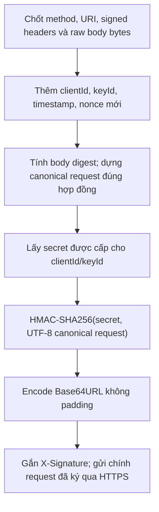
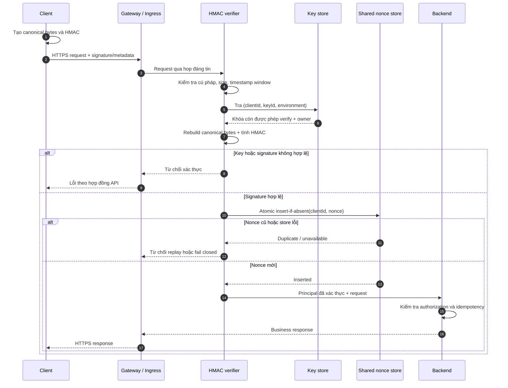
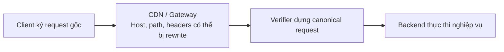

# Signature là gì trong HMAC Request Authentication?

## Mục tiêu học tập

Sau bài học này, bạn có thể:

- Giải thích **request signature** là giá trị gì, được tạo từ đâu, đặt ở đâu trong một HTTP request và dùng để kiểm tra điều gì.
- Phân biệt chữ ký HMAC với hash SHA-256 không khóa, chữ ký số bất đối xứng, mã hóa dữ liệu và token đăng nhập.
- Mô tả quan hệ giữa **shared secret**, **canonical request**, **HMAC-SHA256**, **key ID** và phần biểu diễn chữ ký gửi trên mạng.
- Chỉ ra chính xác **những trường HTTP nào được bảo vệ** bởi chữ ký và vì sao phải có hợp đồng canonical hóa thống nhất.
- Trình bày quy trình tạo chữ ký ở client, xác minh ở server, ngăn replay với timestamp/nonce và xử lý key rotation.
- Phân biệt **xác thực request** với **phân quyền thao tác**, nhất là khi có API gateway, nhiều tenant và nhiều replica verifier.

> **Bối cảnh bài học:** Chủ đề thuộc chương **Request signature** của module `SECURITY_AUTHENTICATION_HMAC_REQUEST_AUTHENTICATION`. Module thiết kế xác thực HTTP request bằng HMAC với khóa bí mật dùng chung, dựa trên canonical request gồm method, URI, header hoặc body theo hợp đồng ký. Trong bài, từ *signature* thường chỉ **HMAC tag** được truyền kèm request; đây là cách gọi phổ biến trong API nhưng cần phân biệt với chữ ký số dùng cặp khóa bất đối xứng.

## 1. Signature là gì?

Một **request signature** là một giá trị kiểm tra mật mã được tính trên **những phần đã thỏa thuận của HTTP request** bằng một cơ chế mật mã và khóa phù hợp. Trong mô hình dùng HMAC:

```text
signatureBytes = HMAC-SHA256(secretKeyBytes, canonicalRequestBytes)
signatureText  = Base64URL_NoPadding(signatureBytes)
```

- `secretKeyBytes`: các byte của **shared secret** đã được cấp cho client và verifier. Secret này **không xuất hiện** trong request.
- `canonicalRequestBytes`: chuỗi byte biểu diễn ổn định phương thức, URI, header/body và metadata được ký theo **hợp đồng cụ thể của API**.
- `signatureBytes`: HMAC tag dài 32 byte đối với HMAC-SHA256 đầy đủ.
- `signatureText`: cách biểu diễn tag dưới dạng chuỗi ký tự để gửi, ví dụ trong header `X-Signature`. Với 32 byte tag, Base64URL không padding dài **43 ký tự**.

Điều cần hiểu trước tiên: signature **không chứa lại thông điệp gốc**, không chứa secret, cũng không phải một bản mã có thể “giải mã” để lấy body. Client **tính** tag; verifier **tính lại** tag từ request nhận được và khóa đúng, rồi **so sánh**.

Nếu một người sửa `POST` thành `PUT`, đổi URI, thay số tiền trong body hoặc chỉnh header **có nằm trong dữ liệu được ký**, kết quả HMAC server tính lại sẽ không khớp chữ ký cũ. Điều này giúp phát hiện thay đổi đối với những phần được ký, giả sử attacker không biết secret.

### Một ví dụ gần đời sống

Một đối tác `merchant-17` gửi lệnh tạo đơn trị giá 120.000 VND. Server cần biết request có thực sự được ký bằng khóa thuộc đối tác ấy và các trường quan trọng có bị thay đổi hay không. Client tính signature trên một canonical request có `POST`, `/v1/orders`, `merchant-17`, timestamp, nonce và digest của body. Server dùng khóa đã đăng ký cho `merchant-17` để tính lại.

Nếu chữ ký đúng, server có thể kết luận request **được ký bởi bên có khả năng sử dụng khóa phù hợp**. Server **chưa thể kết luận** đối tác có quyền tạo đơn hàng cho mọi tenant; việc đó thuộc bước phân quyền sau xác thực.

## 2. Signature không đồng nghĩa với những khái niệm nào?

| Cơ chế | Có khóa bí mật? | Bảo đảm chính | Có thay thế HMAC request signature không? |
|---|---|---|---|
| `SHA-256(body)` | Không | Tạo digest của byte body | Không. Attacker có thể sửa body và tự tính digest mới |
| **`HMAC-SHA256(K, canonicalRequest)`** | Có, **cùng secret** ở phía ký và kiểm tra | Xác thực khả năng sử dụng khóa; bảo vệ các phần request được ký | Đây là cơ chế đang học |
| Chữ ký số bất đối xứng (RSA, ECDSA, EdDSA) | Có private key để ký, public key để verify | Xác minh với khóa công khai; mô hình bằng chứng khác HMAC | Có thể dùng cho giao thức khác, không phải cùng kiểu khóa |
| `AES-GCM` | Có khóa đối xứng | Mã hóa có xác thực, bảo vệ bí mật và toàn vẹn dữ liệu theo cách dùng đúng | Không tự thay cho hợp đồng ký HTTP |
| HTTPS/TLS | Dùng cơ chế khóa của TLS | Bảo vệ kết nối giữa các endpoint TLS | Vẫn cần nếu dùng HMAC ở tầng ứng dụng |
| Bearer token | Thường là một credential/token | Bên sở hữu token có thể gọi API theo hợp đồng của token | Có thể xác thực theo mô hình khác; không mặc nhiên ràng buộc từng request với method/body |

Tên “`X-Signature`” chỉ là tên một header của giao thức ví dụ. Nó **không chứng minh** API đang dùng chữ ký số. Phải xem thuật toán: `HmacSHA256` là MAC với khóa dùng chung, trong khi `SHA256withRSA` hoặc `Ed25519` là các kiểu chữ ký bất đối xứng.

**HMAC không có tính chống chối bỏ giữa các bên cùng nắm khóa.** Client và verifier đều biết `K`, nên về mặt mật mã cả hai có thể tạo cùng một tag. HMAC không chứng minh duy nhất bên nào đã phát sinh chữ ký nếu nhiều bên được cấp quyền sử dụng secret.

## 3. Những gì thực sự được ký: hợp đồng canonical request

### 3.1. HTTP request có nhiều biểu diễn hợp lệ

Hai request có thể có cùng ý nghĩa nghiệp vụ nhưng khác byte:

- `/v1/orders?a=1&b=2` so với `/v1/orders?b=2&a=1`;
- header `Content-Type` so với `content-type`;
- JSON `{"id":"A1","amount":1000}` so với `{ "amount": 1000, "id": "A1" }`;
- path chứa `%2F` so với path đã được decode;
- request trước và sau gateway rewrite path, host hoặc header.

Nếu client ký một biểu diễn còn verifier tính lại trên biểu diễn khác, **chữ ký không khớp dù secret giống nhau**. Vì vậy cần một **hợp đồng ký**: bộ quy tắc quyết định chính xác chuỗi byte nào được đưa vào HMAC và cách chuyển từ HTTP request thành chuỗi ấy.

### 3.2. Các thành phần thường được đưa vào chữ ký

| Thành phần | Ví dụ | Vì sao đáng ký? |
|---|---|---|
| HTTP method | `POST` | Bảo vệ hành động; không để chuyển sang `DELETE` mà dùng lại tag |
| Request target | `/v1/orders?currency=VND` | Ràng buộc API, resource và query có ý nghĩa |
| Host/authority | `api.example.test` | Ràng buộc đích nếu có tác động đến routing, đặc biệt qua proxy |
| Content type | `application/json` | Bảo vệ cách diễn giải body |
| Client ID | `merchant-17` | Ràng buộc danh tính tự khai với khóa xác minh |
| Key ID | `k2` | Ràng buộc phiên bản khóa được chọn |
| Timestamp | Unix seconds, ví dụ `<timestamp>` | Giới hạn khoảng thời gian request được chấp nhận |
| Nonce | Chuỗi ngẫu nhiên, ví dụ 128 bit | Phát hiện request được sử dụng lại trong cửa sổ |
| Hash body | SHA-256 của **raw body bytes** | Bảo vệ nội dung body mà không phải đưa raw body vào chuỗi canonical |
| Header nghiệp vụ quan trọng | `Idempotency-Key`, `X-Tenant-Id` nếu có | Tránh thay đổi cách xử lý/retry hoặc tenant sau khi ký |

**Không có bộ trường ký phổ quát cho mọi API.** Hợp đồng phải nói rõ các trường bắt buộc, thứ tự, encoding, cách xử lý header trùng, URI và body, cũng như tác động của proxy/gateway. Nếu backend ra quyết định dựa trên một trường client có thể sửa mà hợp đồng không ký hoặc không kiểm tra bằng context tin cậy, chữ ký không bảo vệ quyết định ấy.

### 3.3. Một hợp đồng `hmac-v1` mang tính minh họa

Để tự tính và kiểm tra signature, giả sử API định nghĩa:

1. Thuật toán cố định: **HMAC-SHA256**; encode kết quả bằng Base64URL **không padding**.
2. Canonical string gồm từng dòng theo thứ tự: method, request-target, `host`, `content-type`, `x-client-id`, `x-key-id`, `x-timestamp`, `x-nonce`, `body-sha256`.
3. Ghép dòng bằng LF (byte `0x0a`), không thêm LF cuối cùng; mã hóa toàn bộ chuỗi bằng **UTF-8**.
4. Method viết hoa, host và content type chuẩn hóa về chữ thường theo quy tắc của hợp đồng này, giá trị header còn lại được trim khoảng trắng hai đầu.
5. URI là path + query ở dạng **được cả client và verifier thống nhất**, không tùy tiện sort hoặc decode lại. Với trường hợp nhập nhằng/không được hỗ trợ, từ chối thay vì tự đoán.
6. Body digest là `Base64URL_NoPadding(SHA256(rawBodyBytes))`. Body rỗng vẫn có digest của chuỗi byte rỗng.
7. Các header bắt buộc phải xuất hiện đúng một lần. Từ chối header trùng, CR/LF bất thường hoặc giá trị có định dạng không hợp lệ.
8. Chữ ký được gửi trong `X-Signature`, nhưng **không đưa `X-Signature` vào chính chuỗi cần ký**.

Đây là quy ước cho ví dụ học tập, **không phải một tiêu chuẩn HMAC chung**. Với hệ thống production, hợp đồng cần quy định chi tiết hơn cách chuẩn hóa query trùng, percent-encoding, Unicode, content encoding, giới hạn kích thước, dấu slash và các header bảo mật khác.

## 4. Signature xuất hiện ở đâu trong HTTP request?

Một kiểu hợp đồng phổ biến là gửi signature và metadata trong HTTP headers. Ví dụ minh họa:

```http
POST /v1/orders?currency=VND HTTP/1.1
Host: api.example.test
Content-Type: application/json
X-Client-Id: merchant-17
X-Key-Id: k2
X-Timestamp: <unix-seconds-hien-tai>
X-Nonce: <nonce-128-bit>
X-Signature: <base64url-hmac-sha256>

{"orderId":"O-42","amount":120000}
```

Những giá trị trong dấu `<...>` là **placeholder**, không phải request có thể gửi trực tiếp. Với body bytes đúng bằng UTF-8 của `{"orderId":"O-42","amount":120000}` và **không có dấu xuống dòng cuối**, canonical string tương ứng là:

```text
POST
/v1/orders?currency=VND
host:api.example.test
content-type:application/json
x-client-id:merchant-17
x-key-id:k2
x-timestamp:<unix-seconds-hien-tai>
x-nonce:<nonce-128-bit>
body-sha256:<base64url-sha256-cua-chinh-xac-body-bytes>
```

**Tách biệt ba thứ:** `X-Client-Id` cho biết client *tự khai* mình là ai; `X-Key-Id` chọn phiên bản khóa ứng viên; `X-Signature` là kết quả HMAC mà server phải tính lại. Không trường nào trong ba trường này, đứng riêng, đủ xác thực client.

Một API cũng có thể đóng gói metadata trong header `Authorization` theo một schema riêng. Vị trí đặt header không thay đổi nguyên tắc: cả hai phía vẫn phải hiểu rõ **đã ký những byte nào**, **tra khóa nào**, và **giải mã/so tag theo quy tắc nào**.

## 5. Cách client tạo chữ ký



Trình tự cụ thể:

1. **Chốt request nghiệp vụ**: method, URI, query, các header được ký và raw body bytes. Nếu HTTP client có interceptor chỉnh body/header sau đó, phải bảo đảm thay đổi không làm sai hợp đồng ký.
2. **Chọn danh tính và phiên bản khóa**: `clientId` và `keyId` đã được đăng ký. Secret chỉ được đọc hoặc sử dụng qua cơ chế quản lý khóa phù hợp; không đưa raw secret vào header/URL.
3. **Sinh metadata chống replay**: timestamp theo quy ước (ví dụ Unix seconds) và nonce ngẫu nhiên khó đoán; mỗi lần ký mới dùng nonce mới.
4. **Canonicalize**: lấy đúng bytes từ những phần request có ký, tính body SHA-256 nếu hợp đồng yêu cầu, ghép đúng dấu phân cách và encoding.
5. **Tính signature**: gọi thuật toán HMAC-SHA256 trên canonical bytes bằng shared secret, sau đó Base64URL-encode tag.
6. **Gửi chính request đã ký** qua HTTPS; server sẽ tự dựng lại canonical bytes từ request nhận được.

Bước (4) quan trọng ngang phép tính mật mã: HMAC chạy đúng trên **sai thông điệp** sẽ vẫn tạo ra một tag hợp lệ về mặt toán học, nhưng không bảo vệ được request mà backend thực sự xử lý.

### Vì sao không chỉ ký body?

Nếu hệ thống chỉ ký `HMAC(K, rawBody)`, người có thể sửa request có thể giữ nguyên body và signature nhưng đổi method hoặc URI. Signature vẫn khớp body, dù hành động nghiệp vụ đã thay đổi. Khi API cần bảo vệ method, path, query hay header quyết định quyền, những thành phần ấy phải **nằm trong dữ liệu ký** hoặc được ràng buộc bằng cơ chế đáng tin cậy tương đương.

## 6. Cách server xác minh chữ ký

Verifier không “giải mã chữ ký” để lấy request gốc. Nó dùng các trường công khai để **tra khóa đúng scope**, dựng lại canonical request, tính một HMAC mới và so sánh hai tag.



**Các bước tại verifier:**

1. Giới hạn kích thước, parse các header bắt buộc và format signature; từ chối header lặp/nhập nhằng; xác định phiên bản hợp đồng ký.
2. Đọc `timestamp` và từ chối request quá cũ/quá xa tương lai theo cửa sổ thời gian của server. Đây là bộ lọc sớm; chỉ sau khi HMAC hợp lệ mới biết timestamp thật sự được bên nắm khóa ký.
3. Tra **đúng** secret từ `(clientId, keyId, environment)` và kiểm tra trạng thái khóa có được phép xác minh không. Không tự thử khóa của client khác khi chữ ký sai.
4. Dựng canonical bytes từ request **thực nhận tại điểm verify**, theo chính xác quy tắc client đã dùng.
5. Tính HMAC-SHA256, giải mã signature từ Base64URL và so sánh tag **dạng byte** với hàm phù hợp cho dữ liệu nhạy cảm, ví dụ `MessageDigest.isEqual`; có kiểm tra độ dài và biểu diễn đầu vào.
6. Chỉ **sau** khi chữ ký được chấp nhận, ghi nonce vào kho dùng chung bằng thao tác insert-if-absent nguyên tử; nonce trùng hoặc kho không khả dụng phải có chính sách từ chối an toàn.
7. Ánh xạ bản ghi khóa vừa kiểm tra thành **principal đã xác thực**. Chuyển context này tới backend qua kênh tin cậy; backend thực hiện kiểm tra quyền riêng.

**Lưu ý:** yêu cầu chữ ký đúng **không đồng nghĩa request được phép chạy**. Signature giúp xác thực người có khả năng dùng khóa đối với dữ liệu được ký; authorization quyết định principal có quyền đối với **method, tài nguyên, tenant và hành động cụ thể** hay không.

## 7. Ví dụ Java: tạo và xác minh signature với `javax.crypto.Mac`

Class sau tự chứa phần **tính chữ ký trên canonical bytes đã chuẩn bị**. Java/JCA có sẵn `javax.crypto.Mac`; không cần tự cài thuật toán HMAC.

```java
import java.nio.charset.StandardCharsets;
import java.security.GeneralSecurityException;
import java.security.MessageDigest;
import java.util.Base64;
import javax.crypto.Mac;
import javax.crypto.spec.SecretKeySpec;

public final class HmacRequestSignature {
    private static final String ALGORITHM = "HmacSHA256";
    private static final Base64.Encoder ENCODER =
            Base64.getUrlEncoder().withoutPadding();

    private HmacRequestSignature() {}

    private static byte[] tag(byte[] secret, byte[] canonicalBytes)
            throws GeneralSecurityException {
        Mac mac = Mac.getInstance(ALGORITHM);
        mac.init(new SecretKeySpec(secret, ALGORITHM));
        return mac.doFinal(canonicalBytes);
    }

    public static String sign(byte[] secret, String canonicalRequest)
            throws GeneralSecurityException {
        byte[] message = canonicalRequest.getBytes(StandardCharsets.UTF_8);
        return ENCODER.encodeToString(tag(secret, message));
    }

    public static boolean verify(
            byte[] secret, String canonicalRequest, String signature)
            throws GeneralSecurityException {
        // HMAC-SHA256: 32 bytes -> 43 ký tự Base64URL không padding.
        if (signature == null || !signature.matches("[A-Za-z0-9_-]{43}")) {
            return false;
        }

        final byte[] supplied;
        try {
            supplied = Base64.getUrlDecoder().decode(signature);
        } catch (IllegalArgumentException invalidEncoding) {
            return false;
        }
        if (supplied.length != 32) {
            return false;
        }

        // Từ chối biến thể noncanonical trong biểu diễn Base64URL.
        if (!ENCODER.encodeToString(supplied).equals(signature)) {
            return false;
        }

        byte[] message = canonicalRequest.getBytes(StandardCharsets.UTF_8);
        byte[] expected = tag(secret, message);
        return MessageDigest.isEqual(expected, supplied);
    }
}
```

Ví dụ cách dùng: sau khi **đã dựng đúng** chuỗi canonical theo hợp đồng, client gọi `sign(secret, canonicalRequest)`. Server tra đúng secret và dựng lại chuỗi canonical của request nhận được rồi gọi `verify(secret, canonicalRequest, suppliedSignature)`. Nếu method hoặc body hash khác một byte, giá trị signature cũ sẽ không khớp.

**Giới hạn của class:** `sign` và `verify` là các phép toán mật mã, **chưa phải HTTP authentication middleware**. Mã không parse HTTP, không lấy raw body/URI, không xử lý duplicate header, không tra key, không kiểm tra timestamp/nonce, không chuyển principal và không phân quyền. Những việc đó phải nằm trong pipeline bên ngoài; không truyền chuỗi canonical do client tự khai cho verifier tin tưởng.

### Minh họa khác biệt giữa tag và secret

```text
Client có K và M    -> tính T = HMAC(K, M)
HTTP gửi M và T     -> K không xuất hiện trên mạng
Verifier có K và M' -> tính T' = HMAC(K, M')
                       so T' với T
Nếu bằng nhau      -> các trường trong M' khớp thông điệp đã ký
```

Một chữ ký công khai có thể được gửi lại, nên tag không phải “mật khẩu dùng một lần”. Cần timestamp/nonce để hạn chế replay, và HTTPS/TLS để bảo vệ nội dung cùng metadata trong truyền tải.

## 8. Signature bảo đảm gì và có giới hạn nào?

### 8.1. Những tính chất được kỳ vọng khi triển khai đúng

- **Message integrity:** nếu những byte đã ký thay đổi và attacker không có key, việc tạo chữ ký mới hợp lệ phải khó về mặt mật mã.
- **Authentication of key possession:** tag hợp lệ cho thấy bên ký có khả năng sử dụng key tương ứng. Phạm vi danh tính phụ thuộc vào cách hệ thống cấp và bảo vệ key.
- **Request binding:** hợp đồng có thể ràng buộc method, URI, header, body và metadata vào **một request cụ thể**.
- **Domain separation:** khi cần dùng cùng nguyên liệu khóa ở nhiều loại thông điệp, giao thức có thể đưa vào version/context được ký hoặc tách khóa theo mục đích để tránh tái diễn giải tag ở ngữ cảnh khác.

### 8.2. Những điều signature **không tự cung cấp**

- **Không mã hóa nội dung:** attacker có quyền đọc dữ liệu truyền không bảo vệ sẽ đọc được body. Cần HTTPS/TLS.
- **Không chống replay:** request và signature vẫn có thể bị gửi lại y hệt trong khoảng thời gian được chấp nhận.
- **Không bảo vệ trường nằm ngoài hợp đồng ký:** thay header không ký có thể không làm tag đổi.
- **Không đảm bảo độc quyền danh tính:** nhiều bên cùng biết `K` đều có thể tạo signature. Secret bị lộ cho phép tạo chữ ký mới.
- **Không cấp authorization:** chữ ký của client A có thể hợp lệ trên request nhắm tới tenant B; backend vẫn phải từ chối nếu A không có quyền.
- **Không đảm bảo backend thực thi đúng dữ liệu đã verify:** nếu proxy/backend diễn giải request khác nhau, chữ ký có thể bảo vệ một biểu diễn nhưng handler sử dụng biểu diễn khác.

**Ví dụ:** `merchant-A` ký hợp lệ yêu cầu tạo đơn cho `tenant=merchant-B`. HMAC có thể đúng do A sở hữu key hợp lệ. Đây là **authentication thành công** nhưng **authorization phải thất bại** nếu A không có quyền trên B.

## 9. Signature, timestamp/nonce và replay protection

Một attacker có thể ghi lại toàn bộ request `POST /v1/payments` hợp lệ và gửi lại kèm **chính signature cũ**. Nếu verifier chỉ kiểm tra HMAC, cả hai lần có thể pass vì bytes không đổi.

Cơ chế thực tế cần:

1. **Timestamp được ký** trong canonical request, biểu diễn cố định (ví dụ Unix seconds). Verifier chỉ chấp nhận cửa sổ hữu hạn, ví dụ ±300 giây với đồng hồ đã đồng bộ.
2. **Nonce được ký** và đủ ngẫu nhiên/duy nhất, ví dụ 128 bit CSPRNG cho mỗi lần tạo signature mới.
3. **Kho lưu nonce dùng chung** cho mọi verifier. Chỉ sau khi HMAC đúng, ghi khóa như `(clientId, nonce)` bằng *insert-if-absent* nguyên tử.
4. **TTL phù hợp**: giữ nonce cho tới khi timestamp của request không thể còn được chấp nhận, kể cả request đến sớm nhất trong cửa sổ. Với cửa sổ ±Δ, việc giữ trạng thái từ lúc nhận sớm nhất có thể kéo dài gần `2Δ` cộng biên.
5. **Chính sách khi store lỗi**: với thao tác nhạy cảm, lựa chọn an toàn là **fail closed** và không chạy handler khi không thể xác minh nonce.

Nếu server có nhiều replica và mỗi replica giữ nonce trong RAM riêng, request gửi lại qua replica khác vẫn có thể pass. Tương tự, code đọc “nonce đã tồn tại?” rồi mới ghi bằng hai lệnh không nguyên tử có thể bị race.

### Replay không giống retry nghiệp vụ

Client có thể timeout sau khi server đã tạo thanh toán. Nếu client gửi lại **nguyên signature + nonce**, replay protection từ chối. Nếu client ký lại **nonce mới**, verifier coi là request mới và có thể chuyển xuống backend lần nữa.

Vì vậy API tạo đơn/thanh toán cần **idempotency** độc lập: cùng một `Idempotency-Key` và cùng ý nghĩa nghiệp vụ phải không tạo kết quả trùng ngoài ý muốn. Nếu key idempotency là header do client gửi, nó nên nằm trong dữ liệu được ký hoặc được ràng buộc theo chính sách đáng tin.

## 10. Signature và vòng đời khóa: key rotation

Mỗi client nên có key riêng, được cô lập theo tenant, môi trường và mục đích. Verifier tra khóa theo `(clientId, keyId, environment)`; `keyId` được đưa vào phần ký để tránh nhầm phiên bản.

Một giai đoạn xoay vòng đơn giản:

```text
T1: key k1 ACTIVE; client ký bằng k1, verifier chấp nhận k1
T2: cấp k2; verifier tạm chấp nhận k1 + k2
T3: client chuyển sang ký bằng k2, vẫn gửi X-Key-Id: k2
T4: vô hiệu hóa k1, chỉ còn k2 được verify
```

Server không thử mọi khóa của mọi client để tìm chữ ký khớp. Key cũ đã bị thu hồi phải bị từ chối ngay khi chính sách thu hồi có hiệu lực, kể cả khi có cache. Không làm lộ secret trong log, source code, lỗi HTTP hoặc bản debug request.

**Nếu secret bị lộ**, attacker có thể tạo signature mới với timestamp/nonce mới. Replay protection không ngăn được tấn công này. Cần thu hồi secret, cấp key mới, cập nhật verifier và kiểm tra audit; mức độ ảnh hưởng phụ thuộc vào phạm vi chia sẻ key.

## 11. Signature khi đi qua reverse proxy và API gateway

Một request HTTP có thể đi qua nhiều hop trước khi đến verifier:



Có hai câu hỏi phải trả lời được:

**Verifier xác minh trên biểu diễn nào?** Nếu client ký `/api/v1/orders` mà gateway bỏ `/api` trước khi verifier thấy request, canonical target có thể thành `/v1/orders`. Nếu client ký public `Host` mà gateway chuyển sang internal host, chữ ký cũng có thể sai. Cần quy định verify **trước rewrite**, hoặc truyền nguyên/bản canonical đáng tin tới verifier theo một hợp đồng đã kiểm soát.

**Backend có thực thi chính những gì verifier đã kiểm tra?** Nếu verifier lấy header đầu tiên còn backend lấy header cuối trong request có header lặp, kẻ tấn công có thể khai thác sự khác biệt parser. Nếu verifier chỉ ký URI dạng đã decode còn backend route theo URI gốc, một đường dẫn được ký có thể được hiểu khác. Do đó cần từ chối giá trị nhập nhằng, định nghĩa chuẩn hóa thống nhất và kiểm thử proxy thật.

Các nguồn như `Forwarded`, `X-Forwarded-Host` hoặc `X-Original-URI` **không mặc nhiên đáng tin** vì client có thể gửi chúng. Chỉ dùng khi các header đó được tạo hoặc ghi đè bởi proxy đã ủy quyền và đường truyền nội bộ được bảo vệ. Gateway cũng cần loại bỏ header danh tính nội bộ do client tự chèn trước khi chuyển principal đã xác thực cho backend.

## 12. Những lỗi thường gặp

| Tình huống | Kết luận sai thường gặp | Cách hiểu/thiết kế đúng |
|---|---|---|
| Header `X-Signature` có mặt | “Request đã được xác thực” | Header do client tự đặt; phải tính lại và so bằng secret đúng scope |
| Dùng SHA-256 của body | “Đã có signature chống sửa” | Digest không có secret; cần HMAC trên hợp đồng ký |
| Ký body nhưng không ký method/URI | “Mọi hành động đã được bảo vệ” | Chỉ những phần được ký mới được bảo vệ |
| Client/server đều dùng HMAC-SHA256 mà tag khác | “Thuật toán sai” | Thường khác key bytes, encoding hoặc canonical bytes |
| Tự giải mã signature để lấy payload | “Signature chứa dữ liệu request” | HMAC là tag một chiều; phải dựng message và tính lại |
| Client tự gửi `clientId=admin` | “Client đã là admin” | ID là gợi ý lookup chưa tin, phải xác minh key và phân quyền |
| Timestamp hợp lệ | “Không thể replay” | Cần nonce store nguyên tử và TTL đúng |
| Chữ ký hợp lệ trên request tenant B | “Client có quyền với tenant B” | Authentication và authorization là hai bước riêng |
| HMAC đúng trước gateway rewrite | “Handler chắc nhận đúng dữ liệu được ký” | Phải kiểm soát biến đổi/diễn giải trên mọi hop |
| Secret bị lộ | “Nonce vẫn ngăn kẻ giả mạo” | Kẻ biết secret có thể ký yêu cầu mới; cần revoke/rotation |

## 13. Bộ kiểm thử cần có

| Kiểm thử | Cách thực hiện | Kết quả mong đợi |
|---|---|---|
| Request hợp lệ | Key đúng, canonical bytes đúng, timestamp và nonce mới | Chữ ký hợp lệ; gắn principal đúng |
| Sửa một byte body sau ký | Đổi `amount` trong JSON | Chữ ký bị từ chối nếu body hash đã ký |
| Sửa method/URI/header đã ký | Đổi `POST` sang `PUT` hoặc query/host | Chữ ký bị từ chối theo hợp đồng |
| Đổi `clientId` hoặc `keyId` | Tráo ID nhưng dùng secret cũ | Không xác thực thành client khác |
| Header bị thiếu/trùng | Gửi hai `X-Timestamp` hoặc `X-Client-Id` | Từ chối trước verify |
| Chuỗi Base64URL sai | Sai alphabet/độ dài/noncanonical | Từ chối định dạng signature |
| Request cũ được gửi lại | Giữ nguyên timestamp/nonce/signature | Không xử lý lại request đã chấp nhận |
| Phát lại đồng thời qua nhiều replica | Hai request cùng nonce vào hai verifier | Nhiều nhất một request đi tiếp |
| Rotation | Ký với `k1` trong giai đoạn chuyển tiếp rồi sau khi disable | Chỉ key còn được phép verify pass |
| Proxy rewrite | Thay path prefix, `Host`, query encoding hoặc body | Hợp đồng xử lý đúng hoặc từ chối rõ ràng |
| Chữ ký đúng, tài nguyên sai tenant | Key A ký thao tác trên tenant B | Authentication có thể pass, authorization phải deny |
| Retry với nonce mới | Lặp thao tác cùng idempotency key | Không tạo hai đơn/thanh toán |

Khi triển khai thực tế, cần chạy test từ **HTTP client → ingress/gateway → verifier → backend**, bên cạnh unit test cho `HMAC-SHA256`. Unit test HMAC đúng vẫn không chứng minh đường đi proxy, xử lý nonce và quyền nghiệp vụ đúng.

## 14. Bài tập tự kiểm tra

Một đối tác `inventory-client` gửi `POST /v1/reservations?tenant=alpha` đến API qua reverse proxy. Body là JSON có `sku`, `quantity` và `warehouseId`. Hệ thống dùng shared secret HMAC-SHA256, có hai phiên bản khóa `k1/k2` và hai verifier replica.

Hãy thực hiện:

1. Viết bằng lời **signature là gì**, giải thích vì sao nó không chứa secret và vì sao không thể “giải mã signature để tìm body”.
2. Đề xuất các phần HTTP cần ký, bao gồm method, request-target, một số header quan trọng, body hash, timestamp, nonce và key ID; ghi rõ hợp đồng UTF-8/LF.
3. Mô tả từ lúc client tính HMAC đến khi verifier tra đúng khóa, tính lại tag và chuyển principal cho backend.
4. Giải thích ba tình huống: sửa `quantity` sau ký; phát lại nguyên request qua replica khác; giữ signature hợp lệ nhưng đổi sang tenant không được phép.
5. Đề xuất cách ký request sau khi chuyển từ `k1` sang `k2` và cách từ chối `k1` khi bị thu hồi.
6. Chỉ rõ test nào phải chạy qua proxy thay vì chỉ chạy trực tiếp hàm Java ký/xác minh.

**Tiêu chí đạt:** Có thể trả lời rõ ràng “**signature bảo vệ chính xác dữ liệu nào?**”, “**bên nào có thể tạo signature hợp lệ?**”, “**server xác minh bằng cách nào?**” và “**những kiểm soát nào vẫn cần sau khi signature đúng?**”.

---

## Ghi nhớ

Trong `SECURITY_AUTHENTICATION_HMAC_REQUEST_AUTHENTICATION`, **request signature** là **HMAC tag trên canonical request bytes**. Nó ràng buộc các trường được ký với một shared secret, giúp verifier phát hiện chỉnh sửa và xác thực khả năng sử dụng khóa. Để bảo vệ HTTP request hoàn chỉnh, cần kết hợp **hợp đồng canonical request**, **HTTPS**, **timestamp/nonce chống replay**, **key rotation**, **kiểm thử proxy/gateway** và **phân quyền riêng tại backend**.
