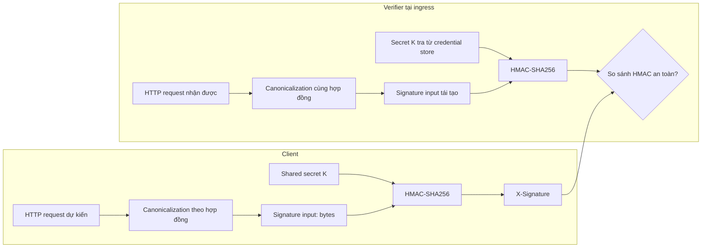
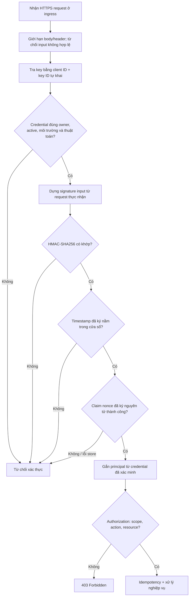

# Signature input

## 1. Signature input là gì?

Trong cơ chế **xác thực HTTP request bằng HMAC**, *signature input* là **chuỗi byte chính xác** mà client đưa vào thuật toán HMAC để tạo chữ ký và server tái tạo để xác minh. Một request HTTP có nhiều thành phần — phương thức, URI, query, header, body — nhưng chúng chỉ được bảo vệ nếu **hợp đồng ký** đưa chúng vào signature input theo cách nhất quán.

Với module `SECURITY_AUTHENTICATION_HMAC_REQUEST_AUTHENTICATION`, client và server giữ một shared secret. Mô hình tính chữ ký là:

```text
canonicalBytes = UTF8(canonicalRequest(request))
signatureBytes = HMAC_SHA256(sharedSecret, canonicalBytes)
signatureHeader = BASE64URL_NO_PADDING(signatureBytes)
```

Khi nhận request, server **không tin** giá trị signature input do client tự khai; server lấy HTTP request thực nhận tại ranh giới xác minh, dựng lại `canonicalBytes` theo cùng hợp đồng, tra đúng secret của client/key ID và tính lại HMAC.

Bài này tập trung vào câu hỏi **“Chính xác những byte nào được ký?”**. Đây là yếu tố quyết định cả tính toàn vẹn lẫn tính tương thích giữa client, gateway và backend. Một thuật toán HMAC-SHA256 chuẩn vẫn có thể bảo vệ sai dữ liệu nếu signature input thiếu trường quan trọng hoặc hai phía hiểu trường đó khác nhau.

Sau bài học, bạn sẽ biết:

- Phân biệt *HTTP request*, *canonical request*, *signature input*, *signature output* và shared secret.
- Chọn và ràng buộc method, URI/query, authority, một số header, timestamp/nonce và body/hash body vào signature input.
- Đặc tả encoding, thứ tự, dấu xuống dòng và quy tắc canonicalization đủ chặt để hai bên tạo **cùng một byte array**.
- Triển khai tạo signature input bằng Java 17, tính HMAC và xác minh đúng byte.
- Kiểm thử proxy/gateway rewrite, header trùng, JSON formatting, replay, key rotation và phân biệt xác thực với phân quyền.

## 2. Tách bạch các khái niệm dễ nhầm

| Khái niệm | Nội dung | Có phải secret? |
| --- | --- | --- |
| **HTTP request thực tế** | Method, request target, headers, body và metadata kết nối | Không mặc định; body/header có thể chứa dữ liệu nhạy cảm |
| **Signature input** | Byte array được chọn và chuẩn hóa từ request theo hợp đồng ký | **Không phải shared secret**, nhưng có thể chứa dữ liệu nhạy cảm |
| **Canonical request** | Biểu diễn văn bản/cấu trúc xác định trước khi mã hóa thành bytes | Không, nhưng có thể chứa thông tin nghiệp vụ |
| **Shared secret** | Khóa bí mật dùng trong `HMAC_SHA256(key, input)` | **Có**; chỉ bên ký và verifier được giữ |
| **Signature/tag** | Byte output của HMAC; truyền qua header dạng Base64url trong ví dụ | Không phải secret; bản sao request có tag có thể bị replay nếu thiếu kiểm soát |
| **Key ID** | Định danh phiên bản key để tra credential ở server | Không; không thay thế secret |
| **Timestamp / nonce** | Thông tin freshness và một-lần-sử-dụng; phải nằm trong phần được ký | Không; cần kiểm tra thêm bằng chính sách server |

Hai chuỗi byte khác nhau dù cùng thể hiện một “giá trị” về mặt nghiệp vụ vẫn cho kết quả HMAC khác nhau. Ví dụ JSON `{"amount":250000}` và `{ "amount": 250000 }` được parser hiểu tương tự, nhưng **body bytes khác**. Tương tự, `/v1/orders?a=1&b=2` và `/v1/orders?b=2&a=1` có thể đi đến cùng logic nhưng phần query thô khác.

**Không phải lúc nào “request giống nhau về nghĩa” cũng là “signature input giống nhau”.** Đó là lý do phải định nghĩa rõ cách canonicalize hoặc nhất quán ký các byte thô.

### Sơ đồ luồng dữ liệu



Nếu `I1 != I2`, chữ ký sẽ thất bại ngay cả khi secret hai bên giống nhau. Nếu hai bên cùng bỏ qua một trường có ý nghĩa bảo mật, chữ ký có thể vẫn thành công **khi kẻ khác sửa riêng trường đó**.

## 3. Thiết kế hợp đồng Signature input v1

Bài này xây dựng một **hợp đồng minh họa riêng** tên `HTTP-HMAC-V1` cho endpoint chuyển khoản. Đây **không phải định dạng bắt buộc của HTTP hay chuẩn HMAC chung**. Trong hệ thống thực, client và server phải chốt hợp đồng tương đương thành tài liệu/API specification, có test vector và version rõ ràng.

Request dự kiến:

```http
POST /v1/transfers?currency=VND HTTP/1.1
Host: api.example.test
Content-Type: application/json
X-Client-Id: merchant-42
X-Key-Id: key-2026-11
X-Timestamp: <unix-epoch-seconds>
X-Nonce: <random-base64url-nonce>
X-Signature: <base64url-hmac-sha256>

{"transferId":"tr-101","amount":250000}
```

Giá trị trong dấu nhọn là **placeholder**; chúng phải được thay bằng giá trị thực khi tạo chữ ký. Quy tắc `HTTP-HMAC-V1` quy định chính xác 11 dòng theo thứ tự sau, nối bằng LF (ký tự byte `0A`), **không thêm LF cuối**:

| Dòng | Nguồn dữ liệu | Quy tắc của ví dụ |
| --- | --- | --- |
| 1 | **Domain/version** | Chuỗi cố định `HTTP-HMAC-V1`, phân biệt hợp đồng với dữ liệu khác dùng chung key |
| 2 | HTTP method | Chữ in hoa, ví dụ `POST`; phải phản ánh method thực nhận |
| 3 | URI path | **Raw path** tại điểm xác minh, ví dụ `/v1/transfers`; không có scheme/host/query |
| 4 | Query | **Raw query** (không có `?`), giữ nguyên thứ tự/percent-encoding; không có query thì dòng rỗng |
| 5 | Authority | `authority:<canonical-authority>`, ví dụ `authority:api.example.test` |
| 6 | Content-Type | `content-type:<canonical-content-type>`, ví dụ `content-type:application/json` |
| 7 | Client ID | `x-client-id:<value>` |
| 8 | Key ID | `x-key-id:<value>` |
| 9 | Timestamp | `x-timestamp:<unix-seconds>` |
| 10 | Nonce | `x-nonce:<unique-nonce>` |
| 11 | Body digest | `SHA256_HEX(exactBodyBytes)` bằng **64 ký tự hex lowercase** |

Trong cấu trúc này, dòng 1 là version, dòng 11 là body digest. Mọi ví dụ và mã dưới đây dùng đúng 11 dòng đó.

Một signature input của request ví dụ có dạng:

```text
HTTP-HMAC-V1
POST
/v1/transfers
currency=VND
authority:api.example.test
content-type:application/json
x-client-id:merchant-42
x-key-id:key-2026-11
x-timestamp:<unix-epoch-seconds>
x-nonce:<random-base64url-nonce>
<64-lowercase-hex-characters-of-SHA256(bodyBytes)>
```

Dòng cuối là **ký hiệu** cho digest, không phải hash thực; mẫu này không thể dùng để kiểm thử chữ ký trước khi thay placeholder.

### Quy định chi tiết cho các thành phần

**Version/domain separation.** Dòng `HTTP-HMAC-V1` tránh dùng cùng secret cho thông điệp của hai giao thức nhưng vô tình có cùng chuỗi bytes. Khi thay hợp đồng, ban hành version mới và test tương thích; không tự động thử nhiều biến thể khi xác minh thất bại.

**Method.** Dùng token HTTP như thực nhận, nhưng chỉ hỗ trợ method nằm trong tập endpoint cho phép và yêu cầu canonical uppercase. `POST` khác `GET`: nếu không ký method, người có bản sao signature có thể thử chuyển phương thức trong các hệ thống có xử lý khác nhau.

**Path và query.** Lấy từ request-target tại **ranh giới mà hai bên đã thống nhất**, chưa bị proxy rewrite theo ví dụ này. `/v1/transfers` và `/v1/transfers/` khác nhau; `%2F`, `%2f` và `/` cũng không được tự động coi giống nhau. Nếu hợp đồng muốn chuẩn hóa, phải định nghĩa thuật toán chuẩn hóa duy nhất và buộc cả router lẫn verifier dùng cùng cách hiểu.

**Authority.** Nếu hostname/port ảnh hưởng đến tenant, routing hoặc permission, ký authority sẽ ngăn thay đổi ngữ cảnh. Trong hợp đồng v1, authority phải do ingress lấy/kiểm tra từ request `Host`/HTTP authority, so với danh sách hostname hợp lệ và chuẩn hóa lowercase hostname theo chính sách. Hợp đồng phải quy định rõ cổng mặc định, IPv6 và IDNA; ví dụ chỉ dùng hostname ASCII với không có port. Không lấy `X-Forwarded-Host` do caller tự khai làm sự thật.

**Headers.** Tên header trong canonical text viết lowercase. Giá trị đã được parse theo quy tắc thống nhất; ví dụ chỉ chấp nhận một `Content-Type` thuộc tập được phép, bỏ whitespace đầu/cuối đã xác định trong hợp đồng, **từ chối** duplicate signed headers và ký tự CR/LF. Không nối/gộp nhiều giá trị tùy hứng.

**Body.** Thay vì chèn nguyên JSON vào canonical text, ký **SHA-256 hex của đúng byte body**. HMAC bảo vệ cả digest này. Body trống là `SHA256(empty byte array)`, **không phải dòng trống**. Với bản v1, chấp nhận `Content-Encoding: identity` hoặc không có content coding; không tự giải nén/chuyển charset/serialize lại JSON trước khi hash. Byte body được lấy sau khi loại HTTP *transfer framing* (ví dụ chunked), trước transform của ứng dụng.

**Timestamp và nonce.** Dùng thời gian Unix seconds dạng thập phân và nonce ngẫu nhiên theo quy tắc đã định nghĩa. Bắt buộc ký **chính xác chuỗi được kiểm tra**. Chỉ có hai giá trị trong signature input chưa chống replay: server cần kiểm tra cửa sổ thời gian và lưu nonce đã dùng bằng thao tác nguyên tử sau khi xác minh HMAC.

**Signature header.** `X-Signature` **không được tự đưa vào canonical text** vì tạo vòng phụ thuộc khi tính nó. Header này chở kết quả HMAC. `X-Key-Id` và `X-Client-Id` phải được ký để ràng buộc lựa chọn khóa với principal. Thuật toán cố định `HmacSHA256` thuộc policy server/phiên bản, không cho client tùy chọn thuật toán qua header tự khai.

## 4. Signature input thuộc byte-level contract

### 4.1. Quy tắc phân tách và mã hóa

Một hợp đồng ký rõ ràng phải trả lời được các câu hỏi cụ thể:

- Dùng `LF` (`\n`) hay `CRLF` (`\r\n`) để nối dòng? Trong ví dụ này dùng duy nhất **LF**.
- Có dòng trống khi query không tồn tại không? **Có**: vẫn giữ dòng query thứ tư.
- Có LF ở cuối không? **Không**. Một byte LF thừa làm HMAC thay đổi.
- Dùng encoding nào? **UTF-8**; text của ví dụ này giới hạn ASCII ở các trường ký để tránh Unicode normalization không mong muốn.
- Có lowercase chữ ký, header value hoặc URI không? Chỉ lowercase **tên header** và hostname theo hợp đồng; **không tự lowercase** path, query, value, body.
- Dùng hex của body digest theo case nào? **Lowercase** không có `0x`.
- Empty body khác absent body? Đối với body bytes trong ví dụ, cả hai là **mảng byte rỗng**; các điều kiện HTTP khác (Content-Type, Content-Length) phải được kiểm tra theo chính sách endpoint.

Ví dụ khác nhau một byte:

```text
A: "HTTP-HMAC-V1\nPOST\n/v1/transfers\ncurrency=VND\n..."
B: "HTTP-HMAC-V1\r\nPOST\r\n/v1/transfers\r\ncurrency=VND\r\n..."
C: "HTTP-HMAC-V1\nPOST\n/v1/transfers\ncurrency=VND\n...\n"
```

Dù quan sát văn bản có vẻ tương tự, A/B/C là các byte arrays khác nhau. Không có chuyện verifier “tự đoán” dấu xuống dòng khi chữ ký không khớp.

### 4.2. Phân biệt raw query với query đã parse

Giả sử query `amount=100&amount=200`. Một thư viện trả giá trị đầu tiên, thư viện khác trả giá trị cuối hoặc một mảng. Nếu verifier ký một cách hiểu nhưng business handler dùng cách hiểu khác, attacker có thể lợi dụng sai lệch.

Với `HTTP-HMAC-V1`, canonical input ký **raw query** tại ingress, nhưng route vẫn phải **từ chối các tham số trùng tên có thể làm thay đổi nghiệp vụ**, hoặc bảo đảm handler dùng đúng cách hiểu được quy định. Ký nguyên raw bytes không thay thế validation ngữ nghĩa.

Các cặp cần kiểm thử:

| Query/URI 1 | Query/URI 2 | Theo hợp đồng raw v1 |
| --- | --- | --- |
| `a=1&b=2` | `b=2&a=1` | Khác byte; khác signature input |
| `name=A%2FB` | `name=A/B` | Khác byte; không tự decode thành cùng chuỗi |
| `/orders` | `/orders/` | Khác path |
| `%2f` | `%2F` | Khác ký tự hex trong raw path/query |
| Query không có `?` | Dấu `?` nhưng query rỗng | Cùng dòng query rỗng trong **hợp đồng ví dụ**; nếu hệ thống cần phân biệt hai dạng phải bổ sung quy tắc |
| `amount=100&amount=200` | `amount=200` | Khác raw query; đồng thời phải kiểm soát parse duplicate |

### 4.3. Body hash bảo vệ điều gì?

```text
bodyBytes: UTF-8 bytes of {"transferId":"tr-101","amount":250000}
bodyDigest: SHA256_HEX(bodyBytes)
signatureInput: ... + LF + bodyDigest
tag: HMAC_SHA256(secret, UTF8(signatureInput))
```

Hash của body chỉ có tác dụng ràng buộc **tính toàn vẹn** khi giá trị digest ấy nằm trong dữ liệu đã được HMAC bảo vệ. **SHA-256 không mã hóa JSON**; nếu request đi qua HTTP không TLS hoặc log body, kẻ nghe lén vẫn có thể đọc nội dung. Vì vậy tiếp tục dùng HTTPS/TLS cho các hop cần bảo vệ bí mật và không ghi body nhạy cảm vào log.

Nếu hệ thống ký `SHA256(JSON đã parse rồi serialize lại)`, phải định nghĩa chính xác quy tắc canonical JSON trên **cả hai phía**. Với một API thông thường, ký exact body bytes và tránh reserialize qua middleware thường đơn giản, ít mơ hồ hơn.

## 5. Ví dụ Java 17: dựng signature input và tính HMAC

Mẫu sau chỉ thể hiện **lõi ký/xác minh** theo `HTTP-HMAC-V1`. Các field trong `SignedParts` phải được adapter HTTP lấy tại ranh giới tin cậy và kiểm tra kỹ trước khi gọi, đặc biệt là duplicate headers, raw target, Content-Type, authority và byte body. Code không tự thực hiện authorization hay nonce storage.

```java
import java.nio.charset.StandardCharsets;
import java.security.GeneralSecurityException;
import java.security.MessageDigest;
import java.util.Base64;
import java.util.HexFormat;
import javax.crypto.Mac;
import javax.crypto.spec.SecretKeySpec;

public final class SignatureInputV1 {
    private static final String ALGORITHM = "HmacSHA256";
    private static final String VERSION = "HTTP-HMAC-V1";

    public record SignedParts(
        String method, String rawPath, String rawQuery,
        String canonicalAuthority, String contentType,
        String clientId, String keyId, String timestamp,
        String nonce, byte[] bodyBytes
    ) {}

    private SignatureInputV1() {}

    // Chỉ kiểm tra một phần cú pháp tại đây.
    // HTTP adapter vẫn phải từ chối duplicate headers, path/query mơ hồ,
    // content coding chưa hỗ trợ và authority không được phép.
    private static String singleLine(String value) {
        if (value == null || value.indexOf('\r') >= 0
                || value.indexOf('\n') >= 0) {
            throw new IllegalArgumentException("Invalid signed field");
        }
        return value;
    }

    public static byte[] canonicalBytes(SignedParts p)
            throws GeneralSecurityException {
        if (p == null || p.bodyBytes() == null) {
            throw new IllegalArgumentException("Missing body bytes");
        }

        String rawQuery = p.rawQuery() == null ? "" : p.rawQuery();
        String digest = HexFormat.of().formatHex(
            MessageDigest.getInstance("SHA-256").digest(p.bodyBytes()));

        String canonical = String.join("\n",
            VERSION,
            singleLine(p.method()),
            singleLine(p.rawPath()),
            singleLine(rawQuery),
            "authority:" + singleLine(p.canonicalAuthority()),
            "content-type:" + singleLine(p.contentType()),
            "x-client-id:" + singleLine(p.clientId()),
            "x-key-id:" + singleLine(p.keyId()),
            "x-timestamp:" + singleLine(p.timestamp()),
            "x-nonce:" + singleLine(p.nonce()),
            digest
        );
        return canonical.getBytes(StandardCharsets.UTF_8);
    }

    public static byte[] hmac(byte[] secret, byte[] canonical)
            throws GeneralSecurityException {
        Mac mac = Mac.getInstance(ALGORITHM);
        mac.init(new SecretKeySpec(secret, ALGORITHM));
        return mac.doFinal(canonical);
    }

    public static String sign(SignedParts p, byte[] secret)
            throws GeneralSecurityException {
        return Base64.getUrlEncoder().withoutPadding()
            .encodeToString(hmac(secret, canonicalBytes(p)));
    }

    public static boolean verify(
            SignedParts p, byte[] secret, String suppliedSignature)
            throws GeneralSecurityException {
        // 32-byte HMAC-SHA256 => 43 Base64url chars không padding.
        if (suppliedSignature == null
                || !suppliedSignature.matches("[A-Za-z0-9_-]{43}")) {
            return false;
        }
        byte[] supplied;
        try {
            supplied = Base64.getUrlDecoder().decode(suppliedSignature);
        } catch (IllegalArgumentException ex) {
            return false;
        }
        if (supplied.length != 32) return false;

        // Bắt buộc biểu diễn Base64url canonical, không chấp nhận alias.
        String normalized = Base64.getUrlEncoder().withoutPadding()
                .encodeToString(supplied);
        if (!normalized.equals(suppliedSignature)) return false;

        byte[] expected = hmac(secret, canonicalBytes(p));
        return MessageDigest.isEqual(expected, supplied);
    }
}
```

**Lưu ý kỹ thuật quan trọng:**

1. `canonicalBytes` tạo một mảng bytes từ các trường đã có. `singleLine` chỉ chặn CR/LF và null; nó **chưa xác thực đầy đủ** syntax URI, HTTP method, hostname, Content-Type, encoding hoặc quy tắc giá trị header. Việc đó là trách nhiệm của adapter/protocol validator.
2. `canonicalAuthority` phải là giá trị đã được chuẩn hóa và kiểm tra theo hợp đồng tại ingress, **không phải** giá trị `X-Forwarded-Host` ngoài mạng tự đặt.
3. `rawQuery == null` được ánh xạ thành chuỗi rỗng theo hợp đồng. Dùng `UTF-8` tường minh, không phụ thuộc default charset JVM.
4. Byte body được hash **trước khi parser JSON thay đổi nội dung**. Nếu client gửi gzip hoặc multipart, cần phiên bản hợp đồng nêu rõ bộ dữ liệu nào được ký; bản v1 giới hạn content coding identity.
5. `Mac` giữ trạng thái, vì vậy mỗi phép tính tạo instance riêng. `MessageDigest.isEqual` dùng khi so sánh tag. Không dùng một `Mac` static chung cho request đồng thời.
6. `sign` và `verify` là ví dụ một protocol với HMAC-SHA256. Secret phải được sinh đủ mạnh, cấp riêng theo client/môi trường, lấy từ secret manager; không hardcode hay in secret.
7. `NoSuchAlgorithmException` (nếu không có provider MAC bắt buộc) hay `InvalidKeyException` là **lỗi hệ thống/credential**. Không được bỏ xác thực hoặc fallback sang thuật toán khác; nên kiểm tra tính khả dụng của HMAC ở startup và fail-closed khi lỗi.

### Sử dụng với giá trị mẫu

```java
import java.nio.charset.StandardCharsets;
import java.security.SecureRandom;

byte[] secret = new byte[32];
new SecureRandom().nextBytes(secret); // secret test, không in ra log

SignatureInputV1.SignedParts p = new SignatureInputV1.SignedParts(
    "POST",
    "/v1/transfers",
    "currency=VND",
    "api.example.test",
    "application/json",
    "merchant-42",
    "key-2026-11",
    "1790000000", // ví dụ thời điểm, không mặc định còn hiệu lực
    "q1V7rK4Z0pT8nC2y",
    "{\"transferId\":\"tr-101\",\"amount\":250000}"
        .getBytes(StandardCharsets.UTF_8)
);

String signature = SignatureInputV1.sign(p, secret);
boolean ok = SignatureInputV1.verify(p, secret, signature);
// ok == true; ví dụ này chưa kiểm tra timestamp/nonce freshness.
```

Ví dụ dùng `sign` của cùng class để tự kiểm chứng canonical bytes. Khi tích hợp giữa các ngôn ngữ/hệ thống, **không nên chỉ thử sign rồi verify bằng cùng một implementation**: cả hai có thể cùng mắc lỗi canonicalization. Cần có test vectors độc lập gồm exact input bytes, body digest, canonical bytes và expected tag.

## 6. Ranh giới giữa signature input và authentication

Việc tạo đúng signature input chỉ là **một bước** của cơ chế xác thực. Pipeline verifier nên như sau:



**Client ID và key ID:** ban đầu chỉ là dữ liệu đầu vào để tìm credential. Server phải lấy bản ghi có owner phù hợp, thuật toán cố định `HmacSHA256` và trạng thái còn hiệu lực; sau khi HMAC thành công mới tạo principal từ **bản ghi đã xác minh**. Không dùng header `X-Client-Id` làm danh tính mặc định trước authentication.

**Timestamp đã ký:** ví dụ server chấp nhận Unix seconds lệch trong khoảng ±300 giây, nhưng kiểm tra định dạng, timezone/epoch và giới hạn skew phải rõ. Attacker không biết secret không thể sửa timestamp mà giữ nguyên HMAC đúng.

**Nonce đã ký:** dùng nonce đủ ngẫu nhiên, duy nhất trong cửa sổ theo client. Sau khi HMAC hợp lệ, server thực hiện thao tác ghi nonce *chỉ nếu chưa tồn tại* trên kho chia sẻ có tính nguyên tử (ví dụ Redis `SET key value NX EX ttl`). TTL phải bao phủ toàn bộ thời gian request vẫn có thể được chấp nhận, gồm skew giữa các node. Không claim nonce trước HMAC vì kẻ không biết secret có thể chiếm nonce hợp lệ.

**Key bị lộ:** nếu attacker đã lấy được secret, họ có thể tạo **signature input, timestamp, nonce và HMAC mới**. Timestamp/nonce không cứu được credential đã lộ; cần thu hồi key ID tương ứng ở mọi verifier, cấp secret mới và rà soát giao dịch.

**Authorization:** request có chữ ký đúng từ `merchant-42` chưa chắc được chuyển tiền từ mọi tài khoản. Sau authentication, kiểm tra quyền theo principal, scope, resource, hạn mức và nghiệp vụ. Một lỗi xác thực thường trả `401`, còn client đã xác thực nhưng thiếu quyền thường nhận `403`. Signature input không thay thế authorization.

## 7. Proxy/gateway: khi byte ở hai phía không giống nhau

Proxy hoặc API gateway là nơi dễ xảy ra sai lệch signature input nhất. Xem ví dụ:

```text
Client ký:
POST /public/v1/transfers?currency=VND

Gateway rewrite:
POST /v1/transfers?currency=VND

Service dựng signature input theo rawPath:
  /v1/transfers
```

Nếu client đưa `/public/v1/transfers` vào signature input nhưng service ký `/v1/transfers`, HMAC thất bại **dù cùng secret và cùng body**. Cần xác định một trong hai phương án:

- **Xác minh tại ingress trước rewrite:** gateway nhận đúng request ngoài, dựng signature input, xác minh HMAC + timestamp/nonce rồi chuyển verified principal xuống service. Service phải tin principal thông qua kênh nội bộ có xác thực nguồn, ví dụ mTLS/assertion được ký; gateway xóa mọi header principal do client bên ngoài tự gửi.
- **Xác minh tại service:** proxy phải bảo toàn đúng dữ liệu raw cần ký hoặc chuyển một representation đã xác thực, không thể bị caller giả mạo. Service phải dùng đúng hợp đồng đã công bố; không tin `X-Original-URI`/`X-Forwarded-*` do client tùy ý đặt.

Nếu cả gateway và service cùng xác minh và **cùng claim một nonce**, request hợp lệ có thể bị coi là replay ở tầng thứ hai. Phải chỉ định tầng duy nhất sở hữu replay store hoặc thiết kế hai lớp xác thực khác nhau với giao thức/challenge riêng.

### Các dạng biến đổi phải thử

| Biến đổi ở proxy, framework hoặc client | Hậu quả với signature input | Cách kiểm soát |
| --- | --- | --- |
| Thêm/bỏ path prefix | Raw path khác | Verify trước rewrite hoặc truyền raw target đáng tin cậy |
| Reorder query | Raw query khác | Hợp đồng quy định giữ thứ tự; kiểm thử client/gateway |
| Decode/encode `%2F`, `%20` hoặc Unicode | Byte URI khác; router có thể hiểu khác | Từ chối URI mơ hồ, thống nhất canonicalization và routing |
| Gộp duplicate header | Một phía dùng giá trị đầu, bên khác giá trị cuối | Từ chối signed headers lặp và input không rõ |
| Đổi host/port | Authority khác, có thể đổi tenant hoặc route | Chuẩn hóa authority tại ingress, kiểm soát Host và forwarded headers |
| Thêm `Content-Type` mặc định | Dòng signed header khác | Client phải gửi đúng giá trị đã ký; adapter không tự thêm trước verify |
| Re-serialize JSON | Body SHA-256 khác | Ký exact body bytes và verify trước biến đổi |
| Tự giải nén gzip | Hash body khác | Chốt representation/content coding; v1 chỉ identity |
| Chuyển HTTP/1.1 sang HTTP/2 | Request line / header casing biểu diễn khác | Ký các thành phần **ngữ nghĩa đã chuẩn hóa theo hợp đồng**, không ký nguyên text protocol framing |
| Dùng server URL helper tạo lại URI | Có thể decode/encode lại query/path | Lấy đúng raw target tại điểm xác minh, viết test cross-language |

**HTTPS/TLS bảo vệ đường truyền**, còn HMAC bảo vệ những byte signature input bao phủ. HMAC không mã hóa payload hoặc ngăn request đã ký bị thu thập từ log trong môi trường sau TLS; cần quản trị quyền xem log và dữ liệu nhạy cảm.

## 8. Thiết kế test vector và kiểm thử liên thông

Một bộ test vector chất lượng nên chứa:

```yaml
contractVersion: HTTP-HMAC-V1
algorithm: HmacSHA256
request:
  method: POST
  rawPath: /v1/transfers
  rawQuery: currency=VND
  authority: api.example.test
  contentType: application/json
  clientId: merchant-42
  keyId: key-2026-11
  timestamp: "1790000000"
  nonce: q1V7rK4Z0pT8nC2y
  bodyUtf8: '{"transferId":"tr-101","amount":250000}'
expected:
  bodySha256Hex: <compute-and-freeze-64-hex>
  canonicalUtf8BytesHex: <compute-and-freeze-exact-bytes>
  signatureBase64Url: <compute-and-freeze-with-test-secret>
```

Đây là **khung dữ liệu cho bài thực hành**, không chứa expected digest/tag tính sẵn và không phải vector kiểm thử hoàn chỉnh. Khi tạo bộ vector thật, dùng **secret test cố định chỉ trong test**, sinh expected bằng implementation độc lập, lưu raw bytes ở dạng hex, rồi “freeze” để tránh hai phía cùng tái tạo một lỗi.

Bộ vector tối thiểu phải bao gồm trường hợp signature hợp lệ, body khác một byte, method khác, raw URI/query khác, header khác, body rỗng, timestamp cũ, nonce lặp và request qua gateway.

### Ma trận kiểm thử

| Test | Thay đổi so với request hợp lệ | Kỳ vọng |
| --- | --- | --- |
| T1. Baseline | Method/path/query/headers/body, secret khớp | HMAC hợp lệ và vượt authn nếu timestamp/nonce/key hợp lệ |
| T2. Method | `POST` thành `PUT`, giữ signature | HMAC không khớp |
| T3. Path | `/v1/transfers` thành `/v1/transfers/` | HMAC không khớp |
| T4. Query | `currency=VND` thành `currency=USD` | HMAC không khớp |
| T5. Reorder query | `a=1&b=2` thành `b=2&a=1` | Input khác theo raw-query contract |
| T6. Authority | Host/port hợp lệ khác nhưng giữ signature | HMAC không khớp hoặc bị từ chối bởi host policy |
| T7. Header value | `Content-Type` bị thay đổi | HMAC không khớp |
| T8. Duplicate header | Hai `X-Client-Id` hoặc hai `X-Nonce` | Từ chối request mơ hồ trước khi tạo principal |
| T9. Body whitespace | Thêm một space vào JSON | Body digest/HMAC thay đổi |
| T10. Body rỗng | Xác minh hash của byte array rỗng | HMAC khớp nếu hai phía dùng SHA-256(empty) |
| T11. JSON reserialize | Gateway đổi thứ tự field/whitespace | Verify thất bại nếu verify sau transform; sửa vị trí verify |
| T12. Percent encoding | `%2F` và `/` trong raw path/query | Dữ liệu ký khác; router/verifier phải thống nhất |
| T13. LF và CRLF | Dùng dấu xuống dòng canonical khác | HMAC không khớp |
| T14. Timestamp | Dùng timestamp cũ với HMAC được tính đúng | Chữ ký hợp lệ về toán học, nhưng từ chối vì freshness |
| T15. Nonce replay | Gửi lại y nguyên request hợp lệ | HMAC vẫn khớp, nhưng nonce bị từ chối sau lần đầu |
| T16. Key ID | Đổi key ID nhưng giữ signature cũ | HMAC không khớp hoặc credential bị từ chối |
| T17. Key revoked | Dùng secret/key ID đã bị thu hồi | Từ chối ngay dù HMAC đúng |
| T18. Client ID khác | Ký bằng secret của `merchant-42` nhưng khai `merchant-73` | Không xác thực thành client khác |
| T19. Gateway rewrite | Client ký path ngoài; backend dựng path sau rewrite | Phát hiện khác biệt, chọn đúng boundary verify |
| T20. Parallel replay | Hai request cùng nonce qua hai instance | Tối đa một claim nonce thành công |
| T21. Authorization | Signature đúng nhưng client không có quyền chuyển từ tài khoản nguồn | Qua authn nhưng trả `403` |
| T22. Signature encoding | Padding/alias Base64url không theo hợp đồng | Từ chối định dạng signature, không mở cơ chế fallback |

### Ba tình huống suy luận

**Tình huống A — “HMAC đúng, amount vẫn bị sửa”.** API ký method, path, timestamp nhưng bỏ query, body. Endpoint nhận query `amount` và chuyển tiền tương ứng. Kẻ tấn công chặn request và thay `amount=100` thành `amount=900`, giữ signature.

**Phân tích:** HMAC vẫn có thể hợp lệ vì **amount nằm ngoài signature input**. Cần ràng buộc mọi trường có ý nghĩa nghiệp vụ/bảo mật (query/body) theo hợp đồng; bổ sung authorization và hạn mức.

**Tình huống B — “Cùng JSON, chữ ký khác”.** Java client ký `{"a":1,"b":2}`; backend parse rồi serialize ra `{"b":2,"a":1}` trước khi hash body.

**Phân tích:** Hai JSON có thể tương đương về đối tượng nhưng khác byte. Hợp đồng v1 ký exact body bytes, vì vậy backend phải hash **body bytes ban đầu**. Nếu muốn ký JSON theo nghĩa, hai bên phải chọn cùng chuẩn canonical JSON rõ ràng và kiểm thử.

**Tình huống C — “Có timestamp và nonce rồi thì đủ?”.** Server đưa timestamp/nonce vào signature input và Verify HMAC đúng, nhưng không lưu nonce; một request đã ký bị lấy lại từ log và gửi lần nữa trong cửa sổ thời gian.

**Phân tích:** HMAC vẫn hợp lệ; timestamp chỉ giới hạn thời hạn. Cần **claim nonce nguyên tử** theo client trên kho dùng chung, TTL bao phủ cửa sổ hiệu lực, và idempotency ở nghiệp vụ. Nếu secret bị lộ, attacker có thể ký request mới; lúc đó phải thu hồi key.

## 9. Checklist chốt hợp đồng ký

- [ ] Có version/domain separation rõ ràng, quy định cách dựng canonical input và nơi verifier lấy raw HTTP data.
- [ ] Method, path, query, authority khi liên quan routing/tenant, selected headers, client ID, key ID, timestamp, nonce và body digest đều được ràng buộc theo hợp đồng.
- [ ] Có quy tắc byte-level cho thứ tự dòng, LF/CRLF, UTF-8, lowercase/uppercase, khoảng trắng, query rỗng, content coding và body rỗng.
- [ ] Từ chối duplicate signed headers, percent encoding/query mơ hồ và input có CR/LF gây header/canonical injection.
- [ ] Xác minh trên **request thực nhận**, không tin canonical string hay “verified principal” do client tự khai.
- [ ] Server tra secret theo client ID + key ID trong kho tin cậy, kiểm tra algorithm, key state, môi trường, rotation/revocation trước khi gắn principal.
- [ ] Có TLS, kiểm tra timestamp đã ký và claim nonce nguyên tử sau HMAC hợp lệ; dùng idempotency nghiệp vụ.
- [ ] Xác minh trước gateway rewrite hoặc truyền representation đáng tin cho backend, không tin `X-Forwarded-*` ngoài mạng.
- [ ] Bài test có expected canonical bytes **cố định và độc lập** giữa client/server, có vector cả tích cực và tiêu cực.
- [ ] Sau xác thực HMAC, luôn kiểm tra quyền theo principal, action và resource; không log shared secret hoặc dữ liệu nhạy cảm.

**Điểm cốt lõi:** Độ an toàn của HMAC request authentication phụ thuộc vào **cả secret lẫn signature input**. Hợp đồng ký phải chỉ rõ **chính xác những byte nào** biểu diễn method, URI, headers, body và metadata freshness. Client và server phải tạo cùng chuỗi bytes, còn gateway/backend phải giữ cùng cách hiểu request; timestamp/nonce, key rotation và authorization bổ sung các lớp bảo vệ mà HMAC một mình không cung cấp.

