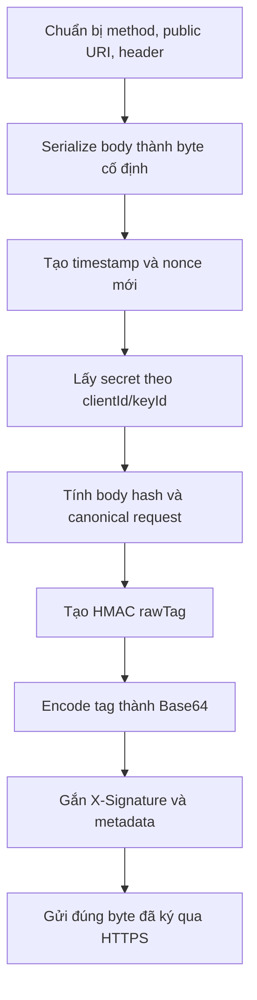
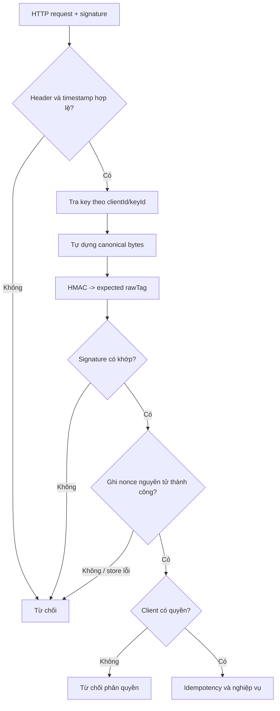

# Signature output

## 1. Signature output là gì trong xác thực HTTP request bằng HMAC?

Trong cơ chế **HMAC request authentication**, client không gửi shared secret trên từng HTTP request. Thay vào đó, client tạo một **canonical request** theo hợp đồng ký, dùng shared secret để tính HMAC rồi gửi **signature output** — kết quả tính chữ ký — kèm các thông tin giúp server chọn khóa và xác minh request.

Bài này thuộc chương **Request signature** của mô-đun **`SECURITY_AUTHENTICATION_HMAC_REQUEST_AUTHENTICATION`**. Toàn bộ hệ thống hướng tới xác thực HTTP request bằng HMAC với shared secret, bao gồm method, URI, header hoặc body theo hợp đồng; đồng thời chống replay bằng timestamp/nonce, quản lý key rotation, kiểm thử proxy/gateway và phân biệt xác thực với phân quyền.

**Signature output** ở đây là giá trị MAC được tạo từ thông điệp đã chuẩn hóa; thường nó được mã hóa thành một chuỗi ASCII để truyền trong HTTP header. Ví dụ:

```http
POST /v1/payments?merchantId=m-42 HTTP/1.1
Host: api.example.test
Content-Type: application/json
X-Client-Id: client-42
X-Key-Id: key-2026-11
X-Timestamp: 1795856400
X-Nonce: B4WleKXhN9rPAB9I6mNJKw
X-Signature: <base64-hmac-sha256>

{"orderId":"O-42","amount":250000,"currency":"VND"}
```

Chuỗi trong dấu `<...>` là **placeholder**, không phải một chữ ký có thể kiểm tra được. Giá trị timestamp là dữ liệu minh họa; một request thực tế phải dùng timestamp được sinh tại thời điểm ký.

Mỗi thành phần có trách nhiệm khác nhau:

| Thành phần | Vai trò |
| --- | --- |
| `X-Client-Id` | Nhận diện client để server tìm cấu hình ký; bản thân giá trị header chưa chứng minh danh tính |
| `X-Key-Id` | Chỉ phiên bản secret mà client dùng; giúp rotation |
| `X-Timestamp` | Thời điểm ký; hỗ trợ giới hạn thời gian request còn hiệu lực |
| `X-Nonce` | Giá trị mới cho lần ký; server ghi nhận để phát hiện replay |
| `X-Signature` | Chuỗi biểu diễn HMAC tag, dùng để so sánh với kết quả server tự tính |
| Method, URI, header, body | Dữ liệu thực tế được xử lý; những phần ảnh hưởng đến ý nghĩa request phải được ràng buộc theo hợp đồng |

Một signature output hợp lệ chứng minh rằng người tạo ra nó **biết secret tương ứng** với danh tính/khóa đã xác định, và những byte được đưa vào HMAC chưa bị sửa đổi. Nó **không mã hóa dữ liệu**, **không tự ngăn replay** và **không tự cấp quyền thao tác**.

## 2. Phân biệt HMAC tag thô và chuỗi chữ ký gửi qua HTTP

JCA `javax.crypto.Mac` trả về `byte[]`. Với thuật toán `HmacSHA256`, kết quả đầy đủ là **32 byte (256 bit)**. Những byte đó không nhất thiết là ký tự có thể in, nên giao thức HTTP thường dùng một cách mã hóa ổn định:

```text
Canonical request (UTF-8 bytes)
            |
            v
 HMAC-SHA256(sharedSecret, bytes)
            |
            v
      rawTag: byte[32]
            |
       Base64 encode
            |
            v
 X-Signature: ASCII text
```

| Biểu diễn cho HMAC-SHA-256 đầy đủ | Kích thước | Ghi chú |
| --- | --- | --- |
| MAC thô | 32 byte | Giá trị đầu ra mật mã thực tế |
| Hex chữ thường | 64 ký tự ASCII | Mỗi byte được mã hóa thành hai ký tự hex |
| Base64 chuẩn có padding | 44 ký tự ASCII | Chứa dấu `=` cuối |
| Base64URL không padding | 43 ký tự ASCII | Dùng bảng ký tự khác; không tự động tương đương Base64 chuẩn |

Ví dụ **đơn vị độ dài**:

```text
raw tag:           32 bytes = 256 bits
hex(raw tag):      64 characters
Base64(raw tag):   44 characters, including one "=" padding character
Base64URL-no-pad:  43 characters
```

**Độ dài chuỗi không phải độ dài tag.** Cụm “signature dài 44” chỉ có nghĩa là 44 ký tự Base64 trong hợp đồng cụ thể; giá trị mật mã bên dưới là 32 byte.

### 2.1. Có được rút ngắn tag không?

Có thể có một phiên bản giao thức sử dụng **truncated HMAC tag**: ví dụ lấy **16 byte đầu của MAC thô** rồi mã hóa Base64 thành chuỗi 24 ký tự có `==` ở cuối. Nếu hợp đồng yêu cầu 16 byte thì server phải từ chối tag 8, 15, 17 hoặc 32 byte.

```text
fullTag = HMAC-SHA256(secret, canonicalBytes)  // 32 bytes
sentTag = first 16 bytes of fullTag            // 16 bytes
header  = Base64(sentTag)                      // 24 chars with "=="
```

**Truncate byte trước khi encode.** Không dùng `Base64(fullTag).substring(0,16)` hoặc cắt 16 ký tự hex để gọi đó là tag 16 byte. Truncate làm giảm độ dài bảo mật và cần được chọn dựa trên rủi ro, không để client tự đề xuất tag ngắn khi xác minh thất bại.

Trong bài này, ví dụ chính dùng **HMAC-SHA-256 đầy đủ 32 byte**, mã hóa **Base64 chuẩn có padding** để giữ một hợp đồng nhất quán.

## 3. Signature output được tạo từ những byte nào?

Signature không ký “đối tượng request” theo nghĩa trừu tượng. Nó được tính từ **dãy byte chính xác**. Hai bên phải đồng thuận cách biểu diễn thông điệp trước khi thực hiện HMAC, thường gọi là *canonicalization contract*.

Một hợp đồng minh họa tên `HMAC-SHA256-V1` quy định:

1. Dòng đầu là tên phiên bản `HMAC-SHA256-V1`.
2. Dòng thứ hai là HTTP method viết hoa, ví dụ `POST`.
3. Dòng thứ ba là **public URI path**, dùng biểu diễn raw đã thỏa thuận.
4. Dòng thứ tư là query string được biểu diễn theo quy tắc hợp đồng; ví dụ này sử dụng một query duy nhất đã được cố định.
5. Các dòng tiếp theo chứa `Content-Type`, `clientId`, `keyId`, Unix timestamp tính bằng **giây** và nonce theo thứ tự xác định.
6. Dòng cuối là **hex chữ thường của SHA-256 tính trên raw body bytes**.
7. Ghép các dòng bằng một byte line feed (`\n`), UTF-8, **không thêm line feed cuối**.

Với request minh họa phía trên, canonical request có dạng:

```text
HMAC-SHA256-V1
POST
/v1/payments
merchantId=m-42
content-type:application/json
client-id:client-42
key-id:key-2026-11
timestamp:1795856400
nonce:B4WleKXhN9rPAB9I6mNJKw
<body-sha256-lowercase-hex>
```

Đây là **mười dòng**. Phần trong dấu `<...>` phải được thay bằng digest thật trước khi ký. Một hợp đồng khác có thể canonicalize header khác đi, sắp xếp query hoặc ký byte body trực tiếp; không có quy tắc canonicalization HTTP mặc định chung cho mọi thiết kế HMAC.

**Đặc biệt với URI:** `/v1/payments?a=1&b=2` có thể khác chữ ký của `/v1/payments?b=2&a=1`. Tương tự, `%2F` có thể khác `/`, `+` có thể khác `%20` và tham số query lặp cần quy tắc rõ. Nếu gateway viết lại URI trước khi backend xác minh, client và backend có thể tính HMAC trên hai thông điệp khác nhau.

### 3.1. Body hash phải xuất phát từ byte body thật

Hai JSON có thể được parser diễn giải thành dữ liệu tương đương nhưng là hai dãy byte khác nhau:

```json
{"amount":250000,"currency":"VND"}
```

```json
{ "currency": "VND", "amount": 250000 }
```

Khi hợp đồng dùng `SHA-256(raw body bytes)`, khác biệt khoảng trắng, thứ tự trường và encoding sẽ làm body hash và signature output khác nhau. Sender nên **serialize đúng một lần**, giữ `byte[]` đó để tính digest và đưa chính `byte[]` ấy vào HTTP client. Server tự tính digest từ byte nó nhận theo ranh giới đã thỏa thuận; không tin một header hash do client cung cấp nếu chưa kiểm tra.

### 3.2. Timestamp và nonce có nằm trong chữ ký không?

**Có, nếu hệ thống dựa vào chúng để chống replay.** Nếu timestamp/nonce chỉ được thêm vào header sau khi tính MAC mà không xuất hiện trong canonical request, kẻ tấn công có thể sửa chúng trong bản sao mà không làm HMAC sai.

Khi timestamp và nonce được ký:

```text
same method, path, query, body, key
+ timestamp T1 + nonce N1 -> signature S1

same method, path, query, body, key
+ timestamp T2 + nonce N2 -> signature S2
```

`S1` và `S2` thông thường khác nhau. Nhưng điều đó chỉ giúp server **phát hiện** nonce cũ nếu server có bộ nhớ nonce đáng tin cậy; bản thân chuỗi signature output không biết request đã từng được xử lý hay chưa.

## 4. Đưa signature output vào HTTP request

Cách phổ biến là gắn chữ ký vào header, ví dụ `X-Signature`. Tên header chỉ mang tính minh họa và phải thống nhất giữa client và server. Có thể dùng một định dạng `Authorization` riêng nếu giao thức định nghĩa đầy đủ, nhưng không được nhầm cơ chế HMAC tự thiết kế với chuẩn HTTP Message Signatures hoặc Bearer authentication.

Quy trình bên gửi:



Các quy tắc cần nhớ:

- **Không gửi shared secret** trong header, URL, body hoặc log. Header chỉ chứa signature output và các tham số công khai cần xác minh.
- Chữ ký là bằng chứng cho request hiện tại, vì vậy **không ký xong rồi thay method, URI, Content-Type hoặc body**. Middleware nào được phép biến đổi các trường đã ký phải hoạt động trước điểm ký, hoặc phải có hợp đồng canonicalization phù hợp.
- **Không đưa chính `X-Signature` vào canonical string** nếu cách định nghĩa gây vòng lặp: cần chữ ký để ký chữ ký. Thay vào đó, phiên bản hợp đồng và các tham số chọn key/thuật toán phải được ràng buộc phù hợp.
- Phải quy định signature header **xuất hiện đúng một lần**, cách xử lý khoảng trắng và encoding. Không cho proxy hoặc web framework ghép hai chữ ký thành một giá trị không dự đoán được.
- Nên gửi signature trong **header**, tránh query string khi không có yêu cầu đặc thù, vì URL thường bị ghi vào access log, lịch sử truy cập, trace và cache. Một signature hợp lệ có thể bị phát lại trong cửa sổ còn hiệu lực nếu lọt vào log.
- HTTPS vẫn cần thiết để bảo vệ request trên đường truyền. HMAC không cung cấp bí mật nội dung.

## 5. Java 17+: tạo HMAC và signature output Base64

Ví dụ dưới đây minh họa rõ ranh giới giữa **MAC raw bytes** và **encoding của signature output**. Hàm nhận `canonicalRequestBytes` đã được tạo theo hợp đồng ký; nó không tự đoán cách sắp xếp URI hoặc header.

```java
import java.security.GeneralSecurityException;
import java.security.MessageDigest;
import java.util.Base64;
import java.util.HexFormat;
import java.util.Objects;
import javax.crypto.Mac;
import javax.crypto.spec.SecretKeySpec;

public final class RequestSignature {
    private static final String ALGORITHM = "HmacSHA256";
    private static final int TAG_BYTES = 32;
    private static final int BASE64_CHARS = 44;

    private RequestSignature() {}

    public static byte[] rawTag(byte[] secret, byte[] canonicalRequestBytes)
            throws GeneralSecurityException {
        Objects.requireNonNull(secret, "secret");
        Objects.requireNonNull(canonicalRequestBytes, "canonicalRequestBytes");
        if (secret.length == 0) {
            throw new IllegalArgumentException("Empty HMAC secret");
        }

        // Mac có trạng thái: mỗi lần gọi dùng một instance local.
        Mac mac = Mac.getInstance(ALGORITHM);
        mac.init(new SecretKeySpec(secret, ALGORITHM));
        return mac.doFinal(canonicalRequestBytes);
    }

    public static String signBase64(
            byte[] secret, byte[] canonicalRequestBytes)
            throws GeneralSecurityException {
        byte[] tag = rawTag(secret, canonicalRequestBytes);
        return Base64.getEncoder().encodeToString(tag);
    }

    public static boolean verifyBase64(byte[] secret,
                                       byte[] canonicalRequestBytes,
                                       String suppliedSignature)
            throws GeneralSecurityException {
        // Hợp đồng: HMAC-SHA-256 đầy đủ 32 byte, Base64 chuẩn.
        if (suppliedSignature == null
                || suppliedSignature.length() != BASE64_CHARS) {
            return false;
        }

        final byte[] suppliedTag;
        try {
            suppliedTag = Base64.getDecoder().decode(suppliedSignature);
        } catch (IllegalArgumentException invalidBase64) {
            return false;
        }

        if (suppliedTag.length != TAG_BYTES) {
            return false;
        }

        // Kiểm tra encoding chính tắc (cú pháp public).
        if (!Base64.getEncoder().encodeToString(suppliedTag)
                .equals(suppliedSignature)) {
            return false;
        }

        byte[] expectedTag = rawTag(secret, canonicalRequestBytes);
        return MessageDigest.isEqual(expectedTag, suppliedTag);
    }

    public static String sha256Hex(byte[] bodyBytes)
            throws GeneralSecurityException {
        Objects.requireNonNull(bodyBytes, "bodyBytes");
        byte[] digest =
                MessageDigest.getInstance("SHA-256").digest(bodyBytes);
        return HexFormat.of().formatHex(digest);
    }
}
```

Ví dụ ứng dụng sau dùng byte JSON thật và ghép canonical request bằng LF:

```java
import java.nio.charset.StandardCharsets;
import java.util.Base64;

// secretBytes: khóa đã lấy qua secret manager, đúng client/keyId.
byte[] bodyBytes = (
        "{\"orderId\":\"O-42\",\"amount\":250000,\"currency\":\"VND\"}"
).getBytes(StandardCharsets.UTF_8);

String bodyHash = RequestSignature.sha256Hex(bodyBytes);
String canonical = String.join("\n",
        "HMAC-SHA256-V1",
        "POST",
        "/v1/payments",
        "merchantId=m-42",
        "content-type:application/json",
        "client-id:client-42",
        "key-id:key-2026-11",
        "timestamp:1795856400",
        "nonce:B4WleKXhN9rPAB9I6mNJKw",
        bodyHash);

byte[] canonicalBytes = canonical.getBytes(StandardCharsets.UTF_8);
String xSignature = RequestSignature.signBase64(
        secretBytes, canonicalBytes);
boolean macMatches = RequestSignature.verifyBase64(
        secretBytes, canonicalBytes, xSignature);
```

Đây là **đoạn ví dụ**, không phải request sản xuất: `secretBytes` là biến do tầng quản lý secret cung cấp, còn timestamp/nonce đang cố định để người học dễ so sánh đầu ra. Trong tích hợp thật, phải lấy timestamp hiện tại, sinh nonce mới cho từng lần ký và gửi **chính bodyBytes** dùng để tạo body hash.

Chọn `Mac` local giúp tránh chia sẻ trạng thái giữa các thread. `MessageDigest.isEqual` được dùng để so sánh **byte tag**, hạn chế rò rỉ thời gian so với vòng lặp thoát sớm. Việc từ chối sớm đầu vào sai định dạng/độ dài dựa trên metadata công khai là phù hợp. Nếu hợp đồng dùng truncated tag 16 byte, phải định nghĩa verifier khác với độ dài cố định 16 byte và tạo output theo đúng phiên bản; không chấp nhận độ dài tùy ý do client gửi.

## 6. Kiểm tra signature output phía server

Server không được “giải mã Base64 rồi xem có đúng 32 byte không” là xong. Độ dài hợp lệ chỉ xác nhận **cú pháp**, chưa chứng minh gì về secret hay request.

Một luồng xác minh thực tế:

1. **Giới hạn và kiểm tra đầu vào:** method, kích thước request, số lượng signature header, mã hóa tag, định dạng timestamp và nonce. Từ chối header rỗng/trùng hoặc giá trị quá dài.
2. **Tra client/key ứng viên:** `clientId` và `keyId` lúc này chỉ là đầu vào chưa xác thực. Key resolver phải kiểm tra key thuộc client và nằm trong khoảng hiệu lực.
3. **Kiểm tra cửa sổ thời gian:** ví dụ server từ chối timestamp nằm ngoài ±300 giây. Kiểm tra kiểu dữ liệu, độ lệch đồng hồ và đơn vị giây/millisecond.
4. **Tự dựng canonical request:** sử dụng method, public URI, các header đã định nghĩa và body bytes **thực nhận**. Không chấp nhận body hash được khai báo mà không tự xác minh.
5. **Tính HMAC và so sánh:** tạo tag bằng secret ứng viên, dùng encoding/độ dài cố định của phiên bản hợp đồng rồi so sánh an toàn.
6. **Chống replay:** **chỉ sau khi chữ ký hợp lệ**, chấp nhận nonce bằng thao tác ghi nguyên tử *insert-if-absent*, theo principal, trong kho dùng chung với TTL bao trùm vòng đời timestamp.
7. **Phân quyền và xử lý nghiệp vụ:** kiểm tra principal có quyền với merchant/tài nguyên, rồi áp dụng idempotency và quy tắc nghiệp vụ.



**Phân biệt xác thực và phân quyền:** HMAC thành công chỉ thiết lập rằng request đến từ bên có secret tương ứng (trong giả định key được bảo vệ) và nội dung **đã ký** còn nguyên vẹn. Nó không cấp quyền tự động cho mọi endpoint hoặc merchant.

### 6.1. Vì sao không được chấp nhận “signature prefix”?

Một verifier không an toàn có thể viết:

```java
// SAI: ví dụ để nhận diện lỗi, không áp dụng trong hệ thống thật.
byte[] supplied = Base64.getDecoder().decode(signatureHeader);
byte[] expected = computeFullHmac(secret, canonicalBytes);
return MessageDigest.isEqual(
        java.util.Arrays.copyOf(expected, supplied.length),
        supplied);
```

Nếu `supplied.length == 0`, kết quả so sánh hai mảng rỗng có thể bằng nhau. Nếu chỉ 1 byte được chấp nhận, đối thủ có khoảng 1/256 xác suất đoán trúng mỗi lần thử. Server phải cố định độ dài tag độc lập với dữ liệu không tin cậy và **không cắt expected tag theo độ dài client gửi**.

### 6.2. Có cần so sánh trực tiếp hai chuỗi Base64?

Nên giải mã thành byte tag, kiểm tra độ dài/encoding cố định rồi so sánh byte. `String.equals` có thể dừng ngay khi có ký tự sai và không được thiết kế cho so sánh giá trị MAC bí mật theo thời gian ổn định. `MessageDigest.isEqual` là tiện ích phù hợp hơn cho trường hợp này.

## 7. Signature output, key rotation và phiên bản giao thức

Một client có thể có nhiều secret trong quá trình key rotation:

```text
client-42
  key-2026-01  (old, temporarily accepted)
  key-2026-11  (new, active)
```

Header `X-Key-Id` cho server xác định secret ứng viên. Header này **không phải secret** và không cần được giấu; nhưng phải được ràng buộc cùng danh tính client và phiên bản hợp đồng để không thể hoán đổi key ID ngoài dữ liệu ký mà giữ HMAC hợp lệ.

Khi xoay khóa, cùng canonical bytes nhưng secret khác sẽ cho signature output khác. Nếu client điền key ID mới song vẫn dùng secret cũ, verifier sẽ tính HMAC bằng khóa không trùng và từ chối.

Đối với **độ dài/encoding chữ ký**, nên gắn với phiên bản hợp đồng ký:

| Thuộc tính | Ví dụ V1 | Ví dụ V2 (giả định) |
| --- | --- | --- |
| Thuật toán | HMAC-SHA-256 | HMAC-SHA-256 |
| Kích thước tag | 32 byte | 16 byte được truncate có chủ đích |
| Encoding | Base64 chuẩn có padding | Base64 chuẩn có padding |
| Độ dài chuỗi | 44 ký tự | 24 ký tự |
| Chấp nhận trên server | Chỉ client/key được phép dùng V1 | Chỉ client/key được phép dùng V2 |

Không tự suy luận phiên bản chỉ bằng “chữ ký này dài bao nhiêu” rồi chọn cách kiểm tra yếu nhất có thể. Server phải có allowlist phiên bản còn hiệu lực và chính sách kiểm tra phiên bản đáng tin cậy. Khi một phiên bản cũ bị thu hồi, không fallback về phiên bản đó nếu xác minh phiên bản mới thất bại.

## 8. Retry, replay và signature output

Một request có signature output hợp lệ có thể bị **phát lại nguyên vẹn**. Đối thủ không cần đoán tag, vì tag cũ đã đúng. Vì vậy **tag dài 256 bit không thay thế kiểm tra timestamp/nonce**.

Ví dụ khách hàng tạo thanh toán, server xử lý nhưng response bị mất:

| Lần gửi | Timestamp/nonce | Signature | Idempotency key | Ý nghĩa |
| --- | --- | --- | --- | --- |
| Lần đầu | `T1/N1` | `S1` | `payment-O-42` | Request đầu có thể đã được xử lý |
| Gửi lại y nguyên | `T1/N1` | `S1` | `payment-O-42` | Server phải chặn **replay** nếu nonce đã dùng |
| Retry có ký mới | `T2/N2` | `S2` | `payment-O-42` | Anti-replay chấp nhận nonce mới; idempotency quyết định không tạo giao dịch trùng |

Sender nên tạo timestamp và nonce mới, tính signature output mới khi retry có chủ đích. **Idempotency key** phải được giữ cho cùng ý định nghiệp vụ và cần được bảo vệ theo hợp đồng ký; nếu header này ảnh hưởng đến cách server xử lý giao dịch thì không được để bên ngoài sửa tự do.

Server phải lưu nonce bằng thao tác nguyên tử trong kho đủ nhất quán giữa các API instance. TTL cần kéo dài tới khi timestamp tương ứng không còn được chấp nhận, kể cả trường hợp request được nhận sớm trong khoảng lệch đồng hồ. Khi replay store gặp lỗi, thao tác nhạy cảm không nên bỏ qua kiểm tra chống replay.

## 9. Signature output đi qua proxy/gateway

Gateway thường chuyển tiếp signature header nguyên vẹn, nhưng có thể biến đổi **dữ liệu đã ký** như đường dẫn, query, header hoặc body:

```text
Client ký:
  POST /api/v1/payments?merchantId=m-42
  X-Signature: Base64(HMAC(secret, canonicalPublicRequest))

Gateway chuyển tiếp:
  POST /internal/payments?merchantId=m-42
  X-Signature: [giữ nguyên giá trị trên]

Backend dựng canonical trên /internal/payments
  -> expected tag khác -> xác minh thất bại
```

Điều này thường không được sửa bằng “đổi độ dài signature” hoặc “cắt bớt Base64”, vì lỗi xảy ra **trước bước tạo HMAC**. Hệ thống cần có một trong các cách triển khai rõ ràng:

- **Xác minh tại gateway trước rewrite**, rồi chuyển principal đã xác thực vào backend qua kênh được bảo vệ, tránh tin header danh tính tự đặt từ Internet.
- **Xác minh tại backend** với canonical request được tái tạo từ các thành phần **public-original** đáng tin cậy và raw body theo hợp đồng; gateway phải bảo toàn các thông tin cần thiết.

Cần kiểm thử tình huống gateway chuẩn hóa percent-encoding, sắp xếp hoặc loại tham số query trùng, thay `Content-Type`, nén/giải nén body, đổi `Host` hoặc merge header cùng tên. Các thay đổi đó có thể khiến expected signature khác dù client gửi một chuỗi Base64 đúng cú pháp.

## 10. Những lỗi thường gặp với signature output

| Hiện tượng | Nguyên nhân điển hình | Cách chẩn đoán / xử lý |
| --- | --- | --- |
| Client báo chữ ký 44 ký tự nhưng server cần 64 | Client gửi Base64, server mong hex | Thống nhất encoding theo hợp đồng |
| Server mong tag 32 byte nhưng nhận 16 byte | Truncate không đồng bộ | Cố định độ dài tag theo phiên bản |
| Base64 mất dấu `=` cuối | Middleware bỏ padding hoặc dùng Base64URL | Chọn rõ Base64 chuẩn có padding hoặc Base64URL |
| Chữ ký có ký tự `-` hoặc `_` | Client dùng Base64URL | Chỉnh đúng encoding, không tự thử mọi decoder |
| Chữ ký có khoảng trắng, xuống dòng | Header bị định dạng sai hoặc gấp dòng | Từ chối input không hợp lệ; sửa SDK/proxy |
| Same JSON, signature khác | Raw body bytes không trùng | Kiểm tra serialization/charset/body hash |
| Raw URI trông giống nhau nhưng HMAC sai | Percent-encoding, query order hoặc path rewrite | So sánh canonical bytes giữa hai phía bằng test vector an toàn |
| Chữ ký đúng nhưng server báo hết hạn | Timestamp quá cũ/tương lai hoặc sai đơn vị | Đồng bộ đồng hồ, kiểm tra giây so với millisecond |
| Chữ ký đúng nhưng server báo replay | Dùng lại nonce hoặc HTTP client tự retry nguyên request | Sinh nonce/chữ ký mới theo chính sách |
| Signature đúng nhưng bị HTTP 403 | Principal thiếu quyền theo merchant/scope | Kiểm tra phân quyền độc lập |
| Lỗi chỉ khi chuyển key | `keyId` không khớp secret hoặc khóa đã thu hồi | Đối chiếu phiên bản khóa, thời hạn hiệu lực |
| Chữ ký lúc đúng lúc sai khi tải lớn | Chia sẻ `Mac` stateful giữa các thread | Dùng một `Mac` local cho mỗi phép tính |
| Log lộ nguyên request + signature | Lưu header/body nhạy cảm | Che chữ ký, secret, body; giới hạn quyền log |

Khi chẩn đoán, có thể log **mã lỗi, request ID, client ID đã xác thực, phiên bản hợp đồng và fingerprint không nhạy cảm** theo chính sách bảo mật. Không log shared secret, toàn bộ canonical request nhạy cảm hoặc chữ ký nguyên vẹn trong production, vì chúng có thể giúp attacker replay.

## 11. Kiểm thử signature output bằng test vector độc lập

Một **test vector** tối thiểu nên có: thuật toán, secret thử nghiệm, danh sách trường request, byte canonical, SHA-256 body, MAC raw dạng hex và signature output mong đợi ở đúng encoding. Không dùng secret production trong fixture.

### 11.1. Vector HMAC-SHA-256 chuẩn để kiểm tra lớp MAC/encoding

Ví dụ với khóa thử nghiệm **20 byte có giá trị `0x0b`** và thông điệp ASCII `Hi There`:

```text
Key:     0b0b0b0b0b0b0b0b0b0b0b0b0b0b0b0b0b0b0b0b
Message: Hi There

Expected HMAC-SHA-256 (hex, 32 bytes):
b0344c61d8db38535ca8afceaf0bf12b
881dc200c9833da726e9376c2e32cff7
```

Giá trị expected là **32 byte MAC đầy đủ**, được tách hai dòng cho dễ đọc. Đoạn kiểm tra Java:

```java
import java.nio.charset.StandardCharsets;
import java.util.Arrays;
import java.util.Base64;
import java.util.HexFormat;

byte[] testKey = new byte[20];
Arrays.fill(testKey, (byte) 0x0b);

byte[] canonicalTest = "Hi There".getBytes(StandardCharsets.US_ASCII);
String expectedHex =
        "b0344c61d8db38535ca8afceaf0bf12b"
      + "881dc200c9833da726e9376c2e32cff7";

String actualBase64 =
        RequestSignature.signBase64(testKey, canonicalTest);
byte[] actualTag = Base64.getDecoder().decode(actualBase64);

if (!HexFormat.of().formatHex(actualTag).equals(expectedHex)) {
    throw new AssertionError("HMAC or output encoding is incorrect");
}
```

Bài test kiểm tra riêng việc tính HMAC và mã hóa Base64. Nó **không kiểm tra** rằng HTTP client/server đã xây dựng cùng canonical request; phần đó cần test vector với method, URI, header và raw body thực tế.

### 11.2. Ma trận kiểm thử từ client đến server

| Ca kiểm thử | Dữ liệu thử | Kết quả mong đợi |
| --- | --- | --- |
| Signature hợp lệ | Cùng secret, canonical bytes, tag 32 byte Base64 chuẩn | Server xác minh được |
| Một bit tag thay đổi | Lật một bit trong raw tag rồi encode lại | Bị từ chối |
| Dùng sai secret | Client ký bằng key A, server chọn key B | Bị từ chối |
| Tag sai kích thước | Base64 của tag 8, 16 hoặc 31 byte | Bị từ chối với hợp đồng 32 byte |
| Encoding khác | Base64URL không padding thay cho Base64 chuẩn | Bị từ chối theo hợp đồng |
| Signature header lặp | Gửi hai giá trị `X-Signature` | Bị từ chối hoặc xử lý theo quy tắc chặt chẽ đã công bố |
| Body đổi một byte | Đổi JSON/UTF-8 byte sau khi ký | Body hash/MAC sai |
| Method/URI/header đã ký đổi | Giữ tag cũ nhưng thay trường đã ký | HMAC sai |
| Query reorder/encoding | Đảo query hoặc đổi `%2F` thành `/` | Xử lý nhất quán theo hợp đồng raw/canonical |
| Timestamp ngoài cửa sổ | Dùng chữ ký đúng của request cũ | Bị từ chối |
| Replay nonce | Gửi nguyên request đã chấp nhận | Bị chặn bởi replay store |
| Retry hợp lệ | Nonce/timestamp/chữ ký mới và idempotency key cũ | Không tạo giao dịch trùng |
| Key rotation | Dùng key active, key cũ trong grace period và key đã thu hồi | Chỉ key còn hiệu lực được chấp nhận |
| Proxy rewrite | Truyền qua gateway đổi path/header/body | Verifier nhận đúng canonical target hoặc từ chối có thể giải thích |
| Có chữ ký nhưng thiếu quyền | Client hợp lệ gọi merchant không thuộc quyền | Tầng authorization từ chối |

Không chỉ kiểm thử `sign` rồi gọi `verify` bằng **cùng một implementation**: hai hàm có thể chia sẻ một lỗi canonicalization khiến test vẫn thành công. Nên so sánh với vector độc lập, thử nhiều ngôn ngữ triển khai và chạy xuyên qua gateway thật.

## 12. Bài tập thực hành: thiết kế signature output cho API thanh toán

Một API nhận request tạo thanh toán từ đối tác qua HTTPS. Hợp đồng ghi:

- HMAC-SHA-256 đầy đủ 32 byte.
- Canonical request gồm version, method, public URI, `Content-Type`, client ID, key ID, Unix timestamp, nonce và SHA-256 của raw body.
- Signature được gửi ở `X-Signature` bằng Base64 chuẩn có padding.
- Timestamp hợp lệ trong cửa sổ ±300 giây; nonce chỉ được sử dụng một lần.
- Hệ thống hỗ trợ hai key đang hoạt động trong giai đoạn rotation và định tuyến qua API gateway.

**Câu hỏi:**

1. `Mac.doFinal(...)` trả về 32 byte. Chuỗi `X-Signature` phải có bao nhiêu ký tự Base64? Nó có cần chứa secret không?
2. Nếu phía client cắt **32 ký tự đầu** của chuỗi hex HMAC và server vẫn kỳ vọng MAC 32 byte, chuyện gì xảy ra?
3. Nếu signature đã tạo nhưng HTTP client tự serialize JSON thêm một lần với spacing khác, server có chấp nhận không?
4. Nếu attacker thay `X-Timestamp` của một request cũ thành thời điểm mới mà không thể tính HMAC lại, vì sao chữ ký phải sai?
5. Request được xác thực nhưng bị gửi lại nguyên vẹn trong 30 giây. Signature output có tự phát hiện replay không? Server cần trạng thái gì?
6. Nếu gateway rewrite path, nên điều chỉnh điểm xác minh hoặc thông tin canonical như thế nào?
7. Trong rotation, khi header `X-Key-Id` nói khóa mới nhưng sender tính bằng secret cũ, server phải xử lý ra sao?
8. Khi HMAC và anti-replay đều hợp lệ nhưng đối tác không có quyền tạo thanh toán cho merchant chỉ định, hệ thống phải làm gì?

**Gợi ý trả lời:** (1) 44 ký tự Base64 chuẩn có một `=` cuối; không truyền secret. (2) 32 ký tự hex chỉ biểu diễn 16 byte, phải từ chối sai độ dài. (3) Không nếu byte body thay đổi. (4) Timestamp được ràng buộc vào canonical request. (5) Không; cần nonce store có thao tác nguyên tử với TTL đúng. (6) Xác minh trước rewrite hoặc bảo toàn public URI theo cơ chế tin cậy. (7) Từ chối chữ ký không khớp, sửa cặp key ID/secret. (8) Từ chối ở tầng phân quyền.

## 13. Những điều cần ghi nhớ

**Signature output là biểu diễn có thể truyền tải của MAC tag, không phải thuật toán bảo mật độc lập.** Thiết kế đúng cần xác định rõ:

1. **Dữ liệu được ký:** những byte của canonical request, bao gồm các trường HTTP quan trọng và timestamp/nonce.
2. **Giá trị mật mã:** HMAC bằng đúng secret/`keyId`, với thuật toán và độ dài tag được cố định trong hợp đồng.
3. **Định dạng trên mạng:** Base64, Base64URL hoặc hex phải được quy định chính xác; kiểm tra đúng số byte sau giải mã.
4. **Trách nhiệm verifier:** tự dựng canonical bytes, tự tính HMAC, so sánh tag, chống replay rồi phân quyền.
5. **Vận hành xuyên hệ thống:** key rotation, gateway và HTTP client phải không làm lệch phương thức, URI, header hoặc body đã ký.

Khi nắm rõ những tầng này, người học có thể giải thích vì sao hai chữ ký khác nhau, phân biệt lỗi encoding với lỗi HMAC/canonicalization, thiết kế sender–server tương thích và kiểm thử request signature trong môi trường có proxy/gateway.

