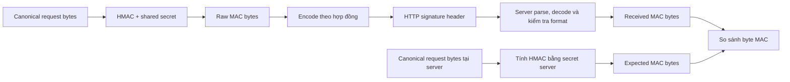
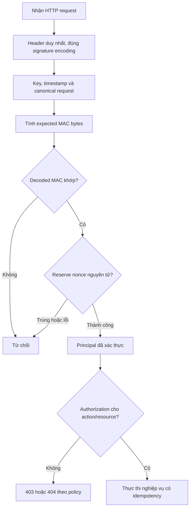

# Signature encoding trong xác thực HTTP request bằng HMAC

## 1. Vì sao cách biểu diễn chữ ký phải được quy định chính xác?

Trong module `SECURITY_AUTHENTICATION_HMAC_REQUEST_AUTHENTICATION`, client và server dùng **shared secret** để xác thực HTTP request. Client xây dựng **canonical request** từ những thành phần đã thỏa thuận (method, URI/query, các header cần bảo vệ và/hoặc hash của raw body), tính HMAC trên đúng **byte** của canonical request rồi gửi chữ ký kèm request. Server tái tạo cùng byte, tính HMAC với secret tương ứng, giải mã chữ ký nhận được và so sánh hai dãy byte.

Kết quả của HMAC **không phải văn bản**. Nó là một dãy byte có thể chứa `0x00`, `0xFF` hoặc byte không biểu diễn được bằng ký tự in được. HTTP header lại truyền giá trị dưới dạng chuỗi. Vì vậy cần bước **signature encoding** để chuyển byte HMAC thành biểu diễn văn bản được thống nhất giữa client, gateway và server.

Quy trình đúng:



**Ba vấn đề khác nhau** cần được giải quyết:

1. **Thông điệp nào được ký?** Canonicalization định nghĩa chính xác byte của method, raw URI/query, header/body theo hợp đồng.
2. **Thuật toán nào tạo MAC?** Chẳng hạn HMAC-SHA-256, quyết định bởi phiên bản protocol và metadata khóa ở phía server.
3. **MAC được truyền như thế nào?** Chẳng hạn Base64 chuẩn có padding, hex chữ thường hoặc Base64URL không padding.

Nếu hai bên nhất trí về secret và HMAC-SHA-256 nhưng một bên gửi hex, một bên giải mã Base64, xác thực sẽ thất bại. Nếu hai bên dùng Base64 đúng nhưng dựng canonical request khác nhau, xác thực cũng thất bại. Không nên “sửa” một lỗi bằng cách đoán nhiều encoding hoặc thay đổi quy tắc ký.

Sau bài học, bạn có thể chọn và ghi lại một hợp đồng signature encoding; triển khai encode/decode an toàn trong Java; xác minh độ dài và định dạng; kiểm thử qua proxy/gateway; hiểu mối quan hệ với timestamp/nonce, key rotation và phân quyền.

## 2. Raw MAC bytes, Base64, Base64URL và hex

### 2.1 Raw MAC là kết quả thật của thuật toán

Ví dụ dùng HMAC-SHA-256:

```text
rawBodyBytes   = byte thực sự gửi trên HTTP
bodyHash       = SHA256(rawBodyBytes)
canonicalBytes = UTF8(canonicalRequest)
macBytes       = HMAC_SHA256(sharedSecretBytes, canonicalBytes)  // 32 byte
signatureText  = Base64_Standard_WithPadding(macBytes)
```

**Không chuyển `macBytes` thành String bằng charset UTF-8** rồi gắn vào header: dãy byte bất kỳ có thể chứa byte không hợp lệ hoặc ký tự điều khiển. Việc gọi `new String(macBytes, UTF_8)` rồi chuyển lại byte có thể làm mất thông tin và phá chữ ký. Chỉ biến MAC thành text qua **encoder được hợp đồng công bố**.

Hàm `SHA256(rawBodyBytes)` dùng trong ví dụ là **body digest**, không phải chữ ký. HMAC là bước có secret trên `canonicalBytes`. Một hợp đồng khác có thể dùng SHA-512 cho body digest và HMAC-SHA-256 cho chữ ký; hai lựa chọn phải được mô tả riêng.

### 2.2 So sánh cách encoding

| Encoding | Bảng ký tự / đặc điểm | Lợi ích | Điều phải thống nhất |
| --- | --- | --- | --- |
| **Base64 chuẩn RFC 4648** | `A–Z a–z 0–9 + /`, dấu `=` padding | Chuỗi ngắn, phù hợp HTTP header | Có bắt buộc padding không; có cấm xuống dòng/space không |
| **Base64URL RFC 4648** | `A–Z a–z 0–9 - _`, có thể có hoặc bỏ padding | Dễ dùng trong cấu trúc yêu cầu URL-safe | Chính xác kiểu có/không padding; không trộn với Base64 chuẩn |
| **Hex chữ thường** | `0–9 a–f`, mỗi byte thành hai ký tự | Dễ nhìn khi debug và test vector | Phải chốt lowercase/uppercase, đúng độ dài, không có prefix `0x` |
| **Raw binary** | Byte tùy ý | Không cần bước mã hóa trong kênh truyền nhị phân | Không đặt trực tiếp trong header HTTP text |

Một ví dụ nhỏ về cùng một dãy byte `FB FF FF`:

```text
bytes (hex):          fbffff
Base64 chuẩn:         +///
Base64URL:            -___
Hex lowercase:        fbffff
```

`+///` và `-___` **chỉ là hai chuỗi biểu diễn cùng ba byte**; chúng không phải chữ ký HMAC thực tế. Base64URL thay `+` bằng `-`, `/` bằng `_`. Với dãy byte không có hai ký tự đặc biệt này, Base64 và Base64URL có thể trông giống hệt nhau; không thể “phát hiện encoding” chỉ từ chuỗi nếu biểu diễn trùng nhau. Vì vậy encoding là **hợp đồng**, không phải điều server đoán từ giá trị nhận được.

### 2.3 Độ dài chữ ký theo thuật toán

Với **tag đầy đủ**, một số độ dài thường gặp:

| Thuật toán HMAC | Raw tag | Base64 chuẩn **có padding** | Base64URL **không padding** | Hex |
| --- | ---: | ---: | ---: | ---: |
| HMAC-SHA-256 | 32 byte | **44 ký tự**, cuối `=` | 43 ký tự | 64 ký tự |
| HMAC-SHA-384 | 48 byte | **64 ký tự**, không cần `=` | 64 ký tự | 96 ký tự |
| HMAC-SHA-512 | 64 byte | **88 ký tự**, cuối `==` | 86 ký tự | 128 ký tự |

Công thức Base64 có padding là `4 × ceil(n / 3)` ký tự với `n` là số byte. Hex luôn có `2 × n` ký tự. Base64URL không padding bỏ một hoặc hai dấu `=` ở cuối nếu chúng xuất hiện trong kết quả Base64 tương ứng.

**Chiều dài tag phải đến từ thuật toán và chính sách server**, không đến từ chiều dài chuỗi do client tự gửi. Ví dụ hợp đồng yêu cầu HMAC-SHA-256 full tag thì server decode phải được **đúng 32 byte**. Không chấp nhận 16 byte đầu của tag hoặc chuỗi Base64 bất kỳ chỉ vì phép decode thành công.

**Truncated HMAC** là một biến thể hợp lệ khi được thiết kế rõ: hai bên phải thống nhất độ dài `t` bit và quy tắc lấy `t` bit bên trái của tag đầy đủ; giới hạn số lần thử giả mạo và chấp nhận rủi ro tương ứng. Bài này chọn **full tag** để tránh nhập nhằng.

## 3. Hợp đồng signature encoding mẫu cho một HTTP API

Giả sử giao thức `HMAC-REQUEST/V1` sử dụng HMAC-SHA-256, tag đầy đủ và header `X-HMAC-Signature`. Hợp đồng:

| Thuộc tính | Quy tắc trong ví dụ |
| --- | --- |
| Algorithm | `HmacSHA256` trong Java, tên giao thức `HMAC-SHA256`; server tra từ `keyId` đã đăng ký |
| Shared secret | Byte ngẫu nhiên được cấp qua kênh bảo mật, ví dụ **32 byte** |
| MAC đầu ra | **32 byte** |
| Signature transport | Header `X-HMAC-Signature` xuất hiện **chính xác một lần** |
| Signature encoding | **Base64 chuẩn RFC 4648 có padding**, **không** newline, space hay tab |
| Chiều dài signature text | **44 ký tự**, bắt buộc dạng canonical duy nhất |
| Canonical request | UTF-8, nối các dòng bằng `LF`, không thêm `LF` cuối |
| Thành phần được ký | Method, raw path/query, các header liệt kê rõ ràng và SHA-256(raw body) |
| Chống replay | Timestamp epoch seconds + nonce **nằm trong canonical request**, được server kiểm tra |
| Phân quyền | Xác thực key/principal xong vẫn phải kiểm tra endpoint, tenant và resource |

Request minh họa:

```http
POST /v1/merchants/m-42/payments?mode=online HTTP/1.1
Host: api.example.test
Content-Type: application/json
X-HMAC-Key-Id: merchant-42:v3
X-HMAC-Timestamp: 1795838400
X-HMAC-Nonce: 9fc41749ac56ccfd4589b032779f6aee
X-HMAC-Signature: <base64-cua-32-byte-mac>

{"amountMinor":250000,"currency":"VND"}
```

Canonical request **chưa chứa chữ ký**, có tám dòng:

```text
HMAC-REQUEST/V1
POST
/v1/merchants/m-42/payments?mode=online
content-type:application/json
x-hmac-key-id:merchant-42:v3
x-hmac-timestamp:1795838400
x-hmac-nonce:9fc41749ac56ccfd4589b032779f6aee
body-sha256:<lowercase-hex-sha256-raw-body>
```

Các giá trị trong dấu `<...>` chỉ là placeholder khi giải thích. Khi tính chữ ký, phải **thay body hash bằng hash thực tế** và **thay signature header bằng Base64 thực tế**. Dòng `X-HMAC-Signature` không được đưa vào canonical string này, bởi không thể dùng một chữ ký chưa được tính để tạo chính nó.

Các bước client:

```text
bodyDigestBytes  = SHA256(rawBodyBytes)
bodyDigestHex    = lowercase_hex(bodyDigestBytes)
canonicalText    = join_with_LF(eight_exact_lines)
canonicalBytes   = UTF8(canonicalText)
macBytes         = HMAC_SHA256(secretBytes, canonicalBytes)
signatureHeader  = Base64_Standard_Padded(macBytes)
```

Các bước server tương ứng:

```text
parseHeader(signatureHeader)            // một giá trị, đúng syntax/length
receivedMac = strictBase64Decode(...)    // đúng 32 byte
expectedMac = HMAC_SHA256(secretBytes, canonicalBytes_server)
matches     = constantTimeEqual(expectedMac, receivedMac)
```

Việc header có tên `X-HMAC-Signature`, `Authorization` hay `Signature` không phải yếu tố bảo mật chính; chính **hợp đồng parse, các byte ký và cách xác minh** mới quyết định tính đúng đắn. Nếu dùng `Authorization: HMAC ...`, phải định nghĩa rõ cú pháp, escaping và thứ tự thành phần trong giá trị header; không tự áp dụng cách parse của một auth scheme khác.

## 4. Strict decoding: cùng byte chỉ nên có một biểu diễn hợp lệ

### 4.1 Không tự động thử nhiều codec

Một server chấp nhận cả hex, Base64, Base64URL, có padding hoặc không padding **cho cùng một key và cùng version** sẽ khiến contract khó kiểm soát, mở thêm trường hợp nhập nhằng trong HTTP parser và làm khó điều tra lỗi. Server nên quyết định codec từ **metadata hợp đồng gắn với key/version**, sau đó chỉ giải mã theo đúng codec đó.

Ví dụ những giá trị sau phải **bị từ chối** với contract Base64 chuẩn có padding:

- Chữ ký có CR/LF, khoảng trắng ở đầu/cuối hoặc xuống dòng giữa chuỗi.
- Chữ ký Base64URL có ký tự `-` hoặc `_`.
- Bỏ dấu `=` padding ở cuối khi output chuẩn bắt buộc có padding.
- Chữ ký hex 64 ký tự thay vì Base64 chuẩn 44 ký tự.
- Chữ ký sau decode có ít hoặc nhiều hơn **32 byte**.
- Hai header `X-HMAC-Signature` (kể cả viết hoa/thường khác nhau), hoặc giá trị đã bị proxy gộp bằng dấu phẩy.

Trong một số thư viện, `Base64.getDecoder().decode(...)` **có thể chấp nhận input thiếu padding**. Vì vậy chỉ gọi decode thành công **chưa đủ** để xác nhận một chuỗi Base64 chuẩn theo hợp đồng. Cách chặt chẽ là **decode → kiểm tra byte length → encode lại theo codec chuẩn → so chuỗi encode với input**. Bước encode lại cũng giúp loại các biểu diễn khác nhau cùng decode về byte giống nhau (ví dụ padding hoặc các bit dư không chuẩn).

### 4.2 Không “trim hộ” chữ ký ngoài hợp đồng

Một header value có thể bị framework, gateway hay client SDK thêm whitespace. Nếu contract cấm whitespace trong signature, server nên từ chối thay vì cố `trim()` rồi so. Đối với **header được ký** (chẳng hạn `Content-Type`), có thể quy định trim khoảng trắng ASCII ở hai đầu *trước khi canonicalize*. Đó là **quy tắc khác** với xử lý header chứa chữ ký.

Có thể dùng `trim()` ở một vị trí duy nhất **nếu và chỉ nếu hợp đồng đã định nghĩa** hành vi đó và mọi triển khai dùng cùng quy tắc. Đừng để Java, Go, Node và proxy tự diễn giải khác nhau.

### 4.3 Khác biệt giữa decode đúng và xác minh đúng

Khi decode đúng, server mới biết `receivedMacBytes` là một dãy byte hợp lệ theo **định dạng**. Điều đó **không chứng minh chữ ký đúng**: phải tự tính `expectedMacBytes` bằng shared secret và canonical request.

Sau đó, server nên so sánh byte bằng primitive hạn chế rò rỉ thời gian như `MessageDigest.isEqual(expected, received)` trong Java. Tránh so từng byte bằng vòng lặp trả `false` ngay ở byte khác đầu tiên; tránh dùng `String.equals` để thay thế việc so MAC.

Phản hồi lỗi client nên thống nhất theo chính sách (ví dụ `401 Unauthorized` cho authentication thất bại), đồng thời lưu metric nội bộ riêng cho lỗi encoding, lỗi MAC, timestamp hoặc nonce. Không tiết lộ key nào tồn tại thông qua thông báo lỗi chi tiết.

## 5. Ví dụ Java 17+: ký, encode và xác minh chữ ký Base64

Đoạn dưới là **bộ xử lý signature encoding + HMAC-SHA-256 tự chứa**, không phụ thuộc framework. Server phải gọi nó với:

- `secretBytes` lấy từ kho key theo `keyId`; thuật toán/codec được ràng buộc server-side.
- `canonicalRequestBytes` đã được dựng đúng hợp đồng từ **raw HTTP data**.
- `signatureHeader` đã được HTTP adapter xác minh là **một giá trị** chưa bị gộp/trùng.

```java
import java.security.GeneralSecurityException;
import java.security.MessageDigest;
import java.util.Base64;
import java.util.Objects;
import javax.crypto.Mac;
import javax.crypto.spec.SecretKeySpec;

public final class HmacSignatureCodec {
    private static final String ALGORITHM = "HmacSHA256";
    private static final int FULL_TAG_BYTES = 32;
    private static final int PADDED_BASE64_CHARS = 44;

    private HmacSignatureCodec() {}

    public static byte[] computeHmac(
            byte[] secretBytes, byte[] canonicalRequestBytes) {
        Objects.requireNonNull(secretBytes, "secretBytes");
        Objects.requireNonNull(canonicalRequestBytes, "canonicalRequestBytes");

        try {
            Mac mac = Mac.getInstance(ALGORITHM);
            mac.init(new SecretKeySpec(secretBytes, ALGORITHM));
            return mac.doFinal(canonicalRequestBytes);
        } catch (GeneralSecurityException e) {
            throw new IllegalStateException("HMAC provider/key error", e);
        }
    }

    // Phía client hoặc fixture: HMAC raw bytes -> text cho HTTP header.
    public static String signBase64(
            byte[] secretBytes, byte[] canonicalRequestBytes) {
        byte[] tag = computeHmac(secretBytes, canonicalRequestBytes);
        return Base64.getEncoder().encodeToString(tag);
    }

    // Phía server: chỉ kiểm tra chữ ký, chưa kiểm tra timestamp/nonce.
    public static boolean verifyBase64(
            byte[] secretBytes,
            byte[] canonicalRequestBytes,
            String signatureHeader) {

        if (signatureHeader == null
                || signatureHeader.length() != PADDED_BASE64_CHARS) {
            return false;
        }

        final byte[] received;
        try {
            // Decoder chuẩn, không dùng MIME decoder bỏ qua whitespace.
            received = Base64.getDecoder().decode(signatureHeader);
        } catch (IllegalArgumentException ex) {
            return false;
        }

        // Full HMAC-SHA-256 tag bắt buộc 32 byte.
        if (received.length != FULL_TAG_BYTES) return false;

        // Ép đúng một biểu diễn Base64 chuẩn + padding.
        // String.equals ở đây chỉ kiểm tra format của dữ liệu công khai;
        // MAC bí mật được so bên dưới ở dạng byte.
        if (!Base64.getEncoder().encodeToString(received)
                .equals(signatureHeader)) {
            return false;
        }

        byte[] expected = computeHmac(
                secretBytes, canonicalRequestBytes);
        return MessageDigest.isEqual(expected, received);
    }
}
```

**Giải thích các điểm bảo mật:**

1. Thuật toán được **cố định ở phía server** trong ví dụ: client không gửi tên thuật toán để ép server tính SHA-1, SHA-512 hoặc thử fallback.
2. `PADDED_BASE64_CHARS = 44` và `FULL_TAG_BYTES = 32` là quy tắc cho **HMAC-SHA-256 full tag**. Nếu dùng HMAC-SHA-512, phải xây dựng codec/hợp đồng mới có raw tag **64 byte**, Base64 chuẩn **88 ký tự** và kiểm thử riêng.
3. Decode rồi re-encode loại chuỗi Base64 không đúng dạng canonical; sử dụng `Base64.getDecoder()` thay vì `Base64.getMimeDecoder()` để tránh các ký tự bị bỏ qua theo MIME.
4. `MessageDigest.isEqual` so sánh **byte tag**, không so string Base64. Kiểm tra kích thước và format trước khi so MAC là hợp lý; các phép thử có thể tiết lộ lỗi định dạng nhưng không tiết lộ byte HMAC bí mật.
5. Đoạn code **chưa** xác minh timestamp, nonce, trạng thái key, phân quyền, giới hạn kích thước request và body. Những việc đó thuộc lớp authentication HTTP đầy đủ.

### 5.1 Dựng canonical bytes và ký đúng thứ tự

Ví dụ minh họa cách tạo **body SHA-256 digest** dưới dạng hex rồi đưa vào canonical string. Các giá trị method/path/header phải được adapter lấy chính xác theo hợp đồng:

```java
import java.nio.charset.StandardCharsets;
import java.security.MessageDigest;
import java.util.HexFormat;

byte[] rawBody = "{\"amountMinor\":250000,\"currency\":\"VND\"}"
        .getBytes(StandardCharsets.UTF_8);

String bodyHex = HexFormat.of().formatHex(
        MessageDigest.getInstance("SHA-256").digest(rawBody));

String canonical = String.join("\n",
        "HMAC-REQUEST/V1",
        "POST",
        "/v1/merchants/m-42/payments?mode=online",
        "content-type:application/json",
        "x-hmac-key-id:merchant-42:v3",
        "x-hmac-timestamp:1795838400",
        "x-hmac-nonce:9fc41749ac56ccfd4589b032779f6aee",
        "body-sha256:" + bodyHex);

byte[] canonicalBytes = canonical.getBytes(StandardCharsets.UTF_8);

// secretBytes đã được cấp bởi secret manager hoặc fixture, không hardcode.
String headerValue = HmacSignatureCodec.signBase64(
        secretBytes, canonicalBytes);

boolean signatureMatches = HmacSignatureCodec.verifyBase64(
        secretBytes, canonicalBytes, headerValue);
```

Ở HTTP server thật, **không tự dùng lại canonical string do client gửi**. Server cần dựng lại từ request thực tế, lấy raw method/path/query/body và các header đã ký. Chữ ký tính trên *byte canonical*; không tính trực tiếp trên chuỗi Base64 của body digest trừ khi đó chính là định dạng body hash đã được quy định.

### 5.2 Test vector độc lập để nhận diện sai HMAC hay sai encoding

**RFC 4231 Test Case 1** cho HMAC-SHA-256, với `key` gồm 20 byte `0x0b` và data là ASCII `Hi There`:

```text
expected HMAC-SHA256 (hex):
b0344c61d8db38535ca8afceaf0bf12b881dc200c9833da726e9376c2e32cff7
```

Kiểm tra byte MAC **trước** khi kiểm tra cách encode:

```java
import java.nio.charset.StandardCharsets;
import java.security.MessageDigest;
import java.util.Arrays;
import java.util.Base64;
import java.util.HexFormat;

byte[] fixtureKey = new byte[20];
Arrays.fill(fixtureKey, (byte) 0x0b);
byte[] message = "Hi There".getBytes(StandardCharsets.US_ASCII);

byte[] expected = HexFormat.of().parseHex(
        "b0344c61d8db38535ca8afceaf0bf12b881dc200c9833da726e9376c2e32cff7");
byte[] actual = HmacSignatureCodec.computeHmac(fixtureKey, message);
if (!MessageDigest.isEqual(expected, actual)) {
    throw new AssertionError("HMAC primitive mismatch");
}

String encoded = Base64.getEncoder().encodeToString(actual);
if (encoded.length() != 44) {
    throw new AssertionError("Expected full-tag padded Base64");
}
if (!HmacSignatureCodec.verifyBase64(fixtureKey, message, encoded)) {
    throw new AssertionError("Signature encoding/verification mismatch");
}
```

Khóa 20 byte lặp trong RFC là **dữ liệu thử nghiệm**, không phải cách tạo secret production. Trong production nên sinh secret ngẫu nhiên bằng `SecureRandom` (ví dụ 32 byte cho HMAC-SHA-256), bảo vệ bằng secret manager và không in secret/signature đầy đủ ra log.

## 6. Những lỗi thực tế do encoding và HTTP transport

### 6.1 Dấu `+` thành dấu cách trong URL form

Trong **Base64 chuẩn**, `+` là một ký tự hợp lệ. Nhưng trong dữ liệu kiểu `application/x-www-form-urlencoded`, ký tự `+` trong tham số URL/form thường được diễn giải thành dấu cách nếu chưa percent-encode.

Ví dụ cùng ba byte:

```text
Base64 chuẩn: +///
Base64URL:    -___
```

Đưa chữ ký Base64 chuẩn thẳng vào query mà không escape dễ làm thay đổi ký tự. Vì thế **nên truyền signature qua HTTP header**, qua TLS. Nếu giao thức bắt buộc đặt trong query, cần định nghĩa **percent-encoding** đúng (và xử lý rủi ro URL bị log/cache/chia sẻ); không tự động coi Base64URL là tương đương Base64 chuẩn.

**Không đưa secret vào query, path hoặc header để client “chứng minh” khóa**. Chữ ký là kết quả HMAC, không phải bản sao shared secret. Dù MAC không tiết lộ key trực tiếp, việc ghi lại cả request, timestamp, nonce và chữ ký có thể tạo vật liệu replay trong cửa sổ hợp lệ.

### 6.2 HTTP header bị gộp hoặc biến đổi

HMAC signature là trường bảo mật nhạy cảm với cách parse. Các vấn đề thường gặp:

- Client gửi **hai header** `X-HMAC-Signature`, một hợp lệ và một giả. Gateway chọn giá trị đầu, backend chọn giá trị cuối; hai lớp có thể hiểu khác nhau.
- Reverse proxy gộp nhiều header thành danh sách ngăn bằng dấu phẩy, trong khi server chỉ kiểm tra chuỗi đầu.
- Một thư viện chèn newline mỗi 76 ký tự theo **MIME Base64**, nhưng hợp đồng header yêu cầu một dòng không whitespace.
- Header đã bị trim hoặc chuẩn hóa giá trị theo cách khác giữa client và server.
- API gateway đổi HTTP/2 sang HTTP/1.1; **tên** header có thể thành chữ thường, còn **giá trị** signature phải giữ đúng byte ASCII theo hợp đồng.
- Một bộ lọc WAF chặn hoặc rewrite dấu `/`, `+`, `=` trong giá trị header một cách bất thường.

Server phải kiểm tra **số lần xuất hiện và kiểu giá trị** trước khi tính HMAC. Không dựa vào `getHeader()` lấy “một chuỗi nào đó” nếu framework không cho biết header có trùng hay không. Khi điều tra, chỉ lưu độ dài, loại encoding, request ID và mã lỗi ở mức cần thiết; hạn chế ghi toàn bộ signature.

### 6.3 Base64 của body không đồng nghĩa Base64 của signature

Trong một số API, body có thể chứa payload `base64` hoặc file nhị phân; đó là **dữ liệu nghiệp vụ**. Hợp đồng vẫn phải xác định liệu HMAC bảo vệ **raw HTTP body bytes**, **body đã giải mã**, hay một cấu trúc canonical đã biết.

Ví dụ:

```text
Body HTTP thực tế: {"payload":"AQID"}
SHA256 để ký:      SHA256(UTF8(cả JSON nguyên bản))
HMAC signature:    Base64(HMAC_SHA256(secret, canonicalRequestBytes))
```

Nếu server decode `AQID` thành ba byte `01 02 03` rồi hash riêng các byte này thay cho JSON raw body, kết quả **không khớp** hợp đồng trên. Phải giải quyết sự khác biệt giữa *body data encoding* và *signature encoding* ngay trong đặc tả.

## 7. Signature encoding không thay thế chống replay và phân quyền

Giải mã chính xác signature và xác minh HMAC chỉ chứng minh người gửi biết secret tương ứng và những trường **đã ký** được giữ nguyên. Một request có HMAC đúng vẫn có thể bị gửi lại nguyên vẹn.

Ví dụ hợp đồng ký **`X-HMAC-Timestamp` và `X-HMAC-Nonce`**. Server cần:

1. Parse timestamp epoch **seconds** nghiêm ngặt, so với clock server đáng tin trong cửa sổ cho phép (ví dụ ±300 giây).
2. Tra key đang được phép verify, tái tạo canonical bytes, decode signature theo encoding của key/protocol, xác minh MAC.
3. Chỉ **sau khi MAC hợp lệ**, reserve nonce bằng thao tác nguyên tử kiểu `SET key 1 NX EX ttl` tại kho dùng chung giữa replica; nonce trùng → từ chối replay, kho lỗi → fail-closed.
4. Tạo principal nội bộ từ metadata key đã xác minh, rồi **authorization riêng** theo action, tenant, resource và business rule.

Với cửa sổ **±300 giây**, timestamp nằm ở biên tương lai có thể còn hợp lệ trong **tối đa 600 giây** kể từ lần chấp nhận sớm nhất. TTL nonce phải phủ toàn bộ khoảng đó, cộng sai số clock/độ trễ đã định. TTL 300 giây trong trường hợp này có thể hết sớm và cho phép replay khi timestamp vẫn hợp lệ.



**HMAC đúng không đồng nghĩa có quyền:** client `merchant-42` có thể tự ký một request hợp lệ nhắm vào tài nguyên `merchant-99` nếu biết secret của chính nó. Server phải từ chối nếu principal không được grant quyền truy cập. **Nonce cũng không phải idempotency**: hai request mới với nonce khác nhau nhưng cùng nội dung chuyển tiền có thể đều hợp lệ; nghiệp vụ cần idempotency key và cơ chế lưu kết quả thích hợp.

## 8. Key rotation và chuyển đổi signature encoding

Trong quá trình **key rotation**, server có thể tạm thời verify các phiên bản key cũ/mới, mỗi phiên bản có secret, trạng thái và chính sách riêng. Encoding không nhất thiết thay đổi khi rotate key.

Ví dụ:

| Key/version | Algorithm | Encoding của tag | Trạng thái |
| --- | --- | --- | --- |
| `merchant-42:v2` | HMAC-SHA-256 | Base64 chuẩn có padding | Verify-only đến mốc chuyển tiếp |
| `merchant-42:v3` | HMAC-SHA-256 | Base64 chuẩn có padding | Active |
| `merchant-99:v1` | HMAC-SHA-512 | Hex chữ thường theo hợp đồng khác | Active riêng |

Server không nên thử một chữ ký lần lượt bằng nhiều secret/algorithm/codec đến khi thấy khớp. **`keyId` chỉ ra một record metadata server-side** chứa algorithm và signature encoding được phép. Key ID cũng phải nằm trong canonical request nếu hợp đồng sử dụng nó. Nếu key cũ bị thu hồi, chữ ký đúng encoding vẫn phải bị từ chối.

Khi **thực sự đổi encoding**, ví dụ từ Base64 chuẩn sang Base64URL không padding:

1. Ban hành version hợp đồng mới, quy định chính xác bảng ký tự, padding, raw tag length và cách gửi header.
2. Chuẩn bị test vector đa ngôn ngữ cùng **các byte HMAC** và hai biểu diễn text mong đợi.
3. Cấp key ID/version mới hoặc cách định danh version tách bạch, cấu hình codec theo metadata server; tránh chấp nhận hai codec mơ hồ cho cùng request.
4. Client chuyển sang version mới; theo dõi mức sử dụng phiên bản cũ, lỗi decode và lỗi MAC.
5. Thu hồi version/codec cũ đúng lịch; bảo đảm policy ngăn downgrade vẫn được giữ.

Nếu muốn dùng nhiều algorithm qua nhiều phiên bản (SHA-256 và SHA-512), cũng phải ràng buộc **tag length**, canonical protocol version và secret phù hợp cho mỗi key. **Không chọn algorithm từ giá trị `X-HMAC-Algorithm` do client tự khai** rồi dùng trực tiếp `Mac.getInstance(...)`.

## 9. Ma trận kiểm thử signature encoding

Nên kiểm thử **chữ ký ở mức byte**, **biểu diễn trên HTTP** và **luồng xác thực đầy đủ**. Một bài test chỉ chứng minh encode/decode round-trip vẫn có thể bỏ sót lỗi HMAC/canonical request nếu cả hai phía mắc cùng một lỗi.

| Case | Đầu vào/tình huống | Kết quả kỳ vọng |
| --- | --- | --- |
| E01 | HMAC-SHA-256 test vector RFC 4231 Case 1. | Raw tag khớp chính xác 32 byte / hex chuẩn trước khi encode. |
| E02 | Full tag 32 byte, Base64 chuẩn có padding. | Text dài 44 ký tự; decode được đúng 32 byte và re-encode khớp. |
| E03 | Cùng raw tag biểu diễn thành hex thay vì Base64. | Từ chối nếu contract yêu cầu Base64. |
| E04 | Base64URL chứa ký tự `-`/`_` với contract Base64 chuẩn. | Từ chối khi cú pháp khác contract. |
| E05 | Bỏ padding `=` của chữ ký SHA-256. | Từ chối vì không phải Base64 chuẩn có padding. |
| E06 | Thêm space/tab, newline hoặc MIME line wrapping. | Từ chối trước khi so MAC. |
| E07 | Chuỗi Base64 không đúng canonical form nhưng decode ra cùng byte. | Bị phát hiện qua decode → encode lại → so chuỗi. |
| E08 | Chữ ký decode được nhưng chỉ có 16 byte. | Từ chối vì hợp đồng full tag HMAC-SHA-256 dài 32 byte. |
| E09 | Một byte MAC khác, nhưng độ dài và encoding đều hợp lệ. | Decode pass, **xác minh HMAC fail**. |
| E10 | Sai secret hoặc key đã bị revoke. | Authentication fail; không thử secret khác tùy tiện. |
| E11 | Hai header signature (khác hoa/thường) hoặc header bị gộp bằng dấu phẩy. | Từ chối vì nhập nhằng; không chọn giá trị đầu/cuối. |
| E12 | `+` và `/` của Base64 bị rewrite trong query/form. | Phát hiện thay đổi; khuyến nghị signature ở header, hoặc percent-encode đúng hợp đồng. |
| E13 | Proxy thay raw URI/query hoặc serialize lại JSON body. | MAC fail nếu những thành phần đó được ký. |
| E14 | Body UTF-8 tiếng Việt, body rỗng, body có byte `0x00`. | Client/server thống nhất raw body hash và signature encoding. |
| E15 | Key SHA-512 full tag Base64 chuẩn. | Raw MAC 64 byte, text 88 ký tự, padding đúng; không nhận tag SHA-256. |
| E16 | Key cũ Base64, key mới Base64URL theo protocol version. | Server chọn **đúng codec theo key/version**; không đoán codec từ input. |
| E17 | Timestamp quá hạn hoặc nonce đã dùng, MAC hợp lệ. | Không xử lý nghiệp vụ vì chống replay thất bại. |
| E18 | Gửi cùng signed request đồng thời tới hai replica. | Tối đa một request vượt atomic nonce reserve. |
| E19 | Nonce store mất kết nối dù MAC hợp lệ. | Fail-closed; không tạo side effect nghiệp vụ. |
| E20 | HMAC hợp lệ nhưng principal truy cập tenant khác. | Authentication pass, authorization từ chối (`403` hoặc `404` theo policy). |
| E21 | Hai request khác nonce nhưng cùng idempotency key. | Idempotency phía nghiệp vụ ngăn tác dụng phụ trùng. |
| E22 | Java/Go/Node hoặc Python ký cùng secret/canonical bytes. | MAC raw bytes và text Base64 phải khớp tuyệt đối theo test vector chung. |

Đối với integration test, đặt luồng **client → gateway → backend verifier → nonce store → authorizer** và quan sát các tình huống HTTP/1.1 ↔ HTTP/2, header trùng, query lặp, `%2F`, `+`, gzip và ký tự Unicode. Test vector cần chứa **raw byte**, không chỉ bản JSON hiển thị hay object đã parse. Dùng một `Clock` cố định trong test để không gây lỗi timestamp không ổn định.

### Quan sát vận hành

Có thể đo `invalid_signature_encoding`, `wrong_tag_length`, `signature_mismatch`, `unknown_key`, `timestamp_out_of_window`, `nonce_replay`, `gateway_canonical_mismatch` theo phạm vi key/tenant đã kiểm soát. Ghi correlation ID, key ID không nhạy cảm, encoding/version và lý do lỗi nội bộ ở mức cần thiết; **không log raw secret**, toàn bộ signature hoặc body nhạy cảm. Đối với các lỗi xác thực, tránh trả response chi tiết giúp dò secret/key version.

## 10. Bài tập tình huống

**Đề bài:** API quy định **HMAC-SHA-256 full tag, Base64 chuẩn có padding trong `X-HMAC-Signature`**. Một client gửi chữ ký 43 ký tự, bỏ `=` cuối vì SDK dùng Base64URL không padding; backend Java có lúc vẫn decode được. Một gateway khác lại chuyển dấu `+` trong signature đặt ở query thành dấu cách. Nhà phát triển định giải quyết bằng cách thử `Base64.getDecoder()`, `Base64.getUrlDecoder()` rồi thử cả SHA-512 nếu MAC chưa khớp.

**Phân tích và hướng sửa:**

1. Full HMAC-SHA-256 là **32 byte**, biểu diễn Base64 chuẩn có padding dài **44 ký tự** và kết thúc bằng một dấu `=`. Chuỗi 43 ký tự thiếu padding không phù hợp hợp đồng dù thư viện decode thành công.
2. Chuyển các client sang gửi **Base64 chuẩn có padding trong header**; kiểm tra duplicate header và decoder canonical. Nếu phải hỗ trợ Base64URL, cần **version hợp đồng rõ ràng**, không đoán từ mỗi request.
3. Khi signature nằm ở URL/form, dấu `+` có thể bị diễn giải thành space. Chuyển sang header, hoặc thiết kế percent-encoding rõ với các nguy cơ URL bị log.
4. Không fallback sang SHA-512: đó là thay đổi thuật toán MAC **không liên quan** đến lỗi encoding, đồng thời mở đường chính sách không nhất quán. Server phải xác định algorithm từ metadata `keyId`.
5. Dùng test vector chung kiểm tra lần lượt **raw HMAC bytes**, **encoded signature text**, **canonical bytes** trước và sau gateway. Chỉ sau khi MAC đúng mới đánh giá nonce rồi principal và authorization.

### Câu hỏi tự kiểm tra

1. Vì sao `new String(macBytes, UTF_8)` có thể làm hỏng chữ ký?
2. HMAC-SHA-512 full tag biểu diễn Base64 chuẩn có padding dài bao nhiêu ký tự? Hex dài bao nhiêu?
3. Base64 chuẩn khác Base64URL ở những ký tự nào? Tại sao không thể đoán chắc codec từ mọi chuỗi?
4. Vì sao phải decode, kiểm tra byte length rồi encode lại trước khi so MAC?
5. Vì sao **header chữ ký** không tự nằm trong canonical request ví dụ trên?
6. Đổi thứ tự query khi đi qua gateway là lỗi **canonicalization** hay lỗi **signature encoding**?
7. Vì sao cùng HMAC hợp lệ vẫn có thể bị từ chối do nonce trùng hoặc không đủ quyền tenant?
8. Khi key rotation và migration encoding xảy ra đồng thời, server nên chọn codec và algorithm bằng cách nào?
9. Tại sao `Base64.getMimeDecoder()` không phải lựa chọn phù hợp với hợp đồng cấm whitespace?
10. Có nên ghi nguyên signature/Base64 vào URL và log để debug? Những thông tin nào hữu ích hơn?

**Ghi nhớ:** **Signature encoding** là bước chuyển **raw HMAC bytes → chuỗi truyền trên HTTP → raw bytes**. Cần cố định codec, padding và độ dài tag theo **key/protocol version**, từ chối biểu diễn nhập nhằng, và so byte HMAC theo cách hạn chế rò rỉ thời gian. Đây chỉ là một mắt xích: muốn xác thực request an toàn còn phải chuẩn hóa đúng method/URI/header/body, kiểm tra **timestamp + nonce**, quản lý **key rotation** và thực thi **authorization độc lập** sau authentication.

