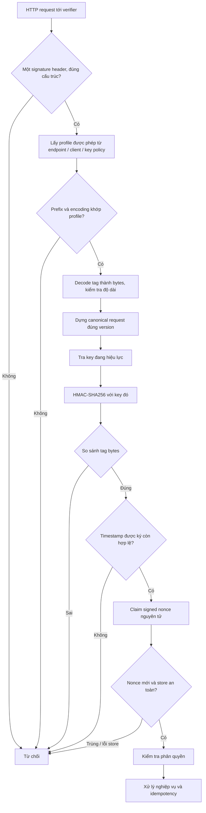

# Signature prefix

> **Chương:** Request signature  
> **Chủ đề:** Tiền tố (*prefix*) ở giá trị chữ ký HMAC của HTTP request: ý nghĩa, cách định dạng, cách kiểm tra, quản lý phiên bản và những lỗi an toàn thường gặp.  
> **Bối cảnh:** Xác thực HTTP request bằng shared secret và canonical request bao gồm phương thức, URI, header hoặc body theo hợp đồng ký. Bài học dùng Java 17, kết nối với timestamp/nonce chống replay, key rotation, kiểm thử proxy/gateway và phân biệt xác thực với phân quyền.

## 1. Signature prefix là gì?

Khi client gửi mã xác thực HMAC trong HTTP header, API thường không gửi trực tiếp dãy bytes nhị phân của MAC. Thay vào đó, client **mã hóa MAC** thành chuỗi (ví dụ hex hoặc Base64URL), rồi có thể đặt một **tiền tố** trước chuỗi đó để chỉ ra định dạng hoặc phiên bản của giao thức ký.

Ví dụ một hợp đồng minh họa:

```http
POST /v1/orders?mode=commit HTTP/1.1
Host: orders.example.test
Content-Type: application/json
X-Client-Id: partner-01
X-Key-Id: key-2026-11
X-Timestamp: 1795800000
X-Nonce: jGQxAvUBWtpDx4qxKJiZ4Q
X-Request-Signature: hmac-sha256-v1=<64-ky-tu-hex-chu-thuong>

{"orderId":"ORD-1024","amount":200000}
```

Trường `X-Request-Signature` được định nghĩa:

```text
signature-value = "hmac-sha256-v1=" + lowercase_hex(hmac_tag)
hmac_tag        = HMAC_SHA256(shared_secret, canonical_request_bytes)
```

Trong đó:

- **`hmac-sha256-v1=`** là *signature prefix*, một chuỗi ASCII cố định gồm định danh thuật toán/phiên bản và dấu phân cách `=`.
- **64 ký tự hex chữ thường phía sau** là biểu diễn của tag HMAC-SHA256 đầy đủ **32 bytes**.
- **`X-Request-Signature`** là tên header do hợp đồng API chọn; tên header và tiền tố là hai khái niệm khác nhau.
- **`X-Key-Id`** dùng để định vị secret theo client và chính sách rotation; key ID **không phải** signature prefix.

Các tên và định dạng trên là **ví dụ của một giao thức tự thiết kế**, không phải định dạng HTTP áp dụng cho mọi API. Trong hệ thống khác, tiền tố có thể trông như `sha256=`, `v1=`, `HMAC-SHA256 ` hoặc nằm trong một trường có cấu trúc hơn. Không được trộn các dạng đó nếu hợp đồng không quy định.

**Mục tiêu:** Người học cần biết chính xác prefix đang biểu thị điều gì, parse prefix mà không để kẻ gửi điều khiển thuật toán xác minh, ràng buộc phiên bản với canonical request và key policy, đồng thời viết và kiểm thử mã Java 17 có thể sử dụng làm lõi xác minh.

## 2. Vì sao cần signature prefix?

Tiền tố hỗ trợ **mô tả định dạng** và **định tuyến xử lý giao thức**, giúp giảm mơ hồ khi nhiều bên trao đổi chữ ký.

| Mục đích | Prefix hỗ trợ ra sao | Giới hạn cần nhớ |
| --- | --- | --- |
| Nhận biết kiểu tag | `hmac-sha256-v1=` cho biết phía sau là hex của HMAC-SHA256 theo v1 | Không chứng minh tag hợp lệ |
| Nhận biết phiên bản | `v1=` cho phép phân biệt một cấu trúc chữ ký với phiên bản khác | Version chỉ đáng tin khi được **policy server** cho phép và xác minh đúng |
| Tránh nhầm encoding | Hợp đồng chỉ rõ 64 hex thay vì Base64URL 43 ký tự | Parser phải kiểm tra độ dài, alphabet, chữ hoa/thường |
| Hỗ trợ nâng cấp giao thức | Có thể cùng tồn tại v1/v2 trong thời gian chuyển đổi có kiểm soát | Không chấp nhận version cũ vô thời hạn; không cho downgrade tùy ý |
| Quan sát vận hành | Có thể ghi log phiên bản giao thức được phép mà không ghi tag | Không log toàn bộ chữ ký hay secret |

Điểm mấu chốt: **prefix là dữ liệu do bên gửi khai báo**, có thể bị sửa. Nếu server tin tiền tố và chạy bất cứ thuật toán nào client yêu cầu, nó mở ra nguy cơ *algorithm confusion* hoặc *downgrade*.

Ví dụ thiết kế yếu:

```text
if signature startsWith("sha1="):
    verify_with_HMAC_SHA1(...)
else if signature startsWith("sha256="):
    verify_with_HMAC_SHA256(...)
else:
    accept_legacy_unsigned_request(...)   // LỖ HỔNG
```

Ngay cả khi không có nhánh chấp nhận request không ký, việc tiếp tục cho phép thuật toán không còn được phê duyệt hoặc định dạng cũ có thể phá vỡ chính sách bảo mật. **Hợp đồng server** phải quyết định client/key/endpoint được phép dùng phiên bản nào; prefix chỉ là đầu vào để kiểm tra **có khớp** hợp đồng đó không.

## 3. Phân biệt ba loại tiền tố thường bị nhầm lẫn

### 3.1 Prefix ở giá trị header chữ ký

Ví dụ:

```text
X-Request-Signature: hmac-sha256-v1=<hex-tag>
                         └── prefix ──┘  └─ tag ─┘
```

Đây là *format prefix*, xuất hiện **ngoài kết quả HMAC nhị phân**. Bên xác minh phải loại phần prefix theo đúng cú pháp rồi chuyển phần tag từ hex thành bytes để so sánh.

Chỉ cắt prefix đúng định dạng đã đăng ký. Không được loại bỏ tùy ý mọi đoạn trước `=`, rồi cố đoán thuật toán từ độ dài tag.

### 3.2 Domain/version prefix bên trong canonical request

Một giao thức cũng có thể quy định **dòng đầu** của dữ liệu được ký:

```text
request-hmac-v1
orders-api-prod
POST
/v1/orders?mode=commit
...
```

`request-hmac-v1` là một nhãn phiên bản/ngữ cảnh nằm **trong bytes được HMAC bảo vệ**. Nó giúp ràng buộc tag với một hợp đồng cụ thể; đây cũng là một dạng *domain separation* theo giao thức khi các bên định nghĩa nhất quán.

**Hai prefix không đồng nghĩa:**

- `hmac-sha256-v1=` ở header giúp parser nhận dạng định dạng chữ ký nhận được.
- `request-hmac-v1` trong canonical bytes trở thành đầu vào HMAC; bên không biết secret không thể tự tạo tag hợp lệ cho canonical bytes đã đổi.

Nhãn nằm trong canonical request không thay thế việc kiểm tra audience, key, đường dẫn hoặc phân quyền. Khi tái sử dụng key giữa các giao thức (thực tế nên tránh), domain separation càng quan trọng để hạn chế việc mang tag từ ngữ cảnh này sang ngữ cảnh khác.

### 3.3 Signature prefix không phải credential, secret hay key ID

| Trường | Vai trò | Ai có thể biết? |
| --- | --- | --- |
| Prefix như `hmac-sha256-v1=` | Định dạng/phiên bản chữ ký | Công khai |
| `X-Key-Id: key-2026-11` | Tìm phiên bản secret được phép | Thường công khai trong request |
| Shared secret | Khóa dùng tính HMAC | Chỉ các bên được cấp quyền |
| MAC/tag | Mã kiểm tra được tạo từ secret và canonical bytes | Có thể truyền qua HTTP header; không nên log rộng rãi |
| Timestamp và nonce | Ngữ cảnh chống replay | Có thể truyền công khai nhưng **phải được ký** |

Không coi prefix như token bí mật. HMAC cung cấp xác thực theo secret; prefix chỉ mô tả cách trình bày và cách chọn hợp đồng kiểm tra.

## 4. Định nghĩa hợp đồng prefix chặt chẽ

Một API nên ghi rõ **grammar**, encoding, cách dựng canonical request, thuật toán, key policy và quy tắc từ chối. Giả sử endpoint `POST /v1/orders` cho phép đúng profile `HMAC-SHA256 v1`.

### 4.1 Grammar của header chữ ký

Ví dụ hợp đồng:

```text
HEADER_NAME  = "X-Request-Signature"
PREFIX       = "hmac-sha256-v1="
TAG_ENCODING = 64 ký tự hex chữ thường [0-9a-f]
VALUE        = PREFIX + TAG_ENCODING
TAG_BYTES    = 32
```

Các quyết định cần ghi tường minh:

1. **Tên header** theo quy tắc HTTP là không phân biệt chữ hoa/chữ thường; **giá trị prefix** được xử lý **đúng từng ký tự** theo hợp đồng.
2. Chỉ chấp nhận **một** giá trị header chữ ký. Nếu nhận header lặp, giá trị list bị gộp bằng dấu phẩy, hoặc nhiều định dạng mơ hồ thì từ chối trước xác minh.
3. Không chấp nhận whitespace bên trong giá trị, dấu `=` thừa, ký tự ngoài `[0-9a-f]`, chuỗi quá dài, newline hoặc dữ liệu đính kèm sau tag. Nếu framework đã chuẩn hóa optional whitespace ở ranh giới HTTP, phải nhất quán về quy tắc đó; không tự `trim()` tùy tiện ở nhiều lớp.
4. Chỉ cho phép **hex chữ thường**. Nếu cần Base64URL, hãy đặc tả thành **một profile khác** với alphabet, padding và chiều dài chính xác, thay vì chấp nhận cả hai bằng cách đoán.
5. Không nhận tag bị cắt ngắn nếu giao thức yêu cầu tag đầy đủ; không nhận tiền tố không xác định.

**Lưu ý cú pháp:** `<64-ky-tu-hex-chu-thuong>` trong ví dụ HTTP là placeholder, không phải chữ ký có thể xác minh. Chữ ký thực cần chứa chính xác 64 ký tự hex tương ứng tag 32 bytes.

### 4.2 Hợp đồng bytes được ký

Để prefix `hmac-sha256-v1=` có ý nghĩa, các bên phải biết HMAC ký dữ liệu nào. Ví dụ:

```text
canonical-v1 = UTF8(
    "request-hmac-v1" + LF +
    "orders-api-prod" + LF +
    METHOD + LF +
    RAW_TARGET + LF +
    CONTENT_TYPE + LF +
    CLIENT_ID + LF +
    KEY_ID + LF +
    TIMESTAMP + LF +
    NONCE + LF +
    BODY_SHA256_HEX
)
```

Trong đó:

- `METHOD` là HTTP method theo hợp đồng, ví dụ `POST`.
- `RAW_TARGET` là path cộng query ở **ranh giới tin cậy nơi xác minh**, ví dụ `/v1/orders?mode=commit`; quy tắc percent-encoding, đường dẫn, query lặp phải được định nghĩa rõ.
- `CONTENT_TYPE` trong ví dụ được cố định là `application/json`; nếu hỗ trợ thêm định dạng phải có quy tắc chính xác.
- `CLIENT_ID`, `KEY_ID` và audience ràng buộc request với key/policy phù hợp; không coi client tự khai là đã được chứng thực trước khi MAC khớp.
- `TIMESTAMP` và `NONCE` nằm trong dữ liệu ký để được kiểm tra chống replay.
- `BODY_SHA256_HEX` là SHA-256 hex chữ thường của **bytes body thực nhận** theo hợp đồng, không phải hash của JSON đã parse rồi serialize lại.

Chuỗi sử dụng byte LF `0x0A` giữa các dòng và **không** có LF cuối. Các field phải bị giới hạn ký tự hợp lệ; nếu chúng chứa CR/LF thì không được cho phá cấu trúc dòng. Những header/metadata khác ảnh hưởng đến routing, tenant, encoding hoặc nghiệp vụ phải được ký thêm hoặc ràng buộc đáng tin tại gateway.

Công thức cuối cùng:

```text
tag_bytes = HMAC_SHA256(shared_secret, canonical-v1)
signature_header = "hmac-sha256-v1=" + lowercase_hex(tag_bytes)
```

HMAC không thể tự biết HTTP method, URI, query hoặc header nào phải được ký; **canonical contract** mới quyết định điều đó.

### 4.3 Ràng buộc prefix với phiên bản một cách an toàn

Giả sử hệ thống hỗ trợ một lộ trình nâng cấp. Không nên để client chọn v2 chỉ vì gửi prefix v2; server cần kiểm tra:

```text
(clientId, keyId, audience, endpoint)
    -> allowed signing profiles
    -> canonical format được phép
    -> MAC algorithm được phép
    -> key hiệu lực cho profile đó
```

Sau khi chọn/kiểm tra profile, xác minh MAC phải dùng đúng canonical bytes **có nhãn version tương ứng**. Nếu một profile mới thay thuật toán, encoding hoặc các field được ký, hãy công bố version mới và bộ test vector. Tách secret theo giao thức/đích nếu khả thi.

Đổi prefix `hmac-sha256-v1=` thành `hmac-sha256-v2=` không tự tạo chữ ký v2: server phải có đặc tả v2 và đối chiếu key policy; các bytes canonical v2 khác phải được ký lại. Không âm thầm chấp nhận lại v1 khi xác minh v2 thất bại.

## 5. Quy trình xác minh signature prefix



**Thứ tự an toàn cần bảo đảm:** malformed prefix phải bị từ chối; key phải thuộc đúng client/endpoint; MAC phải khớp; timestamp/nonce phải được ký và xác minh; phân quyền thuộc lớp sau. Thứ tự kiểm tra định dạng so với key lookup có thể được tối ưu theo kiến trúc, nhưng không được cho phép một request tiếp tục nghiệp vụ khi bất kỳ kiểm tra bắt buộc nào thất bại.

### 5.1 Các lỗi parsing thường gặp

| Input gửi đến | Lỗi | Kết quả theo hợp đồng ví dụ |
| --- | --- | --- |
| `hmac-sha256-v1=<64hex>` | Đúng prefix, đúng alphabet/độ dài | Chuyển sang kiểm tra MAC; chưa kết luận hợp lệ |
| `<64hex>` | Thiếu prefix | Từ chối |
| `HMAC-SHA256-V1=<64hex>` | Sai chữ hoa/thường | Từ chối |
| `hmac-sha256-v2=<64hex>` | Version không được endpoint cho phép | Từ chối |
| `hmac-sha1-v1=<40hex>` | Thuật toán không được phép | Từ chối |
| `hmac-sha256-v1=<63hex>` | Tag thiếu một ký tự | Từ chối |
| `hmac-sha256-v1=<64HEX>` | Hex chữ hoa trái với profile | Từ chối |
| `hmac-sha256-v1=<64hex>, hmac-sha256-v1=<64hex>` | Header bị gộp/đa giá trị | Từ chối |
| `hmac-sha256-v1= <64hex>` | Khoảng trắng thừa trong giá trị | Từ chối |
| `hmac-sha256-v1=<64hex>extra` | Dữ liệu thừa sau tag | Từ chối |
| Hai header `X-Request-Signature` | Nhập nhằng có thể khác parser | Từ chối trước khi parse tag |

Trong bảng, các nhóm ký tự nằm giữa dấu `<...>` chỉ minh họa kích thước và dạng dữ liệu, không phải tag thật. Đừng dùng regex cho phép khớp một phần như `find()` trên chuỗi có tiền tố/hậu tố tùy ý; cần **khớp toàn bộ giá trị**.

## 6. Ví dụ Java 17: ký, parse và xác minh prefix

Ví dụ tập trung vào `Signature prefix`; nó dùng **một profile duy nhất**, không có fallback thuật toán. Mỗi lần ký dùng một instance `Mac` mới. Tag được mã hóa hex chữ thường và parse lại thành bytes trước khi so sánh.

Lưu mã sau thành `SignaturePrefixDemo.java`:

```java
import java.nio.charset.StandardCharsets;
import java.security.GeneralSecurityException;
import java.security.MessageDigest;
import java.security.SecureRandom;
import java.time.Instant;
import java.util.Base64;
import java.util.HexFormat;

import javax.crypto.Mac;
import javax.crypto.spec.SecretKeySpec;

public final class SignaturePrefixDemo {
    private static final String PREFIX = "hmac-sha256-v1=";
    private static final String MAC_ALGORITHM = "HmacSHA256";
    private static final String HASH_ALGORITHM = "SHA-256";
    private static final String AUDIENCE = "orders-api-prod";
    private static final int TAG_SIZE = 32;
    private static final int TAG_HEX_LENGTH = TAG_SIZE * 2;

    private SignaturePrefixDemo() {}

    private static byte[] canonicalBytes(
            String method, String rawTarget, String contentType,
            String clientId, String keyId, String timestamp,
            String nonce, byte[] rawBody)
            throws GeneralSecurityException {

        // Ví dụ tối thiểu: giới hạn trường theo hợp đồng.
        // Production phải xác định thêm header lặp, giới hạn size,
        // percent-encoding, query, body encoding và trust boundary.
        if (!"POST".equals(method)
                || !"application/json".equals(contentType)
                || rawBody == null) {
            throw new IllegalArgumentException("Invalid contract");
        }

        for (String field : new String[] {
                method, rawTarget, contentType, clientId, keyId,
                timestamp, nonce }) {
            if (field == null || field.contains("\r")
                    || field.contains("\n")) {
                throw new IllegalArgumentException("Invalid signed field");
            }
        }

        String bodyDigest = HexFormat.of().formatHex(
                MessageDigest.getInstance(HASH_ALGORITHM)
                        .digest(rawBody));

        String canonical = String.join("\n",
                "request-hmac-v1",
                AUDIENCE,
                method,
                rawTarget,
                contentType,
                clientId,
                keyId,
                timestamp,
                nonce,
                bodyDigest);

        return canonical.getBytes(StandardCharsets.UTF_8);
    }

    private static byte[] hmac(byte[] secret, byte[] message)
            throws GeneralSecurityException {
        Mac mac = Mac.getInstance(MAC_ALGORITHM);
        mac.init(new SecretKeySpec(secret, MAC_ALGORITHM));
        return mac.doFinal(message);
    }

    private static String sign(byte[] secret, byte[] canonical)
            throws GeneralSecurityException {
        byte[] tag = hmac(secret, canonical);
        return PREFIX + HexFormat.of().formatHex(tag);
    }

    private static boolean validSignatureFormat(String value) {
        if (value == null
                || value.length() != PREFIX.length() + TAG_HEX_LENGTH
                || !value.startsWith(PREFIX)) {
            return false;
        }

        // Hợp đồng chỉ nhận lowercase hex, đúng 64 ký tự.
        for (int i = PREFIX.length(); i < value.length(); i++) {
            char c = value.charAt(i);
            if (!((c >= '0' && c <= '9')
                    || (c >= 'a' && c <= 'f'))) {
                return false;
            }
        }
        return true;
    }

    private static boolean verify(
            byte[] secret, byte[] canonical, String headerValue)
            throws GeneralSecurityException {
        if (!validSignatureFormat(headerValue)) return false;

        String hex = headerValue.substring(PREFIX.length());
        byte[] supplied = HexFormat.of().parseHex(hex);
        byte[] expected = hmac(secret, canonical);

        // So sánh tag bytes, tránh tự viết vòng lặp dừng sớm.
        return MessageDigest.isEqual(expected, supplied);
    }

    public static void main(String[] args)
            throws GeneralSecurityException {

        byte[] demoSecret = new byte[32];
        new SecureRandom().nextBytes(demoSecret);

        byte[] nonceBytes = new byte[16];
        new SecureRandom().nextBytes(nonceBytes);
        String nonce = Base64.getUrlEncoder().withoutPadding()
                .encodeToString(nonceBytes);
        String timestamp =
                Long.toString(Instant.now().getEpochSecond());

        byte[] body = (
                "{\"orderId\":\"ORD-1024\",\"amount\":200000}"
        ).getBytes(StandardCharsets.UTF_8);

        byte[] canonical = canonicalBytes(
                "POST", "/v1/orders?mode=commit",
                "application/json", "partner-01",
                "key-2026-11", timestamp, nonce, body);

        String signatureHeader = sign(demoSecret, canonical);

        System.out.println("Original valid: "
                + verify(demoSecret, canonical, signatureHeader));
        System.out.println("No prefix valid: "
                + verify(demoSecret, canonical,
                        signatureHeader.substring(PREFIX.length())));
        System.out.println("Wrong prefix valid: "
                + verify(demoSecret, canonical,
                        signatureHeader.replace(PREFIX,
                                "hmac-sha1-v1=")));

        byte[] changed = canonicalBytes(
                "POST", "/v1/orders?mode=preview",
                "application/json", "partner-01",
                "key-2026-11", timestamp, nonce, body);
        System.out.println("Tampered target valid: "
                + verify(demoSecret, changed, signatureHeader));

        // Chỉ HMAC: gửi lại nguyên request vẫn có MAC hợp lệ.
        System.out.println("Exact replay MAC valid: "
                + verify(demoSecret, canonical, signatureHeader));
    }
}
```

Chạy bằng JDK 17:

```bash
javac SignaturePrefixDemo.java
java SignaturePrefixDemo
```

Kết quả kỳ vọng:

```text
Original valid: true
No prefix valid: false
Wrong prefix valid: false
Tampered target valid: false
Exact replay MAC valid: true
```

Diễn giải:

- **Original valid:** Prefix đúng cú pháp, tag đúng key và đúng canonical bytes.
- **No prefix / Wrong prefix:** Dù phần tag có thể là tag gốc hợp lệ, giá trị header không tuân thủ profile nên bị từ chối ngay.
- **Tampered target:** Thay query làm canonical bytes khác, tag cũ không còn hợp lệ.
- **Exact replay MAC valid:** HMAC không biết request đã dùng trước đó. Cần thêm timestamp và nonce store.

**Giới hạn của ví dụ:** `demoSecret` chỉ để chạy thử; ứng dụng thật phải lấy đúng secret đang có hiệu lực của client/key ID. Phương thức `verify` chỉ xử lý giá trị của **một** header đã được HTTP adapter kiểm tra là duy nhất; nó không tự phát hiện duplicate headers, xác minh timestamp/nonce, chống replay, phân quyền hay chuẩn hóa proxy. Với hệ thống production, dữ liệu tiếp tục xử lý phải là chính body/target đã được xác minh.

### 6.1 Vì sao không dùng equals hoặc parse lỏng?

Không dùng:

```java
// Sai: chỉ kiểm tra prefix, bỏ qua tag.
if (signatureHeader.startsWith("hmac-sha256-v1=")) {
    allowRequest();
}

// Sai: bỏ prefix nào cũng được rồi so tag.
String rawTag = signatureHeader.substring(
        signatureHeader.indexOf('=') + 1);
```

Prefix không phải chứng cứ xác thực; MAC phải được tính lại bằng secret. Mã hóa hex chỉ là lớp biểu diễn; cần parse chính xác rồi so sánh bytes bằng API phù hợp như `MessageDigest.isEqual`. Không nên dùng phép so sánh tự viết dừng ngay tại byte sai, vì có thể để lộ chênh lệch thời gian.

### 6.2 Phân biệt lỗi format với MAC sai

Một request có prefix sai có thể bị chặn **trước** khi dùng tài nguyên HMAC, nhưng không nên lộ quá nhiều chi tiết xác thực qua response công khai. Có thể chuẩn hóa lỗi ngoại vi như `401 Unauthorized` hoặc `400 Bad Request` theo hợp đồng API; log nội bộ mã nguyên nhân: `SIGNATURE_FORMAT_INVALID`, `SIGNING_PROFILE_NOT_ALLOWED`, `KEY_NOT_FOUND`, `MAC_MISMATCH`, `REPLAY_DETECTED` hoặc `REPLAY_STORE_UNAVAILABLE`.

Không log shared secret, expected tag, full received tag hoặc body nhạy cảm để debug. Log có kiểm soát có thể gồm client ID, key ID, profile đã chọn, correlation ID và thời gian xử lý.

## 7. Signature prefix khi nâng cấp giao thức và rotate key

Hai việc thường diễn ra cùng thời gian nhưng khác bản chất:

- **Key rotation:** thay secret, thường đồng thời đổi `X-Key-Id`; nếu canonical format/algorithm không đổi, prefix có thể giữ nguyên `hmac-sha256-v1=`.
- **Signature profile migration:** thay cấu trúc canonical request, cách mã hóa tag hoặc thuật toán HMAC; thường cần version/prefix mới, chính sách chấp nhận song song có thời hạn và test vector.

| Tình huống | Prefix | Key ID | Cần làm gì? |
| --- | --- | --- | --- |
| Rotate secret nhưng giữ HMAC-SHA256 v1 | Không đổi | Đổi | Server tra đúng key ID, chỉ chấp nhận key còn hiệu lực |
| Chuyển canonical v1 sang v2 | Đổi thành v2 | Có thể giữ hoặc đổi theo policy | Ký lại canonical bytes v2; không cho tự động fallback |
| Đổi hex sang Base64URL | Nên version hóa định dạng | Có thể giữ | Đặc tả lại parser, chiều dài, alphabet và test vector |
| Đổi thuật toán sang HMAC-SHA3-256 | Cần profile mới | Theo chính sách | Chọn provider/thuật toán được phép và migration rõ |
| Key bị thu hồi | Dù prefix hợp lệ | Key cũ | Từ chối xác thực; prefix không vô hiệu hóa chính sách key |

Khi hỗ trợ đồng thời v1/v2, đừng viết logic “thử mọi phiên bản, thử mọi secret cho đến khi ra MAC đúng”. Nên lấy tập profile/key **được phép** cho client và endpoint từ phía server, giới hạn rõ, theo dõi thời hạn sunset; format header phải khớp đúng một profile. Chữ ký được tạo theo một profile cũ không được mặc nhiên tái sử dụng sang profile mới.

## 8. Prefix và chống replay, proxy/gateway, phân quyền

### 8.1 Prefix không phải anti-replay

Kẻ tấn công phát lại nguyên một request đã ký có cùng `hmac-sha256-v1=...` sẽ giữ nguyên MAC. Prefix không chứa trạng thái “đã dùng” và không chứng minh request mới.

Cần **ký** timestamp và nonce, kiểm tra thời hạn và claim nonce duy nhất bằng thao tác nguyên tử trên replay store dùng chung. Với cửa sổ timestamp ±300 giây, nonce TTL phải bao phủ thời điểm request có thể tiếp tục hợp lệ (trong trường hợp xấu có thể gần 600 giây từ lần chấp nhận sớm), cộng margin phù hợp.

Nếu replay store timeout, kết quả không xác định hoặc mất khả năng lưu nonce, phải **fail closed** trước khi thực hiện nghiệp vụ. Mã lỗi format/prefix đúng không thể được dùng làm lý do bỏ qua replay gate.

### 8.2 Gateway có thể làm biến đổi header

Có hệ thống đặt verifier tại ingress, có hệ thống xác minh ở service sau proxy. Hai cấu hình cần thống nhất:

- Gateway **không được bỏ** header chữ ký hoặc sửa giá trị `hmac-sha256-v1=...` nếu service còn cần xác minh nó.
- HTTP header names không phân biệt chữ hoa/thường theo giao thức; **header values** cần được giữ đúng quy tắc profile. Không đổi prefix sang uppercase/lowercase trong proxy để “chuẩn hóa”.
- Gateway có thể gộp header lặp hoặc chuyển HTTP/2 sang HTTP/1.1; bộ xác minh phải từ chối trường hợp nhiều chữ ký hoặc header nhập nhằng thay vì chọn tùy ý một giá trị.
- Canonical request có thể lệch vì path rewrite, query encoding, header rewrite, body compression hoặc URL decoding, dù prefix vẫn giống hệt. Prefix đúng **không chứng minh** canonical bytes nhất quán.
- Các header như `X-Original-URI`, `X-Forwarded-*` phải do proxy đáng tin làm sạch/tái tạo nếu được dùng để dựng canonical; client không được tự đưa dữ liệu không đáng tin vào ngữ cảnh xác thực.

Cần test direct-to-service và qua gateway, bao gồm HTTP/1.1 và HTTP/2, nhưng không log secret hoặc raw signature để so sánh. Có thể dùng test vector cố định với secret thử nghiệm tách khỏi production và digest chẩn đoán được kiểm soát.

### 8.3 Xác thực không đồng nghĩa phân quyền

Một client biết secret hợp lệ có thể tạo prefix đúng và HMAC đúng cho request mà họ **không được phép** thực hiện, chẳng hạn truy cập tài nguyên của tenant khác. Vì thế bộ xác minh chỉ được chuyển danh tính đã chứng thực sang lớp authorization; API vẫn phải kiểm tra action, resource, tenant, hạn mức và chính sách nghiệp vụ.

Với thao tác có side effect như tạo thanh toán, client có thể ký request mới với nonce khác cho cùng giao dịch. Cần thêm **idempotency key** hoặc transaction ID được ràng buộc vào request và lưu kết quả đủ bền để tránh thực hiện hai lần. HMAC/prefix và nonce không tự đảm bảo exactly-once.

## 9. Ma trận kiểm thử signature prefix

| Ca kiểm thử | Đầu vào | Kỳ vọng |
| --- | --- | --- |
| Đúng profile | Prefix v1 đúng, tag đầy đủ, key hợp lệ | Qua format và MAC; tiếp tục timestamp/nonce |
| Không có header | Thiếu `X-Request-Signature` | Từ chối |
| Prefix bị xóa | Chỉ còn 64 ký tự hex | Từ chối |
| Thay đổi chữ hoa/thường | `HMAC-SHA256-V1=...` | Từ chối theo grammar |
| Không có dấu `=` | `hmac-sha256-v1...` | Từ chối |
| Unknown version | `hmac-sha256-v9=...` | Từ chối |
| Downgrade | `hmac-sha1-v1=...` | Từ chối kể cả khi key tồn tại |
| Hex uppercase | 64 ký tự `A-F/0-9` | Từ chối nếu hợp đồng chỉ cho lowercase |
| Tag ngắn/dài | 63 hoặc 65 ký tự hex | Từ chối |
| Ký tự không hợp lệ | Có `g`, khoảng trắng, dấu phẩy hoặc ký tự xuống dòng | Từ chối |
| Duplicate header | Hai `X-Request-Signature` hoặc header bị gộp | Từ chối |
| Tag sai | Prefix/độ dài đúng nhưng MAC khác | Từ chối xác thực |
| Sửa method/URI/body đã ký | Giữ nguyên tag | MAC sai |
| Thay client/key ID | Dùng key không được phép hoặc mapping khác | Từ chối key lookup hoặc MAC |
| Version/algorithm mismatch | Client ký v1, server chỉ cho v2 | Từ chối, không fallback |
| Replay nguyên request | Tag/prefix hợp lệ nhưng nonce đã dùng | Anti-replay từ chối |
| Replay store lỗi | Không thể claim nonce | Fail closed, không chạy nghiệp vụ |
| Proxy chuyển protocol | HTTP/1.1 ↔ HTTP/2, giữ/chuyển header | Prefix và canonical semantics đúng; nếu nhập nhằng thì từ chối |
| Reverse proxy rewrite path | Raw target client/server khác hợp đồng | MAC sai hoặc request bị từ chối nhất quán |
| Chữ ký hợp lệ, sai quyền | Client không có quyền trên resource | Authorization từ chối |

### 9.1 Thực hành có hướng dẫn

**Bước 1:** Thay `PREFIX` trong `SignaturePrefixDemo` thành `sha256=`, giữ MAC là HMAC-SHA256. Quan sát chữ ký có phần tag giống trước nhưng **giá trị header hoàn chỉnh khác**. Cần cập nhật đồng thời hợp đồng bên gửi và bên nhận.

**Bước 2:** Giữ prefix v1 nhưng đổi `HexFormat.of().formatHex(tag)` sang Base64URL. Tìm lý do parser từ chối: nó đã cố định encoding và chiều dài theo v1. Nếu muốn hỗ trợ, hãy tạo profile/version mới và test vector.

**Bước 3:** Bổ sung kiểm tra duplicate header ở adapter HTTP trước khi gọi `verify`. Kiểm tra trường hợp framework cung cấp một danh sách giá trị hoặc tự gộp dấu phẩy.

**Bước 4:** Thiết kế profile v2 ký thêm header `X-Tenant-Id`. Khẳng định prefix/header v1 không được phép xác minh v2, dù client vẫn dùng cùng secret. Thiết kế mapping profile được phép ở server thay vì đọc algorithm tự do từ request.

**Bước 5:** Bổ sung timestamp window và replay store nguyên tử. Gửi lại cùng request và quan sát: phần prefix và HMAC vẫn hợp lệ, nhưng nonce phải bị từ chối lần thứ hai.

## 10. Câu hỏi tự kiểm tra

1. Prefix như `hmac-sha256-v1=` là secret, tag HMAC hay chỉ là phần biểu diễn giao thức?
2. Vì sao server không nên dùng prefix từ client để tự động chọn bất kỳ thuật toán MAC nào?
3. Sự khác biệt giữa prefix ở header `X-Request-Signature` và nhãn `request-hmac-v1` nằm trong canonical bytes là gì?
4. Với tag HMAC-SHA256 đầy đủ 32 bytes, vì sao encoding hex yêu cầu chính xác 64 ký tự?
5. Nếu cùng một tag nhưng client bỏ prefix, vì sao hợp đồng ví dụ phải từ chối?
6. Trong key rotation, có bắt buộc đổi signature prefix mỗi lần đổi secret không?
7. Nếu gateway đổi path nhưng giữ nguyên `X-Request-Signature`, vì sao MAC có thể không khớp?
8. Prefix đúng và HMAC đúng có đủ chặn replay request nguyên vẹn không?
9. Vì sao duplicate signature headers hoặc parser chỉ lấy header đầu tiên tạo rủi ro?
10. Sau khi xác thực prefix, HMAC, timestamp và nonce thành công, server vẫn cần kiểm tra những quyền nào?

**Điều cần ghi nhớ:** Signature prefix là **một phần của định dạng truyền mã xác thực**, hữu ích để định danh profile và kiểm tra cú pháp; bản thân nó không chứng minh request hợp lệ. Phải để server kiểm soát thuật toán/phiên bản được phép, parse prefix và tag chặt chẽ, ràng buộc version với canonical request, xác minh MAC bằng secret đúng, rồi kiểm tra chống replay và phân quyền độc lập.
