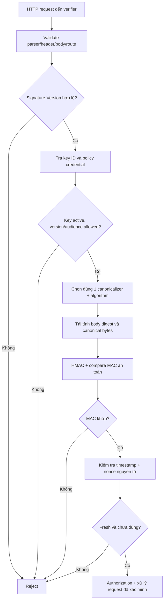

# Signature version trong xác thực HTTP request bằng HMAC

## 1. Vì sao chữ ký request cần có phiên bản?

Trong hệ thống xác thực request bằng HMAC, **signature version (phiên bản chữ ký)** định danh **một hợp đồng ký cụ thể**: thuật toán MAC, cấu trúc canonical request, thành phần HTTP được ký, encoding, định dạng chữ ký và quy tắc xác minh. Hai bên chỉ tạo được chữ ký giống nhau khi cùng sử dụng **đúng phiên bản** và cùng dữ liệu đầu vào.

Bài **Signature version** thuộc chương **Request signature** của module `SECURITY_AUTHENTICATION_HMAC_REQUEST_AUTHENTICATION`. Module tập trung thiết kế xác thực HTTP request với **shared secret**, canonical request bao gồm **method, URI, header hoặc body** theo hợp đồng; người học còn cần xác minh chữ ký, chống replay bằng timestamp/nonce, quản lý key rotation, kiểm thử proxy/gateway và phân biệt xác thực với phân quyền.

Giả sử phiên bản đầu tiên của một API ký:

```text
HMAC-SHA256(secret, UTF8(method + "\n" + path + "\n" + bodyHash))
```

Về sau, API muốn ràng buộc thêm `Content-Type`, `Host`/audience, timestamp và nonce. Cùng một HTTP request giờ tạo **message bytes khác**. Nếu chỉ âm thầm sửa mã mà giữ nguyên tên phiên bản, client chưa cập nhật sẽ lỗi chữ ký, server khó xác định phải kiểm tra theo quy tắc nào và những phiên bản cũ có thể tiếp tục được chấp nhận ngoài ý muốn.

Một phiên bản ký rõ ràng giúp:

- **Tương thích có kiểm soát:** client và server biết mỗi request tuân thủ hợp đồng ký nào.
- **Phân tách giao thức:** chữ ký tạo theo phiên bản này không bị hiểu nhầm là chữ ký của phiên bản khác.
- **Chống downgrade:** server chỉ nhận những phiên bản được policy cho phép đối với credential, dịch vụ và thời điểm hiện tại.
- **Di chuyển an toàn:** phát hành phiên bản mới, kiểm thử song song trong khoảng chuyển tiếp hữu hạn, rồi ngừng hỗ trợ phiên bản cũ.
- **Điều tra lỗi:** có thể gắn lỗi signature mismatch với một phiên bản, canonicalization và bộ test vector tương ứng.

**Signature version không phải bằng chứng xác thực tự thân.** Trước khi xác minh HMAC, header khai báo phiên bản vẫn là dữ liệu do client gửi và có thể bị giả mạo. Server chỉ dùng giá trị đó để **chọn một quy tắc đã cho phép** rồi kiểm tra chữ ký; không coi phiên bản khai báo là đáng tin cho tới khi nó được ràng buộc thành công vào MAC.

## 2. Phân biệt signature version với các loại phiên bản khác

| Thuật ngữ | Ví dụ | Ý nghĩa |
| --- | --- | --- |
| **Signature version** | `hmac-http-v2` | Chỉ rõ **giao thức tạo và xác minh chữ ký**; có thể bao gồm thay đổi canonical schema dù thuật toán MAC giữ nguyên. |
| **MAC algorithm** | `HmacSHA256` | Thuật toán nhận secret và message bytes rồi tạo MAC; là **một phần** của signature version. |
| **Body digest algorithm** | `SHA-256(bodyBytes)` | Thuật toán hash body để đưa digest vào message được ký; cũng là một phần của hợp đồng. |
| **Key ID** | `client-a-2026-11` | Định danh credential/secret; có thể đổi khi rotation mà **không đổi signature version**. |
| **API version** | `/v1/transfers` hoặc `/v2/transfers` | Phiên bản giao diện nghiệp vụ; không nhất thiết trùng với phiên bản chữ ký. |
| **HTTP version** | HTTP/1.1, HTTP/2 | Giao thức truyền tải; hai phiên bản HTTP có thể tạo cùng canonical request khi adapter xử lý đúng. |
| **Credential policy version** | Chính sách nội bộ theo ngày | Quy định credential nào được sử dụng profile ký nào; có thể thay mà không đổi format chữ ký. |

Ví dụ, request gửi đến `/v1/transfers` qua HTTP/2 vẫn có thể dùng `hmac-http-v2` và key ID `client-a-2026-11`. Không nên suy signature version từ số `v1` trong API path, cũng không tự gắn phiên bản ký với năm trong key ID.

**Khi nào cần tăng signature version?** Khi thay đổi có ảnh hưởng đến **byte message được ký hoặc cách xác minh**: thêm/bỏ field, đổi thứ tự dòng, dấu phân tách, charset, chuẩn hóa URI/header, body digest, thuật toán MAC, độ dài/encoding chữ ký hoặc quy tắc canonical bắt buộc. Thay secret trong cùng hợp đồng chỉ cần **key rotation**. Thay thư viện mà kết quả byte vẫn tương thích không nhất thiết cần phiên bản mới.

## 3. Ví dụ giao thức ký HMAC-HTTP-V2

Xét request chuyển tiền giả định:

```http
POST /v1/transfers?dryRun=false HTTP/1.1
Host: api.example.test
Content-Type: application/json
X-Key-Id: client-a-2026-11
X-Signature-Version: hmac-http-v2
X-Timestamp: 2026-11-28T02:05:00Z
X-Nonce: X7yQnN9sTp5xM4zKd6bL2A
X-Signature: <64 ký tự hex viết thường>

{"from":"A100","to":"B200","amount":250000}
```

Đây là **hợp đồng minh họa do hai phía tự thỏa thuận**, không phải format chung mà mọi server hoặc gateway mặc định hiểu. Với phiên bản `hmac-http-v2`, client tạo **canonical message**:

```text
HMAC-HTTP-REQUEST-V2
POST
https://api.example.test
/v1/transfers?dryRun=false
content-type:application/json
x-key-id:client-a-2026-11
x-signature-version:hmac-http-v2
x-timestamp:2026-11-28T02:05:00Z
x-nonce:X7yQnN9sTp5xM4zKd6bL2A
<SHA-256(bodyBytes) dạng 64 ký tự hex thường>
```

Dòng cuối trong sơ đồ trên là **placeholder**: message thật chứa 64 ký tự hex của digest, **không** chứa dấu `<`/`>`. Thuật toán tính chữ ký:

```text
bodyDigest = lowercaseHex(SHA-256(bodyBytes))
message    = UTF8(canonicalMessageWithoutFinalNewline)
mac        = HMAC-SHA256(sharedSecret, message)
signature  = lowercaseHex(mac)       # MAC 32 byte => 64 ký tự hex
```

Trong hợp đồng ví dụ, version 2 có các quy định bắt buộc:

1. **Phiên bản và thuật toán cố định:** `hmac-http-v2` luôn ánh xạ tới `HmacSHA256` với MAC đầy đủ 32 byte; body digest luôn là `SHA-256`; tên version **không phải đầu vào tự do** cho `Mac.getInstance`.
2. **Các dòng cố định:** ký `HMAC-HTTP-REQUEST-V2`, method, origin, raw target, các header được chọn và body digest theo đúng thứ tự. Dùng **UTF-8**, nối mỗi dòng bằng một **LF** (`0A`), không thêm LF ở cuối.
3. **Method và target:** method viết hoa; raw target gồm raw path và raw query theo đúng thứ tự/percent-encoding đã quy ước, không chứa URL fragment. Không tự thay `%2F` bằng `/` hoặc sort tham số query khi kiểm tra chữ ký.
4. **Origin/audience:** `https://api.example.test` được ràng buộc với **dịch vụ đích đã cấu hình tin cậy**, không chỉ lấy từ `Host` hoặc `X-Forwarded-Host` do client tự đặt. Nếu API dùng nhiều host/cổng, phải quy định normalization chính xác.
5. **Signed headers:** `Content-Type`, `X-Key-Id`, `X-Signature-Version`, `X-Timestamp`, `X-Nonce` phải có **đúng một giá trị** với format cụ thể. Từ chối header trùng, CR/LF injection và giá trị mơ hồ; không lặng lẽ tự chọn một trong nhiều giá trị.
6. **Body:** server **tự tính** `SHA-256` trên byte body **thực nhận và thực được ứng dụng xử lý**. Không dựa vào body hash hay canonical string do client khai báo. JSON thêm khoảng trắng cũng làm digest khác nếu ký raw body bytes.
7. **Không tự ký `X-Signature`:** chữ ký là **đầu ra**, không phải một thành phần của message cần ký; đưa nó vào message sẽ tạo vòng phụ thuộc.

### Vì sao ghi cả prefix và signed version header?

`HMAC-HTTP-REQUEST-V2` là **domain separator**, giảm khả năng một MAC của giao thức khác bị diễn giải theo schema này. Dòng `x-signature-version:hmac-http-v2` ràng buộc trực tiếp header mà bên nhận sử dụng để chọn verifier. Đây là hai quy tắc bổ trợ nhau; bản thân chúng **chưa đủ để chống downgrade** nếu server vẫn cho mọi key tùy ý chọn phiên bản cũ. Policy chấp nhận version ở server mới là hàng rào quyết định.

Trong triển khai có nhiều phiên bản, mỗi profile cần **schema và test fixture riêng**. Không sử dụng `canonicalizeV2` để kiểm tra chữ ký v1 rồi hy vọng vẫn tương thích. Nếu muốn nâng hợp đồng từ v1 lên v2, hãy định nghĩa chính xác khác biệt; ví dụ v1 chưa ký origin còn v2 đã ký origin. Giữ verifier v1 giới hạn ở những credential legacy thật sự cần trong giai đoạn chuyển tiếp.

## 4. Chính sách chọn phiên bản và chống downgrade

Một cách làm sai:

```java
if (verifyHmacSha256(request)) {
    accept();
} else if (verifyLegacy(request)) {
    accept();  // Fallback khi chữ ký mới thất bại!
}
```

Với logic này, server có thể tự hạ tiêu chuẩn sau khi gặp lỗi xác minh, dù credential không được phép ký theo hợp đồng cũ. Tương tự, code `Mac.getInstance(request.getHeader("X-Algorithm"))` cho client quyền chọn thuật toán theo ý mình và làm chính sách an toàn khó kiểm soát.

Quy tắc nên là:

- **Chỉ chấp nhận một version được khai báo duy nhất**, phải có tên trong registry cố định; không có default ngầm về v1 khi header thiếu.
- **Tìm credential theo key ID từ kho tin cậy**, kiểm tra trạng thái, tenant/service/audience, và tập `allowedVersions` gắn với credential đó.
- **Xác định đúng một profile** theo version hợp lệ; profile quyết định cả canonical schema, MAC algorithm, body digest, độ dài MAC và encoding.
- **Tự dựng canonical request** từ HTTP request thực nhận rồi tính MAC **một lần theo profile đã chọn**. Nếu mismatch, từ chối và **không thử tiếp** các phiên bản khác.
- **Sau ngày sunset**, version cũ phải bị chặn ở policy trên mọi instance/gateway; không còn đường fallback ẩn trong SDK hoặc server.

Ví dụ policy:

| Credential | Phiên bản được phép | Ghi chú |
| --- | --- | --- |
| `client-a-new` | `{hmac-http-v2}` | Credential mới; từ chối hoàn toàn v1. |
| `client-b-legacy` | `{hmac-http-v1, hmac-http-v2}` trước hạn chuyển đổi | Chỉ được phép trong giai đoạn migration có thời hạn. |
| `client-c-revoked` | Không có | Khóa bị thu hồi; từ chối dù chữ ký đúng. |

**Kẻ tấn công sửa `X-Signature-Version` từ v2 sang v1** sẽ làm thay đổi message được ký nếu version được canonical hóa như ví dụ. Khi server áp dụng đúng profile, chữ ký cũ sẽ không khớp. Tuy nhiên **một request đã được ký hợp lệ theo v1** vẫn có thể được chấp nhận nếu server tiếp tục cho phép v1: do đó phải có **allowlist theo credential/route và ngày sunset**, không chỉ ký trường version.

## 5. Java 17+: verifier cố định phiên bản và không fallback

Ví dụ này chỉ cài **profile `hmac-http-v2`**. Nó minh họa lựa chọn version từ registry, kiểm tra chính sách của credential, tái tạo byte canonical request và gọi JCA `Mac.doFinal`. Hệ thống đang migrate có thể thêm profile v1 riêng với canonicalizer riêng **chỉ khi được phép bởi policy**; không có logic tự thử v1 nếu v2 sai.

Các giả định để code tập trung vào mục tiêu bài học: HTTP adapter đã từ chối header ký trùng/CR-LF, cung cấp **raw request target đáng tin cậy** và snapshot body bytes không bị thay đổi trước khi handler xử lý. Demo chỉ chấp nhận một route `/v1/transfers?dryRun=false` và `Content-Type: application/json`; không phải HTTP middleware tổng quát.

```java
import java.nio.charset.StandardCharsets;
import java.security.GeneralSecurityException;
import java.security.MessageDigest;
import java.time.Clock;
import java.time.Duration;
import java.time.Instant;
import java.time.format.DateTimeParseException;
import java.util.HexFormat;
import java.util.Set;
import javax.crypto.Mac;
import javax.crypto.spec.SecretKeySpec;

public final class VersionedHmacRequestVerifier {
    private static final String VERSION = "hmac-http-v2";
    private static final String PREFIX = "HMAC-HTTP-REQUEST-V2";
    private static final String ALGORITHM = "HmacSHA256";
    private static final String EXPECTED_ORIGIN = "https://api.example.test";
    private static final Duration MAX_SKEW = Duration.ofMinutes(5);
    private static final Duration NONCE_TTL = Duration.ofMinutes(11);
    private static final HexFormat HEX = HexFormat.of();

    // Mỗi field bắt nguồn từ request đã được adapter kiểm tra cú pháp.
    public record Request(
            String method, String origin, String rawTarget,
            String contentType, String keyId, String signatureVersion,
            String timestamp, String nonce, byte[] body, String signatureHex) {}

    // allowedVersions và scope do server quản lý, không đọc từ request.
    public record Credential(
            byte[] secret, boolean active, String permittedOrigin,
            Set<String> allowedVersions) {}

    public interface Credentials {
        Credential findByKeyId(String keyId);
    }

    public interface Nonces {
        // Kho dùng chung; insert-if-absent nguyên tử với TTL thực sự.
        boolean claim(String keyId, String nonce, Duration ttl);
    }

    public static byte[] canonicalBytes(Request r)
            throws GeneralSecurityException {
        String digest = HEX.formatHex(
                MessageDigest.getInstance("SHA-256").digest(r.body()));
        String canonical = String.join("\n",
                PREFIX,
                r.method(),
                r.origin(),
                r.rawTarget(),
                "content-type:" + r.contentType(),
                "x-key-id:" + r.keyId(),
                "x-signature-version:" + r.signatureVersion(),
                "x-timestamp:" + r.timestamp(),
                "x-nonce:" + r.nonce(),
                digest);
        return canonical.getBytes(StandardCharsets.UTF_8);
    }

    private static byte[] calculateMac(byte[] key, byte[] message)
            throws GeneralSecurityException {
        Mac mac = Mac.getInstance(ALGORITHM);
        mac.init(new SecretKeySpec(key, ALGORITHM));
        return mac.doFinal(message);
    }

    public static boolean verify(
            Request r, Credentials credentials, Nonces nonces, Clock clock)
            throws GeneralSecurityException {
        if (r == null || r.method() == null || r.origin() == null
                || r.rawTarget() == null || r.contentType() == null
                || r.keyId() == null || r.signatureVersion() == null
                || r.timestamp() == null || r.nonce() == null
                || r.body() == null || r.signatureHex() == null) {
            return false;
        }

        // Registry v2: version lạ hoặc thiếu version đều bị từ chối.
        if (!VERSION.equals(r.signatureVersion())
                || !"POST".equals(r.method())
                || !EXPECTED_ORIGIN.equals(r.origin())
                || !"/v1/transfers?dryRun=false".equals(r.rawTarget())
                || !"application/json".equals(r.contentType())
                || !r.keyId().matches("[A-Za-z0-9._-]{1,128}")
                || !r.nonce().matches("[A-Za-z0-9_-]{16,128}")
                || !r.signatureHex().matches("[0-9a-f]{64}")) {
            return false;
        }

        // Timestamp ở dạng UTC, chính xác tới giây; kiểm tra freshness.
        Instant issuedAt;
        try {
            issuedAt = Instant.parse(r.timestamp());
        } catch (DateTimeParseException ex) {
            return false;
        }
        if (issuedAt.getNano() != 0
                || !issuedAt.toString().equals(r.timestamp())
                || Duration.between(clock.instant(), issuedAt)
                        .abs().compareTo(MAX_SKEW) > 0) {
            return false;
        }

        Credential credential = credentials.findByKeyId(r.keyId());
        if (credential == null || !credential.active()
                || credential.secret() == null || credential.secret().length == 0
                || !EXPECTED_ORIGIN.equals(credential.permittedOrigin())
                || credential.allowedVersions() == null
                || !credential.allowedVersions().contains(VERSION)) {
            return false;
        }

        // Cùng key và đúng canonical bytes -> cùng HMAC-SHA256 32 byte.
        byte[] expected = calculateMac(credential.secret(), canonicalBytes(r));
        byte[] supplied = HEX.parseHex(r.signatureHex());
        if (!MessageDigest.isEqual(expected, supplied)) {
            return false; // Không tự thử lại theo v1.
        }

        // Chỉ claim nonce sau khi MAC đúng; rồi còn phải authorization.
        return nonces.claim(r.keyId(), r.nonce(), NONCE_TTL);
    }
}
```

Ví dụ có thể được ghép với một client ký canonical request theo đúng cùng schema:

```java
// Client tạo canonical bytes trước, sau khi đã có body bytes sẽ gửi thực tế.
// "r" có các field như request trên, còn signatureHex chưa được gắn.
byte[] message = VersionedHmacRequestVerifier.canonicalBytes(r);
Mac mac = Mac.getInstance("HmacSHA256");
mac.init(new SecretKeySpec(clientSecret, "HmacSHA256"));
String signatureHex = HexFormat.of().formatHex(mac.doFinal(message));
// Gửi signatureHex trong X-Signature cùng với X-Signature-Version.
```

**Giới hạn cần hiểu đúng:** `canonicalBytes(r)` trong demo là primitive xây message, giả sử input đã được kiểm tra và body snapshot chính xác. Không nhận `r.origin()` từ header chưa tin cậy mà bỏ qua việc kiểm tra route; demo chỉ cho phép `EXPECTED_ORIGIN`, còn hệ thống đa origin phải ánh xạ theo routing policy từ gateway/server. Parser HTTP phải chặn request smuggling, header trùng, path ambiguity, body quá lớn và bảo đảm handler dùng **chính dữ liệu đã được xác minh**.

Mã mẫu cũng không tự trả mã HTTP, không xử lý exception từ key store/nonce store và không quyết định quyền nghiệp vụ. Khi kho khóa, JCA provider hoặc nonce store lỗi, request phải **fail closed**. Sau khi `verify` thành công, ứng dụng vẫn phải kiểm tra **authorization** theo client identity, action và resource.

### Tại sao không lấy thuật toán trực tiếp từ header?

```java
// KHÔNG LÀM: cho caller quyết định thuật toán và độ mạnh chữ ký
Mac mac = Mac.getInstance(requestAlgorithmHeader);
```

Tên `requestAlgorithmHeader` là dữ liệu chưa xác thực. Với thiết kế versioned profile, ứng dụng chỉ nhận một **version đã có trong registry** rồi map sang thuật toán và canonical schema do **server định nghĩa**. Khi phiên bản bị sunset, xóa nó khỏi allowlist/registry theo kế hoạch; không thêm một fallback để “cứu” request sai chữ ký.

## 6. Quy trình kiểm tra trên server

Các bước quan trọng cần diễn ra nhất quán:



**Thứ tự kiểm tra có thể khác theo tối ưu triển khai**, nhưng phải duy trì các bất biến: một version chỉ chọn **một** verifier theo policy; signature, timestamp và nonce đều được ràng buộc vào message; không xử lý nghiệp vụ trước khi HMAC, replay và authorization thành công. Lookup key ID là bước tra cứu từ dữ liệu chưa xác thực, nên cần rate limit, kiểm soát tài nguyên và phản hồi lỗi không làm lộ thông tin tồn tại của credential.

### Khác biệt giữa signature hợp lệ và replay hợp lệ

Một request `hmac-http-v2` giữ nguyên method, URI, body, timestamp, nonce và MAC có thể được gửi lại mà HMAC vẫn hợp lệ. Vì vậy:

- Timestamp **phải nằm trong canonical bytes** và được kiểm tra cửa sổ thời gian, ví dụ ±5 phút theo đồng hồ server.
- Nonce **phải nằm trong canonical bytes**, đồng thời được `claim` bằng thao tác **insert-if-absent nguyên tử** trên storage dùng chung, với TTL đủ phủ khoảng thời gian request còn hợp lệ.
- Nếu request được ký đúng nhưng nonce đã được dùng, server phải **từ chối**. Nếu kẻ tấn công relay nguyên request **trước** bản gốc, nonce store thường chỉ có thể nhận biết **bản tới thứ hai**; TLS và xác minh danh tính server vẫn cần để giảm nguy cơ interception/relay.
- Idempotency key cho tác vụ như chuyển tiền là **biện pháp nghiệp vụ riêng**; nếu dùng, hãy ký cả idempotency key hoặc ràng buộc tương đương.

## 7. Migration, key rotation và lịch sunset

Một migration chuẩn thường gồm nhiều giai đoạn:

| Giai đoạn | Việc thực hiện | Điều kiện sang giai đoạn kế |
| --- | --- | --- |
| **Inventory** | Thu thập signature version, canonical schema, algorithm, key ID, client SDK, endpoint và lượng traffic legacy. | Xác định đầy đủ nơi còn dùng phiên bản cũ. |
| **Publish contract** | Công bố profile mới và golden test vectors, policy time/nonce, format header/signature và mốc sunset. | Client và verifier tạo byte giống nhau trên bộ fixture cố định. |
| **Server rollout** | Triển khai verifier mới trên mọi node/gateway; giữ legacy chỉ cho credential đã whitelist. | Đồng nhất hỗ trợ và giám sát trên toàn cụm. |
| **Issue credentials** | Cấp key ID + shared secret mới cho profile mới; tách scope theo môi trường, dịch vụ và tenant. | Khóa mới chỉ chấp nhận version phù hợp. |
| **Client migration** | Nâng SDK và chuyển traffic từng nhóm, theo dõi lỗi từ canonicalization, key và replay. | Traffic legacy giảm đến ngưỡng được phê duyệt. |
| **Sunset** | Sau hạn hỗ trợ, bỏ legacy khỏi policy/registry và revoke key cũ theo chính sách. | Request legacy bị từ chối trên mọi node. |
| **Cleanup** | Xóa đường fallback/compatibility không còn dùng; giữ fixture lịch sử khi cần audit. | Rollback không vô tình mở lại bản cũ. |

**Version và key rotation là hai trục riêng.** Có thể đổi từ `client-a-2026-11` sang `client-a-2027-01` mà vẫn giữ `hmac-http-v2`. Ngược lại, nâng từ v1 sang v2 thường nên phát hành credential mới, nhưng điều cần thiết nhất là policy rõ ràng cho version và phạm vi key. Nếu một shared secret đã bị lộ, cần **revoke/rotate ngay**, không đợi đổi signature version.

Với một migration có **hai phiên bản cùng được chấp nhận tạm thời**, server không được “thử tất cả key và version”. Nó tra đúng key ID, kiểm tra version được phép, rồi áp dụng duy nhất profile được chỉ định. Những credential mới nên chỉ có `{v2}`; credential legacy có thể còn `{v1, v2}` với thời hạn và phạm vi cụ thể.

### Tương thích SDK và gateway

Chỉ đổi library Java không nhất thiết gây lỗi, nhưng đổi cách chuẩn hóa URI/header hoặc serialize JSON sẽ làm **canonical bytes khác**. Gateway có thể thêm prefix path, giải mã `%2F`, sắp query, thay `Host` hoặc giải nén body. Vì vậy:

- Thực hiện **golden fixtures** giữa các SDK/language khác nhau, không chỉ giữa hai hàm trong cùng thư viện.
- Kiểm thử end-to-end qua đúng ingress/gateway/load balancer mà production sử dụng.
- Ghi rõ verifier chạy **trước hay sau** các phép rewrite; ràng buộc request đã xác minh với dữ liệu handler thực thi.
- Không tin `X-Forwarded-Host` do caller tự gửi; gateway phải strip header không đáng tin và cung cấp routing metadata đã xác thực.
- Nếu chuẩn hóa HTTP thay đổi và kết quả ký khác, xem đó là **thay đổi contract có version**, không chỉ một bản sửa kỹ thuật.

## 8. Các ca kiểm thử signature version quan trọng

Một bộ fixture nên lưu **version, key ID, shared secret thử nghiệm, canonical message UTF-8, body bytes và MAC hex kỳ vọng**. Bổ sung negative tests cho từng thành phần:

| Thử nghiệm | Kết quả mong đợi |
| --- | --- |
| v2, key chỉ cho phép v2, request/body đúng, timestamp hợp lệ, nonce mới. | HMAC đúng và tiếp tục authorization. |
| Thiếu `X-Signature-Version`, có hai header version, hoặc version lạ. | Parser/verifier từ chối; không mặc định v1. |
| Chữ ký v2 đúng nhưng thay header `X-Signature-Version` sang v1. | Chữ ký cũ thất bại hoặc bị key policy chặn. |
| Chữ ký v1 đúng về mặt mật mã nhưng key chỉ cho phép v2. | **Từ chối**, không downgrade. |
| Signature v2 không khớp và có đường code legacy. | **Từ chối**, không thử v1 sau khi v2 sai. |
| Đổi `X-Key-Id` nhưng giữ MAC. | Chữ ký không còn đúng, hoặc credential/scope không khớp. |
| Đổi method, URI, thứ tự query, origin, signed header hoặc một byte body. | Chữ ký cũ bị từ chối theo canonical v2. |
| HTTP/2 và HTTP/1.1 cùng request logic nhưng adapter xuất raw target giống contract. | Cho cùng canonical bytes và MAC. |
| Gateway rewrite path/query/header/body sau khi client ký. | Phát hiện mismatch và sửa ranh giới canonical/verify; không bỏ ký field quan trọng. |
| Client dùng hex hoa, Base64 hoặc MAC bị cắt ngắn khi contract cần 64 hex thường. | Từ chối vì encoding/độ dài sai. |
| Timestamp/nonce bị sửa mà giữ MAC; timestamp hết hạn; nonce trùng. | Từ chối bởi MAC hoặc chống replay. |
| Key cũ đã revoke, hoặc version v1 sau ngày sunset. | Từ chối dù toán học HMAC vẫn tính đúng. |
| MAC đúng nhưng client không có quyền chuyển tiền. | Authorization từ chối. |
| Lỗi secret manager hoặc nonce store. | Fail closed; không cho request đi tiếp. |

### Bài tập thực hành

1. Tạo hai canonical message cho cùng request với prefix `HMAC-HTTP-REQUEST-V1` và `HMAC-HTTP-REQUEST-V2`; so sánh byte và MAC. Giải thích tại sao đổi prefix cũng là thay đổi message được ký.
2. Tạo request v2 có chữ ký hợp lệ, sau đó đổi riêng header version sang `hmac-http-v1` mà không ký lại. Quan sát verifier chặn request ở bước nào.
3. Giả lập credential `old-key` chỉ được dùng v1 đến một thời điểm; sau sunset, xác minh rằng request v1 hợp lệ về HMAC vẫn bị từ chối bởi policy.
4. Tạo credential `new-key` chỉ cho phép v2; bảo đảm không thể lùi về v1 khi chữ ký v2 sai hoặc backend có lỗi tạm thời.
5. Chạy cùng fixture qua client Java và một API gateway có rewrite query; so sánh canonical byte trước và sau gateway.
6. Gửi cùng request có MAC đúng hai lần để thấy **signature verification** và **replay detection** cho hai kết quả khác nhau.

## 9. Checklist thiết kế

- [ ] Signature version có tên rõ ràng, registry cố định và tài liệu hợp đồng ký **đầy đủ**, không chỉ tên thuật toán.
- [ ] Mỗi profile khóa chặt MAC algorithm, body digest, canonical field/order, UTF-8/delimiter, MAC length và signature encoding.
- [ ] Version được đưa vào **canonical message** và/hoặc domain separator theo quy tắc không mơ hồ; version header thiếu hoặc trùng phải bị từ chối.
- [ ] Server kiểm tra **version được phép theo credential, route/audience, trạng thái key và ngày sunset** trước khi tính MAC.
- [ ] Không nhận thuật toán tùy ý từ client, không fallback khi signature mismatch và không âm thầm mặc định legacy version.
- [ ] Client và server ký cùng raw method/URI/header/body thực tế được ứng dụng sử dụng; kiểm thử xuyên gateway và các HTTP version.
- [ ] Timestamp/nonce được ký và được kiểm tra freshness/replay bằng kho nonce dùng chung với thao tác nguyên tử.
- [ ] Key rotation/revocation và version migration có policy riêng, được triển khai nhất quán trên các node; secret không ghi vào log.
- [ ] Chữ ký hợp lệ chỉ xác thực credential và integrity; tiếp tục authorization, idempotency và TLS server authentication.
- [ ] Duy trì golden fixtures cho từng version, negative tests về downgrade, encoding, proxy rewrite và sunset.

**Điểm cần nhớ:** *Signature version* là định danh của **toàn bộ hợp đồng ký HTTP request**. Trong xác thực HMAC, version phải được ràng buộc vào dữ liệu ký và vào **chính sách cho phép của server**; mỗi request chỉ được kiểm tra theo một profile xác định. Nhờ vậy có thể nâng canonical request, thuật toán hoặc cách biểu diễn chữ ký theo kế hoạch mà vẫn chống downgrade, quản lý khóa rõ ràng và kiểm soát replay, proxy/gateway cùng quyền truy cập.
