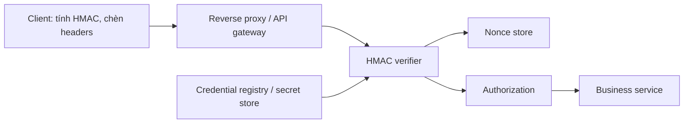

# Signature transport: truyền chữ ký HMAC trong HTTP request

> **Chương:** Request signature  
> **Bài học:** Signature transport  
> **Bối cảnh:** Xác thực HTTP request bằng HMAC với shared secret. Client và server cùng tuân thủ một hợp đồng ký các thành phần method, URI, header và/hoặc body; dùng timestamp/nonce để hạn chế replay, key ID cho quản lý credential và key rotation, đồng thời kiểm thử đường đi qua proxy/gateway.

## 1. Signature transport là gì?

Trong mô hình xác thực HTTP bằng HMAC, **signature transport** là quy ước **đóng gói, đặt và truyền giá trị chữ ký cùng metadata xác minh** trong một HTTP request. Chẳng hạn, client có thể gửi HMAC tag ở header `X-Signature`, còn key ID, timestamp và nonce ở các header riêng.

Điều cần phân biệt ngay từ đầu:

1. **Signing input:** các byte cụ thể mà client đưa vào HMAC, được xây từ canonical request và phiên bản giao thức.
2. **Signature/tag:** kết quả `HMAC-SHA256(secretBytes, signingInputBytes)` là một mảng byte, dài **32 byte** với HMAC-SHA256.
3. **Encoding:** chuyển tag thành chuỗi HTTP-safe như Base64URL không padding hoặc hex; encoding không làm tag mạnh hơn và không mã hóa bí mật.
4. **Transport:** quyết định tag và metadata xuất hiện ở header nào, định dạng ra sao, và các thành phần mạng sẽ xử lý chúng thế nào.
5. **Verification:** server đọc đúng trường đã thỏa thuận, decode tag, tự tính HMAC với secret tương ứng, so sánh rồi mới áp dụng kiểm soát freshness, replay và authorization.

Ví dụ: `X-Signature: v1=...` là **định dạng truyền**, còn HMAC không biết gì về tên header `X-Signature`. Nếu client và server tính cùng tag nhưng một phía dùng hex, phía kia đòi Base64URL, request vẫn bị từ chối. Ngược lại, nếu truyền chữ ký thành công nhưng hai bên canonicalize URI khác nhau, tag sẽ không khớp.

**Mục tiêu học tập:** sau bài này, người học có thể thiết kế một định dạng chữ ký trên HTTP, phân biệt các trường cần ký và trường chở signature, viết codec Java đọc/ghi signature an toàn, và kiểm tra chữ ký vẫn xác minh được sau gateway/proxy.

## 2. Những gì cần truyền cùng chữ ký

Một request HMAC thực tế thường cần nhiều hơn tag:

| Thành phần | Ví dụ minh họa | Vai trò | Có bí mật không? |
| --- | --- | --- | --- |
| **Key ID** | `merchant-42-k2` | Server chọn đúng credential và secret từ registry. | Không; không thay thế bằng chứng HMAC. |
| **Signature version** | `v1` | Chỉ rõ hợp đồng ký và encoding được hỗ trợ. | Không; server phải kiểm chính sách phiên bản. |
| **Signature tag** | `Base64URL(HMAC-SHA256(...))` | Được server decode và so sánh với tag tự tính. | Không phải secret; vẫn tránh ghi đầy đủ vào log. |
| **Timestamp** | `1795800000` | Giới hạn thời gian request hợp lệ, ví dụ epoch seconds. | Không; **phải ràng buộc vào signing input**. |
| **Nonce** | `e701c6b8d1e34fdd9915a477c1a59302` | Phân biệt mỗi lần gửi để phát hiện phát lại. | Không cần bí mật; phải khó đoán, dùng một lần và được ký. |
| **Algorithm** | `HMAC-SHA256` | Mô tả thuật toán được sử dụng cho hợp đồng ký. | Không; **không cho client tự chọn thuật toán yếu**. |
| **Signed headers list** | `content-type;x-key-id;x-nonce;x-timestamp` | Xác định đúng các header thuộc dữ liệu ký, nếu giao thức mang danh sách này. | Không; server phải có quy tắc kiểm danh sách để tránh bỏ sót trường bắt buộc. |
| **Body digest** | SHA-256 của raw body bytes | Gắn payload vào canonical request mà không cần đưa toàn bộ body vào signing input. | Không; được HMAC ràng buộc nếu nằm trong dữ liệu ký. |

**Đề phòng nhầm lẫn:** key ID là chỉ mục để tra secret, không phải secret. Timestamp/nonce được truyền công khai, nhưng phải được ký; nếu attacker có thể sửa timestamp hoặc nonce mà không phá signature thì hệ thống có thể mất cơ chế freshness/replay.

Một signature hợp lệ là bằng chứng **quyền sử dụng shared secret đối với những byte đã ký**. Nó chưa chứng minh request là mới và **không cấp quyền** truy cập tài nguyên. Xác thực và phân quyền phải là hai quyết định riêng.

## 3. Những nơi có thể mang chữ ký trong HTTP

### 3.1. Header chuyên dụng: lựa chọn dễ vận hành cho API riêng

Đây là ví dụ một **giao thức tùy biến `v1`**, không phải định dạng do HTTP tự quy định:

```http
POST /v1/payments?currency=VND&orderId=42 HTTP/1.1
Host: api.example.test
Content-Type: application/json
X-Key-Id: merchant-42-k2
X-Timestamp: 1795800000
X-Nonce: e701c6b8d1e34fdd9915a477c1a59302
X-Signature: v1=<BASE64URL_TAG>

{"amount":100000}
```

Trong đó `<BASE64URL_TAG>` là **placeholder**, không phải tag hợp lệ; `timestamp` và `nonce` chỉ là dữ liệu giả lập. Một HMAC-SHA256 tag 32 byte được mã hóa Base64URL không padding thường tạo **43 ký tự ASCII**.

Các trường ví dụ:

- `X-Key-Id`: tên credential để server tra cứu, không phải thông tin dùng để tin ngay vào client.
- `X-Timestamp`: Unix epoch **giây**, nên quy định rõ định dạng số, độ lệch đồng hồ và khoảng hợp lệ.
- `X-Nonce`: 16 byte từ CSPRNG biểu diễn thành 32 ký tự hex; server kiểm uniqueness trên `(keyId, nonce)` bằng thao tác nguyên tử.
- `X-Signature`: `v1=<tag>`, với tag mã hóa đúng một định dạng; server từ chối version/encoding khác hợp đồng.

**Ưu điểm:** dễ tách metadata, ít phụ thuộc cách parse scheme Authorization và phù hợp giao tiếp service-to-service qua HTTP. **Rủi ro:** proxy/WAF có thể xóa hoặc thay đổi custom headers, gateway có thể không chuyển tiếp đầy đủ; cần cấu hình và kiểm thử thực tế.

Dù tên header không phân biệt chữ hoa/thường theo HTTP, **cách chuẩn hóa giá trị header và cách xử lý header trùng tên phải được quy định rõ**. Tránh nhận nhiều `X-Signature` hoặc `X-Key-Id` và tự chọn giá trị đầu/cuối một cách mơ hồ.

### 3.2. Dùng `Authorization` với một authentication scheme được định nghĩa rõ

Một thiết kế khác là khai báo scheme riêng trong header xác thực:

```http
Authorization: HMAC keyId="merchant-42-k2",signature="v1=<BASE64URL_TAG>"
X-Timestamp: 1795800000
X-Nonce: e701c6b8d1e34fdd9915a477c1a59302
```

**Đây chỉ là cú pháp minh họa của một scheme tùy biến**, không phải một scheme HMAC chung được HTTP định nghĩa. Nếu chọn cách này, hai phía phải có grammar và cách escape/quote cụ thể; cần phân biệt parser scheme với parser giá trị HMAC. HTTP middleware có thể tự xử lý hoặc loại bỏ `Authorization` trước khi request đến service.

**Ưu điểm:** được nhiều framework, gateway và công cụ bảo mật nhận diện là vật liệu xác thực, dễ áp dụng chính sách che thông tin nhạy cảm. **Điều cần kiểm soát:** hệ thống đang dùng Bearer/Basic/OAuth hay scheme khác trên cùng endpoint? Không được “ghép” nhiều scheme mơ hồ vào một header; phải quyết định nơi xác minh và truyền tiếp dữ liệu cần thiết.

Nếu backend xác minh HMAC sau gateway, kiểm thử gateway có chuyển `Authorization` đúng không. Nếu gateway xác minh, backend phải nhận principal qua **kênh nội bộ đã xác thực** và không tin trực tiếp header danh tính do client tự khai.

### 3.3. Truyền signature qua query string

Ví dụ presigned URL có thể đặt chữ ký trong query:

```text
/v1/download?keyId=...&expires=...&signature=...
```

Cách này có thể phù hợp với **giao thức presigned URL được thiết kế riêng** cho một thao tác, nhưng có nhiều nguy cơ: query dễ xuất hiện trong access log, lịch sử trình duyệt, bản sao URL, giám sát và công cụ phân tích; URL cũng có thể bị chuyển tiếp cho người khác. Một link có signature hợp lệ có thể được **phát lại trong thời gian hiệu lực** nếu giao thức không có kiểm soát bổ sung.

Nếu thực sự cần, phải quy định rõ **scope hẹp, phương thức/URI/tài nguyên được ký, thời hạn ngắn, giới hạn quyền và chính sách chống replay**. Không chuyển một giao thức dùng header sang query tùy ý khi chưa thiết kế lại signing contract.

### 3.4. Truyền trong body hoặc HTTP trailers

Có giao thức nghiệp vụ gói `signature` và dữ liệu vào một JSON envelope, hoặc dùng HTTP trailer cho thông tin tính sau khi stream body. Đây là lựa chọn đặc thù:

- **Body envelope:** phải xác định chính xác **phần nào được ký**; nếu tính hash của toàn body bao gồm chính trường `signature` sẽ tạo vòng lặp định nghĩa. Parse/re-serialize JSON có thể đổi byte và làm sai tag.
- **HTTP trailers:** cần xác nhận client, gateway, load balancer, framework, HTTP version và service đều hỗ trợ bảo toàn trailers; một số thành phần có thể loại bỏ chúng. Không được coi trailer là trường xác thực bắt buộc nếu đường truyền có thể làm mất nó.
- **Custom format trên wire:** yêu cầu parser nghiêm ngặt, giới hạn độ dài và kiểm thử nhiều phiên bản giao thức; sự linh hoạt dư thừa tăng nguy cơ parser mismatch.

**Gợi ý mặc định cho HMAC service-to-service:** dùng header chuyên dụng hoặc một cơ chế chuẩn đã xác định; chỉ chọn query/body/trailers khi có yêu cầu vận hành cụ thể và threat model tương ứng.

## 4. Có chuẩn HTTP Message Signatures hay không?

Có. **RFC 9421 – HTTP Message Signatures** quy định cách biểu diễn và kiểm tra chữ ký thông điệp HTTP, bao gồm các trường HTTP `Signature-Input` và `Signature`. RFC hỗ trợ nhiều cách ký, trong đó có **HMAC-SHA256**, nhưng quy tắc xây dữ liệu ký và định dạng trường **khác** giao thức custom `X-Signature: v1=...` ở ví dụ trên.

Ngoài ra, **RFC 9530 – Digest Fields** mô tả những trường như `Content-Digest` để biểu diễn digest của nội dung HTTP; muốn xác thực body, cần **đưa trường digest thích hợp vào các thành phần được ký** theo hợp đồng.

| Lựa chọn | Dữ liệu chở signature | Cách xây signing input | Khi nào cân nhắc |
| --- | --- | --- | --- |
| **Custom HMAC header** | `X-Signature`, `X-Key-Id`, `X-Timestamp`, `X-Nonce` theo hợp đồng riêng. | Canonical request do hai hệ thống tự định nghĩa chi tiết. | Hai hệ thống cùng kiểm soát giao thức, có nhu cầu tích hợp hạn chế. |
| **Custom Authorization scheme** | Một scheme `Authorization` riêng đã có grammar rõ. | Hợp đồng canonicalization riêng hoặc quy tắc do scheme định nghĩa. | Gateway/framework có cơ chế xác thực dựa trên `Authorization` phù hợp. |
| **RFC 9421** | `Signature-Input` và `Signature` theo cấu trúc chuẩn. | Quy trình tạo signature base và covered components theo RFC. | Muốn tương tác theo chuẩn HTTP Message Signatures giữa nhiều hệ thống. |

**Không được tráo đổi các định dạng này** chỉ vì cùng dùng HMAC-SHA256. Cùng secret và cùng thuật toán vẫn cho chữ ký khác nếu **signing input khác**. Khi chọn RFC 9421, hãy triển khai đúng RFC thay vì tự đổi tên `X-Signature` thành `Signature` rồi coi như tương thích.

Nguồn tra cứu: [RFC 9421](https://www.rfc-editor.org/rfc/rfc9421) và [RFC 9530](https://www.rfc-editor.org/rfc/rfc9530).

## 5. Chữ ký trên header: trường nào được ký?

Một nguyên tắc quan trọng: **header chở chữ ký thường không được đưa trực tiếp vào phần đang tính chữ ký**. Nếu `X-Signature` chứa tag HMAC mà chính tag lại là một phần của signing input, ta sẽ tự tạo phụ thuộc vòng.

Nhưng **các trường điều khiển xác thực** như key ID, timestamp, nonce và version/algorithm **phải được ràng buộc vào hợp đồng ký theo cách nhất quán**, để client không thể đổi metadata mà giữ signature cũ.

Một hợp đồng custom ví dụ:

| Thành phần | Đưa vào signing input? | Lý do |
| --- | --- | --- |
| `method` | **Có** | Đổi GET/POST có thể đổi tác động. |
| `path` và `query` | **Có** | Thay endpoint/tài nguyên/tenant có thể thay nghiệp vụ. |
| `content-type` | **Có**, nếu ảnh hưởng parser nghiệp vụ | Tránh thay kiểu body mà không phá HMAC. |
| `x-key-id` | **Có** | Ràng buộc lựa chọn credential với yêu cầu đã ký. |
| `x-timestamp` | **Có** | Ngăn sửa timestamp để kéo dài thời gian hợp lệ. |
| `x-nonce` | **Có** | Ngăn thay nonce để né replay cache. |
| `bodyDigest` | **Có**, khi body có ý nghĩa cần bảo vệ | Khóa nội dung payload với signature. |
| `x-signature` | **Không**, theo giao thức tự định nghĩa này | Đây là giá trị đầu ra của phép tính HMAC. |
| `x-transport-debug` không có ý nghĩa bảo mật | Tùy hợp đồng; không được làm thay đổi nghiệp vụ nếu ngoài phần ký | Giữ signing input ổn định trước trường do proxy thêm. |

Nếu host/`:authority` quyết định service hay tenant, **phải xem xét ký authority** và xác định tại điểm nào canonicalization diễn ra. Các header hop-by-hop như `Connection`/`Transfer-Encoding` thường bị proxy thay đổi; không nên phụ thuộc vào chúng như dữ liệu ký giữa các hop nếu không có hợp đồng rất chặt.

### Canonicalization minh họa

Giả sử hợp đồng `v1` quy định:

1. Method là chữ hoa; path và query canonical được xây theo quy tắc percent-encoding, thứ tự query, duplicate parameters và chính sách dấu `/` đã thỏa thuận.
2. Chỉ chấp nhận chính xác một giá trị của mỗi header `X-Key-Id`, `X-Timestamp`, `X-Nonce`, `Content-Type`. Tên ký viết thường; giá trị normalize theo hợp đồng, không tự nhận header mơ hồ.
3. Có danh sách signed headers cố định `content-type;x-key-id;x-nonce;x-timestamp`.
4. Body hash là **SHA-256 trên raw body bytes** (UTF-8 chỉ áp dụng khi body gốc thực sự là chuỗi UTF-8).
5. Nối các dòng canonical bằng LF (`\n`) và **không có LF cuối**; string-to-sign thêm tiền tố phiên bản `HMAC-SHA256/v1\n`.
6. Signature tag được mã hóa **Base64URL không padding**, truyền qua đúng một header `X-Signature: v1=<tag>`. Server **từ chối** version khác chính sách; client không tự chọn thuật toán thay thế.

Với request mẫu, sau chuẩn hóa, canonical request sẽ có hình thức:

```text
POST
/v1/payments
currency=VND&orderId=42
content-type:application/json
x-key-id:merchant-42-k2
x-nonce:e701c6b8d1e34fdd9915a477c1a59302
x-timestamp:1795800000
content-type;x-key-id;x-nonce;x-timestamp
<SHA256_HEX_RAW_BODY>
```

`<SHA256_HEX_RAW_BODY>` **không phải digest thật**; trong triển khai thay bằng 64 ký tự hex SHA-256 tính từ byte chính xác của `{"amount":100000}`. Tag trong header cũng chỉ là placeholder.

```text
stringToSign = "HMAC-SHA256/v1\n" + canonicalRequest
expectedTagBytes = HMAC-SHA256(secretBytes, UTF8(stringToSign))
X-Signature = "v1=" + BASE64URL_NO_PADDING(expectedTagBytes)
```

Đây là hợp đồng **minh họa**, không phải tiêu chuẩn canonicalize HTTP áp dụng cho mọi hệ thống. Cần viết đặc tả chính xác cho URI, query trùng tên, header duplicate, encoding, khoảng trắng, body rỗng, version và điểm xác minh. Hai phía có cùng secret nhưng không thống nhất các byte này sẽ không tương tác được.

## 6. Định dạng trên wire và parse an toàn

Đối với giao thức header `v1`, có thể chọn **một định dạng duy nhất**:

```text
X-Signature: v1=<43 ky tu Base64URL khong padding>
```

Giá trị thực tế có dạng `v1=` theo sau là 43 ký tự chỉ thuộc tập `A–Z`, `a–z`, `0–9`, `-`, `_`. Trong trường hợp HMAC-SHA256 tạo ra 32 byte tag, Base64URL không padding dài 43 ký tự. Nếu chọn hex, phải quy định cụ thể 64 ký tự hex; không tự suy đoán định dạng từ nội dung.

### Những quy tắc parser cần có

- **Một header giá trị đơn:** từ chối header `X-Signature` xuất hiện nhiều lần, bị gộp bằng dấu phẩy hoặc có cấu trúc không thuộc grammar. Tương tự `X-Key-Id`, `X-Timestamp`, `X-Nonce`.
- **Giới hạn độ dài:** yêu cầu signature tối đa một độ dài nhỏ theo hợp đồng; chặn chuỗi cực lớn trước khi decode hoặc đưa vào log.
- **Version rõ ràng:** từ chối `v0`, `v2` hoặc `none` nếu không được cấu hình; kiểm đúng phiên bản gắn với credential.
- **Encoding nghiêm ngặt:** chỉ nhận Base64URL không padding theo chính sách; decode rồi encode lại và so sánh nếu cần loại biểu diễn không chuẩn.
- **Độ dài tag:** HMAC-SHA256 đầy đủ có 32 byte. Nếu giao thức có truncation, phải được định nghĩa và đánh giá riêng; không tự chấp nhận tag ngắn.
- **So sánh byte:** decode tag người gửi rồi so với tag server tính bằng phép so sánh hạn chế rò rỉ timing, ví dụ `MessageDigest.isEqual` cho mảng tag cùng độ dài.
- **Header metadata:** validate cú pháp và kích thước của key ID/nonce/timestamp; timestamp phải có đơn vị chuẩn và không vượt số nguyên.
- **Không tin version/algorithm do client tự chọn:** server đối chiếu với chính sách của credential và signing contract; tránh đường downgrade.

HTTP header name không phân biệt hoa/thường, nhưng điều đó **không có nghĩa** được bỏ qua sự khác nhau về số lần xuất hiện, dấu phẩy, whitespace hoặc value. Nếu framework trả nhiều giá trị cho một tên header, cần kiểm trước khi lấy `getFirst`.

### Java 17+: encode, parse và verify tag chuyển qua header

Ví dụ sau chỉ chịu trách nhiệm **chữ ký trên wire**; đầu vào `bytesToSign` được giả định đã tạo đúng từ canonical request theo hợp đồng. Nó **không** tự triển khai đọc HTTP, canonicalization, credential registry, replay protection hay authorization.

```java
import java.security.GeneralSecurityException;
import java.security.MessageDigest;
import java.util.Base64;
import java.util.Objects;
import java.util.regex.Matcher;
import java.util.regex.Pattern;
import javax.crypto.Mac;
import javax.crypto.spec.SecretKeySpec;

public final class HmacSignatureHeader {
    private static final Pattern V1 =
            Pattern.compile("v1=([A-Za-z0-9_-]{43})");

    private HmacSignatureHeader() {}

    public static byte[] hmacSha256(byte[] secret, byte[] bytesToSign)
            throws GeneralSecurityException {
        Objects.requireNonNull(secret, "secret");
        Objects.requireNonNull(bytesToSign, "bytesToSign");
        Mac mac = Mac.getInstance("HmacSHA256");
        mac.init(new SecretKeySpec(secret, "HmacSHA256"));
        return mac.doFinal(bytesToSign);
    }

    public static String encodeTagForHeader(byte[] tag) {
        if (tag == null || tag.length != 32) {
            throw new IllegalArgumentException("Expected 32-byte HMAC tag");
        }
        return "v1=" + Base64.getUrlEncoder()
                .withoutPadding()
                .encodeToString(tag);
    }

    public static byte[] parseHeaderTag(String headerValue) {
        if (headerValue == null) {
            throw new IllegalArgumentException("Missing X-Signature");
        }
        Matcher matcher = V1.matcher(headerValue);
        if (!matcher.matches()) {
            throw new IllegalArgumentException("Invalid signature format");
        }

        String encoded = matcher.group(1);
        byte[] tag;
        try {
            tag = Base64.getUrlDecoder().decode(encoded);
        } catch (IllegalArgumentException invalid) {
            throw new IllegalArgumentException("Invalid Base64URL tag", invalid);
        }
        if (tag.length != 32) {
            throw new IllegalArgumentException("Invalid HMAC tag length");
        }
        String canonical = Base64.getUrlEncoder()
                .withoutPadding()
                .encodeToString(tag);
        if (!canonical.equals(encoded)) {
            throw new IllegalArgumentException("Noncanonical Base64URL tag");
        }
        return tag;
    }

    public static boolean verify(byte[] secret, byte[] bytesToSign,
                                 String signatureHeader)
            throws GeneralSecurityException {
        final byte[] supplied;
        try {
            supplied = parseHeaderTag(signatureHeader);
        } catch (IllegalArgumentException malformed) {
            return false;
        }
        byte[] expected = hmacSha256(secret, bytesToSign);
        return MessageDigest.isEqual(expected, supplied);
    }
}
```

Ở phía client, sau khi dựng signing input và lấy đúng secret:

```java
byte[] tag = HmacSignatureHeader.hmacSha256(secretBytes, bytesToSign);
String xSignature = HmacSignatureHeader.encodeTagForHeader(tag);
// Gắn keyId, timestamp, nonce và xSignature vào request headers.
// Những metadata này đã phải được đưa vào bytesToSign.
```

Ở server, đầu tiên phải chọn key theo `X-Key-Id` từ registry đáng tin cậy, xây lại signing input theo request nhận được rồi gọi:

```java
boolean signatureMatches = HmacSignatureHeader.verify(
        selectedSecretBytes, bytesToSign, xSignatureHeader
);
// Chỉ khi tag hợp lệ mới claim nonce dùng một lần và gán principal.
```

**Giới hạn quan trọng của mã ví dụ:** chỉ xử lý **một giá trị header đã được lấy đúng và kiểm tra trùng lặp ở lớp HTTP**. Nếu chỉ gọi `request.getHeader("X-Signature")` mà framework bỏ qua các giá trị trùng, rủi ro parser mismatch vẫn còn. Mã cũng chưa kiểm trạng thái key, timestamp, nonce hay quyền; phải đặt các bước đó ở luồng xác thực đầy đủ.

## 7. Signature transport qua proxy, gateway và các hop

Chữ ký được tạo ở client nhưng server verifier có thể nằm sau nhiều thành phần trung gian. Trên đường đi, HTTP request có thể thay đổi:



Một hệ thống phải lựa chọn **điểm xác minh** và hiểu điều gì đã hoặc chưa bị biến đổi trước điểm đó.

| Biến đổi ở trung gian | Ảnh hưởng tới transport | Ảnh hưởng tới chữ ký |
| --- | --- | --- |
| Gateway **xóa `X-Signature`** hoặc `Authorization` | Server không nhận được tag. | Request phải bị từ chối; không bỏ qua kiểm tra. |
| Gateway thay `Host` hoặc `:authority` | Signature header còn nguyên. | Nếu authority được ký, canonical input có thể không khớp. |
| Gateway rewrite path prefix | Signature header còn nguyên. | Server có thể tính HMAC trên path khác với client. |
| Proxy normalize query hoặc percent-encoding | Header vẫn còn nguyên. | Canonical query có thể thay đổi, dẫn tới mismatch hoặc parsing ambiguity. |
| Proxy thêm header `X-Forwarded-*` | Có thể tạo thêm metadata dễ nhầm lẫn. | Không dùng forwarded headers do attacker tự khai làm nguồn canonical đáng tin. |
| HTTP/1.1 sang HTTP/2 hoặc HTTP/3 | Header name có thể đổi chữ hoa/thường; representation thay đổi. | Hợp đồng ký phải dựa trên thành phần HTTP chuẩn hóa đã định nghĩa, không sao chép tùy tiện raw wire bytes. |
| Proxy giải nén/chuyển đổi body | Signature field có thể vẫn nguyên. | Body digest trên byte đã biến đổi không còn khớp với client. |
| Header trùng tên bị gộp/ghi đè | Parser có thể nhìn thấy giá trị khác client. | Có thể xác minh một giá trị nhưng nghiệp vụ dùng giá trị khác; cần từ chối ambiguity. |

### Gateway xác minh và service xác minh khác nhau thế nào?

**Gateway tự xác minh HMAC:** gateway nhận `X-Key-Id`, `X-Timestamp`, `X-Nonce`, `X-Signature`, xác minh hợp đồng ký rồi chuyển **principal đã xác thực** sang service. Service phải bảo đảm đường nội bộ có kiểm soát mạng/xác thực service-to-service, và gateway **xóa header principal do client tự khai** trước khi tạo giá trị tin cậy.

**Service đích tự xác minh HMAC:** gateway phải chuyển tiếp tag/metadata và các phần request dùng cho canonicalization một cách nhất quán; nếu có rewrite thì phải mô tả cách service lấy dữ liệu gốc từ nguồn tin cậy. Không được tự “sửa lỗi” bằng cách loại bỏ method, path, host hoặc body khỏi hợp đồng ký khi các trường đó quyết định quyền/tài nguyên.

**Kiểm thử thực tế là bắt buộc:** cùng một bộ request có thể chạy trực tiếp vào service và bị lỗi sau gateway do mapping header hoặc rewrite URI. Provider HMAC chỉ tính trên các byte được đưa vào; không thể biết proxy đã sửa gì.

## 8. Chống replay: truyền timestamp và nonce đúng cách

Chữ ký chính xác về mặt mật mã **không làm request chỉ có thể dùng một lần**. Attacker có thể sao chép nguyên request hợp lệ cùng tag và gửi lại nếu hệ thống không lưu nonce.

Một hợp đồng truyền metadata tối thiểu có thể quy định:

```text
X-Timestamp: <Unix epoch seconds, base-10 canonical>
X-Nonce: <32 lowercase hex chars from 16 random bytes>
X-Signature: v1=<Base64URL HMAC-SHA256 tag, no padding>
```

Timestamp và nonce phải nằm trong signing input. Server làm các bước:

1. Kiểm cú pháp và kích thước trước khi parse; timestamp dùng đơn vị **giây** nhất quán; nonce đúng định dạng.
2. Kiểm timestamp còn nằm trong cửa sổ, chẳng hạn `abs(serverNow - timestamp) <= 300` giây.
3. Tính lại signing input từ request, kiểm tag HMAC bằng secret tra từ key ID.
4. **Chỉ sau khi chữ ký hợp lệ**, ghi `(keyId, nonce)` vào kho chung bằng thao tác **atomic insert-if-absent**; nếu đã tồn tại, từ chối.
5. Giữ nonce đủ lâu để bao phủ toàn bộ thời gian request còn có thể được chấp nhận. Cửa sổ đối xứng ±300 giây cho phép một timestamp được nhận từ `T-300` đến `T+300`; TTL 300 giây kể từ lần nhận sớm nhất có thể hết quá sớm.
6. Sau chống replay, gán principal và kiểm authorization riêng trước khi thực thi nghiệp vụ.

**Đừng vận chuyển nonce như “secret thứ hai”.** Nonce có thể công khai, nhưng phải có entropy đủ tốt và không được sử dụng hai lần trong phạm vi credential. Nó không thay shared secret và cũng không thay idempotency key.

## 9. Key rotation và versioning của signature trên wire

Định dạng signature phải tương thích với việc **nhiều credential có thể cùng tồn tại trong giai đoạn rotation**.

Ví dụ:

```text
X-Key-Id: merchant-42-k1
X-Signature: v1=<TAG_TINH_BANG_K1>

X-Key-Id: merchant-42-k2
X-Signature: v1=<TAG_TINH_BANG_K2>
```

Hai cặp trên biểu thị **hai request khác nhau**, không phải hai header key ID trên một request. Server tra đúng record `keyId → secret, principal, trạng thái, thời hạn, algorithm/version`, rồi dùng key được chọn để tính lại HMAC.

- **Key ID mới khi đổi secret:** giảm ambiguity trong giai đoạn cho phép cả k1 và k2.
- **Không thử mọi secret** bất kể key ID cho tới khi tag khớp: làm mờ danh tính, tăng chi phí và dễ chấp nhận credential không đúng phạm vi.
- **Revoke key cũ:** request dùng k1 phải bị từ chối khi k1 đã bị thu hồi, kể cả signature vẫn khớp về mặt toán học.
- **Version giao thức khác version key:** `v1` trong `X-Signature` mô tả encoding/canonical signing contract; `k2` trong key ID mô tả credential. Đổi secret **không bắt buộc** đổi signing contract.
- **Thay version hợp đồng:** nếu chuyển `v1` sang `v2`, cần xác định đầu vào ký mới, cách parse, thuật toán hỗ trợ, quy trình tương thích và thời hạn loại bỏ bản cũ. Không chấp nhận fallback không kiểm soát để tránh downgrade.

**Ví dụ chống thay thế metadata:** đưa `x-key-id`, `x-timestamp` và `x-nonce` vào canonical request, và đưa tiền tố version vào `stringToSign`. Như vậy, đổi key ID hoặc timestamp trên wire làm thay đổi signing input. Đồng thời registry phải bắt buộc chính sách credential/tenant, không tin metadata do client tự khai.

## 10. Lỗi triển khai dễ gặp ở signature transport

| Lỗi | Tác hại | Biện pháp |
| --- | --- | --- |
| Gửi shared secret trong header cùng chữ ký | Lộ khóa đối xứng; người nhận header có thể tạo tag mới. | Chỉ gửi key ID và tag; secret giữ ở hai phía qua kênh cấp phát riêng. |
| Gửi `X-Signature` nhưng server chỉ kiểm “có header là đủ” | Bất kỳ ai có thể tự đặt signature. | Tra key, tự tính HMAC, so sánh tag, freshness và nonce. |
| Client gửi Base64URL, server decode như hex hoặc Base64 chuẩn | Chữ ký bị từ chối dù byte gốc tương đương. | Một encoding được định nghĩa và kiểm nhất quán. |
| Header bị lặp/gộp, verifier đọc giá trị đầu còn backend đọc giá trị cuối | Parser mismatch và lỗ hổng ranh giới tin cậy. | Reject duplicate/ambiguous auth headers trước khi xác minh. |
| Server lấy thuật toán từ một header do client tự khai | Có thể downgrade hoặc bypass. | Giao thức và credential policy xác định thuật toán/version được phép. |
| Key ID không được ký hoặc registry mapping lỏng | Nguy cơ nhầm credential/principal. | Ràng buộc key ID trong signing input; registry ánh xạ duy nhất. |
| Timestamp/nonce có trên wire nhưng **không được ký** | Attacker có thể thay đổi metadata để né freshness/replay. | Thêm cả hai vào hợp đồng ký và xác minh byte nhất quán. |
| Tag và signature header bị log đầy đủ | Có thể lộ dữ liệu giúp tái hiện request hoặc phân tích lưu lượng. | Chỉ log reason code, correlation ID và metadata tối thiểu. |
| Chữ ký đặt trong URL không giới hạn thời gian/quyền | Link bị chia sẻ/lưu log có thể bị dùng lại. | Presigned URL riêng với TTL ngắn, phạm vi hẹp và chính sách replay. |
| Proxy loại `Authorization` hoặc header custom | Backend không có tag để kiểm. | Chỉnh cấu hình chuyển tiếp; fail closed khi thiếu metadata. |
| Xác minh tag ở gateway nhưng backend tin header danh tính bên ngoài | Bypass gateway có thể giả principal. | Gateway xóa/ghi đè principal; xác thực kênh nội bộ và chặn bypass. |
| Signature đúng nhưng bỏ qua authorization | Client hợp lệ có thể truy cập tài nguyên của client khác. | Phân quyền theo principal và resource sau xác thực. |
| Client và server canonicalize URI/query khác nhau | Tag không khớp hoặc request được hiểu khác nhau. | Quy định đầy đủ canonicalization và kiểm qua ingress thực tế. |
| Gọi `getFirst("X-Signature")` mà bỏ qua duplicate | Giá trị mơ hồ có thể đi qua các tầng khác nhau. | Kiểm số lượng header trước khi chọn và parse. |

## 11. Bộ kiểm thử về signature transport

Chuẩn bị hai client A/B có secret khác nhau, một request có body được ký và môi trường đi qua gateway giống production. Dùng **fixture an toàn**, không dùng key thật trong log/test.

| # | Trường hợp kiểm thử | Kết quả kỳ vọng |
| --- | --- | --- |
| 1 | Header `X-Signature: v1=<43 ký tự Base64URL không padding>` đúng. | Decode 32 byte; HMAC hợp lệ khi ký đúng byte và key. |
| 2 | Signature bị đổi một ký tự nhưng vẫn đúng định dạng. | HMAC mismatch; từ chối xác thực. |
| 3 | Signature thiếu, rỗng hoặc sai độ dài. | Từ chối trước khi đi vào nghiệp vụ. |
| 4 | Signature có `=` padding hoặc ký tự `+`/`/` của Base64 thường. | Từ chối nếu hợp đồng chỉ chấp nhận Base64URL không padding. |
| 5 | Signature có prefix `v0=` hoặc `v2=` không được hỗ trợ. | Từ chối, không tự fallback. |
| 6 | Có hai header `X-Signature` hoặc `X-Key-Id`, hoặc bị gộp bằng dấu phẩy. | Từ chối request mơ hồ. |
| 7 | `X-Key-Id` là của A nhưng tag được tính bằng key B. | Từ chối xác thực; không gán principal A. |
| 8 | Thay `X-Timestamp` hoặc `X-Nonce` mà giữ signature. | HMAC mismatch nếu chúng được ký. |
| 9 | Giữ nguyên request/signature nhưng gửi lại nonce đã được dùng. | Từ chối replay bằng nonce store. |
| 10 | Timestamp ngoài cửa sổ nhưng tag vẫn đúng. | Từ chối freshness. |
| 11 | Đổi method, URI, canonical query, Content-Type hoặc body được ký. | HMAC mismatch; không chấp nhận request bị sửa. |
| 12 | Hai JSON body cùng logic nhưng khác whitespace/order. | Nếu ký raw bytes, body digest và tag khác nhau. |
| 13 | HTTP/1.1 chuyển HTTP/2 và header name đổi chữ hoa/thường. | Vẫn xác minh được nếu canonicalization đúng và các trường được bảo toàn. |
| 14 | Gateway xóa `Authorization` hoặc `X-Signature`. | Từ chối, không đi đường xác thực dự phòng yếu hơn. |
| 15 | Proxy rewrite host/path prefix/query hoặc giải nén body. | Đảm bảo byte ký nhất quán hoặc fail closed; không tự bỏ trường ký. |
| 16 | Client tự chèn `X-Authenticated-Client` giả. | Gateway loại bỏ và backend chỉ tin principal được xác minh. |
| 17 | Caller truy cập trực tiếp backend, bỏ qua HMAC gateway. | Bị chặn qua ranh giới mạng/xác thực nội bộ. |
| 18 | Rotation từ k1 sang k2 rồi revoke k1. | k2 hoạt động; k1 bị từ chối dù tag HMAC về mặt toán học đúng. |
| 19 | Request có HMAC hợp lệ từ A nhưng thao tác tài nguyên của B. | Authentication có thể thành công; authorization phải từ chối. |
| 20 | Chữ ký hợp lệ nhưng không có nonce store do lỗi hệ thống. | API nhạy cảm fail closed theo chính sách; không bỏ qua chống replay. |

### Cần ghi lại gì khi kiểm thử?

Nên ghi **correlation ID, endpoint, key ID đã giảm nhạy cảm nếu cần, phiên bản contract, loại lỗi nội bộ** (`signature_missing`, `signature_malformed`, `invalid_signature`, `stale_timestamp`, `nonce_reused`, `key_revoked`, `forbidden`). Không ghi shared secret; hạn chế log đầy đủ signature, body nhạy cảm và URL có presigned signature.

Nếu client và server khác tag, so sánh theo thứ tự: **credential/key bytes → version → raw request target → canonical URI/query → signed headers → raw body digest → byte string-to-sign → HMAC tag bytes → encoding trên wire**. Một lỗi signature không nên được “chữa” bằng cách tắt xác minh hoặc thu hẹp các trường cần bảo vệ.

## 12. Câu hỏi tự kiểm tra

**Câu 1.** `X-Signature` có phải là shared secret không?

*Đáp án:* Không. Nó mang HMAC tag đã được tính; secret ở phía client và verifier. Tag không nên bị log công khai nhưng không phải khóa dùng chung.

**Câu 2.** Nếu client gửi tag Base64URL còn server đòi hex, có phải HMAC-SHA256 bị hỏng không?

*Đáp án:* Không. Đây là lỗi **encoding/transport contract**. Hai phía cần thống nhất định dạng và decode thành đúng tag bytes trước khi so sánh.

**Câu 3.** Có nên đưa chính `X-Signature` vào canonical request của custom scheme không?

*Đáp án:* Thông thường không, vì giá trị signature là đầu ra của phép tính. Nhưng phải ràng buộc key ID, timestamp, nonce và version/algorithm theo hợp đồng để chặn sửa metadata.

**Câu 4.** Key ID đã được gửi ở header, vì sao server chưa thể coi request đã xác thực?

*Đáp án:* Key ID chỉ cho biết credential cần tra. Server còn phải tự tính HMAC bằng secret của credential đó, kiểm tag, freshness, nonce và trạng thái key trước khi gán principal.

**Câu 5.** Vì sao đặt signature trong query thường cần thêm giới hạn?

*Đáp án:* Query URL có thể đi vào log, bản sao URL hoặc lịch sử; nếu chứa chữ ký còn hiệu lực, người có URL có thể phát lại trong phạm vi được phép. Cần TTL ngắn, phạm vi tài nguyên hẹp và chính sách phù hợp.

**Câu 6.** Gateway giữ nguyên signature nhưng rewrite path. Điều gì xảy ra?

*Đáp án:* Nếu path được ký thì hai phía dựng signing input khác nhau và HMAC có thể không khớp. Phải xác định điểm ký/điểm kiểm hoặc cung cấp dữ liệu gốc qua kênh đáng tin cậy.

**Câu 7.** Hai header `X-Key-Id` cùng tên nhưng giá trị khác nhau có nên chọn cái đầu để xử lý không?

*Đáp án:* Không nên. Đó là đầu vào mơ hồ; cần từ chối hoặc áp dụng duy nhất quy tắc được hai phía ký/parse/kiểm thử hoàn chỉnh. Thiết kế ví dụ này **từ chối duplicate**.

**Câu 8.** Chuyển từ k1 sang k2 thì phải đổi `v1` trong `X-Signature` không?

*Đáp án:* Không nhất thiết. `k1/k2` là vòng đời credential; `v1` mô tả phiên bản định dạng/hợp đồng ký. Nếu hợp đồng không thay đổi, vẫn có thể dùng `v1` với key mới.

**Câu 9.** Request HMAC hợp lệ nhưng truy cập tenant không được cấp quyền có nên thành công không?

*Đáp án:* Không. Chữ ký chỉ giải quyết authentication cho phần đã ký; authorization phải kiểm quyền của principal đối với endpoint/tài nguyên.

---

## Tài liệu tham khảo

- [RFC 9421 – HTTP Message Signatures](https://www.rfc-editor.org/rfc/rfc9421): cơ chế chuẩn để biểu diễn signature input và signature trong HTTP.
- [RFC 9530 – Digest Fields](https://www.rfc-editor.org/rfc/rfc9530): trường digest của nội dung HTTP.
- [RFC 9110 – HTTP Semantics](https://www.rfc-editor.org/rfc/rfc9110): các khái niệm HTTP field, representation và authentication.
- [Oracle Java SE 17 – `javax.crypto.Mac`](https://docs.oracle.com/en/java/javase/17/docs/api/java.base/javax/crypto/Mac.html): phép tính HMAC bằng JCA/JCE.
- [Oracle Java SE 17 – `MessageDigest`](https://docs.oracle.com/en/java/javase/17/docs/api/java.base/java/security/MessageDigest.html): tính body digest và so sánh tag byte.

**Ghi nhớ:** Signature transport giải quyết cách đưa **key ID, timestamp, nonce, phiên bản và HMAC tag** từ client đến đúng điểm xác minh. Chuyển được các trường qua HTTP vẫn chưa đủ: cần **hợp đồng ký chính xác, encoding và parser thống nhất, byte request được bảo toàn hoặc chuẩn hóa tin cậy qua proxy/gateway, chống replay, key rotation và authorization riêng**. Tag chỉ được chấp nhận khi server tự xác minh bằng credential hợp lệ và dữ liệu đúng theo hợp đồng.
