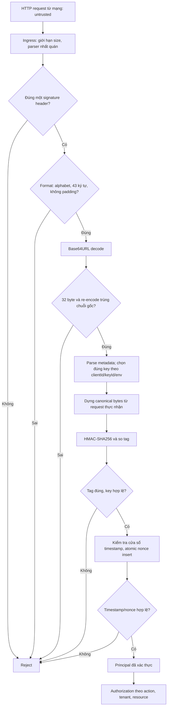

# Kiểm tra signature format trong HMAC Request Authentication

## Mục tiêu học tập

Sau bài học này, bạn có thể:

- Phân biệt **kiểm tra định dạng (format validation)** với **xác minh chữ ký mật mã (cryptographic verification)** và với **phân quyền**.
- Định nghĩa hợp đồng wire format rõ ràng cho signature HMAC-SHA256: vị trí HTTP header, thuật toán, bảng chữ cái mã hóa, độ dài, quy tắc padding và phiên bản.
- Chặn signature thiếu, trùng, sai kiểu mã hóa, sai độ dài, chứa whitespace/ký tự điều khiển hoặc biểu diễn Base64URL không chuẩn (noncanonical).
- Viết Java dùng `Base64.getUrlDecoder()`, `javax.crypto.Mac` và `MessageDigest.isEqual()` để parse nghiêm ngặt rồi xác minh tag.
- Nêu các vấn đề đặc thù của reverse proxy/API gateway: gộp header, biến đổi request, khác biệt parser và giới hạn kích thước.
- Kết hợp kiểm tra format với hợp đồng canonical request, timestamp/nonce chống replay, key rotation và kiểm tra quyền nghiệp vụ.

> **Phạm vi:** Bài thuộc chương **Request signature** của module `SECURITY_AUTHENTICATION_HMAC_REQUEST_AUTHENTICATION`. Ví dụ sử dụng shared secret, HMAC-SHA256 và một hợp đồng canonical request có method, URI, header/body. Các tên header `X-*`, phiên bản và quy tắc mã hóa bên dưới là **hợp đồng ví dụ**, không phải quy định chung cho mọi API.

## 1. “Signature đúng định dạng” nghĩa là gì?

Trong xác thực request bằng HMAC, client tính một **MAC tag** từ khóa bí mật `K` và chuỗi byte canonical `M`:

```text
tagBytes = HMAC-SHA256(K, M)                 // 32 bytes
signature = Base64URL_NoPadding(tagBytes)    // 43 ký tự ASCII
```

Server nhận `signature` dưới dạng chuỗi từ HTTP. Trước khi so chữ ký, server phải quyết định chuỗi đó có **đúng định dạng giao thức đã công bố** hay không: nó được gửi ở đâu, có bao nhiêu giá trị, những ký tự nào được phép, độ dài bao nhiêu, cách giải mã và chuẩn hóa thế nào.

**Chữ ký đúng định dạng không chứng minh request hợp lệ.** Một chuỗi 43 ký tự thuộc bảng chữ cái Base64URL có thể hoàn toàn là dữ liệu do attacker tự chọn. Chỉ khi server dựng lại canonical bytes, tra khóa đúng client, tính HMAC và so sánh thành công mới có cơ sở xác thực việc sử dụng khóa.

| Tầng kiểm tra | Câu hỏi cần trả lời | Ví dụ |
|---|---|---|
| **HTTP wire format** | Header có đúng vị trí, đúng số lần xuất hiện, đúng cấu trúc? | Chính xác một `X-Signature` |
| **Encoded signature format** | Chuỗi có đúng alphabet, length, padding và encoding chuẩn? | Base64URL không padding, đúng 43 ký tự |
| **Cryptographic verification** | HMAC tính lại bằng khóa đúng có khớp tag đã decode? | `MessageDigest.isEqual(expected, received)` |
| **Replay protection** | Request còn trong cửa sổ thời gian và nonce chưa được sử dụng? | Timestamp hợp lệ, atomic nonce insert |
| **Authorization** | Principal đã xác thực có quyền với action/resource/tenant? | Partner A không được thao tác tenant B |

Năm tầng này giải quyết các vấn đề khác nhau. Không được dùng một kết quả `formatValid=true` để bỏ qua HMAC, timestamp/nonce hoặc phân quyền.

## 2. Định nghĩa một hợp đồng format có thể kiểm thử

Giả sử API lựa chọn **hợp đồng phiên bản 1**, với quy định cố định ở server:

| Thuộc tính | Quy ước của ví dụ | Tác dụng |
|---|---|---|
| Thuật toán MAC | `HmacSHA256` | Không cho client tự chọn `none` hoặc thuật toán yếu |
| Độ dài MAC đầy đủ | 32 byte (256 bit) | Giữ nguyên tag, không cắt ngắn tùy ý |
| Encoding trên wire | RFC 4648 Base64URL không padding | Chỉ `A-Z`, `a-z`, `0-9`, `-` và `_` |
| Độ dài chuỗi signature | **43 ký tự ASCII** | Bắt lỗi thiếu/thừa ký tự sớm |
| Vị trí | Một header `X-Signature` | Không đọc signature từ body/query tùy ý |
| Số lần xuất hiện | **Đúng một giá trị** sau HTTP parsing | Không nhập nhằng khi các tầng chọn header khác nhau |
| Padding | **Không chấp nhận `=`** | Một cách biểu diễn duy nhất |
| Whitespace trong giá trị | Không chấp nhận; OWS ở mép header phải có chính sách parse nhất quán | Tránh mỗi bên trim một kiểu |
| Version | `hmac-v1` được chọn theo cấu hình endpoint hoặc định danh version có quy tắc cố định | Tránh downgrade/nhầm định dạng |
| Trường bổ trợ | `X-Client-Id`, `X-Key-Id`, `X-Timestamp`, `X-Nonce` | Được parse riêng, có giới hạn và phải nằm trong phạm vi ký |

Ví dụ request (các giá trị trong `<...>` là **placeholder**, chưa phải request gửi được):

```http
POST /v1/orders?currency=VND HTTP/1.1
Host: api.example.test
Content-Type: application/json
X-Client-Id: partner-17
X-Key-Id: k2
X-Timestamp: <unix-seconds>
X-Nonce: <random-nonce>
X-Signature: <43-char-base64url-tag>

{"orderId":"O-42","amount":120000}
```

`X-Signature` là **tag được truyền**, `X-Key-Id` chỉ **phiên bản khóa**, `X-Client-Id` là **danh tính tự khai**. Ba trường này đều không được tin trước khi xác minh. Secret chỉ tồn tại ở client/verifier hoặc hệ thống quản lý khóa được phép dùng, **không gửi trên mạng**.

Nếu API dùng `Authorization: HMAC-V1 Credential=...,Signature=...` thay vì `X-Signature`, cần đặc tả grammar chính xác cho schema đó: dấu phân cách, thứ tự tham số, quoting, duplicate parameter, case và giới hạn size. **Không lấy parser của một schema khác rồi giả định tương thích**.

## 3. Vì sao HMAC-SHA256 đầy đủ encode thành 43 ký tự?

HMAC-SHA256 trả về 256 bit = 32 byte. Base64 encode 3 byte thành 4 ký tự; với 32 byte:

```text
32 = 10 * 3 + 2 bytes
10 nhóm đủ 3 byte     -> 10 * 4 = 40 ký tự
2 byte còn lại        -> 3 ký tự Base64 + 1 dấu "=" nếu padding
Base64 chuẩn có "="   -> 44 ký tự
Base64URL bỏ padding  -> 43 ký tự
```

Điểm khác biệt của Base64URL: ký tự `+` và `/` của Base64 thường được thay bằng `-` và `_`; trong hợp đồng **không padding** thì `=` cũng bị loại bỏ.

| Biểu diễn tag HMAC-SHA256 32 byte | Ký tự/độ dài | Có chấp nhận trong hợp đồng ví dụ? |
|---|---|---|
| Raw tag | 32 byte nhị phân | Dùng nội bộ để so sánh, không phải format header |
| Hex chữ thường | 64 ký tự `0-9a-f` | Không |
| Base64 thông thường có padding | 44 ký tự; có thể chứa `+`, `/` và kết thúc bằng `=` | Không |
| **Base64URL không padding** | **43 ký tự `A-Za-z0-9_-`** | **Có**, nếu decode canonical và đúng tag |
| Base64URL có padding | 44 ký tự, cuối `=` | Không |
| Base64URL cắt ngắn | Ít hơn 43 ký tự | Không; giao thức không cho phép truncated tag |

Các giá trị 32/43/44/64 ở đây chỉ đúng cho **tag HMAC-SHA256 đầy đủ**. Nếu hệ thống chọn HMAC-SHA512, HMAC-SHA384 hoặc quy định truncate tag, phải tính lại độ dài theo đặc tả tương ứng. Không áp dụng phép kiểm tra “43 ký tự” một cách máy móc cho mọi thuật toán.

### Bẫy: hợp lệ theo decoder chưa chắc là biểu diễn canonical

Base64 có những **bit đệm không mang dữ liệu** ở ký tự cuối của một phần nhóm. Với 32 byte, có 2 bit thấp không được dùng ở ký tự Base64 cuối; encoding chuẩn đặt chúng bằng 0. Một số decoder có thể bỏ qua những bit này và giải ra **cùng một dãy byte** dù chuỗi ký tự khác nhau.

Ví dụ với 32 byte toàn `0x00`, cách encode Base64URL không padding chuẩn là 43 chữ `A`. Thay ký tự cuối thành `B` có thể được một số decoder chấp nhận mà vẫn giải ra 32 byte tương tự. Do đó:

```text
Khớp regex và đúng chiều dài
        ↓
Giải mã Base64URL
        ↓
Đúng 32 byte
        ↓
Encode lại bằng Base64URL không padding
        ↓
So với chuỗi nhận được: phải bằng nhau
```

**Decode → re-encode → so khớp** là cách kiểm tra rõ ràng để từ chối biểu diễn không chuẩn, ngay cả khi decoder đầu vào dễ dãi. Nó còn giúp hệ thống log/cache/xác minh có một biểu diễn duy nhất cho mỗi tag.

## 4. Parse HTTP header nghiêm ngặt trước khi decode

### 4.1. Chỉ chấp nhận đúng một trường signature

HTTP header names **không phân biệt chữ hoa/chữ thường**: `X-Signature` và `x-signature` là cùng tên. Một attacker có thể cố gửi hai giá trị với case khác nhau:

```http
X-Signature: abc...
x-signature: xyz...
```

Một framework có thể lấy giá trị đầu, framework khác lấy cuối, hoặc proxy gộp thành `abc..., xyz...`. Verifier phải **phát hiện và từ chối mọi dạng trùng/nhập nhằng**, thay vì tùy ý chọn một.

Đừng chỉ gọi một API dạng `getHeader("X-Signature")` rồi kết luận header chỉ xuất hiện một lần: API đó có thể trả về một giá trị đầu tiên. Cần dùng cơ chế HTTP parser/framework cho phép kiểm tra **tất cả occurrences/values**, đồng thời cấu hình proxy không làm mất thông tin cần phát hiện. Nếu gateway đã gộp các giá trị, nên từ chối chuỗi chứa dấu phẩy (không thuộc alphabet Base64URL của hợp đồng ví dụ).

### 4.2. Giới hạn đầu vào trước khi xử lý mật mã

Dù tag chỉ dài 43 ký tự, kẻ tấn công có thể gửi header rất dài, hàng nghìn header hoặc giá trị bất thường. Ở ingress và verifier cần:

- Giới hạn tổng kích thước header và request, số lượng header và độ dài từng giá trị.
- Từ chối header trùng, giá trị rỗng, dấu phẩy, CR/LF, control characters, ký tự ngoài ASCII hợp đồng, whitespace bên trong tag.
- Thống nhất quy tắc **OWS** (optional whitespace ở hai biên field value) với proxy và thư viện HTTP: có thể để HTTP parser chuẩn loại OWS trước khi validate, nhưng không trim tùy tiện ở một thành phần trong khi thành phần khác dùng raw bytes khác.
- Kiểm tra `clientId`, `keyId`, `timestamp`, `nonce` có định dạng/chiều dài phù hợp **trước** khi truy vấn kho khóa hoặc kho nonce; các giá trị này là đầu vào tự khai chưa tin cậy.
- Xác định phiên bản hợp đồng ký từ cấu hình đã được phép; nếu hỗ trợ nhiều phiên bản, kiểm tra giá trị version theo danh sách cho phép, ràng buộc version/algorithm vào dữ liệu được ký để tránh nhầm giao thức.

Format validation nên dùng **allowlist cố định** thay vì xử lý chuỗi bằng nhiều lần thay thế/chuẩn hóa mơ hồ. Đặc biệt, đừng tự “sửa” signature sai bằng cách thêm `=`, chuyển `+` thành `-` hoặc xóa whitespace rồi mới kiểm tra: đó là mở rộng ngầm những giá trị được chấp nhận.

## 5. Một pipeline từ header đến kết quả xác thực



Sơ đồ ưu tiên diễn đạt **các điều kiện logic**. Một triển khai thực tế có thể kiểm tra timestamp-format và loại timestamp quá hạn **trước HMAC** để tiết kiệm tài nguyên, nhưng chỉ sau khi HMAC đúng mới biết timestamp được một bên nắm khóa ký. Việc ghi nonce vào store phải xảy ra **sau khi xác minh HMAC**, để attacker không thể chiếm chỗ nonce bằng request với chữ ký giả.

Phân biệt các lỗi:

- **Format error:** không parse được header hoặc tag không theo hợp đồng.
- **Verification failure:** tag có format hợp lệ nhưng HMAC không khớp, khóa không tồn tại/không được phép verify.
- **Replay rejection:** tag hợp lệ nhưng nonce đã dùng, hoặc timestamp không trong cửa sổ.
- **Authorization denial:** danh tính được xác thực nhưng không có quyền thực hiện thao tác.

API có thể dùng `400` cho lỗi cú pháp và `401` cho lỗi xác thực, `403` cho lỗi phân quyền theo hợp đồng riêng. Không nên trả về secret, canonical bytes nhạy cảm hay thông tin tra khóa quá chi tiết cho người gọi.

## 6. Mã Java: kiểm tra Base64URL canonical và xác minh HMAC

Ví dụ sau dùng Java standard library, không phụ thuộc web framework. Nó **nhận đúng giá trị của một header signature đã được kiểm tra số lần xuất hiện** và nhận `canonicalBytes` do **server tự dựng lại** theo hợp đồng ký.

```java
import java.nio.charset.StandardCharsets;
import java.security.GeneralSecurityException;
import java.security.MessageDigest;
import java.util.Arrays;
import java.util.Base64;
import java.util.regex.Pattern;
import javax.crypto.Mac;
import javax.crypto.spec.SecretKeySpec;

public final class HmacSignatureFormat {
    private static final String ALGORITHM = "HmacSHA256";
    private static final int TAG_LENGTH = 32;
    private static final Pattern ENCODED_TAG =
            Pattern.compile("[A-Za-z0-9_-]{43}");
    private static final Base64.Encoder ENCODER =
            Base64.getUrlEncoder().withoutPadding();

    private HmacSignatureFormat() {}

    /** Parse một giá trị X-Signature duy nhất, theo hợp đồng ví dụ. */
    public static byte[] decodeStrict(String signature) {
        if (signature == null ||
                !ENCODED_TAG.matcher(signature).matches()) {
            throw new IllegalArgumentException("Invalid signature format");
        }

        final byte[] bytes;
        try {
            bytes = Base64.getUrlDecoder().decode(signature);
        } catch (IllegalArgumentException invalidBase64) {
            throw new IllegalArgumentException(
                    "Invalid signature format", invalidBase64);
        }

        // Reject độ dài sai và biểu diễn Base64URL không canonical.
        if (bytes.length != TAG_LENGTH ||
                !ENCODER.encodeToString(bytes).equals(signature)) {
            throw new IllegalArgumentException("Invalid signature format");
        }
        return bytes;
    }

    private static byte[] hmac(byte[] secret, byte[] canonicalBytes)
            throws GeneralSecurityException {
        // Tạo Mac mới cho mỗi request; không chia sẻ một instance
        // mutable cho nhiều thread hoặc nhiều tenant.
        Mac mac = Mac.getInstance(ALGORITHM);
        mac.init(new SecretKeySpec(secret, ALGORITHM));
        return mac.doFinal(canonicalBytes);
    }

    /** Client ký bytes canonical đã được chốt đúng hợp đồng. */
    public static String sign(byte[] secret, byte[] canonicalBytes)
            throws GeneralSecurityException {
        return ENCODER.encodeToString(hmac(secret, canonicalBytes));
    }

    /** Verifier gọi sau khi đã tra đúng secret theo client/key ID. */
    public static boolean verify(
            byte[] secret, byte[] canonicalBytes, String signature)
            throws GeneralSecurityException {

        final byte[] received;
        try {
            received = decodeStrict(signature);
        } catch (IllegalArgumentException invalidFormat) {
            return false;
        }

        byte[] expected = hmac(secret, canonicalBytes);
        return MessageDigest.isEqual(expected, received);
    }

    // Kiểm tra tự chứa với RFC 4231 test case 1.
    public static void main(String[] args)
            throws GeneralSecurityException {
        byte[] key = new byte[20];
        Arrays.fill(key, (byte) 0x0b); // Public test vector; không dùng production.
        byte[] message = "Hi There".getBytes(StandardCharsets.US_ASCII);

        String valid = sign(key, message);
        if (!verify(key, message, valid)) {
            throw new AssertionError("Valid tag rejected");
        }
        if (verify(key, "Hi there".getBytes(StandardCharsets.US_ASCII),
                   valid)) {
            throw new AssertionError("Tampered message accepted");
        }
        if (verify(key, message, valid + "=")) {
            throw new AssertionError("Padded tag accepted");
        }
        if (verify(key, message, valid.substring(0, 42))) {
            throw new AssertionError("Short tag accepted");
        }

        System.out.println("Signature format and HMAC checks: PASS");
    }
}
```

**Điều ví dụ đã minh họa:**

1. Regex áp đặt **đúng 43 ký tự ASCII** thuộc alphabet Base64URL, không `=` hoặc whitespace.
2. Decoder chuyển text thành bytes, kiểm tra độ dài **32 byte**, rồi encode lại để từ chối noncanonical encoding.
3. `Mac` dùng HMAC-SHA256 với secret server đã lấy theo scope.
4. `MessageDigest.isEqual` so sánh **hai tag cùng độ dài**, tránh lộ thông tin từng byte như kiểu so sánh thoát sớm.
5. `verify` trả `false` cho format sai hoặc tag sai. Lỗi provider/khóa ở tầng hạ tầng vẫn phải được middleware xử lý theo chính sách.

**Ranh giới quan trọng:** mã này **không** tự đếm số lần header xuất hiện, không parse HTTP request-target, không xác minh timestamp/nonce, không quản lý key rotation hay kiểm tra quyền. HTTP layer phải đảm nhận các bước đó. Không truyền `canonicalBytes` do client tự gửi cho server tin tưởng; server phải **tự xây dựng từ HTTP request thực nhận**.

### Vì sao không so trực tiếp hai chuỗi Base64URL?

Một lựa chọn yếu là `expectedSignature.equals(receivedSignature)`. Khi xác thực MAC, quy trình chuẩn hơn là **parse nghiêm ngặt → decode về bytes → so tag bằng một hàm so sánh phù hợp**, chẳng hạn `MessageDigest.isEqual`. Việc có một định dạng canonical cũng giúp giảm sai khác trong cache, audit và các tầng proxy.

Tuy nhiên, không thể suy ra toàn bộ endpoint “constant-time” chỉ vì sử dụng `isEqual`. Nhánh tra khóa, thời gian đọc body, lỗi parser và kho nonce vẫn có thời gian khác nhau. Áp dụng rate limiting, thông báo lỗi thận trọng và kiểm soát side channel ở toàn bộ pipeline.

## 7. Kiểm tra định dạng metadata đi kèm chữ ký

Một signature HMAC hoàn toàn đúng format nhưng các **header phục vụ xác thực** vẫn có thể sai. Hãy đặc tả chúng cùng một phiên bản hợp đồng.

| Trường | Ví dụ chính sách format | Vì sao cần? |
|---|---|---|
| `X-Client-Id` | Một giá trị, chiều dài giới hạn, alphabet định danh hợp lệ | Tránh lookup tùy ý và mơ hồ danh tính |
| `X-Key-Id` | Một giá trị, ký tự/độ dài giới hạn, thuộc client đã tra | Chọn đúng phiên bản khóa, hỗ trợ rotation |
| `X-Timestamp` | Unix seconds dạng thập phân chuẩn, giới hạn số chữ số, không dấu `+`/whitespace | Tránh cách parse khác nhau, tránh overflow |
| `X-Nonce` | Một giá trị, ví dụ Base64URL của **16 byte ngẫu nhiên** (22 ký tự không padding), canonical | Có độ ngẫu nhiên/duy nhất cho replay state |
| `X-Signature` | Một chuỗi Base64URL không padding 43 ký tự cho HMAC-SHA256 | Phát hiện lỗi truyền và input sai grammar |
| Version/algorithm ID | Một giá trị từ allowlist do server quy định | Không cho downgrade hoặc nhầm thuật toán |

Ví dụ “nonce 16 byte → 22 ký tự Base64URL không padding” là một **lựa chọn hợp đồng**; nếu hệ thống chọn hex hoặc UUID thì format khác. **Nonce cần đủ entropy và tính duy nhất**, không phải chỉ đủ độ dài chuỗi.

Mọi trường có ý nghĩa bảo mật như `clientId`, `keyId`, timestamp, nonce, phiên bản hợp đồng và những header điều khiển hành động phải được **ràng buộc trong canonical request** hoặc bằng một cơ chế tương đương. Parse format chỉ kiểm tra *cách viết*, không chứng minh client được quyền khai báo giá trị ấy.

**Key rotation:** verifier có thể chấp nhận `k1` và `k2` trong giai đoạn chuyển tiếp, nhưng chỉ khi mỗi key thuộc đúng `clientId`, môi trường và còn trong trạng thái được phép xác minh. Nếu key cũ đã bị thu hồi, một chữ ký có format hoàn hảo vẫn phải bị từ chối.

## 8. Format signature khác canonical request format như thế nào?

Hai lớp format liên quan nhưng không giống nhau:

- **Signature format:** cách mang **kết quả HMAC** trên wire, ví dụ `X-Signature: <43 Base64URL chars>`.
- **Canonical request format:** cách dựng chính xác **bytes đầu vào cho HMAC**, có thể gồm method, path/query, host, content type, client ID, key ID, timestamp, nonce và SHA-256 của body.

Ví dụ hợp đồng ký minh họa:

```text
POST
/v1/orders?currency=VND
host:api.example.test
content-type:application/json
x-client-id:partner-17
x-key-id:k2
x-timestamp:<unix-seconds>
x-nonce:<random-nonce>
body-sha256:<base64url-sha256-of-exact-body-bytes>
```

Quy tắc cần nêu rõ: UTF-8, phân tách bằng LF, không có LF cuối, tên header chữ thường, cách chuẩn hóa giá trị, thứ tự các dòng và cách băm **raw body bytes**. Các giá trị `<...>` là placeholder, cần thay bằng dữ liệu thật trước khi ký.

Kiểm tra `X-Signature` là Base64URL 43 ký tự **không phát hiện** nếu client ký `/api/v1/orders` nhưng gateway đã sửa thành `/v1/orders`. Khi hai phía dựng canonical request khác nhau, HMAC sẽ không khớp. Càng nguy hiểm hơn nếu verifier kiểm tra một biểu diễn nhưng backend thực thi biểu diễn khác: cần thống nhất hợp đồng và kiểm soát biến đổi request qua các hop.

**Đừng coi body hash là signature.** `SHA-256(rawBody)` là digest không khóa, có thể được đưa **vào canonical request** để HMAC bảo vệ body. Bản thân digest không xác thực người gửi.

## 9. Proxy/gateway có thể làm format validation sai ra sao?

Khi request đi qua CDN, load balancer, reverse proxy hoặc API gateway, các tầng có thể:

- Chuẩn hóa tên header, trim OWS hoặc gộp những header trùng thành một giá trị cách nhau bằng dấu phẩy.
- Giới hạn/loại bỏ header quá dài, thay đổi `Host` hoặc path/query, hoặc phân tách `Authorization` khác framework backend.
- Cho phép nhiều giá trị trùng, trong khi verifier lấy giá trị đầu và backend lấy giá trị cuối.
- Thêm `Forwarded` hoặc `X-Forwarded-*`, cũng có thể nhận những header này từ Internet nếu chưa được cấu hình xóa/ghi đè.
- Giải nén body, biến đổi charset hoặc serialize lại JSON, làm canonical bytes khác nhau.

Để xử lý:

1. Thống nhất nơi verifier kiểm tra signature và những header nào được bảo toàn đến vị trí đó.
2. Kiểm thử **duplicate header** qua proxy thực tế, kể cả thay case header name; không giả định framework giữ nguyên mọi occurrence.
3. Giới hạn header ở **edge và verifier**, dùng parser thống nhất; từ chối chữ ký bị gộp, chứa dấu phẩy hoặc ký tự ngoài allowlist.
4. Chốt cách xử lý host/URI/body đã ký; chỉ tin header forwarding do proxy **được ủy quyền** tạo hoặc ghi đè.
5. Sau xác thực, xóa/ghi đè mọi header danh tính nội bộ từ client rồi chuyển principal qua một kênh đáng tin đến backend.

Một request có format signature đúng nhưng backend bị gọi **trực tiếp để bỏ qua verifier** vẫn có thể gây lỗi nghiêm trọng. Cần bảo vệ ranh giới giữa gateway và backend, và luôn thực hiện phân quyền theo principal đã xác thực.

## 10. Các trường hợp âm tính phải kiểm thử

| Input hoặc tình huống | Tầng phát hiện | Kết quả mong đợi |
|---|---|---|
| Không có `X-Signature` | HTTP parser | Từ chối |
| Hai `X-Signature`, kể cả khác case tên header | HTTP parser/gateway | Từ chối, không chọn ngẫu nhiên |
| Một header chứa `tag1,tag2` | Format validator | Từ chối vì dấu phẩy không hợp lệ |
| Signature rỗng, quá ngắn, quá dài | Format validator | Từ chối |
| Có `+`, `/`, `=` hoặc whitespace trong tag | Format validator | Từ chối theo hợp đồng Base64URL không padding |
| Có ký tự Unicode, CR/LF hoặc control character | HTTP parser/format validator | Từ chối |
| Tag 43 ký tự đúng alphabet nhưng decode không ra 32 byte | Decoder/length check | Từ chối |
| Tag giải mã ra 32 byte nhưng encode lại không khớp | Canonical encoding check | Từ chối |
| Tag canonical hợp lệ nhưng ký bằng sai secret | HMAC verification | Từ chối |
| Tag đúng với body cũ nhưng body đã sửa | HMAC verification | Từ chối nếu body được ký |
| `clientId`/`keyId` sai format hoặc nhắm khóa của client khác | Metadata parser/key lookup | Từ chối |
| Timestamp quá cũ hoặc quá xa tương lai | Time policy | Từ chối |
| Phát lại đúng tag, đúng timestamp và nonce cũ | Shared nonce store | Từ chối replay |
| Một nonce đồng thời qua hai replica | Atomic insert-if-absent | Tối đa một request được đi tiếp |
| Tag đúng với key đã bị revoke | Key status check | Từ chối |
| Signature đúng nhưng principal thiếu quyền tenant | Authorization | Từ chối thao tác nghiệp vụ |
| Proxy gộp/trim header hoặc rewrite URI | End-to-end ingress test | Format/semantic theo hợp đồng; reject khi nhập nhằng |

Một số decoder chấp nhận nhiều biến thể Base64; hãy tạo **test vector noncanonical** để chứng minh vòng re-encode có tác dụng. Đừng chỉ test một chuỗi rác không giải mã được, vì trường hợp đó không kiểm chứng lỗi *pad bits*.

### Mẫu unit test bổ sung cho validator

Với class `HmacSignatureFormat` ở phần 6, có thể kiểm tra:

```java
// Ví dụ 32 byte 0 -> 43 ký tự 'A'.
String canonical = "A".repeat(43);
String nonCanonical = "A".repeat(42) + "B";

if (HmacSignatureFormat.decodeStrict(canonical).length != 32) {
    throw new AssertionError("Valid Base64URL tag format rejected");
}

try {
    HmacSignatureFormat.decodeStrict(nonCanonical);
    throw new AssertionError("Noncanonical pad bits were accepted");
} catch (IllegalArgumentException expected) {
    // PASS: decode rồi encode lại không trùng biểu diễn đầu vào.
}
```

Test này kiểm tra **format**, không có ý nghĩa rằng 32 byte toàn 0 là HMAC hợp lệ cho một request. Bước HMAC verification vẫn phải tính expected tag bằng secret thực tế.

## 11. Thực hành: thiết kế một signature-format gate cho API Java

Giả sử API `POST /v1/transfers?tenant=alpha` nhận request từ hai đối tác; request đi qua reverse proxy và verifier chạy hai replica. Hệ thống dùng HMAC-SHA256 và đã cấp các key `k1`, `k2` cho từng đối tác.

Hãy thiết kế một lớp `SignatureFormatValidator` và middleware:

1. Định nghĩa **wire contract** cho `X-Signature`: đúng một header, ASCII Base64URL không padding, 43 ký tự, decode 32 byte, encode lại phải khớp.
2. Định nghĩa grammar, giới hạn chiều dài cho `clientId`, `keyId`, timestamp, nonce; xử lý duplicate header, invalid HTTP input và unknown version.
3. Viết phương thức chỉ **parse format**, trả về `byte[32]` hoặc lỗi rõ ràng; viết phương thức **verify HMAC** riêng, dùng `javax.crypto.Mac` và `MessageDigest.isEqual`.
4. Dựng canonical bytes từ **method, URI, header/body do server nhận** theo hợp đồng đã công bố; từ chối request mà proxy làm mất thông tin ký.
5. Tra secret đúng `(clientId, keyId, environment)`, kiểm tra key còn được phép verify, không thử chéo tenant hoặc thuật toán tùy ý.
6. Chỉ khi HMAC đúng mới ghi nonce vào kho chung bằng thao tác nguyên tử; thực hiện authorization với principal và resource.
7. Kiểm thử ít nhất tám trường hợp âm tính ở bảng trên, trong đó có **duplicate headers qua gateway**, **noncanonical Base64URL**, **key bị thu hồi** và **replay giữa hai replica**.

**Tiêu chí đạt:** Có bằng chứng format validator chỉ chấp nhận **một biểu diễn canonical** cho tag HMAC-SHA256; verifier không coi signature đúng format là chữ ký hợp lệ; các bước chống replay, key rotation và authorization đều được áp dụng sau/ngoài kiểm tra format theo đúng trách nhiệm.

---

## Ghi nhớ

Trong `SECURITY_AUTHENTICATION_HMAC_REQUEST_AUTHENTICATION`, kiểm tra signature format là **cổng đầu vào** để loại request không đúng wire contract trước khi xác minh HMAC. Với **HMAC-SHA256 đầy đủ + Base64URL không padding**, một tag hợp lệ về format phải có **43 ký tự ASCII**, giải mã ra **32 byte** và encode lại đúng chuỗi ban đầu. Điều này không thay thế kiểm tra **canonical request**, **shared secret và trạng thái key**, **timestamp/nonce chống replay**, **proxy/gateway** hay **phân quyền**.
