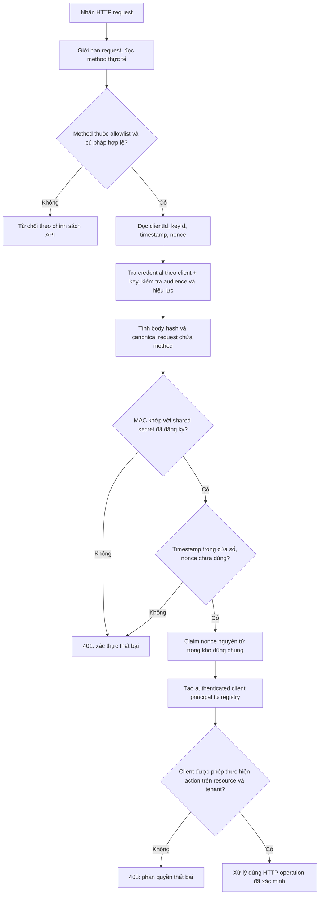

# Phương thức HTTP trong HMAC request authentication

## Mục tiêu bài học

Trong chương **Request components**, **phương thức HTTP (HTTP method)** là một thành phần quan trọng của request cần được đưa vào hợp đồng ký HMAC. `GET`, `POST`, `PUT` hoặc `DELETE` có thể nhắm tới cùng một URI nhưng mang ý nghĩa nghiệp vụ khác nhau. Nếu chữ ký bảo vệ URI và body mà **không bảo vệ phương thức**, server có thể xác nhận một request đã bị đổi loại thao tác mà không phát hiện được việc đổi đó.

Bài học thuộc module `SECURITY_AUTHENTICATION_HMAC_REQUEST_AUTHENTICATION`: thiết kế xác thực HTTP request bằng shared secret và **canonical request** bao gồm phương thức, URI, header hoặc body theo hợp đồng ký; đồng thời xác minh chữ ký, chống replay bằng timestamp/nonce, quản lý key rotation, kiểm thử proxy/gateway và phân biệt authentication với authorization.

Sau bài này, người học có thể:

- Giải thích method là gì, nhận diện tính **safe** và **idempotent** của các phương thức thông dụng, và hiểu giới hạn của các thuộc tính đó.
- Xác định chính xác **method nào** phải được ký và kiểm tra trong HMAC canonical request.
- Thiết kế hợp đồng method nhất quán giữa client, gateway và ứng dụng, bao gồm quy tắc phân biệt chữ hoa/chữ thường, allowlist và method override.
- Viết ví dụ Java dùng `Mac` và `SecretKeySpec` để ký cả method, minh họa đổi `POST` thành `PUT` làm chữ ký không khớp.
- Phân tích tương tác giữa method, authorization, timestamp/nonce, retry, redirect, rotation và proxy/gateway.

## 1. Phương thức HTTP là gì?

HTTP method là một token thể hiện **hành động được yêu cầu** trên tài nguyên được xác định bằng request target. Trong HTTP/1.1, method xuất hiện ở đầu request line:

```http
POST /v1/orders?dryRun=false HTTP/1.1
Host: api.example.test
Content-Type: application/json

{"sku":"A-100","quantity":2}
```

Ở HTTP/2 và HTTP/3, thông tin tương ứng thường nằm trong pseudo-header `:method`. Client và server vẫn phải đồng ý chính xác về **phương thức thực nhận** tại ranh giới xác minh.

Method và URI là hai thành phần khác nhau:

- `POST` trả lời câu hỏi **thực hiện loại thao tác gì** theo semantics và hợp đồng API.
- `/v1/orders?dryRun=false` trả lời **thao tác hướng đến tài nguyên/request target nào**.
- Body và header bổ sung nội dung, biểu diễn dữ liệu và ngữ cảnh.

Ví dụ, cùng URI `/v1/orders/123` có thể được API định nghĩa cho `GET` để đọc, `PUT` để thay thế và `DELETE` để xóa. Chữ ký chỉ bao phủ URI sẽ không ràng buộc request vào hành động HTTP cụ thể.

### 1.1. Semantics của các method thường gặp

| Method | Mục đích thường gặp | Safe? | Idempotent? | Ghi chú khi thiết kế API |
| --- | --- | --- | --- | --- |
| `GET` | Lấy biểu diễn của tài nguyên. | Có | Có | Không thiết kế GET để cố ý thay đổi trạng thái nghiệp vụ; kết quả đọc có thể khác theo thời gian. |
| `HEAD` | Lấy metadata của phản hồi GET, không nhận response body. | Có | Có | Có thể dùng cùng logic routing với GET nhưng method trên wire vẫn là HEAD. |
| `POST` | Xử lý representation theo semantics của tài nguyên đích, thường tạo hoặc kích hoạt thao tác. | Không | Không được bảo đảm | Dùng **idempotency key** nếu nghiệp vụ cần tránh xử lý lặp khi retry. |
| `PUT` | Tạo/thay thế trạng thái tài nguyên đích bằng representation được gửi. | Không | Có | Hai PUT giống nhau có cùng **tác động dự định** khi lặp; response/status không nhất thiết giống. |
| `PATCH` | Áp dụng một tập thay đổi lên tài nguyên. | Không | Không được bảo đảm | Có thể thiết kế thao tác PATCH idempotent, nhưng không mặc định mọi PATCH đều như vậy. |
| `DELETE` | Yêu cầu loại bỏ liên kết/trạng thái tài nguyên đích. | Không | Có | Xóa lặp có thể nhận status khác nhau nhưng tác động dự định vẫn idempotent. |
| `OPTIONS` | Hỏi về các tùy chọn giao tiếp với tài nguyên. | Có | Có | CORS preflight thường là request OPTIONS **riêng**, cần chính sách gateway riêng. |
| `TRACE` | Kiểm tra vòng lặp phản chiếu thông điệp. | Có | Có | Thường bị tắt vì lý do bảo mật; không cần cho API nghiệp vụ HMAC. |
| `CONNECT` | Thiết lập tunnel đến đích. | Không | Không | Không dùng cho endpoint tài nguyên thông thường của API HMAC. |

**Safe** nghĩa là semantics được chuẩn hóa không yêu cầu thay đổi trạng thái như mục đích chính của request; nó không có nghĩa request miễn authentication/authorization. Một `GET` đọc dữ liệu nhạy cảm vẫn phải được kiểm soát quyền.

**Idempotent** nghĩa là khi nhiều request giống nhau được gửi liên tiếp, **tác động dự định** trên server tương đương với gửi một lần. Nó không có nghĩa mạng không thể gửi trùng, response luôn giống, hay không cần nonce. Chống replay của HMAC và idempotency nghiệp vụ giải quyết những câu hỏi khác nhau.

### 1.2. Method có phân biệt hoa/thường không?

Theo HTTP semantics, tên method là token **phân biệt chữ hoa và chữ thường**. Các method tiêu chuẩn thường viết hoa (`GET`, `POST`), nhưng `post` không tự động là cùng token với `POST`.

Với một API HMAC mới, chính sách đơn giản là:

1. **Chỉ chấp nhận đúng chính tả ASCII viết hoa** của các method API công bố, ví dụ `GET`, `HEAD`, `POST`, `PUT`, `PATCH`, `DELETE`.
2. **Ký chính xác method token đã chấp nhận**, không tự gọi `toUpperCase()` rồi âm thầm đổi một method lạ thành method khác.
3. Từ chối method không được hỗ trợ tại ranh giới nhất quán trước khi ứng dụng thực hiện side effect.

Đây là **quy tắc của API minh họa**, không phải khẳng định rằng mọi HTTP server trên thế giới chỉ hỗ trợ token viết hoa. Nếu hệ thống cần method tùy chỉnh, phải công bố chính xác token, semantics và quy tắc ký của method đó.

## 2. Vì sao method phải nằm trong chữ ký HMAC?

Giả sử client có shared secret hợp lệ và gửi một request đã ký:

```http
POST /v1/orders/123 HTTP/1.1
X-Client-Id: partner-orders-prod
X-Key-Id: key-2026-11
X-Timestamp: <epoch-seconds>
X-Nonce: <nonce>
X-Signature: <signature>
```

Nếu dữ liệu HMAC chỉ gồm `/v1/orders/123`, timestamp và nonce, một bên trung gian có khả năng sửa method có thể thay `POST` thành `DELETE` **mà không làm thay đổi các trường đã ký**. Kẻ tấn công không biết secret vẫn có cơ hội chuyển request sang thao tác khác **nếu API/gateway thực thi method khác nhau trên cùng target và không ràng buộc method bằng cơ chế khác**.

Nếu canonical request chứa `POST`, server xác minh một request thực nhận là `DELETE` sẽ tạo **canonical bytes khác** và chữ ký không khớp:

```text
# Dữ liệu client ký
POST
/v1/orders/123

# Dữ liệu server nhận sau khi method bị sửa
DELETE
/v1/orders/123
```

Cùng secret nhưng input khác ⇒ MAC khác với xác suất áp đảo, nếu sử dụng HMAC an toàn.

**Chỉ ký method vẫn chưa đủ:** phải ký cả request target và những trường body/header ảnh hưởng đến cách ứng dụng xử lý request. Ví dụ cùng `POST` nhưng thay query `tenant` hoặc đổi body `amount` cũng cần bị phát hiện theo hợp đồng ký.

### 2.1. HMAC bảo vệ method nào: method trên wire hay method đã biến đổi?

Câu trả lời phải được **chốt theo ranh giới tin cậy**:

- Nếu xác minh ở **gateway**, canonical method là token mà gateway thực nhận từ client, **trước khi** bất kỳ middleware nào rewrite/override method.
- Nếu xác minh ở **backend**, gateway phải bảo toàn method theo hợp đồng; nếu có biến đổi, cần cơ chế truyền method gốc qua kênh tin cậy và ràng buộc nó với thao tác cuối cùng.
- Nếu ứng dụng **cố ý** hỗ trợ method override, hợp đồng phải nêu rõ có ký transport method, effective method hay **cả hai**, thứ tự xác minh và quyền yêu cầu override.

Đối với tích hợp M2M mới, phương án đơn giản, dễ kiểm chứng nhất là **không cho phép method override đối với các endpoint HMAC** và giữ nguyên method từ lúc ký đến lúc được ứng dụng xử lý.

## 3. Hợp đồng canonical request minh họa có chứa method

Không tồn tại một định dạng canonical request dùng chung cho mọi API HMAC. Client và server phải công bố cùng phiên bản, thứ tự trường, cách xử lý URI/header/body, charset, thuật toán và định dạng chữ ký.

Hợp đồng `v1` sau đây có **11 dòng** UTF-8, dùng LF (`\n`) làm ký tự phân cách và **không có LF cuối**:

```text
HMAC-SHA256
v1
<fixed-audience>
<client-id>
<key-id>
<http-method>
<raw-path-and-query>
<normalized-content-type>
<base64url-sha256-body>
<unix-timestamp-seconds>
<nonce>
```

Các trường mang ý nghĩa:

| Dòng | Trường | Quy tắc minh họa |
| --- | --- | --- |
| 1 | `HMAC-SHA256` | Nhãn thuật toán của hợp đồng; JCA gọi `HmacSHA256`. |
| 2 | `v1` | Phiên bản canonicalization. |
| 3 | Audience | Định danh API đích ổn định và đáng tin cậy, ví dụ `inventory-api-prod`. |
| 4–5 | Client ID, key ID | Định danh client và credential được server đăng ký; **đều nằm trong chữ ký**. |
| **6** | **HTTP method** | Token viết hoa đúng allowlist; ký **đúng chuỗi đã được chấp nhận**. |
| 7 | Raw path và query | Giữ nguyên percent-encoding, dấu slash, thứ tự và tham số lặp theo hợp đồng. |
| 8 | Content-Type | Bỏ ASCII space/tab ở hai đầu; nếu vắng mặt thì chuỗi rỗng. |
| 9 | SHA-256 body | Hash của **chính xác byte body**; Base64URL không padding. |
| 10–11 | Timestamp, nonce | Được ký để server kiểm soát cửa sổ thời gian và phát hiện replay. |

Ví dụ `POST` tạo hoặc cập nhật tồn kho:

```http
POST /v1/stock?warehouse=HN-1 HTTP/1.1
Host: inventory.example.test
Content-Type: application/json
X-Client-Id: partner-orders-prod
X-Key-Id: key-2026-11
X-Timestamp: 1795800000
X-Nonce: 9-EdarZXdHuLo3CE_5CAZQ
X-Content-SHA256: <computed-body-hash>
X-Signature: <computed-hmac>

{"sku":"A-100","quantity":12}
```

Dữ liệu canonical tương ứng:

```text
HMAC-SHA256
v1
inventory-api-prod
partner-orders-prod
key-2026-11
POST
/v1/stock?warehouse=HN-1
application/json
<computed-body-hash>
1795800000
9-EdarZXdHuLo3CE_5CAZQ
```

**Giá trị trong dấu `<...>` là placeholder**, không phải hash/chữ ký có thể gửi trực tiếp. Timestamp cố định trong ví dụ chỉ minh họa; trong hệ thống thật phải dùng timestamp hiện tại và nonce mới.

### 3.1. Chính xác hóa quy tắc ký method

Với hợp đồng mẫu:

- Chỉ chấp nhận `GET`, `HEAD`, `POST`, `PUT`, `PATCH` và `DELETE`. `OPTIONS` cho CORS preflight được xử lý bằng chính sách HTTP riêng; nếu cần ký OPTIONS nghiệp vụ, phải bổ sung phương thức đó vào phiên bản/hợp đồng có kiểm soát.
- Không dùng `method.toUpperCase()` để sửa request đến. Nếu nhận `post`, từ chối vì không thuộc allowlist, thay vì tự coi đó là `POST`.
- Không thêm khoảng trắng trước/sau method; chuỗi canonical dùng **chính xác** token đã kiểm tra. Không chấp nhận CR/LF trong bất kỳ trường canonical nào.
- Nếu client gửi `GET` hoặc `HEAD`, hợp đồng **yêu cầu body request rỗng** và Content-Type vắng mặt để giảm mơ hồ. Đây là ràng buộc của ứng dụng mẫu; không phải quy tắc chung nói mọi GET trên HTTP đều không thể mang nội dung.
- `POST`, `PUT`, `PATCH` và `DELETE` được phép mang body; bất kể có hay không, body hash phải phản ánh **đúng byte thực nhận**. Với body rỗng, hash SHA-256 Base64URL không padding là `47DEQpj8HBSa-_TImW-5JCeuQeRkm5NMpJWZG3hSuFU`.
- Trong hợp đồng minh họa, `Content-Encoding` chỉ được vắng mặt hoặc bằng `identity`, tránh vấn đề giải nén làm thay đổi byte body trước khi xác minh.

Một client ký đúng `POST` phải gửi **cùng method đó**. Phần mềm HTTP, reverse proxy hoặc gateway không được đổi method sau khi tạo chữ ký mà không có thỏa thuận lại về ranh giới ký/xác minh.

### 3.2. Method không thể tách khỏi URI, header và body

HMAC trên method bảo vệ tên thao tác, còn những thành phần khác bảo vệ đối tượng và dữ liệu của thao tác.

| Chỉ ký | Rủi ro do trường còn lại không được bảo vệ |
| --- | --- |
| Chỉ method | Có thể đổi URI/query/body/tenant mà MAC vẫn không phản ánh các thay đổi đó. |
| Chỉ URI + body | Có thể đổi method nếu API xử lý method như hành động khác nhau. |
| Method + URI nhưng bỏ body | Có thể sửa nội dung POST/PUT/PATCH/DELETE. |
| Method + URI + body nhưng bỏ Content-Type liên quan | Có thể thay đổi cách parse payload trong một số API. |
| Method + URI + body nhưng bỏ timestamp/nonce | Request đã ký có thể bị phát lại trong thời gian dài hoặc vô hạn theo chính sách khóa. |

Phạm vi chính xác phải xuất phát từ **hợp đồng ký và semantics xử lý request**, không chỉ từ việc có một đoạn code gọi `Mac.doFinal`.

## 4. Tạo và xác minh chữ ký chứa HTTP method bằng Java

Ví dụ sau sử dụng JDK 17+ và chỉ các API chuẩn. Chương trình mô phỏng hai phía có cùng shared secret để nhìn thấy ảnh hưởng khi đổi method. Trong ứng dụng production, secret phải đến từ secret manager/registry của đúng `(clientId, keyId)`; server phải lấy method và byte body từ HTTP request thực nhận.

### 4.1. Chương trình Java hoàn chỉnh

```java
import java.nio.charset.StandardCharsets;
import java.security.GeneralSecurityException;
import java.security.MessageDigest;
import java.security.SecureRandom;
import java.time.Instant;
import java.util.Arrays;
import java.util.Base64;
import java.util.Objects;
import java.util.Set;
import javax.crypto.Mac;
import javax.crypto.spec.SecretKeySpec;

public final class HmacHttpMethodDemo {
    private static final String AUDIENCE = "inventory-api-prod";
    private static final Set<String> ALLOWED_METHODS =
            Set.of("GET", "HEAD", "POST", "PUT", "PATCH", "DELETE");

    private static final Base64.Encoder ENCODER =
            Base64.getUrlEncoder().withoutPadding();
    private static final Base64.Decoder DECODER = Base64.getUrlDecoder();

    private HmacHttpMethodDemo() {}

    record Request(
            String method, String rawTarget, String contentType,
            byte[] body, String clientId, String keyId,
            String timestamp, String nonce) {
        Request {
            body = Objects.requireNonNull(body, "body").clone();
        }

        @Override
        public byte[] body() {
            return body.clone(); // Tránh sửa byte body từ bên ngoài.
        }
    }

    record SignedHeaders(String bodyHash, String signature) {}

    static String hashBody(byte[] body) throws GeneralSecurityException {
        byte[] digest = MessageDigest
                .getInstance("SHA-256")
                .digest(body);
        return ENCODER.encodeToString(digest);
    }

    static String canonical(Request r, String bodyHash) {
        // Phải dùng method chính xác, không âm thầm uppercase.
        if (!ALLOWED_METHODS.contains(r.method())) {
            throw new IllegalArgumentException("Unsupported method");
        }
        if ((r.method().equals("GET") || r.method().equals("HEAD"))
                && r.body().length != 0) {
            throw new IllegalArgumentException("GET/HEAD body not allowed");
        }
        if ((r.method().equals("GET") || r.method().equals("HEAD"))
                && r.contentType() != null && !r.contentType().isEmpty()) {
            throw new IllegalArgumentException("GET/HEAD Content-Type not allowed");
        }
        if (r.rawTarget() == null || !r.rawTarget().startsWith("/")) {
            throw new IllegalArgumentException("Invalid raw target");
        }

        String contentType =
                r.contentType() == null ? "" : trimOws(r.contentType());
        String[] fields = {
                "HMAC-SHA256", "v1", AUDIENCE, r.clientId(), r.keyId(),
                r.method(), r.rawTarget(), contentType, bodyHash,
                r.timestamp(), r.nonce()
        };
        for (String field : fields) {
            if (field == null || field.indexOf('\r') >= 0
                    || field.indexOf('\n') >= 0) {
                throw new IllegalArgumentException("Invalid canonical field");
            }
        }
        return String.join("\n", fields); // Không có LF cuối.
    }

    static String trimOws(String s) {
        int left = 0;
        int right = s.length();
        while (left < right &&
                (s.charAt(left) == ' ' || s.charAt(left) == '\t')) {
            left++;
        }
        while (right > left &&
                (s.charAt(right - 1) == ' ' || s.charAt(right - 1) == '\t')) {
            right--;
        }
        return s.substring(left, right);
    }

    static byte[] computeMac(byte[] secret, String canonical)
            throws GeneralSecurityException {
        Mac mac = Mac.getInstance("HmacSHA256");
        mac.init(new SecretKeySpec(secret, "HmacSHA256"));
        return mac.doFinal(canonical.getBytes(StandardCharsets.UTF_8));
    }

    static SignedHeaders sign(Request r, byte[] secret)
            throws GeneralSecurityException {
        String bodyHash = hashBody(r.body());
        String signature = ENCODER.encodeToString(
                computeMac(secret, canonical(r, bodyHash)));
        return new SignedHeaders(bodyHash, signature);
    }

    static boolean verify(Request received, SignedHeaders headers,
                          byte[] secret)
            throws GeneralSecurityException {
        if (headers == null || headers.bodyHash() == null
                || headers.signature() == null) {
            return false;
        }
        try {
            String bodyHash = hashBody(received.body());
            if (!bodyHash.equals(headers.bodyHash())) {
                return false;
            }
            // 32 byte HMAC-SHA256 -> 43 ký tự Base64URL không padding.
            if (!headers.signature().matches("[A-Za-z0-9_-]{43}")) {
                return false;
            }
            byte[] supplied = DECODER.decode(headers.signature());
            if (supplied.length != 32 ||
                    !ENCODER.encodeToString(supplied)
                            .equals(headers.signature())) {
                return false;
            }
            byte[] expected = computeMac(secret, canonical(received, bodyHash));
            return MessageDigest.isEqual(expected, supplied);
        } catch (IllegalArgumentException ex) {
            return false;
        }
    }

    public static void main(String[] args)
            throws GeneralSecurityException {
        byte[] secret = new byte[32];
        SecureRandom random = new SecureRandom();
        random.nextBytes(secret);

        byte[] nonce = new byte[16];
        random.nextBytes(nonce);
        byte[] body = "{\"sku\":\"A-100\",\"quantity\":12}"
                .getBytes(StandardCharsets.UTF_8);

        Request originalPost = new Request(
                "POST", "/v1/stock?warehouse=HN-1", "application/json",
                body, "partner-orders-prod", "key-2026-11",
                Long.toString(Instant.now().getEpochSecond()),
                ENCODER.encodeToString(nonce));

        SignedHeaders signed = sign(originalPost, secret);
        System.out.println("Valid POST: " +
                verify(originalPost, signed, secret));

        Request changedToPut = new Request(
                "PUT", originalPost.rawTarget(), originalPost.contentType(),
                originalPost.body(), originalPost.clientId(), originalPost.keyId(),
                originalPost.timestamp(), originalPost.nonce());
        System.out.println("POST changed to PUT accepted: " +
                verify(changedToPut, signed, secret));

        Request lowercase = new Request(
                "post", originalPost.rawTarget(), originalPost.contentType(),
                originalPost.body(), originalPost.clientId(), originalPost.keyId(),
                originalPost.timestamp(), originalPost.nonce());
        System.out.println("Lowercase method accepted: " +
                verify(lowercase, signed, secret));

        Arrays.fill(secret, (byte) 0);
    }
}
```

Kết quả dự kiến:

```text
Valid POST: true
POST changed to PUT accepted: false
Lowercase method accepted: false
```

Ví dụ sinh secret ngẫu nhiên trong quá trình chạy **chỉ để mô phỏng phép ký**; không in secret hoặc đưa vào source production. `Request` sao chép mảng body để hạn chế lỗi body bị thay đổi sau khi ký. Trong hệ thống thực, adapter HTTP phải giới hạn kích thước, kiểm tra header trùng và giữ đúng byte body trước bước parse.

### 4.2. Vì sao cùng secret vẫn không xác minh được sau khi đổi method?

`Mac` thực hiện phép tính trên **byte của chuỗi canonical**. `POST` có byte UTF-8 khác `PUT`; do đó, canonical request khác ở dòng method dù URI, body, timestamp, nonce và secret giữ nguyên. `MessageDigest.isEqual` so sánh các **byte MAC** thay cho việc so sánh chữ ký dạng chuỗi dễ dừng sớm.

Những điểm riêng của phép xác minh:

- `MessageDigest("SHA-256")` dùng để hash body, **không thay thế** `Mac("HmacSHA256")`.
- `SecretKeySpec(secret, "HmacSHA256")` bọc raw shared secret. Nếu credential được cung cấp dưới dạng Base64URL, phải **decode thành byte gốc** trước khi tạo `SecretKeySpec`.
- MAC được mã hóa Base64URL không padding để truyền qua header. Encoding không bảo mật secret và không biến MAC thành thuật toán khác.
- `verify(...)` hiện chỉ kiểm tra **MAC và quy tắc canonical trong bộ nhớ**, **chưa xác thực HTTP đầy đủ**: chưa kiểm tra timestamp thực tế, nonce store, tình trạng key/audience trong registry hay authorization.

## 5. Dùng HTTP method đúng ranh giới khi qua gateway và framework

Một request có thể đi qua HTTP client library, CDN/WAF, load balancer, API gateway, reverse proxy và framework backend. Chữ ký HMAC chỉ đối chiếu được nếu method mà client ký và method server xác minh **cùng cách diễn giải**.

### 5.1. HTTP/1.1, HTTP/2 và HTTP/3

- Ở HTTP/1.1, method nằm trong request line.
- Ở HTTP/2/HTTP/3, method thường được đưa vào pseudo-header `:method`.
- Một proxy chuyển đổi phiên bản HTTP vẫn cần bảo toàn method token và semantics của thao tác đã ký; đổi protocol framing **không phải** lý do tự đổi `POST` thành `GET`.

Khi backend dùng Servlet, `HttpServletRequest.getMethod()` cung cấp tên method request đã được container tiếp nhận. Với Spring MVC, method có thể đã qua filter hoặc gateway xử lý; cần biết rõ **bước nào chạy trước lớp xác minh HMAC**. Không tin một header như `X-Original-Method` nếu nó có thể được client ngoài internet tự thêm vào.

### 5.2. Method override: một nguồn nhầm lẫn nghiêm trọng

Một số framework hỗ trợ quy ước:

```http
POST /v1/orders/123 HTTP/1.1
X-HTTP-Method-Override: DELETE
```

Hoặc biểu mẫu có trường `_method=DELETE`. Lúc đó, request trên wire là `POST` nhưng handler có thể xử lý theo `DELETE`.

Nếu client ký `POST` và bộ lọc HMAC xác minh `POST`, nhưng middleware sau đó đổi thành `DELETE`, **phép toán cuối cùng không còn là phép toán mà người thiết kế tưởng đã được ràng buộc bằng method đã ký**. HMAC không tự ngăn một thành phần ứng dụng nội bộ đổi semantics sau xác minh.

Đối với API M2M, nên **tắt method override** hoặc từ chối các header/parameter override tại edge đối với endpoint được bảo vệ bằng HMAC. Nếu bắt buộc hỗ trợ, hợp đồng phải quy định minh bạch việc ký **cả transport method và effective method**; xác minh cần diễn ra ở ranh giới đáng tin trước khi override có hiệu lực, và authorization phải kiểm tra **effective action** cuối cùng.

### 5.3. Route mapping không được thay đổi ý nghĩa của method

Các framework có thể dùng chung logic handler cho GET và HEAD, hoặc định tuyến cả POST và PUT đến một controller. Điều đó không làm hai method tương đương về bảo mật.

Một request được ký bằng `HEAD` phải xác minh theo `HEAD` ngay cả khi handler phía sau gọi chung logic đọc của GET. Chính sách quyền vẫn phải áp dụng cho tài nguyên. Tương tự, nếu POST và PUT cùng vào một handler, action được phân quyền phải phản ánh chính xác **ý nghĩa thao tác thực sự** của method và resource.

### 5.4. Proxy rewrite URI có thể làm chữ ký sai dù method giữ nguyên

Method không thay đổi nhưng gateway rewrite:

```text
Client ký:     POST /public/v1/stock?warehouse=HN-1
Backend nhận:  POST /internal/stock?warehouse=HN-1
```

Chữ ký vẫn sai nếu backend tính HMAC trên raw target đã rewrite. Giải pháp thường là **xác minh tại gateway trước rewrite**, hoặc truyền dữ liệu gốc qua kênh tin cậy, bảo đảm client không giả mạo các trường nội bộ. Nếu gateway xác minh rồi forward principal, backend chỉ được tin danh tính đó trên kênh được bảo vệ và phải kiểm tra quyền đối với **operation cuối cùng**.

Không “sửa lỗi” bằng cách loại method hoặc URI ra khỏi canonical request; phải chọn rõ ranh giới ký/xác minh và bảo vệ các thay đổi được phép.

## 6. Retry, redirect và method: chữ ký có được dùng lại không?

HTTP client có thể tự retry khi mất kết nối hoặc tự đi theo redirect. Đây là nơi method và chữ ký cần được xử lý cẩn trọng.

### 6.1. Retry cùng phương thức

Một request được retry với **cùng method, URI, body và header đã ký** có thể có MAC vẫn đúng. Nhưng nếu dùng cùng timestamp và nonce, **nonce store** phải từ chối request đã được chấp nhận trước đó. Nếu muốn client retry sau khi mất response, ứng dụng cần thiết kế rõ:

- Client có thể tạo **timestamp/nonce mới và chữ ký mới**, nhưng thao tác POST vẫn có khả năng xảy ra hai lần.
- **Idempotency key** ở tầng nghiệp vụ, được ràng buộc với client, request và tài nguyên, giúp tránh xử lý trùng khi retry có chủ đích.
- Cần xác định cách trả lại kết quả cũ hoặc trạng thái đang xử lý; không vô hiệu kiểm tra nonce để “cho phép retry”.

`PUT` và `DELETE` là idempotent theo semantics chuẩn, nhưng vẫn cần HMAC và chống replay. Idempotency không phải bằng chứng rằng request cũ có thể được chấp nhận vô thời hạn.

### 6.2. Redirect có thể đổi method

Một số redirect có quy tắc và hành vi client khác nhau:

| Mã redirect | Tác động phương thức đáng chú ý |
| --- | --- |
| `303 See Other` | Client thường chuyển sang **GET** để lấy tài nguyên khác sau request ban đầu. |
| `307 Temporary Redirect` | Bảo toàn method và body khi tự động chuyển tiếp theo semantics của mã trạng thái. |
| `308 Permanent Redirect` | Bảo toàn method và body khi tự động chuyển tiếp theo semantics của mã trạng thái. |
| `301` / `302` | Lịch sử triển khai có thể làm một số client chuyển `POST` thành `GET`; cần kiểm tra hành vi thư viện thật. |

Một redirect sang URI mới thay đổi **ít nhất raw target**, và đôi khi thay đổi cả **method**. Vì vậy client phải dựng **canonical request mới và ký lại** với timestamp/nonce phù hợp. Không tự động chuyển signature hoặc shared secret sang host/dịch vụ không thuộc audience đã cấp. Một lựa chọn thực tế với M2M có chữ ký là **tắt tự động follow redirect** hoặc chỉ cho phép đích đã đăng ký, rồi ký lại request theo đích và method thực tế.

## 7. Xác minh method trong quy trình authentication và authorization

Một hệ thống HMAC request auth hoàn chỉnh không dừng ở việc method đã được ký. Luồng phía server nên làm rõ:



Một cách triển khai có thể kiểm tra timestamp **trước** khi tính MAC để giảm chi phí, nhưng chỉ sau khi kiểm tra MAC mới được tin timestamp do client khai là thành phần được bảo vệ. Nonce chỉ nên được claim sau khi MAC hợp lệ, tránh request giả mạo có thể chiếm namespace nonce.

### 7.1. Phân quyền theo method và tài nguyên thực

Ví dụ registry cho `partner-orders-prod` scope `stock:read` nhưng **không có** `stock:update`.

| Request | MAC | Quyền của client | Kết quả |
| --- | --- | --- | --- |
| `GET /v1/stock/A-100` | Đúng, nonce mới | Có `stock:read` đúng tenant | Cho phép đọc khi các điều kiện khác đạt. |
| `PUT /v1/stock/A-100` | Đúng, nonce mới | Thiếu `stock:update` | **403 Forbidden**. |
| `POST /v1/stock` đã ký, bị đổi thành `PUT` | Sai MAC | Chưa đánh giá quyền | **401 Unauthorized** theo chính sách mẫu. |
| `DELETE /v1/stock/A-100` | Đúng, nonce mới | Thiếu `stock:delete` | **403 Forbidden**. |

**Authentication** trả lời request có bằng chứng hợp lệ từ client đang nắm giữ secret đã cấp hay không. **Authorization** trả lời client đã xác thực có quyền thực hiện action tương ứng với method, URI, tenant và tài nguyên cụ thể hay không. Một MAC hợp lệ không chứng minh `userId` trong body là người dùng cuối đã xác thực.

### 7.2. Method được ký nhưng credential hết hạn thì sao?

Server phải tra đúng credential theo `(clientId, keyId)`. Trong thời gian **key rotation**, có thể cho phép khóa cũ và mới cùng xác minh trong khoảng chuyển tiếp hữu hạn, nhưng sau khi thu hồi key cũ, mọi request dùng key đó phải bị từ chối dù HMAC toán học vẫn khớp. Method là một phần canonical request, còn **chính sách hiệu lực khóa** thuộc registry/secret manager.

Nên ký cả `clientId`, `keyId`, audience, timestamp và nonce; tránh lấy scope/role trực tiếp từ header do client tự khai.

## 8. Method và replay protection không phải một cơ chế

HMAC bảo vệ method trước **sự thay đổi sau khi ký**. Nếu một kẻ tấn công chỉ phát lại **nguyên request POST đã ký**, method vẫn là POST, canonical bytes và MAC có thể vẫn khớp. Do đó cần:

1. Timestamp có chữ ký: ví dụ chấp nhận độ lệch trong cửa sổ **±300 giây**, tính theo đồng hồ server đồng bộ.
2. Nonce có chữ ký: tạo bằng CSPRNG, tối thiểu 128 bit ngẫu nhiên, dùng một lần trong phạm vi credential/audience.
3. Kho nonce dùng chung giữa các instance, thao tác **put-if-absent nguyên tử** (chẳng hạn Redis `SET key value NX EX 610`) và **fail closed** khi không thể đảm bảo chống replay.
4. TTL nonce đủ dài để bao phủ thời gian còn có thể gửi lại request; với biên ±300 giây, TTL khoảng **610 giây tính từ lúc claim** là một ví dụ có dự phòng.
5. Chính sách retry/idempotency riêng cho tác động nghiệp vụ của POST/PUT/PATCH/DELETE.

Không dùng method safe/idempotent làm lý do bỏ timestamp/nonce một cách tùy tiện. Dù GET không có tác động sửa tài nguyên được yêu cầu, replay GET vào API nhạy cảm vẫn có thể lặp lại truy vấn, gây tải hoặc tạo tác động phụ ở hạ tầng.

## 9. Các lỗi hay gặp khi ký HTTP method

| Sai sót | Triệu chứng | Cách xử lý |
| --- | --- | --- |
| Bỏ method khỏi canonical request | Chữ ký có thể vẫn khớp sau khi đổi POST thành PUT/DELETE. | Ký method trong hợp đồng; server tái tạo từ method thực nhận. |
| Tự uppercase mọi token | `post` bị ứng dụng âm thầm xử lý như POST dù HTTP token phân biệt hoa/thường. | Allowlist tên exact, reject dữ liệu không hợp lệ. |
| Dùng `X-HTTP-Method-Override` không kiểm soát | Ký POST nhưng handler làm DELETE. | Tắt override hoặc ký/ràng buộc effective method theo hợp đồng rõ ràng. |
| Xác minh quá muộn sau proxy rewrite | Raw target/method ở backend không còn như client ký. | Chọn trust boundary, verify trước rewrite hoặc bảo toàn dữ liệu gốc tin cậy. |
| HEAD được framework chuyển thành GET trước verifier | Chữ ký HEAD không khớp hoặc bị gán sai action. | Bảo toàn method gốc qua lớp xác minh; phân quyền trên operation thực. |
| Client tự follow redirect mà không ký lại | MAC sai tại URI/method mới, hoặc bị gửi sang audience khác. | Kiểm soát redirect, tái ký theo request cuối cùng và giới hạn audience. |
| Chỉ ký method/URI, bỏ body hash | Có thể sửa payload POST/PUT/PATCH. | Ký digest của byte body thật và header liên quan. |
| Dùng GET cho thao tác sửa dữ liệu | Crawler, cache, prefetch hoặc client có thể kích hoạt side effect ngoài ý muốn. | Tuân thủ semantics, chọn method và endpoint đúng nghiệp vụ. |
| Coi idempotency là chống replay | Request cũ vẫn có thể được chấp nhận nhiều lần. | Dùng timestamp/nonce ký kèm và kho nonce nguyên tử. |
| Bỏ authorization vì MAC hợp lệ | Client có thể dùng method vượt scope/tenant. | Map method + resource thành action rồi kiểm tra quyền độc lập. |
| Không thống nhất raw target giữa HTTP/1.1 và HTTP/2 | Method đúng nhưng canonical khác do gateway chuyển đổi. | Test chuyển đổi protocol, raw path/query và header tại điểm xác minh. |

Một lỗi vận hành khác là log toàn bộ canonical request để chẩn đoán. Canonical string thường chứa URI/query, định danh và có thể chứa dữ liệu nhạy cảm trong một số hợp đồng. Chỉ lưu dữ liệu chẩn đoán đã lọc và giới hạn truy cập; tuyệt đối không log shared secret.

## 10. Ma trận kiểm thử phương thức HTTP trong HMAC

Test cần chạy qua **đường đi thực tế** từ client → gateway → ứng dụng, đồng thời kiểm tra kết quả MAC và **action** mà ứng dụng cuối cùng thực hiện.

| Tình huống kiểm thử | Kỳ vọng |
| --- | --- |
| Ký POST, server nhận POST; URI/body/header/secret đúng | MAC hợp lệ; qua bước authentication khi timestamp/nonce/key hợp lệ. |
| Ký POST, đổi thành PUT trước verifier | MAC sai; không thực hiện PUT. |
| Ký POST, đổi thành DELETE trước verifier | MAC sai; không thực hiện DELETE. |
| Ký POST, đổi thành `post` | Method bị từ chối bởi allowlist exact. |
| Ký GET, server nhận HEAD | MAC sai vì method khác, dù có thể chung controller. |
| GET/HEAD có request body theo hợp đồng mẫu | Bị từ chối bởi ràng buộc body rỗng của API mẫu. |
| Ký DELETE với body rỗng, thay URI tài nguyên | MAC sai do raw target thay đổi. |
| Ký POST, client tự follow 303 thành GET và giữ chữ ký cũ | MAC sai; phải tái ký request mới nếu redirect được phép. |
| Ký POST, proxy chuyển sang PUT do method override | Từ chối override hoặc xử lý theo quy tắc method đã ký; không âm thầm thực hiện action khác. |
| Ký POST, gateway chỉ rewrite path nhưng method giữ nguyên | Phải xác minh trước rewrite hoặc có cách dùng raw target gốc tin cậy. |
| Ký POST, body JSON bị serialize lại bởi middleware | Body hash/MAC không còn khớp. |
| Ký request hợp lệ rồi gửi lại cùng nonce | Chỉ lần đầu claim nonce thành công. |
| Hai request giống hệt tới hai instance | Kho nonce dùng chung chỉ cho tối đa một request được claim. |
| MAC đúng nhưng scope không cho phép method/action | Authentication thành công, authorization trả 403. |
| MAC đúng nhưng key ID đã bị thu hồi | Authentication từ chối theo chính sách key rotation. |
| CORS preflight OPTIONS chưa ký | Được xử lý bởi chính sách CORS riêng; không coi preflight là request nghiệp vụ đã xác thực. |

Nên chuẩn bị **test vector** cho nhiều SDK chứa: method, raw URI/path+query, Content-Type, chính xác byte body, audience, client ID, key ID, timestamp, nonce, canonical string, body hash và MAC mong đợi. Mỗi SDK phải cho kết quả giống nhau trên cùng byte secret và input. Có thể tạo hai vector chỉ khác dòng `POST`/`PUT` để xác nhận chữ ký thay đổi.

## 11. Bài thực hành

Xây dựng một client Java và một server giả lập cho `/v1/stock`, dùng HMAC-SHA256:

1. **Khai báo allowlist** `GET`, `HEAD`, `POST`, `PUT`, `PATCH`, `DELETE`. Chặn các method viết thường và tắt method override.
2. **Xây canonical request `v1`** có method đứng trước raw target, kèm audience, client ID, key ID, Content-Type, body hash, timestamp và nonce.
3. Dùng `Mac.getInstance("HmacSHA256")`, `SecretKeySpec` và UTF-8 để ký. Ở server, đọc method từ request thực nhận, tự dựng canonical và so sánh MAC theo byte.
4. Ký một POST hợp lệ, sau đó đổi thành PUT/DELETE/GET/HEAD nhưng **giữ nguyên chữ ký**. Ghi lại kết quả; tất cả biến thể thay method phải bị từ chối.
5. Gắn gateway hoặc middleware có khả năng method override và route rewrite. Xác định thứ tự filter, điểm xác minh, method gốc, method handler thực thi và cách authorization được áp dụng.
6. Tạo request POST mới với nonce mới nhưng cùng dữ liệu nghiệp vụ để thử idempotency. Thử gửi **nguyên request cũ** để thấy nonce store chặn replay. Đừng nhầm hai kết quả.
7. Cho client scope `stock:read` nhưng không có `stock:update`. Ký một PUT hoàn toàn hợp lệ, xác nhận authentication thành công và authorization trả **403**.
8. Cấp một key ID mới trong giai đoạn rotation; kiểm tra cùng method/URI vẫn được ký bởi key mới, còn key đã thu hồi không được chấp nhận.

**Câu hỏi tự đánh giá:** Vì sao `POST` và `PUT` cùng URI có thể cần quyền khác nhau? Vì sao chuyển `post` thành `POST` trước khi ký/xác minh có thể gây mơ hồ? Khi một gateway đổi method sau bước xác minh HMAC, còn điều gì phải được ràng buộc để tránh thực thi sai action? Vì sao GET idempotent vẫn cần chống replay theo chính sách HMAC? Sau redirect 303, chữ ký POST cũ có dùng cho GET mới được không? Nếu MAC đúng nhưng client thiếu scope xóa tài nguyên, tầng nào phải từ chối?

## 12. Tài liệu tham khảo

- **RFC 9110 — HTTP Semantics:** định nghĩa method token, phân biệt hoa/thường, semantics của GET, HEAD, POST, PUT, DELETE, OPTIONS, TRACE, CONNECT; safe và idempotent; redirect.
- **RFC 5789 — PATCH Method for HTTP:** semantics của PATCH và lưu ý về idempotency.
- **RFC 2104 — HMAC: Keyed-Hashing for Message Authentication:** phép MAC dùng secret key và hàm băm.
- **Java SE API — `javax.crypto.Mac` và `javax.crypto.spec.SecretKeySpec`:** API tạo và xác minh HMAC-SHA256.
- **RFC 4648 — Base Encodings:** biểu diễn Base64URL của body hash và MAC.
- **RFC 9113 / RFC 9114:** HTTP/2 và HTTP/3, bao gồm cách biểu diễn request với pseudo-header `:method`.

**Phương thức HTTP là một phần của hành động được yêu cầu**, vì vậy HMAC request authentication phải ràng buộc method vào các byte đã ký và xác minh trên cùng method mà hệ thống dùng để xử lý request. Khi method, URI, header, body, timestamp/nonce và secret cùng nhất quán qua client–gateway–server, chữ ký mới có ý nghĩa xác thực; quyền thực hiện hành động trên tài nguyên vẫn phải được kiểm tra riêng.

