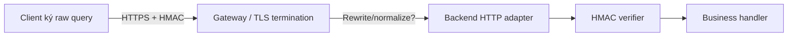
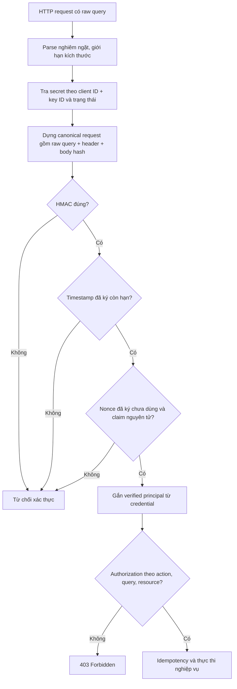

# Query string

## 1. Query string nằm ở đâu trong request HMAC?

Trong URL `/v1/transfers?currency=VND&dryRun=false`, **query string** là phần sau dấu `?`: `currency=VND&dryRun=false`. Nó thường chứa bộ lọc, phân trang, lựa chọn định dạng hoặc tham số trực tiếp ảnh hưởng đến thao tác nghiệp vụ. Trong hệ thống xác thực HTTP request bằng HMAC, nếu client ký method và body nhưng **bỏ query string**, kẻ có khả năng thay đổi request trên đường truyền hoặc tại proxy có thể sửa hành vi mà chữ ký vẫn không đổi.

Module `SECURITY_AUTHENTICATION_HMAC_REQUEST_AUTHENTICATION` sử dụng shared secret và **canonical request** để bảo vệ các thành phần đã thỏa thuận: phương thức, URI, header và/hoặc body. Bài này đi sâu vào **query string**: lấy nó từ đâu, biểu diễn thành byte ký như thế nào, xử lý sự khác biệt giữa cách nhìn của client/gateway/backend ra sao, và kiểm thử tính toàn vẹn của tham số.

Sau bài học, người học cần:

- Phân biệt path, query, fragment, raw query, parsed parameters và canonical query.
- Chỉ ra nguy cơ nếu query ảnh hưởng nghiệp vụ nhưng không nằm trong HMAC signature input.
- Chọn một **hợp đồng canonicalization** có thể kiểm thử, nhất là thứ tự tham số, tham số trùng tên, phần trăm mã hóa (`%XX`), dấu cộng (`+`), giá trị rỗng và query rỗng.
- Dựng signature input có query bằng Java 17 và xác minh HMAC-SHA256 trên đúng byte.
- Phát hiện sai lệch do proxy/gateway rewrite, decode/encode lại URL và khác biệt giữa parser xác minh với parser nghiệp vụ.
- Kết hợp HMAC với timestamp/nonce, key rotation và authorization; hiểu vì sao mỗi cơ chế giải quyết một rủi ro khác nhau.

## 2. Cấu trúc URL và các hình thức query

Một HTTP request-target dạng thông dụng:

```http
POST /v1/transfers?currency=VND&dryRun=false HTTP/1.1
Host: api.example.test
Content-Type: application/json

{"transferId":"tr-101","amount":250000}
```

| Thành phần | Giá trị minh họa | Lưu ý khi ký |
| --- | --- | --- |
| HTTP method | `POST` | Phải ký nếu thay method làm đổi hành vi |
| Path | `/v1/transfers` | Là phần trước `?`, cần xác định dạng raw hay đã chuẩn hóa |
| **Raw query** | `currency=VND&dryRun=false` | Phần sau `?`, không bao gồm dấu `?` trong hợp đồng ví dụ |
| Parsed query | `currency → VND`, `dryRun → false` | Do framework decode và parse; có thể làm mất thứ tự, encoding và giá trị trùng |
| Fragment | `#section1` trên URL ở trình duyệt | Không được gửi trong HTTP request-target thông thường; không phải dữ liệu để server ký |
| Authority/Host | `api.example.test` | Nếu quyết định tenant/routing thì phải được ràng buộc hoặc kiểm soát riêng |

Trên HTTP/1.1, gateway thường nhận request-target chứa path và query; trên HTTP/2 và HTTP/3, pseudo-header `:path` đại diện cho path và query. Bộ xác minh phải lấy dữ liệu từ **adapter HTTP tại ranh giới xác minh đã thống nhất**, không tự suy dựng query bằng cách nối lại một map tham số.

### Phân biệt ba tình trạng dễ bị gộp

```text
GET /v1/orders          -> không có query: null trong adapter minh họa
GET /v1/orders?         -> có dấu ?, nhưng query rỗng: ""
GET /v1/orders?x=      -> raw query = "x="; tham số x có giá trị rỗng
GET /v1/orders?x       -> raw query = "x"; chưa có dấu "="
```

Các API có thể coi một số dạng trên tương đương về nghiệp vụ, nhưng chúng **không cùng request-target**. Nếu hợp đồng ký cần phân biệt absent query và empty query, phải biểu diễn rõ. Nếu chủ động coi chúng tương đương, cả client lẫn server phải thống nhất quy tắc và bảo đảm router, cache, ACL cũng dùng cùng cách hiểu.

### Query là chuỗi byte trên đường truyền, không phải tự động là một map

Dấu `&` và `=` thường dùng phân tách cặp tên–giá trị, nhưng encoding và quy tắc parse phụ thuộc giao thức/ứng dụng. Ví dụ:

```text
?tag=java&tag=security
?name=Mai%20Anh
?name=Mai+Anh
?redirect=%2Faccount%3Fview%3Dfull
?enabled
?enabled=
```

- `tag` xuất hiện **hai lần**: framework có thể trả phần tử đầu, cuối hoặc cả danh sách.
- `%20` là một cách mã hóa khoảng trắng; `+` thường được hiểu là khoảng trắng bởi parser theo `application/x-www-form-urlencoded`, nhưng theo cách hiểu URI tổng quát, `+` là ký tự cộng.
- `%2F` là ký tự slash `/` được mã hóa theo percent encoding; server không nên tự decode rồi encode lại khi dựng chữ ký trên raw query.
- `enabled` và `enabled=` có thể được framework chuyển thành cùng giá trị, mặc dù chuỗi byte khác.

**Nguyên tắc:** chọn và mô tả **một quy tắc cú pháp/chuẩn hóa duy nhất**. HMAC xác nhận các byte đã ký; HMAC không tự bảo đảm business handler và verifier **hiểu cùng một ý nghĩa** từ những byte đó.

## 3. Tại sao query string phải được bảo vệ?

Giả sử đối tác hợp pháp gửi:

```http
POST /v1/transfers?currency=VND&dryRun=true HTTP/1.1
Host: api.example.test
X-Client-Id: merchant-42
X-Key-Id: k-2026-11
X-Timestamp: <unix-seconds>
X-Nonce: <random-nonce>
X-Signature: <hmac-signature>
Content-Type: application/json

{"transferId":"tr-101","amount":250000}
```

Nếu chữ ký **chỉ bao gồm method, path, timestamp và body hash**, kẻ tấn công có thể thử đổi `dryRun=true` thành `dryRun=false` hoặc `currency=VND` thành `currency=USD` mà chữ ký vẫn hợp lệ — **nếu** gateway/backend cho phép một tác nhân sửa query trước bước xử lý và không có kiểm soát khác chặn lại. Đây là lỗi **thiếu thành phần được ký**, không phải lỗi thuật toán HMAC-SHA256.

Bảo vệ query đem lại:

1. **Toàn vẹn lựa chọn nghiệp vụ:** các giá trị như đơn vị tiền, loại giao dịch, ID tài nguyên, scope tìm kiếm, phân trang hoặc cờ thực thi không bị sửa mà giữ chữ ký cũ.
2. **Gắn ngữ cảnh với lời gọi:** chữ ký trên `GET /v1/orders?owner=42` khác với `GET /v1/orders?owner=73` nếu query được ký.
3. **Phát hiện biến đổi trên đường đi:** gateway vô tình đổi thứ tự hoặc encoding có thể làm chữ ký khác, giúp chỉ ra sự không nhất quán giữa các phía.
4. **Chống thay đổi ngầm ở proxy:** khi client ký raw query trước rewrite và gateway xác minh ngay tại ingress, request chưa được xác thực không thể chủ động sửa query đã được ký mà vẫn qua xác thực.

Tuy nhiên, **query được ký không phải quyền truy cập**. Client có HMAC hợp lệ với `owner=73` vẫn phải bị chặn nếu không có quyền xem dữ liệu của owner 73. Sau xác thực phải kiểm tra principal, scope, tài nguyên và quy tắc nghiệp vụ.

## 4. Hai chiến lược canonical hóa query string

Có hai hướng phổ biến; **không được trộn lẫn ngẫu nhiên** giữa client và server.

| Chiến lược | Signature input chứa gì? | Ưu điểm | Giới hạn, rủi ro |
| --- | --- | --- | --- |
| **Ký raw query** | Nguyên chuỗi như nhận tại điểm ký, ví dụ `a=1&b=2` | Đơn giản, giữ thứ tự và percent encoding; không cần tự ghép lại tham số | `a=1&b=2` khác `b=2&a=1`; proxy/client đổi encoding sẽ gây mismatch; vẫn phải chặn parse ambiguity |
| **Ký canonical parsed query** | Decode theo quy tắc xác định, validate, chuẩn hóa/encode và sắp xếp theo thuật toán cố định | Có thể thống nhất những biểu diễn tương đương và làm việc với client đa ngôn ngữ | Dễ sai khi duplicate keys, Unicode, encoding, `+`, null/empty; phải đồng bộ với router và authorization |

### 4.1. Chiến lược ký raw query

```text
/v1/orders?status=pending&limit=20
   rawQuery = "status=pending&limit=20"

/v1/orders?limit=20&status=pending
   rawQuery = "limit=20&status=pending"
```

Hai chuỗi **khác nhau**, dù handler có thể tạo cùng danh sách kết quả. Vì vậy nếu ký raw query, client phải bảo toàn đúng request target đã ký đến điểm verifier. Không dùng `request.getParameterMap()` rồi nối lại thành query string, bởi map thường không giữ đủ thứ tự, biểu diễn percent encoding và sự khác biệt absent/empty.

**Chọn cách này cho hợp đồng minh họa của bài** vì dễ chỉ rõ những byte đã được HMAC bảo vệ. Nhưng phải chấp nhận rằng “khác byte” có thể làm request bị từ chối ngay cả khi giá trị logic tương đương.

### 4.2. Chiến lược ký parsed/canonical query

Một hợp đồng có thể định nghĩa từng bước:

1. Parse query theo một chuẩn encoding cố định; giải mã percent encoding đúng một lần bằng UTF-8 **nghiêm ngặt**.
2. Quy định rõ `+` là cộng, khoảng trắng hay bị cấm. Không tùy tiện dùng parser form encoding của Java nếu client đang dùng quy tắc URI khác.
3. Quy định với tên tham số trùng: từ chối, giữ tất cả theo thứ tự hay sắp xếp cặp (name,value). **Không** âm thầm giữ “giá trị đầu” ở verifier nhưng “giá trị cuối” ở handler.
4. Chuẩn hóa Unicode nếu hợp đồng có yêu cầu, rồi percent-encode từng tên/giá trị bằng thuật toán cố định, sử dụng một tập ký tự unreserved và case hex thống nhất.
5. Sắp xếp bằng tiêu chí cụ thể, ví dụ byte UTF-8 đã encode của tên rồi giá trị, và ghép bằng `&`/`=` theo đúng hợp đồng.

Cách này chỉ an toàn khi các tầng **thực sự thực thi request theo cùng nghĩa**. Chẳng hạn ký `amount=100&amount=200` nhưng business handler lấy giá trị cuối là `200` trong khi verifier lấy giá trị đầu `100` có thể gây thay đổi không được ràng buộc như mong muốn.

### 4.3. So sánh byte và ngữ nghĩa

| Query A | Query B | Theo raw-query contract | Điểm cần kiểm tra |
| --- | --- | --- | --- |
| `a=1&b=2` | `b=2&a=1` | **Khác** chữ ký input | Thứ tự parameter có thể bị proxy đổi |
| `q=hello%20world` | `q=hello+world` | **Khác** | Parser `+` có thể chuyển thành dấu cách |
| `q=%2F` | `q=/` | **Khác** | Percent encoding của slash |
| `q=%2f` | `q=%2F` | **Khác** | Chữ hex thường/hoa trong raw query |
| `x` | `x=` | **Khác** | Không được âm thầm đồng nhất absent value/empty value |
| `x=1&x=2` | `x=2` | **Khác** | Từ chối duplicate nếu ảnh hưởng quyền/nghiệp vụ |
| Không có `?` | Có `?` nhưng rỗng | **Khác** trong hợp đồng ví dụ | Cần bảo toàn distinction null/empty |

Các framework có thể thay đổi biểu diễn khi xây URL: URL builder sắp xếp key, bỏ tham số rỗng, mặc định encode khoảng trắng bằng `+` hoặc thêm trailing `?`. Vì vậy **ký dữ liệu cuối cùng sẽ được gửi** hoặc chuẩn hóa bằng một thư viện chung với hợp đồng được kiểm thử độc lập.

## 5. Hợp đồng ví dụ: HTTP-HMAC-QUERY-V1

Hợp đồng sau được thiết kế riêng cho bài học, **không phải một định dạng mặc định của JCA hoặc tiêu chuẩn bắt buộc cho mọi API**.

**Giả định:**

- HMAC-SHA256 với secret riêng cho từng `clientId/keyId`, lấy từ kho credential phía server.
- Verifier tại ingress nhận được method, raw path, raw query, authority, các header và **body bytes** trước khi middleware làm thay đổi.
- Với raw query, giữ nguyên thứ tự và cách viết `%XX`; **không** decode rồi encode lại trong signature input.
- Hai trạng thái `rawQuery == null` (không có dấu `?`) và `rawQuery.equals("")` (có dấu `?` nhưng rỗng) được ký **khác nhau**.
- Hợp đồng v1 giới hạn raw query là ASCII hiển thị, percent triplets hợp lệ; **không chấp nhận `+` thô hoặc `#` thô** để giảm sự mơ hồ giữa các parser. Nếu cần cộng, encode thành `%2B`; nếu cần khoảng trắng, encode thành `%20`.
- Adapter/router từ chối tham số trùng tên sau decode nghiêm ngặt nếu chúng có ý nghĩa nghiệp vụ hoặc bảo mật; v1 coi điều đó là chính sách bắt buộc với endpoint chuyển tiền.
- Header được ký phải duy nhất, đã kiểm tra không có CR/LF, có quy tắc whitespace nhất quán; authority phải thuộc tập host được cấp phép.
- Dùng UTF-8 để mã hóa canonical text; các trường văn bản minh họa ở đây chỉ dùng ASCII.
- Phần body được ký là `SHA-256` dạng hex chữ thường của **đúng byte body** sau khi HTTP transfer framing được loại bỏ, không tự parse/serialize JSON trước khi hash.

### 5.1. Ví dụ HTTP request

```http
POST /v1/transfers?currency=VND&dryRun=false HTTP/1.1
Host: api.example.test
Content-Type: application/json
X-Client-Id: merchant-42
X-Key-Id: k-2026-11
X-Timestamp: <unix-epoch-seconds>
X-Nonce: <random-unique-nonce>
X-Signature: <base64url-hmac-sha256>

{"transferId":"tr-101","amount":250000}
```

### 5.2. Canonical input chính xác

Kết hợp **11 dòng**, mỗi dòng cách nhau bằng LF (`\n`), không thêm LF cuối:

| Dòng | Giá trị hoặc nguồn |
| --- | --- |
| 1 | `HTTP-HMAC-QUERY-V1` — domain/version |
| 2 | Method uppercase: `POST` |
| 3 | Raw path: `/v1/transfers` |
| 4 | `query-present:currency=VND&dryRun=false` nếu có `?`; hoặc `query-absent:` nếu không có |
| 5 | `authority:api.example.test` |
| 6 | `content-type:application/json` |
| 7 | `x-client-id:merchant-42` |
| 8 | `x-key-id:k-2026-11` |
| 9 | `x-timestamp:<unix-epoch-seconds>` |
| 10 | `x-nonce:<random-unique-nonce>` |
| 11 | `<lowercase-64-hex-SHA256-of-exact-body-bytes>` |

Đối với query có dấu `?` nhưng không có giá trị, dòng 4 là **`query-present:`** (khác **`query-absent:`**). Mỗi dòng phải có đúng thứ tự; body hash là chuỗi hex 64 ký tự, không phải body gốc.

```text
HTTP-HMAC-QUERY-V1
POST
/v1/transfers
query-present:currency=VND&dryRun=false
authority:api.example.test
content-type:application/json
x-client-id:merchant-42
x-key-id:k-2026-11
x-timestamp:<unix-epoch-seconds>
x-nonce:<random-unique-nonce>
<64-hex-characters-of-SHA256(body)>
```

Dấu nhọn chỉ là **placeholder trong tài liệu**. Khi tạo chữ ký thật phải thay timestamp/nonce bằng giá trị hợp lệ và dòng cuối bằng digest đã tính.

### 5.3. Vì sao phân biệt absent với empty query?

Xét hai request:

```text
POST /v1/transfers
POST /v1/transfers?
```

Một số framework coi chúng là cùng endpoint; một số lớp cache/log/routing giữ sự khác biệt. Hợp đồng này chọn **phân biệt** để chữ ký phản ánh request target đã gửi, tránh tự suy đoán. Có thể chọn coi chúng tương đương trong hệ thống khác, nhưng cần quy định rõ từ client đến gateway, parser và verifier.

### 5.4. Giới hạn an toàn

Nếu có tham số nghiệp vụ nhạy cảm, chẳng hạn `accountId` hay `currency`, cần kiểm tra **kiểu dữ liệu, miền giá trị và quyền** sau khi decode query. Signature input gồm raw query **không tự** chặn request mang hai tên có cùng nghĩa sau decode, path traversal hoặc query parameter pollution. Verifier và business handler phải thống nhất cách đọc đã được phép.

Nếu host/authority quyết định tenant hoặc service đích, phải lấy và chuẩn hóa authority từ nguồn HTTP đáng tin tại ingress; **không** đọc `X-Forwarded-Host` do bên ngoài tự khai làm thành phần ký. Nếu HTTP/2 `:authority` và HTTP/1.1 `Host` khác nhau sau chuyển đổi proxy, thống nhất policy từ trước.

## 6. Java 17: dựng signature input chứa raw query

Ví dụ dưới đây diễn tả **bước canonicalization và HMAC**. HTTP adapter vẫn có trách nhiệm cung cấp đúng raw request target, từ chối duplicate signed headers, validate decoded parameter semantics và body decoding. Trong bài thực tế, không được tin `rawQuery` được client gửi dưới một header tùy ý.

```java
import java.nio.charset.StandardCharsets;
import java.security.GeneralSecurityException;
import java.security.MessageDigest;
import java.util.Base64;
import java.util.HexFormat;
import javax.crypto.Mac;
import javax.crypto.spec.SecretKeySpec;

public final class QuerySignatureV1 {
    private static final String VERSION = "HTTP-HMAC-QUERY-V1";
    private static final String ALGORITHM = "HmacSHA256";

    // null rawQuery: URL không có "?".
    // "" rawQuery: URL có "?" nhưng query rỗng.
    public record RequestParts(
        String method,
        String rawPath,
        String rawQuery,
        String authority,
        String contentType,
        String clientId,
        String keyId,
        String timestamp,
        String nonce,
        byte[] body
    ) {}

    private QuerySignatureV1() {}

    private static void asciiLine(String value) {
        if (value == null) {
            throw new IllegalArgumentException("Missing signed field");
        }
        for (int i = 0; i < value.length(); i++) {
            char c = value.charAt(i);
            if (c < 0x21 || c > 0x7E) {
                throw new IllegalArgumentException(
                    "Signed field must be printable ASCII without spaces");
            }
        }
    }

    private static boolean hex(char c) {
        return (c >= '0' && c <= '9')
            || (c >= 'A' && c <= 'F')
            || (c >= 'a' && c <= 'f');
    }

    private static void validateRawQuery(String query) {
        if (query == null) return; // absence có ý nghĩa riêng
        if (query.length() > 4096) {
            throw new IllegalArgumentException("Query too long");
        }
        // Hợp đồng này cấm raw '+' và '#'.
        if (query.indexOf('+') >= 0 || query.indexOf('#') >= 0) {
            throw new IllegalArgumentException("Ambiguous raw query");
        }
        for (int i = 0; i < query.length(); i++) {
            char c = query.charAt(i);
            if (c < 0x21 || c > 0x7E) {
                throw new IllegalArgumentException("Invalid raw query byte");
            }
            if (c == '%') {
                if (i + 2 >= query.length()
                        || !hex(query.charAt(i + 1))
                        || !hex(query.charAt(i + 2))) {
                    throw new IllegalArgumentException("Invalid percent escape");
                }
                i += 2;
            }
        }
        // Adapter còn phải decode UTF-8 nghiêm ngặt và kiểm tra
        // duplicate decoded parameter names, cấu trúc '&'/'='.
    }

    public static byte[] canonicalBytes(RequestParts p)
            throws GeneralSecurityException {
        if (p == null || p.body() == null) {
            throw new IllegalArgumentException("Missing request/body");
        }
        asciiLine(p.method());
        asciiLine(p.rawPath());
        asciiLine(p.authority());
        asciiLine(p.contentType());
        asciiLine(p.clientId());
        asciiLine(p.keyId());
        asciiLine(p.timestamp());
        asciiLine(p.nonce());
        if (!p.method().equals(p.method().toUpperCase(java.util.Locale.ROOT))
                || !p.rawPath().startsWith("/")
                || p.rawPath().indexOf('?') >= 0
                || p.rawPath().indexOf('#') >= 0) {
            throw new IllegalArgumentException("Method or raw path invalid");
        }
        validateRawQuery(p.rawQuery());

        String signedQuery = p.rawQuery() == null
                ? "query-absent:"
                : "query-present:" + p.rawQuery();

        String bodyHash = HexFormat.of().formatHex(
            MessageDigest.getInstance("SHA-256").digest(p.body())
        );

        String canonical = String.join("\n",
            VERSION,
            p.method(),
            p.rawPath(),
            signedQuery,
            "authority:" + p.authority(),
            "content-type:" + p.contentType(),
            "x-client-id:" + p.clientId(),
            "x-key-id:" + p.keyId(),
            "x-timestamp:" + p.timestamp(),
            "x-nonce:" + p.nonce(),
            bodyHash
        );
        return canonical.getBytes(StandardCharsets.UTF_8);
    }

    private static byte[] computeMac(byte[] secret, byte[] input)
            throws GeneralSecurityException {
        if (secret == null || secret.length < 32) {
            throw new IllegalArgumentException("Missing/short HMAC secret");
        }
        Mac mac = Mac.getInstance(ALGORITHM);
        mac.init(new SecretKeySpec(secret, ALGORITHM));
        return mac.doFinal(input);
    }

    public static String sign(RequestParts p, byte[] secret)
            throws GeneralSecurityException {
        byte[] mac = computeMac(secret, canonicalBytes(p));
        return Base64.getUrlEncoder().withoutPadding().encodeToString(mac);
    }

    public static boolean verify(
            RequestParts p, byte[] secret, String supplied)
            throws GeneralSecurityException {
        // HMAC-SHA256 32 bytes -> 43 ký tự Base64url không padding.
        if (supplied == null
                || !supplied.matches("[A-Za-z0-9_-]{43}")) {
            return false;
        }
        byte[] received;
        try {
            received = Base64.getUrlDecoder().decode(supplied);
        } catch (IllegalArgumentException ex) {
            return false;
        }
        if (received.length != 32) return false;
        String normalized = Base64.getUrlEncoder().withoutPadding()
                .encodeToString(received);
        if (!normalized.equals(supplied)) return false;

        byte[] expected = computeMac(secret, canonicalBytes(p));
        return MessageDigest.isEqual(expected, received);
    }
}
```

**Ranh giới của ví dụ:** các kiểm tra `asciiLine` và `validateRawQuery` chỉ minh họa vài quy tắc byte-level. Chúng **chưa** xác minh ngữ nghĩa của các cặp tên–giá trị sau decode; HTTP adapter phải kiểm tra percent encoding thành UTF-8 hợp lệ, các tên trùng sau decode, schema của từng tham số, authority đã được phép và consistency với router. `body` phải là byte thực nhận theo hợp đồng, không phải JSON do client tự khai rồi ứng dụng dựng lại.

### Dùng thử với một request

```java
import java.nio.charset.StandardCharsets;
import java.security.SecureRandom;

byte[] secret = new byte[32];
new SecureRandom().nextBytes(secret); // Chỉ sử dụng secret test

QuerySignatureV1.RequestParts request =
    new QuerySignatureV1.RequestParts(
        "POST",
        "/v1/transfers",
        "currency=VND&dryRun=false",
        "api.example.test",
        "application/json",
        "merchant-42",
        "k-2026-11",
        "1790000000", // chỉ minh họa; có thể đã hết hạn
        "mJ2r4K0pW7zA9fN6",
        "{\"transferId\":\"tr-101\",\"amount\":250000}"
            .getBytes(StandardCharsets.UTF_8)
    );

String signature = QuerySignatureV1.sign(request, secret);
boolean signatureValid =
    QuerySignatureV1.verify(request, secret, signature);
// true về mật mã; còn phải kiểm tra timestamp, nonce, key và quyền.
```

Nếu client đổi thứ tự `currency=VND&dryRun=false` thành `dryRun=false&currency=VND` **và ký lại** bằng secret đúng, server vẫn có thể xác minh thành công vì nó dùng raw query mới. Nhưng nếu query bị đổi **sau khi ký** mà giữ chữ ký cũ, HMAC phải thất bại.

**Không chỉ test sign rồi verify bằng cùng class:** cả hai có thể cùng sai quy tắc. Bộ test liên thông nên có expected canonical bytes và MAC được tính **độc lập** với implementation phía client/server. Dùng secret test được cấp riêng, tuyệt đối không đưa secret production vào test vector.

## 7. Proxy/gateway và sự lệch nghĩa của query

Sơ đồ đường đi phổ biến:



Các vị trí có thể xảy ra mismatch:

- **Gateway reorder query:** phía client ký `a=1&b=2`, gateway gửi `b=2&a=1`; raw query khác nên HMAC thất bại.
- **Decode/re-encode:** `q=A%2FB` thành `q=A/B` hoặc `q=hello%20world` thành `q=hello+world`; byte khác, và `+` còn có khả năng khác nghĩa.
- **Duplicate parameters:** verifier lấy value đầu, business lấy value cuối; request đã ký raw vẫn có thể gây tranh cãi về tài nguyên/permission.
- **Query rỗng bị bỏ:** `/v1/orders?` biến thành `/v1/orders`, trong hợp đồng này `query-present:` khác `query-absent:`.
- **Header authority:** host có thể đổi sau proxy; verifier tại backend phải dùng giá trị authority đã thống nhất và được bảo vệ, không tin forwarded host do client tự gửi.
- **Body transform:** JSON được chuẩn hóa, content coding thay đổi hoặc gzip được giải nén trước khi hash; signature input bao gồm body hash nên HMAC có thể khác dù query không đổi.

Có hai cách thiết kế hợp lý:

1. **Xác minh tại gateway trước rewrite:** gateway nhận raw request từ client, dựng canonical input và kiểm tra HMAC + replay; sau đó gán verified principal và chuyển tới backend bằng kênh nội bộ đáng tin. Gateway phải xóa các header dạng `X-Verified-Client` do caller ngoài tự gửi trước khi đặt giá trị riêng.
2. **Xác minh tại service:** gateway cần bảo toàn raw request target hoặc cung cấp representation đáng tin đã được xác thực nguồn, có hợp đồng cụ thể. Không dùng `X-Original-URI` hay `X-Forwarded-*` do client tự khai nếu proxy không kiểm soát chặt.

Không chọn giải pháp “thử lần lượt raw query, query đã sort, query đã decode cho đến khi một chữ ký khớp”, vì nó tạo nhiều cách hiểu hợp lệ cho cùng một request và khó kiểm toán. Mỗi version của hợp đồng chỉ nên có **một** cách dựng signature input.

**Mạng nội bộ không tự là authentication boundary.** Nếu gateway đã xác minh và backend không thực hiện lại HMAC, backend phải biết nguồn của principal là gateway đáng tin (mTLS, security context hoặc internal assertion đã kiểm tra). Một header caller tự đặt không được coi là chứng cứ xác thực.

## 8. Query được ký vẫn cần chống replay và phân quyền



**Timestamp:** nằm trong signature input và được kiểm tra theo Unix seconds của server trong cửa sổ cho phép, ví dụ ±300 giây. Timestamp không tự ngăn phát lại trong cửa sổ đó.

**Nonce:** giá trị đã ký, độc nhất trong phạm vi client và cửa sổ. Server dùng thao tác claim nguyên tử trong kho chia sẻ giữa các instance; từ chối request lặp. Chỉ claim nonce **sau khi HMAC hợp lệ** để caller không có secret không thể chiếm nonce của client bằng request giả.

**Key rotation:** client gửi key ID đã ký; server tra secret tương ứng và kiểm tra trạng thái. Rotation định kỳ có thể có giai đoạn chuyển đổi được quy định. Nếu secret bị lộ, phải thu hồi key cũ tại **mọi verifier**, không tiếp tục nhận chữ ký chỉ vì timestamp/nonce còn hợp lệ.

**Authorization:** query `accountId=someoneElse` hoặc `scope=admin` có thể được một client hợp lệ tự ký. Chữ ký chỉ xác thực bên sở hữu shared secret, **không tự cấp quyền** đối với account hoặc scope đó. Server phải lấy principal từ credential đã xác minh, kiểm tra quyền với resource/action ở tầng nghiệp vụ; không tin query như nguồn vai trò.

**Idempotency:** với thao tác chuyển tiền hay tạo đơn, dùng `transferId`/`Idempotency-Key` và ràng buộc trạng thái để chặn xử lý trùng khi client retry. Nó bổ sung cho nonce, không thay thế HMAC và phân quyền.

## 9. Bộ kiểm thử query string trong request HMAC

Tạo một request hợp lệ và secret test riêng, rồi thay **từng thành phần**. Với các trường hợp “HMAC sai”, giữ signature cũ sau khi đổi query. Với các trường hợp “ngữ nghĩa mơ hồ”, từ chối ở validation trước khi tạo principal.

| Test | Tình huống | Kết quả kỳ vọng |
| --- | --- | --- |
| T1 | `currency=VND&dryRun=false` như lúc ký | HMAC đúng, sau đó tiếp tục freshness/authorization |
| T2 | Đổi `currency=VND` thành `currency=USD`, giữ signature | HMAC sai |
| T3 | Đổi `dryRun=true` thành `dryRun=false`, giữ signature | HMAC sai |
| T4 | Đảo `a=1&b=2` thành `b=2&a=1`, giữ signature | HMAC sai theo raw-query contract |
| T5 | Đổi `%2F` thành `/`, giữ signature | HMAC sai |
| T6 | Đổi `%2f` thành `%2F`, giữ signature | HMAC sai do raw byte khác |
| T7 | Gửi `q=hello+world` | Bị từ chối theo hợp đồng v1 cấm `+` thô |
| T8 | Gửi `q=hello%20world` | Được xét tiếp nếu percent encoding/UTF-8 và schema hợp lệ |
| T9 | Gửi `x=1&x=2` ở endpoint cấm duplicate | Bị từ chối do ambiguous parameter |
| T10 | Gửi `%78=1&x=2`, cùng decoded key `x` | Bị từ chối do duplicate sau decode |
| T11 | Gửi `q=%ZZ` hoặc `q=%2` | Bị từ chối do percent escape không hợp lệ |
| T12 | Gửi percent bytes không tạo UTF-8 hợp lệ sau decode | Bị từ chối bởi adapter/parser nghiêm ngặt |
| T13 | Đổi `/orders` thành `/orders?` sau khi ký | HMAC sai theo query-absent/query-present |
| T14 | Gửi `/orders?x=` và `/orders?x` | Signature input khác; schema quyết định có chấp nhận |
| T15 | Gateway tự sắp xếp query trước khi verifier chạy | Phát hiện mismatch; cần verify tại đúng boundary |
| T16 | Gateway đổi host/port ảnh hưởng tenant | HMAC sai hoặc bị từ chối theo authority policy |
| T17 | Middleware parse rồi serialize lại body JSON | Body digest có thể khác; không hash body đã đổi |
| T18 | Gửi lại nguyên request hợp lệ hai lần | HMAC có thể đúng, lần lặp bị chặn bởi nonce |
| T19 | Gửi cùng nonce tới hai instance đồng thời | Tối đa một claim nonce thành công |
| T20 | Dùng key ID đã thu hồi nhưng HMAC đúng theo key cũ | Từ chối xác thực |
| T21 | Client có HMAC đúng nhưng `accountId` không thuộc quyền | Qua authn, bị từ chối authz (`403`) |
| T22 | Query chứa ký tự `#` thô hoặc raw space | Bị từ chối theo hợp đồng v1 |
| T23 | Query quá 4096 ký tự | Bị từ chối trước HMAC |
| T24 | Client tự khai `X-Original-URI` để “sửa” query đã ký | Không được tin forwarded/original header ngoài mạng |

### Tình huống A — Bỏ query khỏi HMAC

API ký method, path, timestamp và body, nhưng query `dryRun=true` nằm ngoài signature input. Một request hợp lệ bị thay query thành `dryRun=false` ở thành phần trung gian.

**Phân tích:** HMAC vẫn có thể khớp vì byte query không được bảo vệ. Phải đưa query vào hợp đồng ký, xác minh trước transform hoặc bảo vệ đúng representation qua gateway.

### Tình huống B — Dùng `getParameterMap()` để tạo lại query

Client ký `?q=A%2FB&sort=asc`; backend dùng Java framework parse ra map rồi URL-encode lại thành `q=A%2fB&sort=asc` hoặc `sort=asc&q=A%2FB`.

**Phân tích:** Raw query đổi byte nên HMAC thất bại. Trong chiến lược ký raw, verifier phải nhận **raw query**, còn parser nghiệp vụ chỉ đọc sau validation. Nếu muốn canonical parsed-query, phải có thuật toán chung quy định percent encoding, ordering và xử lý trùng.

### Tình huống C — Duplicate parameter pollution

Request có `?limit=10&limit=10000`. Verifier dùng giá trị đầu để kiểm tra hạn mức, handler dùng giá trị cuối để thực thi.

**Phân tích:** Ký raw query **không tự** giải quyết việc hai tầng diễn giải khác nhau. Nên từ chối decoded duplicate parameter hoặc thống nhất chặt chẽ parsing/policy trên toàn đường xử lý.

### Tình huống D — HMAC đúng nhưng bị truy cập sai tài nguyên

Client được cấp secret hợp lệ ký `GET /v1/accounts?owner=other-tenant`, HMAC và timestamp/nonce đều đúng.

**Phân tích:** Authentication thành công chỉ xác nhận danh tính client đã đăng ký. Backend vẫn phải kiểm tra quyền theo verified principal và owner/resource; query tự khai không tự nâng quyền.

## 10. Checklist trước khi đưa query string vào production

- [ ] Hợp đồng ký chỉ rõ query được ký ở dạng **raw** hay **canonical parsed**; có version và test vector byte-level độc lập.
- [ ] Quy định dấu `?`, trường hợp query absent/empty, thứ tự tham số, duplicate key, encoding, `+`, `%XX` và Unicode.
- [ ] Trường liên quan quyền/nghiệp vụ (ID tài nguyên, cờ thao tác, phân trang nhạy cảm, currency...) nằm trong signature input hoặc được ràng buộc tương đương.
- [ ] Verifier lấy query từ **request thực nhận tại authentication boundary**, không từ tham số tự khai, không dựng lại tùy tiện từ map.
- [ ] Router/business dùng cùng ngữ nghĩa parse; từ chối input mơ hồ hoặc duplicate có thể thay đổi hành vi.
- [ ] Raw query được kiểm tra kích thước và cú pháp; query có percent escape không hợp lệ, CR/LF hoặc encoding không nhất quán bị từ chối.
- [ ] Hợp đồng cũng ký method, path, authority nếu cần, selected headers, timestamp, nonce và body/hash body theo thứ tự và encoding rõ ràng.
- [ ] Gateway/proxy được kiểm thử với reorder query, rewrite path, percent decode/encode, Host forwarding và body transform.
- [ ] Sử dụng HTTPS/TLS, secret HMAC đủ entropy và key ID gắn đúng client; có rotation/revocation và không log secret.
- [ ] Chống replay bằng timestamp đã ký + nonce claim nguyên tử; giữ idempotency cho thao tác nghiệp vụ.
- [ ] Chỉ tạo verified principal sau xác minh thành công, rồi áp dụng authorization theo scope, action và tài nguyên.
- [ ] Định nghĩa kết quả lỗi: malformed/sai signature bị từ chối xác thực; client đã xác thực thiếu quyền trả `403`; sự cố cryptographic provider/nonce store không được bypass.

**Điểm cốt lõi:** Query string là một thành phần **có thể thay đổi ý nghĩa HTTP request**. Trong HMAC request authentication, cần ràng buộc query với chữ ký bằng một hợp đồng canonicalization chính xác và bảo đảm client, gateway, verifier, router cùng hiểu dữ liệu đó. Ký đúng raw bytes hay ký dạng canonical parsed đều có thể sử dụng nếu hợp đồng rõ ràng và nhất quán; timestamp/nonce, key rotation và authorization vẫn phải được triển khai riêng.

