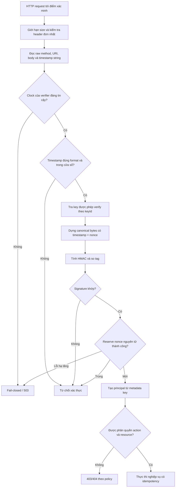

# Dấu thời gian trong HMAC request authentication

## 1. Timestamp giải quyết vấn đề nào?

Trong module `SECURITY_AUTHENTICATION_HMAC_REQUEST_AUTHENTICATION`, một HTTP client được cấp **shared secret** sẽ dùng HMAC để ký **canonical request**. Canonical request có thể chứa method, URI, các header đã thỏa thuận và/hoặc hash của raw body. Server lấy secret từ hệ thống quản lý khóa, dựng lại đúng dữ liệu đã ký rồi xác minh HMAC.

HMAC bảo vệ tính toàn vẹn của những thành phần được ký và chứng minh người gửi biết secret. Tuy nhiên, **HMAC không tự chứng minh request vừa được tạo**. Nếu kẻ tấn công sao chép được một request đã ký, họ có thể phát lại nguyên request. Chữ ký vẫn đúng vì các byte không đổi.

**Dấu thời gian (timestamp)** là một request component giúp server giới hạn thời điểm request được chấp nhận. Trong hợp đồng ký phổ biến, client gửi timestamp dưới dạng header và **đưa chính giá trị đó vào canonical request**. Server kiểm tra hai điều kiện độc lập:

1. **Tính toàn vẹn của timestamp:** nó đã nằm trong dữ liệu được HMAC bảo vệ, nên không thể bị bên không biết secret tự ý sửa mà vẫn giữ nguyên chữ ký hợp lệ.
2. **Tính hợp thời của timestamp:** thời điểm do client khai báo nằm trong **cửa sổ chấp nhận** so với một đồng hồ server đáng tin cậy.

Timestamp phải kết hợp với **nonce** để ngăn replay trong cửa sổ. Một request có timestamp hợp lệ và chữ ký đúng nhưng dùng lại nonce đã thấy vẫn phải bị từ chối.

> **Ý tưởng cần nhớ:** Timestamp giới hạn *khoảng thời gian có thể chấp nhận*, nonce giúp nhận diện *request đã được dùng trong khoảng đó*. Cả hai cần nằm trong hợp đồng ký HMAC nếu muốn chống replay.

Bài **“Dấu thời gian”** thuộc chương **Request components**, tập trung vào định dạng, vị trí, cách đưa timestamp vào chữ ký, kiểm tra phía server, sai lệch đồng hồ và vòng đời nonce. Nội dung cũng kết nối với key rotation, proxy/gateway và phân quyền để đặt thành phần timestamp đúng vị trí trong kiến trúc xác thực HTTP.

### Sau bài học, bạn cần làm được

- Chọn một biểu diễn timestamp rõ ràng, tránh nhầm **epoch seconds** với milliseconds, múi giờ hoặc chuỗi thời gian tự do.
- Giải thích vì sao server phải ký/verify **giá trị timestamp nguyên bản**, tránh biến đổi khác hợp đồng.
- Xây dựng và kiểm thử **cửa sổ thời gian** theo nhu cầu bảo mật, vận hành và độ trễ mạng.
- Tính TTL nonce có xét toàn bộ khoảng có thể replay, bao gồm timestamp ở tương lai và clock skew giữa replica.
- Tách kiểm tra timestamp khỏi HMAC, nonce, **key validity**, **authorization** và **idempotency**.
- Xử lý trường hợp request chậm ở gateway, đồng hồ không đồng bộ hoặc timestamp giả mạo.

## 2. Timestamp là dữ liệu do client khai báo, không phải đồng hồ đáng tin

Một header ví dụ:

```http
X-HMAC-Timestamp: 1795838400
```

Trong hợp đồng minh họa ở bài, giá trị này là **Unix epoch seconds**: số giây tính từ mốc 1970-01-01T00:00:00Z. Nó không biểu diễn giờ địa phương và không kèm offset múi giờ. Số trên chỉ dùng để giải thích hợp đồng; khi request được gửi thật, cần tạo timestamp mới và đối chiếu với giờ server lúc xác minh.

| Lựa chọn biểu diễn | Ví dụ | Khả năng gây lỗi |
| --- | --- | --- |
| **Unix epoch seconds** | `1795838400` | Gọn, không phụ thuộc timezone; cần nêu rõ đơn vị **giây**, định dạng chữ số và giới hạn range. |
| Unix epoch milliseconds | `1795838400000` | Giá trị lớn hơn 1.000 lần; nếu server đọc như giây sẽ sai nghiêm trọng. |
| ISO-8601 UTC | `2026-11-28T12:00:00Z` | Dễ đọc nhưng cần quy định precision, timezone, dấu phân tách và canonical form. |
| Thời gian địa phương không offset | `28/11/2026 19:00:00` | Mơ hồ múi giờ, locale, DST và parser; không khuyến nghị dùng làm input ký. |
| Giá trị tùy ý | `now`, `yesterday`, `+5m` | Không có nghĩa chuẩn giữa client và server; phải từ chối. |

**Quy ước đề xuất cho ví dụ:** chấp nhận đúng một `X-HMAC-Timestamp` là chuỗi **số nguyên thập phân không âm theo dạng canonical**, không dấu `+` hoặc `-`, không khoảng trắng, không leading zero (trừ chính số `0`). Kiểm tra thêm miền thời gian hợp lý trước khi xử lý. Server có thể giới hạn giá trị tối đa, ví dụ không quá thời điểm 9999-12-31T23:59:59Z. Hãy ghi rõ giới hạn trong API contract; đừng tự phụ thuộc vào parser mặc định của framework.

**Không đổi giờ địa phương sang UTC bằng cách thêm/bớt số giờ khi xử lý epoch seconds.** Epoch seconds đã biểu diễn cùng một thời điểm trên thế giới. Việc máy chủ hiển thị múi giờ khác không làm giá trị epoch seconds đúng bị thay đổi.

### 2.1 Timestamp không phải là “server nhận lúc nào”

Cần phân biệt ba thời điểm:

- `t_signed`: thời điểm client tạo request đã ký, được ghi vào `X-HMAC-Timestamp`.
- `t_gateway`: thời điểm gateway nhận request hoặc đưa vào hàng đợi.
- `t_verify`: thời điểm thành phần xác minh thực hiện kiểm tra.

Cùng request có thể trải qua trễ mạng, queue, retry hoặc các bước chuyển giao giữa gateway và backend. Nếu policy quy định đánh giá timestamp tại backend thì phải so với **thời gian backend xác minh**; không thay nó bằng header do client tự gửi mô tả giờ gateway. Nếu policy xác minh tại gateway trước khi rewrite, gateway phải bảo vệ danh tính kết quả khi truyền tiếp backend.

Không được lấy giá trị `Date` hoặc `X-Forwarded-Date` từ request công khai làm “giờ chuẩn” để nới cửa sổ. Đây vẫn là các giá trị đầu vào có thể bị giả mạo nếu không được một thành phần tin cậy thiết lập và bảo vệ.

### 2.2 Những trường nào phải nằm trong chữ ký?

Hãy xét request minh họa:

```http
POST /v1/payments?expand=detail HTTP/1.1
Host: api.example.test
Content-Type: application/json
X-HMAC-Key-Id: merchant-42:v3
X-HMAC-Timestamp: 1795838400
X-HMAC-Nonce: 4b55f5b2e2fd42fb9dca65b8e6c1d902
X-HMAC-Signature: <base64-full-tag>

{"amountMinor":125000,"currency":"VND"}
```

Hợp đồng mẫu `HMAC-REQUEST/V1` dùng **HMAC-SHA256**, canonical request mã hóa UTF-8, **8 dòng ngăn bằng LF, không có LF cuối**:

```text
HMAC-REQUEST/V1
POST
/v1/payments?expand=detail
content-type:application/json
x-hmac-key-id:merchant-42:v3
x-hmac-timestamp:1795838400
x-hmac-nonce:4b55f5b2e2fd42fb9dca65b8e6c1d902
body-sha256:<hex-sha256-cua-raw-body>
```

Dòng cuối phải thay bằng hex SHA-256 thực tế của **raw body bytes**, không giữ `<...>`. Client và server phải thống nhất raw URI/query, header được ký, cách trim, UTF-8 và ký tự phân cách dòng; hợp đồng ví dụ không tự normalize/sắp xếp query.

```text
rawBodyHash  = lowercase_hex(SHA256(rawBodyBytes))
canonical    = exactly_eight_lines_in_UTF8_without_trailing_LF
expectedTag  = HMAC_SHA256(sharedSecretBytes, canonical)
signature    = Base64_Standard_WithPadding(expectedTag)
```

Dòng `x-hmac-timestamp:...` nằm trong canonical request để kẻ không biết secret **không thể thay 1795838400 bằng thời gian mới** mà giữ được chữ ký. Tương tự, `nonce` phải được ký, nếu không kẻ tấn công có thể đổi nonce của request cũ thành giá trị mới.

**Không đưa `X-HMAC-Signature` vào chính canonical request** của hợp đồng này vì giá trị chữ ký chỉ có sau khi tính HMAC. Các header khác như `Content-Type` và `X-HMAC-Key-Id` có ý nghĩa đến byte body/khóa tra cứu nên phải được xử lý đúng hợp đồng. Nếu hệ thống dùng header mang tenant/audience hoặc idempotency key ảnh hưởng đến bảo mật, cũng cần quy định cách ký chúng và kiểm tra quyền tương ứng.

## 3. Cửa sổ chấp nhận timestamp

### 3.1 Công thức cơ bản

Gọi:

- `t_req`: timestamp do client gửi, tính bằng epoch seconds.
- `t_srv`: thời điểm thành phần xác minh đọc từ đồng hồ server đáng tin cậy.
- `P`: độ cũ tối đa chấp nhận (*maximum age*), tính bằng giây.
- `F`: độ lệch tương lai tối đa chấp nhận (*future allowance*), tính bằng giây.

Request chỉ đạt **kiểm tra thời gian** khi:

\[
t_{srv} - P \;\le\; t_{req} \;\le\; t_{srv} + F
\]

Tương đương `-F <= t_srv - t_req <= P`. Đây chưa phải là điều kiện đủ cho phép chạy nghiệp vụ: còn cần MAC, key status, nonce và authorization.

Một policy đơn giản là **đối xứng ±300 giây** (`P = F = 300`). Trong API nhạy cảm, có thể chọn policy bất đối xứng, ví dụ **chấp nhận request cũ tối đa 300 giây, chỉ chấp nhận timestamp ở tương lai 30 giây** (`P = 300`, `F = 30`). Policy thực tế phải được định nghĩa rõ theo độ lệch đồng hồ được phép, độ trễ mạng, cơ chế retry và rủi ro replay.

Với server đang ở **12:00:00** và policy `P = 300 s`, `F = 30 s`:

| Timestamp trong request | Chênh lệch `t_srv − t_req` | Kết quả kiểm tra thời gian |
| --- | ---: | --- |
| 11:54:59 | +301 s | **Từ chối** vì quá cũ. |
| 11:55:00 | +300 s | **Đạt** đúng biên cũ. |
| 12:00:00 | 0 s | **Đạt**. |
| 12:00:30 | -30 s | **Đạt** đúng biên tương lai. |
| 12:00:31 | -31 s | **Từ chối** vì quá xa tương lai. |

### 3.2 Cửa sổ lớn chưa chắc tốt hơn

Tăng `P` từ 5 phút lên 30 phút giúp request bị kẹt trong mạng/queue dễ qua hơn, nhưng cũng mở rộng thời gian một signed request có thể được gửi lại **nếu nonce store bị mất, cấu hình TTL không đủ hoặc anti-replay gặp sự cố**. Giảm `P` quá thấp lại làm client có mạng chậm, queue dài hoặc clock lệch bị từ chối hàng loạt.

Tăng `F` cũng không miễn phí: timestamp nằm ở biên tương lai có thể **bắt đầu hợp lệ sớm** và **tiếp tục hợp lệ lâu hơn** tính từ lúc được chấp nhận lần đầu. Đây là lý do công thức TTL nonce phải dựa trên cả `P` và `F`.

**Đề xuất vận hành:** bắt đầu từ độ trễ P95/P99 đã đo, giới hạn lệch clock cho phép và nhu cầu retry; định nghĩa rõ `P`/`F`; theo dõi lỗi expired/future và queue latency trước khi sửa policy. Không cho client tự gửi thêm header “skew allowance” để nới cửa sổ.

### 3.3 Biên thời gian và phần lẻ giây

Trong hợp đồng epoch seconds, client ghi một số giây nguyên. Java `Clock.instant()` có thể có nanosecond; nếu server dùng `clock.instant().getEpochSecond()`, thời gian được lấy phần giây nguyên. Biên `<=` hay `<` phải được thống nhất trong code/test.

Đặt một lần `Instant now = clock.instant()` rồi dùng **cùng snapshot** cho kiểm tra timestamp và điều kiện key validity tương ứng, tránh việc gọi lại đồng hồ ngay khi tiến trình đã vượt biên hoặc clock bị chỉnh. Snapshot không làm đồng hồ máy tự trở nên chính xác; server vẫn cần cơ chế giám sát đồng bộ thời gian.

## 4. Timestamp phải đi cùng nonce để chống replay

### 4.1 Tấn công replay khi chỉ kiểm tra timestamp

Giả sử client gửi request đã ký lúc 12:00:00. Kẻ tấn công lấy được nguyên request và gửi lại lúc 12:01:00. Nếu server chỉ kiểm tra HMAC và timestamp trong khoảng `P = 300`, cả hai request đều có thể đạt xác thực vì chữ ký không thay đổi và request mới chậm hơn chỉ 60 giây.

Để ngăn lần thứ hai, client tạo **nonce mới cho mỗi request**, server phải ghi nhận nonce đã dùng bằng thao tác **nguyên tử chỉ-ghi-nếu-chưa-có**, trong cùng phạm vi client/principal. Nonce phải nằm trong canonical request để không bị sửa mà vẫn giữ chữ ký cũ.

Ví dụ nonce là **16 byte ngẫu nhiên mật mã**, truyền dưới dạng **32 ký tự hex**. Mọi replica cùng bảo vệ một API cần dùng chung kho nonce hoặc cơ chế chống replay nhất quán giữa các vùng xử lý.

```redis
SET hmac:nonce:merchant-42:v3:4b55f5b2e2fd42fb9dca65b8e6c1d902 1 NX EX 360
```

`NX` làm thao tác tạo nonce chỉ thành công nếu chưa tồn tại; `EX 360` đặt TTL 360 giây đồng thời. Đây là ví dụ cho policy **`P = 300`, `F = 30`, sai lệch node nhỏ có giám sát và thời gian dự phòng phù hợp**. Không mặc định dùng 360 giây cho mọi hợp đồng.

Server reserve nonce **sau khi chữ ký HMAC hợp lệ và trước khi chạy nghiệp vụ**. Nếu nonce đã tồn tại, từ chối request. Nếu kho nonce không kết nối được, phải **fail-closed** theo chính sách (ví dụ trả `503` cho lỗi hạ tầng), không chấp nhận request chỉ vì MAC đúng.

### 4.2 Tính TTL nonce theo toàn bộ lifetime

Một timestamp `t_req` có thể được chấp nhận sớm nhất khi đồng hồ server chỉ `t_req − F` và muộn nhất khi đồng hồ server đạt `t_req + P`.

Do đó, nếu clock không lệch và không nhảy đột ngột, **độ dài tối đa từ lúc chấp nhận sớm nhất tới lúc timestamp hết hợp lệ** bằng:

\[
TTL_{base} \ge P + F
\]

Ví dụ:

| Policy | `P` | `F` | Độ dài lifetime tối đa |
| --- | ---: | ---: | ---: |
| Đối xứng ±5 phút | 300 s | 300 s | **600 s** |
| Bất đối xứng: cũ 5 phút, tương lai 30 s | 300 s | 30 s | **330 s** |
| Không cho phép tương lai, cũ 2 phút | 120 s | 0 s | **120 s** |

Trong hệ thống nhiều replica, clock của mỗi node có thể lệch với thời gian thực tối đa `E` giây; reserve nonce có thêm dự phòng xử lý/độ trễ `D`. Một cận bảo thủ dễ vận hành là:

\[
TTL_{nonce} \ge P + F + 2E + D
\]

Ví dụ với `P = 300 s`, `F = 30 s`, `E = 2 s`, `D = 10 s` thì `TTL >= 344 s`. Có thể cấu hình **360 giây** để có thêm dự phòng. Con số này chỉ an toàn theo **giả định offset giữa các node được giới hạn và kho nonce giữ TTL đúng**. Nếu clock nhảy lùi, có replica lệch quá mức hoặc kho nonce bị xóa bất thường, hệ thống phải phát hiện và dừng phục vụ xác thực ở node không đáng tin cậy.

**Sai lầm thường gặp:** policy đối xứng ±300 giây nhưng đặt TTL nonce 300 giây. Một request ghi timestamp ở biên tương lai có thể được chấp nhận sớm và vẫn hợp lệ sau khi nonce hết hạn. Kẻ tấn công có thể replay nguyên request, vượt qua kho nonce nếu bản ghi đã biến mất.

### 4.3 Nonce và idempotency giải quyết hai việc khác nhau

- **Nonce store** chặn gửi lại cùng nonce trong phạm vi bảo vệ, chống replay của signed request.
- **Idempotency key** xử lý an toàn các request **khác nonce nhưng cùng ý định nghiệp vụ**, ví dụ client retry thanh toán sau khi không nhận được response.

Hai request khác nonce và timestamp nhưng cùng `amountMinor` và `destinationAccount` có thể đều được HMAC xác thực và qua anti-replay. Nếu nghiệp vụ cần chống tạo hai giao dịch, phải có idempotency được ràng buộc với principal, operation và payload phù hợp.

## 5. Server xác minh timestamp ở bước nào?



Trình tự này **kiểm tra định dạng và cửa sổ timestamp sớm** để loại request không hợp lệ mà không tốn tài nguyên tính MAC. Tuy vậy, cho tới khi HMAC khớp, timestamp vẫn chỉ là dữ liệu client khai: không được dùng nó để tạo principal, cấp quyền hoặc sửa trạng thái nghiệp vụ.

Quy trình nên được triển khai với các nguyên tắc:

1. **Header xuất hiện đúng một lần:** kiểm tra `X-HMAC-Timestamp`, `X-HMAC-Nonce`, `X-HMAC-Key-Id` và `X-HMAC-Signature` không thiếu/trùng; từ chối dạng header gộp hoặc giá trị chứa CR/LF nhập nhằng.
2. **Giữ nguyên giá trị đã ký:** sau khi kiểm tra format, sử dụng **chính chuỗi timestamp theo hợp đồng** để dựng canonical request. Không parse thành `Instant` rồi format lại thành ISO text hay tự thêm padding.
3. **Lấy thời gian từ nguồn đáng tin của server:** kiểm tra đồng bộ thời gian/clock health trước khi accept; tránh dùng timestamp do proxy/client tự khai thay clock.
4. **Không cho client quyết định policy:** `P` và `F` là cấu hình server, có thể phân theo endpoint/đối tác nhưng phải kiểm soát tập trung và ổn định theo hợp đồng.
5. **Chữ ký và key:** lấy algorithm/secret theo `keyId` server-side; từ chối key đã bị revoke hoặc sai audience; so MAC bằng primitive hạn chế rò rỉ thời gian như `MessageDigest.isEqual`.
6. **Nonce và quyền:** chỉ reserve nonce sau chữ ký hợp lệ. Chỉ tạo principal sau khi vượt anti-replay rồi kiểm tra action/scope, tenant, resource và điều kiện nghiệp vụ. HMAC và timestamp không tự mang quyền.
7. **Phản hồi lỗi:** lỗi key/signature/timestamp có thể được báo `401` với thông điệp chung; lỗi cú pháp theo contract có thể là `400`; lỗi hạ tầng clock/nonce store nên fail-closed, ví dụ `503`. Theo dõi nguyên nhân cụ thể trong metric/log nội bộ mà không lộ secret.

## 6. Ví dụ Java 17+: chính sách timestamp tách biệt với bộ HMAC verifier

Dùng `java.time.Clock` cho phép thay đồng hồ thật bằng đồng hồ cố định trong unit test. Đoạn dưới **chỉ kiểm tra timestamp** theo policy minh họa `P = 300 giây`, `F = 30 giây`; HMAC, key rotation, raw request parsing, nonce reserve và authorization vẫn do các thành phần khác đảm nhiệm.

### 6.1 Kiểm tra format, range và cửa sổ

```java
import java.time.Clock;
import java.time.Instant;
import java.time.DateTimeException;
import java.util.Objects;
import java.util.regex.Pattern;

enum TimestampVerdict {
    OK, BAD_FORMAT, TOO_OLD, TOO_FAR_IN_FUTURE, CLOCK_UNTRUSTED
}

interface ClockHealth {
    // Cơ chế giám sát đồng bộ thời gian của host/VM thực tế.
    boolean isHealthy();
}

final class SignedTimestampPolicy {
    private static final long MAX_AGE_SECONDS = 300;
    private static final long MAX_FUTURE_SECONDS = 30;

    // Giới hạn trong phạm vi Unix epoch seconds không vượt năm 9999.
    private static final long MAX_TIMESTAMP = 253402300799L;
    private static final Pattern EPOCH_SECONDS =
            Pattern.compile("(0|[1-9][0-9]{0,11})");

    private final Clock clock;
    private final ClockHealth clockHealth;

    SignedTimestampPolicy(Clock clock, ClockHealth clockHealth) {
        this.clock = Objects.requireNonNull(clock);
        this.clockHealth = Objects.requireNonNull(clockHealth);
    }

    TimestampVerdict evaluate(String signedTimestamp) {
        if (!clockHealth.isHealthy()) return TimestampVerdict.CLOCK_UNTRUSTED;
        if (signedTimestamp == null
                || !EPOCH_SECONDS.matcher(signedTimestamp).matches()) {
            return TimestampVerdict.BAD_FORMAT;
        }

        final long seconds;
        try {
            seconds = Long.parseLong(signedTimestamp);
        } catch (NumberFormatException e) {
            return TimestampVerdict.BAD_FORMAT;
        }
        if (seconds > MAX_TIMESTAMP) return TimestampVerdict.BAD_FORMAT;

        Instant requestTime = Instant.ofEpochSecond(seconds);
        Instant serverNow = clock.instant(); // Chỉ đọc một lần

        if (requestTime.isBefore(serverNow.minusSeconds(MAX_AGE_SECONDS))) {
            return TimestampVerdict.TOO_OLD;
        }
        if (requestTime.isAfter(serverNow.plusSeconds(MAX_FUTURE_SECONDS))) {
            return TimestampVerdict.TOO_FAR_IN_FUTURE;
        }
        return TimestampVerdict.OK;
    }
}
```

Ở code trên:

- Regex buộc timestamp là một **chuỗi số thập phân chuẩn**, không có space, dấu `+`, dấu `-` hoặc leading zero. Limit về giá trị chặn chuỗi biểu diễn thời gian quá xa.
- `Instant.ofEpochSecond` hiểu giá trị theo UTC epoch; không đọc timezone mặc định của máy.
- `isBefore` / `isAfter` làm hai biên **inclusive**: timestamp bằng `now − 300` hoặc `now + 30` vẫn đạt.
- `ClockHealth` phải gắn với thông tin đồng bộ giờ thực tế, không trả `true` cố định ở production. `Clock.systemUTC()` không bảo đảm máy chủ đã sync đúng giờ.
- Các lỗi config/không có clock đáng tin cần **fail-closed**, thay vì nới cửa sổ tự động. Trong thực tế cũng cần giới hạn kích thước và tính hợp lệ của mọi header ngay tại HTTP adapter.

**Giới hạn quan trọng:** code này không tự chứng minh header đã được HMAC ký. Bộ verifier phải dựng canonical request với chuỗi `signedTimestamp` nguyên bản rồi kiểm tra chữ ký; chỉ sau khi mọi bước xác thực thành công mới tin quyết định `OK` để cho đi tiếp.

### 6.2 Thử biên mà không thay giờ của máy

```java
import java.time.Clock;
import java.time.Instant;
import java.time.ZoneOffset;

Clock fixed = Clock.fixed(
        Instant.parse("2026-11-28T12:00:00Z"), ZoneOffset.UTC);
SignedTimestampPolicy policy =
        new SignedTimestampPolicy(fixed, () -> true);

long nowSeconds = fixed.instant().getEpochSecond();

// Ví dụ dùng exception để kiểm thử ngay cả khi Java assertions bị tắt.
if (policy.evaluate(Long.toString(nowSeconds - 300))
        != TimestampVerdict.OK) throw new AssertionError("past boundary");
if (policy.evaluate(Long.toString(nowSeconds + 30))
        != TimestampVerdict.OK) throw new AssertionError("future boundary");
if (policy.evaluate(Long.toString(nowSeconds - 301))
        != TimestampVerdict.TOO_OLD) throw new AssertionError("too old");
if (policy.evaluate(Long.toString(nowSeconds + 31))
        != TimestampVerdict.TOO_FAR_IN_FUTURE) {
    throw new AssertionError("too far in future");
}
if (policy.evaluate(Long.toString(nowSeconds * 1000))
        != TimestampVerdict.BAD_FORMAT) {
    throw new AssertionError("milliseconds must be rejected");
}
```

**Cần chú ý:** với mẫu code `SignedTimestampPolicy` ở trên, chuỗi epoch milliseconds (thường 13 chữ số) bị loại ở bước kiểm tra format. Với policy khác cho phép chuỗi 13 chữ số, vẫn phải kiểm tra range và thời gian để tránh sai đơn vị. Những kiểm thử trên chỉ minh họa các case quan trọng, chưa phải test suite toàn bộ HTTP authentication.

### 6.3 Nối timestamp vào bộ xác minh request hoàn chỉnh

```java
// Pseudocode của HTTP authentication pipeline:
RawSignedRequest request = adapter.readWithinLimits(httpRequest);
TimestampVerdict verdict = timestampPolicy.evaluate(
        request.getSingleHeader("X-HMAC-Timestamp"));
if (verdict == TimestampVerdict.CLOCK_UNTRUSTED) {
    rejectUnavailable(); // fail-closed
    return;
}
if (verdict != TimestampVerdict.OK) {
    rejectUnauthenticated();
    return;
}

// keyId, algorithm, secret và trạng thái lấy từ kho phía server.
VerificationKey key = keyStore.findVerificationKey(
        request.getSingleHeader("X-HMAC-Key-Id"), clock.instant());
if (key == null || key.isRevoked()) {
    rejectUnauthenticated();
    return;
}

// Dựng byte canonical từ request thực tế, bao gồm timestamp và nonce.
byte[] canonical = canonicalizer.fromRawRequest(request);
byte[] received = signatureCodec.decodeStrict(
        request.getSingleHeader("X-HMAC-Signature"), key);
byte[] expected = hmac.compute(key, canonical);
if (!java.security.MessageDigest.isEqual(expected, received)) {
    rejectUnauthenticated();
    return;
}

// Sau chữ ký đúng, reserve nonce bằng thao tác nguyên tử và TTL đủ dài.
// NonceStore lỗi => không xử lý nghiệp vụ.
if (!nonceStore.reserve(
        key.id(), request.getSingleHeader("X-HMAC-Nonce"), 360)) {
    rejectReplay();
    return;
}

AuthenticatedPrincipal principal = identity.fromVerifiedKey(key);
authorize(principal, request.action(), request.resource());
executeWithIdempotency(principal, request);
```

`RawSignedRequest`, `VerificationKey`, `TimestampPolicy`, `nonceStore` là các abstraction **minh họa**, không phải API có sẵn trong JDK. Trong code production cần đưa cùng snapshot `Instant now` qua timestamp policy và kiểm tra key status để tránh bất nhất ở biên thời gian, đồng thời phân biệt nonce bị trùng với lỗi kết nối kho nonce. Đừng hardcode TTL `360` nếu policy `P`/`F` khác.

## 7. Sai lệch đồng hồ, NTP và time handling

### 7.1 Client nhanh/chậm so với server

| Tình huống | Tác động điển hình | Hướng xử lý |
| --- | --- | --- |
| Clock client chậm hơn server 7 phút, `P = 300 s` | Chữ ký đúng nhưng timestamp **quá cũ**; request bị từ chối. | Đồng bộ giờ client, telemetry về skew; không vô điều kiện nới policy. |
| Clock client nhanh hơn server 2 phút, `F = 30 s` | Timestamp **quá xa tương lai**; request bị từ chối. | Đồng bộ giờ client; chỉ thay `F` khi policy được đánh giá. |
| Một replica server bị chậm 6 phút | Cùng request có thể pass ở replica này nhưng fail ở replica khác; replay window thực tế bị kéo dài. | Giám sát offset từng node, rút node khỏi phục vụ khi clock health không đạt. |
| Đồng hồ server nhảy lùi | Timestamp cũ có thể được xem là hợp lệ thêm lần nữa, vượt giả định TTL. | Theo dõi clock step, fail-closed trong giai đoạn không thể bảo đảm time. |
| Gateway giữ request trong queue 6 phút | Dữ liệu ký còn nguyên, nhưng timestamp đã hết hạn ở backend. | Giới hạn queue latency, cho client retry bằng timestamp/nonce và MAC mới. |
| Clock client đúng nhưng code nhân timestamp với 1000 | Epoch milliseconds bị gửi như seconds, gây lỗi parse/range. | Hợp đồng ghi rõ đơn vị; test cả hai kiểu. |

Dùng dịch vụ đồng bộ thời gian phù hợp (ví dụ NTP/chrony hay dịch vụ được hạ tầng quản lý), theo dõi độ lệch thực tế và thời điểm đồng bộ cuối. **UTC** là quy ước biểu diễn thời gian, không tự làm clock đúng; hai máy đều ghi UTC vẫn có thể lệch nhau.

### 7.2 Wall-clock và monotonic clock

Để so timestamp epoch seconds, server cần **wall-clock** có nghĩa gắn với thời gian thực. Với Java, dùng `Clock`/`Instant.now(clock)` giúp inject trong test. Để đo timeout và elapsed duration trong cùng tiến trình, nên dùng **monotonic clock** như `System.nanoTime()`; nó không biểu diễn epoch seconds và không thể thay `Instant` khi so với timestamp của client.

Một hệ thống có thể quan sát cả hai:

- Độ lệch đồng hồ wall-clock giữa node và nguồn tham chiếu.
- Thời gian monotonic đã trôi qua cho queue/timeout, để tránh tác động khi wall-clock bị điều chỉnh.

### 7.3 Đồng hồ và key rotation

Khi xoay từ `merchant-42:v3` sang `merchant-42:v4`, có thể tạm verify cả hai key theo thời hạn chuyển tiếp. Nếu replica lệch clock, thời điểm `notBefore`/`notAfter` có thể áp dụng không đồng nhất. Vì vậy key store phải có metadata trạng thái key và thời gian hiệu lực **phía server**, các điểm verify phải có đồng hồ đạt tiêu chuẩn.

**Không quyết định key còn hoạt động chỉ theo timestamp do client ký.** Một client có thể tạo request mới với timestamp cũ vẫn trong cửa sổ; key đã bị revoke không được “sống lại” chỉ vì timestamp thuộc giai đoạn trước thu hồi. Khi secret bị lộ, kẻ tấn công có thể ký timestamp và nonce mới: phải **thu hồi secret và xoay khóa**, không trông cậy vào timestamp.

## 8. Timestamp qua proxy và gateway

Timestamp là một header trong hợp đồng ký. Proxy/gateway có thể ảnh hưởng theo hai cách chính:

1. **Thay đổi dữ liệu đã ký:** gateway có thể rewrite URI/query, normalize header, đổi body encoding, hoặc sửa `X-HMAC-Timestamp`. Nếu backend dựng canonical bytes khác client, HMAC thất bại. Đừng âm thầm thay timestamp bằng “giờ gateway” để request qua được cửa sổ, vì nó làm thay đổi dữ liệu đã ký.
2. **Trì hoãn việc kiểm tra:** gateway giữ request trong queue hoặc retry, khiến timestamp hết hạn dù signature vẫn đúng về mặt mật mã.

Hai mô hình triển khai:

```text
A. Client --signed request--> Gateway verify HMAC/time/nonce
                               |
                               +-- trusted principal context --> Backend authorize

B. Client --signed request--> Gateway preserve signed data
                               |
                               +-- raw request --> Backend verify HMAC/time/nonce
                                                     |
                                                     +--> authorize
```

Trong mô hình A, gateway phải loại bỏ header nhận dạng nội bộ do client tự gửi và truyền principal qua đường nội bộ được xác thực, ví dụ mTLS hoặc trusted identity context. Backend phải kiểm tra quyền với **tenant/resource thực tế** ở lớp nghiệp vụ.

Trong mô hình B, backend cần nhận nguyên raw request target và byte body đã ký hoặc metadata request gốc có bảo vệ; không tin các header như `X-Original-URI`, `X-Forwarded-*` được Internet tự gửi. Kiểm thử các trường hợp `%2F`, query lặp, khoảng trắng trong header, HTTP/2 → HTTP/1.1 và body nén nếu hợp đồng có liên quan.

Timestamp trong header phải được giữ **đúng dạng canonical của contract**. Một gateway viết lại epoch seconds thành ISO-8601 hoặc epoch milliseconds sẽ khiến HMAC mismatch, kể cả nếu thời điểm logic tương đương.

## 9. Xử lý lỗi và quan sát trong production

Một API an toàn cần phân biệt tình huống **không xác thực được** với **không thể bảo đảm xác thực do hạ tầng thời gian lỗi**.

| Điều kiện | Phản ứng phù hợp |
| --- | --- |
| Header timestamp thiếu, nhiều giá trị hoặc sai format | Từ chối trước nghiệp vụ; `400` hoặc `401` theo hợp đồng lỗi của API. |
| Timestamp quá cũ/quá xa tương lai | Từ chối xác thực; không tự nới cửa sổ cho request đó. |
| Timestamp trong cửa sổ nhưng HMAC sai | Từ chối xác thực; không reserve nonce. |
| Timestamp/HMAC hợp lệ nhưng nonce trùng | Từ chối replay; không thực hiện side effect. |
| Clock health mất bảo đảm, nguồn giờ thất bại | Tạm dừng xác minh hoặc đưa node khỏi traffic; fail-closed, có thể `503`. |
| Nonce store lỗi | Fail-closed; không cho qua request với HMAC đúng nếu không thể bảo đảm replay protection. |
| Key bị revoke nhưng timestamp thuộc khoảng cũ | Từ chối vì key hiện không còn được phép verify. |
| HMAC/nonce hợp lệ nhưng principal không có quyền resource | Authorization từ chối (`403` hoặc `404` theo chính sách). |

Metrics gợi ý: `timestamp_bad_format`, `timestamp_too_old`, `timestamp_too_far_future`, `clock_offset_seconds`, `clock_unhealthy`, `nonce_replay`, `nonce_store_error`, `hmac_invalid_signature`, `verification_latency`, `gateway_queue_latency` và tỷ lệ lỗi theo key/client ở cardinality kiểm soát được.

Có thể ghi **request/correlation ID**, thời gian server nhận, timestamp đã ký ở mức cần thiết, độ lệch đã đo, key ID/version không nhạy cảm và loại lỗi nội bộ. Không ghi shared secret, raw signature đầy đủ, dữ liệu body nhạy cảm hoặc material đủ để phát lại request trong cửa sổ. Khi phản hồi client, hạn chế cung cấp thông tin về key nào còn active hoặc chi tiết kiểm tra MAC.

### Khi phát sinh hàng loạt lỗi timestamp

1. Xác định lỗi ở **một client, một gateway, một replica hay toàn hệ thống**. So sánh lệch clock với nguồn thời gian tham chiếu và độ trễ hàng đợi.
2. Kiểm tra lỗi đơn vị seconds/milliseconds, parse timestamp, khoảng trắng, header trùng, hoặc gateway tự rewrite header.
3. Nếu một node mất đồng bộ, loại node khỏi verify đến khi thời gian ổn định; giữ nguyên chính sách fail-closed.
4. Kiểm tra nonce TTL so với `P + F` và độ lệch thực tế; đối soát tác động tới giao dịch có side effect.
5. Chỉ điều chỉnh `P/F` sau khi đánh giá dữ liệu vận hành và rủi ro replay, không “vá nóng” bằng chấp nhận mọi timestamp.

## 10. Ma trận kiểm thử dấu thời gian

Dùng đồng hồ giả lập (`Clock.fixed`), key và canonical vector xác định. Với kiểm thử hệ thống, chạy luồng **client → gateway → các verifier replica → nonce store → authorization → nghiệp vụ** để phát hiện vấn đề phân tán.

| Case | Điều kiện | Kỳ vọng |
| --- | --- | --- |
| T01 | Timestamp `now`, MAC đúng, nonce mới, key active, quyền đầy đủ | Timestamp pass; request có thể tiếp tục sau các kiểm tra khác. |
| T02 | `P = 300`, `F = 30`, timestamp `now − 300` | Pass tại đúng biên quá khứ. |
| T03 | Timestamp `now − 301` | Bị từ chối vì quá cũ. |
| T04 | Timestamp `now + 30` | Pass tại đúng biên tương lai. |
| T05 | Timestamp `now + 31` | Bị từ chối vì quá xa tương lai. |
| T06 | Timestamp là epoch **milliseconds** (13 chữ số) | Từ chối theo hợp đồng epoch seconds. |
| T07 | Timestamp chứa dấu `+`, `-`, whitespace, leading zero hoặc chữ cái | Từ chối theo format, không tự normalize. |
| T08 | Hai header timestamp hoặc gateway gộp nhiều giá trị bằng dấu phẩy | Từ chối vì nhập nhằng. |
| T09 | Timestamp bị sửa nhưng giữ nguyên HMAC ban đầu | MAC không khớp; request bị từ chối. |
| T10 | Nonce bị sửa nhưng giữ HMAC ban đầu | MAC không khớp vì nonce cũng phải được ký. |
| T11 | Replay nguyên signed request trong cửa sổ | Nonce đã tồn tại; lần sau bị chặn. |
| T12 | Hai replica đồng thời reserve cùng nonce | Chỉ một reserve nguyên tử thành công. |
| T13 | Nonce TTL 300 giây dưới policy đối xứng `±300` | Kiểm thử phát hiện khả năng nonce hết hạn khi timestamp vẫn hợp lệ; cấu hình cần sửa. |
| T14 | Client clock chậm 7 phút hoặc nhanh 2 phút dưới `P = 300`, `F = 30` | Từ chối theo đúng phía cửa sổ; log skew có kiểm soát. |
| T15 | Một replica lệch giờ vượt ngưỡng clock health | Node fail-closed/không tiếp nhận verify cho tới khi đồng bộ. |
| T16 | Clock nhảy lùi hoặc NTP mất đồng bộ | Không mặc định accept request cũ; cảnh báo và cô lập node nếu không bảo đảm thời gian. |
| T17 | Gateway giữ request quá 5 phút rồi backend xác minh | Bị từ chối nếu ra ngoài cửa sổ, dù MAC còn đúng. |
| T18 | Gateway thay `X-HMAC-Timestamp` hoặc raw URI/body đã ký | HMAC thất bại nếu canonical khác client. |
| T19 | Key đã revoke nhưng timestamp nằm trong cửa sổ | Từ chối vì trạng thái key hiện tại. |
| T20 | HMAC, timestamp, nonce đúng nhưng tenant/resource không được cấp quyền | Authentication thành công, authorization từ chối. |
| T21 | Nonce store ngừng hoạt động | Fail-closed; không có side effect nghiệp vụ. |
| T22 | Cùng ý định thanh toán ký lại bằng nonce/timestamp mới | Anti-replay không tự ngăn tác dụng phụ trùng; idempotency bảo vệ nghiệp vụ. |
| T23 | Body raw UTF-8 hoặc query có percent-encoding, timestamp giữ nguyên | MAC chỉ pass khi mọi byte canonical giống hợp đồng. |
| T24 | Đổi key trong rotation gần mốc hết hiệu lực, đồng hồ 2 replica chênh lệch nhỏ | Tất cả node khỏe mạnh áp dụng policy key và cửa sổ timestamp nhất quán. |

Các test time boundary nên kiểm tra cả trường hợp request tạo **đúng thời điểm chuyển giây**, và snapshot `now` chỉ được lấy một lần cho mỗi quyết định. Kiểm thử nonce phải xác nhận thao tác nguyên tử trong môi trường nhiều replica, không chỉ dùng map cục bộ.

## 11. Bài tập tình huống

**Đề bài:** API `POST /v1/transfers` dùng HMAC-SHA256, policy đối xứng `±300 giây`, nonce store với `TTL = 300 giây`. Client gửi một request có timestamp **12:05:00**. Đồng hồ server khi nhận lần đầu là **12:00:00**; chữ ký đúng và nonce chưa xuất hiện. Một kẻ tấn công phát lại y nguyên request lúc **12:06:00**. Trong thời gian đó, kho nonce đã xóa bản ghi lúc 12:05:00.

**Câu hỏi:** Tại sao cùng request có thể vượt qua cả HMAC lẫn kiểm tra timestamp ở lần replay? Phải sửa thiết kế thế nào?

**Phân tích:**

- Ở 12:00, timestamp 12:05 nằm đúng **biên tương lai** cho phép (`F = 300`). HMAC đúng vì toàn bộ request vẫn được ký bằng cùng secret.
- Ở 12:06, timestamp 12:05 mới chậm 60 giây, vẫn nằm trong cửa sổ quá khứ (`P = 300`). Chữ ký không tự hết hiệu lực về mặt mật mã.
- Vì nonce hết hạn sau 300 giây, server có thể coi request replay là lần đầu mới. Lỗi nằm ở **TTL nonce ngắn hơn toàn bộ lifetime timestamp**, không phải do SHA-256 yếu.
- Sửa bằng **TTL ít nhất `P + F = 600 giây`**, cộng dự phòng về offset/độ trễ; dùng `SET NX EX` nguyên tử trên kho chung; giám sát clock health; áp dụng **idempotency** cho thao tác chuyển tiền.
- Nếu client hợp lệ lại gửi một request **mới với nonce khác** nhưng cùng ý định giao dịch, anti-replay không ngăn được trùng; quyền truy cập vẫn phải được kiểm tra độc lập theo principal/tenant.

### Câu hỏi tự kiểm tra

1. Timestamp trong header chưa được ký có ngăn kẻ tấn công sửa thành thời điểm mới không?
2. Vì sao Unix epoch seconds không cần cộng múi giờ Việt Nam trước khi server kiểm tra?
3. Nếu `P = 300 s`, `F = 30 s`, độ dài lifetime timestamp tối đa theo giả định clock chuẩn là bao nhiêu?
4. Nếu các replica có sai số tối đa `E = 3 s` và dự phòng `D = 12 s`, TTL tối thiểu theo cận trong bài là bao nhiêu?
5. Vì sao chỉ kiểm tra timestamp/HMAC vẫn có thể chấp nhận cùng request hai lần?
6. Khi client gửi epoch milliseconds nhưng server mong seconds, lỗi nằm ở đâu? Làm sao đưa vào automated test?
7. Vì sao không nên thay timestamp bằng giờ gateway rồi ký lại bằng secret của server?
8. Nếu key đã bị revoke, một timestamp từng hợp lệ có cho phép request qua authentication không?
9. Vì sao một request HMAC và nonce hợp lệ vẫn có thể nhận `403 Forbidden`?
10. Trong trường hợp queue backend trễ vượt cửa sổ, bên nào nên tạo timestamp/nonce và MAC mới khi retry?

**Ghi nhớ:** Dấu thời gian là **request component phải được ký** và được server so với một **đồng hồ đáng tin cậy** trong cửa sổ chấp nhận rõ ràng. Timestamp giới hạn thời gian sử dụng, **nonce nguyên tử** ngăn phát lại trong cửa sổ đó, key rotation quyết định secret còn được phép verify, còn **authorization** kiểm tra quyền của principal. Chỉ khi canonical request, clock, proxy/gateway, TTL nonce và chính sách quyền được thiết kế nhất quán, xác thực HTTP bằng HMAC mới đạt mục tiêu bảo vệ đã đặt ra.

