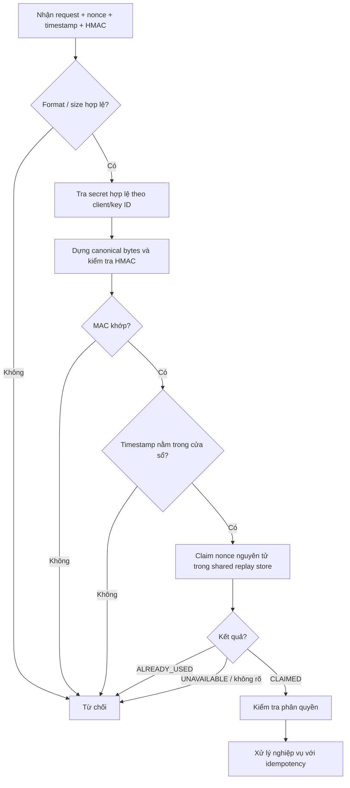

# Số dùng một lần (Nonce) trong xác thực HTTP request bằng HMAC

> **Chương:** Request components  
> **Chủ đề:** Số dùng một lần (*nonce*) — thành phần nhận diện một lần gửi request để phát hiện replay.  
> **Phạm vi:** Xác thực HTTP request bằng shared secret và canonical request có method, URI, header hoặc body theo hợp đồng ký; kiểm tra timestamp/nonce, luân chuyển key, kiểm thử proxy/gateway và tách biệt xác thực với phân quyền.

## 1. Vì sao request HMAC cần nonce?

Giả sử một ứng dụng gọi API chuyển tiền:

```http
POST /v1/transfers?mode=commit HTTP/1.1
Host: payments.example.test
Content-Type: application/json
X-Client-Id: billing-service
X-Key-Id: billing-2026-11
X-Timestamp: 1795800000
X-Nonce: Bph1bgR7mMYnUnkY_UY6NA
X-Signature: <base64url-hmac-sha256>

{"transactionId":"tx-101","toAccount":"A-203","amount":100000}
```

Client tính chữ ký HMAC từ shared secret và những thành phần HTTP đã thống nhất. Server dựng lại cùng canonical request để xác minh MAC. Nếu một kẻ tấn công sửa số tiền hoặc path **đã được ký**, MAC cũ sẽ không còn khớp.

Nhưng hãy xét kẻ tấn công lấy được **toàn bộ request hợp lệ**, bao gồm timestamp, nonce và signature, rồi gửi lại y nguyên. Dữ liệu ký không đổi, vì vậy HMAC vẫn đúng. Một server chỉ kiểm tra HMAC có thể thực hiện giao dịch thêm lần nữa.

**Nonce** là một giá trị được tạo cho mỗi lần gửi request được ký, được server ghi nhận khi request hợp lệ. Nếu cùng nonce xuất hiện lại trong phạm vi chấp nhận, server từ chối request trước khi thực hiện nghiệp vụ. Nonce phải được **đưa vào dữ liệu HMAC bảo vệ**; nếu không, kẻ tấn công có thể thay nonce mà giữ nguyên MAC.

HMAC, timestamp và nonce phối hợp:

- **HMAC:** phát hiện thay đổi trên đúng các bytes đã ký và xác thực theo shared secret.
- **Timestamp đã ký:** giới hạn khoảng thời gian request có thể được chấp nhận.
- **Nonce đã ký + replay store:** chỉ cho phép một lần sử dụng trong khoảng thời gian đó.

Nonce **không phải mật khẩu, token phân quyền hay chữ ký**. HMAC hợp lệ cộng nonce mới vẫn phải qua bước kiểm tra quyền với tài nguyên và hành động cụ thể.

## 2. Nonce là “số” hay chuỗi? Thuộc tính nào quan trọng?

Tên *number used once* hoặc *nonce* thường được dịch là **số dùng một lần**, nhưng trong HTTP nó có thể được biểu diễn bằng **chuỗi ký tự** được mã hóa từ những bytes ngẫu nhiên; không cần là số nguyên.

Ví dụ một nonce được sinh từ 16 bytes ngẫu nhiên và mã hóa Base64URL không padding:

```text
Bph1bgR7mMYnUnkY_UY6NA
```

| Thuộc tính | Yêu cầu | Lý do |
| --- | --- | --- |
| Mới cho mỗi request | Không tái sử dụng trong phạm vi bảo vệ | Ngăn cùng thông điệp được chấp nhận thêm lần nữa |
| Khó đoán | Sinh bằng CSPRNG với entropy đủ mạnh | Giảm khả năng dự đoán và chiếm nonce trước |
| Có định dạng rõ | Alphabet, độ dài và encoding thống nhất | Tránh nhiều chuỗi đại diện cùng giá trị hoặc parser khác nhau |
| Có giới hạn kích thước | Từ chối giá trị quá dài hoặc ký tự ngoài hợp đồng | Ngăn lạm dụng tài nguyên, log và kho lưu |
| Được HMAC bảo vệ | Nằm trong canonical request | Ngăn thay nonce nhưng vẫn giữ signature cũ |
| Được kiểm tra trạng thái | Có thao tác “claim một lần” nguyên tử | Chỉ phát hiện trùng khi server còn lưu được dấu sử dụng |

**Giá trị khuyến nghị cho ví dụ:** 16 bytes từ `SecureRandom` = 128 bit ngẫu nhiên; khi mã hóa Base64URL không padding thành **22 ký tự**. Nonce này có thể truyền công khai trong HTTP header vì tính bảo mật chủ yếu đến từ HMAC và trạng thái replay store; không cần che nonce để chống replay.

Để ước lượng va chạm của nonce ngẫu nhiên 128 bit, xác suất xấp xỉ sau `n` lần sinh (trước khi quá lớn) là:

\[
P(\text{collision}) \approx \frac{n(n-1)}{2^{129}}.
\]

Ví dụ `n = 10^9` request, xác suất va chạm xấp xỉ `1{,}47 \times 10^{-21}` với bộ sinh ngẫu nhiên đúng. Dù rủi ro ngẫu nhiên rất thấp, **server vẫn bắt buộc kiểm tra nonce trùng**; không được coi xác suất thấp là thay thế cho replay store.

### 2.1 Nonce khác timestamp, request ID và idempotency key

| Thành phần | Mục đích | Có thể dùng lại? |
| --- | --- | --- |
| Nonce | Nhận diện một lần sử dụng của **request đã ký** | Không được dùng lại khi còn trong cửa sổ chống replay |
| Timestamp | Chứng minh request thuộc khoảng thời gian chấp nhận | Nhiều request có thể cùng timestamp |
| Request/correlation ID | Liên kết log, trace và gỡ lỗi | Theo hợp đồng quan sát; bản thân không chống replay |
| Idempotency key | Nhận diện một **thao tác nghiệp vụ** để retry không tạo side effect hai lần | **Có**: những lần retry của cùng thao tác thường giữ nguyên key |
| HMAC tag | Mã xác thực cho bytes đã ký | Tag cũ vẫn đúng khi phát lại nguyên request |

Ví dụ client gửi yêu cầu thanh toán với `Idempotency-Key: transfer-101`. Nếu mất phản hồi, client có thể phát **request được ký mới** với nonce/timestamp/signature mới nhưng **giữ idempotency key** để phía nghiệp vụ không tạo chuyển tiền thứ hai. Trường idempotency key phải được ký hoặc ràng buộc vào ngữ cảnh đã xác thực; server còn phải kiểm tra key có gắn với đúng client, payload và tài nguyên hay không.

### 2.2 Chỉ có timestamp không đủ

Nếu server cho phép timestamp lệch ±300 giây, một request đã ký có thể được gửi lại nhiều lần trong chính 5 phút đó. Timestamp chặn request quá hạn nhưng không biết request được dùng lần nào. Một nonce chỉ phát huy tác dụng nếu **server nhớ và kiểm tra việc sử dụng**.

Ngược lại, chỉ dùng nonce mà không có timestamp và chỉ lưu nonce trong thời gian ngắn sẽ cho phép phát lại request sau khi dấu nonce bị xóa. Kết hợp cả hai giúp giới hạn thời gian phải nhớ nonce.

## 3. Sinh nonce an toàn bằng Java 17

Dùng `java.security.SecureRandom`; không dùng `Random`, `Math.random()`, bộ đếm đơn giản, thời gian hệ thống hoặc hash của timestamp như nguồn ngẫu nhiên mật mã. Một client **phải tạo nonce mới cho mỗi HTTP request được ký**, kể cả request gửi lại sau timeout nếu hệ thống chọn cơ chế retry bằng chữ ký mới.

```java
import java.security.SecureRandom;
import java.util.Base64;

public final class NonceFactory {
    private static final int NONCE_BYTES = 16;
    private static final SecureRandom RNG = new SecureRandom();

    private NonceFactory() {}

    public static String newNonce() {
        byte[] randomBytes = new byte[NONCE_BYTES];
        RNG.nextBytes(randomBytes);
        return Base64.getUrlEncoder()
                .withoutPadding()
                .encodeToString(randomBytes);
    }

    public static void main(String[] args) {
        String nonce = newNonce();
        System.out.println(nonce);
        System.out.println(nonce.length()); // 22
    }
}
```

`SecureRandom` là công cụ sinh ngẫu nhiên phù hợp cho mục đích mật mã trong JCA. Có thể tái sử dụng instance `SecureRandom` theo thiết kế của Java; mỗi lần gọi `nextBytes` vẫn phải sinh một chuỗi bytes mới. Giá trị ví dụ trong HTTP ở đầu bài chỉ minh họa; **không hardcode nonce vào request production**.

### 3.1 Định dạng nonce theo hợp đồng

Giả sử giao thức chỉ nhận Base64URL không padding của đúng 16 bytes. Server cần từ chối:

- Nonce rỗng, quá ngắn hoặc quá dài.
- Ký tự không thuộc Base64URL (ví dụ `+`, `/`, `=` nếu hợp đồng cấm padding).
- Nhiều header `X-Nonce`, header bị gộp hoặc giá trị chứa dấu phẩy/CR/LF.
- Dạng mã hóa không canonical (decode ra bytes hợp lệ nhưng re-encode khác).
- Nonce bị thay đổi bởi proxy hoặc không nằm trong dữ liệu ký.

Ví dụ hàm kiểm tra định dạng:

```java
import java.util.Base64;

public final class NonceFormat {
    private NonceFormat() {}

    public static boolean valid(String nonce) {
        if (nonce == null
                || !nonce.matches("[A-Za-z0-9_-]{22}")) {
            return false;
        }

        try {
            byte[] bytes = Base64.getUrlDecoder().decode(nonce);
            return bytes.length == 16
                    && Base64.getUrlEncoder()
                            .withoutPadding()
                            .encodeToString(bytes)
                            .equals(nonce);
        } catch (IllegalArgumentException malformed) {
            return false;
        }
    }
}
```

Kiểm tra hình thức chỉ xác nhận **định dạng và độ dài**; không thể chứng minh một nonce cụ thể thực sự được sinh từ CSPRNG. Đó là trách nhiệm của phía client và quá trình kiểm thử, đồng thời phía server vẫn phải kiểm tra uniqueness.

## 4. Nonce phải được ký ở đâu trong HTTP request?

Ví dụ API dùng các header:

```http
X-Client-Id: billing-service
X-Key-Id: billing-2026-11
X-Timestamp: 1795800000
X-Nonce: Bph1bgR7mMYnUnkY_UY6NA
X-Signature: <base64url-tag>
```

Server và client thỏa thuận canonical request gồm chính xác các dòng UTF-8 sau, cách nhau bằng byte LF (`0x0A`), **không thêm newline cuối**:

```text
request-hmac-v1
payments-api-prod
POST
/v1/transfers?mode=commit
application/json
billing-service
billing-2026-11
1795800000
Bph1bgR7mMYnUnkY_UY6NA
<sha256-hex-of-body-bytes>
```

Ý nghĩa:

- `request-hmac-v1` xác định phiên bản hợp đồng; `payments-api-prod` là audience/đích của chữ ký.
- `POST`, raw path + query và `application/json` ràng buộc cách xử lý request.
- Client ID và key ID phải trùng key được server cấp quyền sử dụng; đây là metadata **được xác minh bằng HMAC**, chưa đáng tin chỉ vì có header.
- **Timestamp và nonce xuất hiện trong bytes được HMAC bảo vệ**.
- Hash của raw body bytes được đưa vào chuỗi ký để phát hiện thay đổi body.

Chữ ký minh họa:

```text
bodyDigest = lowercase_hex(SHA256(raw_body_bytes))
signature  = BASE64URL_NO_PADDING(
    HMAC_SHA256(shared_secret, UTF8(canonical_request))
)
```

Nếu kẻ tấn công thay nonce nhưng giữ tag, HMAC kỳ vọng thay đổi. Nếu thay cả nonce lẫn tag thì cần biết shared secret mới tạo được tag hợp lệ (giả sử HMAC-SHA256 và quản lý khóa đúng). Nếu nonce không được ký, attacker có thể đổi nonce để tránh replay store mà vẫn giữ MAC của phần còn lại.

**Đừng đưa header `X-Signature` vào chính dữ liệu ký**: điều đó tạo phụ thuộc vòng. Đây là một **hợp đồng ký minh họa**, không phải chuẩn chung áp đặt lên mọi hệ thống. Nếu Host, tenant, content encoding hoặc header khác ảnh hưởng đến quyết định xử lý, cần đưa chúng vào phạm vi ký hoặc cố định đáng tin tại gateway.

### 4.1 Những biến đổi của proxy/gateway cần kiểm tra

- Proxy có thể rewrite URI, đổi encoding query hoặc sắp xếp/chuẩn hóa header; bộ ký và bộ xác minh phải thống nhất biểu diễn tại ranh giới tin cậy.
- Gateway phải giữ nguyên giá trị `X-Nonce` và `X-Timestamp` trong phạm vi hợp đồng; từ chối header trùng hoặc format nhập nhằng thay vì tự chọn một giá trị.
- Khi chuyển HTTP/1.1 sang HTTP/2, header names thường được chuẩn hóa khác đi; quy tắc lấy **giá trị** và xử lý header duplicate vẫn phải nhất quán.
- Header `X-Forwarded-*` hay `X-Original-URI` chỉ được tin khi gateway làm sạch giá trị do client tự khai và tái tạo trên kênh nội bộ đáng tin cậy.
- Chuyển vị trí xác minh từ gateway vào backend có thể làm canonical bytes hoặc trust boundary thay đổi; cần test ký/xác minh qua đường đi thật.

Proxy không được tạo nonce mới cho request đã ký nếu không có một giao thức ký lại có thẩm quyền; việc sửa nonce phá HMAC gốc.

## 5. Server kiểm tra nonce như thế nào?

Một replay store cần thực hiện thao tác **claim một nonce chỉ một lần**; kết quả phải phân biệt *chưa dùng*, *đã dùng* và *không xác định do lỗi*. Điều này không thể chỉ dựa trên `SELECT`/`GET` rồi ghi riêng rẽ.



**Thứ tự trọng yếu:** không claim nonce trước khi xác minh HMAC, nếu không kẻ tấn công có thể gửi hàng loạt nonce giả để tiêu tốn bộ nhớ hoặc “chiếm” nonce của client. Timestamp phải được ký và được kiểm tra. HMAC hợp lệ chưa đủ cho phép vào nghiệp vụ nếu claim thất bại.

### 5.1 Ba kết quả nghiệp vụ của replay store

| Trạng thái claim | Ý nghĩa | Quyết định của API |
| --- | --- | --- |
| `CLAIMED` | Nonce chưa tồn tại và đã được ghi thành công bằng thao tác nguyên tử | Cho phép đi tiếp đến **phân quyền** |
| `ALREADY_USED` | Nonce đã được sử dụng trong phạm vi kiểm tra | Từ chối replay, không chạy nghiệp vụ |
| `UNAVAILABLE` / `UNKNOWN` | Mất kết nối, timeout, lỗi ghi, failover hoặc kết quả không xác định | **Fail closed**: từ chối tạm thời, không chạy nghiệp vụ |

Một timeout có thể xảy ra **sau khi** replay store đã ghi nonce nhưng **trước khi** server nhận phản hồi. Khi đó server không biết claim đã thành công hay chưa; không được cho request đi qua dựa trên phỏng đoán. Client có thể retry theo hợp đồng và dùng idempotency để tránh nhân đôi hiệu ứng nghiệp vụ.

### 5.2 Claim nguyên tử với Redis

Ví dụ Redis dành cho một replay store được cấu hình đúng:

```redis
SET hmac-replay:v1:payments-api-prod:billing-service:<nonce> "1" NX EX 660
```

Ý nghĩa:

- `NX`: chỉ ghi key khi **chưa tồn tại**; hai request đồng thời tới cùng một primary không thể cùng claim cùng key.
- `EX 660`: đặt TTL 660 giây cho dấu nonce.
- Kết quả `OK` → `CLAIMED`; kết quả nil do `NX` → `ALREADY_USED`; timeout/lỗi → `UNAVAILABLE`.
- Key có namespace gồm version, audience và client đã xác thực; không cần thêm key ID nếu muốn nonce không thể dùng lại khi client đổi key trong thời kỳ rotation.

Ví dụ trên chỉ thể hiện thao tác atomic tại nơi Redis xử lý lệnh. **Không tự động đảm bảo dữ liệu nonce vẫn còn sau mất điện/failover**: replication bất đồng bộ có thể làm mất một claim vừa được ACK. Với tác vụ giá trị cao, phải đánh giá độ bền và tính nhất quán của storage; có thể cần unique constraint trong database bền vững hoặc thiết kế transaction/idempotency có bảo đảm mạnh hơn.

Không đưa nhiều instance API vào trạng thái mỗi instance giữ một `HashSet` riêng; nếu request đầu tiên vào instance A và replay vào instance B, B có thể không biết nonce đã dùng. Dùng chung kho trạng thái có bảo đảm phù hợp với phạm vi audience/region.

### 5.3 TTL phải bao phủ thời gian chữ ký còn hợp lệ

Giả sử server chấp nhận timestamp thỏa:

```text
abs(nowEpochSeconds - signedTimestamp) <= 300
```

Nếu client ký timestamp **ở tương lai 300 giây**, request được nhận sớm nhất ngay bây giờ và vẫn có thể còn hợp lệ đến **600 giây sau**. Do đó, nếu xóa dấu nonce sau đúng 300 giây từ lần claim đầu tiên, request cũ có thể được chấp nhận trở lại.

Với ví dụ này, TTL từ lần claim đầu nên **ít nhất bao phủ 600 giây**, cộng thêm phần đệm thích hợp cho lệch đồng hồ giữa các node và chênh lệch vận hành; ví dụ **660 giây** nếu đã xác minh phần đệm phù hợp. Có thể tính TTL theo hạn cuối của timestamp đã ký, nhưng phải xử lý sai lệch đồng hồ, làm tròn và hệ thống đa instance đúng cách.

Nếu endpoint chỉ cho chấp nhận timestamp trong quá khứ (không cho tương lai), công thức TTL tối thiểu có thể khác. **Không copy máy móc giá trị 660 giây**: xuất phát từ cửa sổ chấp nhận thực tế rồi chứng minh dấu nonce không hết hạn sớm.

### 5.4 Trạng thái key nên ràng buộc thế nào?

Một namespace minh họa:

```text
hmac-replay:{profileVersion}:{audience}:{clientId}:{nonceDigest}
```

`nonceDigest` có thể là SHA-256 của chuỗi nonce khi không muốn lưu raw nonce trong key; nếu hash cần cố định encoding và được áp dụng giống nhau ở mọi instance. Để tránh replay xuyên môi trường, ký audience trong canonical request và tách key/ngữ cảnh theo môi trường. Nếu mọi vùng cùng phục vụ một audience và một key, uniqueness cần có hiệu lực **trên toàn bộ phạm vi** đó.

Một nonce ở client A không nhất thiết xung đột nonce cùng bytes ở client B nếu hai client dùng secret độc lập và namespace theo client. Ngược lại, nếu gắn thêm `keyId` vào namespace, cùng client có thể dùng lại nonce sau khi chuyển sang key khác; phải chủ động quyết định xem đó có phù hợp hợp đồng chống replay hay không.

## 6. Ví dụ Java 17: ký nonce và từ chối replay

Ví dụ dùng một hợp đồng cố định để tập trung vào nonce. Nó tạo secret thử nghiệm, ký request chứa timestamp/nonce, xác minh tag rồi gọi một interface `NonceStore`. Lớp `DemoNonceStore` chỉ mô phỏng lưu trữ **trong một JVM, không TTL** để chứng minh một request bị chặn khi gửi lại; production phải thay bằng store nguyên tử, chia sẻ giữa các instance và có TTL/độ bền phù hợp.

```java
import java.nio.charset.StandardCharsets;
import java.security.GeneralSecurityException;
import java.security.MessageDigest;
import java.security.SecureRandom;
import java.time.Clock;
import java.util.Base64;
import java.util.HexFormat;
import java.util.Set;
import java.util.concurrent.ConcurrentHashMap;

import javax.crypto.Mac;
import javax.crypto.spec.SecretKeySpec;

public final class NonceHmacDemo {
    private static final SecureRandom RNG = new SecureRandom();
    private static final int NONCE_BYTES = 16;
    private static final long WINDOW_SECONDS = 300L;
    private static final long NONCE_TTL_SECONDS = 660L;

    private NonceHmacDemo() {}

    interface NonceStore {
        // Phải là thao tác nguyên tử; không biết kết quả -> exception.
        boolean claimOnce(String namespace, long ttlSeconds)
                throws StoreUnavailableException;
    }

    static final class StoreUnavailableException extends Exception {
        StoreUnavailableException(String message) {
            super(message);
        }
    }

    // CHỈ DEMO: chia sẻ trong một JVM, không có TTL/failover.
    static final class DemoNonceStore implements NonceStore {
        private final Set<String> used =
                ConcurrentHashMap.newKeySet();

        public boolean claimOnce(String key, long ttlSeconds) {
            return used.add(key);
        }
    }

    static String newNonce() {
        byte[] value = new byte[NONCE_BYTES];
        RNG.nextBytes(value);
        return Base64.getUrlEncoder()
                .withoutPadding()
                .encodeToString(value);
    }

    static boolean validNonce(String value) {
        if (value == null
                || !value.matches("[A-Za-z0-9_-]{22}")) {
            return false;
        }

        try {
            byte[] decoded = Base64.getUrlDecoder().decode(value);
            return decoded.length == NONCE_BYTES
                    && Base64.getUrlEncoder()
                            .withoutPadding()
                            .encodeToString(decoded).equals(value);
        } catch (IllegalArgumentException malformed) {
            return false;
        }
    }

    static byte[] canonicalBytes(
            String timestamp, String nonce, byte[] body)
            throws GeneralSecurityException {

        if (timestamp == null || nonce == null || body == null) {
            throw new IllegalArgumentException("Missing field");
        }

        String digest = HexFormat.of().formatHex(
                MessageDigest.getInstance("SHA-256").digest(body));

        String canonical = String.join("\n",
                "request-hmac-v1",
                "payments-api-prod",
                "POST",
                "/v1/transfers?mode=commit",
                "application/json",
                "billing-service",
                "billing-2026-11",
                timestamp,
                nonce,
                digest);

        return canonical.getBytes(StandardCharsets.UTF_8);
    }

    static byte[] hmac(byte[] secret, byte[] input)
            throws GeneralSecurityException {
        Mac mac = Mac.getInstance("HmacSHA256");
        mac.init(new SecretKeySpec(secret, "HmacSHA256"));
        return mac.doFinal(input);
    }

    static String sign(
            byte[] secret, String timestamp, String nonce, byte[] body)
            throws GeneralSecurityException {
        return Base64.getUrlEncoder().withoutPadding()
                .encodeToString(
                        hmac(secret, canonicalBytes(timestamp, nonce, body)));
    }

    static boolean verifyAndClaim(
            byte[] secret,
            String timestamp,
            String nonce,
            byte[] body,
            String signature,
            Clock clock,
            NonceStore store) throws GeneralSecurityException {

        if (!validNonce(nonce) || timestamp == null
                || !timestamp.matches("[0-9]{10,12}")
                || body == null || signature == null
                || !signature.matches("[A-Za-z0-9_-]{43}")) {
            return false;
        }

        long signedAt;
        try {
            signedAt = Long.parseLong(timestamp);
        } catch (NumberFormatException invalidTime) {
            return false;
        }

        long now = clock.instant().getEpochSecond();
        if (signedAt < now - WINDOW_SECONDS
                || signedAt > now + WINDOW_SECONDS) {
            return false;
        }

        byte[] receivedTag;
        try {
            receivedTag = Base64.getUrlDecoder().decode(signature);
        } catch (IllegalArgumentException invalidSignature) {
            return false;
        }

        if (receivedTag.length != 32
                || !Base64.getUrlEncoder().withoutPadding()
                        .encodeToString(receivedTag).equals(signature)) {
            return false;
        }

        byte[] expected = hmac(
                secret, canonicalBytes(timestamp, nonce, body));
        if (!MessageDigest.isEqual(expected, receivedTag)) {
            return false;
        }

        // Chỉ đến đây mới claim, sau khi timestamp và MAC đã hợp lệ.
        // Không tiếp tục nghiệp vụ khi store lỗi/timeout.
        String namespace =
                "hmac-replay:v1:payments-api-prod:billing-service:" + nonce;
        try {
            return store.claimOnce(namespace, NONCE_TTL_SECONDS);
        } catch (StoreUnavailableException unavailable) {
            return false; // Fail closed.
        }
    }

    public static void main(String[] args)
            throws GeneralSecurityException {
        byte[] secret = new byte[32];
        RNG.nextBytes(secret);

        byte[] body =
                "{\"transactionId\":\"tx-101\",\"amount\":100000}"
                        .getBytes(StandardCharsets.UTF_8);
        String timestamp =
                Long.toString(Clock.systemUTC().instant().getEpochSecond());
        String nonce = newNonce();
        String signature = sign(secret, timestamp, nonce, body);

        NonceStore store = new DemoNonceStore();
        Clock clock = Clock.systemUTC();

        System.out.println("First request: "
                + verifyAndClaim(secret, timestamp, nonce, body,
                        signature, clock, store));

        System.out.println("Exact replay: "
                + verifyAndClaim(secret, timestamp, nonce, body,
                        signature, clock, store));

        String forgedNonce = newNonce();
        System.out.println("Changed nonce, old signature: "
                + verifyAndClaim(secret, timestamp, forgedNonce, body,
                        signature, clock, store));
    }
}
```

Lưu thành `NonceHmacDemo.java`, biên dịch bằng JDK 17 và chạy:

```bash
javac NonceHmacDemo.java
java NonceHmacDemo
```

Khi không có lỗi môi trường, kết quả mong đợi:

```text
First request: true
Exact replay: false
Changed nonce, old signature: false
```

Giải thích: request đầu có HMAC hợp lệ và nonce mới nên được claim. Request lặp có cùng HMAC nhưng nonce đã dùng nên bị chặn. Khi đổi nonce mà **giữ chữ ký cũ**, MAC không còn khớp, vì nonce là một trường đã ký.

**Ranh giới của demo:** Không có HTTP adapter đọc header thực, key resolver, kiểm tra client/key ID đang hoạt động, replay store Redis, TTL, transaction nghiệp vụ hay phân quyền. Dữ liệu method/path/content type/audience được cố định trong ví dụ; khi làm API thật phải đọc đúng trường từ HTTP và chuẩn hóa theo hợp đồng. Không sử dụng `DemoNonceStore` để chống replay trong service nhiều instance hoặc khi restart.

### 6.1 Mapping kết quả của store trong production

Thay vì một method chỉ trả boolean, adapter thực tế thường nên báo kết quả phân biệt rõ:

```java
enum ClaimResult {
    CLAIMED, ALREADY_USED
}

interface DurableReplayStore {
    ClaimResult claim(String key, long ttlSeconds)
            throws StoreUnavailableException;
}
```

Khi dùng Redis, `SET key 1 NX EX 660` trả `OK` nghĩa là claim thành công; nil là nonce đã tồn tại; lỗi kết nối, failover hoặc timeout phải ném exception/tạo trạng thái không xác định và **không bao giờ** được biến thành `CLAIMED`. Có thể dùng mã lỗi HTTP phù hợp như `401`/`409` cho replay tùy API, `503` cho sự cố store; tránh tiết lộ cấu trúc nội bộ cho người gọi.

## 7. Các thất bại và tấn công liên quan nonce

| Trường hợp | Nguyên nhân | Hậu quả | Phòng vệ |
| --- | --- | --- | --- |
| Nonce không được ký | Chỉ ký body/URI | Attacker đổi nonce để tránh replay | Đưa nonce vào canonical bytes |
| Nonce cố định hoặc dự đoán được | Counter/time/Random yếu | Va chạm, khả năng bị đoán/chiếm nonce | CSPRNG, entropy đủ lớn |
| Chỉ dùng timestamp | Không lưu dấu sử dụng | Nhiều replay trong cửa sổ | Timestamp + nonce store |
| `GET` rồi `SET` | Claim không nguyên tử | Hai request đồng thời cùng được chấp nhận | Insert-if-absent nguyên tử |
| Store cục bộ từng instance | Không chia sẻ trạng thái | Replay sang instance khác | Kho chung theo audience |
| Store timeout nhưng bypass | Xử lý lỗi “cho qua” | Replay được chấp nhận | Fail closed |
| Redis eviction/failover mất key | Dấu nonce biến mất sớm | Request cũ có thể trở lại hợp lệ | Đảm bảo dung lượng, durability/consistency |
| TTL ngắn hơn cửa sổ | Hết hạn trước timestamp | Replay sau khi key bị xóa | Chứng minh TTL phủ toàn bộ cửa sổ |
| Key rotation đổi namespace nonce | Dấu cũ không còn xét đến | Nonce bị dùng lại giữa hai key của client | Namespace theo client/audience, kiểm tra policy |
| Header duplicate/encoding mơ hồ | Gateway và backend hiểu khác nhau | Xác minh một giá trị nhưng xử lý giá trị khác | Từ chối cấu trúc mơ hồ |
| Attacker có secret | Có thể ký nonce mới hợp lệ | Giả mạo request mới | Thu hồi key, rotation, quyền tối thiểu |
| Client retry với nonce mới | Các request đều hợp lệ | Side effect nghiệp vụ có thể bị thực hiện hai lần | Idempotency key/transaction ID và bảo đảm nghiệp vụ |

### 7.1 Nonce poisoning và denial of service

Nếu server **ghi nonce trước khi xác minh HMAC**, attacker có thể chiếm những nonce đoán được hoặc gửi hàng loạt request không hợp lệ làm đầy store. Xác minh cú pháp, giới hạn payload, key, timestamp và HMAC **trước khi** ghi nonce giúp tránh tiêu tốn replay store bởi request không hợp lệ.

Dù vậy, client có secret hợp lệ vẫn có thể phát nhiều nonce mới để gây áp lực lên store. Cần rate limit, quota, timeout, giám sát dung lượng, theo dõi eviction và phân tách pool tài nguyên. Không giải quyết tình trạng quá tải bằng cách tắt kiểm tra nonce.

### 7.2 Multi-region và failover

Nếu hệ thống active-active ở hai vùng nhưng mỗi vùng dùng store riêng với replication bất đồng bộ, hai bản sao cùng nonce có thể được chấp nhận đồng thời tại hai vùng trước khi replication hoàn thành. Không thể suy ra **global uniqueness** chỉ từ thao tác `SET NX` trên hai primary độc lập.

Với nghiệp vụ nhạy cảm, chọn một nguồn quyết định có mức nhất quán thích hợp, định tuyến nhất quán theo client/audience hoặc bảo đảm ràng buộc vùng rõ trong hợp đồng ký và quyền xử lý. Khi primary failover sang replica chưa có bản ghi, cần đánh giá rủi ro mất nonce đã ACK. Replay store và transaction/idempotency ở tầng dữ liệu cần đáp ứng mức rủi ro chấp nhận được.

### 7.3 Nonce bị “tiêu” khi nghiệp vụ thất bại

Nếu HMAC và nonce đã qua nhưng authorization từ chối hoặc service gặp lỗi sau khi claim, nonce thường vẫn **được giữ là đã dùng**. Không tự xóa nonce để “cho retry” vì request cũ có thể được gửi lại. Client muốn retry một thao tác phải dùng nonce mới và giữ idempotency key phù hợp, hoặc truy vấn trạng thái thao tác trước khi gửi.

## 8. Kiểm thử đầy đủ

Để kiểm chứng nonce, cần cả test unit và test tích hợp qua API gateway. Một kiểm thử chỉ so sánh tag HMAC không chứng minh chống replay.

| Ca kiểm thử | Cách tạo | Kết quả yêu cầu |
| --- | --- | --- |
| Request hợp lệ lần đầu | Timestamp trong cửa sổ, nonce mới, MAC đúng | Claim thành công; chuyển sang authorization |
| Replay nguyên request | Gửi lại y nguyên | HMAC vẫn khớp nhưng nonce bị từ chối |
| Đổi nonce, giữ signature | Chỉ sửa `X-Nonce` | HMAC sai |
| Nonce mới, ký lại | Tạo nonce và HMAC mới | Có thể qua xác thực; nghiệp vụ còn kiểm tra idempotency |
| Nonce sai encoding | Chứa dấu `=`, `+`, `/` hoặc độ dài sai | Từ chối trước claim |
| Duplicate nonce header | Gửi hai `X-Nonce` | Từ chối nhập nhằng |
| MAC sai | Body hoặc query đổi, tag cũ | Từ chối, **không ghi** nonce |
| Timestamp hết hạn | Dùng chữ ký cũ quá cửa sổ | Từ chối dù nonce chưa từng dùng |
| Timestamp tương lai | Vượt ngưỡng lệch đồng hồ | Từ chối |
| Hai request cùng lúc | Cùng nonce vào hai instance | Chỉ **một** claim thành công |
| Redis timeout | Ngắt kết nối khi claim | Fail closed; không chạy nghiệp vụ |
| Timeout sau khi ghi | ACK không về client | Không giả định claim thành công; retry qua idempotency |
| TTL/eviction | Nonce bị xóa sớm | Test phải phát hiện nguy cơ replay |
| Failover | Sau một claim đã ACK | Đánh giá và thử bảo đảm dấu nonce không bị mất |
| Multi-region | Cùng nonce tới hai vùng | Uniqueness trong phạm vi audience theo thiết kế |
| Key rotation | Cùng client, nonce cũ, key mới | Không được tái sử dụng nonce cũ trong cửa sổ nếu policy cấm |
| Sai quyền | HMAC/nonce hợp lệ, client thiếu quyền | Authorization từ chối, không chạy nghiệp vụ |
| Gateway rewrite | Thay raw target/header/encoding | Xác minh nhất quán hoặc từ chối; nonce không bị tự sửa |

### 8.1 Bài tập thực hành

**Bài 1 — Tạo nonce:** Dùng `SecureRandom` sinh 10.000 nonce Base64URL từ 16 bytes, kiểm tra đúng 22 ký tự/nonce. Giải thích vì sao quan sát không trùng trong 10.000 mẫu không chứng minh RNG đã an toàn mật mã.

**Bài 2 — Nonce có được ký không?** Ký request với nonce A, giữ signature rồi đổi nonce thành B. Dự đoán kết quả HMAC và giải thích tại sao **chỉ có store mà không ký nonce** vẫn có thể bị bypass.

**Bài 3 — Concurrency:** Viết fake store dùng `ConcurrentHashMap.putIfAbsent` để mô phỏng hai request cùng nonce; thử tương phản với `containsKey` rồi `put` và quan sát race. Fake store này chỉ dành cho unit test, không thay thế shared production store.

**Bài 4 — TTL:** Với timestamp window ±300 giây và một request có timestamp tương lai 300 giây, tìm thời điểm hợp lệ cuối cùng của request. Vì sao `EX 300` là không đủ? Khi nào TTL 660 giây phù hợp?

**Bài 5 — Retry:** Đặt transaction ID/idempotency key ổn định cho một lệnh thanh toán. Sau mất phản hồi, tạo nonce/timestamp/signature mới và gửi lại. Thiết kế cách backend trả cùng kết quả hoặc từ chối tạo giao dịch thứ hai.

**Bài 6 — Gateway:** Gửi request HTTP/1.1 và HTTP/2 qua proxy, thử trùng header nonce, path rewrite và query encoding. Mô tả trust boundary và quy tắc đọc giá trị mà cả gateway lẫn verifier phải thống nhất.

## 9. Câu hỏi tự kiểm tra

1. Vì sao HMAC hợp lệ không đủ phát hiện request được gửi lại nguyên vẹn?
2. Nonce có bắt buộc phải là số nguyên không? Vì sao có thể dùng chuỗi Base64URL?
3. Sinh nonce với `Math.random()` hoặc lấy timestamp làm nonce có vấn đề gì?
4. Vì sao nonce phải nằm trong canonical request được HMAC bảo vệ?
5. Timestamp và nonce giải quyết hai vấn đề khác nhau như thế nào?
6. Với cửa sổ timestamp ±300 giây, vì sao TTL nonce bằng đúng 300 giây có thể không đủ?
7. Tại sao `GET` rồi `SET` không tạo claim an toàn khi nhiều request đến đồng thời?
8. Nếu replay store timeout sau khi đã ghi nhưng trước khi trả ACK, server có nên cho request chạy không?
9. Nonce có thay thế idempotency key trong bài toán thanh toán không?
10. Khi luân chuyển key hoặc triển khai đa vùng, namespace và trạng thái nonce phải giữ bảo đảm gì?
11. Một client có HMAC đúng, timestamp đúng và nonce mới có được phép truy cập mọi tài nguyên không?

**Ghi nhớ:** Nonce là thành phần **nhận diện một lần sử dụng của request đã ký**. Nó cần được sinh bằng CSPRNG, có định dạng thống nhất, được ràng buộc vào HMAC và được claim nguyên tử trong replay store đủ bền, đủ thời gian, chia sẻ đúng phạm vi. Khi replay store không xác nhận được trạng thái, hệ thống phải từ chối an toàn; sau bước chống replay vẫn phải kiểm tra phân quyền và idempotency nghiệp vụ.
