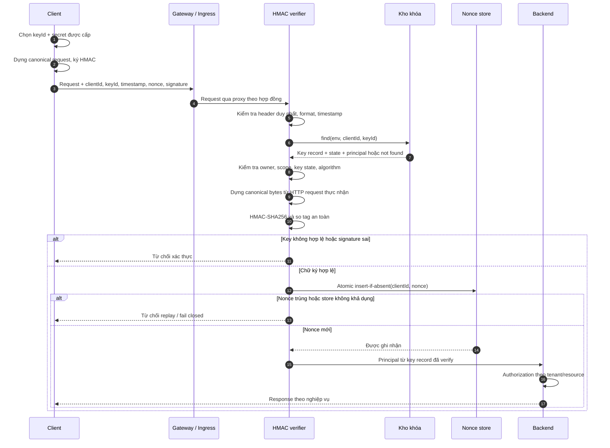
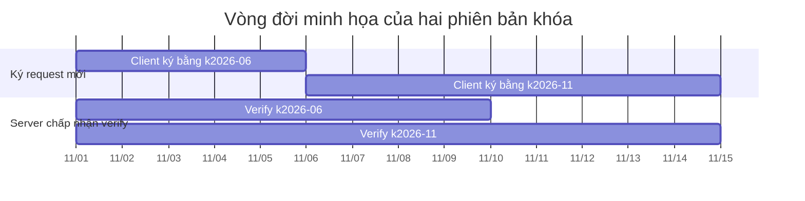

# Mã nhận diện khóa (Key ID) trong HMAC Request Authentication

## Mục tiêu học tập

Sau bài này, bạn có thể:

- Giải thích **mã nhận diện khóa** (`key ID`, thường viết `keyId`) dùng để làm gì khi một HTTP request được xác thực bằng HMAC.
- Phân biệt `keyId`, `clientId`, **shared secret**, HMAC signature và danh tính đã được xác thực.
- Thiết kế quy tắc đặt tên, phạm vi định danh, cấu trúc bản ghi khóa và quy trình **tra đúng khóa** theo client/môi trường.
- Ràng buộc `keyId` vào **canonical request** gồm method, URI, header/body để tránh nhầm khóa và nhầm giao thức.
- Giải thích cách `keyId` hỗ trợ **key rotation**, trạng thái verify-only, thu hồi và vận hành nhiều API gateway/verifier.
- Viết Java kiểm tra định dạng key ID, tra cứu khóa theo scope và xác minh chữ ký mà không tin ngay danh tính do client tự khai.
- Kiểm thử các trường hợp **cross-tenant key confusion**, header trùng, key bị thu hồi, replay và phân quyền sau xác thực.

**Bối cảnh:** Bài thuộc chương **Request components** của module `SECURITY_AUTHENTICATION_HMAC_REQUEST_AUTHENTICATION`. Module sử dụng shared secret và HMAC trên canonical HTTP request (method, URI, header hoặc body theo hợp đồng ký), kèm timestamp/nonce chống replay, key rotation và kiểm thử proxy/gateway. Bài này tập trung vào **key ID**, một thành phần nhỏ nhưng quyết định verifier chọn đúng secret để tính lại chữ ký.

## 1. Key ID là gì?

**Key ID** là một **định danh phiên bản khóa** mà client gửi trong request để verifier tìm đúng khóa HMAC đã được cấp phát. Ví dụ:

```http
POST /v1/orders HTTP/1.1
Host: api.example.test
X-Client-Id: merchant-17
X-Key-Id: k2026-11
X-Timestamp: 1795800000
X-Nonce: TVK5dTNsvt8QgQeIRq7PtA
X-Signature: <base64url-hmac-sha256>
Content-Type: application/json

{"orderId":"O-42","amount":120000}
```

`X-Key-Id: k2026-11` giúp phía server tìm phiên bản secret **k2026-11 thuộc merchant-17**. Giá trị trong header `X-Signature` là placeholder. Timestamp và nonce cũng chỉ minh họa; khi kiểm thử thật phải dùng metadata trong cửa sổ cho phép.

Key ID **không phải secret**. Việc biết `k2026-11` không cho phép tính HMAC. Tương tự, một request tự khai `X-Client-Id: merchant-17` và `X-Key-Id: k2026-11` **chưa được xác thực**: attacker có thể tự tạo những header này.

| Khái niệm | Ví dụ | Vai trò và mức độ tin cậy |
|---|---|---|
| `clientId` | `merchant-17` | Danh tính ứng dụng *tự khai*, dùng cùng key ID để tra cứu; chưa đáng tin trước khi verify |
| **`keyId`** | `k2026-11` | Chọn **một phiên bản khóa** trong phạm vi client/môi trường; thường công khai |
| Shared secret `K` | 32 byte ngẫu nhiên | Khóa **bí mật**, chỉ cấp cho client/verifier được phép; không gửi trong HTTP |
| Signature | Base64URL của HMAC-SHA256 | Tag tính từ secret và canonical request; có thể truyền trong HTTP |
| Principal | `merchant-17` sau xác minh | Danh tính **server thiết lập** từ bản ghi khóa đã xác minh |
| Authorization | Cho phép tạo đơn của merchant-17 | Quyết định quyền theo action, tenant, resource; thực hiện **sau** xác thực |

Cần nhớ nguyên tắc: **key ID chọn khóa ứng viên, còn chữ ký đúng với khóa ấy mới góp phần chứng minh khả năng sử dụng secret.** Ngay cả khi chữ ký đúng, backend vẫn phải kiểm tra quyền.

## 2. Vì sao request cần mang key ID?

Nếu một hệ thống chỉ có một client và một secret, verifier có thể cấu hình trực tiếp một khóa. Khi có nhiều đối tác, tenant hoặc phiên bản khóa, cách làm đó không còn phù hợp.

Một server có thể cần xác minh đồng thời:

```text
merchant-17 / production
    k2026-06   VERIFY_ONLY   (khóa cũ, sắp ngừng)
    k2026-11   ACTIVE        (khóa hiện hành)

merchant-42 / production
    k2026-11   ACTIVE        (key ID giống chữ nhưng KHÁC secret)

merchant-17 / staging
    k2026-11   ACTIVE        (KHÁC secret production)
```

Ví dụ cho thấy `keyId` có thể **chỉ duy nhất trong phạm vi một client và môi trường**, không cần duy nhất toàn thế giới. Vì vậy dùng riêng `keyId` làm khóa tra cứu có thể gây nhầm secret. Một khóa tra cứu an toàn tối thiểu gồm:

```text
(environment, clientId, keyId) -> key record
```

Ở đây `environment` phải được xác định từ cấu hình/đường đi server đáng tin, **không tin một header môi trường do caller tự đặt**. Trong hệ thống nhiều API hoặc mục đích sử dụng, có thể cần bổ sung `audience`, `service` hay `purpose` vào phạm vi tra cứu.

Key ID giúp giải quyết ba nhu cầu:

1. **Hiệu quả:** tra một bản ghi khóa được phép thay vì thử lần lượt toàn bộ khóa của hệ thống.
2. **Key rotation:** client ghi rõ phiên bản đang ký; verifier có thể tạm chấp nhận khóa cũ/mới trong giai đoạn chuyển đổi.
3. **Vận hành:** metric có thể cho biết tỷ lệ request dùng `k2026-06` hoặc `k2026-11` mà không ghi hay tiết lộ bytes secret.

**Không nên** gộp mọi client vào một “global secret”: khi secret chung bị lộ, attacker có thể ký request mang nhiều danh tính tự khai khác nhau. Khóa riêng từng client/tenant và từng môi trường giúp giới hạn phạm vi thiệt hại.

## 3. Quy tắc đặt tên và format của key ID

Một giao thức cần quy định rõ **key ID trên wire** để cả client, gateway và server parse nhất quán. Ví dụ chính sách minh họa:

- Trường mang key ID là `X-Key-Id`, **phải xuất hiện đúng một lần**. HTTP header name không phân biệt hoa/thường.
- Giá trị là **1–64 ký tự ASCII**; ký tự đầu thuộc `A-Z`, `a-z` hoặc `0-9`; các ký tự sau thuộc `A-Z`, `a-z`, `0-9`, `.`, `_` hoặc `-`.
- Giá trị **phân biệt hoa/thường**: `K2` và `k2` là hai ID khác nhau; không tự lowercase rồi tra cứu.
- Không chấp nhận giá trị rỗng, khoảng trắng trong ID, ký tự Unicode, `/`, `:`, `,`, xuống dòng, tab hoặc header bị gộp.
- Không nhúng secret vào key ID và không dùng key ID như credential; nên dùng định danh ngẫu nhiên không mang dữ liệu nhạy cảm hoặc tên version không tiết lộ bí mật.
- Không cho phép client tự đặt một key ID mới để làm server **cấp phát** khóa: server chỉ tra những ID đã được quản lý và cho phép.

Regex cho chính sách ví dụ:

```regex
^[A-Za-z0-9][A-Za-z0-9._-]{0,63}$
```

Quy ước trên **không phải chuẩn bắt buộc của HMAC**. Một số API sử dụng UUID, prefix phiên bản hoặc tên khóa theo chuẩn riêng. Điều quan trọng là hai phía thống nhất **một grammar**, có giới hạn độ dài và reject các trường hợp nhập nhằng.

### Header trùng là rủi ro bảo mật

Request sau phải bị từ chối:

```http
X-Key-Id: k2026-11
x-key-id: k2026-06
```

Tên header HTTP là không phân biệt hoa/thường, nên đây là **hai giá trị của cùng một trường**. Một proxy có thể lấy giá trị đầu, một framework lấy giá trị cuối, hoặc gộp thành `k2026-11, k2026-06`. Nếu verifier và tầng nghiệp vụ hiểu khác nhau, chữ ký có thể bị gắn với sai phiên bản hoặc sai context.

Vì vậy, **trước khi tra khóa**, ingress/verifier phải phát hiện duplicate header và từ chối theo chính sách. API `getHeader("X-Key-Id")` trả một chuỗi đầu tiên **không tự chứng minh** request chỉ có một header. Phải xem toàn bộ giá trị theo khả năng của HTTP parser/gateway đang sử dụng.

## 4. Bản ghi khóa cần chứa những thông tin nào?

Một bản ghi khóa logic có thể được quản lý như sau:

| Field | Ví dụ | Mục đích |
|---|---|---|
| `environment` | `production` | Cô lập dev/staging/production |
| `clientId` | `merchant-17` | Chủ sở hữu khóa; đầu ra định danh sau verify |
| `keyId` | `k2026-11` | Phiên bản khóa trong phạm vi client/env |
| `algorithm` | `HmacSHA256` | Thuật toán cố định theo hợp đồng đã chốt |
| `secretRef` | `secret-manager/...` | Tham chiếu khóa trong hệ thống bảo vệ bí mật |
| `state` | `ACTIVE`, `VERIFY_ONLY`, `DISABLED` | Quyết định được ký/xác minh trong giai đoạn nào |
| `validFrom` / `validUntil` | Mốc thời gian server quản lý | Giới hạn vòng đời phiên bản khóa |
| `principal` | `merchant-17` | Danh tính **server** gán sau khi chứng thực thành công |
| `audience` / `purpose` | `orders-api` | Ngăn dùng khóa sai dịch vụ hoặc giao thức |
| `metadata/audit` | Người tạo, thời gian đổi trạng thái | Theo dõi rotation và thu hồi, không ghi secret |

Ví dụ **minh họa dữ liệu quản lý**, không phải cấu hình triển khai trực tiếp:

```yaml
environment: production
clientId: merchant-17
keyId: k2026-11
algorithm: HmacSHA256
secretRef: secret-manager/merchant-17/hmac/k2026-11
state: ACTIVE
principal: merchant-17
audience: orders-api
validFrom: "2026-11-01T00:00:00Z"
validUntil: "2027-02-01T00:00:00Z"
```

**Secret reference không phải secret.** Với một số giải pháp, verifier đọc key bytes từ secret manager; với một số HSM/KMS, nó nhận một handle cho phép thực hiện phép MAC mà không xuất raw bytes. Dù theo cách nào, key ID phải dẫn tới **vật liệu khóa chính xác** và trạng thái được phép sử dụng. Không log secret, không commit secret vào Git, không đưa raw secret lên URL, query hoặc header.

### Trạng thái và thời điểm kiểm tra

Hệ thống nên phân biệt:

- `ACTIVE`: phiên bản được phép dùng cho request mới và được verifier chấp nhận.
- `VERIFY_ONLY`: phía server còn tạm xác minh request ký bằng khóa cũ trong thời gian chuyển tiếp, nhưng client được hướng dẫn ký bằng khóa mới.
- `DISABLED`/`REVOKED`: verifier phải từ chối dù tag HMAC đúng.
- `EXPIRED`: không còn hiệu lực theo chính sách mốc thời gian, không được phục hồi chỉ bởi client tự gửi timestamp cũ.

Tên trạng thái chỉ là gợi ý thiết kế; cần quy định chính xác ý nghĩa ở phía client/server. **Không tin vào timestamp do client tự gửi để tự cho phép dùng khóa đã bị thu hồi.** Việc thu hồi khóa dựa trên trạng thái phía server và chính sách có hiệu lực tại thời điểm xác minh.

## 5. Luồng tra cứu khóa: từ untrusted key ID đến principal đã xác thực



Các giai đoạn cần tách rõ:

1. **Client tự khai** `clientId` và `keyId`. Chúng chưa đáng tin, kể cả khi trông đúng cú pháp.
2. **Server kiểm tra format và số lần header xuất hiện**, giới hạn kích thước/giá trị trước khi tra cứu để tránh dùng kho khóa như công cụ dò tìm không giới hạn.
3. **Server tra khóa theo scope** `(environment, clientId, keyId)`; kiểm tra phiên bản, thuật toán, trạng thái, thời hạn và audience.
4. **Server tự dựng canonical request** từ HTTP request thực nhận ở điểm xác minh, bao gồm `clientId` và `keyId` theo hợp đồng ký.
5. **Server tính lại HMAC** bằng secret vừa tra; so tag theo giá trị byte và chỉ khi thành công mới tạo authentication context.
6. **Server chống replay** bằng timestamp và nonce đã ký, sau đó backend **phân quyền** theo principal, tenant và tài nguyên.

Một sai lầm nguy hiểm là:

```text
request.clientId = "merchant-17"
request.keyId    = "k2026-11"
-> lập tức gán principal = merchant-17      // SAI
```

Principal chỉ được lấy từ **bản ghi khóa thuộc scope đã xác minh HMAC thành công**, không từ header bất kỳ của client.

## 6. Vì sao key ID phải nằm trong canonical request?

Giả sử contract ký method, URI, body, timestamp và nonce nhưng bỏ `keyId`. Khi đó attacker có thể đổi header key ID mà không làm thay đổi **thông điệp được ký**. Nếu hệ thống có cấu hình khóa tái sử dụng, key alias, cache không đồng nhất hoặc fallback thiếu an toàn, việc đổi key ID có thể gây nhầm **phiên bản, tenant hoặc mục đích sử dụng**.

Cách thiết kế nhất quán là **ký cả client ID và key ID**:

```text
POST
/v1/orders?currency=VND
host:api.example.test
content-type:application/json
x-client-id:merchant-17
x-key-id:k2026-11
x-timestamp:<unix-seconds>
x-nonce:<random-nonce>
body-sha256:<base64url-sha256-of-raw-body>
```

Hợp đồng ví dụ:

- Dùng từng dòng theo thứ tự đã cố định; phân tách bằng LF (`\n`), **không thêm LF cuối** và encode UTF-8.
- Method viết hoa; request-target là path + query theo một biểu diễn thống nhất.
- Host và content type được chuẩn hóa theo quy tắc chốt trước.
- Giá trị `x-client-id` và `x-key-id` giữ nguyên **case** và bytes theo format đã chấp nhận.
- Body được đưa vào phần ký bằng SHA-256 của **raw bytes**; body rỗng cũng phải hash.
- `timestamp` và `nonce` **được ký** để không thể sửa giá trị nhằm vượt qua chính sách replay.
- Server xác minh bằng `HMAC-SHA256(K, UTF8(canonicalString))`; tag gửi dưới dạng Base64URL không padding. `X-Signature` không được ký đệ quy vào chính nó.

Các chuỗi `<...>` là placeholder minh họa. Trong sản phẩm thật, cần chốt thêm percent-encoding, query trùng, header trùng, charset, content encoding và nơi ghi nhận URI công khai qua proxy.

### Key ID có cần bí mật không?

**Không.** Khi `keyId` đã được ký, attacker vẫn nhìn thấy nó; điều này không làm mất tính bảo mật của HMAC. Cần bảo vệ **shared secret**, không cố “giấu key ID” như một mật khẩu. Tuy nhiên, vì key ID có thể giúp suy đoán cấu trúc nội bộ hoặc vòng đời khóa, log/metric và lỗi trả về nên được thiết kế có kiểm soát, hạn chế lộ metadata không cần thiết.

### Có thể tra key trước khi kiểm tra HMAC không?

**Có, và thường phải làm như vậy**: cần xác định key ứng viên mới có thể tính lại HMAC. Nhưng việc **tra khóa** chỉ là thao tác nội bộ trên **dữ liệu chưa tin cậy**, không đồng nghĩa server đã tin `clientId` hay `keyId`.

Cần áp dụng rate limit và kiểm soát tải cho lookup. Không phân biệt quá chi tiết “key ID tồn tại” và “signature không đúng” trong lỗi công khai khi điều đó tạo điều kiện dò tìm định danh.

## 7. Ví dụ Java: kiểm tra key ID, tra đúng khóa, xác minh tag

Ví dụ Java 17+ dưới đây minh họa **đường đi của key ID** từ request đến bản ghi khóa. Nó dùng Java standard library và giả định HTTP layer đã phát hiện header trùng, đã tạo dữ liệu request từ các thành phần HTTP thực nhận và giới hạn kích thước body/URI. Kho khóa có thể được hiện thực bằng secret manager/KMS hoặc database được bảo vệ.

```java
import java.nio.charset.StandardCharsets;
import java.security.GeneralSecurityException;
import java.security.MessageDigest;
import java.util.Base64;
import java.util.Locale;
import java.util.Optional;
import java.util.regex.Pattern;
import javax.crypto.Mac;
import javax.crypto.spec.SecretKeySpec;

public final class ScopedHmacVerifier {
    private static final Pattern ID =
            Pattern.compile("[A-Za-z0-9][A-Za-z0-9._-]{0,63}");
    private static final Pattern SIGNATURE =
            Pattern.compile("[A-Za-z0-9_-]{43}");
    private static final Base64.Encoder B64URL =
            Base64.getUrlEncoder().withoutPadding();

    private ScopedHmacVerifier() {}

    public record RequestParts(
            String method, String rawTarget, String publicHost,
            String contentType, String clientId, String keyId,
            String timestamp, String nonce, byte[] rawBody) {}

    public record KeyRecord(
            String environment, String clientId, String keyId,
            String principal, boolean allowedToVerify, byte[] secret) {}

    public interface KeyStore {
        Optional<KeyRecord> find(
                String environment, String clientId, String keyId);
    }

    private static String bodyDigest(byte[] rawBody)
            throws GeneralSecurityException {
        byte[] hash = MessageDigest.getInstance("SHA-256")
                .digest(rawBody);
        return B64URL.encodeToString(hash);
    }

    // Yêu cầu caller đã validate request-target, Host và header cardinality.
    private static String canonical(RequestParts r)
            throws GeneralSecurityException {
        return String.join("\n",
                r.method().toUpperCase(Locale.ROOT),
                r.rawTarget(),
                "host:" + r.publicHost().toLowerCase(Locale.ROOT),
                "content-type:" + r.contentType().toLowerCase(Locale.ROOT),
                "x-client-id:" + r.clientId(),
                "x-key-id:" + r.keyId(), // QUAN TRỌNG: key ID được ký
                "x-timestamp:" + r.timestamp(),
                "x-nonce:" + r.nonce(),
                "body-sha256:" + bodyDigest(r.rawBody()));
    }

    public static Optional<String> authenticate(
            RequestParts r, String encodedSignature,
            String serverEnvironment, KeyStore keyStore)
            throws GeneralSecurityException {

        // Trường claim được kiểm tra trước khi dùng làm khóa tra cứu.
        if (r == null || r.clientId() == null || r.keyId() == null ||
                !ID.matcher(r.clientId()).matches() ||
                !ID.matcher(r.keyId()).matches() ||
                encodedSignature == null ||
                !SIGNATURE.matcher(encodedSignature).matches()) {
            return Optional.empty();
        }

        byte[] supplied;
        try {
            supplied = Base64.getUrlDecoder().decode(encodedSignature);
        } catch (IllegalArgumentException badBase64) {
            return Optional.empty();
        }
        if (supplied.length != 32 ||
                !B64URL.encodeToString(supplied).equals(encodedSignature)) {
            return Optional.empty();
        }

        // Scope chứa environment do SERVER quy định, không nhận từ client.
        Optional<KeyRecord> candidate = keyStore.find(
                serverEnvironment, r.clientId(), r.keyId());
        if (candidate.isEmpty()) {
            return Optional.empty();
        }

        KeyRecord key = candidate.get();
        if (!key.allowedToVerify() ||
                !serverEnvironment.equals(key.environment()) ||
                !r.clientId().equals(key.clientId()) ||
                !r.keyId().equals(key.keyId())) {
            return Optional.empty();
        }

        Mac mac = Mac.getInstance("HmacSHA256");
        mac.init(new SecretKeySpec(key.secret(), "HmacSHA256"));
        byte[] expected = mac.doFinal(
                canonical(r).getBytes(StandardCharsets.UTF_8));

        if (!MessageDigest.isEqual(expected, supplied)) {
            return Optional.empty();
        }
        return Optional.of(key.principal());
    }
}
```

Ví dụ trả về `Optional<String>` để làm rõ **principal chỉ xuất hiện sau khi HMAC khớp**. Nó **chưa phải HTTP authentication filter hoàn chỉnh**: môi trường thực tế cần kiểm tra định dạng và cửa sổ timestamp, nonce store chia sẻ và nguyên tử, trạng thái thời hạn/thu hồi khóa, provider failure, request size, header trùng, host/URI/body qua proxy, đồng thời kiểm tra authorization trước khi thực thi nghiệp vụ. `KeyStore` là interface, cần cung cấp implementation quản lý secret an toàn; không tự tạo secret mới khi verify.

Ở đây `KeyRecord.secret` dùng `byte[]` để minh họa. Trong production, giới hạn quyền truy cập raw secret, tránh làm rò rỉ qua log/crash dump và cân nhắc KMS/HSM nếu phù hợp. Khi server dùng cùng key bytes cho nhiều mục đích hoặc audience, phải bổ sung ràng buộc/phân tách khóa hoặc context ký theo kiến trúc.

### Vì sao phải kiểm tra lại owner trên bản ghi?

Ngay cả khi `keyStore.find(env, clientId, keyId)` được thiết kế trả đúng dữ liệu, xác nhận bản ghi có scope và owner nhất quán giúp phát hiện sai lệch mapping/cache. Một hệ thống không được “thành công” chỉ vì tìm thấy một bản ghi có **cùng key ID** nhưng thuộc client khác.

**Không tự thử tất cả secret đến khi tag khớp.** Cách đó làm mất ý nghĩa của key ID, tăng nguy cơ nhầm tenant, tạo bề mặt dò tìm và tăng chi phí xử lý. Khi key ID không tồn tại, thuật toán không phù hợp hoặc trạng thái disabled, server phải từ chối theo chính sách.

## 8. Key rotation sử dụng key ID như thế nào?

Hãy xét một đối tác trước đó dùng `k2026-06` và cần chuyển sang `k2026-11`.



Các ngày chỉ phục vụ minh họa quy trình; không phải thời hạn rotation khuyến nghị.

1. **Provision `k2026-11`:** sinh secret mới từ CSPRNG, gắn đúng client và môi trường; cấp secret mới qua kênh bảo mật.
2. **Chuẩn bị verifier:** cho phép xác minh cả `k2026-06` và `k2026-11` trong một khoảng **chuyển tiếp hữu hạn**. Mỗi request chọn đúng secret bằng `keyId` đã khai và được ký.
3. **Chuyển client:** client bắt đầu ký request mới bằng secret `k2026-11`, gửi `X-Key-Id: k2026-11`. Theo dõi tỷ lệ request còn sử dụng khóa cũ qua metrics.
4. **Vô hiệu hóa khóa cũ:** sau thời hạn và xác nhận request đang bay không còn cần thiết, chuyển `k2026-06` sang `DISABLED`; verifier phải từ chối chữ ký với khóa ấy.
5. **Thu hồi khẩn cấp:** khi secret có dấu hiệu lộ, vô hiệu hóa ngay theo chính sách; không chờ hết thời gian chuyển tiếp và phải cập nhật cache của mọi replica.

**Không nên tái sử dụng một key ID cho secret mới.** Tốt hơn là mỗi phiên bản có một ID ổn định, không trùng trong cùng scope. Nếu thay secret ở sau cùng ID mà cache/verifier chưa đồng bộ, các request có thể xác minh sai và khó truy nguyên.

### Key ID và hệ thống nhiều replica

Mọi verifier cần nhất quán về phiên bản khóa nào được phép verify. Nếu pod A đã thu hồi `k2026-06` nhưng pod B vẫn dùng cache cũ, attacker có thể gửi vào pod B. Thiết kế rotation cần giải pháp invalidation, thời gian sống cache phù hợp và giám sát trạng thái phiên bản.

**Nonce store là một thành phần riêng:** nhiều replica cũng phải dùng chung trạng thái nonce để chặn replay. Key ID không thay thế timestamp/nonce, và rotation không tự động chống được việc gửi lại request đã ký hợp lệ.

## 9. Những ranh giới cần chú ý khi đi qua proxy/gateway

Key ID thường ở header do client cung cấp. Hành trình qua CDN, reverse proxy, API gateway và framework có thể tạo khác biệt xử lý:

- **Header trùng/đổi case:** `X-Key-Id` và `x-key-id` có thể bị gộp hoặc chỉ một giá trị được giữ.
- **Whitespace và encoding:** bên ký giữ nguyên `k2026-11`, còn proxy tự trim/biến đổi chuỗi; server nên có parser và quy ước format nhất quán.
- **Đổi signed fields:** gateway rewrite method/path, host, query, header hoặc body khiến canonical request ở verifier khác với client.
- **Header danh tính nội bộ bị giả mạo:** attacker gửi `X-Authenticated-Client` với giá trị bất kỳ; backend có thể nhầm là header do gateway xác thực.
- **Proxy không giữ phiên bản ký:** một gateway cũ và backend mới có thể dùng quy tắc canonical khác nhau, khiến tag sai hoặc ý nghĩa request bị hiểu khác.

Hướng xử lý:

1. Chọn **vị trí xác minh HMAC** trước hoặc sau rewrite một cách có chủ đích, đặc tả rõ nguồn method/URI/host/body được ký.
2. Cấu hình ingress từ chối header key ID trùng/nhập nhằng, giới hạn độ dài và số lượng header.
3. Nếu verifier sử dụng `Forwarded`, `X-Forwarded-Host`, `X-Original-URI`, chỉ tin giá trị do proxy **được ủy quyền** tạo hoặc ghi đè; không lấy trực tiếp từ client Internet.
4. Sau khi xác minh, gateway loại bỏ header định danh nội bộ do client tự chèn, chỉ truyền **principal server đã xác thực** qua kênh tin cậy.
5. Kiểm thử từ **HTTP client thật → gateway/proxy → verifier → backend**, bao gồm key ID đúng/sai scope và thay đổi dữ liệu được ký.

Nếu key ID được parse ở gateway nhưng lại được backend parse lần nữa, cần bảo đảm cả hai cùng dùng **chính một giá trị đã kiểm tra**; tốt nhất backend nhận authentication context đã xác thực từ gateway thay vì tự “chọn lại key ID” từ request không đáng tin.

## 10. Key ID không thay thế chống replay hoặc phân quyền

### Timestamp và nonce

Kể cả khi request có `clientId`, `keyId` và signature đúng, attacker vẫn có thể **gửi lại nguyên request** trong thời gian nó còn được chấp nhận nếu thiếu replay protection.

Hệ thống nên ký `timestamp` và `nonce` trong canonical request, kiểm tra thời gian chấp nhận (ví dụ ±300 giây) và ghi nonce sau khi HMAC hợp lệ bằng **atomic insert-if-absent** vào kho dùng chung cho mọi replica. TTL phải bao phủ đến lúc timestamp không thể còn hợp lệ. Nếu kho nonce không khả dụng, endpoint nhạy cảm nên **fail closed**.

Replay key thường có dạng `(principal/clientId, nonce)` trong phạm vi môi trường. Có thể lựa chọn thêm key ID nếu mô hình replay xác định và chứng minh được không chấp nhận phát lại ở **khác phiên bản khóa**; tuy nhiên dùng `(clientId, nonce)` chung giữa các phiên bản giúp tránh chấp nhận nonce giống nhau sau rotation. Cần định nghĩa rõ phạm vi nonce thay vì ngầm coi key ID là cách chống replay.

### Authentication và authorization

Nếu `merchant-17` ký hợp lệ request tạo đơn cho `merchant-42`, verifier có thể xác thực được **merchant-17** từ bản ghi khóa. Backend **phải tiếp tục kiểm tra quyền đối với tenant/resource merchant-42**. Không có chuyện vì key ID đúng và HMAC khớp mà tự động có quyền với tài nguyên khác.

Key ID cũng không thay thế idempotency: client có thể retry một lệnh tạo đơn với nonce mới và chữ ký mới, dẫn tới chạy nghiệp vụ lần hai. Với endpoint tạo đơn/thanh toán, hãy thiết kế **Idempotency-Key** và cơ chế ngăn tác vụ trùng ở backend; nếu là dữ liệu do client gửi thì bảo vệ nó bằng chữ ký hoặc cơ chế đáng tin tương đương.

## 11. Threat model cho key ID: sai ở đâu, hậu quả gì?

| Tình huống | Sai lầm thiết kế | Hậu quả | Biện pháp |
|---|---|---|---|
| Client A gửi key ID của B | Lookup chỉ theo `keyId` | Nhầm khóa/tenant | Scope theo `(env, clientId, keyId)`, kiểm tra owner |
| Client đổi `keyId` sau khi ký | Key ID không nằm trong canonical request | Không ràng buộc lựa chọn khóa với thông điệp | Ký `x-key-id` cùng `x-client-id` |
| Header `X-Key-Id` xuất hiện hai lần | Verifier/gateway chọn giá trị khác nhau | Key confusion hoặc chữ ký sai | Reject header trùng/nhập nhằng |
| Key ID cực dài hoặc ký tự lạ | Thiếu giới hạn và parser | Dò tìm/tăng tải, xử lý không nhất quán | Allowlist ASCII, length bound, rate limit |
| Key cũ được chấp nhận sau revoke | Cache verifier stale | Giả mạo bằng khóa đã lộ | Invalidation, TTL, cơ chế thu hồi |
| Key ID tái sử dụng cho secret khác | Cache trỏ secret cũ hoặc mới | Lỗi xác minh khó chẩn đoán | Phiên bản mới phải có ID mới |
| Log raw secret để debug key ID | Nhầm ID với secret | Lộ khóa, attacker ký request mới | Log ID đã kiểm soát, không log secret |
| Thử mọi key khi ID không tồn tại | Fallback thiếu scope | Rủi ro chéo tenant, tài nguyên tăng | Lookup đúng scope, fail closed |
| Server tin `clientId` tự khai | Thiết lập principal trước HMAC | Giả mạo danh tính | Principal từ key record sau verify |
| Key ID trông đúng, signature sai | Chỉ kiểm tra format | Xác thực sai | Tính lại HMAC, so tag an toàn |
| Backend tin mọi header sau gateway | Header identity do client chèn | Vượt quyền | Header nội bộ được ghi đè và authz riêng |
| Khóa bị lộ | Giả định nonce đủ để chặn tấn công | Attacker ký request mới | Thu hồi/rotation, giảm scope khóa |

## 12. Kế hoạch kiểm thử key ID

| Ca kiểm thử | Input/thao tác | Kết quả mong đợi |
|---|---|---|
| **Happy path** | `clientId=merchant-17`, `keyId=k2026-11`, secret đúng | Chữ ký hợp lệ; principal `merchant-17` |
| Không có key ID | Thiếu `X-Key-Id` | Reject trước tra khóa |
| Key ID không hợp lệ | Rỗng, quá dài, có `/` hoặc ký tự xuống dòng | Reject format |
| Duplicate header | Hai `X-Key-Id` kể cả khác case | Reject trước chọn khóa |
| Key ID khác case | `K2026-11` thay `k2026-11` | Tìm ID khác hoặc không tồn tại; không tự lowercase |
| Cross-client | Claim client B, key ID của B nhưng ký bằng secret A | HMAC fail, không có principal B |
| Cross-environment | Dùng khóa staging để ký production | Không thể xác minh với khóa production |
| Thay key ID | Sửa `k2026-11` thành `k2026-06` sau ký | Không được chấp nhận nếu thông điệp/khóa khác |
| Khóa đã thu hồi | Signature đúng về mặt HMAC với secret cũ | Bị từ chối do key state |
| Rotation | `k1`/`k2` trong overlap, rồi disable `k1` | Theo chính sách transition, không accept key đã disable |
| Key cache không đồng bộ | Gửi tới nhiều replica sau khi revoke | Không replica nào còn cho phép key bị thu hồi sau khi chính sách có hiệu lực |
| Replay | Gửi cùng request/nonce lần hai | Từ chối replay trên shared nonce store |
| Chữ ký đúng, tenant sai quyền | Client A nhắm tới tài nguyên tenant B | Authn pass, authz deny |
| Gateway rewrite | Path, Host, header bị proxy biến đổi | Canonical contract xử lý nhất quán hoặc reject |
| Header identity giả | Client tự gửi `X-Authenticated-Client: admin` | Backend không nhận principal giả |

Ngoài unit test cho regex, key lookup và HMAC, phải kiểm thử **end-to-end qua proxy/gateway** để phát hiện sai khác parse header, URI, body và cách chuyển principal.

### Câu hỏi tự kiểm tra

1. Khi server nhận `X-Key-Id: k2`, nó đã biết chắc request đến từ client nào chưa? Vì sao?
2. Vì sao hai client khác nhau vẫn có thể dùng cùng chuỗi `keyId=k2` nhưng không được dùng cùng secret?
3. Điều gì có thể xảy ra khi server tra khóa chỉ bằng key ID và bỏ qua môi trường?
4. Khi xoay vòng khóa, cần thay `keyId` hay chỉ thay secret phía sau cùng một key ID?
5. Một chữ ký HMAC hợp lệ với khóa của tenant A có cấp quyền truy cập tenant B không?

Đáp án tốt phải chỉ rõ **scope tra khóa**, **điểm thiết lập principal**, **ràng buộc key ID trong canonical request**, **key lifecycle** và **authorization độc lập**.

## 13. Bài tập thực hành: thiết kế Key ID cho hệ thống đa tenant

Giả sử `inventory-client` và `billing-client` cùng gọi `orders-api` qua API gateway. Mỗi client có hai môi trường `staging`/`production`; verifier chạy ba replica; hệ thống dự kiến rotation `k1 → k2`.

Hãy đề xuất thiết kế và trình bày:

1. Hợp đồng `X-Client-Id` và `X-Key-Id` (grammar, độ dài, số header, phân biệt hoa/thường).
2. Sơ đồ kho khóa với khóa tra cứu `(env, clientId, keyId)`, trạng thái và principal của từng phiên bản.
3. Canonical request có ký `clientId`, `keyId`, method, path/query, các header có ý nghĩa và digest raw body.
4. Pseudocode verifier: kiểm tra format, tra key đúng scope, verify HMAC, timestamp/nonce, tạo principal rồi phân quyền.
5. Quy trình rotation hỗ trợ overlap có hạn, thu hồi khẩn cấp, cập nhật cache và metric theo key ID.
6. Test giả mạo: staging key dùng ở production, key ID của client khác, duplicate `X-Key-Id`, request replay qua hai verifier, backend nhận header identity giả.

**Tiêu chí hoàn thành:** Verifier không bao giờ tạo principal từ `clientId`/`keyId` chưa xác minh; một key ID chỉ chọn được secret **đúng owner và môi trường**; key mới được phân biệt rõ với key cũ; mọi request vẫn đi qua **HMAC, replay policy và authorization**.

---

## Ghi nhớ

Trong module `SECURITY_AUTHENTICATION_HMAC_REQUEST_AUTHENTICATION`, **mã nhận diện khóa (key ID)** là định danh giúp tìm **đúng phiên bản shared secret** để kiểm tra HMAC của HTTP request. Nó thường là dữ liệu công khai và phải được coi là **untrusted** cho tới khi chữ ký đã xác minh. Thiết kế tốt cần **lookup theo client/môi trường**, **ký cả key ID trong canonical request**, **quản lý vòng đời và rotation/thu hồi khóa**, đồng thời giữ riêng các bước **timestamp/nonce chống replay**, **kiểm thử gateway** và **phân quyền nghiệp vụ**.
