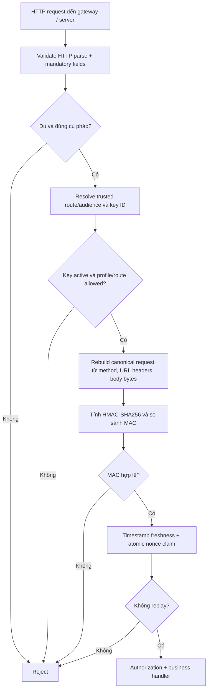

# Thành phần bắt buộc của HTTP request khi xác thực bằng HMAC

## 1. “Bắt buộc” theo hợp đồng ký, không phải theo bản thân HMAC

HMAC là thuật toán tính **Message Authentication Code (MAC)** từ **khóa bí mật** và **một dãy byte thông điệp**:

```text
macBytes = HMAC-SHA256(sharedSecretBytes, canonicalRequestBytes)
```

HMAC không biết khái niệm HTTP method, URL, header, body, timestamp hay nonce. Vì vậy, không tồn tại một danh sách field HTTP “bắt buộc cho mọi HMAC” được thuật toán tự quy định. Trong xác thực HTTP request, **thành phần bắt buộc** phải được xác định bởi **hợp đồng ký (signature contract)** giữa client và server, dựa trên dữ liệu nào quyết định hành vi của API và những mối đe dọa cần ngăn chặn.

Bài này thuộc chương **Request components** của module `SECURITY_AUTHENTICATION_HMAC_REQUEST_AUTHENTICATION`. Module hướng dẫn xác thực HTTP request bằng **shared secret và canonical request** bao gồm phương thức, URI, header hoặc body theo hợp đồng; người học thực hành xác minh chữ ký, chống replay với timestamp/nonce, quản lý key rotation, kiểm thử proxy/gateway và phân biệt **authentication** với **authorization**.

Trong thực tế, cần phân biệt ba nhóm:

1. **Thành phần cần tồn tại trong HTTP request:** ví dụ method, request target, các header có tên được hợp đồng quy định, chữ ký được gửi kèm, body nếu endpoint yêu cầu.
2. **Thành phần phải được ràng buộc vào message có chữ ký:** method, tài nguyên đích, body hoặc digest, các header ảnh hưởng đến diễn giải/ngữ cảnh, thông tin key/version/timestamp/nonce; một số giá trị có thể được lấy từ **cấu hình tin cậy** thay vì nhận trực tiếp từ HTTP.
3. **Điều kiện server phải kiểm tra ngoài phép tính HMAC:** key còn hiệu lực, service/tenant scope, thời gian hợp lệ, nonce chưa dùng, quyền truy cập và cách client xác minh server qua HTTPS.

Ví dụ, `X-Signature` là **header bắt buộc phải gửi**, nhưng **không thể đưa chính giá trị chữ ký vào thông điệp được ký** vì đó là đầu ra của phép tính. Ngược lại, định danh service/audience có thể là **thành phần bắt buộc của canonical request** dù không tồn tại dưới dạng một header riêng.

## 2. Bảng thành phần tối thiểu cho một hợp đồng HMAC request có chống replay

Bảng dưới là **một cấu hình đề xuất cho API nhạy cảm** sử dụng HMAC-SHA256 và timestamp/nonce, không phải chuẩn chung cho mọi hệ thống:

| Thành phần | Trong HTTP request? | Trong canonical request? | Server kiểm tra gì? |
| --- | --- | --- | --- |
| **HTTP method** | Có, ví dụ `POST`. | **Có.** | Method ký phải là method handler thực thi; từ chối hành động ngoài route. |
| **Path + query (request target)** | Có path; query có thể rỗng. | **Có**, theo quy tắc raw/normalized cố định. | Tài nguyên và các tham số ảnh hưởng hành vi khớp với phần đã xác minh. |
| **Origin/audience** | Thường thể hiện qua URL/authority; có thể được gateway xác định từ route. | **Có hoặc ràng buộc tương đương bằng key/route scope.** | Đúng service, môi trường, tenant và host đích được phép; không tin header forwarding chưa xác thực. |
| **Content-Type** | Bắt buộc cho endpoint ví dụ có JSON body. | **Có**, nếu ảnh hưởng cách parse body. | Đúng một giá trị hợp lệ, không tự đoán khi header trùng. |
| **Body bytes / digest** | Body bắt buộc cho thao tác POST trong ví dụ; endpoint khác có thể rỗng. | **Có**, thường là `SHA-256(bodyBytes)`. | Server tự hash **byte payload sẽ được xử lý**. |
| **X-Key-Id** | **Có**. | **Có**. | Tra secret trong kho tin cậy; kiểm tra key active, tenant/service scope. |
| **X-Signature-Version** | **Có** theo contract có phiên bản. | **Có** hoặc domain separation/ràng buộc tương đương. | Chỉ nhận profile có trong allowlist của key; không fallback. |
| **X-Timestamp** | **Có** theo contract chống replay. | **Có**. | Parse UTC đúng định dạng; nằm trong cửa sổ thời gian được phép. |
| **X-Nonce** | **Có** theo contract chống replay. | **Có**. | Nonce đủ ngẫu nhiên và chưa được claim; lưu nguyên tử trên kho dùng chung. |
| **X-Signature** | **Có** để chuyển MAC. | **Không**, đây là đầu ra. | Kiểm tra format/độ dài và so sánh MAC do server tự tính. |

**Không phải mọi endpoint đều cần body hoặc Content-Type.** Một `GET` không có body vẫn có thể ký digest của dãy byte rỗng; nếu contract quy định như vậy thì body digest **vẫn là một dòng canonical bắt buộc**, dù HTTP không truyền nội dung. Với `Content-Type` của request không có body, hợp đồng phải định nghĩa cụ thể là **không có** hay **rỗng**; tuyệt đối không để client và server đoán khác nhau.

### Tối thiểu theo từng mục tiêu

| Mục tiêu | Các dữ liệu/cơ chế cần có |
| --- | --- |
| Chỉ phát hiện thay đổi trên payload | Body bytes/digest **được ký**; nhưng vẫn chưa đủ để ràng buộc method, path hay caller. |
| Xác thực request cho một API | Có key ID/credential context, MAC và canonical bảo vệ các thành phần có ảnh hưởng hành vi; server kiểm tra key scope. |
| Ràng buộc tới đúng tài nguyên và thao tác | Ký method, path/query, và audience/authority hoặc kiểm soát tương đương đáng tin cậy. |
| Chống phát lại (replay) | Timestamp và nonce **được ký** **và** có kiểm tra cửa sổ thời gian/nonce nguyên tử. |
| Phân quyền | Server thực hiện **authorization** sau authentication; không thể thay bằng một header được ký. |
| Bảo mật đường truyền/xác minh server | HTTPS/TLS với xác minh chứng chỉ và hostname; HMAC không mã hóa body. |

## 3. HTTP method và request target: xác định “làm gì” và “ở đâu”

Hai request có body giống hệt nhau có thể gây tác động hoàn toàn khác:

```http
POST /v1/accounts/A123/transfer?currency=VND HTTP/1.1
Content-Type: application/json

{"amount":500000}
```

```http
POST /v1/accounts/B999/transfer?currency=USD HTTP/1.1
Content-Type: application/json

{"amount":500000}
```

Nếu chỉ ký `{"amount":500000}`, cùng chữ ký có thể bị tái sử dụng với một tài khoản hoặc đơn vị tiền tệ khác khi các điều kiện khác cho phép. Một hợp đồng an toàn cần:

- **Method:** ký đúng token method server sẽ xử lý (ví dụ `POST`, `PUT`), không chuyển `POST` thành `GET` rồi vẫn chấp nhận chữ ký cũ.
- **Path:** ký đường dẫn định danh route/tài nguyên, bao gồm ID tài nguyên. Cần biết framework dùng **raw path** hay **decoded path**.
- **Query:** ký tất cả tham số ảnh hưởng hành vi; thứ tự, tham số trùng và percent-encoding phải có quy tắc cố định.
- **Authority/audience:** ràng buộc request với đúng API/service, nhất là khi cùng key có nguy cơ bị dùng qua nhiều hostname, môi trường hoặc tenant.

Ví dụ `/files/a%2Fb` và `/files/a/b` có thể được một số router diễn giải khác nhau; `?a=1&b=2` và `?b=2&a=1` cũng khác byte. **Ký một URL nhưng route theo URL được diễn giải khác** làm mất ranh giới integrity. Nên thống nhất một biểu diễn ở điểm xác minh và điểm xử lý; từ chối URI nhập nhằng hoặc không hợp lệ.

**Không dùng `Host`/ `X-Forwarded-Host` do caller tùy ý khai báo để suy ra service đã được xác thực.** Nếu canonical ký origin, verifier phải đối chiếu nó với **route/authority đã được xác định từ ingress tin cậy** và scope của credential. Gateway cần bỏ các forwarding header do caller tự cung cấp trước khi tạo metadata đáng tin cậy.

## 4. Signed headers: những header ảnh hưởng đến ngữ nghĩa request

Các header có thể thay đổi cách server xử lý body, người gọi hoặc chính sách:

- `Content-Type`: quyết định bộ parser, ví dụ `application/json`; `application/json; charset=utf-8` là giá trị **khác byte** nếu hợp đồng chỉ chấp nhận chuỗi đầu tiên.
- `Content-Encoding`: quyết định dữ liệu được giải nén/diễn giải thế nào; phải quy định và bảo vệ nếu ứng dụng phụ thuộc vào nó.
- `X-Key-Id`: chọn credential từ kho bí mật; được ký để ràng buộc ngữ cảnh khóa.
- `X-Signature-Version`: xác định schema canonical, thuật toán và encoding theo registry của server.
- `X-Timestamp`, `X-Nonce`: metadata chống replay; phải xuất hiện trong phần được ký.
- `Idempotency-Key`: nếu endpoint dùng để xử lý retry an toàn, nên ký để attacker không thay đổi request identity mà vẫn giữ MAC hợp lệ.

Không nên ký mọi header vô điều kiện. Header kiểu hop-by-hop như `Connection` hoặc `Transfer-Encoding` thường thay đổi qua proxy; nếu chúng không có ý nghĩa đầu cuối thì không nên đưa vào contract mà không có lý do cụ thể.

**Vấn đề quan trọng hơn số lượng header là cách lấy giá trị header.** Tên header HTTP thông thường không phân biệt chữ hoa/thường, còn giá trị, khoảng trắng, dấu phẩy, header trùng, thứ tự header và folding cũ có thể được các stack diễn giải khác nhau. Hợp đồng ký phải chỉ rõ:

1. Header nào **bắt buộc tồn tại đúng một lần**; từ chối duplicate signed headers và CR/LF injection.
2. Tên header dùng dạng nào trong canonical (ví dụ chữ thường), giá trị được trim hay phải **chính xác** theo cú pháp quy định.
3. Trường thiếu và trường có giá trị rỗng có được xem tương đương hay không; cách encode sự vắng mặt nếu contract cho phép.
4. Header nào đến từ client, header nào do **gateway đã xác thực** bổ sung và header nào cần tra từ cấu hình server.

Nếu framework gộp nhiều header thành một chuỗi, nhưng hợp đồng yêu cầu một giá trị, hãy từ chối request mơ hồ **trước khi xác minh**. Chỉ kiểm tra một `getHeader(name)` trả về giá trị đầu tiên có thể che giấu những giá trị khác mà downstream lại sử dụng.

## 5. Body: ký đúng byte mà nghiệp vụ sẽ sử dụng

Khi body quyết định hành vi nghiệp vụ, cần bảo vệ nội dung của nó. Một cách phổ biến:

```text
bodyDigest = lowercaseHex(SHA-256(bodyBytes))
canonical  = buildCanonical(method, target, signedHeaders, bodyDigest, ...)
signature  = lowercaseHex(HMAC-SHA256(secret, UTF8(canonical)))
```

`bodyBytes` là snapshot byte payload mà application xử lý sau khi HTTP transfer framing đã được gỡ, **trước khi parse rồi serialize JSON**, trừ khi hợp đồng quy định khác một cách rõ ràng. Server phải tự tính digest này; không được tin một `X-Body-Hash` do client gửi mà không đối chiếu với body thực nhận.

Hai body JSON có thể có cùng ý nghĩa nhưng tạo digest khác:

```json
{"amount":500000,"currency":"VND"}
```

```json
{ "currency": "VND", "amount": 500000 }
```

Đối với **raw-body signing**, khoảng trắng, thứ tự field, UTF-8, normalization Unicode và newline đều là byte thực sự được ký. Nếu cần canonical JSON, phải có một chuẩn biểu diễn thống nhất và độc lập với trình serialize mặc định của từng framework.

Đối với request không có body, có thể quy định bắt buộc dòng digest cho **empty byte array**:

```text
SHA-256(empty) =
e3b0c44298fc1c149afbf4c8996fb92427ae41e4649b934ca495991b7852b855
```

Khi proxy tự giải nén `gzip` hoặc chuyển mã body trước khi tới verifier, client và server có thể tính digest trên **hai dãy byte khác nhau**. Cần chọn ranh giới ký và xác minh thống nhất; nếu gateway xác minh HMAC thay backend, nó phải chuyển caller identity được xác minh qua kênh bảo vệ và backend phải tin cậy nguồn gốc metadata đó.

## 6. Hợp đồng minh họa: những field nào thực sự bắt buộc?

Giả sử triển khai một API chuyển tiền, chỉ nhận `POST` với JSON body và duy nhất một origin `https://api.example.test`. Để người học dễ kiểm chứng, ta định nghĩa **HMAC-REQUEST-V1** là một hợp đồng **tự chọn**, không phải một tiêu chuẩn tự động có sẵn trong HTTP.

**Request minh họa:**

```http
POST /v1/transfers?currency=VND HTTP/1.1
Host: api.example.test
Content-Type: application/json
X-Key-Id: merchant-2026-11
X-Signature-Version: hmac-request-v1
X-Timestamp: 2026-11-28T02:05:00Z
X-Nonce: e1ixWyEAK6uAnv0iKqNyaQ
X-Signature: <64 ký tự lowercase hex>

{"from":"A123","to":"B456","amount":500000}
```

Hợp đồng yêu cầu tất cả các header `Content-Type`, `X-Key-Id`, `X-Signature-Version`, `X-Timestamp`, `X-Nonce`, `X-Signature` **đều có đúng một giá trị**, cùng với method/target hợp lệ và một body JSON. Origin `https://api.example.test` được lấy từ **đích đã cấu hình tin cậy**, ràng buộc với route đích ở server. Server chỉ chấp nhận `hmac-request-v1` cho key được cấp quyền dùng profile này.

**Canonical message v1:**

```text
HMAC-REQUEST-V1
POST
https://api.example.test
/v1/transfers?currency=VND
content-type:application/json
x-key-id:merchant-2026-11
x-signature-version:hmac-request-v1
x-timestamp:2026-11-28T02:05:00Z
x-nonce:e1ixWyEAK6uAnv0iKqNyaQ
<64 ký tự lowercase hex của SHA-256(bodyBytes)>
```

**Dòng cuối là placeholder** cho digest 64 ký tự thực; không ký nguyên dấu `<`, `>`. Mỗi dòng được nối bằng **LF** (`0A`), mã hóa **UTF-8**, **không có LF cuối**. `X-Signature` không nằm trong canonical message vì chữ ký là kết quả của `HMAC-SHA256(secret, canonicalBytes)`.

Quy tắc cố định cho ví dụ:

| Quy tắc | Ý nghĩa |
| --- | --- |
| `HMAC-REQUEST-V1` | Prefix có phiên bản để phân tách hợp đồng. |
| `POST` + raw target | Bảo vệ thao tác và tài nguyên; ở ví dụ raw target là `/v1/transfers?currency=VND`. |
| Origin đã định tuyến | Bảo vệ audience; phải khớp với route và key scope, không mù quáng tin `Host` được forward. |
| `Content-Type: application/json` | Giá trị chính xác; không hỗ trợ trường trống hay tham số bổ sung trong ví dụ. |
| `X-Key-Id` | Được ký và dùng chọn secret tin cậy tương ứng; không chứa chính secret. |
| `X-Signature-Version` | Được ký, đúng `hmac-request-v1`; server không thử phiên bản khác khi MAC sai. |
| `X-Timestamp` | UTC ISO-8601 đến giây, được ký, lệch tối đa ±5 phút so với đồng hồ server. |
| `X-Nonce` | Chuỗi base64url không padding với 16–128 ký tự theo ví dụ; phía client phải tạo ngẫu nhiên đủ mạnh. |
| Body digest | SHA-256 của body bytes; 64 ký tự hex thường, không để client tự chọn hash algorithm. |
| `X-Signature` | MAC HMAC-SHA256 **32 byte** được encode 64 ký tự hex thường, không cắt ngắn. |

Việc “bắt buộc” có thể khác giữa API khác: ví dụ `GET /v1/resources` có thể không cần `Content-Type` và body, nhưng hợp đồng ký nên vẫn có rule rõ ràng cho digest của message rỗng. Nếu API bổ sung body streaming hoặc multi-part, cần xác định chính xác bytes được ký và giới hạn tài nguyên trước khi triển khai.

## 7. Ví dụ Java 17+: kiểm tra thành phần bắt buộc trước khi xử lý

Ví dụ dưới đây tách logic khỏi framework HTTP để làm rõ **field nào được kiểm tra, field nào được ký và field nào là policy**. Adapter HTTP có trách nhiệm phát hiện signed headers bị thiếu/trùng, từ chối CR/LF injection, cung cấp **raw request target** và snapshot body bytes **đúng như handler sẽ sử dụng**. `trustedAudience` phải lấy từ route/ingress đã xác thực, không đọc từ `X-Forwarded-Host` tùy ý.

```java
import java.nio.charset.StandardCharsets;
import java.security.GeneralSecurityException;
import java.security.MessageDigest;
import java.time.Clock;
import java.time.Duration;
import java.time.Instant;
import java.time.format.DateTimeParseException;
import java.util.HexFormat;
import java.util.Set;
import javax.crypto.Mac;
import javax.crypto.spec.SecretKeySpec;

public final class RequiredHmacRequestComponents {
    private static final String VERSION = "hmac-request-v1";
    private static final String PREFIX = "HMAC-REQUEST-V1";
    private static final String ALGORITHM = "HmacSHA256";
    private static final String AUDIENCE = "https://api.example.test";
    private static final Duration MAX_SKEW = Duration.ofMinutes(5);
    private static final Duration NONCE_TTL = Duration.ofMinutes(11);
    private static final HexFormat HEX = HexFormat.of();

    // Values are snapshots taken by an HTTP adapter; fields are single-valued.
    public record SignedRequest(
            String method, String rawTarget, String trustedAudience,
            String contentType, String keyId, String signatureVersion,
            String timestamp, String nonce, byte[] body,
            String signatureHex) {}

    public record Credential(
            byte[] secret, boolean active, String audience,
            Set<String> allowedVersions) {}

    public interface CredentialStore {
        Credential find(String keyId);
    }

    public interface NonceStore {
        // Atomic put-if-absent on shared storage with an expiry.
        boolean claim(String keyId, String nonce, Duration ttl);
    }

    public static byte[] canonicalBytes(SignedRequest r)
            throws GeneralSecurityException {
        String bodyDigest = HEX.formatHex(
                MessageDigest.getInstance("SHA-256").digest(r.body()));
        String canonical = String.join("\n",
                PREFIX,
                r.method(),
                AUDIENCE,
                r.rawTarget(),
                "content-type:" + r.contentType(),
                "x-key-id:" + r.keyId(),
                "x-signature-version:" + r.signatureVersion(),
                "x-timestamp:" + r.timestamp(),
                "x-nonce:" + r.nonce(),
                bodyDigest);
        return canonical.getBytes(StandardCharsets.UTF_8);
    }

    public static byte[] sign(byte[] secret, byte[] message)
            throws GeneralSecurityException {
        Mac mac = Mac.getInstance(ALGORITHM);
        mac.init(new SecretKeySpec(secret, ALGORITHM));
        return mac.doFinal(message);
    }

    public static boolean verify(
            SignedRequest r, CredentialStore credentials,
            NonceStore nonces, Clock clock)
            throws GeneralSecurityException {
        // (1) Mandatory fields must exist before canonicalization.
        if (r == null || r.method() == null || r.rawTarget() == null
                || r.trustedAudience() == null || r.contentType() == null
                || r.keyId() == null || r.signatureVersion() == null
                || r.timestamp() == null || r.nonce() == null
                || r.body() == null || r.signatureHex() == null) return false;

        // (2) Contract-specific shape and route. HTTP adapter must also
        // reject duplicate signed headers and ambiguous parsing.
        if (!"POST".equals(r.method())
                || !"/v1/transfers?currency=VND".equals(r.rawTarget())
                || !AUDIENCE.equals(r.trustedAudience())
                || !"application/json".equals(r.contentType())
                || !VERSION.equals(r.signatureVersion())
                || !r.keyId().matches("[A-Za-z0-9._-]{1,128}")
                || !r.nonce().matches("[A-Za-z0-9_-]{16,128}")
                || !r.signatureHex().matches("[0-9a-f]{64}")
                || r.body().length == 0
                || r.body().length > 1_048_576) return false;

        // (3) Verify timestamp is canonical UTC with second precision.
        Instant sent;
        try {
            sent = Instant.parse(r.timestamp());
        } catch (DateTimeParseException ex) {
            return false;
        }
        if (sent.getNano() != 0 || !sent.toString().equals(r.timestamp())
                || Duration.between(clock.instant(), sent)
                        .abs().compareTo(MAX_SKEW) > 0) return false;

        // (4) Key and permitted audience/version are server-side policy.
        Credential credential = credentials.find(r.keyId());
        if (credential == null || !credential.active()
                || credential.secret() == null
                || credential.secret().length == 0
                || !AUDIENCE.equals(credential.audience())
                || credential.allowedVersions() == null
                || !credential.allowedVersions().contains(VERSION)) {
            return false;
        }

        // (5) Reconstruct signed bytes from the actual received request.
        byte[] expected = sign(credential.secret(), canonicalBytes(r));
        byte[] received = HEX.parseHex(r.signatureHex());
        if (!MessageDigest.isEqual(expected, received)) return false;

        // (6) Only accept each signed nonce once. Authorization follows.
        return nonces.claim(r.keyId(), r.nonce(), NONCE_TTL);
    }
}
```

**Giải thích giới hạn quan trọng:** code minh họa đã chọn sẵn method, route, origin, `Content-Type` và phiên bản, do đó nó chỉ áp dụng đúng endpoint đã mô tả. Một hệ thống nhiều route phải mở rộng policy/adapter rõ ràng. Ví dụ chưa parse/validate JSON theo schema nghiệp vụ, chưa triển khai kho nonce, chưa xử lý exception dịch vụ và chưa thực hiện authorization. Lớp adapter thực tế phải đảm bảo **một giá trị duy nhất** cho mỗi signed header; regex nonce chỉ kiểm tra cú pháp, **không chứng minh nonce được tạo ngẫu nhiên**.

### Client tạo chữ ký ra sao?

Sau khi tạo request object chứa các field hợp lệ và body bytes **chính xác sẽ gửi đi**, client dùng cùng contract:

```java
byte[] canonical = RequiredHmacRequestComponents.canonicalBytes(request);
byte[] mac = RequiredHmacRequestComponents.sign(secret, canonical);
String signatureHex = HexFormat.of().formatHex(mac);
// Gửi signatureHex trong X-Signature; không đưa secret lên HTTP.
```

Ở client, `trustedAudience` phản ánh **origin HTTPS đã cấu hình**; ở server, nó phải được xác định từ tuyến đích tin cậy trước khi verify. Nếu client dùng target hoặc body khác với dữ liệu thực tế được gửi, signature mismatch là hành vi đúng.

### Trình tự kiểm tra trên server



Có thể kiểm tra timestamp trước MAC để loại dữ liệu lỗi rẻ hơn, miễn sao **không tạo side effect bảo mật** khi chữ ký chưa hợp lệ. Đặc biệt, nên claim nonce **sau khi đã xác minh MAC đúng** để request giả mạo không dễ chiếm chỗ trong nonce store. Nếu kho khóa hoặc nonce store không khả dụng, server phải **fail closed**, không bỏ qua bước xác thực/chống replay.

## 8. Chống replay: timestamp và nonce có hai nghĩa vụ

Đưa timestamp và nonce vào canonical request **chỉ giúp chống sửa hai field đó**. Một request đã ký có thể được gửi lại nguyên vẹn nhiều lần và HMAC vẫn đúng. Để chặn replay, server cần:

1. **Freshness:** parse `X-Timestamp` với format UTC đã quy định và từ chối nếu ngoài cửa sổ, ví dụ ±5 phút; đồng bộ đồng hồ giữa các node.
2. **Uniqueness:** nonce được client tạo ngẫu nhiên đủ mạnh cho mỗi request; server atomically lưu `(key ID, nonce)` bằng thao tác insert-if-absent trên kho dùng chung.
3. **TTL phù hợp:** nếu cho phép timestamp lệch cả tương lai lẫn quá khứ ±5 phút, request đến sớm có thể còn hợp lệ gần 10 phút tiếp theo; TTL 11 phút trong ví dụ tạo thêm biên an toàn nhỏ.
4. **Replay vs retry:** với giao dịch chuyển tiền, cần chính sách **idempotency** ở lớp nghiệp vụ cho những retry hợp lệ. Idempotency key nên được ký nếu quyết định trạng thái xử lý.

Nonce store ngăn **lần dùng thứ hai**, nhưng không phân biệt được bản gốc với bản bị relay **đến trước**. HTTPS/TLS, xác minh danh tính server và bảo vệ secret tiếp tục là các lớp cần thiết. HMAC xác minh caller/credential và integrity của dữ liệu đã ký, **không tự cấp quyền chuyển tiền**.

## 9. Gateway, proxy và những thành phần dễ lệch

Hãy coi đường đi sau là một phần của thiết kế hợp đồng:

```text
Client --HTTPS--> API gateway --TLS/mTLS or trusted transport--> Backend
                     |                |
                     |                +-- HMAC verifier + handler
                     +-- rewrites? / headers? / decompress?
```

Các tình huống phải xác minh:

| Tình huống | Thành phần ảnh hưởng | Yêu cầu |
| --- | --- | --- |
| Proxy đổi `/v1/a%2Fb` thành `/v1/a/b`. | Raw path / tài nguyên. | Xác minh và routing phải thống nhất target; từ chối trường hợp mơ hồ. |
| Gateway reorder `?b=2&a=1` thành `?a=1&b=2`. | Raw query. | Contract phải chỉ rõ có sort/normalize hay không; kiểm thử cùng fixture. |
| Gateway ghi đè `Host` hoặc `X-Forwarded-Host`. | Audience/route. | Không tin forwarding header do caller tự đặt; ràng buộc audience với route đã được xác thực. |
| Framework hợp nhất header trùng hoặc trim khoảng trắng. | Signed header values. | Quy tắc extraction rõ ràng; từ chối signed header mơ hồ. |
| Proxy giải nén gzip trước khi backend tính digest. | Body bytes, có thể Content-Encoding. | Phải ký cùng byte và cách diễn giải mà backend thực sự dùng. |
| Client dùng HTTP/2, backend thấy HTTP/1.1. | Method, authority, target, headers. | Adapter chuyển đổi về cùng canonical contract, không ký framing của từng hop. |
| Body parser parse và serialize lại JSON. | Raw body digest. | Verify trên snapshot bytes mà handler sử dụng hoặc công bố canonical JSON scheme cụ thể. |

Nếu gateway là nơi xác minh HMAC, backend chỉ được tin kết quả xác thực/identity được chuyển qua kênh và route được bảo vệ. Backend phải ngăn client gọi trực tiếp rồi tự đặt header `X-Authenticated-Client`.

## 10. Ma trận kiểm thử thành phần bắt buộc

Mỗi client và verifier nên dùng **golden fixture** có request HTTP, canonical UTF-8 bytes, body bytes, secret kiểm thử, MAC dự kiến và kết quả mong đợi. Với negative tests, sửa **một trường** rồi giữ nguyên chữ ký để xác định nó có nằm trong phạm vi bảo vệ hay không.

| Ca kiểm thử | Kết quả mong đợi |
| --- | --- |
| Request đúng contract, key active, nonce mới, timestamp hợp lệ. | MAC đúng; chuyển tiếp đến kiểm tra quyền nghiệp vụ. |
| Thiếu `X-Key-Id` hoặc key ID không tồn tại. | Từ chối, không thử toàn bộ secret để đoán key. |
| Thiếu `X-Signature`, hex dài 63 ký tự, có chữ hoa khi contract yêu cầu chữ thường. | Từ chối do thiếu/sai định dạng. |
| Thiếu/trùng `X-Signature-Version`, hoặc khai báo version ngoài allowlist. | Từ chối; không fallback về phiên bản legacy. |
| Thiếu `X-Timestamp` hoặc `X-Nonce`, timestamp sai định dạng hoặc nonce trùng. | Từ chối theo contract/chống replay. |
| Đổi `POST` thành `PUT` hoặc đổi path/ID/query đã ký. | Từ chối do route/schema hoặc MAC không còn khớp. |
| Đổi `Content-Type` thành `text/plain` hoặc thêm một signed header trùng. | Từ chối; không để parser chọn cách diễn giải khác. |
| Đổi một byte body, thêm khoảng trắng JSON hoặc đổi thứ tự field. | Digest/MAC khác; chữ ký cũ không hợp lệ. |
| Thay origin, route hoặc audience trong lúc giữ lại chữ ký cũ. | Từ chối bởi key scope, route binding hoặc canonical MAC. |
| Body rỗng với endpoint POST yêu cầu body. | Từ chối theo contract và validation nghiệp vụ. |
| Body rỗng với endpoint GET có quy tắc empty-body digest. | Dùng digest SHA-256 của dãy byte rỗng; không tự bỏ dòng digest. |
| Header không được ký thay đổi. | MAC có thể vẫn đúng; đánh giá ảnh hưởng bảo mật và cập nhật contract nếu cần. |
| Gateway rewrite path, query hoặc decompress body trước verifier. | Phát hiện sai lệch với fixture; sửa điểm ký/verify, không bỏ ký field quan trọng. |
| Request HMAC hợp lệ được phát lại với nonce cũ. | MAC vẫn đúng nhưng nonce store phải từ chối replay. |
| Key bị revoked hoặc caller thiếu authorization. | Từ chối dù MAC được tính đúng. |

### Bài tập áp dụng

Với request mẫu ở mục 6, hãy thực hiện bốn thử nghiệm:

1. Loại bỏ `X-Timestamp`; trả lời tại sao verifier phải từ chối **trước khi** thử ghép canonical message không đủ field.
2. Giữ body JSON, đổi `currency=VND` sang `currency=USD` rồi kiểm tra chữ ký cũ. Phân biệt lỗi do route policy và lỗi HMAC.
3. Đổi `amount` từ `500000` thành `500001`, tính lại SHA-256(body) và so sánh MAC trước/sau.
4. Gửi lại nguyên request với cùng nonce trong cửa sổ thời gian; giải thích tại sao chữ ký đúng **không** đồng nghĩa được xử lý lần thứ hai.

Với mỗi lần thử, ghi lại **field thay đổi, byte canonical tương ứng, kết quả MAC, replay result và authorization result**. Đây là cách xác định chính xác một field đang được ký, được kiểm tra bởi policy hay chưa được bảo vệ.

## 11. Checklist thiết kế

- [ ] Công bố **danh sách bắt buộc theo từng endpoint và signature version**, thay vì giả định HMAC tự quy định các HTTP field.
- [ ] Bảo vệ **method, target, audience/route, signed headers và body** theo đúng ngữ nghĩa nghiệp vụ; quy định rõ trường rỗng và không tồn tại.
- [ ] Dùng key ID trỏ đến secret từ kho tin cậy, có trạng thái active/revoked và scope tenant/service; không gửi secret trong request.
- [ ] Phiên bản ký phải chọn **một** canonicalizer/algorithm đã được server cho phép; không fallback khi MAC sai.
- [ ] Timestamp và nonce là field **được ký** và được kiểm tra freshness/uniqueness; nonce store dùng thao tác nguyên tử trên các instance.
- [ ] Chữ ký là output của HMAC, truyền bằng encoding thống nhất, kiểm tra đúng độ dài và so sánh bằng hàm phù hợp.
- [ ] Tự tính body digest trên byte handler sẽ dùng; xác định cách xử lý JSON, nén/giải nén và body rỗng.
- [ ] Từ chối header ký trùng, CR/LF, URL/percent-encoding mơ hồ và forwarding metadata chưa đáng tin.
- [ ] Kiểm thử cùng canonical bytes qua client, API gateway, reverse proxy và backend; đảm bảo policy, replay và authorization hoạt động độc lập.
- [ ] Vẫn dùng HTTPS/TLS để bảo mật truyền tải và xác minh server; **HMAC request authentication không thay thế authorization**.

**Điểm cần nhớ:** “Thành phần bắt buộc” trong HMAC HTTP request có hai lớp: **những giá trị bắt buộc xuất hiện để tạo/đối chiếu chữ ký** và **những thành phần quyết định hành vi của request phải được ràng buộc bằng chữ ký hoặc chính sách tin cậy tương đương**. Thiết kế an toàn đòi hỏi canonical request rõ ràng, key/version/timestamp/nonce được xác minh, dữ liệu nghiệp vụ nhất quán qua gateway và kiểm tra quyền sau xác thực.
