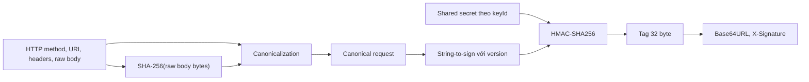
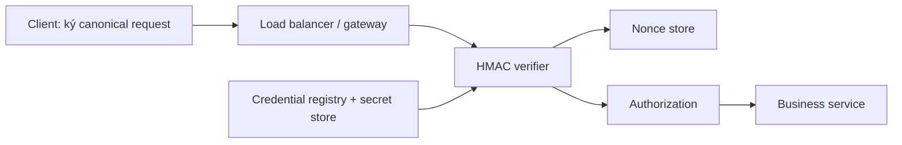

# Canonical request là gì? Chuẩn hóa HTTP request để ký HMAC

> **Chương:** Canonical request  
> **Chủ đề:** Canonical request là gì  
> **Ngữ cảnh:** Hệ thống xác thực HTTP request bằng HMAC và shared secret. Người gửi và người xác minh phải tạo cùng một biểu diễn byte của method, URI, các header và/hoặc body theo một **hợp đồng ký**. Bài này tập trung vào khái niệm canonical request, lý do cần chuẩn hóa, những quy tắc phải thỏa thuận và cách tránh lỗi giữa client, server, proxy/gateway.

## 1. Định nghĩa ngắn gọn

**Canonical request** là **biểu diễn chuẩn tắc, có cấu trúc và xác định được** của những thành phần HTTP request mà hai phía đã thống nhất cần bảo vệ bằng chữ ký.

Thay vì ký một chuỗi tùy tiện như `POST /orders` hoặc toàn bộ request ở dạng text do thư viện HTTP tự in ra, client tạo một chuỗi byte theo quy tắc rõ ràng. Server **tự tạo lại đúng chuỗi byte đó từ request thực sự nhận được ở điểm xác minh**, rồi tính HMAC để so sánh với chữ ký client gửi.

```text
HTTP request
    |
    v
Chọn các trường được bảo vệ
(method, authority, path, query, headers, body digest, ...)
    |
    v
Chuẩn hóa theo hợp đồng ký (canonicalization)
    |
    v
Canonical request bytes
    |
    v
String-to-sign bytes (có thể thêm version / domain separator)
    |
    v
HMAC-SHA256(shared secret, string-to-sign bytes)
    |
    v
Signature tag -> encode -> truyền trong HTTP
```

Ví dụ, một hợp đồng tự định nghĩa có thể quy định:

```text
canonicalRequest =
    METHOD + "\n" +
    CANONICAL_AUTHORITY + "\n" +
    CANONICAL_PATH + "\n" +
    CANONICAL_QUERY + "\n" +
    CANONICAL_SIGNED_HEADERS + "\n" +
    SIGNED_HEADER_NAMES + "\n" +
    LOWERCASE_HEX_SHA256_RAW_BODY
```

**Không tồn tại một canonical request format duy nhất cho mọi hệ thống HMAC.** Định dạng trên chỉ minh họa. Nếu triển khai theo một chuẩn cụ thể như HTTP Message Signatures (RFC 9421), phải tuân thủ **quy tắc signature base và covered components của chính chuẩn đó**, không tự áp một format khác rồi gọi là tương thích.

Canonical request không phải chữ ký; nó là **đầu vào trước khi ký**. Bản thân nó thường chứa dữ liệu công khai, không phải shared secret.

## 2. Vì sao không ký trực tiếp chuỗi HTTP “nhìn thấy được”?

Cùng một HTTP request ở mức ứng dụng có thể có nhiều cách biểu diễn trên mạng:

- Header name có thể là `Content-Type` hoặc `content-type`.
- Query có thể xuất hiện theo thứ tự khác: `?a=1&b=2` so với `?b=2&a=1`.
- Một byte trong URI có thể biểu diễn bằng ký tự trực tiếp hoặc percent-encoding theo quy tắc hợp lệ.
- Proxy có thể đổi host, cắt path prefix, chuyển HTTP/1.1 sang HTTP/2, thêm `X-Forwarded-*`.
- JSON có thể có hoặc không có khoảng trắng, newline, hoặc thứ tự thuộc tính khác nhau.
- Một header có thể bị lặp hoặc gộp theo cách các framework xử lý khác nhau.
- Request body có thể được truyền bằng chunking hoặc theo cơ chế HTTP/2 frame; các byte **framing** không phải nội dung ứng dụng cần ký.

Nếu mỗi phía lấy `request.toString()` hoặc serialize một cấu trúc HTTP theo cách riêng để ký, dù dùng **cùng secret và HMAC-SHA256**, HMAC có thể khác chỉ vì **byte signing input khác**.

Tuy nhiên, canonicalization **không phải** “xóa mọi khác biệt” hoặc “cứ sort tất cả là an toàn”. Nếu tầng xác minh coi hai request là giống nhau nhưng backend thực thi chúng theo hai nghĩa khác nhau, attacker có thể lợi dụng chính phép chuẩn hóa đó.

### Hai yêu cầu đối với thiết kế canonicalization

1. **Deterministic (xác định):** cùng một request theo ngữ nghĩa đã được hợp đồng định nghĩa phải tạo **cùng một chuỗi byte ký** ở client và server.
2. **Unambiguous (không nhập nhằng):** hai request **có ý nghĩa bảo mật/nghiệp vụ khác nhau** không được vô tình bị gom thành cùng chuỗi byte ký. Trường mơ hồ nên bị từ chối, hoặc chỉ được chuẩn hóa khi mọi thành phần phía sau diễn giải giống nhau.

Ví dụ, nếu verifier đọc tham số đầu tiên của `?role=user&role=admin` nhưng backend lấy tham số cuối, hai tầng không cùng hiểu request. Giải pháp an toàn dễ kiểm chứng là **từ chối duplicate query key** nếu nghiệp vụ không cần chúng.

## 3. Canonical request, string-to-sign và HMAC tag khác nhau

| Thuật ngữ | Là gì? | Có cần secret? |
| --- | --- | --- |
| **HTTP request** | Method, target, headers, body được truyền từ client, có thể qua proxy. | Không. |
| **Canonical request** | Biểu diễn chuẩn của các thành phần được hợp đồng lựa chọn và quy định chính xác cách ghép. | Không. |
| **String-to-sign** | Dữ liệu cuối cùng được đưa vào HMAC, thường có version/domain separator và canonical request. | Không. |
| **Shared secret** | Khóa đối xứng của một credential, được giữ kín và quản lý theo client. | Chính là bí mật. |
| **HMAC tag/signature** | Kết quả `HMAC(secret, stringToSignBytes)`. | **Có**: cần khả năng dùng secret để tạo tag. |
| **Signature transport** | Cách gửi key ID, version, timestamp, nonce và tag qua HTTP. | Không cần gửi secret. |
| **Body digest** | Ví dụ SHA-256 trên raw body bytes, đưa vào canonical request để ràng buộc payload. | Không, nhưng digest phải nằm trong dữ liệu được HMAC bảo vệ. |



**Quan trọng:** SHA-256 của body **không tự xác thực client**, vì ai có body cũng tính lại được digest. Nó chỉ giúp đưa dấu vân tay payload vào dữ liệu được HMAC ký. HMAC cũng không mã hóa request và không tự chống replay; hệ thống vẫn cần TLS, timestamp/nonce và kiểm tra phân quyền.

## 4. Thành phần nào của HTTP request nên đưa vào canonical request?

Câu trả lời phải xuất phát từ **những dữ liệu có ảnh hưởng đến routing, danh tính, quyền và nghiệp vụ**, không phải danh sách header chung cho mọi API.

| Thành phần | Cách bảo vệ thường gặp | Điều có thể xảy ra nếu bỏ sót |
| --- | --- | --- |
| **HTTP method** | Dùng chính xác method theo quy tắc đã định nghĩa. | Chữ ký cho `GET` có thể bị dùng với `POST` nếu server không ràng buộc method. |
| **Authority / host** | Ký authority chuẩn nếu nó quyết định domain/service/tenant. | Request có thể bị chuyển tới virtual host hoặc tenant khác. |
| **Path** | Canonical path theo quy tắc URI/route rõ ràng. | Có thể đổi endpoint/tài nguyên mà tag vẫn được chấp nhận. |
| **Query** | Canonical query bao gồm tên, giá trị và các trường ảnh hưởng nghiệp vụ. | Đổi `orderId`, `amount` hoặc tham số routing ngoài phần ký. |
| **Signed headers** | Tập header bắt buộc, tên/value canonical và danh sách tên đã ký. | Đổi `Content-Type` hoặc metadata có tác động mà HMAC vẫn đúng. |
| **Body** | Hash **raw body bytes** rồi đưa digest vào canonical request, hoặc ký body trực tiếp. | Có thể sửa payload mà không làm tag đổi. |
| **Key ID** | Ràng buộc trong dữ liệu ký; đồng thời tra registry đáng tin. | Rủi ro nhầm credential nếu mapping/kiểm tra thiết kế yếu. |
| **Timestamp** | Ký giá trị với đơn vị và grammar chính xác. | Attacker có thể sửa thời gian để né freshness window. |
| **Nonce** | Ký nonce và kiểm tính dùng một lần. | Attacker có thể thay nonce để phát lại request cũ. |
| **Protocol version** | Gắn trong string-to-sign hay metadata được ký theo hợp đồng. | Nguy cơ nhầm signing contract hoặc downgrade. |

Một số trường **thường không nên đưa trực tiếp** vào canonical request: chính header chứa **signature** đầu ra, hoặc các header hop-by-hop dễ bị proxy thay đổi như `Connection` và `Transfer-Encoding`. Nhưng quyết định cụ thể còn tùy hợp đồng và điểm xác minh.

**Nguyên tắc lựa chọn:** nếu thay đổi một trường có thể thay đổi **hành động, đối tượng, tenant, quyền hoặc cách parse body**, trường đó phải được ràng buộc mật mã **hoặc** được một lớp tin cậy khác cố định/bảo vệ rõ ràng.

## 5. Ví dụ một canonical request hoàn chỉnh về cấu trúc

Giả sử một merchant gọi API thanh toán:

```http
POST /v1/payments?orderId=42&currency=VND HTTP/1.1
Host: api.example.test
Content-Type: application/json
X-Key-Id: merchant-42-k2
X-Timestamp: 1795800000
X-Nonce: e701c6b8d1e34fdd9915a477c1a59302
X-Signature: v1=<BASE64URL_HMAC_TAG>

{"amount":100000}
```

Đây là **request minh họa**, với timestamp/nonce cố định cho mục đích giảng giải; không dùng lại chúng ở giao dịch thực. `<BASE64URL_HMAC_TAG>` không phải tag được tính sẵn.

### Hợp đồng ký minh họa `HMAC-SHA256/v1`

Để client và server cùng tạo được kết quả, ví dụ này quy định:

1. Method chuyển sang chữ hoa ASCII; **chỉ chấp nhận danh sách method mà API hỗ trợ**.
2. Authority dùng dạng canonical `api.example.test` được cấu hình cho API; nếu routing đa host/port, phải xác định cách biểu diễn authority theo hợp đồng.
3. Path là `/v1/payments` và query được chuẩn hóa theo **tên tham số và giá trị**: `currency=VND&orderId=42`. Ví dụ chỉ dùng ASCII đơn giản; các ký tự percent-encoded cần quy tắc rõ hơn ở mục sau.
4. Signed headers bắt buộc gồm `content-type`, `x-key-id`, `x-nonce`, `x-timestamp`, sắp xếp **theo tên đã được quy định**. Tên lower-case, giá trị chuẩn hóa theo quy tắc thống nhất, không có header trùng tên.
5. Dòng cuối là `lowercaseHex(SHA256(rawBodyBytes))`, tính trên đúng các byte của body `{"amount":100000}`, **không thêm newline cuối**.
6. Các dòng nối bằng **LF** (byte `0A`), không phải CRLF, và không có LF cuối chuỗi.
7. `stringToSign = "HMAC-SHA256/v1\n" + canonicalRequest`; tag là `HMAC-SHA256(secretBytes, UTF8(stringToSign))`.
8. Header `X-Signature` chỉ chở kết quả `v1=Base64URLNoPadding(tagBytes)`, **không nằm trong canonical request** của hợp đồng này.

Khi thực hiện chuẩn hóa, canonical request có **cấu trúc**:

```text
POST
api.example.test
/v1/payments
currency=VND&orderId=42
content-type:application/json
x-key-id:merchant-42-k2
x-nonce:e701c6b8d1e34fdd9915a477c1a59302
x-timestamp:1795800000
content-type;x-key-id;x-nonce;x-timestamp
<SHA256_RAW_BODY_HEX_64_CHAR>
```

Dòng `<SHA256_RAW_BODY_HEX_64_CHAR>` là **placeholder**, phải thay bằng digest hex thực được tính từ raw body trước khi ký; không được ký nguyên placeholder. Trong ví dụ, **giá trị của query đã được sắp xếp lại** so với request gốc theo chính sách `v1`. Điều này chỉ an toàn khi backend và verifier hiểu hai thứ tự là tương đương và không có duplicate/ordering-sensitive semantics.

Sau đó:

```text
canonicalBytes = UTF8(canonicalRequest)
stringToSignBytes = UTF8("HMAC-SHA256/v1\n" + canonicalRequest)
tag = HMAC-SHA256(sharedSecretBytes, stringToSignBytes)
X-Signature = "v1=" + BASE64URL_NO_PADDING(tag)
```

**Kích thước:** HMAC-SHA256 tạo 32 byte tag; khi mã hóa Base64URL không padding sẽ dài 43 ký tự. Base64URL là **encoding để truyền**, không phải mã hóa bảo mật và không thay shared secret.

## 6. Chuẩn hóa từng thành phần: chính xác đến từng byte

### 6.1. Method

Chỉ ký **HTTP method được hỗ trợ** theo biểu diễn thỏa thuận. Ví dụ `POST`, `GET`, `DELETE`. Hợp đồng ký dùng chữ hoa cho những method đã quy định; không tùy tiện coi method tùy biến là tương đương sau khi đổi case nếu hệ thống không chứng minh được.

**Bài kiểm tra:** lấy chữ ký `GET /v1/orders/42` thay vào `DELETE /v1/orders/42` phải làm tag không khớp nếu method nằm trong signing input.

### 6.2. Authority / Host

`Host` trên HTTP/1.1 và `:authority` trên HTTP/2/HTTP/3 có thể là các nguồn biểu diễn authority. Hợp đồng phải quy định:

- Có ký host/authority hay không, vì sao.
- Lower-case tên DNS theo quy tắc nào; cách xử lý tên quốc tế hóa nếu hỗ trợ.
- Có bỏ cổng mặc định không; có giữ cổng không mặc định không.
- Cách biểu diễn địa chỉ IPv6 trong dấu ngoặc vuông.
- Dữ liệu nào được tin khi reverse proxy thay `Host` hoặc truyền `X-Forwarded-Host`.

Nếu service có nhiều tenant dựa trên hostname, **bỏ host khỏi phần ký thường nguy hiểm**. Nếu authority được cấu hình cố định ngoài request, verifier phải bảo đảm routing không thể bị thay bằng header attacker tự đặt.

### 6.3. Path và percent-encoding

Hai request target có thể trông gần giống nhưng được router hiểu khác nhau:

| Biểu diễn | Câu hỏi phải trả lời |
| --- | --- |
| `/a/b` so với `/a%2Fb` | Encoded slash có được decode thành dấu `/` phân tách segment không? |
| `/a/../b` so với `/b` | Dot segments có bị collapse trước hay sau bước xác minh không? |
| `/products/%41` so với `/products/A` | Unreserved character có được chuẩn hóa về cùng biểu diễn không? |
| `/%2f` so với `/%2F` | Có chuẩn hóa hex digit trong percent-encoding thành chữ hoa không? |
| `/café` so với chuỗi UTF-8 percent-encoded tương đương | Giao thức cho phép ký Unicode trực tiếp hay chỉ URI-encoded ASCII? |

Không thể có quy tắc “decode toàn bộ rồi ký” an toàn cho mọi hệ thống. Encoded slash và dot segments có thể **thay routing** hoặc vượt qua các lớp kiểm tra khi verifier/backend khác quy tắc.

**Cách tiếp cận:** định nghĩa chính xác cách chọn `raw path` hoặc `normalized path`; nếu có thể, **từ chối path mơ hồ** thay vì cố tự làm sạch. Phải kiểm thử cùng router/framework và gateway sẽ dùng trong production.

### 6.4. Query string

Với các tham số không nhạy thứ tự, có thể quy định sort theo **byte của tên và giá trị đã encode**; nhưng chỉ làm vậy nếu ứng dụng cũng coi các thứ tự là tương đương.

Những ca biên quan trọng:

| Trường hợp | Rủi ro nếu không định nghĩa |
| --- | --- |
| `?a=1&b=2` so với `?b=2&a=1` | Client/server chọn thứ tự khác nhau. |
| `?item=1&item=2` | Duplicate key có thể được parser lấy đầu, cuối hoặc thành list. |
| `?flag` so với `?flag=` | Tham số thiếu dấu `=` có được coi như giá trị rỗng không? |
| `?name=a+b` so với `?name=a%20b` | Trong ngữ cảnh khác nhau, `+` có thể là dấu cộng hoặc khoảng trắng. |
| `?path=%2Fadmin` so với `?path=/admin` | Decode percent-encoding có đổi ngữ nghĩa của tham số? |
| `?a=%61` so với `?a=a` | Có chuẩn hóa encoded unreserved chars không? |
| `?x=1&x=2` sau proxy | Một hop có thể gộp/sắp lại tham số. |

**Không phải lúc nào sort query cũng đúng.** API có danh sách tham số trùng tên mà thứ tự có ý nghĩa phải **giữ thứ tự theo hợp đồng** hoặc thiết kế một biểu diễn nhiều giá trị được cả verifier/backend hiểu thống nhất. Với API không cần trùng key, **reject duplicate** thường dễ an toàn hơn.

Một lỗi nguy hiểm là verifier chỉ ký query sau khi parser lấy giá trị đầu tiên, nhưng service thực thi giá trị cuối cùng. Khi ấy chữ ký có thể hợp lệ cho **một thông điệp khác điều mà nghiệp vụ thực thi**.

### 6.5. Headers

Trong HTTP, **tên header không phân biệt hoa/thường**. Tuy nhiên, **giá trị**, khoảng trắng, dấu phẩy và số lần xuất hiện có thể mang ý nghĩa.

Hợp đồng ký cần quy định:

1. **Danh sách signed headers:** trường nào bắt buộc phải có; ví dụ `content-type`, `x-key-id`, `x-timestamp`, `x-nonce`.
2. **Tên canonical:** lower-case và thứ tự sắp xếp được xác định rõ.
3. **Giá trị canonical:** xử lý dấu cách đầu/cuối, horizontal tab, khoảng trắng liên tiếp ra sao; không tự thay đổi nội dung có ý nghĩa như quoted string.
4. **Header trùng:** một hoặc nhiều giá trị có được phép không? Các header an ninh một giá trị nên **bị từ chối khi lặp**, thay vì cho verifier chọn một còn backend chọn giá trị khác.
5. **Ký tự điều khiển:** từ chối CR/LF trong header value và mọi biểu diễn có nguy cơ tạo header injection hoặc canonical collision.
6. **Header do proxy thêm:** có ý nghĩa nghiệp vụ hoặc security không? Nếu có thì phải xác minh nguồn và quy tắc ký, không tự tin `X-Forwarded-*` từ bên ngoài.

**Ví dụ:**

```text
Client gửi:       Content-Type: application/json
Tên trong phần ký: content-type
Dòng canonical:   content-type:application/json
```

Nếu attacker thêm một `Content-Type: text/plain` thứ hai, verifier không nên đơn giản ký giá trị đầu tiên trong khi backend sử dụng giá trị thứ hai. Đầu vào **mơ hồ cần bị từ chối** theo hợp đồng minh họa.

**Không tự đưa header chứa chữ ký vào phần ký** nếu giao thức không quy định một cơ chế xử lý chữ ký vòng ngoài: `X-Signature` là đầu ra của HMAC. Metadata `x-key-id`, `x-timestamp`, `x-nonce` có thể và thường nên được ràng buộc trong signing input.

### 6.6. Body và body digest

Có hai lựa chọn chính:

- Ký trực tiếp **raw body bytes** đã được giao thức xác định.
- Đưa `SHA-256(rawBodyBytes)` vào canonical request rồi ký canonical request bằng HMAC.

Cách thứ hai giúp độ dài canonical request cố định dù body lớn. Nhưng **body hash đứng riêng không xác thực** vì mọi bên đều tính được SHA-256 của body mới.

Ví dụ hai JSON cùng ý nghĩa có thể khác raw bytes:

```json
{"a":1,"b":2}
```

và:

```json
{"b":2,"a":1}
```

Nếu ký raw body bytes thì hai digest khác nhau. **Không parse rồi serialize lại JSON trước khi hash**, trừ khi một quy tắc chuẩn hóa JSON đã được thống nhất đầy đủ. Cũng phải quy định body rỗng: SHA-256 của mảng byte rỗng có giá trị:

```text
e3b0c44298fc1c149afbf4c8996fb924
27ae41e4649b934ca495991b7852b855
```

Hai dòng chỉ dùng để hiển thị một digest hex 64 ký tự; **khi ký phải nối liền thành một dòng**.

**Điểm xác minh byte:** body đi qua HTTP có thể được chunked, nén/gỡ nén hoặc biến đổi bởi gateway. Hợp đồng phải chỉ rõ ký **message content bytes tại đâu** (ví dụ sau khi loại transfer framing, trước bước giải mã `Content-Encoding`) và bảo đảm hai phía cùng dùng tập byte đó. Không giả định mọi framework đều trả đúng bản sao byte trước proxy.

## 7. Java 17+: tạo canonical request từ các thành phần đã được chuẩn hóa

Ví dụ này tập trung vào **ghép byte đúng hợp đồng ký**, không tự nhận rằng đã xử lý mọi URI và header của HTTP. Hàm yêu cầu caller cung cấp **authority, path, query và signed headers đã được validate/canonicalize** theo quy tắc của `v1`.

```java
import java.nio.charset.StandardCharsets;
import java.security.GeneralSecurityException;
import java.security.MessageDigest;
import java.util.HexFormat;
import java.util.Objects;
import javax.crypto.Mac;
import javax.crypto.spec.SecretKeySpec;

public final class CanonicalRequestDemo {
    private CanonicalRequestDemo() {}

    // Giả định các chuỗi đã được chuẩn hóa và kiểm tra ở lớp HTTP:
    // - method: ASCII uppercase từ allowlist
    // - authority: canonical host/port hợp lệ
    // - path/query: canonical URI theo v1, reject ambiguity
    // - signedHeaders: các dòng "name:value" đã sort/validate
    // - signedHeaderNames: danh sách tên đồng nhất với signedHeaders
    public static String canonicalRequest(
            String method,
            String authority,
            String path,
            String query,
            String signedHeaders,
            String signedHeaderNames,
            byte[] rawBody) throws GeneralSecurityException {

        Objects.requireNonNull(method);
        Objects.requireNonNull(authority);
        Objects.requireNonNull(path);
        Objects.requireNonNull(query);
        Objects.requireNonNull(signedHeaders);
        Objects.requireNonNull(signedHeaderNames);
        Objects.requireNonNull(rawBody);

        // Demo: chống chèn dấu xuống dòng vào các field một dòng.
        for (String value : new String[] {
                method, authority, path, query, signedHeaderNames }) {
            if (value.indexOf('\r') >= 0 || value.indexOf('\n') >= 0) {
                throw new IllegalArgumentException("Unexpected CR/LF");
            }
        }
        // signedHeaders có nhiều dòng LF có chủ đích; lớp HTTP phải kiểm
        // từng tên/value, trùng lặp, control chars và thứ tự trước khi gọi.

        byte[] digest = MessageDigest.getInstance("SHA-256")
                .digest(rawBody);
        String bodyHash = HexFormat.of().formatHex(digest);

        // Không thêm LF cuối chuỗi canonical.
        return String.join("\n",
                method,
                authority,
                path,
                query,
                signedHeaders,
                signedHeaderNames,
                bodyHash);
    }

    public static byte[] hmacSha256(
            byte[] secret, String canonicalRequest)
            throws GeneralSecurityException {

        Mac mac = Mac.getInstance("HmacSHA256");
        mac.init(new SecretKeySpec(secret, "HmacSHA256"));
        String stringToSign = "HMAC-SHA256/v1\n" + canonicalRequest;
        return mac.doFinal(
                stringToSign.getBytes(StandardCharsets.UTF_8));
    }
}
```

**Lưu ý phạm vi:** phương thức `canonicalRequest` ở trên **chỉ ghép các thành phần đã canonical**, không kiểm tra semantics của path/query, authority, danh sách signed headers, key ID, timestamp hoặc nonce. Trong production, **không lấy trực tiếp chuỗi do client cung cấp rồi truyền vào hàm như dữ liệu đã chuẩn hóa**; bộ canonicalizer phải đọc request tại điểm xác minh, kiểm tra/chuẩn hóa theo contract và reject trường mơ hồ.

### Ví dụ sử dụng

```java
byte[] body = "{\"amount\":100000}"
        .getBytes(StandardCharsets.UTF_8);

String headers = String.join("\n",
        "content-type:application/json",
        "x-key-id:merchant-42-k2",
        "x-nonce:e701c6b8d1e34fdd9915a477c1a59302",
        "x-timestamp:1795800000");

String canonical = CanonicalRequestDemo.canonicalRequest(
        "POST",
        "api.example.test",
        "/v1/payments",
        "currency=VND&orderId=42",
        headers,
        "content-type;x-key-id;x-nonce;x-timestamp",
        body
);

// secretBytes là key đã lấy từ kho bí mật qua key ID tương ứng.
// Không log secret hoặc tag thực tế trong hệ thống production.
byte[] signature = CanonicalRequestDemo.hmacSha256(
        secretBytes, canonical);
```

Trong đoạn trên, `secretBytes` là biến minh họa phải được cấp **bằng credential đúng** trước khi gọi; không lấy secret từ request. Mục tiêu là thấy được **biên giới giữa canonicalizer và JCA `Mac`**: JCA chỉ biết mảng byte, không biết URL hay headers của HTTP.

Server phải tự tạo `canonical` từ request nhận, lấy `secretBytes` qua registry và so sánh tag giải mã bằng `MessageDigest.isEqual(expected, supplied)` sau khi validate encoding/độ dài. Khi chữ ký hợp lệ mới tiến hành atomic claim nonce và kiểm tra authorization theo principal.

## 8. Canonical request qua proxy và API gateway

Một request có thể thay đổi giữa client và verifier:



Giả sử:

```text
Client ký:       POST https://api.example.test/public/v1/payments
Gateway rewrite: POST http://payments.internal/v1/payments
Server nhìn thấy: path=/v1/payments, host=payments.internal
```

Nếu client ký `/public/v1/payments` và `api.example.test` nhưng verifier ký `/v1/payments` và `payments.internal` thì HMAC có thể không khớp **dù cùng secret và body**.

Có hai kiến trúc thường gặp:

| Kiến trúc | Điểm xác minh | Điều kiện an toàn |
| --- | --- | --- |
| **Gateway xác minh** | Trước khi rewrite các phần HTTP được ký, hoặc tại điểm có đủ dữ liệu nguyên bản đáng tin. | Gateway strip header principal do client khai, xác thực HMAC và truyền danh tính qua kênh nội bộ được xác thực; backend không bị bypass. |
| **Service xác minh** | Sau gateway. | Gateway bảo toàn dữ liệu ký hoặc truyền biểu diễn gốc qua kênh tin cậy theo hợp đồng; verifier không dựa vào `X-Forwarded-*` do attacker chèn. |

Không phải mọi rewrite đều gây lỗi: một hợp đồng có thể chủ động ký một **logical request target chuẩn hóa** thay vì raw target, **nhưng phải** bảo đảm verifier và business layer hiểu cùng nội dung đã ký. Không được khắc phục mismatch bằng cách loại path, host hoặc query khỏi chữ ký khi chúng quyết định tenant hay quyền truy cập.

**Thử nghiệm bắt buộc:** gửi cùng các ca ký hợp lệ/sai signature qua HTTP/1.1, HTTP/2 nếu được hỗ trợ; qua ingress thực tế, qua load balancer, đến đúng nơi verifier; kiểm tra path prefix, query percent encoding, host/authority, header duplicate, body encoding và việc chuyển tiếp metadata.

## 9. Canonical request còn liên quan gì đến replay, key rotation và phân quyền?

Canonicalization **chỉ quyết định các byte được HMAC bảo vệ**. Những lớp an toàn khác cần làm đúng trách nhiệm riêng.

### 9.1. Timestamp và nonce phải được ràng buộc

Nếu server chỉ ký method, path, body mà để `X-Timestamp` và `X-Nonce` bên ngoài, attacker có thể sửa chúng trong request được chép lại mà HMAC không thay đổi.

Một luồng xác minh hợp lý:

1. Kiểm cú pháp request và các trường bắt buộc, giới hạn độ dài và từ chối đầu vào mơ hồ.
2. Tra `X-Key-Id` ở registry để lấy đúng secret, principal, trạng thái, version và môi trường.
3. Kiểm timestamp trong cửa sổ hợp lệ, chẳng hạn `abs(serverNow - signedTimestamp) <= 300` giây.
4. Canonicalize request, **bao gồm timestamp và nonce** như hợp đồng; tính HMAC và so sánh tag.
5. Chỉ sau chữ ký hợp lệ, **atomic claim `(keyId, nonce)`** trong kho replay dùng chung mọi instance.
6. Nếu nonce trùng hoặc store lỗi với endpoint nhạy cảm, **fail closed** theo chính sách.
7. Gán authenticated principal từ credential đã xác minh và **kiểm authorization** trên tài nguyên/tenant.

Nonce TTL phải bao phủ **toàn bộ thời gian** timestamp có thể còn hợp lệ. Với cửa sổ đối xứng ±300 giây, timestamp tương lai có thể hợp lệ từ `T-300` đến `T+300`; TTL 300 giây tính từ lần nhận sớm nhất có thể không đủ.

### 9.2. Key rotation không được làm mơ hồ phiên bản

Khi client chuyển từ credential `merchant-42-k1` sang `merchant-42-k2`, server cần biết **khóa nào** tạo chữ ký:

- Key ID phải ánh xạ tới secret, principal, trạng thái, thời hạn và môi trường trong registry đáng tin.
- Trong giai đoạn overlap thông thường, verifier có thể chấp nhận k1 và k2 nếu cả hai còn hiệu lực; sau thời điểm thu hồi phải từ chối k1.
- Key ID được **ràng buộc trong canonical request** theo hợp đồng; version ký được ràng buộc trong `stringToSign`.
- Đổi khóa **không bắt buộc** đổi định dạng canonicalization; `v1` là version giao thức, còn `k2` là version credential.
- Khi nghi secret bị lộ, cần revoke/rotate và điều tra; canonicalization không bảo vệ trước bên đã có secret.

### 9.3. Authentication không phải authorization

Một request có HMAC hợp lệ cho credential `merchant-42` chỉ giúp server **xác thực quyền sử dụng secret của merchant-42 đối với các byte đã ký**. Nó không có nghĩa merchant-42 được quyền sửa giao dịch của merchant-99.

Sau xác thực, ứng dụng phải kiểm chính sách access control trên endpoint, tenant, tài nguyên và hành động. Không lấy `merchantId` trong query/body làm **principal** chỉ vì nó có trong canonical request; principal phải đến từ credential đã được xác minh.

## 10. Lỗi thiết kế canonical request thường gặp

| Lỗi | Vì sao sai hoặc nguy hiểm? | Cách khắc phục |
| --- | --- | --- |
| Ký kết quả `request.toString()` | Mỗi framework/proxy biểu diễn HTTP khác nhau. | Định nghĩa canonical format byte-level độc lập serialization tùy ý. |
| Chỉ ký body, bỏ method/path/query | Có thể thay hành động hoặc tài nguyên mà tag vẫn đúng. | Ký mọi trường có ảnh hưởng đến nghiệp vụ và security boundary. |
| Đưa chính `X-Signature` vào signing input của custom scheme | Dẫn tới phụ thuộc vòng giữa input và tag. | Ký metadata cần thiết, không ký tag đầu ra của cùng phép tính. |
| Sort query mà backend xử lý duplicate key theo thứ tự | Các request khác nghĩa có thể trở thành một canonical string. | Từ chối duplicate hoặc định nghĩa xử lý nhất quán end-to-end. |
| Decode toàn bộ path trước ký | Có thể làm encoded slash/dot segments biến thành route khác. | Canonicalize theo router và contract; reject ambiguous representations. |
| `SHA256(JsonObject.toString())` | Byte khác body thực và serialization thay đổi. | Hash raw bytes tại điểm xác minh đã định nghĩa. |
| Không định nghĩa UTF-8 và LF/CRLF | Hai phía tạo byte khác nhau. | Ghi rõ encoding, separators, trailing newline. |
| Header trùng nhưng verifier chỉ lấy giá trị đầu | Business layer có thể dùng giá trị khác. | Reject duplicate security-relevant headers; thống nhất parser. |
| Sử dụng `X-Forwarded-Host` do client cung cấp | Attacker có thể thay nguồn authority đã ký. | Chỉ tin giá trị do trusted proxy loại bỏ/thiết lập lại. |
| Ký timestamp/nonce sai đơn vị hoặc không đưa vào HMAC | Có thể lỗi verify hoặc replay metadata. | Contract định nghĩa epoch seconds, grammar, nonce và signed header. |
| Một version contract thay đổi nhưng không gắn version vào signing input | Rủi ro nhầm lẫn cross-protocol/downgrade. | Domain separation và version binding; policy phía server. |
| Tự bỏ qua xác minh khi đi qua gateway mà không khớp chữ ký | Mất authentication. | Xác định điểm ký/kiểm, bảo toàn byte, fail closed. |
| Gọi `Mac.reset()` thay cho xây lại request/đổi key | Reset chỉ quản lý state của `Mac`, không sửa canonicalization hoặc credential. | Tạo bytesToSign đúng và `Mac.init(selectedKey)` tương ứng. |
| HMAC hợp lệ nên cho truy cập mọi tài nguyên | Nhầm authentication với authorization. | Kiểm quyền riêng trên principal đã xác thực và resource đích. |

## 11. Bộ kiểm thử canonical request

Chuẩn bị **một request hợp lệ**, client A/B có secret khác nhau, credential registry và nonce store chung, đi qua đường ingress giống môi trường production. Với các ca kiểm tra chữ ký, giữ nguyên secret và chỉ thay **một đặc tính** tại một thời điểm.

| # | Ca kiểm thử | Kết quả kỳ vọng |
| --- | --- | --- |
| 1 | Cùng canonical fields, cùng body bytes và same key. | Canonical bytes và HMAC tag giống nhau ở hai phía. |
| 2 | Đổi method `POST` thành `GET`, giữ tag cũ. | Signature không khớp. |
| 3 | Đổi path hoặc order ID có ảnh hưởng nghiệp vụ, giữ tag cũ. | Signature không khớp nếu path/query nằm trong dữ liệu ký. |
| 4 | Đổi thứ tự hai query params không nhạy thứ tự. | Canonical query giống nhau **chỉ khi** hợp đồng và backend coi chúng tương đương. |
| 5 | Thêm query key trùng `orderId` hoặc `role`. | Từ chối request mơ hồ theo contract minh họa. |
| 6 | Gửi path có `%2F`, dot segments hoặc percent-encoding không canonical. | Từ chối hoặc canonicalize thống nhất theo contract/router; không ký khác điều backend thực thi. |
| 7 | Đổi `Content-Type` trong tập signed headers. | HMAC mismatch. |
| 8 | Gửi hai `X-Key-Id` hoặc hai `X-Timestamp` khác nhau. | Từ chối duplicate headers, không chọn tùy tiện. |
| 9 | Đổi chữ hoa/thường của **tên** header. | Canonical tên giống nhau nếu header hợp lệ và value không đổi. |
| 10 | Đổi header value/OWS ngoài những quy tắc đã được hợp đồng normalize. | Từ chối hoặc tag thay đổi; tránh parser mismatch. |
| 11 | Đổi một byte raw body, giữ tag cũ. | Body SHA-256 đổi, HMAC không khớp. |
| 12 | Hai JSON cùng ý nghĩa nhưng byte khác (thứ tự field/whitespace). | Digest khác nếu ký raw bytes; không tự serialize lại. |
| 13 | Body rỗng, digest SHA-256 empty bytes. | Digest đúng `e3b0...b855`, không thay bằng chuỗi rỗng nếu contract yêu cầu digest. |
| 14 | Thay `X-Timestamp` hoặc `X-Nonce` nhưng không ký lại. | Signature mismatch. |
| 15 | Phát lại request đã ký với nonce trùng. | Bị từ chối replay dù tag còn đúng. |
| 16 | Ký bằng secret B nhưng gửi key ID A. | Xác thực thất bại; không gán principal A. |
| 17 | Dùng key đã revoke/expired. | Từ chối theo credential status dù HMAC đúng với khóa cũ. |
| 18 | Proxy rewrite host/path prefix/query trước verifier. | Hợp đồng xác định dữ liệu gốc tin cậy; mismatch phải bị từ chối an toàn. |
| 19 | Chuyển HTTP/1.1 sang HTTP/2, thay case header name. | Xác minh tương đương nếu contract chuẩn hóa đúng và dữ liệu được bảo toàn. |
| 20 | Backend có thể bị gọi trực tiếp bỏ qua HMAC gateway. | Bị chặn qua mạng/xác thực nội bộ; không tin principal tự khai. |
| 21 | Nonce store không khả dụng cho thao tác nhạy cảm. | Fail closed theo chính sách, không cho request vượt qua replay control. |
| 22 | Client A có signature hợp lệ nhưng truy cập tài nguyên B. | Authentication có thể thành công; authorization từ chối. |

### Cách điều tra khi chữ ký không khớp

Sử dụng fixture **không chứa khóa production** và so sánh từng lớp:

```text
[1] Signing contract/version
[2] Credential key bytes hoặc key reference
[3] Method bytes
[4] Authority/host canonical
[5] Raw path và canonical path
[6] Raw query và canonical query
[7] Danh sách + giá trị signed headers
[8] Raw body bytes và SHA-256 digest
[9] Canonical request bytes: thứ tự dòng, dấu LF, trailing newline
[10] String-to-sign bytes và version prefix
[11] HMAC tag bytes (trước encode)
[12] Base64URL/hex transport format
```

Nếu HMAC-SHA256 test vector của Java đều đúng nhưng chữ ký HTTP khác nhau, ưu tiên nghi ngờ **khác signing bytes hoặc secret**, không mặc định thuật toán provider bị lỗi.

**Không log shared secret, full signature, canonical request chứa dữ liệu nhạy cảm hoặc raw body ở production** chỉ để debug. Dùng correlation ID, reason code, hash chẩn đoán không nhạy cảm và fixture vô hại trong môi trường thử nghiệm.

## 12. Câu hỏi tự kiểm tra

**Câu 1.** Canonical request có phải chính HMAC signature không?

*Đáp án:* Không. Canonical request là các byte đầu vào được chuẩn hóa. HMAC dùng shared secret và bytesToSign được tạo từ canonical request để tính tag.

**Câu 2.** Tại sao không luôn sort mọi query param?

*Đáp án:* Vì có API dùng duplicate keys hoặc thứ tự query mang ý nghĩa. Sort không phù hợp có thể khiến verifier ký điều khác với điều backend thực thi. Chỉ sort khi có hợp đồng và parser đồng nhất; nếu không, cần bảo toàn hoặc từ chối dạng mơ hồ.

**Câu 3.** Hai JSON object có nội dung logic giống nhau có bắt buộc cùng body hash không?

*Đáp án:* Không. Nếu ký raw body bytes, thứ tự thuộc tính, khoảng trắng và newline đều ảnh hưởng SHA-256. Cần chính sách byte rõ ràng.

**Câu 4.** Nếu gateway thay `Host` và path, tại sao HMAC lại sai?

*Đáp án:* Vì client và verifier có thể dựng canonical request khác nhau. Cần thống nhất điểm xác minh hoặc cung cấp các giá trị request gốc qua ranh giới tin cậy; không tùy tiện bỏ trường cần bảo vệ khỏi hợp đồng.

**Câu 5.** Có cần ký timestamp và nonce không?

*Đáp án:* Có nếu hệ thống dùng chúng chống replay. Nếu không được ràng buộc vào HMAC, attacker có thể thay metadata mà tag không đổi.

**Câu 6.** Một request HMAC đúng có đồng nghĩa được phép sửa tài nguyên của tenant khác không?

*Đáp án:* Không. Authentication xác minh quyền sử dụng secret đối với dữ liệu đã ký; authorization vẫn phải kiểm tra quyền của principal trên tài nguyên.

**Câu 7.** Vì sao key ID nên xuất hiện trong signing input và registry vẫn cần gắn key ID với principal?

*Đáp án:* Signing input ràng buộc lựa chọn credential với nội dung ký; registry đáng tin quyết định secret nào và principal nào thực sự được xác thực. Key ID tự khai không phải bằng chứng danh tính.

**Câu 8.** Nếu ký trực tiếp JSON object sau khi server parse/serialize lại có an toàn không?

*Đáp án:* Chỉ khi cả hai phía dùng một đặc tả canonical JSON đầy đủ và nhất quán, và ứng dụng xử lý đúng ngữ nghĩa đã ký. Với HMAC HTTP phổ biến, hash raw body bytes tại điểm đã quy định sẽ dễ kiểm soát hơn.

---

## Tài liệu tham khảo

- [RFC 9110 – HTTP Semantics](https://www.rfc-editor.org/rfc/rfc9110): ngữ nghĩa method, field và content của HTTP.
- [RFC 3986 – Uniform Resource Identifier (URI): Generic Syntax](https://www.rfc-editor.org/rfc/rfc3986): percent-encoding, path, query và chuẩn hóa URI.
- [RFC 9421 – HTTP Message Signatures](https://www.rfc-editor.org/rfc/rfc9421): chuẩn định nghĩa signature base và covered components cho HTTP.
- [RFC 9530 – Digest Fields](https://www.rfc-editor.org/rfc/rfc9530): trường biểu diễn digest nội dung HTTP.
- [Oracle Java SE 17 – `javax.crypto.Mac`](https://docs.oracle.com/en/java/javase/17/docs/api/java.base/javax/crypto/Mac.html): HMAC trên byte bằng JCA.
- [Oracle Java SE 17 – `MessageDigest`](https://docs.oracle.com/en/java/javase/17/docs/api/java.base/java/security/MessageDigest.html): băm raw body và so sánh tag byte.

**Ghi nhớ:** Canonical request là **hợp đồng về biểu diễn byte của request cần xác thực**, không phải thao tác xóa dấu cách hay sort query đơn thuần. Hai phía phải chọn và chuẩn hóa **cùng dữ liệu có ý nghĩa an ninh/nghiệp vụ**, từ method, authority, URI, signed headers đến body digest; từ chối những biểu diễn mơ hồ khi verifier/backend có thể hiểu khác nhau. HMAC bảo vệ các byte đó bằng shared secret, còn timestamp/nonce, key rotation, trust boundary ở gateway và authorization là những lớp bảo vệ riêng không được bỏ qua.
